# Lecture 5 — Off-Policy Actor Critic: slide-by-slide

Text and figures of the Stanford CS 224R "Deep Reinforcement Learning" (Spring 2025, instructor Chelsea Finn) Lecture 5 deck, transcribed from the PDF. Cite these as "slide N", the printed number. Diagrams, photographs and plots are described in prose since the KB is read as text.

## Slide numbers vs PDF pages

Printed slide number equals PDF page number, 1:1, for all 30 pages. Page 4 prints no number; its label 4 is inferred from its position between slides 3 and 5. Pages 9, 15, 16 and 19–28 print their number in the bottom-right corner rather than at the bottom centre; those numbers are real.

The recording covers slides 3–28. It opens on the recap (slide 3) without discussing slide 2's reminders, and it ends at about 1:09:20 on slide 28 (RL for language models). Slides 29–30, the plan recap and the next-time slide, are not discussed. Several steps are worked on the board, which the recording does not show: a sketch of learning curves for one, five and many gradient steps per batch (≈13:58–15:29), a grid-world sketch of an overfit policy (≈16:14–17:47), a KL-penalized surrogate objective (≈21:39–23:15), the clipping written out with max and min (≈29:24–30:56), and the recursive form of the Q-function (≈53:18–57:10). The transcript is the only source for those.

Companion pages: [wiki page for this lecture](../../wiki/05-off-policy-actor-critic.md) · [transcript](../transcripts/05-off-policy-actor-critic.md)

## Contents

| Slides | Section |
| ------ | ------- |
| 1–2 | Title, course reminders |
| 3–5 | Recap: policy gradients with importance weights, value, Q and advantage functions, actor-critic methods |
| 6 | Plan for today |
| 7–10 | Off-policy actor-critic, version 1: multiple gradient steps, importance weights, the surrogate objective, KL constraint and bounded importance weights |
| 11–13 | Proximal policy optimization: clipping, the minimum, generalized advantage estimation, the full algorithm and example hyperparameters |
| 14–22 | Off-policy actor-critic, version 2: replay buffers, why the algorithm is broken, fitting a Q-function from the buffer, fixing the value function and the policy update, remaining problems, implementation details and soft actor-critic |
| 23–27 | More versus less off-policy comparison, real-world soft actor-critic examples, PPO simulation-to-real examples |
| 28–30 | RL for language models, plan recap, next time and course reminders |

## Slide 1 — Off-Policy Actor Critic Methods

Title slide. Title: "Off-Policy Actor Critic Methods". Below: "CS 224R". No images.

## Slide 2 — Course reminders

- Project survey due tonight!
- **Homework 1** due Friday
- **Homework 2** out Friday

## Slide 3 — Recap: Policy Gradients

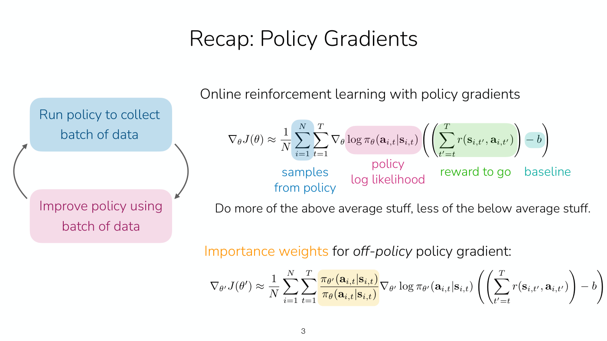

Left: a two-box cycle. A light blue rounded box "Run policy to collect batch of data" and a light pink rounded box "Improve policy using batch of data", joined by two grey curved arrows forming a loop (blue box to pink box down the right side, pink box back to blue box up the left side).

Right, heading: "Online reinforcement learning with policy gradients"

$$\nabla_\theta J(\theta) \approx \frac{1}{N} \sum_{i=1}^{N} \sum_{t=1}^{T} \nabla_\theta \log \pi_\theta(\mathbf{a}_ {i,t} \mid \mathbf{s}_ {i,t}) \left( \left( \sum_{t'=t}^{T} r(\mathbf{s}_ {i,t'}, \mathbf{a}_ {i,t'}) \right) - b \right)$$

The parts of the equation are colour-highlighted and labelled underneath: the two sums $\sum_{i=1}^{N}\sum_{t=1}^{T}$ in a blue highlight labelled "samples from policy"; $\log \pi_\theta(\mathbf{a}_ {i,t} \mid \mathbf{s}_ {i,t})$ in a pink highlight labelled "policy log likelihood"; the inner sum $\sum_{t'=t}^{T} r(\ldots)$ in a green highlight labelled "reward to go"; and $-b$ in a teal highlight labelled "baseline".

Below it: "Do more of the above average stuff, less of the below average stuff."

Lower half, "Importance weights" (in orange) "for *off-policy* policy gradient:"

$$\nabla_{\theta'} J(\theta') \approx \frac{1}{N} \sum_{i=1}^{N} \sum_{t=1}^{T} \frac{\pi_{\theta'}(\mathbf{a}_ {i,t} \mid \mathbf{s}_ {i,t})}{\pi_\theta(\mathbf{a}_ {i,t} \mid \mathbf{s}_ {i,t})} \nabla_{\theta'} \log \pi_{\theta'}(\mathbf{a}_ {i,t} \mid \mathbf{s}_ {i,t}) \left( \left( \sum_{t'=t}^{T} r(\mathbf{s}_ {i,t'}, \mathbf{a}_ {i,t'}) \right) - b \right)$$

The ratio $\pi_{\theta'}/\pi_\theta$ is in a pale yellow highlight.

## Slide 4 — Recap: Some Useful Objects

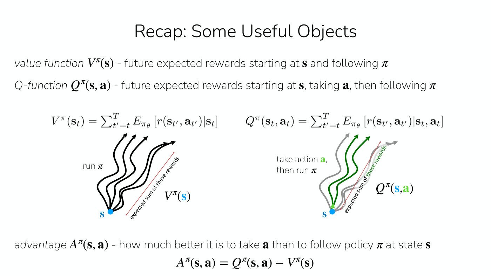

(No printed slide number; the label 4 is inferred from position.)

- *value function* $V^\pi(\mathbf{s})$ - future expected rewards starting at $\mathbf{s}$ and following $\pi$
- *Q-function* $Q^\pi(\mathbf{s}, \mathbf{a})$ - future expected rewards starting at $\mathbf{s}$, taking $\mathbf{a}$, then following $\pi$

Two diagrams side by side, each with its defining equation above it. Left equation:

$$V^\pi(\mathbf{s}_ t) = \sum_{t'=t}^{T} E_{\pi_\theta} \left[ r(\mathbf{s}_ {t'}, \mathbf{a}_ {t'}) \mid \mathbf{s}_ t \right]$$

Left diagram: a blue dot labelled "s" at the lower left with five black wavy trajectory arrows fanning out from it to the upper right, labelled "run $\pi$". A thin red double-headed arrow running alongside, parallel to the trajectories, is labelled "expected sum of these rewards". To the right of it the label $V^\pi(\mathbf{s})$ with the s in blue.

Right equation:

$$Q^\pi(\mathbf{s}_ t, \mathbf{a}_ t) = \sum_{t'=t}^{T} E_{\pi_\theta} \left[ r(\mathbf{s}_ {t'}, \mathbf{a}_ {t'}) \mid \mathbf{s}_ t, \mathbf{a}_ t \right]$$

Right diagram: the same blue dot "s" with a similar fan of five trajectories, but the trajectories are grey except for two (and a short arrow at the start) that are drawn in green; the label "take action **a**, then run $\pi$" (the a in green). A red double-headed arrow labelled "expected sum of these rewards" (green text on a light-grey band) runs alongside. To the right the label $Q^\pi(\mathbf{s}, \mathbf{a})$ with s in blue and a in green.

- *advantage* $A^\pi(\mathbf{s}, \mathbf{a})$ - how much better it is to take $\mathbf{a}$ than to follow policy $\pi$ at state $\mathbf{s}$

$$A^\pi(\mathbf{s}, \mathbf{a}) = Q^\pi(\mathbf{s}, \mathbf{a}) - V^\pi(\mathbf{s})$$

## Slide 5 — Recap: Actor-Critic Methods

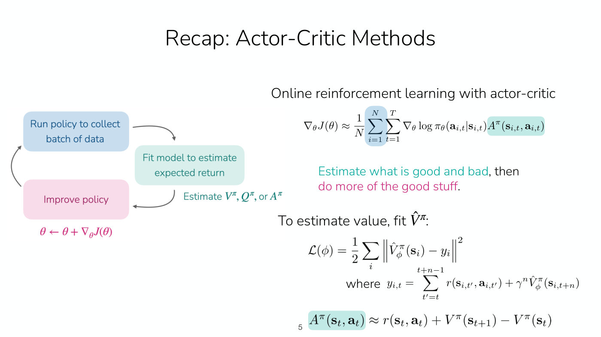

Left: the online RL cycle diagram. A blue box "Run policy to collect batch of data" (upper left), a teal box "Fit model to estimate expected return" (middle, offset to the right) and a pink box "Improve policy" (lower left). A grey arrow runs from the right edge of the blue box curving down to the top of the teal box; a grey arrow runs from the bottom of the teal box curving down and left to the pink box; a grey arrow runs from the pink box up the left side to the blue box. Beside the teal-to-pink arrow, in teal: "Estimate $V^\pi$, $Q^\pi$, or $A^\pi$". Under the pink box, in magenta: $\theta \leftarrow \theta + \nabla_\theta J(\theta)$.

Right, heading: "Online reinforcement learning with actor-critic"

$$\nabla_\theta J(\theta) \approx \frac{1}{N} \sum_{i=1}^{N} \sum_{t=1}^{T} \nabla_\theta \log \pi_\theta(\mathbf{a}_ {i,t} \mid \mathbf{s}_ {i,t}) \thinspace A^\pi(\mathbf{s}_ {i,t}, \mathbf{a}_ {i,t})$$

The two sums are in a blue highlight and the $A^\pi$ term in a teal highlight.

"Estimate what is good and bad" (teal), ", then" (black) "do more of the good stuff." (magenta).

"To estimate value, fit $\hat{V}^\pi$:"

$$\mathcal{L}(\phi) = \frac{1}{2} \sum_i \left\Vert \hat{V}^\pi_\phi(\mathbf{s}_ i) - y_i \right\Vert^2$$

"where"

$$y_{i,t} = \sum_{t'=t}^{t+n-1} r(\mathbf{s}_ {i,t'}, \mathbf{a}_ {i,t'}) + \gamma^n \hat{V}^\pi_\phi(\mathbf{s}_ {i,t+n})$$

Bottom, with the $A^\pi(\mathbf{s}_ t, \mathbf{a}_ t)$ in a teal highlight:

$$A^\pi(\mathbf{s}_ t, \mathbf{a}_ t) \approx r(\mathbf{s}_ t, \mathbf{a}_ t) + V^\pi(\mathbf{s}_ {t+1}) - V^\pi(\mathbf{s}_ t)$$

(The printed "5" sits just left of this last equation.)

## Slide 6 — The plan for today

"Off-policy actor critic methods", then the outline exactly as printed:

1. Taking multiple gradient steps
   a. Importance weights
   b. Constraining step size with KL penalty or clipping
   c. Practical PPO algorithm
b. Even more off-policy algorithm
   a. Fitting Q-value functions with data from other policies
   b. Practical SAC algorithm

(The second top-level item is labelled "b." rather than "2." on the slide, at the same indent as the label of the first item's text; its sub-items are "a." and "b.")

"**Key learning goals**:"
- All of the key concepts for practical algorithms like PPO and SAC

## Slide 7 — Off-Policy Actor-Critic Methods

Subtitle: "**Version 1**: Multiple Gradient Steps".

1. Sample batch of data $\lbrace (\mathbf{s}_ {1,i}, \mathbf{a}_ {1,i}, \ldots, \mathbf{s}_ {T,i}, \mathbf{a}_ {T,i})\rbrace$ from $\pi_\theta$ (blue)
2. Fit $\hat{V}^{\pi_\theta}_ \phi$ to summed rewards in data (teal)
3. Evaluate $\hat{A}^{\pi_\theta}(\mathbf{s}_ {t,i}, \mathbf{a}_ {t,i}) = r(\mathbf{s}_ {t,i}, \mathbf{a}_ {t,i}) + \gamma \hat{V}^{\pi_\theta}_ \phi(\mathbf{s}_ {t+1,i}) - \hat{V}^{\pi_\theta}_ \phi(\mathbf{s}_ {t,i}) \quad \forall t, i$ (grey)
4. Evaluate $\nabla_\theta J(\theta) \approx \sum_{t,i} \nabla_\theta \log \pi_\theta(\mathbf{a}_ {t,i} \mid \mathbf{s}_ {t,i}) \thinspace \hat{A}^{\pi_\theta}(\mathbf{s}_ {t,i}, \mathbf{a}_ {t,i})$ (grey), with, to the right, "<- use importance weights here"
5. Update $\theta \leftarrow \theta + \alpha \nabla_\theta J(\theta)$ (magenta)

## Slide 8 — Off-Policy Actor-Critic Methods

Subtitle: "**Version 1**: Multiple Gradient Steps". Steps 1, 2, 3 and 5 as on slide 7 (same colours). Step 4 now carries the importance weights:

4. Evaluate $\nabla_{\theta'} J(\theta') \approx \sum_{t,i} \frac{\pi_{\theta'}(\mathbf{a}_ {i,t} \mid \mathbf{s}_ {i,t})}{\pi_\theta(\mathbf{a}_ {i,t} \mid \mathbf{s}_ {i,t})} \nabla_{\theta'} \log \pi_{\theta'}(\mathbf{a}_ {t,i} \mid \mathbf{s}_ {t,i}) \thinspace \hat{A}^{\pi_\theta}(\mathbf{s}_ {t,i}, \mathbf{a}_ {t,i})$ (grey), followed by "<- use importance weights here".

A small hand-drawn black curved arrow at the left runs from step 5 up to step 4 (the update feeds back to the evaluation, i.e. step 5 then repeats step 4). Bottom centre, bold: "What can go wrong?"

## Slide 9 — Off-Policy Actor-Critic Methods

(Number printed in the bottom-right corner.)

Subtitle: "**Version 1**: Multiple Gradient Steps". The five steps of slide 8 are repeated but faded to very pale colours (step 1 pale blue, step 2 pale teal, steps 3 and 4 pale grey, step 5 pale magenta, with the small curved arrow from step 5 to step 4 and "<- use importance weights here" also faded).

Below them, in grey: "Let's look at surrogate objective:"

$$\tilde{J}(\theta') \approx \sum_{t,i} \frac{\pi_{\theta'}(\mathbf{a}_ {i,t} \mid \mathbf{s}_ {i,t})}{\pi_\theta(\mathbf{a}_ {i,t} \mid \mathbf{s}_ {i,t})} \hat{A}^{\pi_\theta}(\mathbf{s}_ {t,i}, \mathbf{a}_ {t,i})$$

A black curved arrow from the text "Advantages based on old policy." points to the $\hat{A}^{\pi_\theta}$ term. A black arrow from the text "Policy will increase probability on actions with high advantages." points up to the importance-weight fraction.

At the right, a light grey rounded box: "a convenient identity"

$$p_\theta(\tau) \nabla_\theta \log p_\theta(\tau) = \nabla_\theta p_\theta(\tau)$$

Bottom, bold: "What can go wrong if you take a lot of gradient steps?" Then: "Policy is incentivized to differ significantly from old policy, can easily overfit."

## Slide 10 — Off-Policy Actor-Critic Methods

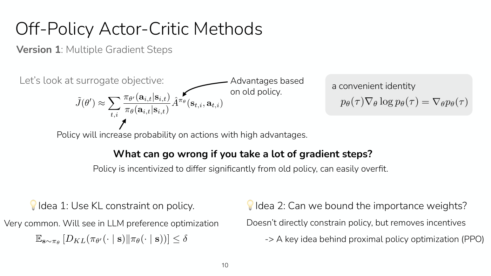

Subtitle: "**Version 1**: Multiple Gradient Steps". (The page number prints slightly left of the bottom centre.) The faded five-step list of slide 9 is gone; the surrogate-objective block of slide 9 moves up unchanged: "Let's look at surrogate objective:", the same $\tilde{J}(\theta')$ equation, the same two arrows with "Advantages based on old policy." and "Policy will increase probability on actions with high advantages.", the grey box "a convenient identity" with $p_\theta(\tau) \nabla_\theta \log p_\theta(\tau) = \nabla_\theta p_\theta(\tau)$, and the bold question "What can go wrong if you take a lot of gradient steps?" with "Policy is incentivized to differ significantly from old policy, can easily overfit."

Added at the bottom, two ideas side by side, each preceded by a light-bulb emoji.

Left: "Idea 1: Use KL constraint on policy." Under it: "Very common. Will see in LLM preference optimization" and

$$\mathbb{E}_ {\mathbf{s} \sim \pi_\theta} \left[ D_{KL}(\pi_{\theta'}(\cdot \mid \mathbf{s}) \thinspace\Vert\thinspace \pi_\theta(\cdot \mid \mathbf{s})) \right] \leq \delta$$

Right: "Idea 2: Can we bound the importance weights?" Under it: "Doesn't directly constrain policy, but removes incentives" and "-> A key idea behind proximal policy optimization (PPO)".

## Slide 11 — Proximal Policy Optimization (PPO)

Subtitle: "Off-policy actor-critic with a few tricks."

"Surrogate objective:" with the ratio in a pale yellow highlight and $\hat{A}^{\pi_\theta}$ in a teal highlight:

$$\tilde{J}(\theta') \approx \sum_{t,i} \frac{\pi_{\theta'}(\mathbf{a}_ {i,t} \mid \mathbf{s}_ {i,t})}{\pi_\theta(\mathbf{a}_ {i,t} \mid \mathbf{s}_ {i,t})} \hat{A}^{\pi_\theta}(\mathbf{s}_ {t,i}, \mathbf{a}_ {t,i})$$

"**Trick #1**: Clip the importance weights:" ("Trick #1" in orange, the rest grey). The clip term is in a yellow highlight and $\hat{A}$ in teal:

$$\tilde{J}(\theta') \approx \sum_{t,i} \mathrm{clip} \left( \frac{\pi_{\theta'}(\mathbf{a}_ {i,t} \mid \mathbf{s}_ {i,t})}{\pi_\theta(\mathbf{a}_ {i,t} \mid \mathbf{s}_ {i,t})}, 1 - \epsilon, 1 + \epsilon \right) \hat{A}^{\pi_\theta}(\mathbf{s}_ {t,i}, \mathbf{a}_ {t,i})$$

To its right: "Policy no longer incentivized to deviate significantly".

"**Trick #2**: Take **minimum** w.r.t. original objective:" ("Trick #2" in dark green, "minimum" in green, the rest grey), with, to the right, "(in rare event where clipping makes objective better)":

$$\tilde{J}(\theta') \approx \sum_{t,i} \min \left( \frac{\pi_{\theta'}(\mathbf{a}_ {i,t} \mid \mathbf{s}_ {i,t})}{\pi_\theta(\mathbf{a}_ {i,t} \mid \mathbf{s}_ {i,t})} \hat{A}^{\pi_\theta}(\mathbf{s}_ {t,i}, \mathbf{a}_ {t,i}), \mathrm{clip} \left( \frac{\pi_{\theta'}(\mathbf{a}_ {i,t} \mid \mathbf{s}_ {i,t})}{\pi_\theta(\mathbf{a}_ {i,t} \mid \mathbf{s}_ {i,t})}, 1 - \epsilon, 1 + \epsilon \right) \hat{A}^{\pi_\theta}(\mathbf{s}_ {t,i}, \mathbf{a}_ {t,i}) \right)$$

The "min" is in a pale green highlight, each ratio and the clip term in yellow, each $\hat{A}$ in teal.

Bottom, in grey, two separate lines: "This is the final PPO surrogate objective!" (left) and "How do we estimate the advantage?" (right).

## Slide 12 — Proximal Policy Optimization (PPO)

Subtitle: "Off-policy actor-critic with a few tricks."

"Surrogate objective:" The full min-and-clip objective of slide 11's last equation, with the same yellow, teal and pale-green highlights:

$$\tilde{J}(\theta') \approx \sum_{t,i} \min \left( \frac{\pi_{\theta'}(\mathbf{a}_ {i,t} \mid \mathbf{s}_ {i,t})}{\pi_\theta(\mathbf{a}_ {i,t} \mid \mathbf{s}_ {i,t})} \hat{A}^{\pi_\theta}(\mathbf{s}_ {t,i}, \mathbf{a}_ {t,i}), \mathrm{clip} \left( \frac{\pi_{\theta'}(\mathbf{a}_ {i,t} \mid \mathbf{s}_ {i,t})}{\pi_\theta(\mathbf{a}_ {i,t} \mid \mathbf{s}_ {i,t})}, 1 - \epsilon, 1 + \epsilon \right) \hat{A}^{\pi_\theta}(\mathbf{s}_ {t,i}, \mathbf{a}_ {t,i}) \right)$$

"**Trick #3**: “Generalized advantage estimation” (GAE)" ("Trick #3" in teal, the rest grey). Then, in grey: "Fit $V^\pi$ with Monte Carlo or bootstrapping." and "Then, use varying horizon to estimate advantage:"

$$\hat{A}^\pi_ n(\mathbf{s}_ t, \mathbf{a}_ t) = \sum_{t'=t}^{t+n} \gamma^{t'-t} r(\mathbf{s}_ {t'}, \mathbf{a}_ {t'}) - \hat{V}^\pi_\phi(\mathbf{s}_ t) + \gamma^n \hat{V}^\pi_\phi(\mathbf{s}_ {t+n})$$

$$\hat{A}^\pi_ {\mathrm{GAE}}(\mathbf{s}_ t, \mathbf{a}_ t) = \sum_{n=1}^{\infty} w_n \hat{A}^\pi_ n(\mathbf{s}_ t, \mathbf{a}_ t)$$

"How to choose weights?" and, in smaller grey type beside it, "cut earlier for less variance", then

$$w_n \propto \lambda^{n-1} \quad \text{for } n = 1, \ldots, N, \text{ where } N \ll T$$

(As printed, the reward sum in $\hat{A}^\pi_ n$ runs from $t$ to $t+n$, so it holds $n+1$ rewards before the $\gamma^n \hat{V}^\pi_\phi(\mathbf{s}_ {t+n})$ term; slide 5's n-step target stops the sum at $t+n-1$. Slide 13 prints the same form.)

Right: the bold grey heading "Why?" above a meme image: a large blue-skinned, nearly naked muscular comic-book figure, glowing against a pale blue sky, stands at the centre, with the quoted text "I made it up" in black over his chest; at the lower left a smaller figure, seen from behind, reaches towards him with the quoted text "Source?" at its bottom. The picture runs off the bottom of the slide; under the visible part of the image, a caption "from one of the GAE authors:" prints over its lower edge, and a thin strip of the image's lower panel (dark shapes) shows beneath the caption. (A joke about where the GAE weighting came from; what Finn says about it is in the transcript.) Finn says the motivation is "a little bit hard to motivate": a mixture of horizons may help hedge when you are not sure which $n$ is right, but "I don't have a great motivation myself for it" (≈40:56–41:42).

## Slide 13 — Proximal Policy Optimization (PPO)

Steps, top to bottom:

1. Sample batch of data $\lbrace (\mathbf{s}_ {1,i}, \mathbf{a}_ {1,i}, \ldots, \mathbf{s}_ {T,i}, \mathbf{a}_ {T,i})\rbrace$ from $\pi_\theta$ (blue)
2. Fit $\hat{V}^{\pi_\theta}_ \phi$ to summed rewards in data (teal)
3. Evaluate (grey, with the numeral and "Evaluate" in grey and the equation in black):

$$\hat{A}^\pi_ {\mathrm{GAE}}(\mathbf{s}_ t, \mathbf{a}_ t) = \sum_{n=1}^{\infty} w_n \left( \sum_{t'=t}^{t+n} \gamma^{t'-t} r(\mathbf{s}_ {t'}, \mathbf{a}_ {t'}) - \hat{V}^\pi_\phi(\mathbf{s}_ t) + \gamma^n \hat{V}^\pi_\phi(\mathbf{s}_ {t+n}) \right)$$

4. "Update policy with M gradient steps on surrogate objective:" (magenta), then

$$\tilde{J}(\theta') \approx \sum_{t,i} \min \left( \frac{\pi_{\theta'}(\mathbf{a}_ {i,t} \mid \mathbf{s}_ {i,t})}{\pi_\theta(\mathbf{a}_ {i,t} \mid \mathbf{s}_ {i,t})} \hat{A}^{\pi_\theta}(\mathbf{s}_ {t,i}, \mathbf{a}_ {t,i}), \mathrm{clip} \left( \frac{\pi_{\theta'}(\mathbf{a}_ {i,t} \mid \mathbf{s}_ {i,t})}{\pi_\theta(\mathbf{a}_ {i,t} \mid \mathbf{s}_ {i,t})}, 1 - \epsilon, 1 + \epsilon \right) \hat{A}^{\pi_\theta}(\mathbf{s}_ {t,i}, \mathbf{a}_ {t,i}) \right)$$

A hand-drawn black curved arrow along the left edge runs from the bottom of step 4 up to step 1 (the loop). (The page prints no highlights on these equations.)

Bottom left, "Some example hyperparameters:" (black), then
- "~2000 timesteps in batch of data" (blue)
- "~10 epochs when updating policy" (magenta), with, to its right in black, "clipping range $\epsilon$=0.2"
- "($M$=~300 gradient steps with batch size 64)" (magenta)
- "~500 iterations —> 1M total timesteps of experience" (black)

Bottom right, a pasted line chart titled "HalfCheetah-v1" with a light lilac plotting area. Y-axis "Reward", ticks -500, 0, 500, 1000, 1500, 2000 (range about -650 to 2200). X-axis "# timesteps collected", labelled only at 0 and 1000000. Six curves, each with a lighter shaded band, all starting at about -600 at 0 steps. Only two are labelled, by text to the right of the chart: "PPO" (purple) and "Vanilla policy gradient" (tan). The curves:
- purple (labelled "PPO"): the fastest riser, about 1100 at roughly 0.25 million steps, about 1500 near 0.5 million, ending about 1800 at 1 million; its band is the widest, about 1500 to 2200 at the end.
- blue (unlabelled): about 500 at 0.5 million, ending about 1000.
- green (unlabelled): close to and just below blue, ending about 900.
- tan (labelled "Vanilla policy gradient"): about 0 at 0.4 million, climbing unevenly to about 600 at 1 million.
- light blue / cyan (unlabelled): stays near -500 until about 0.5 million, ending about 0.
- red (unlabelled): flat, drifting from about -600 to about -350 at 1 million.

At the upper right of the chart a small simulator render labelled "Half-Cheetah": a two-legged brown-orange animal-shaped robot on a checkerboard floor. No source line is printed.

## Slide 14 — Off-Policy Actor-Critic Methods

"**So far**:"
- use one batch of policy data for one gradient step (fully on-policy)
- use one batch of policy data for multiple gradient steps (starting to be off-policy)

Bold, centred: "Can we be even more off-policy?" Then: "Can we reuse data from previous batches, i.e. all of the past trial-and-error data?"

"**Two key ideas**:"
- maintain a buffer of all past data “*replay buffer*”
- adjust equations to remove on-policy assumptions

## Slide 15 — Off-Policy Actor-Critic Methods

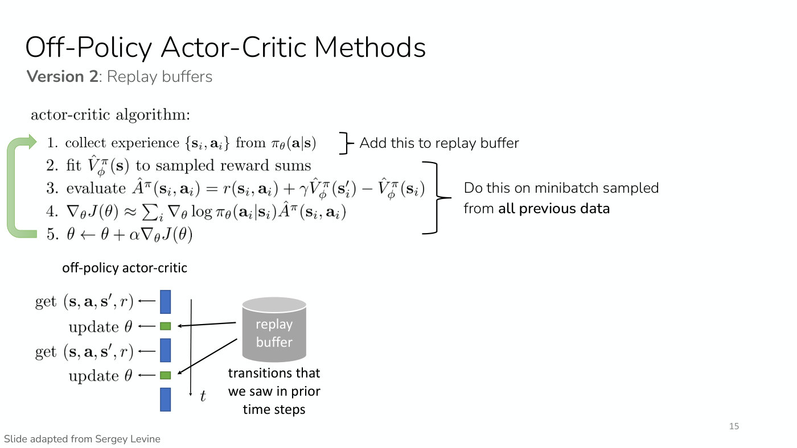

(Number printed in the bottom-right corner.) Bottom-left credit: "Slide adapted from Sergey Levine".

Subtitle: "**Version 2**: Replay buffers".

"actor-critic algorithm:"
1. collect experience $\lbrace \mathbf{s}_ i, \mathbf{a}_ i\rbrace$ from $\pi_\theta(\mathbf{a} \mid \mathbf{s})$ — followed by a right brace and "Add this to replay buffer"
2. fit $\hat{V}^\pi_\phi(\mathbf{s})$ to sampled reward sums
3. evaluate $\hat{A}^\pi(\mathbf{s}_ i, \mathbf{a}_ i) = r(\mathbf{s}_ i, \mathbf{a}_ i) + \gamma \hat{V}^\pi_\phi(\mathbf{s}'_ i) - \hat{V}^\pi_\phi(\mathbf{s}_ i)$
4. $\nabla_\theta J(\theta) \approx \sum_i \nabla_\theta \log \pi_\theta(\mathbf{a}_ i \mid \mathbf{s}_ i) \hat{A}^\pi(\mathbf{s}_ i, \mathbf{a}_ i)$
5. $\theta \leftarrow \theta + \alpha \nabla_\theta J(\theta)$

A right brace spanning steps 2–5 is labelled "Do this on minibatch sampled from **all previous data**". A thick light-green arrow runs down the left edge from step 5 back up to step 1 (the loop).

Bottom-left diagram headed "off-policy actor-critic": a vertical timeline (thin arrow pointing down, labelled $t$) with a column of boxes: a tall blue box with "get $(\mathbf{s}, \mathbf{a}, \mathbf{s}', r)$" and an arrow pointing at it, a small green box with "update $\theta$", a blue box "get $(\mathbf{s}, \mathbf{a}, \mathbf{s}', r)$", a small green box "update $\theta$", then a final blue box with no label. To the right a grey cylinder labelled "replay buffer" with the caption "transitions that we saw in prior time steps"; two black arrows run from the cylinder to the two green "update $\theta$" boxes.

## Slide 16 — Off-Policy Actor-Critic Methods

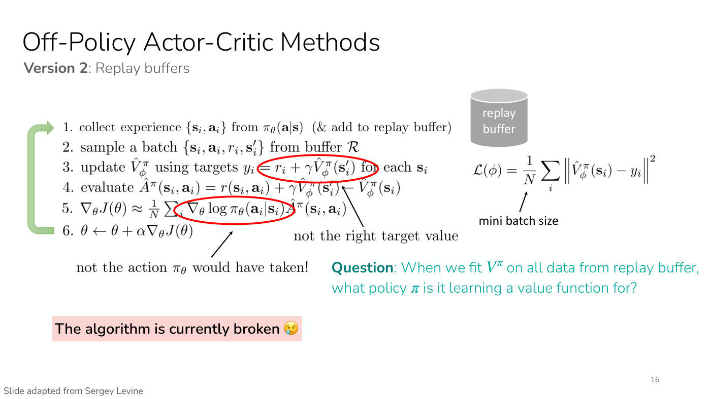

(Number printed in the bottom-right corner.) Bottom-left credit: "Slide adapted from Sergey Levine".

Subtitle: "**Version 2**: Replay buffers".

1. collect experience $\lbrace \mathbf{s}_ i, \mathbf{a}_ i\rbrace$ from $\pi_\theta(\mathbf{a} \mid \mathbf{s})$ (& add to replay buffer)
2. sample a batch $\lbrace \mathbf{s}_ i, \mathbf{a}_ i, r_i, \mathbf{s}'_ i\rbrace$ from buffer $\mathcal{R}$
3. update $\hat{V}^\pi_\phi$ using targets $y_i = r_i + \gamma \hat{V}^\pi_\phi(\mathbf{s}'_ i)$ for each $\mathbf{s}_ i$
4. evaluate $\hat{A}^\pi(\mathbf{s}_ i, \mathbf{a}_ i) = r(\mathbf{s}_ i, \mathbf{a}_ i) + \gamma \hat{V}^\pi_\phi(\mathbf{s}'_ i) - \hat{V}^\pi_\phi(\mathbf{s}_ i)$
5. $\nabla_\theta J(\theta) \approx \frac{1}{N} \sum_i \nabla_\theta \log \pi_\theta(\mathbf{a}_ i \mid \mathbf{s}_ i) \hat{A}^\pi(\mathbf{s}_ i, \mathbf{a}_ i)$
6. $\theta \leftarrow \theta + \alpha \nabla_\theta J(\theta)$

A thick light-green arrow runs down the left edge from step 6 back up to step 1.

Hand-drawn red annotations: a red oval around the target $= r_i + \gamma \hat{V}^\pi_\phi(\mathbf{s}'_ i)$ in step 3 (it runs into the word "for", which is partly covered by the oval's edge), and a second red oval around $\nabla_\theta \log \pi_\theta(\mathbf{a}_ i \mid \mathbf{s}_ i)$ in step 5 (its right edge touches the $\hat{A}^\pi$). A black arrow from the text "not the right target value" points up and to the left at the end of step 4, where $\hat{V}^\pi_\phi(\mathbf{s}'_ i)$ meets $-\hat{V}^\pi_\phi(\mathbf{s}_ i)$, just below the first oval. A black arrow from the text "not the action $\pi_\theta$ would have taken!" points up to the second red oval.

Upper right: a grey cylinder "replay buffer", and below it

$$\mathcal{L}(\phi) = \frac{1}{N} \sum_i \left\Vert \hat{V}^\pi_\phi(\mathbf{s}_ i) - y_i \right\Vert^2$$

with an arrow from the text "mini batch size" pointing up to the $N$.

In teal, right of the middle: "**Question**: When we fit $V^\pi$ on all data from replay buffer, what policy $\pi$ is it learning a value function for?"

Bottom left: on a pink background, "The algorithm is currently broken" followed by a crying-face emoji.

## Slide 17 — Off-Policy Actor-Critic Methods

Top line (printed with this wording): "How to we fit a value function for $\pi_\theta$ using replay buffer of data from past policies?"

A light-bulb emoji then "What if we fit $Q(\mathbf{s}, \mathbf{a})$ instead of $V(\mathbf{s})$?"

"The datapoints we have: $(\mathbf{s}, \mathbf{a}, r, \mathbf{s}')$ + future reward". Two coral-coloured annotations with curved arrows: "depends on past policy's actions" with an arrow pointing at "future reward", and "action from past policy" with an arrow pointing up at the $\mathbf{a}$ in $(\mathbf{s}, \mathbf{a}, r, \mathbf{s}')$. To the right, in italics: "-> Don't want to use this."

Below, in italics: "-> If we fit $Q(\mathbf{s}, \mathbf{a})$, we pass the action as input", and in smaller type "(okay if $\mathbf{a}$ is a bit different from what policy would have done)".

At the right, a light grey rounded box: "Recall: *Definition of Q-values*"

$$Q^\pi(\mathbf{s}_ t, \mathbf{a}_ t) = \sum_{t'=t}^{T} E_{\pi_\theta} \left[ r(\mathbf{s}_ {t'}, \mathbf{a}_ {t'}) \mid \mathbf{s}_ t, \mathbf{a}_ t \right]$$

and the quote: "total reward we get if we take $\mathbf{a}_ t$ in $\mathbf{s}_ t$... ... and then follow the policy $\pi$".

Bottom left: "For *any* $(\mathbf{s}, \mathbf{a})$:"

$$Q^{\pi_\theta}(\mathbf{s}, \mathbf{a}) = r(\mathbf{s}, \mathbf{a}) + \gamma \mathbb{E}_ {\mathbf{s}' \sim p(\cdot \mid \mathbf{s}, \mathbf{a}), \bar{\mathbf{a}}' \sim \pi_\theta(\cdot \mid \mathbf{s}')} \left[ Q^{\pi_\theta}(\mathbf{s}', \bar{\mathbf{a}}') \right]$$

## Slide 18 — Off-Policy Actor-Critic Methods

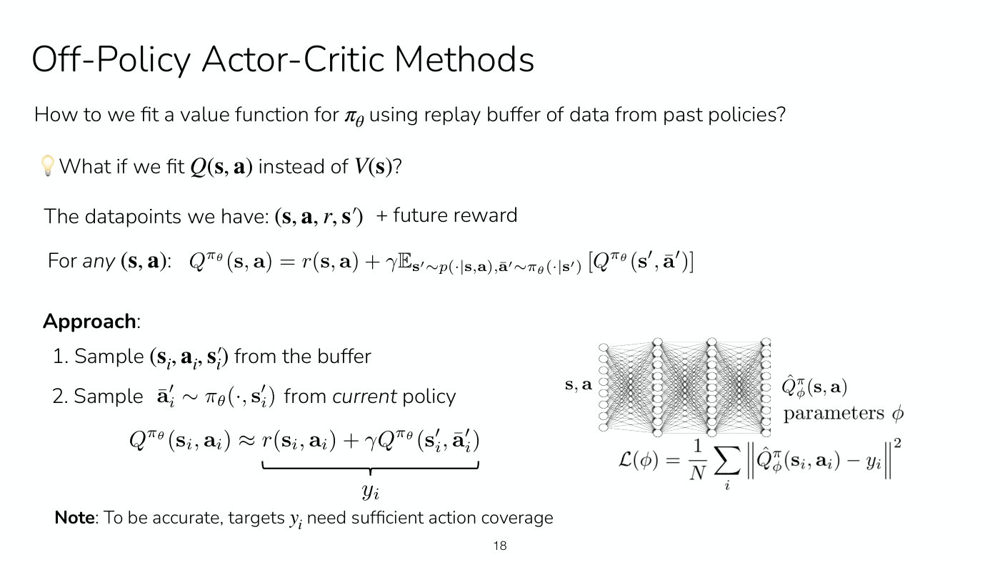

Same top line as slide 17 ("How to we fit a value function for $\pi_\theta$ using replay buffer of data from past policies?"), the same light-bulb line "What if we fit $Q(\mathbf{s}, \mathbf{a})$ instead of $V(\mathbf{s})$?" and the same "The datapoints we have: $(\mathbf{s}, \mathbf{a}, r, \mathbf{s}')$ + future reward" (without slide 17's coral annotations).

"For *any* $(\mathbf{s}, \mathbf{a})$:"

$$Q^{\pi_\theta}(\mathbf{s}, \mathbf{a}) = r(\mathbf{s}, \mathbf{a}) + \gamma \mathbb{E}_ {\mathbf{s}' \sim p(\cdot \mid \mathbf{s}, \mathbf{a}), \bar{\mathbf{a}}' \sim \pi_\theta(\cdot \mid \mathbf{s}')} \left[ Q^{\pi_\theta}(\mathbf{s}', \bar{\mathbf{a}}') \right]$$

"**Approach**:"
1. Sample $(\mathbf{s}_ i, \mathbf{a}_ i, \mathbf{s}'_ i)$ from the buffer
2. Sample $\bar{\mathbf{a}}'_ i \sim \pi_\theta(\cdot, \mathbf{s}'_ i)$ from *current* policy

$$Q^{\pi_\theta}(\mathbf{s}_ i, \mathbf{a}_ i) \approx r(\mathbf{s}_ i, \mathbf{a}_ i) + \gamma Q^{\pi_\theta}(\mathbf{s}'_ i, \bar{\mathbf{a}}'_ i)$$

A black brace under the right-hand side $r(\mathbf{s}_ i, \mathbf{a}_ i) + \gamma Q^{\pi_\theta}(\mathbf{s}'_ i, \bar{\mathbf{a}}'_ i)$ is labelled $y_i$.

Bottom: "**Note**: To be accurate, targets $y_i$ need sufficient action coverage".

Right: a fully connected neural network diagram with an input column of nodes labelled $\mathbf{s}, \mathbf{a}$ on the left, three further columns of nodes with dense connecting lines, and an output column on the right labelled $\hat{Q}^\pi_\phi(\mathbf{s}, \mathbf{a})$, with "parameters $\phi$" beneath it. The output column is drawn with many nodes. Below the network:

$$\mathcal{L}(\phi) = \frac{1}{N} \sum_i \left\Vert \hat{Q}^\pi_\phi(\mathbf{s}_ i, \mathbf{a}_ i) - y_i \right\Vert^2$$

## Slide 19 — Off-Policy Actor-Critic Methods

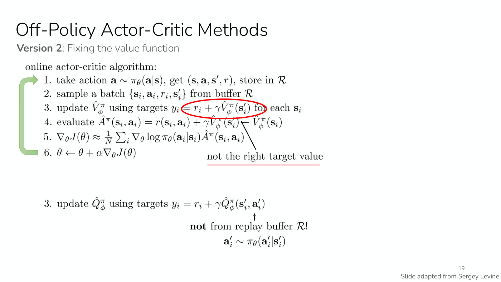

(Number printed in the bottom-right corner.) Bottom-right credit, below the number: "Slide adapted from Sergey Levine".

Subtitle: "**Version 2**: Fixing the value function".

"online actor-critic algorithm:"
1. take action $\mathbf{a} \sim \pi_\theta(\mathbf{a} \mid \mathbf{s})$, get $(\mathbf{s}, \mathbf{a}, \mathbf{s}', r)$, store in $\mathcal{R}$
2. sample a batch $\lbrace \mathbf{s}_ i, \mathbf{a}_ i, r_i, \mathbf{s}'_ i\rbrace$ from buffer $\mathcal{R}$
3. update $\hat{V}^\pi_\phi$ using targets $y_i = r_i + \gamma \hat{V}^\pi_\phi(\mathbf{s}'_ i)$ for each $\mathbf{s}_ i$
4. evaluate $\hat{A}^\pi(\mathbf{s}_ i, \mathbf{a}_ i) = r(\mathbf{s}_ i, \mathbf{a}_ i) + \gamma \hat{V}^\pi_\phi(\mathbf{s}'_ i) - \hat{V}^\pi_\phi(\mathbf{s}_ i)$
5. $\nabla_\theta J(\theta) \approx \frac{1}{N} \sum_i \nabla_\theta \log \pi_\theta(\mathbf{a}_ i \mid \mathbf{s}_ i) \hat{A}^\pi(\mathbf{s}_ i, \mathbf{a}_ i)$
6. $\theta \leftarrow \theta + \alpha \nabla_\theta J(\theta)$

A thick light-green arrow runs down the left edge from step 6 back up to step 1. A thick red hand-drawn oval circles the target $= r_i + \gamma \hat{V}^\pi_\phi(\mathbf{s}'_ i)$ in step 3 (running into the word "for"). A black arrow from the red-underlined text "not the right target value" points up and to the left at the end of step 4, where $\hat{V}^\pi_\phi(\mathbf{s}'_ i)$ meets $-\hat{V}^\pi_\phi(\mathbf{s}_ i)$.

Lower half, a replacement step:

3. update $\hat{Q}^\pi_\phi$ using targets $y_i = r_i + \gamma \hat{Q}^\pi_\phi(\mathbf{s}'_ i, \mathbf{a}'_ i)$

A small black arrow points up at the $\mathbf{a}'_ i$ from the text "**not** from replay buffer $\mathcal{R}$!", and under that $\mathbf{a}'_ i \sim \pi_\theta(\mathbf{a}'_ i \mid \mathbf{s}'_ i)$.

## Slide 20 — Off-Policy Actor-Critic Methods

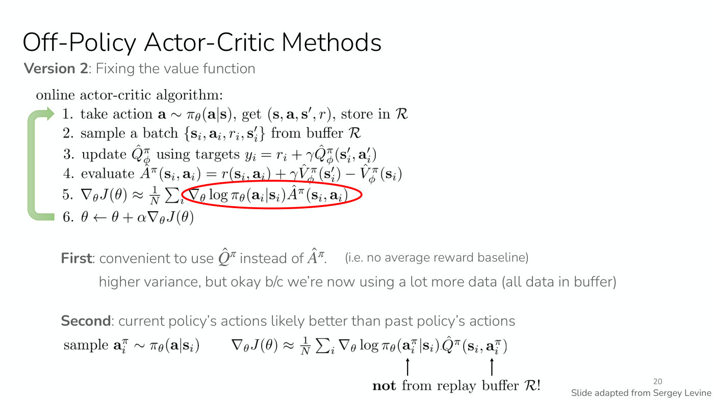

(Number printed in the bottom-right corner.) Bottom-right credit, below the number: "Slide adapted from Sergey Levine".

Subtitle: "**Version 2**: Fixing the value function" (the same subtitle as slide 19).

"online actor-critic algorithm:"
1. take action $\mathbf{a} \sim \pi_\theta(\mathbf{a} \mid \mathbf{s})$, get $(\mathbf{s}, \mathbf{a}, \mathbf{s}', r)$, store in $\mathcal{R}$
2. sample a batch $\lbrace \mathbf{s}_ i, \mathbf{a}_ i, r_i, \mathbf{s}'_ i\rbrace$ from buffer $\mathcal{R}$
3. update $\hat{Q}^\pi_\phi$ using targets $y_i = r_i + \gamma \hat{Q}^\pi_\phi(\mathbf{s}'_ i, \mathbf{a}'_ i)$
4. evaluate $\hat{A}^\pi(\mathbf{s}_ i, \mathbf{a}_ i) = r(\mathbf{s}_ i, \mathbf{a}_ i) + \gamma \hat{V}^\pi_\phi(\mathbf{s}'_ i) - \hat{V}^\pi_\phi(\mathbf{s}_ i)$
5. $\nabla_\theta J(\theta) \approx \frac{1}{N} \sum_i \nabla_\theta \log \pi_\theta(\mathbf{a}_ i \mid \mathbf{s}_ i) \hat{A}^\pi(\mathbf{s}_ i, \mathbf{a}_ i)$
6. $\theta \leftarrow \theta + \alpha \nabla_\theta J(\theta)$

A thick light-green arrow runs down the left edge from step 6 back up to step 1. A thick red hand-drawn oval circles the whole term $\nabla_\theta \log \pi_\theta(\mathbf{a}_ i \mid \mathbf{s}_ i) \hat{A}^\pi(\mathbf{s}_ i, \mathbf{a}_ i)$ in step 5 (it does not enclose the $\frac{1}{N} \sum_i$). There is no oval or label on step 3 on this slide.

Below, in grey type:

"**First**: convenient to use $\hat{Q}^\pi$ instead of $\hat{A}^\pi$." and, in smaller type, "(i.e. no average reward baseline)". Indented: "higher variance, but okay b/c we're now using a lot more data (all data in buffer)".

"**Second**: current policy's actions likely better than past policy's actions". Then, in black:

"sample $\mathbf{a}^\pi_ i \sim \pi_\theta(\mathbf{a} \mid \mathbf{s}_ i)$" and

$$\nabla_\theta J(\theta) \approx \frac{1}{N} \sum_i \nabla_\theta \log \pi_\theta(\mathbf{a}^\pi_ i \mid \mathbf{s}_ i) \hat{Q}^\pi(\mathbf{s}_ i, \mathbf{a}^\pi_ i)$$

Two small black arrows point up from the bold text "**not** from replay buffer $\mathcal{R}$!", one to the $\mathbf{a}^\pi_ i$ inside the log-probability and one to the $\mathbf{a}^\pi_ i$ inside $\hat{Q}^\pi$.

## Slide 21 — Off-Policy Actor-Critic Methods

(Number printed in the bottom-right corner.) Bottom-left credit: "Slide adapted from Sergey Levine".

Subtitle: "**Version 2**: Anything else?".

"online actor-critic algorithm:"
1. take action $\mathbf{a} \sim \pi_\theta(\mathbf{a} \mid \mathbf{s})$, get $(\mathbf{s}, \mathbf{a}, \mathbf{s}', r)$, store in $\mathcal{R}$
2. sample a batch $\lbrace \mathbf{s}_ i, \mathbf{a}_ i, r_i, \mathbf{s}'_ i\rbrace$ from buffer $\mathcal{R}$
3. update $\hat{Q}^\pi_\phi$ using targets $y_i = r_i + \gamma \hat{Q}^\pi_\phi(\mathbf{s}'_ i, \mathbf{a}'_ i)$
4. $\nabla_\theta J(\theta) \approx \frac{1}{N} \sum_i \nabla_\theta \log \pi_\theta(\mathbf{a}^\pi_ i \mid \mathbf{s}_ i) \hat{Q}^\pi(\mathbf{s}_ i, \mathbf{a}^\pi_ i)$ where $\mathbf{a}^\pi_ i \sim \pi_\theta(\mathbf{a} \mid \mathbf{s}_ i)$
5. $\theta \leftarrow \theta + \alpha \nabla_\theta J(\theta)$

A thick light-green arrow runs down the left edge from step 5 back up to step 1.

On a pink background: "Any remaining problems?". Then:
- $\mathbf{s}_ i$ "didn't come from $p_\theta(\mathbf{s})$" and "nothing we can do here, just accept it"
- "**intuition:** we want optimal policy on $p_\theta(\mathbf{s})$" and "but we get optimal policy on a *broader* distribution"

## Slide 22 — Off-Policy Actor-Critic Methods

(Number printed in the bottom-right corner.)

Subtitle: "**Version 2**: Some implementation details".

"online actor-critic algorithm:"
1. take action $\mathbf{a} \sim \pi_\theta(\mathbf{a} \mid \mathbf{s})$, get $(\mathbf{s}, \mathbf{a}, \mathbf{s}', r)$, store in $\mathcal{R}$
2. sample a batch $\lbrace \mathbf{s}_ i, \mathbf{a}_ i, r_i, \mathbf{s}'_ i\rbrace$ from buffer $\mathcal{R}$
3. update $\hat{Q}^\pi_\phi$ using targets $y_i = r_i + \gamma \hat{Q}^\pi_\phi(\mathbf{s}'_ i, \mathbf{a}'_ i)$ for each $\mathbf{s}_ i, \mathbf{a}_ i$
4. $\nabla_\theta J(\theta) \approx \frac{1}{N} \sum_i \nabla_\theta \log \pi_\theta(\mathbf{a}^\pi_ i \mid \mathbf{s}_ i) \hat{Q}^\pi(\mathbf{s}_ i, \mathbf{a}^\pi_ i)$ where $\mathbf{a}^\pi_ i \sim \pi_\theta(\mathbf{a} \mid \mathbf{s}_ i)$
5. $\theta \leftarrow \theta + \alpha \nabla_\theta J(\theta)$

A thick light-green arrow runs down the left edge from step 5 back up to step 1.

Annotations: a black arrow from the text "also fancier ways to fit Q-functions (more on this in next two lectures)" points down-left to the end of step 3. A black arrow from the text "can also use **reparameterization trick** to better estimate the gradient (for Gaussian policy)" points up to the start of step 4's $\nabla_\theta \log \pi_\theta$ term.

"**Example practical algorithm**:" then the citation "Haarnoja, Zhou, Abbeel, Levine. Soft Actor-Critic: Off-Policy Maximum Entropy Deep Reinforcement Learning with a Stochastic Actor. 2018."

## Slide 23 — More off-policy vs. less off-policy actor critic?

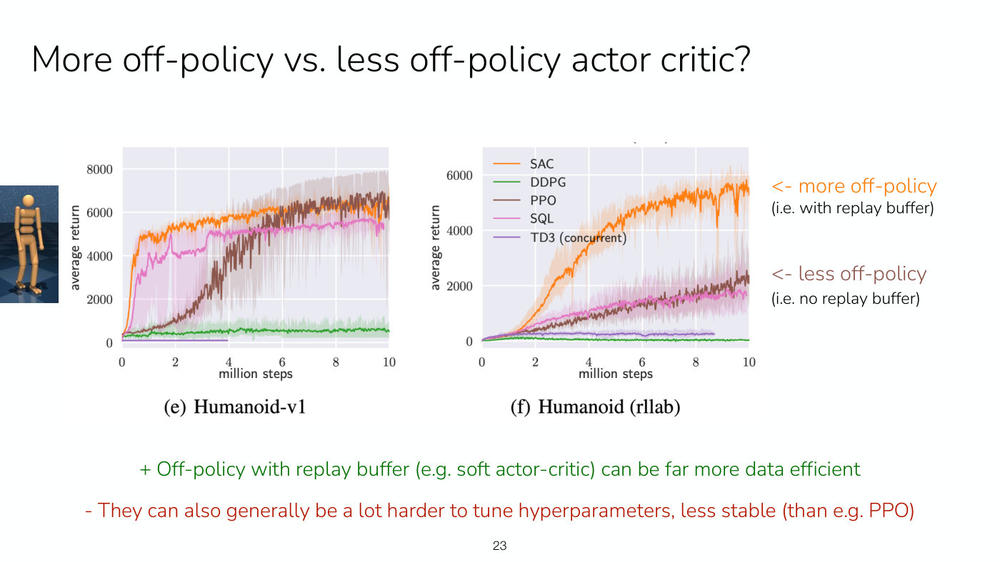

Two line charts pasted from a paper, captioned "(e) Humanoid-v1" (left) and "(f) Humanoid (rllab)" (right). Each has x-axis "million steps" from 0 to 10 (ticks at 0, 2, 4, 6, 8, 10) and y-axis "average return"; both plot noisy learning curves with a lighter shaded band around each. The legend, printed inside the upper left of the right chart, lists five series: SAC (orange), DDPG (green), PPO (brown), SQL (pink), TD3 (concurrent) (purple). Tiny remnants of a cropped chart title show as small arcs just above the right chart. At the far left edge of the slide, left of the first chart, a small cropped photo-like image of a wooden jointed mannequin-style humanoid (orange-tan) standing against a dark blue background on a blue checkered floor (the Humanoid simulation render).

Left chart, "(e) Humanoid-v1": y-axis 0 to 8000 (ticks 0, 2000, 4000, 6000, 8000). Five series. Approximate values read from the curves:
- SAC (orange): jumps to about 4800 by roughly 0.7 million steps, about 5400 at 2 million, about 6000 at 5 million, about 6300 near 10 million; narrow band.
- PPO (brown): rises slowly from about 400 at 0, about 1000 at 2 million, about 3500 at 4 million, about 5800 at 6 million (where it meets SAC), ending near 6500 at 10 million with a very jagged curve; its brownish shaded band is the widest on the chart, reaching roughly 7800 at later steps.
- SQL (pink): rises to about 4000 by 1.5 million steps, about 4300 at 3 million, steps up to about 5000 at 3.3 million, about 5300 at 5 million, about 5600 from 8 to 9 million, ending a little lower at 10 million; a wide pink band spans from near 0 up to about 5000 over the first 3 million steps.
- DDPG (green): stays low, roughly 500 to 600 throughout, with a small light-green band.
- TD3 (concurrent) (purple): a flat line at about 0 that stops at about 4 million steps.

Right chart, "(f) Humanoid (rllab)": y-axis 0 to about 6000 (ticks 0, 2000, 4000, 6000). Five series. Approximate values:
- SAC (orange): near 0 at 0, about 700 at 2 million, about 2000 at 3 million, about 2900 at 4 million (jumping to about 3300 just after), about 4400 at 5 million, about 5300 at 8 million, ending near 5500 at 10 million with a sharp dip to about 3500 around 9.3 million; a light orange band.
- PPO (brown): rises roughly linearly, about 350 at 2 million, about 1300 at 5 million, ending about 2300 at 10 million.
- SQL (pink): close to the PPO curve, ending about 1800 at 10 million; a wide pink band.
- TD3 (concurrent) (purple): flat at about 250, stopping at about 8.7 million steps.
- DDPG (green): flat near 0 (about 100 early) throughout.

Right of the charts, in orange: "<- more off-policy" with "(i.e. with replay buffer)" beneath, aligned with the SAC curve. In brown: "<- less off-policy" with "(i.e. no replay buffer)", aligned with the PPO and SQL curves.

Bottom, in green: "+ Off-policy with replay buffer (e.g. soft actor-critic) can be far more data efficient". In red: "- They can also generally be a lot harder to tune hyperparameters, less stable (than e.g. PPO)".

The slide gives no source line for the charts. The chart axis values above are visual estimates.

## Slide 24 — Fully Off-Policy = Can be efficient enough for real-world RL

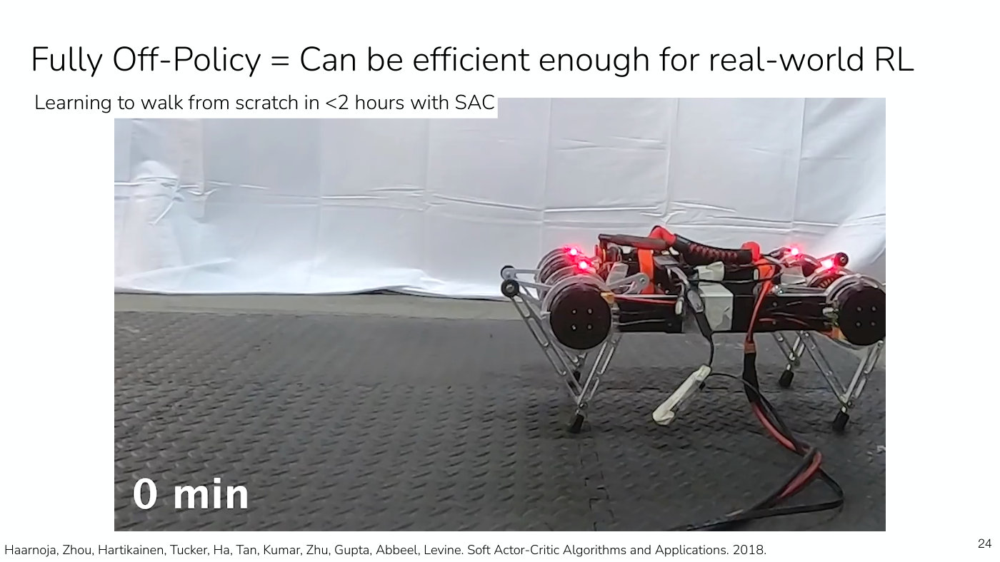

(Number printed in the bottom-right corner.)

Subtitle: "Learning to walk from scratch in <2 hours with SAC".

A large photograph (video frame; what the video shows is in the transcript) of a small four-legged robot with black motors, silver link legs, an orange cable and red lights on its body, seen from the side, standing on a dark grey textured floor mat in front of a white draped backdrop. White text at its bottom left reads "0 min".

Credit at the bottom: "Haarnoja, Zhou, Hartikainen, Tucker, Ha, Tan, Kumar, Zhu, Gupta, Abbeel, Levine. Soft Actor-Critic Algorithms and Applications. 2018."

What the video shows, from the transcript (≈1:07:55): in about two hours, the policy learns how to walk forward "just with the algorithm that we talked about".

## Slide 25 — Fully Off-Policy = Can be efficient enough for real-world RL

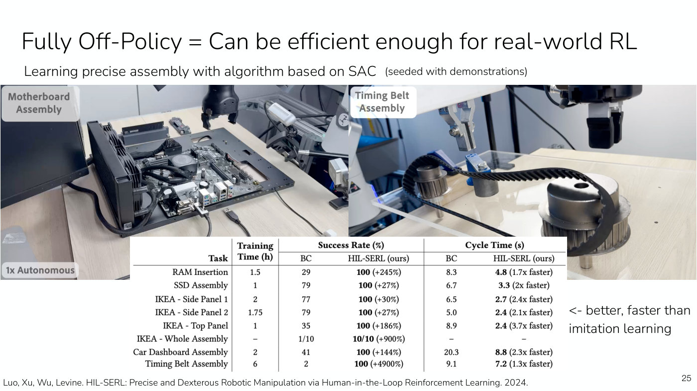

(Number printed in the bottom-right corner.)

Subtitle: "Learning precise assembly with algorithm based on SAC" and, in smaller type, "(seeded with demonstrations)".

Two photographs side by side (video frames; what the videos show is in the transcript). Left: a robot gripper above a PC motherboard mounted in an open case on a desk, with a grey rounded label "Motherboard Assembly" at the top left and a label "1x Autonomous" at the bottom left. Right: a robot gripper holding a black toothed timing belt around pulleys on an acrylic base, with a white rounded label "Timing Belt Assembly" at the top left.

Overlaid on the lower part of the photographs, a results table. Column groups: "Task", "Training Time (h)", "Success Rate (%)" (sub-columns "BC" and "HIL-SERL (ours)") and "Cycle Time (s)" (sub-columns "BC" and "HIL-SERL (ours)"). The HIL-SERL cells are in bold. Rows (task, training time, BC success, HIL-SERL success, BC cycle time, HIL-SERL cycle time):

| Task | Training Time (h) | Success BC | Success HIL-SERL (ours) | Cycle BC | Cycle HIL-SERL (ours) |
| --- | --- | --- | --- | --- | --- |
| RAM Insertion | 1.5 | 29 | 100 (+245%) | 8.3 | 4.8 (1.7x faster) |
| SSD Assembly | 1 | 79 | 100 (+27%) | 6.7 | 3.3 (2x faster) |
| IKEA - Side Panel 1 | 2 | 77 | 100 (+30%) | 6.5 | 2.7 (2.4x faster) |
| IKEA - Side Panel 2 | 1.75 | 79 | 100 (+27%) | 5.0 | 2.4 (2.1x faster) |
| IKEA - Top Panel | 1 | 35 | 100 (+186%) | 8.9 | 2.4 (3.7x faster) |
| IKEA - Whole Assembly | – | 1/10 | 10/10 (+900%) | – | – |
| Car Dashboard Assembly | 2 | 41 | 100 (+144%) | 20.3 | 8.8 (2.3x faster) |
| Timing Belt Assembly | 6 | 2 | 100 (+4900%) | 9.1 | 7.2 (1.3x faster) |

To the right of the table, in black: "<- better, faster than imitation learning".

Credit at the bottom: "Luo, Xu, Wu, Levine. HIL-SERL: Precise and Dexterous Robotic Manipulation via Human-in-the-Loop Reinforcement Learning. 2024."

What the videos show, from the transcript (≈1:07:55–1:08:40): manipulation tasks learned with reinforcement learning, seeded with demonstrations; Finn calls it "a very precise task". The RL method gets 100% on all the tasks tested, imitation learning a much lower success rate, and RL also gives a faster policy.

## Slide 26 — PPO = Common algorithm of choice for stable, less efficient learning

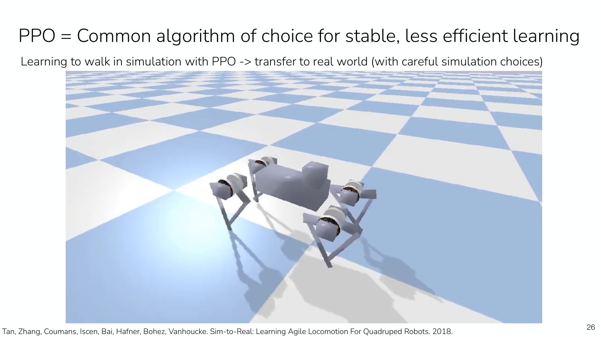

(Number printed in the bottom-right corner.)

Subtitle: "Learning to walk in simulation with PPO -> transfer to real world (with careful simulation choices)".

A large simulator image (video frame; what the video shows is in the transcript): a grey four-legged robot with a rectangular body, a smaller block on its upper side and round motor housings at the four hips, standing on a blue-and-white checkerboard floor that recedes to the horizon, with grey shadows.

Credit at the bottom: "Tan, Zhang, Coumans, Iscen, Bai, Hafner, Bohez, Vanhoucke. Sim-to-Real: Learning Agile Locomotion For Quadruped Robots. 2018."

What the video shows, from the transcript (≈1:08:40): PPO is the common choice for stable but less data-efficient learning; in simulation data is not a problem, so a policy can be learned there and, if the simulator is carefully tuned, may transfer to the real world.

## Slide 27 — PPO = Common algorithm of choice for stable, less efficient learning

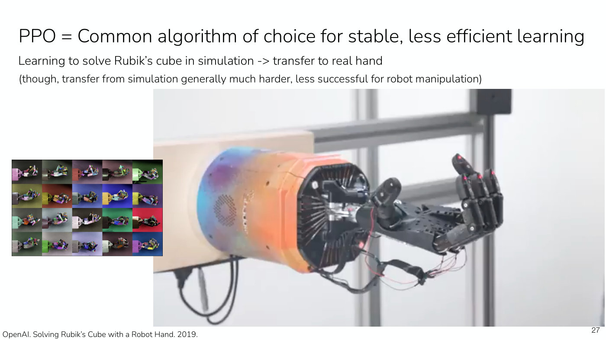

(Number printed in the bottom-right corner.)

Subtitle: "Learning to solve Rubik’s cube in simulation -> transfer to real hand" and, below it in smaller type, "(though, transfer from simulation generally much harder, less successful for robot manipulation)".

A large photograph (video frame; what the video shows is in the transcript) of a black multi-fingered robot hand, open and palm-up, on an orange-and-blue painted cylindrical forearm housing mounted on a wooden board, in front of a white window frame. At the lower left, an inset grid of 20 small simulated renderings (5 columns by 4 rows) of the same hand holding a cube, each on a differently coloured background and with different textures and colours.

Credit at the bottom: "OpenAI. Solving Rubik’s Cube with a Robot Hand. 2019."

What the video shows, from the transcript (≈1:08:40): for manipulation, sim-to-real transfer is "a lot harder". The hand solves a Rubik's cube with a policy trained in simulation with PPO, completing the cube after about 5 minutes of the roll-out.

## Slide 28 — What about RL for language models?

(Number printed in the bottom-right corner.)

"PPO is a common choice!"

"Will start to discuss them when talking about reward modeling next week."

## Slide 29 — The plan for today

(Number printed in the bottom-right corner.) The same text as slide 6, all items in black:

"Off-policy actor critic methods", then

1. Taking multiple gradient steps
   a. Importance weights
   b. Constraining step size with KL penalty or clipping
   c. Practical PPO algorithm
b. Even more off-policy algorithm
   a. Fitting Q-value functions with data from other policies
   b. Practical SAC algorithm

(As on slide 6, the second top-level item is labelled "b." on the slide.)

"**Key learning goals**:"
- All of the key concepts for practical algorithms like PPO and SAC

## Slide 30 — Next Time

(Number printed in the bottom-right corner.)

"Q-learning" "(last big online RL method)", then "+", then "Practical implementation of Q-learning".

"Course reminders"
- Project survey due tonight!
- **Homework 1** due Friday
- **Homework 2** out Friday
