# Lecture 14 — Exploration: slide-by-slide

Text and figures of the Stanford CS 224R "Deep Reinforcement Learning" (Spring 2025) Lecture 14 deck, transcribed from the PDF. The title slide (slide 1) prints "Exploration & Meta-Exploration" and "CS224R", and names no lecturer. Cite these as "slide N". Diagrams, photographs and plots are described in prose since the KB is read as text.

The recording (about 73 minutes) opens with an overview that follows slide 3's plan (≈0:05), without discussing slide 2's reminders, and follows the deck through slide 32, ending at about 1:12:40 on slide 32's grading results; the closing plan and reminders (slides 33–34) are not discussed, so for them this file is the only source. Slide 12 prints only "Exploration game": Finn runs an interactive drug-trial bandit game from a website the PDF does not contain (≈24:53–31:54), described under that slide from the transcript. Finn draws on the slides or a board the recording does not show: regret curves on slide 10 (≈12:32–18:46), the noise and bottleneck construction behind slide 21 (≈46:34–49:41), four example tasks (≈51:13), the execution objective behind slide 22 (≈52:46–55:52) and the exploration reward behind slide 23 (≈1:00:32–1:03:38); the transcript is the only source for those drawings. Slides 27, 30 and 31 hold one frame each of videos that play in the lecture; what they showed is under those slides.

## Slide numbers vs PDF pages

The deck is 1:1 with its page index: PDF page N is slide N, for all 34 pages. Pages 2, 3, 14, 29, 33 and 34 print their number at bottom centre in the text layer, each equal to its page index. The other 28 pages print no number in the text layer; their labels are inferred but unambiguous because they sit between consecutive numbered pages with no gap.

| PDF page | Slide |
| -------- | ----- |
| 1 | 1 |
| 2 | 2 |
| 3 | 3 |
| 4 | 4 |
| 5 | 5 |
| 6 | 6 |
| 7 | 7 |
| 8 | 8 |
| 9 | 9 |
| 10 | 10 |
| 11 | 11 |
| 12 | 12 |
| 13 | 13 |
| 14 | 14 |
| 15 | 15 |
| 16 | 16 |
| 17 | 17 |
| 18 | 18 |
| 19 | 19 |
| 20 | 20 |
| 21 | 21 |
| 22 | 22 |
| 23 | 23 |
| 24 | 24 |
| 25 | 25 |
| 26 | 26 |
| 27 | 27 |
| 28 | 28 |
| 29 | 29 |
| 30 | 30 |
| 31 | 31 |
| 32 | 32 |
| 33 | 33 |
| 34 | 34 |

## Sections of the deck

| Section | Slides |
| ------- | ------ |
| Title and reminders | 1–2 |
| The plan for today | 3 |
| Exploration: why it is hard (Montezuma's revenge, the Mao game, exploration versus exploitation, examples, tractable-to-intractable spectrum) | 4–9 |
| Bandit algorithms (regret, optimism when uncertain and probability matching) | 10–11 |
| Exploration game | 12 |
| Exploration in robotics and LLMs | 13 |
| The plan for today (part 2 begins) | 14 |
| Learning to explore via meta-learning: exploring at test time, end-to-end training and its coupling problem | 15–16 |
| Alternative exploration strategies (PEARL, MAME, MetaCURE) | 17 |
| Decoupled exploration and execution (DREAM): the idea, bottlenecking, objective, theory, navigation experiments, comparison of approaches | 18–28 |
| Application to CS education (Bounce and Breakout feedback, AI-assisted grading) | 29–32 |
| Plan and reminders | 33–34 |

## Slide 1 — Exploration & Meta-Exploration

Title slide. Large centred title "Exploration & Meta-Exploration" with "CS224R" beneath it. No lecturer or date is printed.

## Slide 2 — Reminders

"Reminders". Two lines: "Homework 3 due **tonight**" and "(and HW4 out today)"; then "Project milestone due **next Friday**". The words "tonight" and "next Friday" are in bold. The printed number 2 is at bottom centre.

## Slide 3 — The plan for today

"The plan for today". A numbered outline: "1. Exploration" with sub-items "a. Why is exploration hard?", "b. Algorithms for exploration in bandits", "c. Exploration in robotics, LLMs"; then "2. Learning to Explore via Meta-Learning" with sub-items "a. Efficiently Meta-Learning Optimal Exploration" followed at the right by "<- Part of HW 4", and "b. Meta-Exploration in for CS Education" (sic). The printed number 3 is at bottom centre.

## Slide 4 — What's the problem?

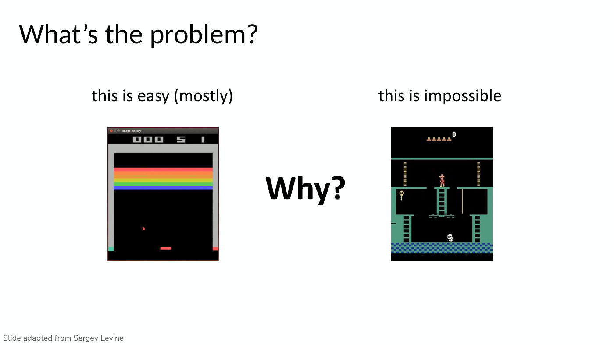

"What's the problem?". Two Atari screenshots side by side with captions above them. Left, captioned "this is easy (mostly)": a Breakout frame with a grey frame, a rainbow of coloured brick rows (red, orange, yellow, green, blue) near the top, a small red ball and a red paddle near the bottom, and a score display reading "000 5 1" under a window title bar "image.display". Right, captioned "this is impossible": a Montezuma's Revenge frame with a green-and-black room, ladders, a red-clad character standing at the top of a central ladder, a key at the left, a rope at the right, a white skull near the bottom and a blue-and-black checkered floor. Between them, in large bold text, "Why?". Footer: "Slide adapted from Sergey Levine". Finn presents the two as games an RL agent is trained to play, with the score as the reward for Breakout (≈0:05–0:50); the transcript does not say whether they play as videos.

## Slide 5 — Montezuma's revenge

"Montezuma's revenge". At left, the same Montezuma's Revenge frame as slide 4. Bullets at right: "Getting key = reward"; "Opening door = reward"; "Getting killed by skull = nothing (is it good? bad?)"; "Finishing the game only weakly correlates with rewarding events"; "We know what to do because we **understand** what these sprites mean!" ("understand" in bold). Footer: "Slide adapted from Sergey Levine".

## Slide 6 — Put yourself in the algorithm's shoes

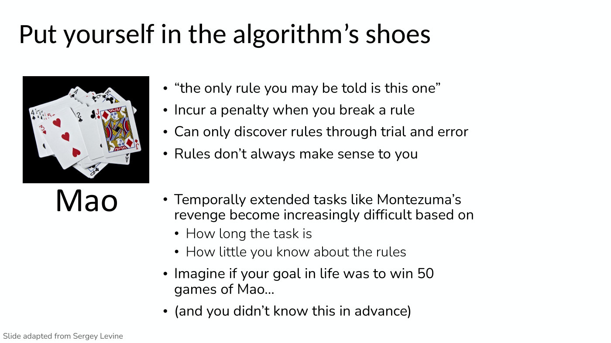

"Put yourself in the algorithm's shoes". At left, a photograph of a spread pile of playing cards on a black background (including a jack of diamonds, a three of hearts, a two and a king of clubs), with the word "Mao" in large text beneath it. Bullets at right: "“the only rule you may be told is this one”"; "Incur a penalty when you break a rule"; "Can only discover rules through trial and error"; "Rules don't always make sense to you". Then a second group: "Temporally extended tasks like Montezuma's revenge become increasingly difficult based on", with two sub-bullets "How long the task is" and "How little you know about the rules"; then "Imagine if your goal in life was to win 50 games of Mao…" and "(and you didn't know this in advance)". Footer: "Slide adapted from Sergey Levine".

## Slide 7 — Exploration and exploitation

"Exploration and exploitation". Bullets: "Two potential definitions of exploration problem", with sub-bullets "How can an agent discover high-reward strategies that require a temporally extended sequence of complex behaviors that, individually, are not rewarding?" and "How can an agent decide whether to attempt new behaviors (to discover ones with higher reward) or continue to do the best thing it knows so far?". Then "Actually the same problem:" with sub-bullets "Exploitation: doing what you know will yield highest reward" and "Exploration: doing things you haven't done before, in the hopes of getting even higher reward". Footer: "Slide adapted from Sergey Levine".

## Slide 8 — Exploration and exploitation examples

"Exploration and exploitation examples". Three examples, each with a green "Exploitation:" line and a red "Exploration:" line. "Restaurant selection": "Exploitation: go to your favorite restaurant"; "Exploration: try a new restaurant". "Online ad placement": "Exploitation: show the most successful advertisement"; "Exploration: show a different random advertisement". "Oil drilling": "Exploitation: drill at the best known location"; "Exploration: drill at a new location". Footer: "Examples from D. Silver lecture notes: http://www0.cs.ucl.ac.uk/staff/d.silver/web/Teaching_files/XX.pdf".

## Slide 9 — Exploration is hard

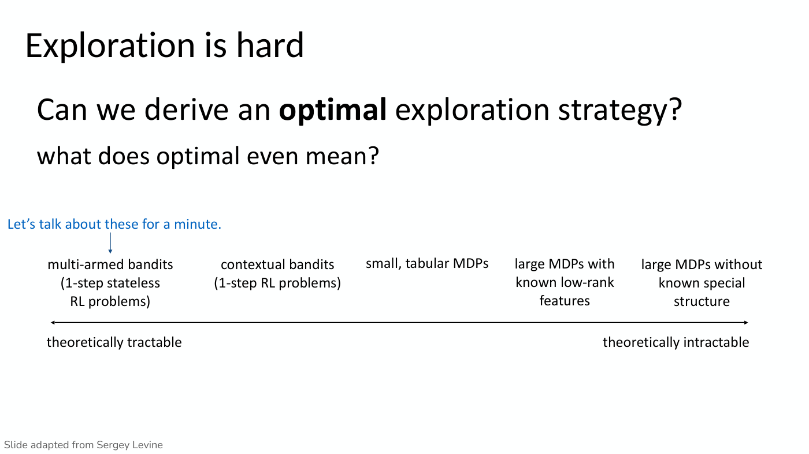

"Exploration is hard". Headline question "Can we derive an **optimal** exploration strategy?" ("optimal" in bold), then "what does optimal even mean?". A diagram: a horizontal double-headed arrow with five labels above it, left to right: "multi-armed bandits (1-step stateless RL problems)", "contextual bandits (1-step RL problems)", "small, tabular MDPs", "large MDPs with known low-rank features", "large MDPs without known special structure". Below the arrow at its left end "theoretically tractable" and at its right end "theoretically intractable". In blue at upper left, "Let's talk about these for a minute.", with a blue arrow pointing down to the "multi-armed bandits" label. Footer: "Slide adapted from Sergey Levine".

## Slide 10 — How do we measure optimality in bandits?

"How do we measure optimality in bandits?". A displayed equation with three annotations:

$$\mathrm{Reg}(T) = T\thinspace E[r(a^\star)] - \sum_{t=1}^{T} r(a_ t)$$

Annotations: "regret after doing RL for $T$ episodes" (arrow to $\mathrm{Reg}(T)$ at the left); "expected reward of best action (the best we can hope for in expectation)" (arrow to the first term); "reward of action actually taken" (arrow to the sum). Bullets: "Variety of relatively simple strategies"; "Often can provide theoretical guarantees on regret", with sub-bullets "Variety of optimal algorithms (up to a constant factor)" and "But empirical performance may vary…". Footer: "Slide adapted from Sergey Levine".

Not in the PDF: Finn draws regret curves on this slide, regret against the number of episodes (≈12:32–15:39; "The blue markers never work that well", ≈14:52). Acting optimally gives a curve at zero in expectation; always picking an action $a_1$ that is not the best, or acting at random, gives a curve that rises linearly; a smarter algorithm gives sublinear regret, a curve that starts out roughly linear while it explores and then flattens out once it reaches the optimal behaviour, the exploitation phase. The questions that follow (≈15:39–19:31) are about these drawings.

## Slide 11 — Exploration in Bandits

"Exploration in Bandits". Two columns.

Left column, "Optimism when uncertain" with "(e.g. upper confidence bound (UCB))". Lines: "Track avg reward $\bar{r}_ a$ for all actions"; "**Exploit**: pick $a_{\mathrm{exploit}} = \arg\max_ a \bar{r}_ a$"; "**Explore**: pick $a_{\mathrm{explore}} = \arg\max_ a \bar{r}_ a + C\sigma_ a$", where the term $\sigma_ a$ is highlighted with a light teal box, and below it in teal "some kind of variance estimate". At the bottom of the column, "**Intuition**: assume unknown = good".

Right column, "Probability matching" with "(e.g. posterior sampling)". Lines: "Assume $r(a_i) \sim p_{\psi_i}(r)$ for each arm $a_i$"; "Defines a POMDP with $\mathbf{s} := [\psi_1, \ldots, \psi_n]$"; then a numbered list with a green curved arrow running from the end of item 3 back up to item 1 (a loop): "1. Form beliefs $\hat{p}(\psi_1, \ldots, \psi_n)$ from data"; "2. Sample an MDP $\psi_1, \ldots, \psi_n \sim \hat{p}(\cdot)$"; "3. Take optimal action $a$ assuming MDP is correct." At the bottom of the column, "**Intuition**: iteratively improve model of bandit, act according to one model".

Across the bottom of the slide: "These methods are widely used/studied in industry for recommenders, ad placement!"

## Slide 12 — Exploration game

Section slide: only the centred text "Exploration game".

Not in the PDF: Finn runs an interactive simulation from a website (≈24:53–31:54). The class plays the head of drug development at a research hospital during a plague, with around 5,000 patients and around 10 drugs of unknown efficacy, a bandit problem in which the goal is to save as many cumulative lives as possible. Students call out drugs and the site reports whether each patient lived or died; the class tries several drugs, favours 7 and then 9, and keeps prescribing 9 (≈26:26–28:48). The site then plots the true efficacy of each drug (9 was the best and 7 was also good), the lives saved by different algorithms and regret over time (≈28:48–30:21). In that single run the class, in purple, did well relative to the algorithms on lives saved and better than all of them on regret, "maybe there's some luck involved". Greedy (green) gets a lot worse over time; posterior sampling (yellow) is "by far the best algorithm"; epsilon-greedy (red) does better than UCB (blue) with fewer patients, and UCB does better in the long run (≈29:34–30:21). Finn says the website will be put in the slides (≈31:54); this PDF does not print it.

## Slide 13 — Exploration in Robotics and LLMs

"Exploration in Robotics and LLMs". Text: "Lots of research translating these exploration methods to large MDPs like robot control."; "But, at the end of the day, **exploration from scratch in large MDPs is intractable**." (bold phrase). Then "Instead:" with two dashed items: "- rely on demonstrations, or on base models pre-trained on demonstrations", where "demonstrations" is in purple and "base models" is in green; and "- use shaped rewards wherever feasible", followed by the smaller line "(e.g. hand-coded in simulation for legged robots, single step rewards from preferences for LLMs)". At right, in green, "These models are *excellent* at exploration!" ("excellent" in italics) with a green curved arrow pointing at "base models".

## Slide 14 — The plan for today

Same outline as slide 3 ("1. Exploration" with a. "Why is exploration hard?", b. "Algorithms for exploration in bandits", c. "Exploration in robotics, LLMs"; "2. Learning to Explore via Meta-Learning" with a. "Efficiently Meta-Learning Optimal Exploration" followed by "<- Part of HW 4", and b. "Meta-Exploration in for CS Education" (sic)). Here item "2. Learning to Explore via Meta-Learning" is in bold, marking the start of part 2. The printed number 14 is at bottom centre.

## Slide 15 — What if we need to explore at test time?

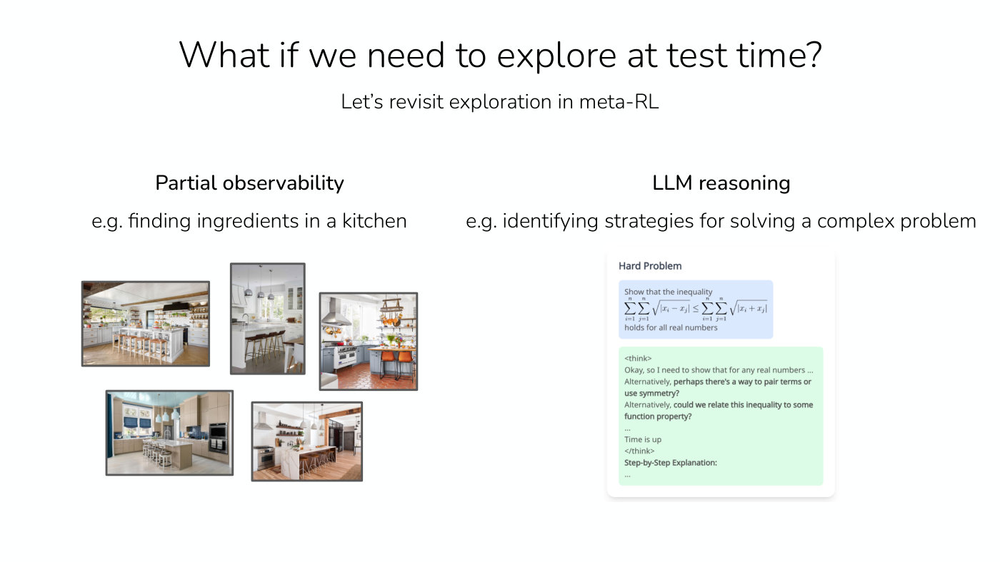

"What if we need to explore at test time?" and subtitle "Let's revisit exploration in meta-RL". Two columns. Left, "Partial observability" with "e.g. finding ingredients in a kitchen", above a scattered collage of five photographs of different kitchens (bright, with islands, bar stools, shelving and hanging lights; one with blue tile, one with orange-red floor tiles and hanging pots). Right, "LLM reasoning" with "e.g. identifying strategies for solving a complex problem", above a screenshot card headed "Hard Problem". Inside it, a blue box reads "Show that the inequality" followed by an equation, the double sum over $i$ and $j$ from 1 to $n$ of $\sqrt{|x_i - x_j|}$ is at most the double sum of $\sqrt{|x_i + x_j|}$, then "holds for all real numbers". Below, a green box with a model response: "<think>"; "Okay, so I need to show that for any real numbers …"; "Alternatively, **perhaps there's a way to pair terms or use symmetry?**"; "Alternatively, **could we relate this inequality to some function property?**"; "…"; "Time is up"; "</think>"; "**Step-by-Step Explanation:**"; "…" (bold phrases as printed).

## Slide 16 — Recall: Why is End-to-End Training Hard for Meta-Learning with Exploration?

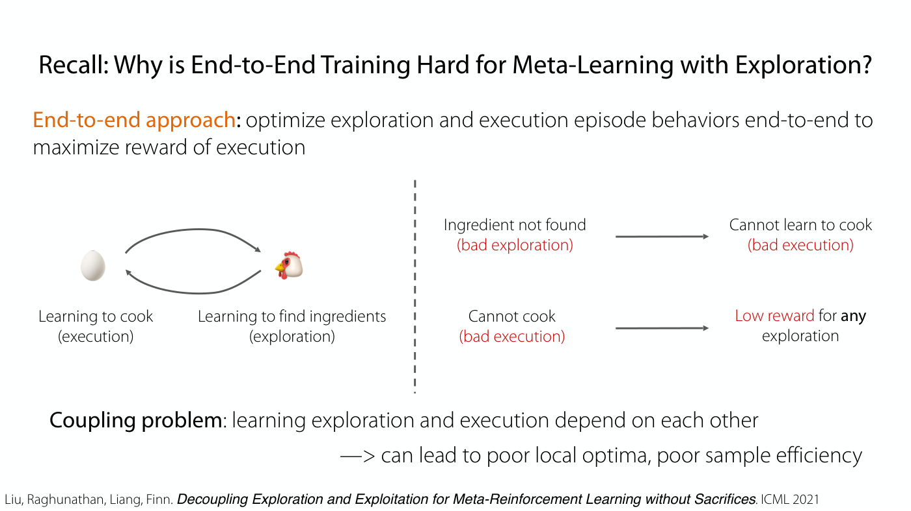

"Recall: Why is End-to-End Training Hard for Meta-Learning with Exploration?". Opening line: "**End-to-end approach**: optimize exploration and execution episode behaviors end-to-end to maximize reward of execution" ("End-to-end approach" in orange).

The figure is split by a vertical dashed line. Left of it: an egg emoji and a chicken emoji joined by two curved arrows forming a cycle (one arrow from the egg to the chicken along the top, one from the chicken back to the egg along the bottom). Under the egg: "Learning to cook (execution)"; under the chicken: "Learning to find ingredients (exploration)". Right of the line, two rows each with an arrow: "Ingredient not found (bad exploration)" arrow to "Cannot learn to cook (bad execution)"; and "Cannot cook (bad execution)" arrow to "Low reward for **any** exploration". The parenthesised phrases and "Low reward" are in red.

Bottom: "**Coupling problem**: learning exploration and execution depend on each other" and "—> can lead to poor local optima, poor sample efficiency". Footer citation: "Liu, Raghunathan, Liang, Finn. *Decoupling Exploration and Exploitation for Meta-Reinforcement Learning without Sacrifices*. ICML 2021".

## Slide 17 — Alternative: Leverage Alternative Exploration Strategies

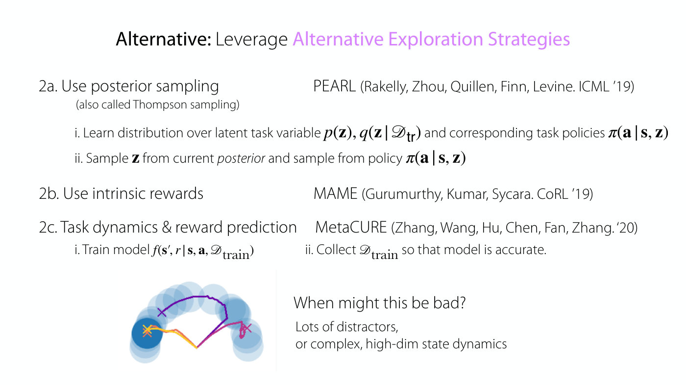

Title: "Alternative: Leverage Alternative Exploration Strategies" (the last three words in purple). Three numbered approaches, each with a paper at right.

"2a. Use posterior sampling" with "(also called Thompson sampling)"; at right "PEARL (Rakelly, Zhou, Quillen, Finn, Levine. ICML '19)". Sub-items: "i. Learn distribution over latent task variable $p(\mathbf{z})$, $q(\mathbf{z} \mid \mathscr{D}_ {\mathrm{tr}})$ and corresponding task policies $\pi(\mathbf{a} \mid \mathbf{s}, \mathbf{z})$" and "ii. Sample $\mathbf{z}$ from current *posterior* and sample from policy $\pi(\mathbf{a} \mid \mathbf{s}, \mathbf{z})$".

"2b. Use intrinsic rewards"; at right "MAME (Gurumurthy, Kumar, Sycara. CoRL '19)".

"2c. Task dynamics & reward prediction"; at right "MetaCURE (Zhang, Wang, Hu, Chen, Fan, Zhang. '20)". Sub-items: "i. Train model $f(\mathbf{s}', r \mid \mathbf{s}, \mathbf{a}, \mathscr{D}_ {\mathrm{train}})$" and "ii. Collect $\mathscr{D}_ {\mathrm{train}}$ so that model is accurate."

Bottom left, a small image: a top-down 2D plot with a semicircular arc of translucent blue circles (a ring of darker blue at the left end and a medium-dark one at the upper right, lighter ones elsewhere) and several coloured trajectories (purple, magenta, orange-yellow gradient) starting from a point at the bottom centre and going to marked crosses at the left (dark circle), upper left and right ends of the arc. At bottom right: "When might this be bad?" and beneath it "Lots of distractors, or complex, high-dim state dynamics".

## Slide 18 — Can we avoid the chicken-and-egg problem without sacrificing optimality?

Text-only slide, centred: "Can we avoid the chicken-and-egg problem *without* sacrificing optimality?" ("without" in italics), "(best of both worlds?)", and in green "Yes!".

## Slide 19 — Solution #3

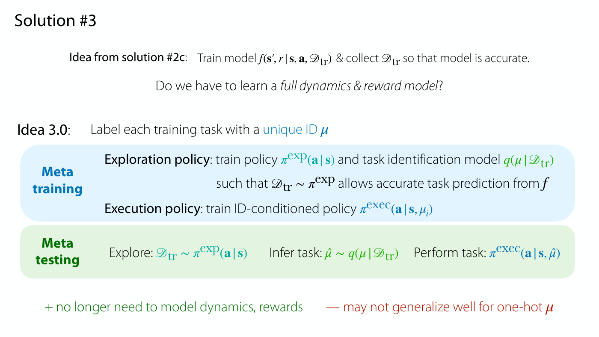

"Solution #3". Top line: "Idea from solution #2c: Train model $f(\mathbf{s}', r \mid \mathbf{s}, \mathbf{a}, \mathscr{D}_ {\mathrm{tr}})$ & collect $\mathscr{D}_ {\mathrm{tr}}$ so that model is accurate." Then "Do we have to learn a *full dynamics & reward model*?" ("full dynamics & reward model" in italics). Then "Idea 3.0: Label each training task with a unique ID $\mu$" ("unique ID $\mu$" in blue).

Two shaded boxes. A light-blue box labelled "Meta training" (bold, blue) holds: "**Exploration policy**: train policy $\pi^{\exp}(\mathbf{a} \mid \mathbf{s})$ and task identification model $q(\mu \mid \mathscr{D}_ {\mathrm{tr}})$" (the policy in teal, the model in green), "such that $\mathscr{D}_ {\mathrm{tr}} \sim \pi^{\exp}$ allows accurate task prediction from $f$" (the text layer confirms the printed $f$, although the task identification model on this slide is $q$) and "**Execution policy**: train ID-conditioned policy $\pi^{\mathrm{exec}}(\mathbf{a} \mid \mathbf{s}, \mu_i)$". A light-green box labelled "Meta testing" (bold, green) holds three steps in a row: "Explore: $\mathscr{D}_ {\mathrm{tr}} \sim \pi^{\exp}(\mathbf{a} \mid \mathbf{s})$"; "Infer task: $\hat{\mu} \sim q(\mu \mid \mathscr{D}_ {\mathrm{tr}})$"; "Perform task: $\pi^{\mathrm{exec}}(\mathbf{a} \mid \mathbf{s}, \hat{\mu})$". Bottom, in green "+ no longer need to model dynamics, rewards" and in red "— may not generalize well for one-hot $\mu$".

## Slide 20 — Solution #3: Decouple by acquiring representation of task relevant information

Title: "Solution #3: Decouple by acquiring representation of task relevant information" ("Decouple" in blue). Inside a green-bordered box labelled "Meta-training" (green): a vertical dashed line splits two parts.

Left, "1) Learn execution & identify key information" with an egg emoji. A column vector labelled "MDP identifier $\mu$" has three rows: "wall color" (in red) with value 2 (red), "ingredients" (in green) with value 0 (green), "decorations" (in purple) with value 1 (purple). A grey trapezoid (an encoder, wide on the left and narrowing to the right) leads to a blue circle holding the vector "[0]" (the 0 in green), labelled above "Bottlenecked representation" and below with $z$. An arrow leads from the circle to "Execution policy" with the symbol $\pi^{\mathrm{exec}}$.

Right, "2) Learn to explore by recovering that information" with a hatching-chick emoji. "Exploration policy" with the symbol $\pi^{\exp}$ at left, a blue circle containing $z$ at right, and two curved arrows between them: one from $\pi^{\exp}$ to $z$ over the top, labelled "Exploration episode $\tau$", and one back from $z$ to $\pi^{\exp}$ below, labelled "Information recovery reward $\mathrm{MI}(z; \tau)$".

Footer: "Liu, Raghunathan, Liang, Finn. *Decoupling Exploration and Exploitation for Meta-Reinforcement Learning without Sacrifices*. ICML 2021".

## Slide 21 — Aside: How can we bottleneck the information in a neural net's representation?

Title: "Aside: How can we bottleneck the information in a neural net's representation?".

"**V0**: Add noise the representation." (sic) Then $\epsilon \sim \mathcal{N}(0, I)$ and $\bar{\mathbf{z}} = \mathbf{z} + \epsilon$ at left, with three comments at right: in green "+ will discard information" followed by a smiling emoji; in red "- if done at test time, my discard good info" (sic); in red "- if done during training, model can increase magnitude of $\mathbf{z}$".

"Key ideas:" with a numbered list "1. Add Gaussian noise during training" and "2. Prevent the model from increasing magnitude".

"**V1**: Variational information bottleneck". "Add noise before passing representation to next layer:" with $\epsilon \sim \mathcal{N}(0, I)$ and $\bar{\mathbf{z}} = \mathbf{z} + \epsilon$. "Modify loss term:" $L_{\mathrm{tr}} + \Vert \mathbf{z} \Vert^2$. Then "-> equivalent to $D_{KL}\big(F(z \mid \mu_i) \Vert \mathcal{N}(0, 1)\big)$." Finn corrects this aloud (≈55:52): since $z$ is a vector, the unit Gaussian's 1 "should be an I", the identity, giving $\mathcal{N}(0, I)$.

Footer: "Alemi, Fischer, Dillon, Murphy. *Deep Variational Information Bottleneck*. ICLR 2017."

## Slide 22 — Solution #3: Decouple by acquiring representation of task relevant information

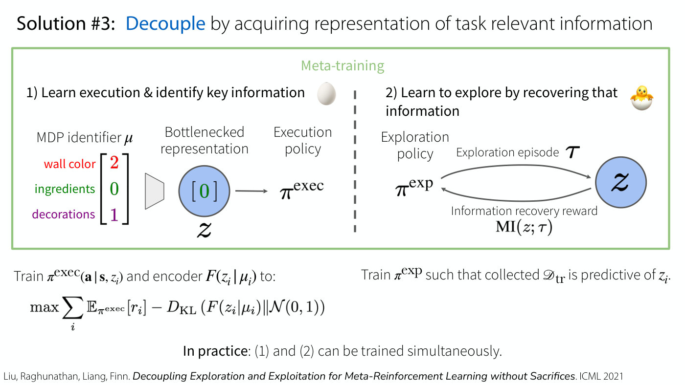

Same title and the same green "Meta-training" diagram as slide 20 (MDP identifier $\mu$ with wall color 2, ingredients 0, decorations 1, encoder, bottlenecked representation $z$ holding "[0]", execution policy $\pi^{\mathrm{exec}}$; on the right the exploration policy $\pi^{\exp}$, exploration episode $\tau$, $z$ and the information recovery reward $\mathrm{MI}(z; \tau)$ beneath it). Added below the box:

Left: "Train $\pi^{\mathrm{exec}}(\mathbf{a} \mid \mathbf{s}, z_i)$ and encoder $F(z_i \mid \mu_i)$ to:" and the displayed objective

$$\max \sum_{i} \mathbb{E}_ {\pi^{\mathrm{exec}}}[r_i] - D_{\mathrm{KL}}\big(F(z_i \mid \mu_i) \Vert \mathcal{N}(0, 1)\big)$$

Right: "Train $\pi^{\exp}$ such that collected $\mathscr{D}_ {\mathrm{tr}}$ is predictive of $z_i$." The objective prints $\mathcal{N}(0, 1)$; Finn corrects this aloud (≈55:52): since $z$ is a vector, the unit Gaussian's 1 "should be an I", the identity, giving $\mathcal{N}(0, I)$.

Bottom, centred: "**In practice**: (1) and (2) can be trained simultaneously." Footer: "Liu, Raghunathan, Liang, Finn. *Decoupling Exploration and Exploitation for Meta-Reinforcement Learning without Sacrifices*. ICML 2021".

## Slide 23 — Solution #3: Decouple by acquiring representation of task relevant information

Same title. The green "Meta-training" box now holds only its two headings, "1) Learn execution & identify key information" (egg emoji) and "2) Learn to explore by recovering that information" (hatching-chick emoji), without the diagram. Below, left: "Train $\pi^{\mathrm{exec}}(\mathbf{a} \mid \mathbf{s}, z_i)$ and encoder $F(z_i \mid \mu_i)$ to:" with the same displayed objective

$$\max \sum_{i} \mathbb{E}_ {\pi^{\mathrm{exec}}}[r_i] - D_{\mathrm{KL}}\big(F(z_i \mid \mu_i) \Vert \mathcal{N}(0, 1)\big)$$

Right: "Train $\pi^{\exp}$ such that collected $\mathscr{D}_ {\mathrm{tr}}$ is predictive of $z_i$." then "How to formulate the *reward function* for $\pi^{\exp}$?" ("reward function" in bold italics), then "(a) Train model $q(z_i \mid \mathscr{D}_ {\mathrm{tr}})$" and "(b) $r_t$ = per-step information gain" (the objective at left prints $\mathcal{N}(0, 1)$, which Finn corrects to $\mathcal{N}(0, I)$ at ≈55:52), then

$$r_t = \text{prediction error from } \tau_{1:t-1} - \text{prediction error from } \tau_{1:t}$$

(the slide prints an em dash, "—", where the minus sign is). Bottom: "**D**ecoupled **R**eward-free **E**xplor**A**tion and Execution in **M**eta-Reinforcement Learning (DREAM)" with the bold letters spelling DREAM (small capitals as printed). Footer: "Liu, Raghunathan, Liang, Finn. *Decoupling Exploration and Exploitation for Meta-Reinforcement Learning without Sacrifices*. ICML 2021".

## Slide 24 — Solution #3: Decouple by acquiring representation of task relevant information

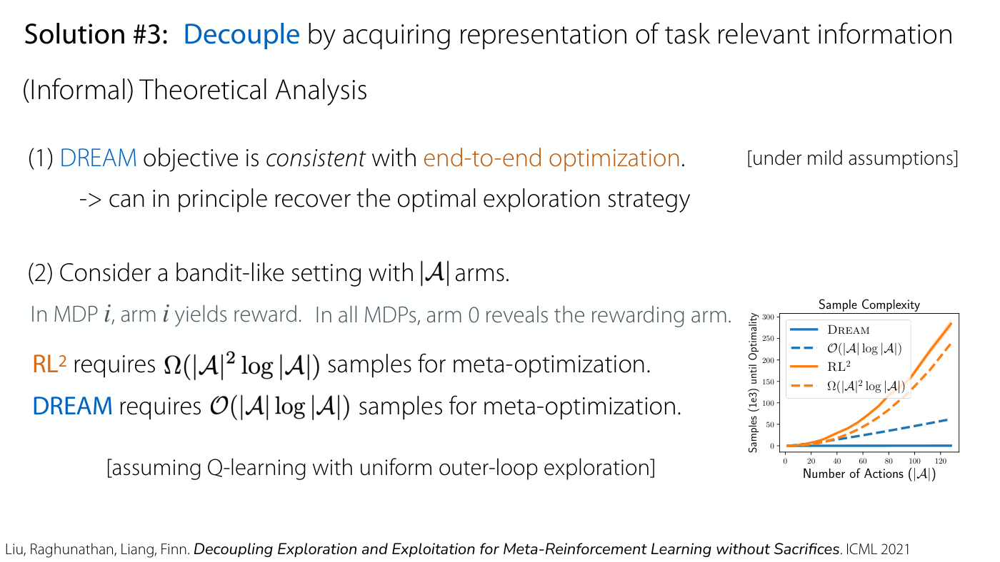

Same title. Subtitle "(Informal) Theoretical Analysis". Text: "(1) DREAM objective is *consistent* with end-to-end optimization." (DREAM in blue, "end-to-end optimization" in orange) with "[under mild assumptions]" at right, and "-> can in principle recover the optimal exploration strategy". Then "(2) Consider a bandit-like setting with $|\mathcal{A}|$ arms." and, in grey, "In MDP $i$, arm $i$ yields reward. In all MDPs, arm 0 reveals the rewarding arm." Then "RL² requires $\Omega(|\mathcal{A}|^2 \log |\mathcal{A}|)$ samples for meta-optimization." ($\text{RL}^2$ in orange) and "DREAM requires $\mathcal{O}(|\mathcal{A}| \log |\mathcal{A}|)$ samples for meta-optimization." (DREAM in blue), and "[assuming Q-learning with uniform outer-loop exploration]".

Chart at lower right titled "Sample Complexity". X axis "Number of Actions ($|\mathcal{A}|$)", ticks 0, 20, 40, 60, 80, 100, 120 (data run to about 128). Y axis "Samples (1e3) until Optimality", ticks 0 to 300 in steps of 50. Four series, as listed in the legend:
- DREAM (solid blue): flat at about 0 across the whole range.
- $\mathcal{O}(|\mathcal{A}| \log |\mathcal{A}|)$ (dashed blue): rises roughly linearly, about 15 at 40 actions, 30 at 80, and about 60 at the right end.
- $\text{RL}^2$ (solid orange): rises convexly, about 10 at 20, 30 at 40, 55 at 60, 100 at 80, 150 at 100, about 200 at 110 and about 285 at the right end (with a faint shaded band).
- $\Omega(|\mathcal{A}|^2 \log |\mathcal{A}|)$ (dashed orange): follows slightly below the $\text{RL}^2$ curve, about 235 at the right end.

Footer: "Liu, Raghunathan, Liang, Finn. *Decoupling Exploration and Exploitation for Meta-Reinforcement Learning without Sacrifices*. ICML 2021".

## Slide 25 — Empirical Comparison: Sparse Reward 3D Visual Navigation Problem

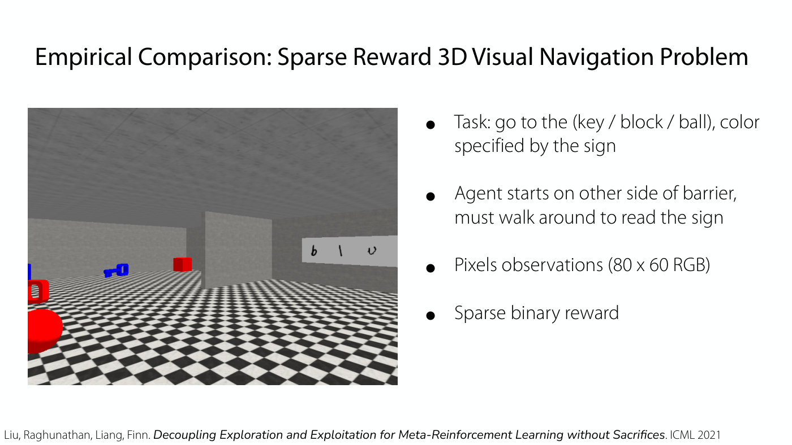

Title: "Empirical Comparison: Sparse Reward 3D Visual Navigation Problem". At left, a first-person 3D rendering of a room with grey walls and ceiling and a black-and-white checkered floor. A free-standing grey barrier stands in the middle; on the far right wall is a white sign with handwritten-looking characters "b l u" (the last character looks like "u"); on the floor at the left are a blue key, a red block and a red ball, and a red cube further back. Finn describes it as a meta-RL problem in which different tasks correspond to going to objects of different colours, with the colour written on the wall: the agent starts on one side, walks around the wall, reads the colour and goes to the correct object, with pixel inputs and a sparse reward (≈1:06:44). Bullets at right: "Task: go to the (key / block / ball), color specified by the sign"; "Agent starts on other side of barrier, must walk around to read the sign"; "Pixels observations (80 x 60 RGB)"; "Sparse binary reward". Footer: "Liu, Raghunathan, Liang, Finn. *Decoupling Exploration and Exploitation for Meta-Reinforcement Learning without Sacrifices*. ICML 2021".

## Slide 26 — Quantitative Comparison

Title: "Quantitative Comparison". Line chart titled "3D Visual Navigation". X axis "Timesteps (1e3)", ticks 0, 500, 1000, 1500, 2000, 2500, 3000, 3500. Y axis "Average Returns", ticks −0.4 to 1.0 in steps of 0.2. Four learning curves (each with a shaded band) and two dashed reference lines, listed in a legend: "DREAM" (solid blue), "RL²" (solid orange), "IMPORT" (solid green), "VARIBAD" (solid red), "PEARL-UB" (dashed pink), "Optimal" (dashed purple).
- DREAM (blue): starts near 0, about 0.05 at 500, 0.3 at 1000, 0.55 at 1500, 0.65 at 2000, 0.75 at 2500, 0.8 at 3000, about 0.75 at 3500; the band is widest between 500 and 1500.
- $\text{RL}^2$ (orange): dips to about −0.15 at the very start, then about 0 throughout (roughly −0.03 to 0).
- IMPORT (green): dips to about −0.28 at the very start, then about 0 to −0.05 throughout, slightly the lowest of the three.
- VARIBAD (red): about 0 throughout.
- PEARL-UB (dashed pink reference line): constant at about 0.17.
- Optimal (dashed purple reference line): constant at 1.0.

Bullets at right: "End-to-end algorithms (RL², IMPORT, VARIBAD) perform poorly due to **coupling**" (the three names in orange, green and red; names in small capitals as printed); "PEARL-UB: Upper-bound on PEARL: optimal policy and Thompson-Sampling exploration, does not learn the optimal exploration strategy" (PEARL-UB in pink); "DREAM achieves near-optimal reward" (DREAM in blue). Under the chart: "RL² (Duan et al., 2016), IMPORT (Kamienny et al., 2020), VARIBAD (Zintgraf et al., 2019), PEARL (Rakelly, et. al., 2019), Thompson, 1933". Footer: "Liu, Raghunathan, Liang, Finn. *Decoupling Exploration and Exploitation for Meta-Reinforcement Learning without Sacrifices*. ICML 2021".

## Slide 27 — Qualitative Results for DREAM

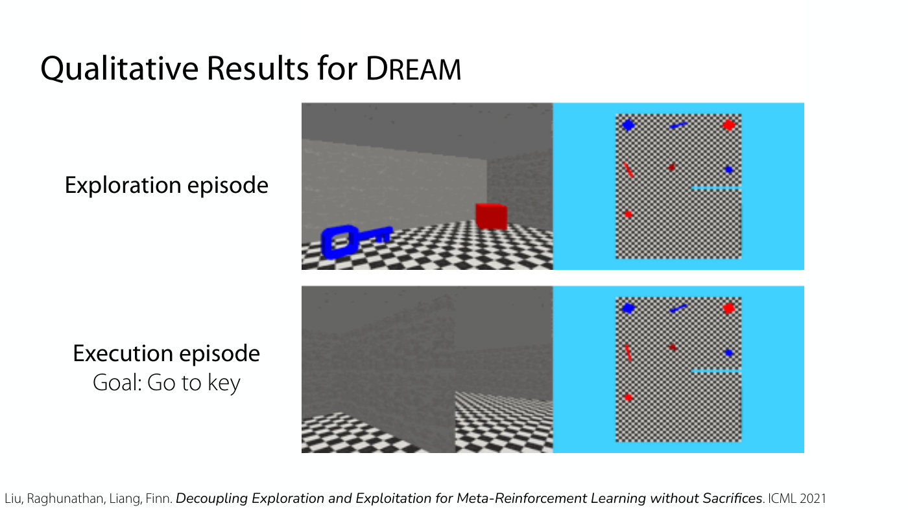

Title: "Qualitative Results for DREAM" (DREAM in small capitals as printed). Two stacked panels, each with a first-person view at left and a top-down map on a bright cyan background at right. Top panel labelled "Exploration episode": the first-person view shows a grey wall, a checkered floor, a large blue key at lower left and a red cube; the map shows a square checkered arena with small blue and red objects (a blue diamond and a blue bar along the top, a red object at top right, a red bar and a dark-red marker in the middle, a blue dot at right, a red dot at lower left) and a short cyan line from the right edge. Bottom panel labelled "Execution episode" and "Goal: Go to key": the first-person view shows a grey wall and a checkered floor with no objects in view; the map is the same arena with the same objects. The slide gives no agent marker that is distinguishable from the objects. The panels are frames of a video that plays in the lecture (≈1:07:29–1:08:16): in the exploration episode the agent walks around to read the sign on the wall, and after reading it, it goes to the blue key. The PDF holds only these frames. Footer: "Liu, Raghunathan, Liang, Finn. *Decoupling Exploration and Exploitation for Meta-Reinforcement Learning without Sacrifices*. ICML 2021".

## Slide 28 — How Do We Learn to Explore in Meta-RL?

Title: "How Do We Learn to Explore in Meta-RL?". Three columns, each with a heading, green "+" lines (pros) and red "--" lines (cons).
- "End-to-End" (orange). "+ leads to optimal strategy in principle". "-- challenging optimization when exploration is hard".
- "Alternative Strategies" (purple). "+ easy to optimize"; "+ many based on principled strategies". "-- suboptimal by arbitrarily large amount in some environments."
- "Decoupled Exploration & Execution" (blue). "+ leads to optimal strategy in principle"; "+ easy to optimize in practice". "-- requires task identifier".

## Slide 29 — Time Permitting: Applying Meta-RL to CS Education

Section slide: only the centred text "Time Permitting: Applying Meta-RL to CS Education". The printed number 29 is at bottom centre.

## Slide 30 — Example application: finding bugs & providing feedback in student programs

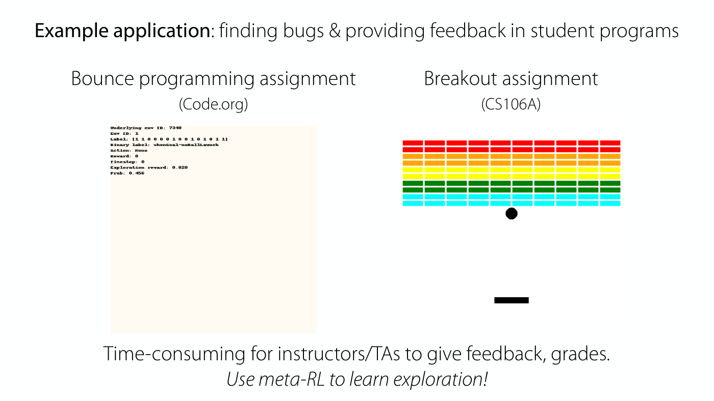

Title: "**Example application**: finding bugs & providing feedback in student programs". Two columns. Left, "Bounce programming assignment (Code.org)": a near-blank cream-coloured square with a few lines of small monospace text in the top-left corner reading "Underlying env ID: 7340", "Env ID: 1", "Label: [1 1 0 0 0 0 1 0 0 1 0 1 0 1 1]", "Binary label: whenGoal-noBallLaunch", "Action: None", "Reward: 0", "Timestep: 0", "Exploration reward: 0.020", "Prob: 0.456". Right, "Breakout assignment (CS106A)": a rendering of a Breakout game with ten rows of bricks (two red, two orange, two yellow, two green, two cyan, ten bricks per row), a black ball just below the bricks and a black paddle near the bottom. Finn describes Bounce as a game on Code.org that looks a bit like Pong, or one side of Pong, where the goal is to hit a ball into the goal (≈1:09:49). The Breakout panel is a frame of a video of a buggy student program that plays in the lecture: the ball gets "skewered" by the paddle, bouncing off it rather than losing a point or a life (≈1:10:35). The PDF holds only the frames. Bottom: "Time-consuming for instructors/TAs to give feedback, grades." and in italics "*Use meta-RL to learn exploration!*".

## Slide 31 — Experiments: Learned Exploration Behavior on Bounce

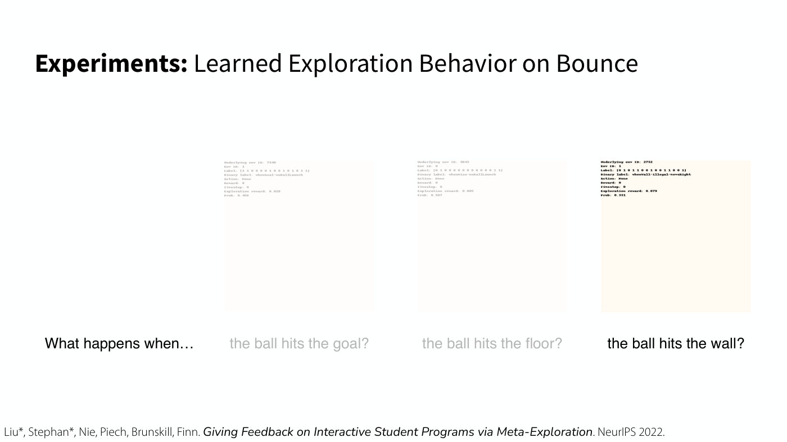

Title: "**Experiments:** Learned Exploration Behavior on Bounce". A row of three near-blank cream-coloured squares, each with a few lines of tiny monospace text in its top-left corner, the way slide 30's Bounce panel does, under a left-hand label "What happens when…". The first two squares and their captions are faded to light grey; the third is in full black, so the build appears to highlight the third.
- First square, caption (grey) "the ball hits the goal?": text reads "Underlying env ID: 7340", "Env ID: 1", a "Label:" line of 15 binary digits, "Binary label: whenGoal-noBallLaunch", "Action: None", "Reward: 0", "Timestep: 0", "Exploration reward: 0.020", "Prob: 0.456".
- Second square, caption (grey) "the ball hits the floor?": text reads "Underlying env ID: 4843", "Env ID: 0", a "Label:" line of 15 binary digits, "Binary label: whenMiss-noBallLaunch", "Action: None", "Reward: 0", "Timestep: 0", "Exploration reward: 0.005", "Prob: 0.507". The text is faint and the binary digits are only approximately readable.
- Third square, caption (black) "the ball hits the wall?": text reads "Underlying env ID: 2732", "Env ID: 1", "Label: [0 1 0 1 1 0 0 1 0 0 1 1 0 0 1]" (digits approximately read), "Binary label: whenWall-illegal-moveRight", "Action: None", "Reward: 0", "Timestep: 0", "Exploration reward: 0.079", "Prob: 0.331".

Each square shows only the initial text readout; no game graphics are visible. The squares are the first frames of videos that play in the lecture (≈1:11:20): in one the learned exploration policy tries to play the game successfully, hitting the ball into the goal; in another it purposely misses the ball to see what happens when the ball hits the floor; in another it hits the wall instead of the goal, and the program shown there is buggy, creating lots of balls as soon as the ball hits the wall. The PDF holds only these frames. Footer: "Liu\*, Stephan\*, Nie, Piech, Brunskill, Finn. *Giving Feedback on Interactive Student Programs via Meta-Exploration*. NeurIPS 2022."

## Slide 32 — Experiments: AI-Assisted Grading in CS106A (Spring 2023)

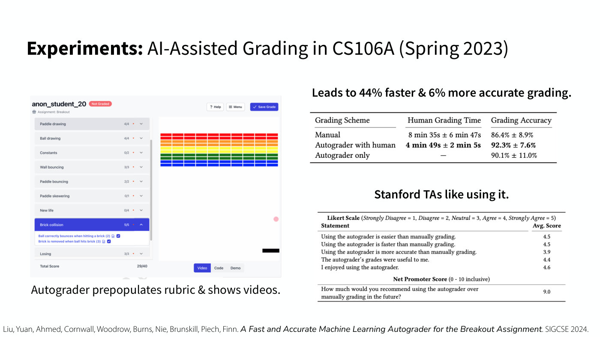

Title: "**Experiments:** AI-Assisted Grading in CS106A (Spring 2023)".

Left, a screenshot of a grading interface headed "anon_student_20" with a red "Not Graded" tag, "Assignment: Breakout", and "Help", "Menu" and "Save Grade" buttons at top right. A rubric list at left shows items with scores: "Paddle drawing 4/4", "Ball drawing 4/4", "Constants 0/2", "Wall bouncing 3/3", "Paddle bouncing 2/2", "Paddle skewering 0/1", "New life 0/4", "Brick collision 5/5" (highlighted in blue and expanded, listing "Ball correctly bounces when hitting a brick (2)" and "Brick is removed when ball hits brick (3)", both checked), "Losing 3/3", and "Total Score 29/40". At right is a Breakout game view with rows of red, orange, yellow, green and blue bricks, a pink dot at the right edge and a black paddle at the bottom right; tabs "Video", "Code" and "Demo" sit beneath it with "Video" selected. Caption beneath: "Autograder prepopulates rubric & shows videos."

Right, a headline "Leads to 44% faster & 6% more accurate grading." and a table:

| Grading Scheme | Human Grading Time | Grading Accuracy |
| --- | --- | --- |
| Manual | 8 min 35s ± 6 min 47s | 86.4% ± 8.9% |
| Autograder with human | **4 min 49s ± 2 min 5s** | **92.3% ± 7.6%** |
| Autograder only | — | 90.1% ± 11.0% |

The "Autograder with human" figures are in bold. Below it, "Stanford TAs like using it." and a second table headed "Likert Scale (Strongly Disagree = 1, Disagree = 2, Neutral = 3, Agree = 4, Strongly Agree = 5)" with columns "Statement" and "Avg. Score":

| Statement | Avg. Score |
| --- | --- |
| Using the autograder is easier than manually grading. | 4.5 |
| Using the autograder is faster than manually grading. | 4.5 |
| Using the autograder is more accurate than manually grading. | 3.9 |
| The autograder's grades were useful to me. | 4.4 |
| I enjoyed using the autograder. | 4.6 |

Then a sub-heading row "Net Promoter Score (0 - 10 inclusive)" and the row "How much would you recommend using the autograder over manually grading in the future?" with score 9.0.

Footer: "Liu, Yuan, Ahmed, Cornwall, Woodrow, Burns, Nie, Brunskill, Piech, Finn. *A Fast and Accurate Machine Learning Autograder for the Breakout Assignment*. SIGCSE 2024."

## Slide 33 — The plan for today

Same outline as slides 3 and 14: "1. Exploration" with a. "Why is exploration hard?", b. "Algorithms for exploration in bandits", c. "Exploration in robotics, LLMs"; "2. Learning to Explore via Meta-Learning" with a. "Efficiently Meta-Learning Optimal Exploration" followed by "<- Part of HW 4", and b. "Meta-Exploration in for CS Education" (sic). Both top-level items are in the heavier weight, with no separate highlight. The printed number 33 is at bottom centre.

## Slide 34 — Reminders

"Reminders". "Homework 3 due **tonight**", "(and HW4 out today)", "Project milestone due **next Friday**" (bold words as on slide 2). Then "**Next week:**" with two lines: "Can we make reinforcement learning more autonomous?" and "Can we do extra long-horizon tasks leveraging hierarchy?" (sic: "extra long-horizon"). The printed number 34 is at bottom centre.
