# Lecture 15 — Hierarchical RL and IL: slide-by-slide

Text and figures of the Stanford CS 224R "Deep Reinforcement Learning" (Spring 2025) Lecture 15 deck, transcribed from the PDF. The title slide (slide 1) prints "Hierarchy in Imitation and Reinforcement Learning" and "CS 224R", and names no lecturer. Cite these as "slide N". Diagrams, photographs and plots are described in prose since the KB is read as text.

The recording (about 69 minutes) opens with the recap of slide 3 (≈0:05), without discussing slide 2's reminders, and follows the deck through slide 44, then closes with slide 46's "next time" (≈1:09:15, ending at about 1:09:28); slide 45's summary outline and the reminders on slides 2 and 46 are not discussed, so for them this file is the only source. Finn draws on a board or the slides where the recording does not show it: the hierarchical policy diagram (≈3:58–6:16), the roll-out procedure before slide 8 appears (≈10:09–11:41), the pasta-making example's sets of states, which no slide holds (≈25:31–28:36 and ≈30:57–37:04), the variable-length segments of a demonstration (≈47:01) and an image-subgoal policy in answer to a question (≈1:01:38); the transcript is the only source for those drawings. Slides 31–33, 35, 36 and 39 hold one frame each of videos that play in the lecture; what they showed is under those slides.

## Slide numbers vs PDF pages

The deck is 1:1 with its page index: PDF page N is slide N, for all 46 pages. Most pages print their number at bottom centre in the text layer (pages 39–41 at bottom right), each equal to its page index. Pages 5, 8, 10, 11, 31, 32, 33, 34, 35 and 43 print no number in the text layer; their labels are inferred but unambiguous because they sit between consecutive numbered pages with no gap.

| PDF page | Slide |
| -------- | ----- |
| 1 | 1 |
| 2 | 2 |
| 3 | 3 |
| 4 | 4 |
| 5 | 5 |
| 6 | 6 |
| 7 | 7 |
| 8 | 8 |
| 9 | 9 |
| 10 | 10 |
| 11 | 11 |
| 12 | 12 |
| 13 | 13 |
| 14 | 14 |
| 15 | 15 |
| 16 | 16 |
| 17 | 17 |
| 18 | 18 |
| 19 | 19 |
| 20 | 20 |
| 21 | 21 |
| 22 | 22 |
| 23 | 23 |
| 24 | 24 |
| 25 | 25 |
| 26 | 26 |
| 27 | 27 |
| 28 | 28 |
| 29 | 29 |
| 30 | 30 |
| 31 | 31 |
| 32 | 32 |
| 33 | 33 |
| 34 | 34 |
| 35 | 35 |
| 36 | 36 |
| 37 | 37 |
| 38 | 38 |
| 39 | 39 |
| 40 | 40 |
| 41 | 41 |
| 42 | 42 |
| 43 | 43 |
| 44 | 44 |
| 45 | 45 |
| 46 | 46 |

## Sections of the deck

| Section | Slides |
| ------- | ------ |
| Title, reminders and recap | 1–3 |
| Plan and the problem: long-horizon tasks, the main idea of hierarchy, why it may help, whether multiple policies are needed | 4–11 |
| Key design choices: goal representation | 12–14 |
| Key design choices: supervision for each level | 15–18 |
| Key design choices: when to move on from one subgoal to the next | 19–21 |
| Example systems: hierarchy in current robot systems | 22–24 |
| Hierarchical imitation with language subgoals (data, ALOHA, DAgger fine-tuning, language corrections, Hi Robot results) | 25–36 |
| Hierarchical imitation with image subgoals (SuSIE, chain-of-thought version) | 37–41 |
| Hierarchical reinforcement learning (state and language goals, skill discovery) | 42–44 |
| Summary plan and next time | 45–46 |

## Slide 1 — Hierarchy in Imitation and Reinforcement Learning

Title slide. Large centred title "Hierarchy in Imitation and Reinforcement Learning" with "CS 224R" beneath it. No lecturer or date is printed. The printed number 1 is at bottom centre.

## Slide 2 — Course reminders

"Course reminders". Two dashed lines: "Project milestone due Friday." and "Homework 4 due next Friday". Below, a second heading "Based on course feedback" with one dashed line: "Posting tips on Ed for default project!". The printed number 2 is at bottom centre.

## Slide 3 — Brief recap

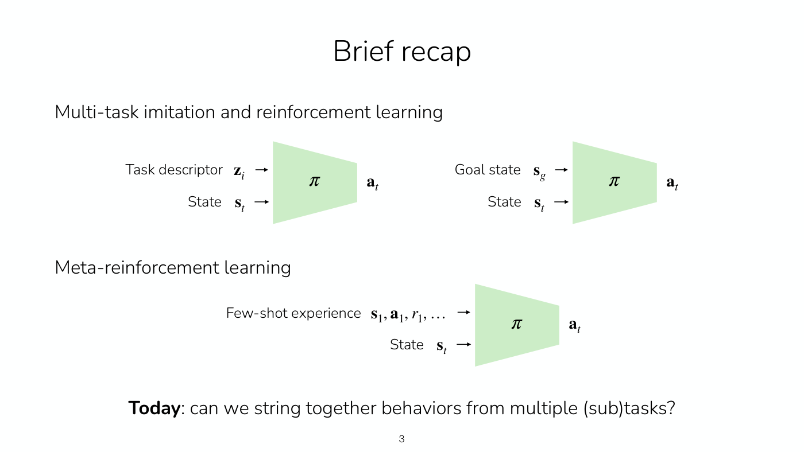

"Brief recap". Three policy diagrams, each a light-green trapezoid (wide on the left, narrow on the right) labelled $\pi$, with arrows entering from the left and an output on the right.

Under the heading "Multi-task imitation and reinforcement learning", two diagrams side by side. Left: inputs "Task descriptor $\mathbf{z}_ i$" and "State $\mathbf{s}_ t$" enter the $\pi$ trapezoid, and the output is $\mathbf{a}_ t$. Right: inputs "Goal state $\mathbf{s}_ g$" and "State $\mathbf{s}_ t$" enter a $\pi$ trapezoid, and the output is $\mathbf{a}_ t$.

Under the heading "Meta-reinforcement learning", one diagram: inputs "Few-shot experience $\mathbf{s}_ 1, \mathbf{a}_ 1, r_ 1, \ldots$" and "State $\mathbf{s}_ t$" enter a $\pi$ trapezoid, and the output is $\mathbf{a}_ t$.

At the bottom: "**Today**: can we string together behaviors from multiple (sub)tasks?" ("Today" in bold). The printed number 3 is at bottom centre.

## Slide 4 — Plan for today

"Plan for today". A numbered outline: "1. What's the problem" with sub-items "a. Why long-horizon tasks are hard" and "b. Why hierarchy may help"; "2. Key design choices" with sub-items "a. How to represent skills/goals?", "b. When to move on from one goal to the next?" and "c. Supervision for each level"; "3. Example systems". The printed number 4 is at bottom centre.

## Slide 5 — Long horizon tasks

"Long horizon tasks". Four lines, each with an emoji icon at the left: a robot face "Cook focaccia."; a desktop computer "Fix a bug that is causing neural network training loss to explode."; a red car "Drive to Yosemite."; a pencil "Give feedback on an 8-page report."

Then "Why are these hard?" with a numbered list: "1. Very large # of states visited."; "2. Many opportunities to make mistakes."; "3. Many opportunities to get "stuck"." No printed number appears (inferred 5).

## Slide 6 — The main idea

"The main idea". Subtitle "Can we break up hard tasks into easier subtasks?". A left-aligned stack of six phrases in decreasing font size, from large to tiny: "Bake a cheesecake", "Buy ingredients", "Go to the store", "Walk to the door", "Take a step", "Contract quad muscle". At the right of the first, in red: "<- doing this is really hard". At the right of "Take a step", in green: "<- doing this is easy". The printed number 6 is at bottom centre.

## Slide 7 — The main idea

"The main idea". Subtitle "Can we break up hard tasks into easier subtasks?". A two-block diagram. A blue trapezoid labelled $\pi_{\text{HL}}$ takes two inputs from the left: the text "Bake a cheesecake" and $\mathbf{o}_ t$. Its output $\mathbf{g}_ t$ is an arrow into a green trapezoid labelled $\pi_{\text{LL}}$, which also takes $\mathbf{o}_ t$ as a second input from below-left; the green block outputs $\mathbf{a}_ t$.

Below the diagram, left, in blue "High-level policy" followed by "predicts intermediate goals $\mathbf{g}_ t$". Right, in green "Low-level policy" followed by "tries to accomplish $\mathbf{g}_ t$ by predicting actions $\mathbf{a}_ t$"; then "It operates at a *higher frequency* than the high-level policy." (the words "higher frequency" in italics).

Bottom lines: "Many names for $\mathbf{g}_ t$: subgoals, subtasks, skills, options, high-level actions" and "Could have more than 2 levels of hierarchy!". The printed number 7 is at bottom centre.

## Slide 8 — The main idea

"The main idea". Same subtitle and same two-block diagram as slide 7 (blue $\pi_{\text{HL}}$ taking "Bake a cheesecake" and $\mathbf{o}_ t$, giving $\mathbf{g}_ t$ to green $\pi_{\text{LL}}$ which also takes $\mathbf{o}_ t$ and gives $\mathbf{a}_ t$), placed higher, with the same blue and green captions "High-level policy predicts intermediate goals $\mathbf{g}_ t$" and "Low-level policy tries to accomplish $\mathbf{g}_ t$ by predicting actions $\mathbf{a}_ t$" (without the frequency sentence or the closing two lines).

Below, at left, "Rolling out the hierarchical policy:" and at right a numbered procedure:

0. Observe initial observation $\mathbf{o}_ 1$ at $t = 1$
1. Plan goal $\mathbf{g}_ t$ according to $\pi_{\text{HL}}(\cdot \mid \mathbf{o}_ t, \text{prompt})$ (the policy term in blue)
2. Until new goal is selected:
   a. Execute predicted action $\mathbf{a}_ t$ according to $\pi_{\text{LL}}(\cdot \mid \mathbf{o}_ t, \mathbf{g}_ t)$ (the policy term in green)
   b. $t \leftarrow t + 1$, observe new observation $\mathbf{o}_ t$

No printed number appears (inferred 8).

## Slide 9 — Why may hierarchy help?

"Why may hierarchy help?". A numbered list: "1. Supervision signal on how to complete the task"; "2. More direct knowledge sharing across similar subtasks"; "3. **In RL**: structured exploration in higher-level space"; "4. **Practical challenge**: Address speed requirements by running polices at different frequencies" (sic, "polices"; "In RL" and "Practical challenge" in a heavier weight). The printed number 9 is at bottom centre.

## Slide 10 — Do we really need multiple policies?

"Do we *really* need multiple policies?" ("really" in italics). Three horizontal rounded bands, each with a label at left and a diagram.

Top band in light blue, "Hierarchy": blue $\pi_{\text{HL}}$ trapezoid taking "Bake a cheesecake" and $\mathbf{o}_ t$, passing $\mathbf{g}_ t$ to a green $\pi_{\text{LL}}$ trapezoid that also takes $\mathbf{o}_ t$ and outputs $\mathbf{a}_ t$.

Middle band in light green, "Flat policy": a single green $\pi$ trapezoid taking "Bake a cheesecake" and $\mathbf{o}_ t$, outputting $\mathbf{a}_ t$.

Bottom band in light cyan, "Chain of thought": a single teal $\pi$ trapezoid taking "Bake a cheesecake" and $\mathbf{o}_ t$, outputting both the goal $\mathbf{g}_ t$ and the action $\mathbf{a}_ t$, printed as the pair $\mathbf{g}_ t , \mathbf{a}_ t$.

No printed number appears (inferred 10).

## Slide 11 — Do we really need multiple policies?

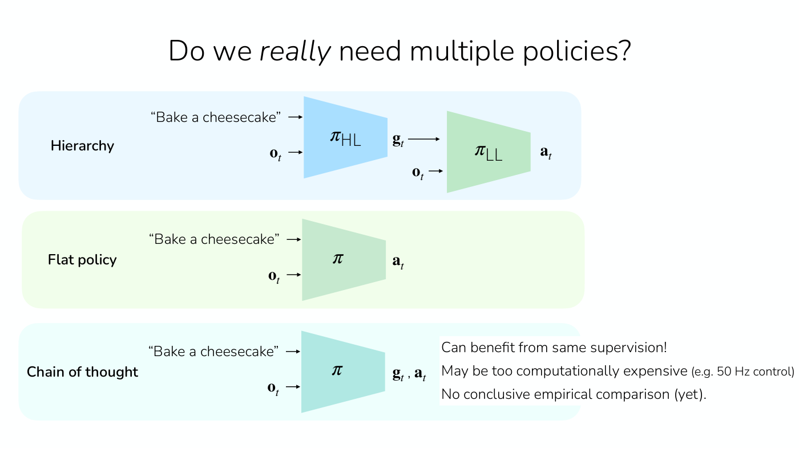

"Do we *really* need multiple policies?" The same three bands as slide 10 (Hierarchy, Flat policy, Chain of thought), shifted to the left. On the right, overlapping the end of the chain-of-thought band, three lines of text on a white box: "Can benefit from same supervision!"; "May be too computationally expensive (e.g. 50 Hz control)" (the parenthetical in smaller type); "No conclusive empirical comparison (yet)." No printed number appears (inferred 11).

## Slide 12 — Plan for today

Same outline as slide 4, with the reordered sub-items of item 2: "1. What's the problem" (a. "Why long-horizon tasks are hard", b. "Why hierarchy may help"); "**2. Key design choices**" in bold, with "a. How to represent skills/goals?", "b. Supervision for each level", "c. When to move on from one goal to the next?"; "3. Example systems". The printed number 12 is at bottom centre.

## Slide 13 — What goal representation would you use?

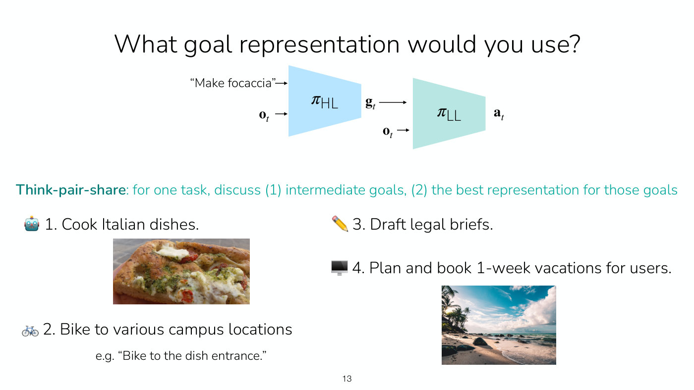

"What goal representation would you use?". Top: the two-block diagram with a blue $\pi_{\text{HL}}$ taking "Make focaccia" and $\mathbf{o}_ t$, giving $\mathbf{g}_ t$ to a teal $\pi_{\text{LL}}$ that also takes $\mathbf{o}_ t$ and outputs $\mathbf{a}_ t$.

Below, in teal: "**Think-pair-share**: for one task, discuss (1) intermediate goals, (2) the best representation for those goals". Then four tasks in a two-by-two layout, each with an emoji at the left: a robot "1. Cook Italian dishes." with a photograph of a slice of focaccia topped with cheese, pesto and cherry tomatoes; a bicycle "2. Bike to various campus locations" with the line 'e.g. "Bike to the dish entrance."'; a pencil "3. Draft legal briefs."; a desktop computer "4. Plan and book 1-week vacations for users." with a photograph of a tropical beach with palm trees, rocks and a cloudy blue sky. The printed number 13 is at bottom centre.

## Slide 14 — What goal representation would you use?

"What goal representation would you use?". The same diagram as slide 13 at the top. Below, a numbered list: "1. Best goal representations will likely be domain specific!"; "2. Properties of good goal representations:" with sub-items "a. Expressive (can communicate many different low-level behaviors)"; "b. Structured (similar behaviors should have similar $\mathbf{g}$)"; "c. Appropriate level of abstraction (not too hard for low-level or for high-level)". The printed number 14 is at bottom centre.

## Slide 15 — Plan for today

Same outline as slide 12, with "**b. Supervision for each level**" now in bold instead of item 2. The printed number 15 is at bottom centre.

## Slide 16 — How to supervise each level?

"How to supervise each level?". The two-block diagram: blue $\pi_{\text{HL}}$ taking "Make focaccia" and $\mathbf{o}_ t$, giving $\mathbf{g}_ t$ to a teal $\pi_{\text{LL}}$ that also takes $\mathbf{o}_ t$ and outputs $\mathbf{a}_ t$.

Below: "Why not train everything end-to-end, with latent goal representation?" and "**Result**: a flat policy". Then, in red-orange, "Key:" followed in black by "Think carefully about where the benefits are coming from!" with a curved red-orange arrow from the words "Generally good to do in any kind of research!!" (red-orange, at lower right) pointing at that sentence. The printed number 16 is at bottom centre.

## Slide 17 — How to supervise each level?

"How to supervise each level?". Same two-block diagram as slide 16. Below, in teal "Low-level policy:" then "Trained to accomplish $\mathbf{g}$, not the original task!". Then, with "Key question:" in magenta: "Key question: For which distribution of goals?" and at right "Ideally whatever the high-level policy will output" and "... but we haven't learned a high-level policy yet."

Then in blue "High-level policy:" then "Trained to accomplish original, long-horizon task". Then "Key question: For which low-level policy?" ("Key question:" in magenta) and at right "Ideally with the learned low-level policy" and "... but we haven't learned a low-level policy yet." The printed number 17 is at bottom centre.

## Slide 18 — How to supervise each level?

"How to supervise each level?". Same two-block diagram. Below, in teal "Low-level policy:" then "Trained to accomplish $\mathbf{g}$, not the original task!"; in blue "High-level policy:" then "Trained to accomplish original, long-horizon task".

Then: "**Key:** Can be trained separately first. But, at least one policy should be adapted to the deficiencies of the other." and "(if not both fine-tuned jointly)" ("Key:" in red-orange). At the lower right, in red-orange: "Note: LLMs are often good high-level policies!". The printed number 18 is at bottom centre.

## Slide 19 — Plan for today

Same outline as slide 12, with "**c. When to move on from one goal to the next?**" in bold. The printed number 19 is at bottom centre.

## Slide 20 — When to move on from one subgoal to the next?

"When to move on from one subgoal to the next?". The two-block diagram (blue $\pi_{\text{HL}}$ with "Make focaccia" and $\mathbf{o}_ t$; teal $\pi_{\text{LL}}$ with $\mathbf{g}_ t$ and $\mathbf{o}_ t$; output $\mathbf{a}_ t$). A curved red-orange arrow runs from the red-orange text "How often do you re-query the HL policy?" up to the $\mathbf{g}_ t$ arrow between the two blocks.

Below, at left, "Rolling out the hierarchical policy:" and at right the same numbered procedure as slide 8:

0. Observe initial observation $\mathbf{o}_ 1$ at $t = 1$
1. Plan goal $\mathbf{g}_ t$ according to $\pi_{\text{HL}}(\cdot \mid \mathbf{o}_ t, \text{prompt})$ (blue)
2. Until new goal is selected: (this line is highlighted with a pink box)
   a. Execute predicted action $\mathbf{a}_ t$ according to $\pi_{\text{LL}}(\cdot \mid \mathbf{o}_ t, \mathbf{g}_ t)$ (green)
   b. $t \leftarrow t + 1$, observe new observation $\mathbf{o}_ t$

The printed number 20 is at bottom centre.

## Slide 21 — When to move on from one subgoal to the next?

"When to move on from one subgoal to the next?". The same diagram and red-orange question "How often do you re-query the HL policy?" with its arrow as slide 20. Below, two columns in grey type with green plus and red minus lines.

Left column: "Option 1: When the low-level policy has completed $\mathbf{g}_ t$" and "e.g. by estimating progress towards $\mathbf{g}$". In green "+ ideal in principle". In red "- hard to estimate when done" and "- need to account for mistakes that require redoing past goals". Then in grey "Errors in estimating when done —>" and "agent easily gets perpetually stuck."; a small red-orange curved arrow points at that line from the red-orange text "These errors are more fatal!".

Right column: "Option 2: After fixed number of $n$ timesteps." and "e.g. by choosing fairly frequent interval to replan". In green "+ simple". In red "- tradeoff between more compute vs more delay in transition to new goal" and "- with small $n$, more burden on HL policy". Then in grey "Errors in predicting subtask —>" and "LL policy may take wrong actions for $n$ steps."

The printed number 21 is at bottom centre.

## Slide 22 — Plan for today

Same outline as slide 12, with "**3. Example systems**" in bold. The printed number 22 is at bottom centre.

## Slide 23 — Hierarchy is hot

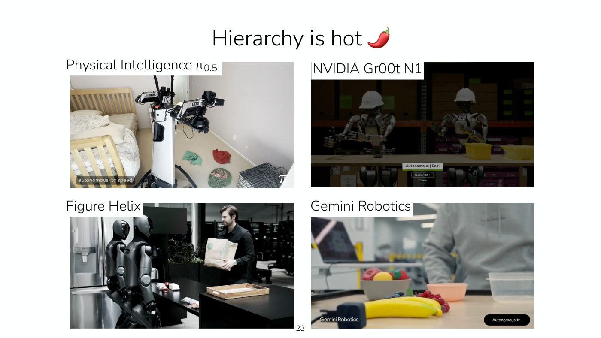

"Hierarchy is hot" followed by a red chili-pepper emoji. Four photographs or video stills in a two-by-two grid, each with a caption on a white label at its top left.

Top left, "Physical Intelligence $\pi_{0.5}$": a mobile robot with a white column body and two black arms with cameras, in a bedroom with a bed, a crib-like wooden frame and a few clothes (green, red and patterned) on the floor, with a black-and-white patterned laundry basket at the right. A grey tag at lower left reads "autonomous, 5x speed"; a small $\pi$ logo is at lower right.

Top right, "NVIDIA Gr00t N1": a dark warehouse scene with two humanoid robots wearing white hard hats behind a counter with yellow bins. A small overlay reads "Autonomous | Real" and "Fourier GR-1" and "1X Speed".

Bottom left, "Figure Helix": two dark humanoid robots at a kitchen counter next to a stainless steel refrigerator, with a person in black holding a paper bag at the right and a wooden tray on the counter.

Bottom right, "Gemini Robotics": a blurred close view of a table with a bowl of fruit, a banana, a pink bowl and a plastic container, and a person in a grey top behind it. A label at lower left reads "Gemini Robotics" and a black pill at lower right reads "Autonomous 1x".

The speed tags mark these as stills from videos. Finn describes the four systems' tasks (≈44:41–45:27): cleaning a bedroom, handing over objects and pouring them or putting them into bins, putting away objects into a fridge, and putting fruit into bowls; the stills do not show those motions. The printed number 23 is at bottom centre.

## Slide 24 — Hierarchy is hot

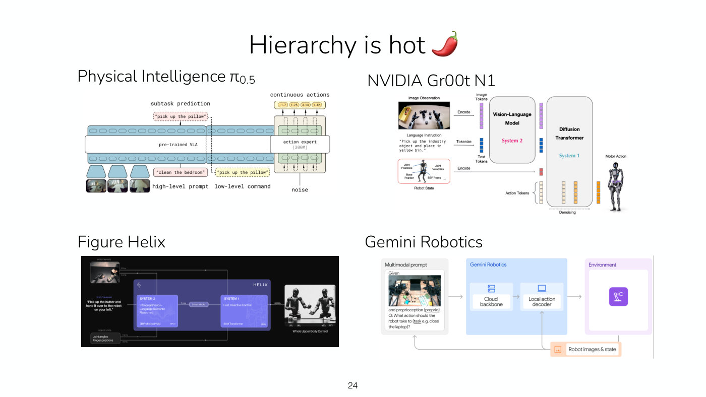

"Hierarchy is hot" with the chili-pepper emoji. The same four captions, each now over an architecture diagram taken from the corresponding system's materials. Text inside the diagrams is small; what is legible is given below.

Top left, "Physical Intelligence $\pi_{0.5}$": a diagram with three camera-image thumbnails at lower left feeding a wide "pre-trained VLA" block built from two rows of token ovals. A dashed pink box above reads "pick up the pillow" under the label "subtask prediction". A pink box below the image row reads "clean the bedroom" under the label "high-level prompt"; a yellow dashed box reads "pick up the pillow" under the label "low-level command", and a dashed line runs from the predicted subtask above the VLA down to this low-level command, which is fed back into the model. At the right an "action expert (300M)" block, fed with "noise" from below, outputs "continuous actions" shown as four numbers in yellow ovals (−1.7, 1.25, 3.14, 1.42).

Top right, "NVIDIA Gr00t N1": a diagram on the left with an "Image Observation" picture of robot arms over a table, a "Language Instruction" box reading "Pick up the industry object and place in yellow bin.", and a "Robot State" box listing joint positions, joint velocities, base position and EEF poses. Arrows labelled "Encode" and "Tokenize" lead through "Image Tokens" and "Text Tokens" into a block "Vision-Language Model" with "System 2" in magenta, and a block "Diffusion Transformer" with "System 1" in teal; the robot state is also encoded into the diffusion transformer. "Action Tokens" and "Denoising" are labelled below, and the output "Motor Action" points to a picture of a humanoid robot.

Bottom left, "Figure Helix": a dark-background diagram with "Robot images", a "Text command" reading "Pick up the butter and hand it over to the robot on your left.", and "Robot state" (joint angles, finger positions) feeding a purple box "HELIX" containing "SYSTEM 2" ("Infrequent Vision-Language Semantic Reasoning", "7B Pretrained VLM") and "SYSTEM 1" ("Fast, Reactive Control", "80M Transformer") joined by a "Latent Vector" link at 7-9 Hz; System 2 is marked "GPU 2" and System 1 "GPU 1". The robot images and the robot state each reach System 2 at 7-9 Hz and System 1 at 20 Hz, and System 1's output at 200 Hz goes to a picture of two humanoid robots captioned "Whole Upper Body Control".

Bottom right, "Gemini Robotics": a block diagram. At left a "Multimodal prompt" box with a robot-workspace picture and the text "Given ... and proprioception (proprio). Q: What action should the robot take to (task e.g. close the laptop)?". An arrow leads to a blue "Gemini Robotics" box containing "Cloud backbone" and "Local action decoder", then to an "Environment" box with a robot-arm icon. A return path "Robot images & state" in an orange box loops back to the prompt and to the local action decoder.

The printed number 24 is at bottom centre.

## Slide 25 — Let's cover a few examples

"Let's cover a few examples". An outline: "1. Hierarchical imitation learning" ("imitation learning" in blue) with sub-items "a. with language subgoals" and "b. with image subgoals"; "2. Hierarchical reinforcement learning" ("reinforcement learning" in magenta) with sub-items "a. with language subgoals" and "b. with state subgoals". The printed number 25 is at bottom centre.

## Slide 26 — Let's cover a few examples

Same outline as slide 25, with "**a. with language subgoals**" under item 1 in bold. The printed number 26 is at bottom centre.

## Slide 27 — Hierarchical imitation with language subgoals

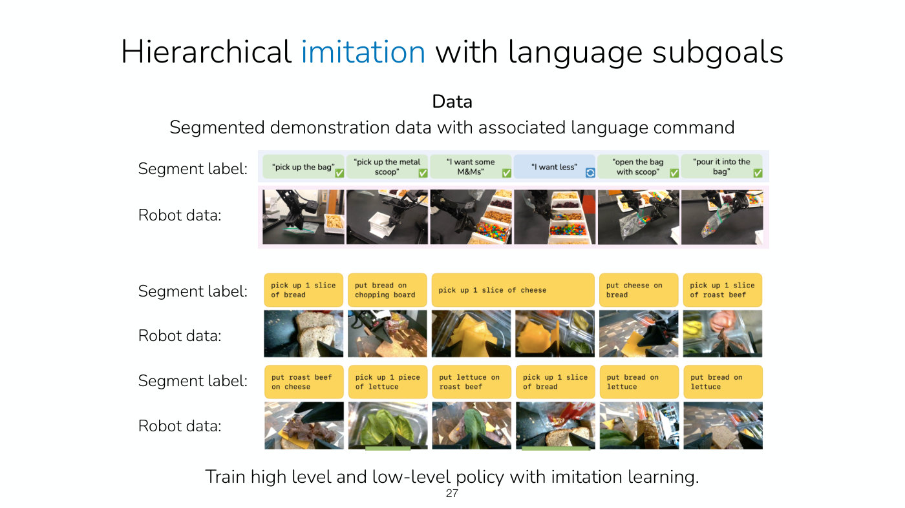

"Hierarchical imitation with language subgoals" ("imitation" in blue). Heading "**Data**" and "Segmented demonstration data with associated language command". Three rows of paired strips, each labelled at the left "Segment label:" over "Robot data:".

Row 1: six light-green label boxes, each label printed in quotation marks, with a green check mark at the corner of each except the fourth, which is light blue with a circular-arrows icon: "pick up the bag"; "pick up the metal scoop"; "I want some M&Ms"; "I want less" (the blue one); "open the bag with scoop"; "pour it into the bag". Beneath, six robot-camera frames in a pink-bordered strip: a gripper over a bag near a bin of snacks; a scoop over a white bin; a gripper with a scoop over bins of nuts and candy; the scoop over M&Ms; a gripper opening a clear bag; the bag being filled with candy.

Row 2: five yellow label boxes in monospace type: "pick up 1 slice of bread"; "put bread on chopping board"; "pick up 1 slice of cheese" (spanning two frames); "put cheese on bread"; "pick up 1 slice of roast beef". Beneath, six robot-camera frames of bread slices, a chopping board, cheese slices in a container, cheese on bread, and roast beef.

Row 3: six yellow label boxes: "put roast beef on cheese"; "pick up 1 piece of lettuce"; "put lettuce on roast beef"; "pick up 1 slice of bread"; "put bread on lettuce"; "put bread on lettuce" (sic, as printed twice). Beneath, six robot-camera frames of the sandwich being built.

Bottom: "Train high level and low-level policy with imitation learning." The printed number 27 is at bottom centre.

## Slide 28 — Hierarchical imitation with language subgoals

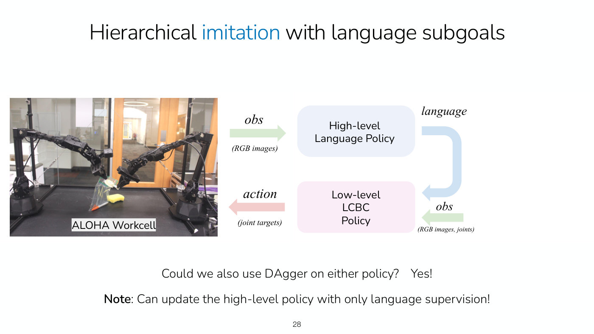

"Hierarchical imitation with language subgoals". At left, a photograph labelled "ALOHA Workcell": two black robot arms on a black table in a glass-walled office, holding a clear plastic bag with a yellow sponge and an orange marker on the table. At right, a block diagram: an arrow labelled "obs" with "(RGB images)" in green points into a pale-blue box "High-level Language Policy". Its output arrow labelled "language" bends in blue downward into a pale-pink box "Low-level LCBC Policy", which also takes an "obs" arrow labelled "(RGB images, joints)" in green from the right. The low-level box outputs a pink "action" arrow labelled "(joint targets)" pointing left.

Below: "Could we also use DAgger on either policy?  Yes!" and "**Note**: Can update the high-level policy with only language supervision!". The printed number 28 is at bottom centre.

## Slide 29 — Hierarchical imitation with language subgoals

"Hierarchical imitation with language subgoals". Subtitle "Fine-tuning high-level policy with DAgger". The same ALOHA Workcell photograph and block diagram as slide 28, with two additions: a snowflake emoji on the low-level LCBC policy box, and, at the right, a drawing of a person's head in profile speaking, connected by an "intervention" label to a double-line mark that cuts across the blue "language" arrow between the two boxes. Caption: "Language corrections override high-level policy prediction". Citation at the bottom: "Shi, Hu, Zhao, Sharma, Pertsch, Leo, Levine, Finn. Yell At Your Robot: Improving On-the-Fly from Language Corrections. RSS 2024". The printed number 29 is at bottom centre.

## Slide 30 — Hierarchical imitation with language subgoals

"Hierarchical imitation with language subgoals". Subtitle "Fine-tuning high-level policy with DAgger". The same diagram as slide 29, with a flame emoji on the high-level language policy box and an orange arrow labelled "gradient update" running from the intervention mark back up to the high-level box. Captions: "Language corrections override high-level policy prediction" and "**One approach**: Freeze low-level policy. Update high-level policy by supervising on language corrections." Same citation as slide 29: "Shi, Hu, Zhao, Sharma, Pertsch, Leo, Levine, Finn. Yell At Your Robot: Improving On-the-Fly from Language Corrections. RSS 2024". The printed number 30 is at bottom centre.

## Slide 31 — Language correction on-the-fly

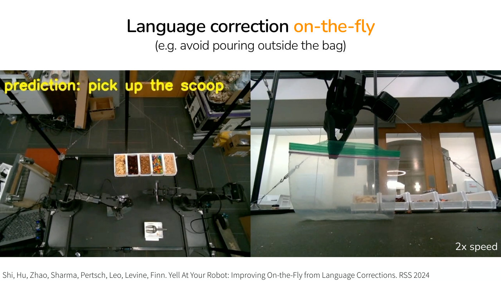

"Language correction on-the-fly" ("on-the-fly" in orange) with the subtitle "(e.g. avoid pouring outside the bag)". A full-width image split into two panels. Left: a top-down camera view of a black table in a lab with two black robot arms, a row of five white bins of snacks (dried fruit, cranberries, nuts, M&Ms, cereal) at the top and a scoop on a white tray at the bottom, with yellow overlay text "prediction: pick up the scoop". Right: a close side view of a gripper holding the top of a clear zip bag with a green seal strip, with a row of bins behind it and the text "2x speed" at lower right. Citation: "Shi, Hu, Zhao, Sharma, Pertsch, Leo, Levine, Finn. Yell At Your Robot: Improving On-the-Fly from Language Corrections. RSS 2024". The page prints no number (inferred 31).

Slides 31–33 each hold one frame of a video. Finn plays it at ≈51:39–53:56: yellow text gives the high-level policy's command and the robot's motion is the low-level policy's. The high-level policy says pick up spoon and the robot picks up the spoon; then come "move the spoon towards me" and "I want some peanuts", and the low-level policy scoops peanuts; then the high-level policy says move the scoop into the bag. When the robot is about to make a mistake, a person intervenes: instead of move the scoop into the bag, "move the left arm to the left", "go higher", then move the scoop into the bag. The user commands override the high-level policy until control is handed back, and the high-level policy then predicts pouring into the bag and getting banana chips.

## Slide 32 — Language correction on-the-fly

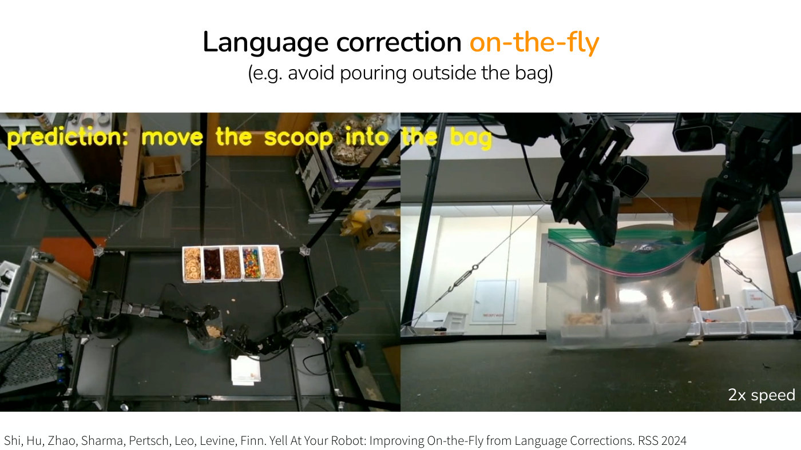

Same title, subtitle, layout, "2x speed" label and citation as slide 31. The left panel now shows the arms over the table with a scoop at the bag and yellow overlay text "prediction: move the scoop into the bag"; the right panel shows two grippers holding a clear zip bag open, bent over a row of bins. The page prints no number (inferred 32).

A frame of the video described under slide 31.

## Slide 33 — After fine-tuning high-level policy with DAgger

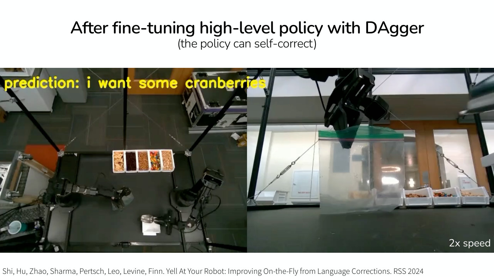

"After fine-tuning high-level policy with DAgger" with the subtitle "(the policy can self-correct)". The same two-panel layout. Left: top-down view of the table with the five bins at the top and the scoop on its tray near the bottom, with yellow overlay text "prediction: i want some cranberries". Right: a gripper holding a clear zip bag upright in front of a row of bins, with "2x speed" at lower right. Citation: "Shi, Hu, Zhao, Sharma, Pertsch, Leo, Levine, Finn. Yell At Your Robot: Improving On-the-Fly from Language Corrections. RSS 2024". The page prints no number (inferred 33).

A frame of a video (≈53:10–53:56): after the high-level policy is fine-tuned on the interventions, it notices on its own that the low-level policy is about to make the same mistake, says "Go higher", and then move the scoop into the bag.

## Slide 34 — Hierarchical imitation with language abstraction

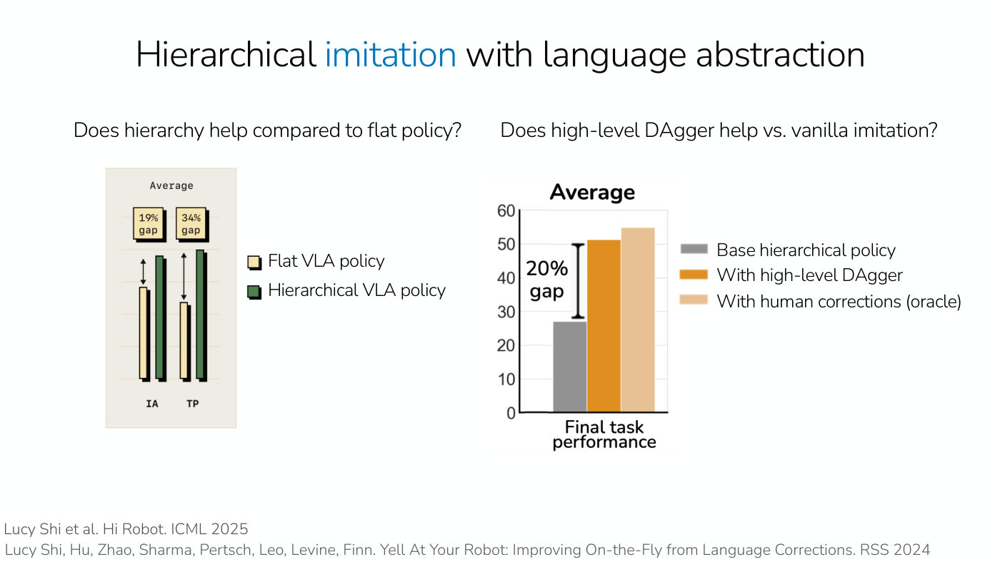

"Hierarchical imitation with language abstraction" ("imitation" in blue). Two questions above two charts. Left question: "Does hierarchy help compared to flat policy?". Right question: "Does high-level DAgger help vs. vanilla imitation?"

Left chart, titled "Average" (monospace): a small beige panel with no numeric axis and two pairs of vertical bars, labelled "IA" and "TP" beneath. In each pair a pale-yellow bar (flat) stands beside a taller dark-green bar (hierarchical), and a double-headed arrow at the left of the pair spans from the top of the flat bar up to the height of the hierarchical one. Above the IA pair a yellow box reads "19% gap" and above the TP pair a box reads "34% gap". Legend at right: a pale-yellow square "Flat VLA policy" and a dark-green square "Hierarchical VLA policy". Two series. No axis values are printed, so the printed gaps are the result; by eye, the flat bar is about three-quarters the height of the hierarchical bar for IA and under two-thirds for TP. The slide does not expand IA and TP; Finn reads the 34% as task progress and names an instruction accuracy metric (≈53:56–54:41).

Right chart, titled "Average": a bar chart with y axis from 0 to 60 in steps of 10 and a single group labelled "Final task performance" on the x axis. Three bars, one per series, in legend order: grey "Base hierarchical policy" at about 27; dark orange "With high-level DAgger" at about 51; light tan "With human corrections (oracle)" at about 55. A black vertical bracket from the top of the grey bar to about the top of the orange bar is labelled "20% gap".

Citations at the bottom: "Lucy Shi et al. Hi Robot. ICML 2025" and "Lucy Shi, Hu, Zhao, Sharma, Pertsch, Leo, Levine, Finn. Yell At Your Robot: Improving On-the-Fly from Language Corrections. RSS 2024". The page prints no number in the text layer (inferred 34).

## Slide 35 — With hierarchy, the robot is better at long-horizon tasks

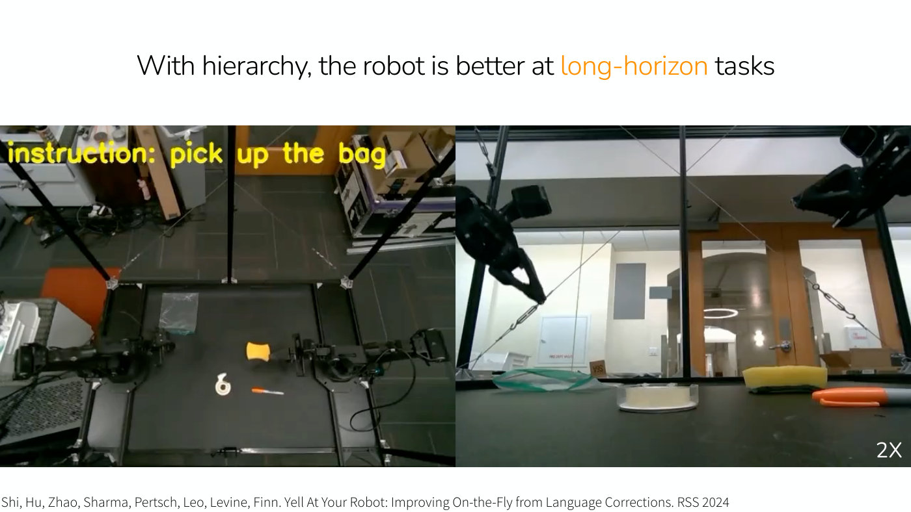

"With hierarchy, the robot is better at long-horizon tasks" ("long-horizon" in orange). The same two-panel layout as slides 31 to 33. Left: top-down view of the black table with a clear zip bag, a yellow sponge, a roll of tape and an orange marker, two black arms at the sides, and yellow overlay text "instruction: pick up the bag". Right: a side view of a gripper and the same objects on the table, with "2X" at lower right. Citation: "Shi, Hu, Zhao, Sharma, Pertsch, Leo, Levine, Finn. Yell At Your Robot: Improving On-the-Fly from Language Corrections. RSS 2024". The page prints no number (inferred 35).

A frame of a video: with the full system the robot puts three objects into a Ziploc bag, which Finn calls traditionally a difficult task, especially in one go (≈54:41–55:27).

## Slide 36 — With hierarchy, the robot is better at long-horizon tasks

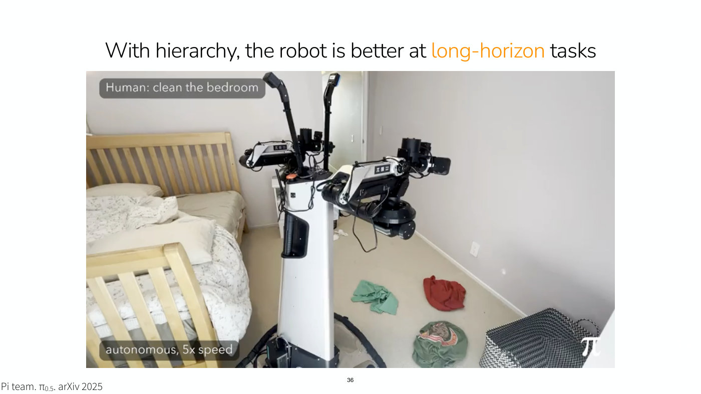

"With hierarchy, the robot is better at long-horizon tasks" ("long-horizon" in orange). A full-width photograph of the mobile robot with a white column body and two arms in a bedroom (bed and wooden crib-like frame at left, clothes on the floor, a black-and-white patterned basket at lower right). Overlay labels: "Human: clean the bedroom" at top left, "autonomous, 5x speed" at lower left, and a $\pi$ logo at lower right. Citation at lower left: "Pi team. $\pi_{0.5}$. arXiv 2025". The printed number 36 is at bottom centre.

A frame of a video (≈55:27): the high-level command is clean the bedroom, and the low-level commands run pick up shirt, put shirt in basket (twice), then the pillow, adjust the blanket, put the pillow at the top of the bed, adjust the pillow, pick up tissue, put the tissue in the trash can.

## Slide 37 — Let's cover a few examples

Same outline as slide 25, with "**b. with image subgoals**" under item 1 in bold. The printed number 37 is at bottom centre.

## Slide 38 — Hierarchical imitation with image subgoals

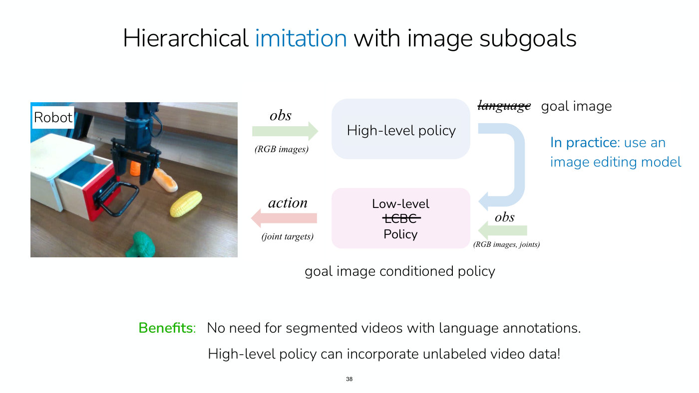

"Hierarchical imitation with image subgoals" ("imitation" in blue). At left, a photograph labelled "Robot": a black gripper over a wooden table with a small white-and-red drawer unit with a blue interior, an orange toy carrot, a yellow toy corn cob and a green toy broccoli. At right, the same block diagram as slide 28 with changes: the arrow "obs" with "(RGB images)" enters a pale-blue box "High-level policy"; the output arrow is labelled with the word "language" struck through and, next to it, "goal image"; it bends down into a pale-pink box "Low-level ~~LCBC~~ Policy" (the word "LCBC" struck through), which also takes "obs" "(RGB images, joints)" and outputs "action" "(joint targets)". Beneath the low-level box: "goal image conditioned policy". At right, in blue: "**In practice**: use an image editing model".

Bottom: "**Benefits**: No need for segmented videos with language annotations." and "High-level policy can incorporate unlabeled video data!" ("Benefits:" in green). The printed number 38 is at bottom centre.

## Slide 39 — Hierarchical imitation with image subgoals

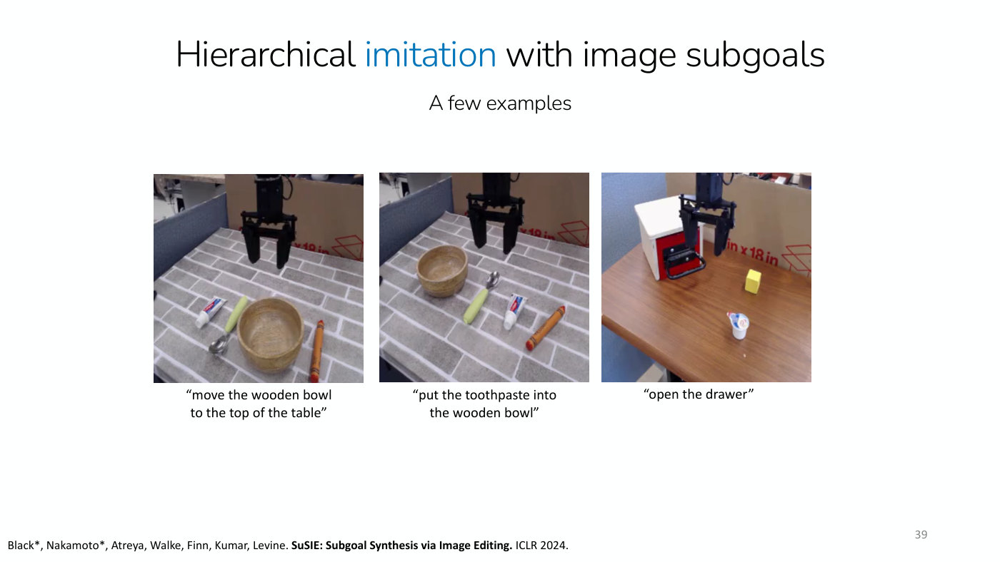

"Hierarchical imitation with image subgoals" ("imitation" in blue). Subtitle "A few examples". Three photographs of a robot gripper over tabletop scenes, each with a caption beneath. First: a brick-patterned surface with toothpaste, a spoon, a wooden bowl and a crayon, captioned "move the wooden bowl to the top of the table". Second: the same surface with the bowl at the upper left and the spoon, toothpaste and crayon, captioned "put the toothpaste into the wooden bowl". Third: a wooden table with a white-and-red drawer unit, a yellow block and a small yogurt cup, captioned "open the drawer". Citation: "Black\*, Nakamoto\*, Atreya, Walke, Finn, Kumar, Levine. **SuSIE: Subgoal Synthesis via Image Editing.** ICLR 2024." The printed number 39 is at bottom right.

The three photographs are frames of videos (≈57:00–58:34, ≈1:01:38): in them the high-level policy generates subgoal images, shown with a pink border, the noise of its diffusion model resolving into each image, and the low-level policy then reaches each one. For the toothpaste, the first subgoal holds the toothpaste above the bowl and the next lowers the arm; for the drawer, the first puts the gripper on the handle and the next moves it to the right so the drawer opens. The frames show none of the generated images.

## Slide 40 — Hierarchical imitation with image subgoals

"Hierarchical imitation with image subgoals" ("imitation" in blue). Question: "Is it helpful to include videos of humans in high-level policy training?". A results table with columns "Task", "BridgeData Only" and "BridgeData + Something-Something". Numbers in bold where printed bold.

| Scene | Task | BridgeData Only | BridgeData + Something-Something |
| --- | --- | --- | --- |
| Scene B | Bell pepper in pot | 0.2 | **0.5** |
| Scene B | Bell pepper in bowl | 0.4 | **0.5** |
| Scene B | Average | 0.30 (highlighted in pink) | **0.50** (highlighted in teal) |
| Scene C | Toothpaste in bowl | **0.7** | 0.6 |
| Scene C | Crayon in bowl | 0.9 | **1.0** |
| Scene C | Spoon in bowl | **0.9** | **0.9** |
| Scene C | Bowl to top | 0.7 | **1.0** |
| Scene C | Average | 0.80 (highlighted in pink) | **0.88** (highlighted in teal) |

Below the table, under the first value column in red-orange: "Robot data only"; under the second in teal: "Robot data + videos of humans". Citation: "Black\*, Nakamoto\*, Atreya, Walke, Finn, Kumar, Levine. **SuSIE: Subgoal Synthesis via Image Editing.** ICLR 2024." The printed number 40 is at bottom right.

## Slide 41 — Let's cover a few examples

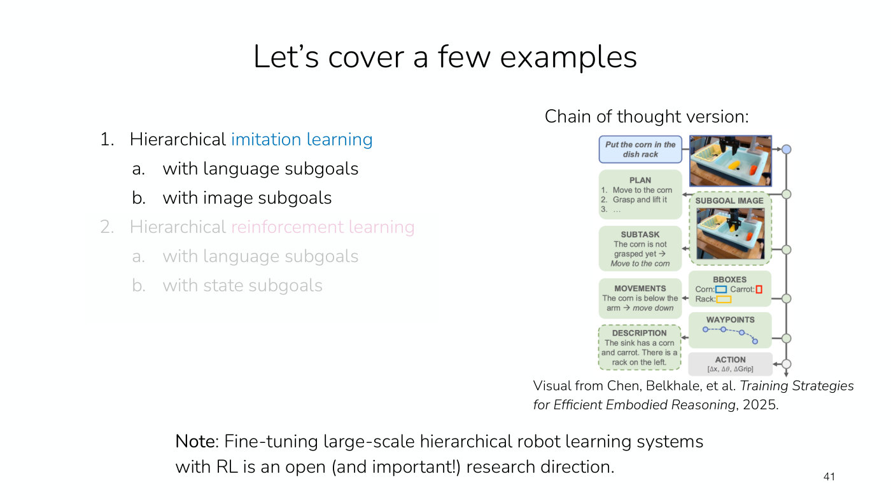

"Let's cover a few examples". At left, the outline of slide 25 with items 1, 1a and 1b in full colour and the whole of item 2 (with 2a and 2b) faded to light grey. At right, the heading "Chain of thought version:" above a diagram from a paper: a column of boxes on the left and right joined by a vertical line with circular nodes at the right edge. Top: a blue box "Put the corn in the dish rack" beside a photograph of a robot gripper over a blue sink with a dish rack, corn and a carrot. Then, in green boxes: "PLAN" with "1. Move to the corn", "2. Grasp and lift it", "3. ..."; "SUBGOAL IMAGE" (dashed outline) with a second photograph of the gripper nearer the corn; "SUBTASK" with "The corn is not grasped yet -> Move to the corn"; "BBOXES" with "Corn:" (blue box), "Carrot:" (red box), "Rack:" (yellow box); "MOVEMENTS" with "The corn is below the arm -> move down"; "WAYPOINTS" with a dotted curve of three or four points; "DESCRIPTION" (dashed outline) with "The sink has a corn and carrot. There is a rack on the left."; and, in grey at the bottom, "ACTION" with "[Δx, Δθ, ΔGrip]". The vertical line runs down the right edge with a node beside each box; the input image's arrow points into the line at the top, arrows point from the line into the left-hand boxes (PLAN, SUBTASK, MOVEMENTS, DESCRIPTION), and the line ends in a downward arrow below ACTION, so the outputs are produced in order from top to bottom. Credit below: "Visual from Chen, Belkhale, et al. *Training Strategies for Efficient Embodied Reasoning*, 2025."

Bottom: "**Note**: Fine-tuning large-scale hierarchical robot learning systems with RL is an open (and important!) research direction." The printed number 41 is at bottom right.

## Slide 42 — Let's cover a few examples

Same outline as slide 25, with "**2. Hierarchical reinforcement learning**" in bold ("reinforcement learning" in bold magenta). The printed number 42 is at bottom centre.

## Slide 43 — Hierarchical reinforcement learning

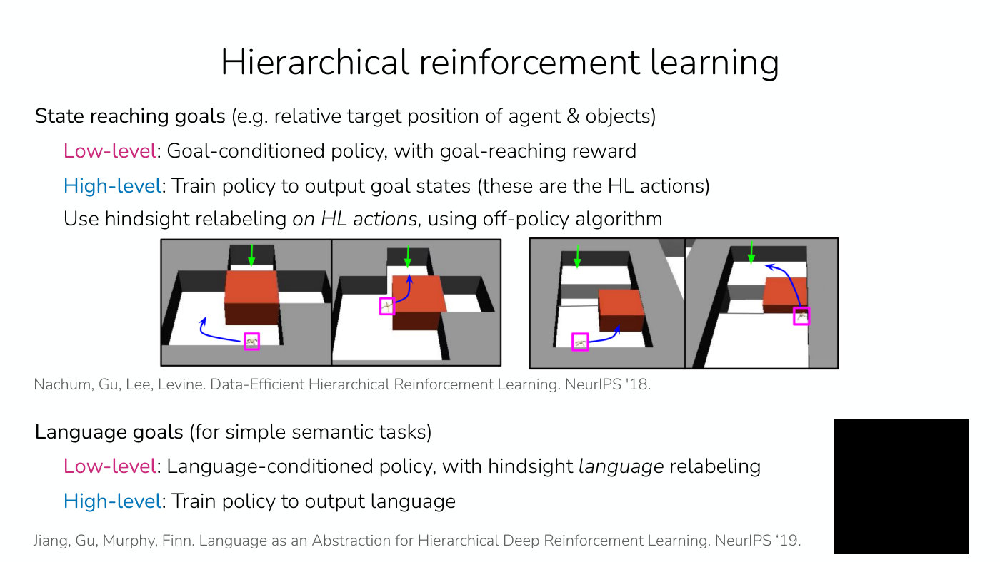

"Hierarchical reinforcement learning". Two parts.

First: "**State reaching goals** (e.g. relative target position of agent & objects)". Then "Low-level: Goal-conditioned policy, with goal-reaching reward" ("Low-level" in magenta); "High-level: Train policy to output goal states (these are the HL actions)" ("High-level" in blue); and "Use hindsight relabeling *on HL actions*, using off-policy algorithm" ("on HL actions" in italics). Below, four small rendered scenes in two bordered pairs, each pair two stages of one task in a grey maze with black walls and a large red block. A small ant-like robot is marked by a magenta square, a green arrow at the top of each scene points down at the target opening, and a blue curved arrow shows where the robot goes next. Left pair: first the robot below the block, with its arrow curving to the left; then the block has moved to the right and the robot, beside it, heads up to the target. Right pair: first the robot pushes the block towards a gap; then the block sits in the gap and the robot's arrow curves up past it to the target. Finn describes the two tasks (≈1:05:28–1:06:59): to reach the goal the ant must push the object to the right and then move there, and in the other it must push the block into a crevasse to make a bridge and walk over it, rather than fall in. Credit: "Nachum, Gu, Lee, Levine. Data-Efficient Hierarchical Reinforcement Learning. NeurIPS '18."

Second: "**Language goals** (for simple semantic tasks)". "Low-level: Language-conditioned policy, with hindsight *language* relabeling" and "High-level: Train policy to output language" (colours as above; "language" in italics). Credit: "Jiang, Gu, Murphy, Finn. Language as an Abstraction for Hierarchical Deep Reinforcement Learning. NeurIPS '19." At the lower right is a solid black rectangle with no visible content.

The black rectangle most likely holds a video the PDF did not export: nothing else on the slide shows the language-goal tasks Finn describes, arranging objects in a particular order, such as pushing the green object, then the red, then the blue (≈1:07:44). The page prints no number (inferred 43).

## Slide 44 — Another active research area

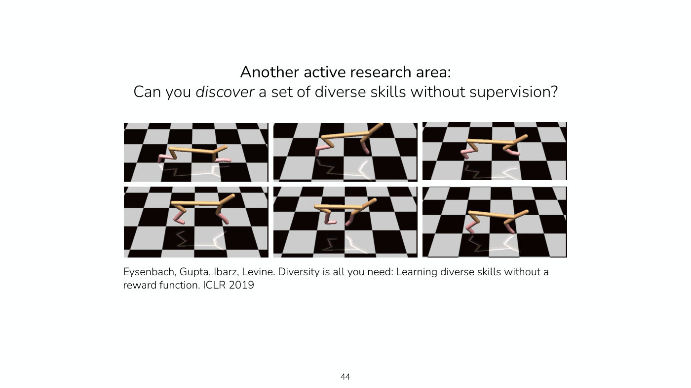

"Another active research area:" and "Can you *discover* a set of diverse skills without supervision?" ("discover" in italics). A three-by-two grid of six rendered frames of a simple walking robot (an orange-tan body bar with pink-tipped legs) on a black-and-white checkerboard floor, each in a different leg pose. Credit: "Eysenbach, Gupta, Ibarz, Levine. Diversity is all you need: Learning diverse skills without a reward function. ICLR 2019". The printed number 44 is at bottom centre.

Finn calls the agent the half cheetah from the homeworks and says it learns skills such as backing up, walking forward and, Finn thinks, a front flip (≈1:08:30). The slide does not label the six frames.

## Slide 45 — Hierarchy for Imitation and Reinforcement Learning

"Hierarchy for Imitation and Reinforcement Learning". The outline of slide 12 (sub-items in its order): "1. What's the problem" (a. "Why long-horizon tasks are hard", b. "Why hierarchy may help"); "2. Key design choices" (a. "How to represent skills/goals?", b. "Supervision for each level", c. "When to move on from one goal to the next?"); "3. Example systems". Nothing is highlighted. The printed number 45 is at bottom centre.

## Slide 46 — Next time

"Next time". "Specific considerations with RL for robotics:" with two dashed lines: "learning with autonomy" and "sim2real transfer: guest lecture from Ashish Kumar! (Tesla Optimus)". Then a second heading "Course reminders" with two dashed lines: "Project milestone due Friday." and "Homework 4 due next Friday". The printed number 46 is at bottom centre.
