# Lecture 17 — Advancing Robot Intelligence with Reinforcement Learning: slide-by-slide

Text and figures of the Stanford CS 224R "Deep Reinforcement Learning" (Spring 2025) Lecture 17 deck, transcribed from the PDF. It is a guest lecture by Ashish Kumar, as the title slide (slide 1) prints. Cite these as "slide N". Diagrams, photographs and plots are described in prose since the KB is read as text.

The recording (about 50 minutes) opens on the contrast between imitation learning and reinforcement learning (slide 2, ≈0:05) and follows the deck in order to slide 78's closing question (≈48:35), ending at about 49:45; slide 79's "Questions?" is not shown being reached. Between introducing the vision paper (slide 41, ≈22:24) and its first content slide (slide 42, ≈28:32), Kumar answers seven student questions, mostly about the first part's training (slides 14–20). Slides 5–11, 22–27, 30, 31, 33–36, 45, 58, 62, 67, 69, 70, 73 and 74 hold one frame each of videos that play in the lecture, and slides 55 and 56 most likely too; what they showed is under those slides, from the transcript. Slide 46 is blank in the PDF.

## Slide numbers vs PDF pages

The deck is 1:1 with its page index: PDF page N is slide N, for all 79 pages. Only pages 62–67 print a number in the text layer (bottom right), each equal to its page index; the other 73 pages print none, and because the printed numbers leave no gap, their labels are the page index.

| PDF page | Slide |
| -------- | ----- |
| 1 | 1 |
| 2 | 2 |
| 3 | 3 |
| 4 | 4 |
| 5 | 5 |
| 6 | 6 |
| 7 | 7 |
| 8 | 8 |
| 9 | 9 |
| 10 | 10 |
| 11 | 11 |
| 12 | 12 |
| 13 | 13 |
| 14 | 14 |
| 15 | 15 |
| 16 | 16 |
| 17 | 17 |
| 18 | 18 |
| 19 | 19 |
| 20 | 20 |
| 21 | 21 |
| 22 | 22 |
| 23 | 23 |
| 24 | 24 |
| 25 | 25 |
| 26 | 26 |
| 27 | 27 |
| 28 | 28 |
| 29 | 29 |
| 30 | 30 |
| 31 | 31 |
| 32 | 32 |
| 33 | 33 |
| 34 | 34 |
| 35 | 35 |
| 36 | 36 |
| 37 | 37 |
| 38 | 38 |
| 39 | 39 |
| 40 | 40 |
| 41 | 41 |
| 42 | 42 |
| 43 | 43 |
| 44 | 44 |
| 45 | 45 |
| 46 | 46 |
| 47 | 47 |
| 48 | 48 |
| 49 | 49 |
| 50 | 50 |
| 51 | 51 |
| 52 | 52 |
| 53 | 53 |
| 54 | 54 |
| 55 | 55 |
| 56 | 56 |
| 57 | 57 |
| 58 | 58 |
| 59 | 59 |
| 60 | 60 |
| 61 | 61 |
| 62 | 62 |
| 63 | 63 |
| 64 | 64 |
| 65 | 65 |
| 66 | 66 |
| 67 | 67 |
| 68 | 68 |
| 69 | 69 |
| 70 | 70 |
| 71 | 71 |
| 72 | 72 |
| 73 | 73 |
| 74 | 74 |
| 75 | 75 |
| 76 | 76 |
| 77 | 77 |
| 78 | 78 |
| 79 | 79 |

## Sections of the deck

| Section | Slides |
| ------- | ------ |
| Title; imitation versus reinforcement learning; what RL has achieved and what enabled it; zooming in on robotics | 1–4 |
| Real-world results of one blind walking policy | 5–12 |
| Rapid Motor Adaptation (RMA): training in simulation, the adaptation module, test time | 13–20 |
| RMA indoors and without adaptation | 21–31 |
| Analysis of the adaptation module | 32–36 |
| Quantitative comparison with existing attempts | 37–38 |
| Why vision; legged locomotion with egocentric vision (terrain maps, two training phases, deployment) | 39–52 |
| Emergent behaviour on stairs, demos and comparisons to baselines | 53–60 |
| Application to dexterous manipulation | 61–67 |
| Application to drone flight | 68–70 |
| What's left to solve: humanoids, reliability and dexterity, simulation, a general reward model, superhuman capabilities | 71–78 |
| Questions | 79 |

## Slide 1 — Advancing Robot Intelligence with Reinforcement Learning

Title slide. Centred title "Advancing Robot Intelligence with Reinforcement Learning" over two lines, and beneath it, centred, "Ashish Kumar". No date or affiliation is printed.

## Slide 2 — What is reinforcement learning?

Title "What is reinforcement learning?". Two columns.

Left column, heading "Imitation Learning" (bold). Bullet: "Used in: VLMs, video generation, image segmentation, etc". Bullet: "Characteristics:" with three dashed sub-items: "Relies heavily on off-policy data", "Learns from good examples", "Gives generalists".

Right column, heading "Reinforcement learning" (bold). Bullet: "Used in: Game playing, reasoning, robotics". Bullet: "Characteristics:" with three dashed sub-items: "On policy data", "Uses good as well as bad data", "Gives Specialists". In each "Used in:" bullet the words "Used in" are in a heavier weight than the rest.

## Slide 3 — What has reinforcement learning achieved?

Title "What has reinforcement learning achieved?". Three dashed items with the lead phrase in bold: "**AlphaGo** [1]: Learned to exceed what humans can do"; "**Reasoning in LLMs** [2]: Coherent over long horizon"; "**Dexterity in robotics** [rest of the talk]: Reliability".

Then, in a larger font, "What enabled these successes ?" followed by two dashed items: "Well specified rewards" and "Scalable evaluation of policies".

Footnotes at the bottom: "[1] Silver, David, et al. "Mastering the game of Go with deep neural networks and tree search." *nature* (2016)" and "[2] Guo, Daya, et al. "Deepseek-r1: Incentivizing reasoning capability in llms via reinforcement learning." *arXiv:2501.12948* (2025)" (the journal name "nature" and the arXiv id are in italics).

## Slide 4 — Zooming in on robotics

Title "Zooming in on robotics", with the word "robotics" in red. Below, "What enabled these success ?" (printed "success", singular). Two dashed items, each with a black first half, an arrow printed as "—>", and a red second half: "Well specified rewards —> Programmatically calculate them" ("Programmatically calculate them" in red) and "Scalable evaluation of policies —> Simulation" ("Simulation" in red). Near the bottom, centred and in red: "Simulation to real?".

## Slide 5 — (photograph of a rocky shoreline)

Full-page photograph, no text. Rocks and boulders of grey and tan on a slope of dirt and gravel in the foreground, with open water along the top edge. No robot is visible.

In the lecture (≈6:57–8:29) slides 5–11 each hold one frame of a run of seven real-world videos, which Kumar introduces to show that the approach works before explaining it. Kumar describes them in turn: in Berkeley, with everything real-time on board, the blind robot trying to get over rocks, its feet getting stuck until it figures out that there is something there and continues; staircases it cannot see, which it gets up "a bit fumbly" without falling; a grass patch where even vision would not show the ground underneath; ground sloping to the left beside a big ditch, where it does not drift; a construction site in front of Kumar's house in Berkeley, which it reliably gets down; slightly muddy ground, where its feet get stuck once in a while and it corrects by applying more force; and walking on sand. All are "from the exact same policy", the same weights deployed zero-shot with no tuning for any terrain (≈8:29). This frame shows rocks, before the robot appears.

## Slide 6 — (photograph of a black quadruped robot on leaf litter)

Full-page photograph, no text. A black four-legged robot, seen from the side at close range and slightly blurred, stands on ground covered in brown dry leaves, with green plants and rocks behind it. A small black sensor unit with a handle-like frame sits on its back, and a green light is on its flank.

In the lecture this is a video: one of the seven clips described under slide 5 (≈6:57–8:29).

## Slide 7 — (photograph of sand and grass)

Full-page photograph, no text. A patch of sandy ground with tufts of green grass and leafy weeds, white and yellow small flowers in the lower foreground, a chain-link fence at the upper right and a pale paved or concrete area at the left. No robot is visible.

In the lecture this is a video: one of the seven clips described under slide 5 (≈6:57–8:29); the frame shows no robot yet.

## Slide 8 — (photograph of a black quadruped robot on green ground cover)

Full-page photograph, no text. A black four-legged robot, in motion and slightly blurred, on a bed of dense small green leaves, with a rock wall behind. A sensor unit with a handle-like frame sits on its back; the body bears a harness strap and a partly visible logo ending in "itree".

In the lecture this is a video: one of the seven clips described under slide 5 (≈6:57–8:29).

## Slide 9 — (photograph of a quadruped robot on a pile of gravel beside a road)

Full-page photograph, no text. A black four-legged robot stands on the crest of a pile of gravel and dirt at the edge of a paved street. Behind it are two orange traffic cones, parked cars and a house. At the right edge a person's legs and one hand are visible, apparently standing next to the robot.

In the lecture this is a video: one of the seven clips described under slide 5 (≈6:57–8:29). The road and traffic cones fit Kumar's description of a construction site in front of Kumar's house (≈7:43).

## Slide 10 — (photograph of a quadruped robot on mulch)

Full-page photograph, no text. A black four-legged robot, close to the camera and cropped at the right, stands on dirt and wood-chip mulch in sunlight, casting a shadow to the left. A sensor unit with a handle-like frame is on its back, and a letter "A" is printed on its side.

In the lecture this is a video: one of the seven clips described under slide 5 (≈6:57–8:29).

## Slide 11 — (photograph of a quadruped robot on sand)

Full-page photograph, no text. A black four-legged robot seen from behind and above, on a sandy slope marked with footprints. The sensor unit with a handle-like frame sits on its back; a strap crosses its body.

In the lecture this is a video: one of the seven clips described under slide 5 (≈6:57–8:29); the sandy slope fits the last clip, "just walking on sand" (≈7:43).

## Slide 12 — One Policy to Walk them All

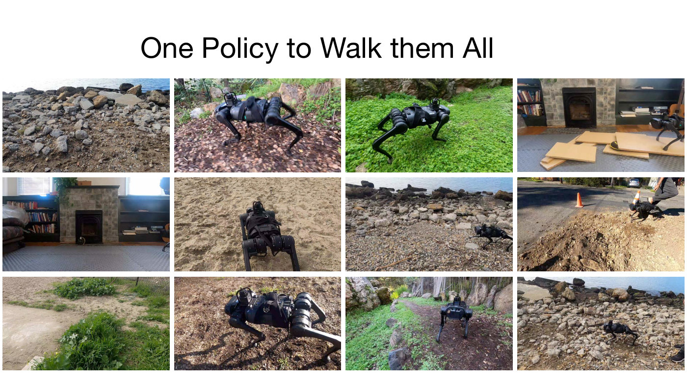

Title "One Policy to Walk them All". Below it a grid of twelve photographs, three rows of four, each a frame from the earlier slides or a similar scene.

- Row 1: the rocky shoreline (slide 5's frame, no robot); the robot on leaf litter (slide 6's frame); the robot on green ground cover (slide 8's frame); a living room with a fireplace and bookshelves, with a robot at the right edge and pieces of cardboard on a grey foam-mat floor.
- Row 2: the same living room with no robot visible; the robot on sand seen from behind (slide 11's frame); a rocky beach with the robot at the right, water behind; the robot on the gravel pile beside a road with a traffic cone and a person's legs (slide 9's frame).
- Row 3: sand and grass with no robot (slide 7's frame); the robot on mulch (slide 10's frame); the robot walking on a dirt path between green plants and rocks; the robot among rocks on a shoreline, with part of a person's foot at the right edge.

## Slide 13 — Rapid Motor Adaptation for Legged Robots

Title slide, in bold: "Rapid Motor Adaptation for Legged Robots" over two lines. Below, four author blocks side by side, each a name over an affiliation: "Ashish Kumar / UC Berkeley"; "Zipeng Fu / CMU"; "Deepak Pathak / CMU"; "Jitendra Malik / UC Berkeley/FAIR".

## Slide 14 — Learn to Walk in Simulation

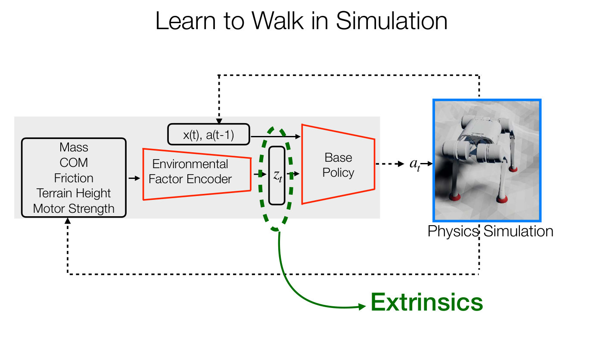

Title "Learn to Walk in Simulation". Diagram.

On a light-grey band at the left and centre sit the learned components, left to right. A black rounded box listing five lines, "Mass", "COM", "Friction", "Terrain Height", "Motor Strength", has a solid arrow to the right into a red-outlined trapezoid labelled "Environmental Factor Encoder" (taller at its left edge and narrowing to the right). A solid arrow leads from it to a small black rounded vertical box holding $z_t$, which is circled by a dashed green ellipse. A solid arrow leads from $z_t$ into a second red-outlined trapezoid labelled "Base Policy" (taller at its left edge and narrowing to the right). Above the encoder and $z_t$, a black rounded box "x(t), a(t-1)" has a solid arrow running right into the left edge of the Base Policy trapezoid.

From the right side of the Base Policy a dashed arrow runs right to the label $a_t$, followed by a solid arrow into a photograph at the right edge, outlined in blue: a rendered white four-legged robot with red feet on a grey-white surface, captioned "Physics Simulation". Two dashed black lines leave the simulation picture. One runs up from its top and left along the top of the slide, ending in an arrowhead pointing down into the "x(t), a(t-1)" box. The other runs down from its bottom, left along the bottom of the slide, and up, ending in an arrowhead pointing up into the black box listing "Mass ... Motor Strength".

A curved green arrow leaves the bottom of the dashed green ellipse and ends at the bold green word "Extrinsics" at the lower right.

## Slide 15 — Learn to Walk in Simulation

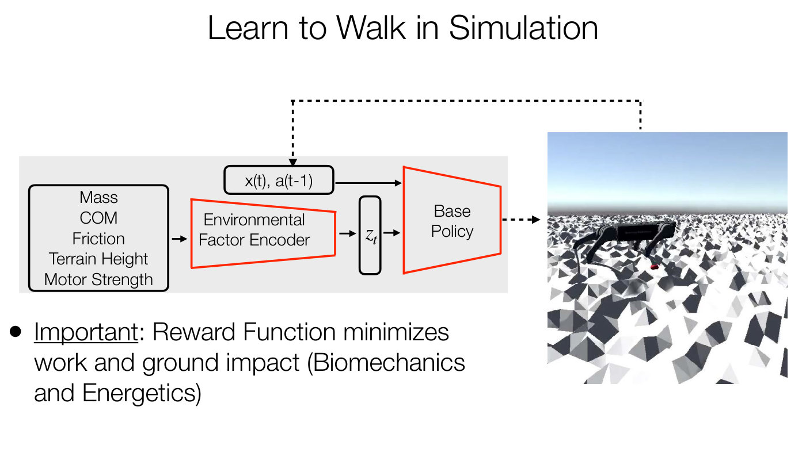

Title "Learn to Walk in Simulation". The same diagram as slide 14, with these differences: the green ellipse around $z_t$, the label "Extrinsics" and its arrow, the label $a_t$ and the "Physics Simulation" caption and blue border are absent; the dashed arrow from the Base Policy now ends directly at the left edge of a larger simulation image at the right. That image shows a dark four-legged robot (with a small red object near its feet) walking on a field of jagged, sharp-peaked grey-black and white triangular terrain under a blue sky. The dashed return line from the top of the image into "x(t), a(t-1)" remains; the bottom dashed return line to the "Mass ... Motor Strength" box is absent.

Below the diagram, a bullet: "<u>Important</u>: Reward Function minimizes work and ground impact (Biomechanics and Energetics)", where the word "Important" is underlined.

The transcript does not say whether the simulation picture is a video. Around this slide Kumar says the policy is trained end to end with PPO, "about a billion samples", followed by a garbled phrase (≈10:00).

## Slide 16 — Reward Function

Title "Reward Function". At the left is a numbered list of ten reward terms, typeset in a serif maths font, on three coloured bands. At the right, three sans-serif labels, one per band.

Band in light blue (items 1 and 2), labelled at the right "Forward Walking":

1) Forward: $\min(v_x^t, 0.35)$

2) Lateral Movement and Rotation: $-\Vert v_y^t\Vert ^2 - \Vert \omega_{\texttt{yaw}}^t\Vert ^2$

Band in light green (items 3 and 4), labelled "Energetics":

3) Work: $-|\boldsymbol{\tau}^T \cdot (\mathbf{q}^t - \mathbf{q}^{t-1})|$

4) Ground Impact: $-\Vert \mathbf{f}^t - \mathbf{f}^{t-1}\Vert ^2$

Band in light red (items 5 to 10), labelled "Stability + Minimize hardware damage" over two lines:

5) Smoothness: $-\Vert \boldsymbol{\tau}^t - \boldsymbol{\tau}^{t-1}\Vert ^2$

6) Action Magnitude: $-\Vert \mathbf{a}^t\Vert ^2$

7) Joint Speed: $-\Vert \dot{\mathbf{q}}^t\Vert ^2$

8) Orientation: $-\Vert \boldsymbol{\theta}_ {\texttt{roll, pitch}}^t\Vert ^2$ (the subscripts "yaw" in item 2 and "roll, pitch" are set in a typewriter font)

9) Z Acceleration: $-\Vert v_z^t\Vert ^2$

10) Foot Slip: $-\Vert \text{diag}(\mathbf{g}^t) \cdot \mathbf{v}_ {\mathbf{f}}^t\Vert ^2$

The slide defines none of the symbols.

## Slide 17 — How can we deploy it?

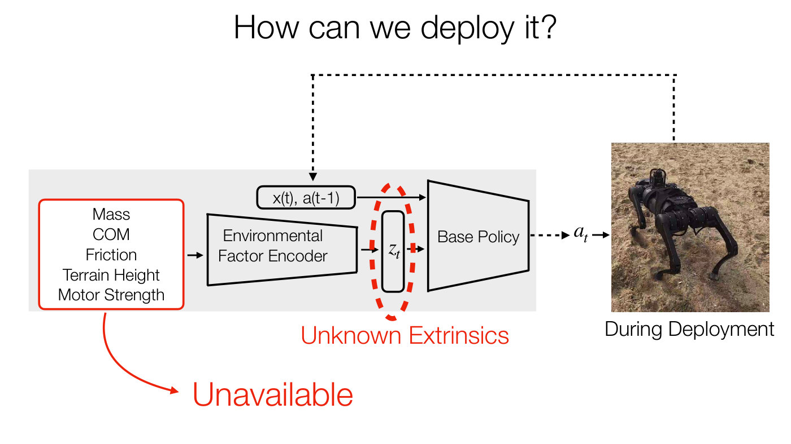

Title "How can we deploy it?". Diagram, drawn with black outlines throughout.

On a light-grey band: a rounded box with a red outline listing "Mass", "COM", "Friction", "Terrain Height", "Motor Strength" (one per line), with a solid arrow to the right into a black trapezoid labelled "Environmental Factor Encoder"; a solid arrow from it to a small rounded vertical box holding $z_t$, which is circled by a thick red dashed ellipse; a solid arrow from $z_t$ into a larger black trapezoid labelled "Base Policy". A rounded box "x(t), a(t-1)" above has a solid arrow into the Base Policy trapezoid.

From the Base Policy a dashed arrow leads right to $a_t$ and then a solid arrow into a photograph at the right of a black four-legged robot on sandy ground, captioned "During Deployment". A dashed black line runs from the top of the photograph left along the top of the slide and down, ending in an arrowhead into the "x(t), a(t-1)" box.

In red: the words "Unknown Extrinsics" under the dashed ellipse, and a curved red arrow from the bottom of the red-outlined "Mass ... Motor Strength" box down and right to the large red word "Unavailable". There is no return line from the photograph to the "Mass ..." box.

## Slide 18 — Key Insight — Extrinsics from Observation History

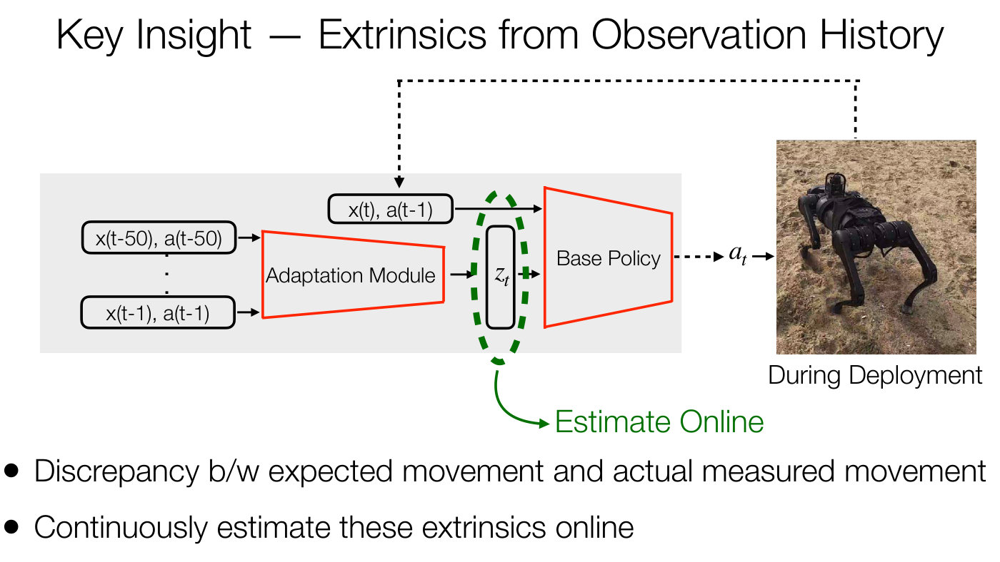

Title "Key Insight — Extrinsics from Observation History". Diagram.

On a light-grey band: at the left a stack of two rounded boxes, "x(t-50), a(t-50)" above and "x(t-1), a(t-1)" below, joined by a vertical column of three dots; each has a solid arrow into the left edge of a red-outlined trapezoid labelled "Adaptation Module". A solid arrow leads from it to the rounded vertical box $z_t$, circled by a thick green dashed ellipse, and a solid arrow from $z_t$ into a red-outlined trapezoid labelled "Base Policy". A rounded box "x(t), a(t-1)" above has a solid arrow into the Base Policy. The Base Policy has a dashed arrow to $a_t$ and a solid arrow into the photograph at the right (a black four-legged robot on sandy ground, captioned "During Deployment"). A dashed line from the top of the photograph runs left and down into the "x(t), a(t-1)" box. A curved green arrow from the bottom of the green ellipse ends at the green words "Estimate Online".

Two bullets beneath: "Discrepancy b/w expected movement and actual measured movement" and "Continuously estimate these extrinsics online".

## Slide 19 — Training Summary

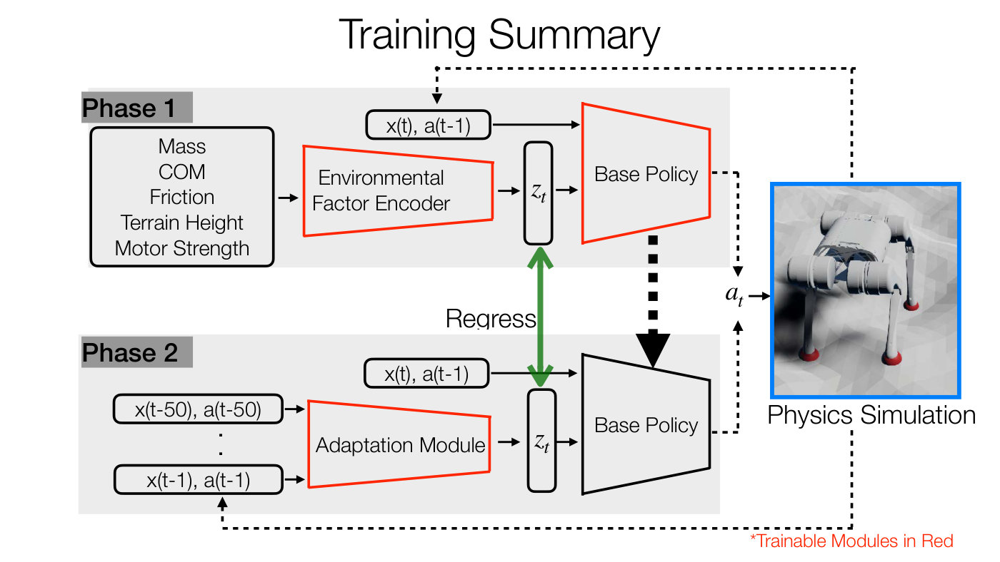

Title "Training Summary". Diagram of two phases, one above the other, on grey bands.

Phase 1 (the band labelled "Phase 1" in a darker grey tab at its upper left): the black rounded box "Mass / COM / Friction / Terrain Height / Motor Strength" has an arrow right into a red-outlined trapezoid "Environmental Factor Encoder", then an arrow to a rounded vertical box $z_t$, then an arrow into a red-outlined trapezoid "Base Policy". A rounded box "x(t), a(t-1)" above has an arrow into the Base Policy.

Phase 2 (labelled "Phase 2"): two stacked boxes "x(t-50), a(t-50)" and "x(t-1), a(t-1)" joined by vertical dots, each with an arrow into a red-outlined trapezoid "Adaptation Module", then an arrow to a rounded vertical box $z_t$, then an arrow into a black-outlined (not red) trapezoid "Base Policy". A rounded box "x(t), a(t-1)" above has an arrow into the Phase 2 Base Policy.

Between the phases, a thick green double-headed vertical arrow joins the Phase 1 $z_t$ and the Phase 2 $z_t$, with the word "Regress" beside it. A thick black dashed arrow with a large head points down from the Phase 1 Base Policy to the Phase 2 Base Policy (unlabelled).

At the right, a dashed line leaves the Phase 1 Base Policy and runs right and down with an arrowhead into the label $a_t$; a dashed line leaves the Phase 2 Base Policy and runs right and up with an arrowhead into the same $a_t$; a solid arrow from $a_t$ leads into a photograph outlined in blue, of a rendered white four-legged robot with red feet, captioned "Physics Simulation". A dashed line from the top of that picture runs left along the top of the slide and down into the Phase 1 "x(t), a(t-1)" box. A dashed line from the bottom of the picture runs down, left along the bottom and up, ending in an arrowhead into the Phase 2 "x(t-1), a(t-1)" box. At the bottom right, in red: "*Trainable Modules in Red".

## Slide 20 — Test Time

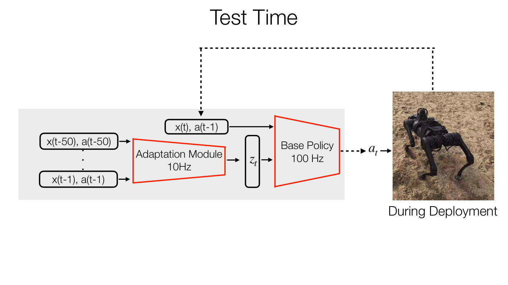

Title "Test Time". Diagram. On a light-grey band: two stacked boxes "x(t-50), a(t-50)" and "x(t-1), a(t-1)" joined by vertical dots, each with an arrow into a red-outlined trapezoid labelled "Adaptation Module" and, on a second line, "10Hz". A solid arrow to the rounded vertical box $z_t$ (no ellipse), then a solid arrow into a red-outlined trapezoid labelled "Base Policy" and, on a second line, "100 Hz". A rounded box "x(t), a(t-1)" above has a solid arrow into the Base Policy. A dashed arrow from the Base Policy leads to $a_t$ and a solid arrow into the photograph at the right (a black four-legged robot on sandy ground), captioned "During Deployment". A dashed line from the top of the photograph runs left and down into "x(t), a(t-1)".

## Slide 21 — Indoors Evaluation

Title text only: "Indoors Evaluation", centred in the lower half of an otherwise empty slide.

## Slide 22 — (photograph of a living room with a plastic-covered mat)

Full-page photograph, no text. A living room: bookshelves at the left and right, a tiled fireplace in the centre with a green plant above, a patterned couch at the left, and a wooden floor. In front of the fireplace a mat of grey foam tiles is covered by a sheet of clear plastic, with several wooden boards under its near edge; a dark object shows at the far right edge. No robot is clearly visible.

In the lecture (≈13:03–14:38) slides 22–24 are frames of one video. Kumar's living room: a plastic tarp with oil poured on it ("I think that is olive oil"), and the robot's feet covered in plastic, "partially to make it challenging, but also to protect the feet of the robot". It slips a bit but continues to march forward; slowed down (slide 24's "SLOW"), it starts slipping and maintains balance without flipping over.

## Slide 23 — (video frame, "Oily surface and plastic wrapped feet")

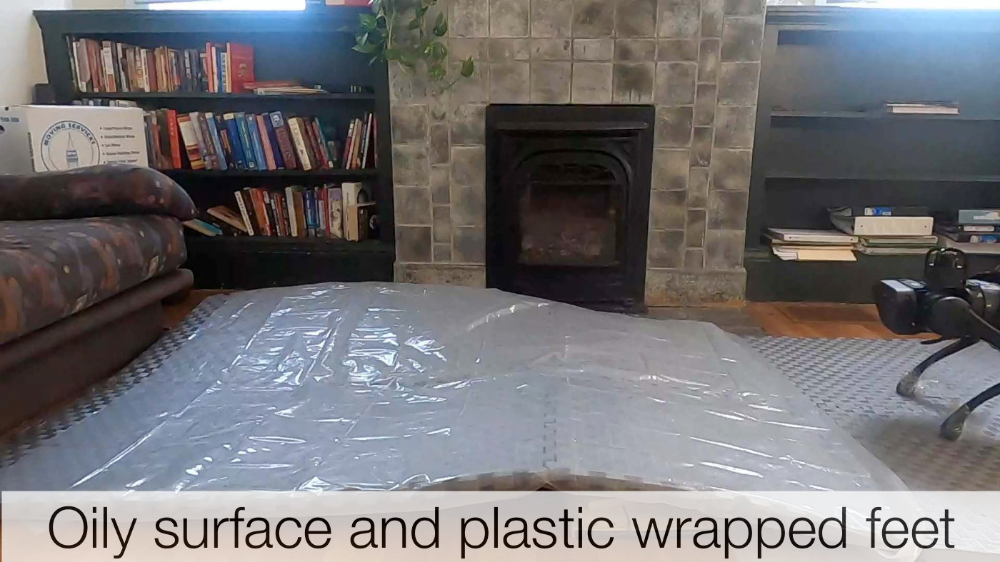

The same living room as slide 22 with the plastic-covered mat in front of the fireplace. At the right edge, partly cropped, a black four-legged robot is visible (a front section and legs). A caption in a semi-transparent white band along the bottom reads "Oily surface and plastic wrapped feet".

In the lecture this is the oily-surface video described under slide 22 (≈13:03–14:38).

## Slide 24 — (video frame, "Oily surface")

The same scene as slide 23, with the robot at the right edge. Caption at the lower left in a white box: "Oily surface". At the upper right in a white box: "SLOW".

In the lecture this is the oily-surface video described under slide 22, slowed down: "This is where it starts slipping and it seems to maintain balance and not flip over" (≈13:48).

## Slide 25 — (video frame, "5kg payload throw")

A view of the same living room from another side: the fireplace with bookshelves at both sides, a guitar at the far left edge, and a floor of grey foam tiles. A round dark object lies by the right of the fireplace opening. No robot is clearly visible. Caption at the lower left in a white box: "5kg payload throw".

In the lecture (≈13:48–14:38) slides 25–26 are frames of one video: Kumar throws a 5 kg payload onto the robot, which weighs 12 kg, so the payload is "roughly half the weight of the robot". Slowed down (slide 26), the robot goes down, and "If you focus on the green dots in a few steps, it tries to go back up and recover the regular motion style".

## Slide 26 — (video frame, "5kg payload throw", slow)

The same scene as slide 25. Caption at the lower left: "5kg payload throw". At the upper right in a white box: "SLOW".

In the lecture this is the payload video described under slide 25, slowed down (≈14:38).

## Slide 27 — (video frame, "Planks - uneven footholds and moving surfaces")

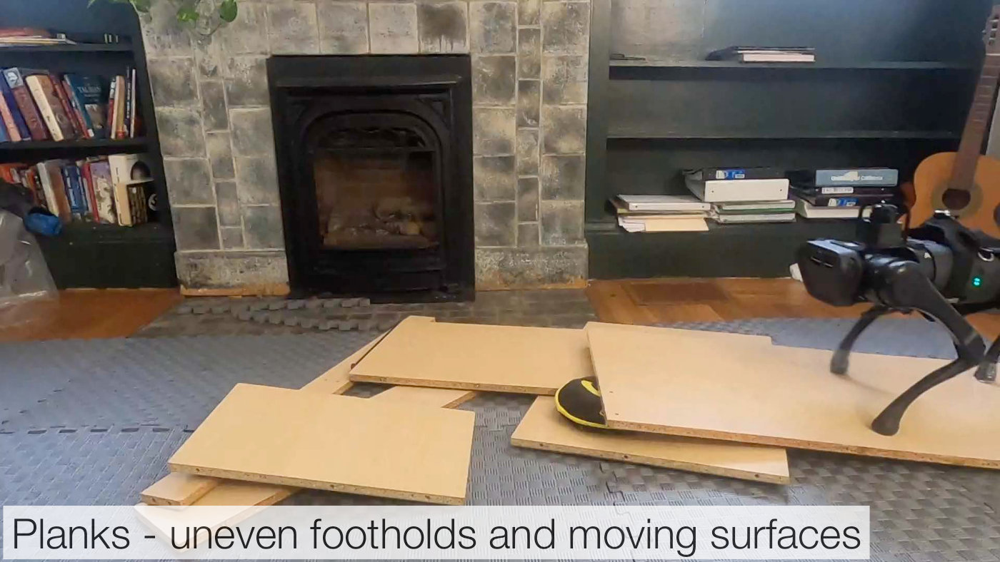

The living room with the fireplace at centre and a guitar at the right edge. Wooden boards lie stacked and overlapping on the grey foam floor, and a black-and-yellow rounded object lies under the edge of one board. At the right edge a black four-legged robot, partly cropped, stands with its front feet on a board. Caption along the bottom in a white band: "Planks - uneven footholds and moving surfaces".

In the lecture (≈14:38) this is a video: the foothold is not even stable, since the plank moves with the foot, so there is no clear estimate of the ground, and the robot keeps walking. Kumar adds that all of these results are blind, using only proprioception history.

## Slide 28 — RMA - Indoors

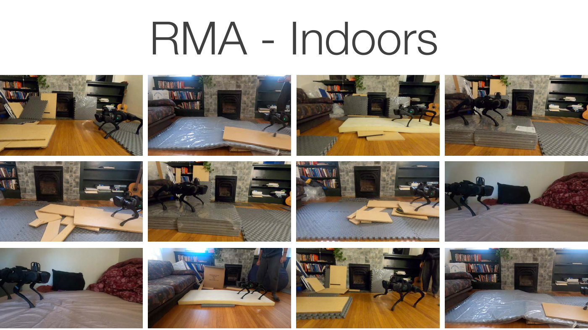

Title "RMA - Indoors" (in dark grey). A grid of twelve photographs, three rows of four, all of a black four-legged robot in the same living room, each with a different obstacle.

- Row 1: the robot on a floor with wooden boards and foam tiles; the robot behind a plastic-covered mat and a board; the robot on a pale cream foam block with boards beneath; the robot on a stack of grey slabs.
- Row 2: the robot on a floor of grey foam tiles with a pile of boards; the robot on a stack of grey slabs, from a different angle; the robot on boards over foam tiles; the robot on a large bed-like surface with a black pillow and a red patterned cover behind.
- Row 3: the robot on the same bed-like surface, from another angle; the robot on a cream foam block, with a person standing nearby and a cardboard box behind; the robot beside boards and a person standing at the right; the robot on a plastic-covered mat with a board.

## Slide 29 — Comparison to RMA w/o Adaptation

Title text only: "Comparison to RMA w/o Adaptation", centred in an otherwise empty slide.

## Slide 30 — (video frame, split screen "RMA" and "RMA w/o Adaptation")

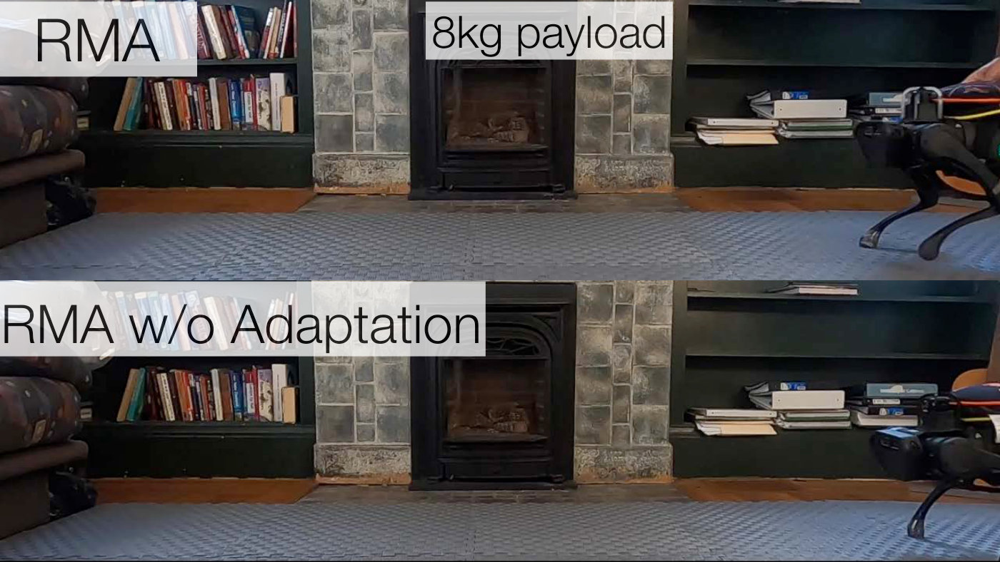

A split-screen frame, two panels one above the other, each showing the same living-room view (bookshelves, tiled fireplace, grey foam floor) with a black four-legged robot cropped at the right edge, carrying a load with orange and yellow straps on its back. In the top panel, white label boxes read "RMA" (upper left) and "8kg payload" (upper centre). In the bottom panel, a white label box at the upper left reads "RMA w/o Adaptation".

In the lecture (≈15:25) this is a video comparing RMA with RMA without adaptation, in which the extrinsics are estimated at the first time step and then frozen. The payload is 8 kg on a 12 kg robot whose rated payload is around 3 kg. With adaptation the robot struggles a bit but walks; without it, the weight tilts the robot forward and it does not correct by applying more torque in the front legs or a higher clearance, and it ends up tilting forward.

## Slide 31 — (video frame, split screen "RMA" and "RMA w/o Adaptation")

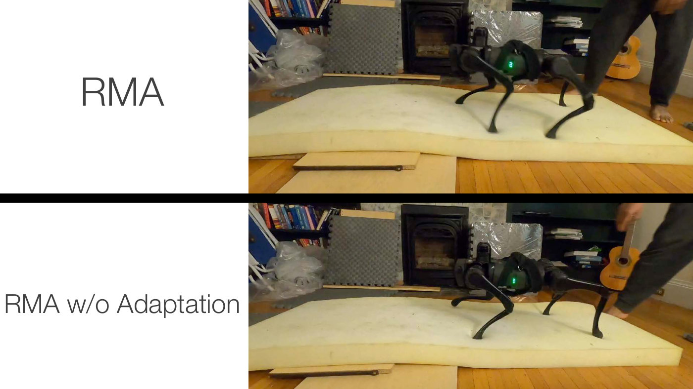

A split-screen frame in two panels one above the other, separated by a black bar. In each panel, the left third is white with a label in dark grey text: "RMA" in the top panel and "RMA w/o Adaptation" in the bottom panel. The right two-thirds of each panel is a photograph of the living room, with a black four-legged robot (a green light on its flank) walking on a large pale cream foam block, with a fireplace, stacked grey foam slabs, plastic bags and a guitar behind it. In the top panel a person's legs and one bare foot are at the right edge, beside the guitar. In the bottom panel a person's hand and leg appear at the right edge, next to the guitar.

In the lecture (≈15:25–16:12) this is a video of the same comparison on foam: with adaptation the robot manages even when it gets stuck; without it, it does not apply more force for a higher clearance, "because it hasn't detected that event or that change".

## Slide 32 — Analysis of Adaptation Module

Title text only: "Analysis of Adaptation Module", centred in an otherwise empty slide.

## Slide 33 — (video frame, "Oily surface and plastic wrapped feet")

The living room with a plastic-covered mat of grey foam tiles in front of the fireplace and a couch at the right. At the left edge a black four-legged robot is partly visible, with a plastic-wrapped foot. Caption along the bottom in a semi-transparent white band: "Oily surface and plastic wrapped feet".

In the lecture (≈16:12) this is the oily-surface video again, flipped, with the plots of slide 34 added beneath (the plots and the video run together).

## Slide 34 — (plots of foot contacts, knee torque and two extrinsics over a photograph, oily surface)

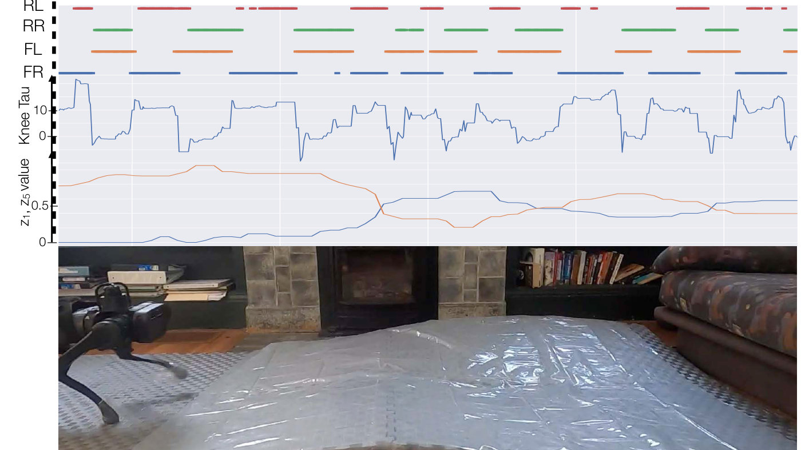

A frame stacking three time-series panels over a photograph, with no title and no axis values along the horizontal (time) axis; the top of the first panel is cropped by the slide edge. A thick black dashed vertical line with small up-pointing arrowheads runs along the left side of the panels.

- Top panel, a foot-contact diagram on a pale lavender background with row labels "RL", "RR", "FL", "FR" (the "RL" label is cut off at the top edge). Each row holds short horizontal bars: RL in red, RR in green, FL in orange, FR in blue. The bars alternate in time with gaps between them, about ten bars per row across the panel.
- Middle panel, y-axis label "Knee Tau", tick labels "10" and "0". One blue line that swings repeatedly, from about $-5$ to about 10–15, with a peak near 20 at the far left and peaks near 17–18 in the last third. The shape is a repeated rise, a plateau at about 10 and a sharp drop; in the middle third the cycles are smaller and irregular, with plateaus at about 5–8, before the 10–15 pattern returns.
- Bottom panel, y-axis label "z1, z5 value", printed with the 1 and 5 as subscripts ($z_1$, $z_5$), tick labels "0.5" and "0". Two lines: in orange, starting at about 0.8, rising to about 1.0 and staying at about 0.95–1.0 until about the middle of the panel, then falling to about 0.3, dipping to about 0.2, recovering to about 0.5, rising again to about 0.65 at about three-quarters of the way across and ending near 0.4; in blue, starting at about 0, staying below about 0.1 until the middle, then rising steeply to about 0.6–0.7 (crossing the orange line near the middle), falling to about 0.35 and ending near 0.55. The two lines cross three times: near the middle, where they meet at about 0.45 a little later, and again near the right end.

Beneath the panels, a photograph from the oily-surface scene: a black four-legged robot at the left edge, on grey foam tiles beside a plastic-covered mat, with the fireplace and bookshelves behind and a couch at the right.

In the lecture (≈16:12–17:46) this is a video with plots that run with it. Kumar explains: the top plot is a gait plot, the four feet of the robot, with a solid line wherever a foot is in contact (the hardware has foot sensors); the second is the torque requested at the front-right knee; the third plots two values taken from the adaptation module, chosen because they vary most in the run. When the robot slips there is shuffling in the gait and a change in the torque profile, and the adaptation module's values change "to capture that something has happened"; they are learned, so they cannot easily be interpreted. Afterwards the gait and the torque return to their earlier pattern.

## Slide 35 — (video frame, "5kg payload throw")

The living room seen from the side of the fireplace, with shelves holding binders at the left, a guitar at the far left edge, bookshelves at the right and a floor of grey foam tiles. A round dark object lies by the right of the fireplace opening. No robot is clearly visible. Caption at the lower left in a white box: "5kg payload throw".

In the lecture (≈17:46) this is the payload video again, with the plots of slide 36 beneath.

## Slide 36 — (plots of foot contacts, knee torque and two extrinsics over a photograph, payload throw)

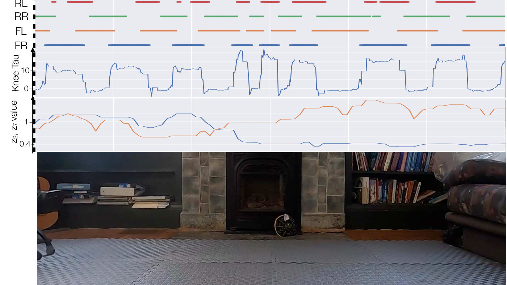

The same layout as slide 34: three stacked time-series panels with no horizontal axis values, a thick dashed vertical line with up-pointing arrowheads at the left, and a photograph beneath. The top of the first panel is cropped.

- Top panel, foot contacts, row labels "RL" (cut off at the top edge), "RR", "FL", "FR", with bars in red, green, orange and blue respectively; RR, FL and FR bars begin at the left edge or near it and alternate with gaps.
- Middle panel, y-axis label "Knee Tau", tick labels "10" and "0". One blue line with about nine plateau-shaped cycles, each rising to about 10–15 and dropping to about $-2$. Two sharp spikes near the middle of the panel reach about 20; the plateaus after them sit at about 15–16, higher than the early ones at about 10–12.
- Bottom panel, y-axis label "z2, z7 value", printed with the 2 and 7 as subscripts ($z_2$, $z_7$), tick labels "1" and "0.4". Two lines: in blue, starting at about 1.0, rising to about 1.2 and holding it for the first quarter, dipping to about 0.85, rising again to about 1.2, falling to about 0.75 and then, a little before the middle of the panel, dropping to about 0.4, where it stays (dipping briefly to about 0.35) to the right end; in orange, starting at about 0.8, rising to about 1.2 (touching the blue line), dipping to about 0.75, back to about 1.05, falling to about 0.6 and staying there until a little before the middle, then climbing past the falling blue line (the one crossing) to about 0.95–1.05, to about 1.4 just after the middle and to a peak of about 1.6 at about three-quarters of the way across, dipping once to about 1.1 and ending at about 1.4.

Beneath the panels, a photograph of the living room with the fireplace, a guitar at the left edge, a couch at the right and a grey foam floor; no robot is clearly visible.

In the lecture (≈17:46) this is a video with plots that run with it: the 5 kg payload is dropped, so the force at impact is probably even higher. The gait shuffles again and the torque is very high at the moment of the drop; the gait returns to normal, but the torque settles at a higher level than before, "because it needs more torque to balance the weight that it is carrying".

## Slide 37 — Quantitative Comparison

Title text only: "Quantitative Comparison", centred in an otherwise empty slide. (The table this section announces is on slide 38.)

## Slide 38 — Existing Attempts at Learning General Policies

Title "Existing Attempts at Learning General Policies" (bold). A table in a serif font, set off by horizontal rules above the header, below the header, above the last row and at the bottom. Citation numbers in the first column are in blue. No cell is printed in bold or highlighted. A faint grey shadow streak appears at the upper right edge of the slide.

| Method | Success (%) | TTF | Reward | Distance (m) | Samples | Torque | Jerk | Ground Impact |
| --- | --- | --- | --- | --- | --- | --- | --- | --- |
| Robust [49, 38] | 62.4 | 0.80 | 4.62 | 1.13 | 0 | 527.59 | 122.50 | 4.20 |
| SysID [54] | 56.5 | 0.74 | 4.82 | 1.17 | 0 | 565.85 | 149.75 | 4.03 |
| AWR [39] | 41.7 | 0.65 | 4.17 | 0.95 | 40k | 599.71 | 162.60 | 4.02 |
| RMA w/o Adapt | 52.1 | 0.75 | 4.72 | 1.15 | 0 | 524.18 | 106.25 | 4.55 |
| RMA | 73.5 | 0.85 | 5.22 | 1.34 | 0 | 500.00 | 92.85 | 4.27 |
| Expert | 76.2 | 0.86 | 5.23 | 1.35 | 0 | 485.07 | 85.56 | 3.90 |

The first header cell is blank on the slide (the "Method" label above is added here); the "Expert" row sits below the third rule, separate from the other five. Below the table, three bullets: "Domain Randomization (Robust)", "System Identification", "Fine tuning at test time in the real world".

## Slide 39 — Why do we need vision?

Title text only: "Why do we need vision?", centred in an otherwise empty slide.

## Slide 40 — Perception enables precise and agile locomotion

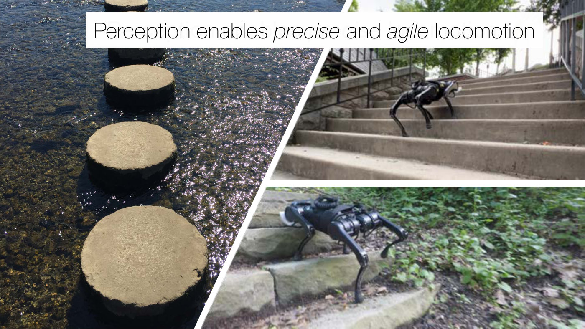

A collage of three photographs divided by diagonal white lines, with a white banner across the top reading "Perception enables *precise* and *agile* locomotion" (the words "precise" and "agile" in italics). At the left, a row of round stone stepping-stones crossing shallow, glittering water. At the upper right, a black four-legged robot walking on wide concrete steps with an iron railing and trees behind. At the lower right, a black four-legged robot stepping across stone ledges beside green plants and leaves.

## Slide 41 — Legged Locomotion in Challenging Terrains using Egocentric Vision

Title slide of a paper. Centred two-line title "Legged Locomotion in Challenging Terrains using Egocentric Vision", with the words "Egocentric Vision" in red. Beneath it, four authors in a row, each with an affiliation below: "Ananye Agarwal*" (CMU), "Ashish Kumar*" (UC Berkeley), "Jitendra Malik†" (UC Berkeley), "Deepak Pathak†" (CMU). The asterisks and daggers are printed as shown, with no footnote explaining them.

## Slide 42 — Typical approach: build terrain maps from vision

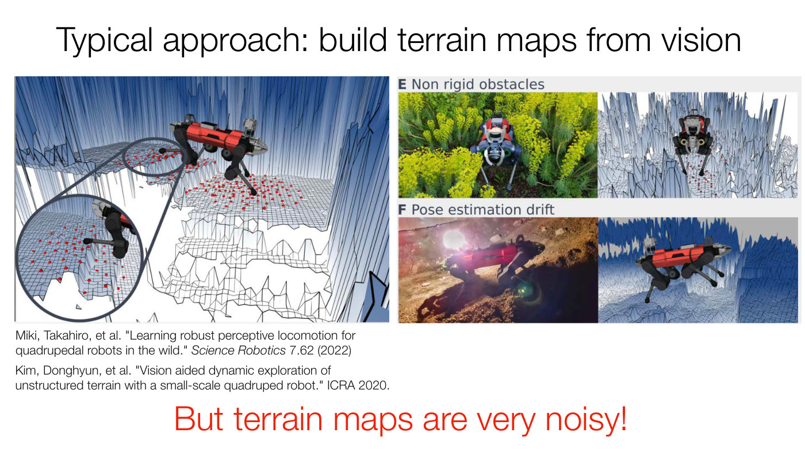

Title "Typical approach: build terrain maps from vision". Two groups of pictures, both taken from the cited papers.

Left, one large picture: a red-bodied quadruped robot standing on a grid-meshed terrain reconstruction rendered in blue and white, with red dots scattered over the mesh. Tall blue spikes rise around it. A circular magnifier at lower left, joined by two lines to a circle near the robot's front leg, shows a close-up of the mesh with red dots under the leg.

Right, two labelled rows, each a photograph beside a rendered terrain map.
- "E Non rigid obstacles": a photograph of a quadruped robot with a red top standing among bright yellow-green leafy plants, beside a spiky blue-white terrain map with the robot drawn on it.
- "F Pose estimation drift": a photograph of a red quadruped robot on a dark earth slope with a bright light flare, beside a blue terrain map with the robot drawn on it.

Citations under the left picture: "Miki, Takahiro, et al. "Learning robust perceptive locomotion for quadrupedal robots in the wild." Science Robotics 7.62 (2022)" (the journal name in italics) and "Kim, Donghyun, et al. "Vision aided dynamic exploration of unstructured terrain with a small-scale quadruped robot." ICRA 2020."

Bottom, centred, in large red text: "But terrain maps are very noisy!"

## Slide 43 — Noisy maps wipe out signal => degraded performance

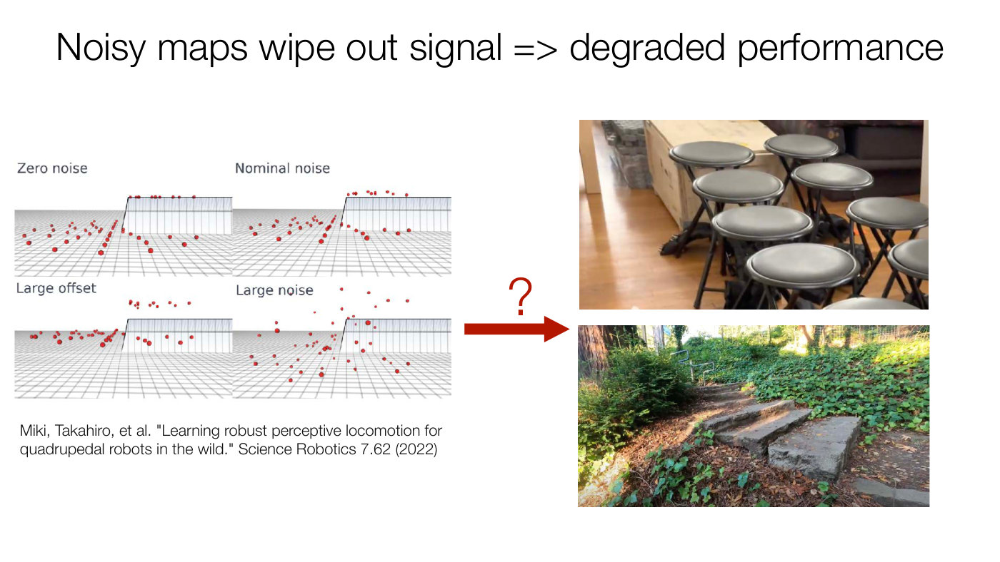

Title "Noisy maps wipe out signal => degraded performance".

Left, a 2 by 2 grid of four small renderings of a flat grid floor with a raised step (a box with a vertical face) and red dots marking the sensed height samples. Panel labels: top left "Zero noise", top right "Nominal noise", bottom left "Large offset", bottom right "Large noise". In "Zero noise" the dots lie on the floor and on the step top; in "Nominal noise" they are slightly scattered; in "Large offset" the dots sit shifted away from the surfaces (those on the left lie near the floor edge and those above the step float above it); in "Large noise" they are widely scattered, many far above or below the surfaces. Citation below the grid: "Miki, Takahiro, et al. "Learning robust perceptive locomotion for quadrupedal robots in the wild." Science Robotics 7.62 (2022)".

Centre, a thick red arrow pointing right, with a red question mark above it. Right, two photographs stacked: top, a cluster of round-seated black folding stools on a wooden floor in front of a cardboard box; bottom, an outdoor path of irregular stone steps among ivy and fallen leaves.

## Slide 44 — (text: "Do we really need terrain maps?")

Text-only slide. Two centred lines of black text, one above the other: "Do we really need terrain maps?" and "We tightly couple vision and control".

## Slide 45 — (photograph of a small black quadruped robot on stepping stones, with a depth-image inset)

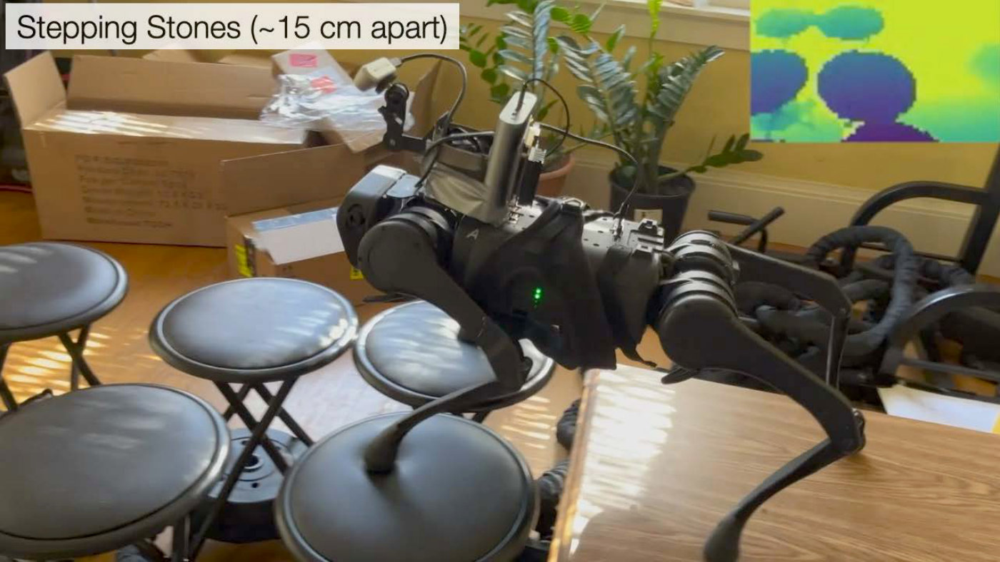

Full-page photograph (a frame of a video) taken indoors: a small black quadruped robot with a camera and a small battery pack on its back steps across a row of round-seated black stools next to a wooden table. Cardboard boxes, a leafy plant and a black chair are behind it. A white label at top left prints "Stepping Stones (~15 cm apart)". At top right is an inset depth image in false colour (yellow-green background, with dark blue and teal rounded blobs near the left and centre).

In the lecture (≈30:52–32:26) this is a video of the deployed vision policy. The depth image at the top right is what the robot sees; the cameras and compute are taped on, and everything runs on board in real time. In Kumar's living room the robot crosses stepping stones made of 20 stools, over repeated runs with different gaps. Kumar then describes further clips without saying which slide is on screen: a hiking path with uneven stairs where a step is almost as high as the robot; even and uneven stairs, up and down; extremely slippery ground; a very high step it takes a few tries to climb; and debris around CMU, where its retries "make more sense than the previous try", an example of learning within the context fed into the model.

## Slide 46 — (blank slide)

Entirely white. No text and no picture is visible on it.

The page is blank in the PDF. The transcript does not say what was on screen here; it may have held one of the clips Kumar describes at ≈31:38–32:26 (see slide 45), but the recording does not settle it.

## Slide 47 — Phase 1: Learning to Walk with Privileged Terrain Information

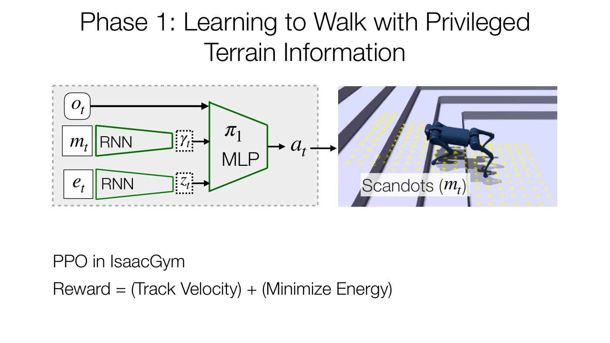

Title "Phase 1: Learning to Walk with Privileged Terrain Information". Left, a diagram inside a grey dashed rounded rectangle (the whole group is a single module). Inside it, from top to bottom:
- A rounded box $o_t$ with a long black arrow to the left edge of the large green trapezoid.
- A white box $m_t$ followed directly by a green-outlined trapezoid (wide at left, narrow at right) labelled "RNN"; an arrow from the trapezoid's narrow end goes into a small dotted-outline box $\gamma_t$, and an arrow from that box points into the big trapezoid.
- A white box $e_t$ followed directly by a green-outlined trapezoid labelled "RNN"; an arrow from it goes into a small dotted-outline box $z_t$, and an arrow from that box points into the big trapezoid.
- The big green-outlined trapezoid (wide at left, narrow at right) is labelled $\pi_1$ over "MLP". All three arrows ($o_t$, $\gamma_t$, $z_t$) enter its left side.
- An arrow leaves its right side, to the label $a_t$, and a second arrow from $a_t$ points out of the grey box to the picture on the right.

Right, a simulation image: a dark-blue quadruped robot on a pale blue-white terrain with dark walls and yellow dots in grids on the floor around it; a white label over the lower part reads "Scandots ($m_t$)".

Text at lower left: "PPO in IsaacGym" and "Reward = (Track Velocity) + (Minimize Energy)".

## Slide 48 — Training Terrains

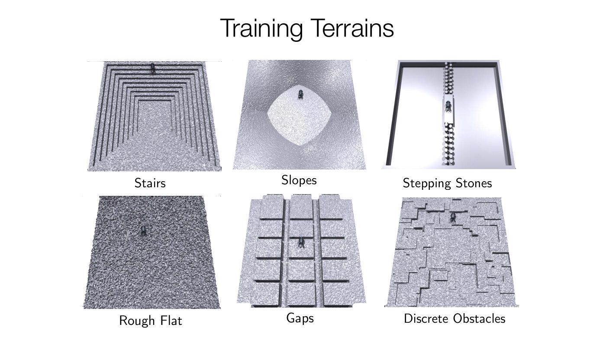

Title "Training Terrains". A 2 by 3 grid of grey top-down renderings of square simulated terrain patches, each with a small robot visible, and a label beneath each. Top row: "Stairs" (concentric rectangular ridges like nested steps around a flat centre, robot at the top), "Slopes" (a smooth diamond-shaped central area with rough sloping surface around it), "Stepping Stones" (a long walled arena with a narrow vertical strip of small round stones, robot on a plain slab in the middle). Bottom row: "Rough Flat" (dark, finely bumpy flat ground), "Gaps" (a grid of square raised blocks separated by dark gaps), "Discrete Obstacles" (an irregular patchwork of raised blocks of different heights).

## Slide 49 — Phase 1 Policy

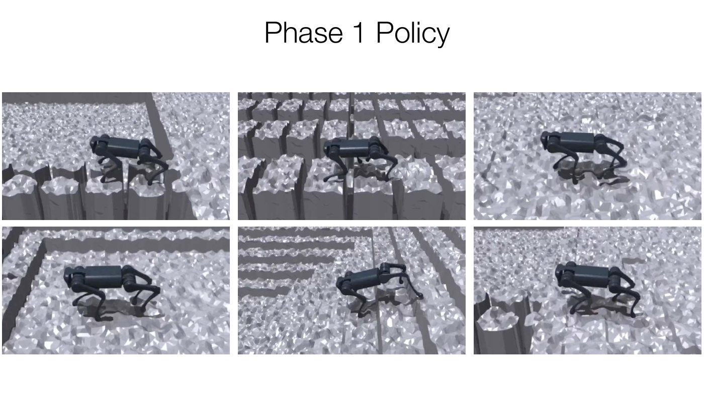

Title "Phase 1 Policy". A 2 by 3 grid of six simulation frames, each showing the same dark grey quadruped robot walking on rough grey-white faceted terrain. In the top row, the left frame has the robot near the edge of a block field beside a wall; the centre frame has it among a grid of tall rough-topped blocks; the right frame has it on bumpy ground. In the bottom row, the left frame has it on rough ground inside a wall; the centre frame has it with one leg raised near ledges and ridges; the right frame has it on bumpy ground beside a single raised block. No labels or captions are printed beyond the title.

## Slide 50 — How do we deploy it?

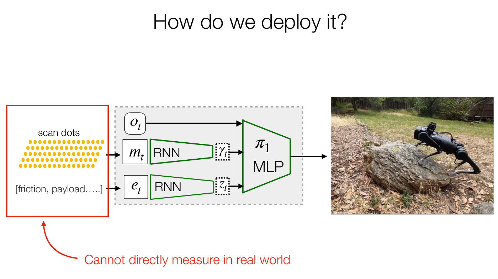

Title "How do we deploy it?". Centre, the same module diagram as slide 47 inside a grey dashed rounded rectangle: $o_t$ with an arrow to the big green trapezoid $\pi_1$ over "MLP"; $m_t$ into a green "RNN" trapezoid, then into a dotted box $\gamma_t$, then an arrow into the trapezoid; $e_t$ into a green "RNN" trapezoid, then into a dotted box $z_t$, then an arrow into the trapezoid. An arrow leaves the trapezoid to the right and points at the photograph on the right.

Left, outside the dashed box, a rectangle with a red outline. It holds a grid of yellow dots (four to five rows, in a slanted layout) labelled "scan dots" above it, and below it the text "[friction, payload.....]". An arrow runs from the dots to $m_t$ and another from the bracketed text to $e_t$. A curved red arrow rises from the red text "Cannot directly measure in real world", at the bottom, to the bottom edge of the red rectangle.

Right, a photograph of a small black quadruped robot with a camera on its back climbing onto a large rock on a grassy hillside with fallen leaves.

## Slide 51 — Phase 2: Learning to Walk with Egocentric Depth

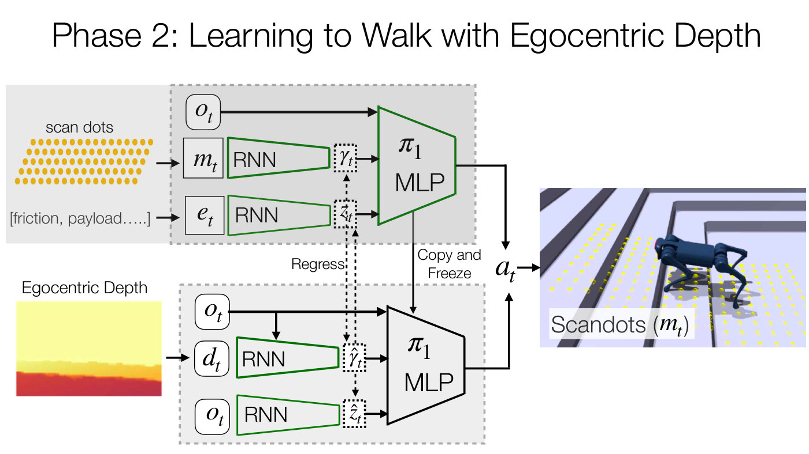

Title "Phase 2: Learning to Walk with Egocentric Depth". Two stacked modules, each inside a grey dashed rounded rectangle, with the input sources at the left and the output picture at the right.

Top module (darker grey, with a darker grey band extending to the left edge that also covers its inputs): the Phase 1 network. Inputs at left: a grid of yellow dots labelled "scan dots", with an arrow to $m_t$; the text "[friction, payload.....]", with an arrow to $e_t$. Inside: $o_t$ with an arrow to the right into the trapezoid; $m_t$ into a green "RNN" trapezoid, into a dotted box $\gamma_t$, then an arrow into the big trapezoid; $e_t$ into a green "RNN" trapezoid, into a dotted box $z_t$, then an arrow into the big trapezoid. The big trapezoid is drawn in green outline, labelled $\pi_1$ over "MLP". Its output goes out the right side, turns down and joins the arrow into $a_t$.

Bottom module (lighter grey): the egocentric depth network. Input at left, labelled "Egocentric Depth" above a small depth image (pale yellow at the top, orange and then dark red in a band at the bottom), with an arrow to a rounded box $d_t$. Inside: a rounded box $o_t$ at top with an arrow right into the big trapezoid and a second arrow branching downward into the first RNN; $d_t$ into a green "RNN" trapezoid, into a dotted box $\hat{\gamma}_ t$, then an arrow into the big trapezoid; a second rounded box $o_t$ below, into a green "RNN" trapezoid, into a dotted box $\hat{z}_ t$, then an arrow into the big trapezoid. The big trapezoid is labelled $\pi_1$ over "MLP" and drawn in black outline with grey fill (not green). Its output leaves on the right, turns up and joins the arrow into $a_t$.

Links between the modules: a solid arrow from the lower part of the top module's trapezoid down into the top of the bottom module's trapezoid, labelled "Copy and Freeze". Two vertical dotted lines run between the modules, with the label "Regress" beside them: one joins the top $\gamma_t$ box to the bottom $\hat{\gamma}_ t$ box, with an arrowhead at each end, and the other joins the top $z_t$ box to the bottom $\hat{z}_ t$ box, with an arrowhead at each end. The lines pass through or beside the boxes between them, and the arrowheads are small enough that their exact direction is hard to read.

Far right: the label $a_t$ with an arrow into the simulation image of a dark-blue quadruped robot on pale terrain with dark walls and yellow dot grids, labelled "Scandots ($m_t$)" in a white box.

## Slide 52 — Deployment Policy

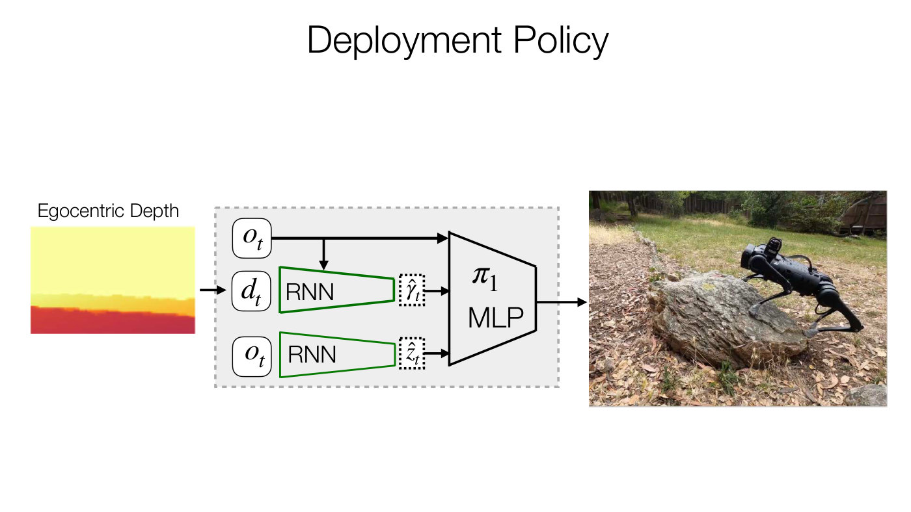

Title "Deployment Policy". Left, the label "Egocentric Depth" above a small depth image (pale yellow top, an orange band, then dark red at the bottom), with an arrow to a rounded box $d_t$. A module in a grey dashed rounded rectangle: a rounded box $o_t$ at top with an arrow right into the big trapezoid and a second arrow branching down into the first RNN; $d_t$ into a green "RNN" trapezoid, into a dotted box $\hat{\gamma}_ t$, then an arrow into the big trapezoid; a second rounded box $o_t$ below, into a green "RNN" trapezoid, into a dotted box $\hat{z}_ t$, then an arrow into the big trapezoid. The big trapezoid is labelled $\pi_1$ over "MLP", drawn in black outline. An arrow leaves the right side towards the photograph on the right: a small black quadruped robot with a camera on its back climbing onto a large rock on a grassy hillside with fallen leaves.

## Slide 53 — Stairs are designed for humans

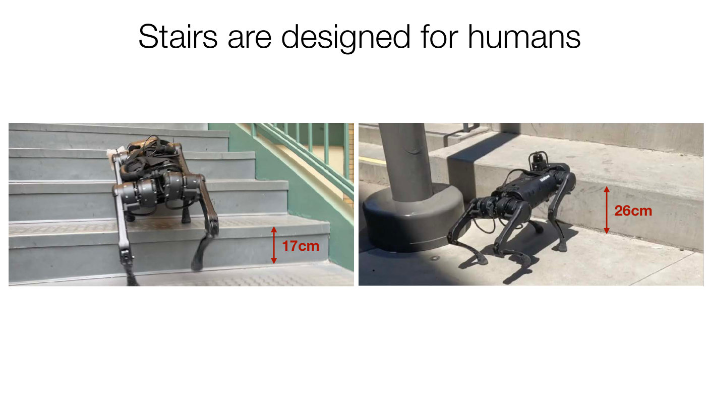

Title "Stairs are designed for humans". Two photographs side by side. Left: a black quadruped robot with a harness-like cable bundle on its back descending a grey metal staircase beside a green railing; a red double-headed vertical arrow beside the step riser is labelled "17cm" in red bold. Right: a black quadruped robot with a camera on its back standing on pavement next to a tall concrete step beside a grey post; a red double-headed vertical arrow beside the step is labelled "26cm" in red bold.

## Slide 54 — Stairs are challenging for small robots

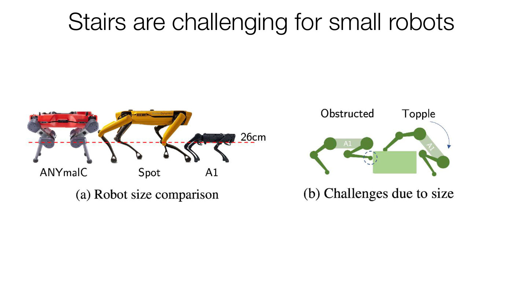

Title "Stairs are challenging for small robots". Left, a photo row of three quadruped robots side by side, standing against a red dashed horizontal line: a red one labelled "ANYmalC", a yellow one labelled "Spot" and a small black one labelled "A1", with "26cm" printed at the right end of the dashed line, at the height of the A1's back. Caption beneath: "(a) Robot size comparison".

Right, a schematic in green: two small diagrams of an A1 robot leg and body (a light green bar labelled "A1" between two circles, with leg segments) next to a light green rectangle (a step). The left diagram is labelled "Obstructed", with a dashed circle where the front leg meets the step. The right diagram is labelled "Topple", with a curved blue arrow from the top towards the right and downward, and the bar tilted. Caption beneath: "(b) Challenges due to size".

## Slide 55 — No predefined gait => emergent hip abduction

Title "No predefined gait => emergent hip abduction". Two photographs side by side, the same scenes as slide 53 without the red measurement arrows. Left: a black quadruped robot with a cable bundle on its back descending a grey metal staircase beside a green railing, with a person's jeans and shoe visible at the top left. Right: a black quadruped robot with a camera on its back standing on pavement beside a concrete step and a grey post.

In the lecture (≈35:32) Kumar describes the motion: going up and down stairs, the small robot "learns to move the leg out sideways", which is possible because no predefined gait or foot motions are used; it is learned with reinforcement learning through search.

## Slide 56 — (photograph of a small black quadruped robot on a wooden table, "Emergent footstep planning")

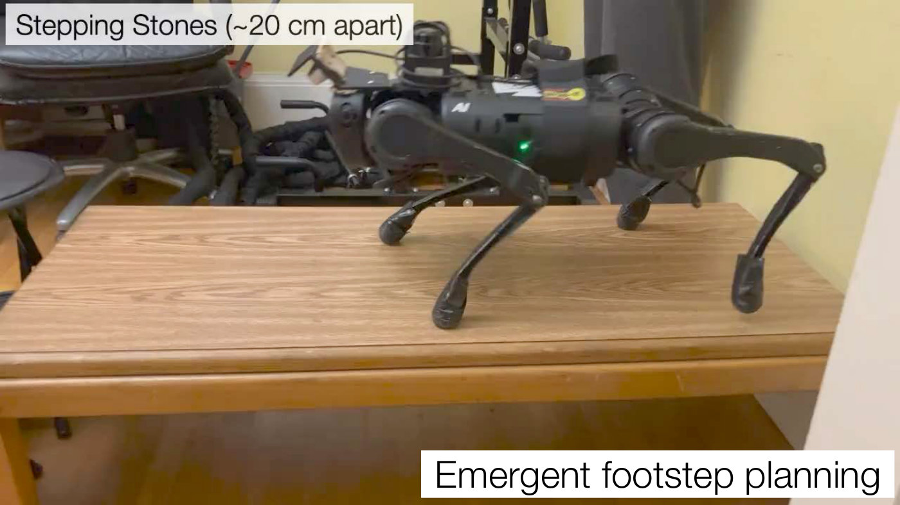

Full-page photograph (a frame of a video) taken indoors: a small black quadruped robot with a camera on its back walks on a wooden tabletop, with a chair and a stool behind it and a pale yellow wall. A white label at top left prints "Stepping Stones (~20 cm apart)". A white box at bottom right prints "Emergent footstep planning" in large black text.

In the lecture (≈35:32–36:18) Kumar describes the motion: footstep planning is also emergent, so the robot "only takes a step when it needs to" rather than moving its feet constantly as a predefined gait would, and it is "quite smooth and seems to work with intention and precision".

## Slide 57 — Map Free, Gait Free

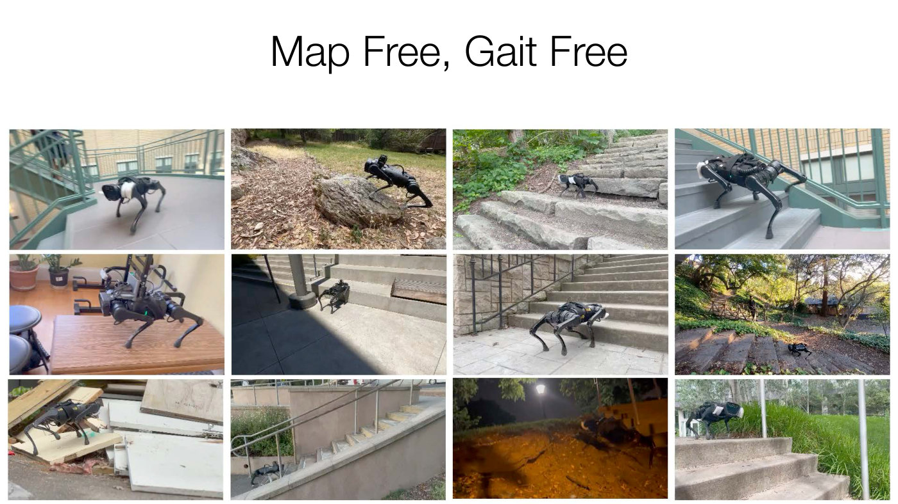

Title "Map Free, Gait Free". A 4 by 3 grid of twelve photographs of the same small black quadruped robot in different places; no captions. Top row: on a curved concrete walkway beside green railings; climbing onto a large rock on a leafy hillside; on wide irregular stone steps among green plants; on a concrete staircase with a green railing. Middle row: on a wooden table beside a stool and potted plants; at the foot of wide concrete steps in the shade beside a grey post; on a stone staircase with an iron railing; on wooden-log steps in a wooded area. Bottom row: on a pile of broken wooden boards and debris; on a concrete ramp-staircase beside a metal handrail; in the dark at night on a dirt slope under a lamp; at the foot of concrete steps with tall grass and metal posts.

## Slide 58 — (four photographs of live demos)

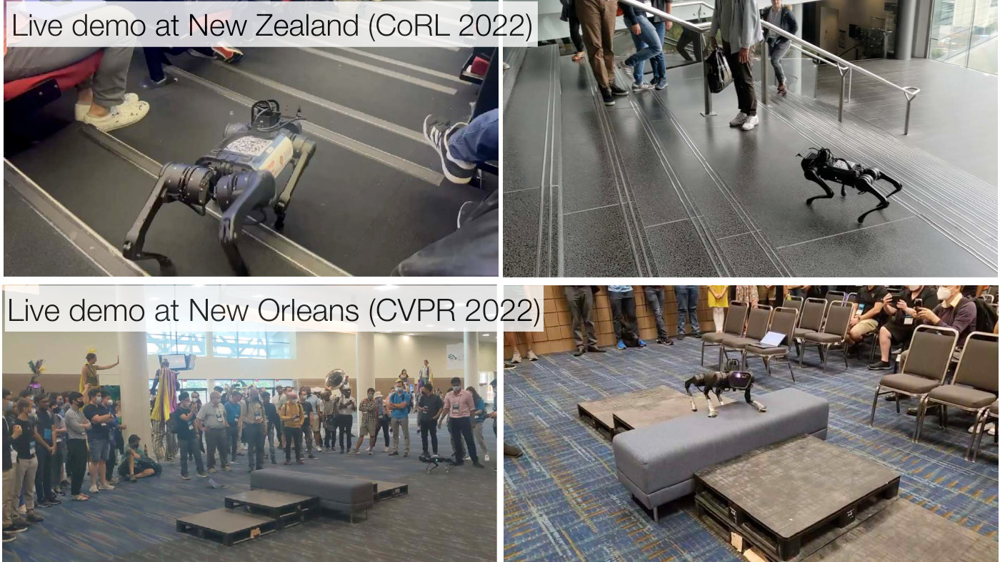

A 2 by 2 grid of four photographs, with two printed labels.
- Top left, label "Live demo at New Zealand (CoRL 2022)": a small black quadruped robot on a dark staircase with striped edges, with people's feet and legs in sneakers at the sides.
- Top right: the robot on a wide dark staircase in a building with a metal handrail; several standing people, seen from the waist down, are at the top of the frame.
- Bottom left, label "Live demo at New Orleans (CVPR 2022)": a wide hall with a crowd of people wearing lanyards standing in a half-circle around a low grey bench and stacked black platforms, with a quadruped robot on the floor at the right of the platforms.
- Bottom right: the robot on top of the grey bench, with black platforms on either side, and rows of chairs and seated spectators behind it.

In the lecture (≈36:18–37:04) Kumar describes the demos as quite robust, and in one, "I think at the bottom one", the right foot's padding came off and the robot started limping but continued the full demo; so at least the bottom panels are frames of videos.

## Slide 59 — Comparisons to baselines

Text-only slide. A single centred line: "Comparisons to baselines".

## Slide 60 — Performance is better without maps

Title "Performance is better without maps". Above the table, a centred heading "Average Distance". The table has a dark blue header row with white text and four rows with alternating white and light grey backgrounds. A black vertical line separates the row-label column from the data columns. No cell is printed in bold or in colour; the highlighting is by red boxes, described below.

| Terrain | Blind | Map Based | Ours |
| --- | --- | --- | --- |
| Slopes | 34.72 | 36.14 | 43.98 |
| Stepping Stones | 1.02 | 1.09 | 18.83 |
| Stairs | 16.64 | 6.74 | 31.24 |
| Discrete Obstacles | 32.41 | 29.08 | 40.13 |

(The header cell over the row labels is empty; the header row prints "Blind", "Map Based", "Ours".)

Annotations in red: a red rectangle surrounds the "Stepping Stones" cells for Blind (1.02) and Map Based (1.09) together, and a second red rectangle surrounds the "Ours" cell (18.83), with a red double-headed horizontal arrow between the two rectangles. Red text, running across the Stairs row and overlapping the tops of its Blind and Map Based numbers: "Performance gap is larger on challenging terrains".

## Slide 61 — Application to dexterous manipulation

Text-only slide. A single centred line: "Application to dexterous manipulation".

## Slide 62 — (photograph of a robot hand rotating an orange object, with citation)

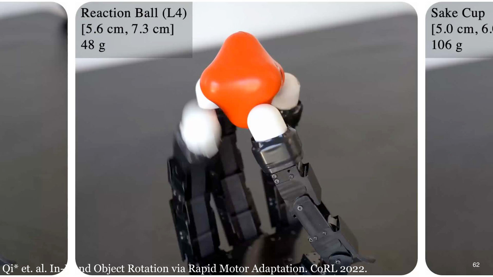

Full-page photograph (a frame of a video) of a black multi-fingered robot hand with white fingertips holding an orange rounded-star-shaped object, against a dark grey background. The picture is a rounded-corner panel in the middle, with the edges of the neighbouring panels visible on each side. A grey label at top left of the middle panel prints "Reaction Ball (L4)", "[5.6 cm, 7.3 cm]", "48 g". The panel on the right is cut off at the edge and its label reads "Sake Cup", "[5.0 cm, 6.(" (cut off), "106 g". Citation along the bottom, partly covered by the middle panel (the text layer reads it whole): "Qi* et. al. In-Hand Object Rotation via Rapid Motor Adaptation. CoRL 2022." Page number 62 at bottom right.

In the lecture (≈38:36) this is a video of in-hand object rotation: the same policy handles many objects, including a paper towel and a badminton shuttle.

## Slide 63 — Generalization across Objects with Different Physical Properties

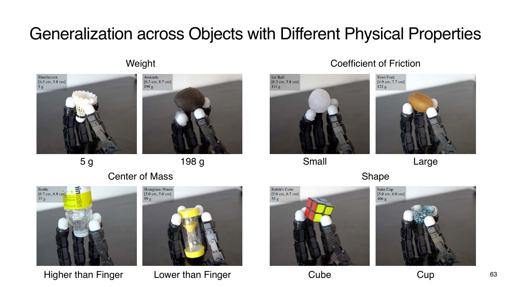

Title "Generalization across Objects with Different Physical Properties". Four groups, each a heading above two photographs of the same black robot hand holding an object, with a caption under each photograph; each photograph carries a small grey label in its top left corner giving the object's name, size and mass. Page number 63 at bottom right.
- "Weight": left photograph labelled "Shuttlecock", "[4.5 cm, 5.8 cm]", "5 g" (a shuttlecock), captioned "5 g"; right photograph labelled "Avocado", "[6.3 cm, 8.7 cm]", "198 g", captioned "198 g".
- "Coefficient of Friction": left photograph labelled "Ice Ball", "[6.3 cm, 5.8 cm]", "111 g", captioned "Small"; right photograph labelled "Kiwi Fruit", "[4.9 cm, 7.7 cm]", "122 g", captioned "Large".
- "Center of Mass": left photograph labelled "Bottle", "[6.7 cm, 6.9 cm]", "37 g" (a water bottle with a yellow label), captioned "Higher than Finger"; right photograph labelled "Hourglass-30min", "[5.0 cm, 5.0 cm]", "99 g" (a yellow-capped hourglass), captioned "Lower than Finger".
- "Shape": left photograph labelled "Rubik's Cube", "[5.0 cm, 6.7 cm]", "55 g", captioned "Cube"; right photograph labelled "Sake Cup", "[5.0 cm, 6.0 cm]", "106 g" (a small blue glass cup), captioned "Cup".

## Slide 64 — Proprioceptive history for Contact Detection

Title "Proprioceptive history for Contact Detection". A centred square photograph of a black robot hand with white fingertips holding a yellow tennis ball against a plain wall, on a dark table. Page number 64 at bottom right.

## Slide 65 — Proprioceptive history for Contact Detection

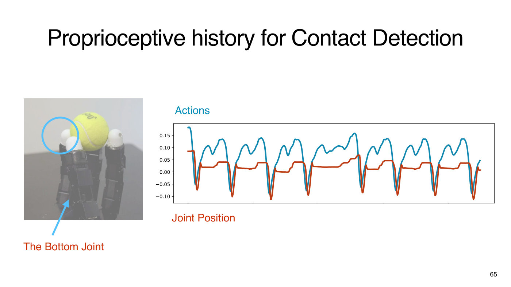

Title "Proprioceptive history for Contact Detection". Page number 65 at bottom right.

Left, a faded (washed-out) copy of the slide 64 photograph of the robot hand and tennis ball. A light blue circle surrounds the fingertip at the upper left of the hand, and a light blue arrow points from below to the lower joint of that finger, with the red label "The Bottom Joint" beneath.

Right, a line chart in a black-bordered box, with the blue label "Actions" above it and the red label "Joint Position" below it. The y-axis is labelled with ticks at 0.15, 0.10, 0.05, 0.00, −0.05, −0.10; the x-axis prints tick marks but no numbers or axis title. Two series over roughly eight repeating cycles:
- Actions, in blue: starts near 0.18, falls to about −0.05, then repeats a cycle of a rise to roughly 0.10–0.14 with two bumps, then a steep drop to about −0.08 to −0.10, eight times; one cycle near the middle of the chart is wider and peaks near 0.16.
- Joint Position, in red: starts at about 0.08, then in each cycle follows the blue curve down to about −0.07 to −0.11 at each steep drop, and between drops stays nearly flat at about 0.01–0.05 (a low step then a slightly higher plateau), well below the blue curve's peaks; it ends near 0.01.

## Slide 66 — Contact Detection

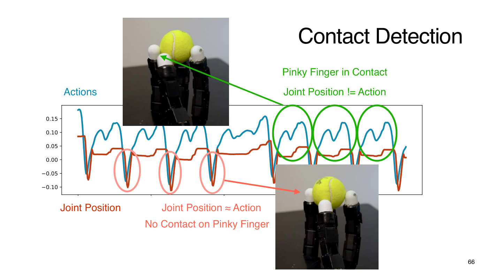

Title "Contact Detection" at top right. Page number 66 at bottom right. The same chart as slide 65 spans the slide (y-axis ticks 0.15, 0.10, 0.05, 0.00, −0.05, −0.10; blue label "Actions" at upper left, red label "Joint Position" at lower left), with two photographs overlapping it and annotations.

- Three pink ovals circle the second, third and fourth steep drops (troughs); the first trough, at the far left, is not circled. A pink-orange arrow runs from the third oval to a photograph at lower right of the black robot hand holding a tennis ball, with one finger in front of the ball. Pink-orange text under the chart: "Joint Position ≈ Action" and "No Contact on Pinky Finger".
- Three green ovals circle the blue peaks of the last three cycles. A green arrow runs from the first green oval up to a photograph at top (centre-left) of the black robot hand with a tennis ball, with the arrow pointing at the fingertip of the lower-left finger. Green text at top right: "Pinky Finger in Contact" and "Joint Position != Action".

The top photograph covers part of the chart's upper left. The bottom photograph covers part of the chart's lower right.

## Slide 67 — Real-world Demos

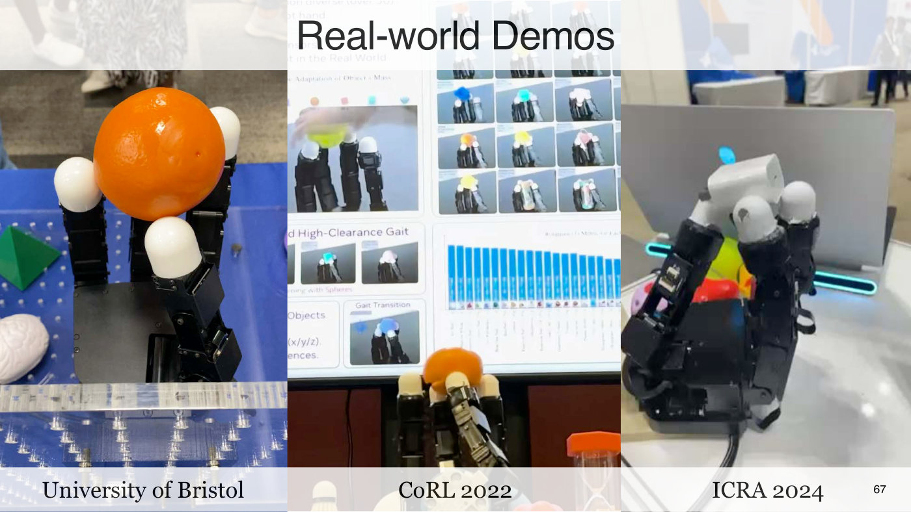

Title "Real-world Demos" at top centre. Page number 67 at bottom right. Three photographs side by side as vertical strips, each with a caption at the bottom (the strips have washed-out bands at the top and bottom).
- Left, caption "University of Bristol": a black robot hand with white fingertips holding a large orange ball on a blue perforated table, with a green pyramid and a white brain model beside it.
- Centre, caption "CoRL 2022": a black robot hand with white fingertips holding an orange object, in front of a large screen showing a poster of small hand photographs and a bar chart; parts of the poster's text are visible ("Adaptation of Object's Mass", "High-Clearance Gait", "Gait Transition", "Objects").
- Right, caption "ICRA 2024": a black robot hand grasping coloured objects (a grey block, red and yellow items) against a laptop with a glowing light strip, at a trade-show booth.

The text layer also holds "Credit: Max Yang, University of Bristol", which is not visible on the rendered page.

In the lecture (≈40:07–40:53) these are videos of live demos: in the centre an orange peel, which deforms completely under slightly more force than necessary, and on the right an adapter, an object not seen in training and not simulated at that level of granularity.

## Slide 68 — Application to drone flight

Text-only slide. A single centred line: "Application to drone flight".

## Slide 69 — (two stacked photographs of drones flying indoors)

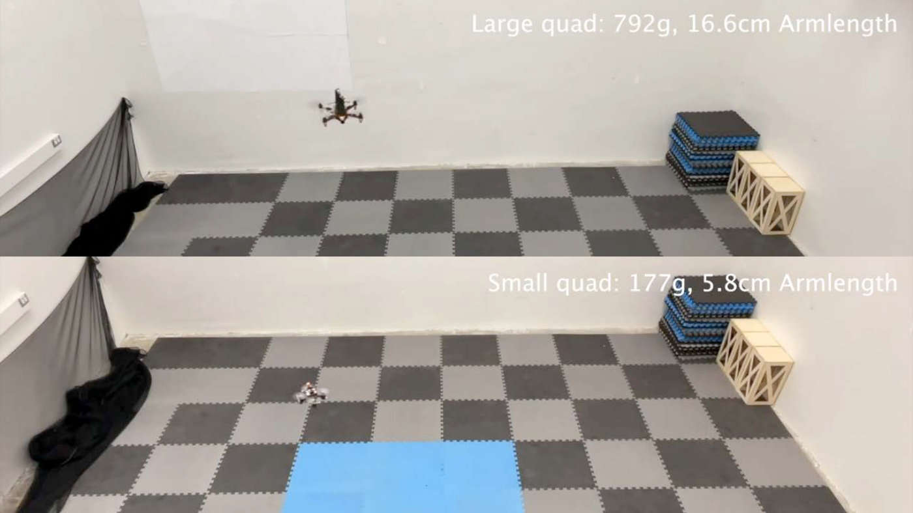

Two stacked photographs (frames of videos) of a white-walled room with a floor of grey and dark-grey checkered foam tiles, a stack of blue-and-black foam tiles and a wooden crate at the right, and black netting at the left. Top, label at top right "Large quad: 792g, 16.6cm Armlength": a quadrotor drone hovers in the air in the middle of the frame. Bottom, label at top right "Small quad: 177g, 5.8cm Armlength": a smaller quadrotor drone is in the air above the tiles, with a blue square of tiles on the floor below it.

In the lecture (≈40:53) these are videos: the same policy, with the same weights, flies both drones, estimating mass and arm length and directly controlling the motor velocity of each propeller. Kumar says the top drone is four times heavier and its arm length three times the bottom one's.

## Slide 70 — (photograph of a small drone on a raised platform)

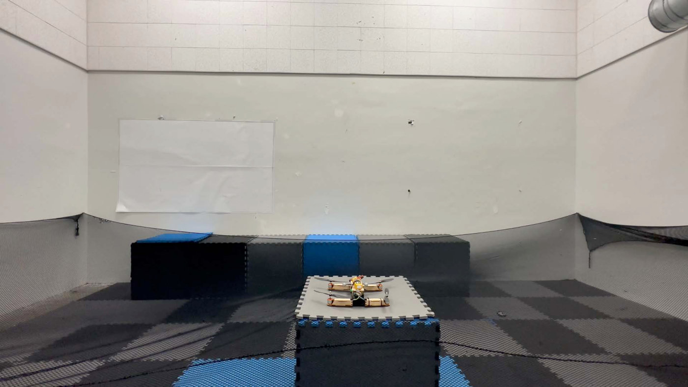

Full-page photograph (a frame of a video) of a white-walled indoor room with black netting around the floor edge, a white paper sheet on the wall at left, and a floor of grey, black and blue foam tiles. A small yellow-and-wood quadrotor drone with propellers sits on top of a raised grey foam platform at the front centre; behind it are black and grey foam blocks with blue tops. No labels printed.

In the lecture (≈40:53–41:40) this is a video of another drone with a higher mass: it wobbles at first, "still trying to estimate what drone it is flying", and stays robust when a tennis ball is shot at one of its propellers.

## Slide 71 — So what's left to solve?

Text-only slide. A single centred line: "So what's left to solve?" (printed with a curly apostrophe).

## Slide 72 — Humanoids

Text-only slide. A single centred word: "Humanoids".

## Slide 73 — (three photographs of white-and-black humanoid robots)

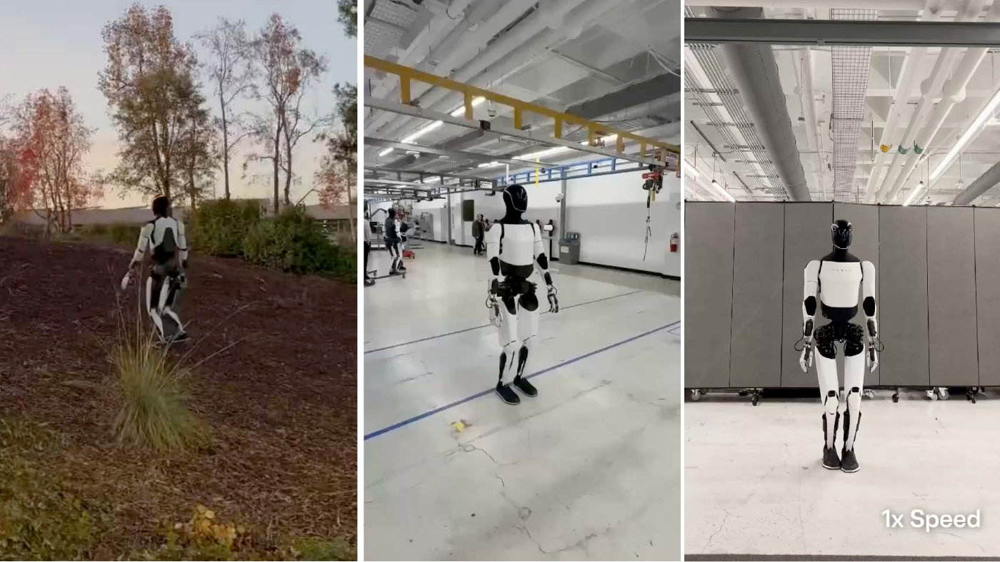

Three tall panels side by side, each a frame of a video of a white-and-black humanoid robot with a black head.
- Left: a humanoid robot seen from behind, walking on a mulch-covered slope with a tuft of grass in front and trees with red and orange leaves behind it, under an evening sky.
- Centre: a humanoid robot standing in an open factory-like hall with a high ceiling, pipes and a yellow overhead rail, on a pale concrete floor with blue lines; other people and another robot stand in the background.
- Right: a humanoid robot standing in a warehouse-like space in front of a row of grey folding partition panels; the text "1x Speed" is printed in white at the bottom right of this panel.

In the lecture (≈42:26) these are videos of the humanoid work at Tesla: on the left a biped walking on a hill, trained in simulation and deployed zero-shot on hardware, and "a more recent video of the bot dancing", all real-time, on board and autonomous. Kumar does not say which panel is the dance.

## Slide 74 — (photograph of a humanoid robot in a lab, "Optimus is learning many new tasks")

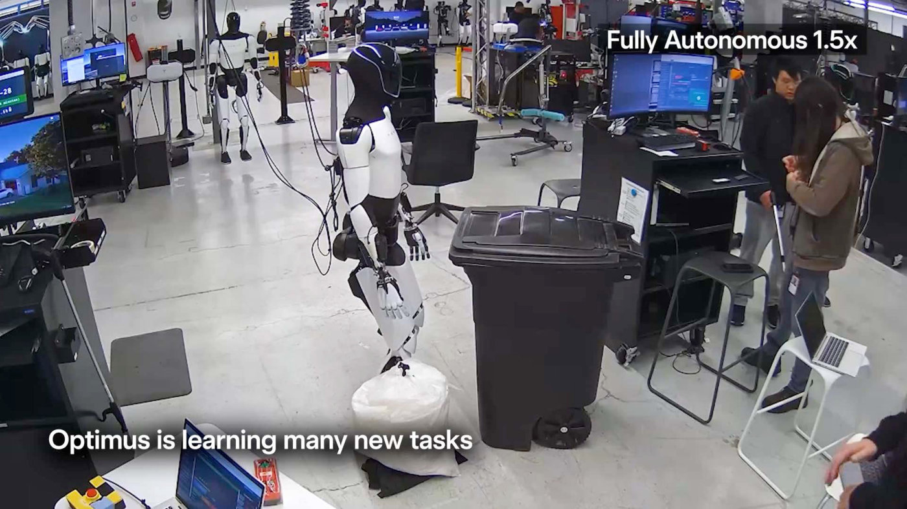

Full-page photograph (a frame of a video) of a workshop-like lab: a white-and-black humanoid robot with a black head stands at the centre, with cables attached, next to a large black wheeled rubbish bin and a white bag on the floor. Other humanoid robots hang or stand at the back; computer monitors, desks, stools and laptops fill the room. Two people stand at the right, one in a brown hooded jacket, looking at a device. Printed overlays: at top right "Fully Autonomous 1.5x", and at bottom left, in large white text, "Optimus is learning many new tasks".

In the lecture (≈43:11–43:56) this is a video of manipulation: the same neural network takes language as input and executes the command, learned from egocentric videos of humans and a little robot data; the tasks get decent performance but are "not very reliable".

## Slide 75 — Getting to reliability and dexterity

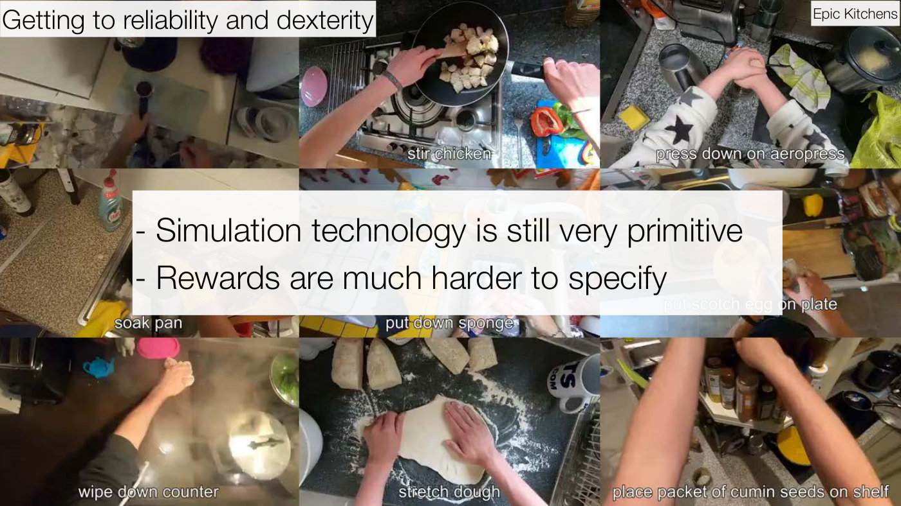

A 3 by 3 grid of first-person kitchen photographs (hands cooking and cleaning, seen from above), overlaid with a large semi-transparent white box in the middle. Printed labels: at top left in a white box, "Getting to reliability and dexterity"; at top right in a small white box, "Epic Kitchens". Per-tile captions in white text at the bottom of each tile: top row, the first tile has no caption visible, then "stir chicken" (a hand stirring chicken pieces in a frying pan) and "press down on aeropress"; middle row, "soak pan", a tile whose caption is hidden behind the overlay, and "put scotch egg on plate" (partly hidden, printed in pale text); bottom row, "wipe down counter", "stretch dough" (two hands on a floured dough) and "place packet of cumin seeds on shelf". Over the middle of the grid, in large black text on the white box, two bullets: "- Simulation technology is still very primitive" and "- Rewards are much harder to specify". Some of the captions in the middle row (including "put down sponge", printed in the row's lower strip) are partly covered by the overlay.

## Slide 76 — Simulation?

Title "Simulation?". Two bullets: "- We can, in fact model complex scenarios like deformable objects, etc. However, they are slow." and "- Learn from the bitter lesson and bet on compute", with the words "bitter lesson" in red. Below, inside a red-outlined box, a centred italic quotation: "“The biggest lesson that can be read from 70 years of AI research is that general methods that leverage computation are ultimately the most effective, and by a large margin”", followed on its own line by the attribution "- Rich Sutton" (not italic).

## Slide 77 — General reward model?

Title "General reward model?". Two bullets: "- Most obvious answer are large models trained for general understanding" and "- Could work, but RL will exploit weaknesses if they exist". Lower centre, in red: "Worst case: humans label everything for us!"

## Slide 78 — Superhuman capabilities

Title "Superhuman capabilities". Two centred lines. First: "Learnings from AlphaGo:" in a darker weight, followed by "Sparse reward + lots of search!". Second: "Can we get robots that exceed human capability?", with the word "exceed" in italics.

## Slide 79 — Questions?

Text-only slide. A single centred line: "Questions?"
