# Lecture 1 — Class Intro (course intro and MDPs)

Chelsea Finn, Stanford CS224R, Spring 2025 (Wednesday, April 2) ·
[video](https://www.youtube.com/watch?v=EvHRQhMX7_w) (53 min) ·
[slides (PDF)](https://cs224r.stanford.edu/spring_2025/slides/01_cs224r_intro_2025.pdf) ·
[slide-by-slide text](../raw/slides/01-class-intro.md) ·
[transcript](../raw/transcripts/01-class-intro.md)

**What this lecture establishes.** Deep reinforcement learning is the study of sequential
decision-making problems, where a system makes many decisions from a stream of information, and
of solutions to them that scale to deep neural networks. The lecture argues for studying it from
four angles: going beyond supervised $(x, y)$ examples, its use in deployed systems, its claim to
be fundamental to intelligence, and its open research problems. It then sets up the vocabulary
every later lecture uses: states, observations, actions, trajectories, rewards, unknown dynamics
and the Markov property; a policy $\pi_\theta$ as a neural network; the objective of maximizing
the *expected* sum of rewards under the trajectory distribution $p_\theta(\tau)$; value and
Q-functions; and the five families of algorithms the course covers.

Slide numbers below are the numbers printed on the slides, which equal the PDF page numbers.
Timestamps (≈M:SS) point into the video and the [transcript](../raw/transcripts/01-class-intro.md).
**The recording leaves out the course-logistics slides** (slides 5–6 and 10–15): after slide 9
the video passes straight to "why study deep RL" at ≈4:43. Their content, from the slides only,
is on the [course logistics](course-logistics.md) page.

## Contents

1. [What "deep reinforcement learning" means](#what-deep-reinforcement-learning-means)
2. [Why study deep RL](#why-study-deep-rl)
3. [Representing experience as data](#representing-experience-as-data)
4. [States, observations and the Markov property](#states-observations-and-the-markov-property)
5. [Two worked examples: the towel robot and the chatbot](#two-worked-examples-the-towel-robot-and-the-chatbot)
6. [Think-pair-share: formulate your own problem](#think-pair-share-formulate-your-own-problem)
7. [Representing behavior: the policy](#representing-behavior-the-policy)
8. [The goal of reinforcement learning](#the-goal-of-reinforcement-learning)
9. [Aside: why stochastic policies?](#aside-why-stochastic-policies)
10. [How good is a policy? Value and Q-functions](#how-good-is-a-policy-value-and-q-functions)
11. [Types of algorithms, and why there are so many](#types-of-algorithms-and-why-there-are-so-many)
12. [Recap: the MDP](#recap-the-mdp)

## What "deep reinforcement learning" means

Finn introduces herself as the course's instructor, an assistant professor at Stanford whose
research covers reinforcement learning, robotics and language models (≈0:05). The day's
learning goals are what deep RL even is, how to represent behavior so that it can be optimized,
and how to formulate a reinforcement learning problem (slide 4).

By *reinforcement learning* the course means **sequential decision-making problems**: a system
has to make multiple decisions based on a stream of information, observing, acting, observing
again and acting again. The course studies both those problems and their solutions: imitation
learning, model-free and model-based RL, offline and online RL, multi-task and meta-RL, and,
with extra emphasis, RL for large language models and RL for robots. The *deep* means an
emphasis on solutions that scale to deep neural networks; methods that do not are given much
less time (slide 7, ≈0:52–1:37).

**How RL differs from supervised learning** (slide 8, ≈1:37–3:55). Supervised learning is given
labeled pairs $\lbrace (x_i, y_i) \rbrace$ and learns $f(x) \approx y$. It is told directly what
to output, and its inputs are assumed independent and identically distributed (i.i.d.). RL
differs in two ways. First, it learns *behavior*, a mapping from states to actions written
$\pi(a \mid s)$, from **indirect feedback** rather than from the answer. Second, the data is
**not i.i.d.**: experience is usually collected by the very policy being learned, so the
distribution the data comes from depends on that policy (slide 8: "actions $a$ affect the future
observations"). "Behavior" is broad: motor control of a robot, a chatbot talking to a person,
playing a game, driving a car, or an agent acting on the web (≈3:55).

The course cannot cover everything. It focuses on the core concepts behind deep RL methods, so
that more advanced methods can be understood from them; on implementing algorithms; on examples
from robotics, control and language models, with techniques that generalize further; and on the
topics the staff find most useful and exciting. For more theory and other applications Finn
points to CS 234. The core goal is to be able to understand and implement existing and emerging
methods in deep RL (slide 9, ≈3:55–4:43).

## Why study deep RL

Finn gives four reasons, then takes each in turn (slide 17, ≈4:43–7:47).

**1. Going beyond supervised $(x, y)$ examples.** Many AI predictions have *consequences*. A
music recommender that picks the next song changes what it should pick after that: it probably
should not repeat the same song, and may want to stay in the same genre. Taking such
consequences into account, and optimizing behavior with respect to them, is what RL provides
(≈5:30). Direct supervision is also often unavailable. Feedback on a coding assistant such as
Cursor or Copilot, telling it that it did a great job there or a poor job there, is not the
output itself but indirect supervision, and learning from it, or from any objective at all, can be formulated as
RL. That makes RL much more flexible than supervised learning (≈6:16). Slide 18 lists where
decision-making problems arise: any AI agent (robots, autonomous vehicles, web assistants);
systems that interact with people (chatbots, recommenders); deployments whose decisions affect
future outcomes and observations ("feedback loops"); and problems without labels, or whose
objective is not just accuracy and is not differentiable (≈7:47).

**2. Widely used in performant AI systems** (≈7:47–10:50). Legged robots that walk and dance
were trained with deep RL in simulation and then transferred to real robots in the real world
(slide 19, ≈8:32).

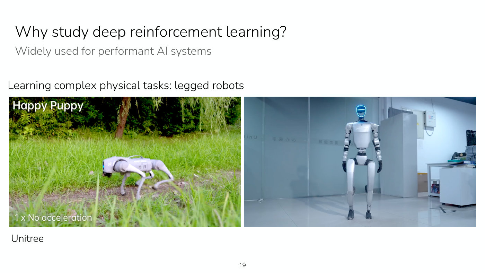

*Slide 19 — legged robots trained with RL in simulation and transferred to the real world: a quadruped captioned "Unitree" and a humanoid (video stills). [Deck](https://cs224r.stanford.edu/spring_2025/slides/01_cs224r_intro_2025.pdf)*

Robot arms can unload and fold laundry or fold simple origami; these examples were learned with
imitation learning, which is within the scope of the course (slide 20, ≈8:32).

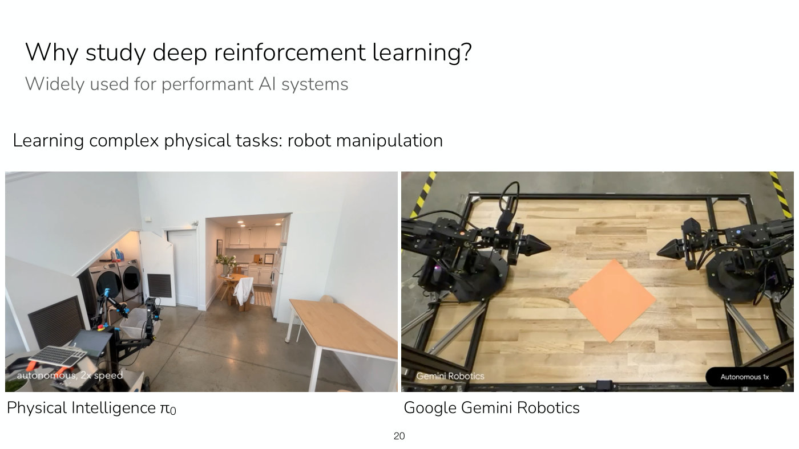

*Slide 20 — manipulation learned with imitation learning: a two-armed mobile robot beside a laundry basket (Physical Intelligence π0) and two arms folding an orange square (Gemini Robotics). [Deck](https://cs224r.stanford.edu/spring_2025/slides/01_cs224r_intro_2025.pdf)*

DeepMind used deep RL to train a Go player that defeated the champion Lee Sedol. Its "move 37"
surprised every Go expert: the system had discovered a strategy humans had not thought of. Finn
offers this as an example of RL as a tool for *discovering* new solutions, which could matter
beyond games, for instance in curing diseases or anything else that needs experimentation
(slide 21, ≈9:19–10:04). The screenshot on the slide is from a different match than the one the
text names: its panels show "KE JIE" against "ALPHAGO", under a banner for the Future of Go
Summit in Wuzhen.

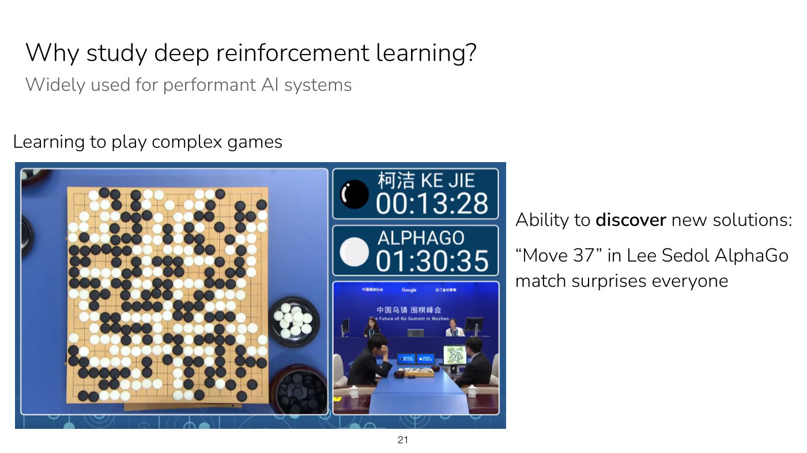

*Slide 21 — a broadcast of AlphaGo playing Ke Jie at the Future of Go Summit; the slide's text refers to "Move 37" in the Lee Sedol match. [Deck](https://cs224r.stanford.edu/spring_2025/slides/01_cs224r_intro_2025.pdf)*

Beyond robots and games, nearly all modern language models use some form of RL for
post-training, especially for more advanced reasoning (slide 22, ≈10:04).

Research on traffic control uses RL to insert automated cars among human-driven ones so as to
increase the throughput of a road (slide 23, ≈10:04).

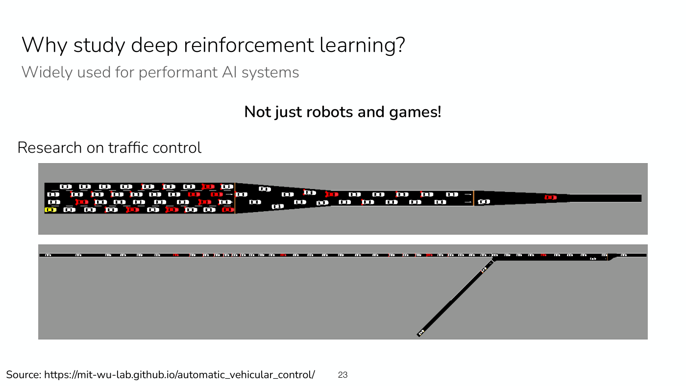

*Slide 23 — traffic-control simulations: a multi-lane road narrowing to one lane (top) and an on-ramp merging into a single lane (bottom). [Deck](https://cs224r.stanford.edu/spring_2025/slides/01_cs224r_intro_2025.pdf)*

Generative image models can be trained with RL to follow their prompt. Asked for "a dolphin
riding a bike", the base model produces a poor picture; optimized with RL, its pictures follow
the prompt much more closely (slide 24, ≈10:04–10:50).

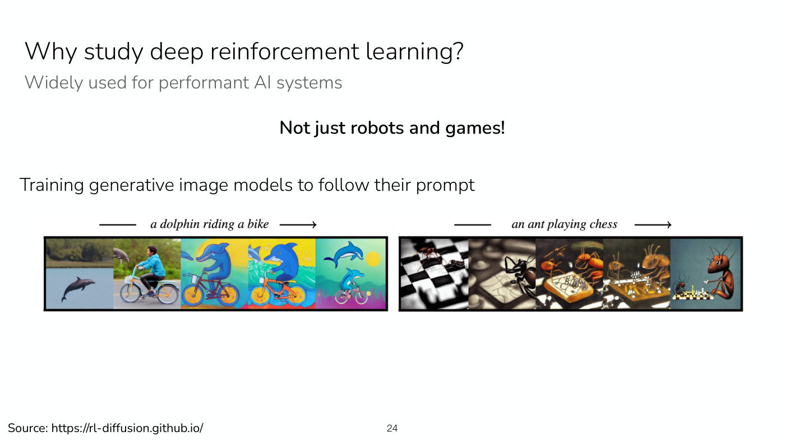

*Slide 24 — read each strip left to right: as RL training proceeds, the images follow the prompts "a dolphin riding a bike" and "an ant playing chess" more closely. [Deck](https://cs224r.stanford.edu/spring_2025/slides/01_cs224r_intro_2025.pdf)*

RL has also been used for chip design, in chips used in Google's production TPUs (slide 25,
≈10:50). The slide's diagram shows the formulation: an agent places the chip's macros onto an
empty canvas one at a time, each placement an action with reward 0, and only the final layout is
scored, with a reward made of negative wirelength, congestion and density terms.

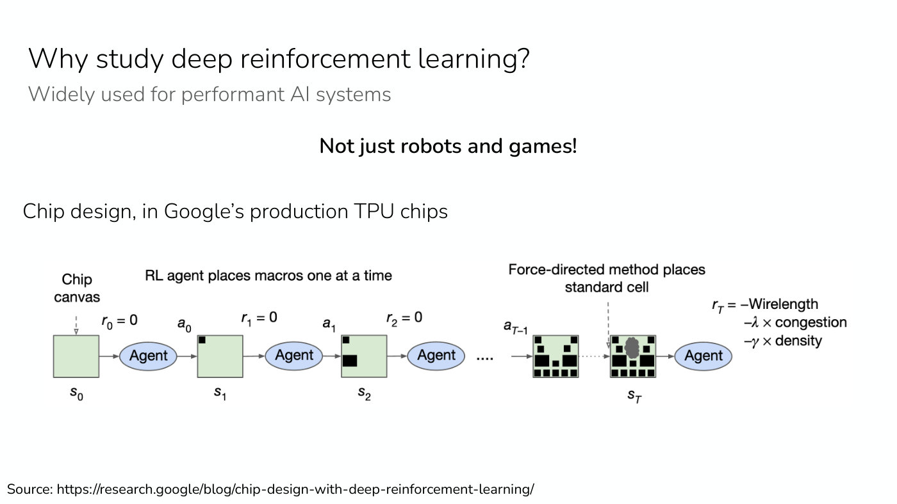

*Slide 25 — chip placement as an RL problem: the agent places one macro per step with reward 0, and only the final layout is scored, by negative wirelength, congestion and density. [Deck](https://cs224r.stanford.edu/spring_2025/slides/01_cs224r_intro_2025.pdf)*

**3. Learning from experience seems fundamental to intelligence** (≈10:50–13:53). Finn tells
the story of starting a PhD, right after undergrad, in a lab working on RL for robots. A postdoc
ran RL experiments on the robot next to Finn's desk, and the robot could be *watched learning*:
at first it knew nothing about how to fit together two parts of a toy airplane, and by the end it
did it quite performantly. RL, in other words, gives a system the ability to get better with
practice, which other machine learning systems lack (slide 26, ≈11:35–12:21).

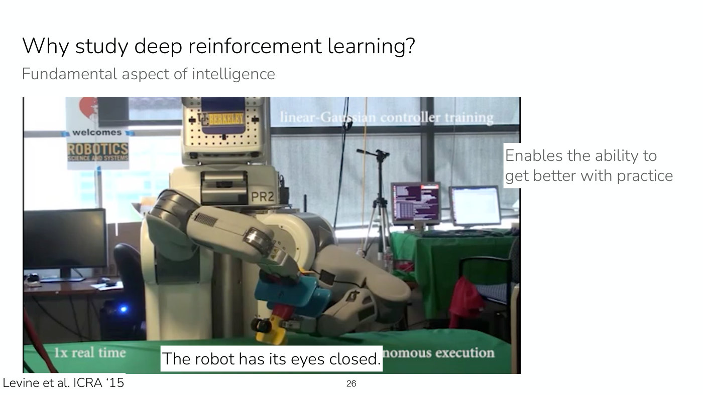

*Slide 26 — the PR2 learning to fit two parts of a toy airplane together without a camera, "the robot has its eyes closed" (Levine et al., ICRA '15). [Deck](https://cs224r.stanford.edu/spring_2025/slides/01_cs224r_intro_2025.pdf)*

That robot had "its eyes closed": it used no camera, which seemed a fundamental limitation. In a
follow-up project with the postdoc, with cameras this time, the robot learned in the real world
to insert a red block into a shape-sorting cube, again getting better as it practiced
(slide 27, ≈12:21).

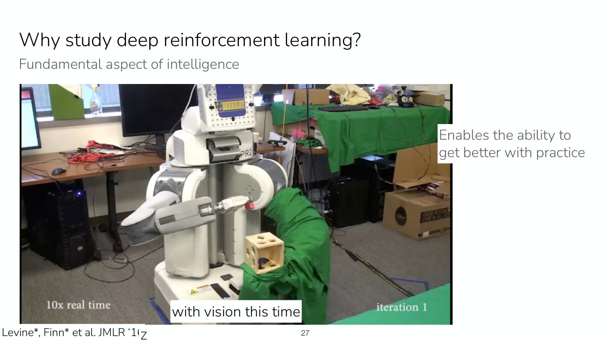

*Slide 27 — the same kind of robot with vision, at iteration 1 of learning to put a block into a shape-sorting cube (Levine, Finn et al., JMLR '16). [Deck](https://cs224r.stanford.edu/spring_2025/slides/01_cs224r_intro_2025.pdf)*

It ended with a success rate Finn recalls as around 95 or 100%, and could put the block in even
when a person held the cube out to it (slide 28, ≈13:08). Finn acknowledges these are very simple
tasks from a long time ago, but shows them because they make the real-world learning process,
the ability to improve with practice, visible.

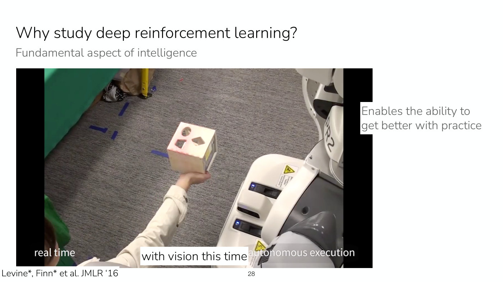

*Slide 28 — after learning: the robot puts the block into the shape-sorting cube while a person holds the cube out. [Deck](https://cs224r.stanford.edu/spring_2025/slides/01_cs224r_intro_2025.pdf)*

**4. Open research problems** (≈13:53–14:39). Slide 29 pairs each open question with the course
topic that addresses it. How does a robot learn to represent what is good or bad for the task?
(reward learning). How can an agent generalize to many scenarios, at scale? (offline RL, which
leverages large and diverse datasets; multi-task RL and meta-RL, which transfer from other tasks
and goals). Can RL learn long-horizon tasks like cooking a meal or, Finn adds, solving a really
hard math problem? (hierarchy and reasoning). Can robots practice fully autonomously?
(reset-free RL).

That last question is where the videos above mislead. Real-world RL often looks like a robot
trying to hit a hockey puck into a goal, which after every attempt has to be reset, because the
robot does not know how to undo the task. Finn's friend Yevgen does the resetting and so does
more work than the robot, and it is not practical to collect a lot of data this way (slide 30,
≈13:53–14:39).

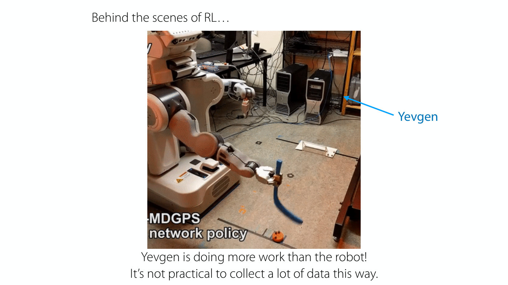

*Slide 30 — "Yevgen is doing more work than the robot": in real-world RL a person resets the task after every attempt. [Deck](https://cs224r.stanford.edu/spring_2025/slides/01_cs224r_intro_2025.pdf)*

Finn closes the motivation with a joke from a friend: the real reason to study deep RL is
"1 million dollars in total compensation from OpenAI" (≈7:02).

**Question: how was the reward measured on the real robot?** (≈15:25–16:12). In those
experiments the reward was the negative distance between the object's position and its goal
position. In the shape-sorting task the robot was holding the cube, so the arm's own position
told it where the cube was. The hockey puck carried a motion-capture (mocap) marker that measured
where it was in the room. Neither trick works in general, which is why reward learning is needed
to solve the problem more generally.

## Representing experience as data

To learn from what a robot experiences while practicing, or from a chatbot's conversations, that
experience has to be written down as data (≈16:12). RL does it with five pieces (slide 32,
≈16:57–20:00); the [notation page](mdp-and-notation.md) collects them.

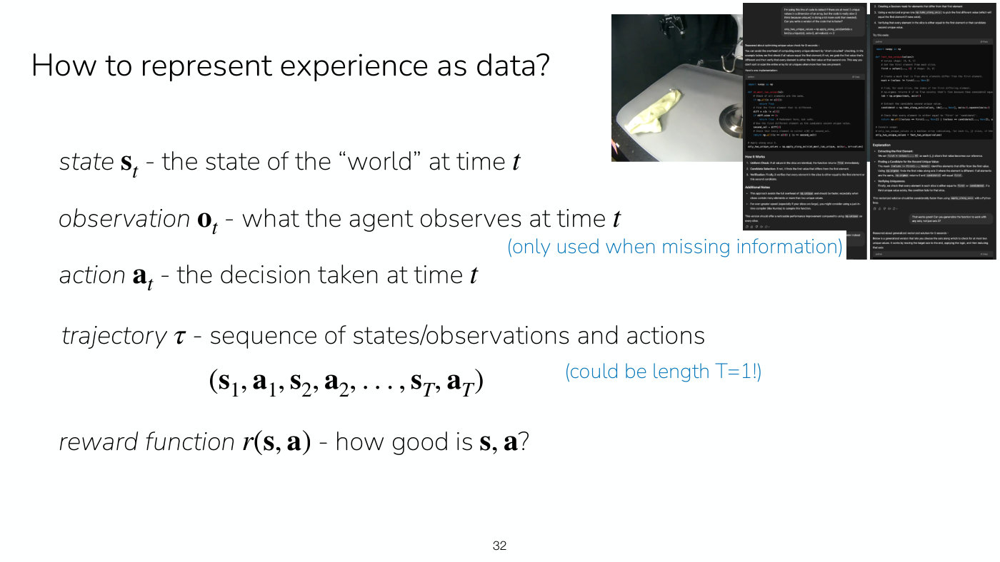

*Slide 32 — the pieces of experience as data (state, observation, action, trajectory, reward), with the two running examples: the towel-on-hook robot and a chatbot. [Deck](https://cs224r.stanford.edu/spring_2025/slides/01_cs224r_intro_2025.pdf)*

- The **state** $\mathbf{s}_ t$ is the state of the world at time $t$. For a robot hanging a towel
  on a hook, it might be the positions of the arm, the towel and the hook; without direct access
  to the towel, it might be an image from the robot's camera plus the arm's joint positions.
- An **observation** $\mathbf{o}_ t$ is what the agent observes at time $t$, used only when
  information is missing. An observation may not capture everything needed to make a decision,
  so past observations may be needed too. For a chatbot, the observation at a time step is the
  user's most recent message, which alone does not say what the next response should be: the
  chatbot needs the history of the conversation.
- The **action** $\mathbf{a}_ t$ is the decision taken at time $t$.
- A **trajectory** $\tau$ is a sequence of states (or observations) and actions,
  $(\mathbf{s}_ 1, \mathbf{a}_ 1, \mathbf{s}_ 2, \mathbf{a}_ 2, \ldots, \mathbf{s}_ T, \mathbf{a}_ T)$.
  The slide notes it could have length $T = 1$. Data in RL is therefore a dataset of
  trajectories rather than a dataset of $(x, y)$ pairs (≈19:14).
- The **reward function** $r(\mathbf{s}, \mathbf{a})$ says how good a state and action are. It
  often depends only on the state: how close the towel is to being hung, or whether the user is
  happy or gave a thumbs up. Each time the policy is rolled out, the trajectory can be augmented
  with its rewards (≈19:14–20:00).

## States, observations and the Markov property

The states and actions form something like a Markov chain (slide 33, ≈20:00–23:07). In the
towel example, the first state has the robot in a neutral position and the towel on the table;
the robot takes an action (moving its arm), and that action and the current state determine the
next state, in which the towel may or may not have moved. How the world changes is described by a
**dynamics** distribution such as $p(\mathbf{s}_ 3 \mid \mathbf{s}_ 2, \mathbf{a}_ 2)$: how the arm
and towel move as a function of where they were and what the robot did. The crucial point is that
$\mathbf{s}_ 3$ depends only on $\mathbf{s}_ 2$ and $\mathbf{a}_ 2$; conditioned on $\mathbf{s}_ 2$,
it is independent of $\mathbf{s}_ 1$. This is the **Markov property**, and it is very useful in
RL because it removes the need to track every earlier dependency (≈21:34–22:21). In general the
dynamics $p(\mathbf{s}_ {t+1} \mid \mathbf{s}_ t, \mathbf{a}_ t)$ are **unknown** and independent
of $\mathbf{s}_ {t-1}$ (slide 33).

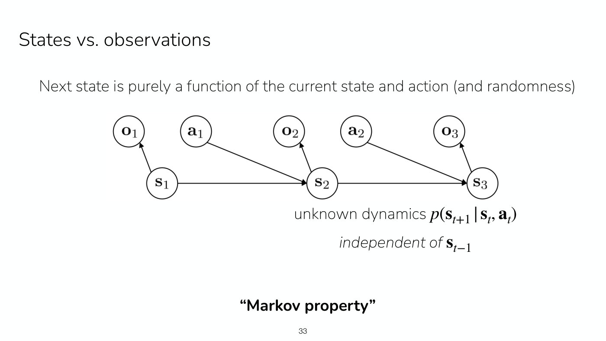

*Slide 33 — the graphical model: states form a chain through the unknown dynamics, each action feeds the next state, and each state emits an observation. [Deck](https://cs224r.stanford.edu/spring_2025/slides/01_cs224r_intro_2025.pdf)*

Observations break this. Each observation is a function of the current state and may not contain
all of its information, so when the state cannot be observed, $\mathbf{o}_ 3$ depends not only on
$\mathbf{o}_ 2$ and $\mathbf{a}_ 2$ but on $\mathbf{o}_ 1$ as well (≈22:21–23:07). The slide's
graphical model draws this: a chain of states linked by the dynamics, with each action feeding
the next state and each state emitting its observation.

Three student questions sharpen the picture.

- *How many past observations are needed to infer the state?* It is heavily domain dependent. In
  much of robotics the current sensor readings are enough, but it depends on the sensors: a
  tactile sensor tells you nothing about how close you are to a table until you touch it, so it
  is far more partially observable than an image, and combining the two gives a more complete
  picture (≈23:07–23:54).
- *Why does the reward depend on the action and not only the state?* A humanoid learning to walk
  might be rewarded for forward progress, which depends on the state. To stop it spending too
  much energy, the reward can also penalize the torque sent to the motors, which depends on the
  action. Often the state alone is enough (≈23:54–24:41).
- *Why is a future observation not independent of past ones?* In the tactile example, if you make
  contact, lose it and make contact again, the most recent observation says little about the
  current state while an earlier one says a lot, so predicting $\mathbf{o}_ 3$ is better done
  conditioning on $\mathbf{o}_ 1$ as well as $\mathbf{o}_ 2$. Marginalizing out the unobserved
  states in the graphical model shows the same thing (≈25:28–26:14).

See [MDPs and RL notation](mdp-and-notation.md) for the definitions in one place.

## Two worked examples: the towel robot and the chatbot

The robot example (slide 34, ≈26:14–28:33). The **state** is the RGB images from the robot's
cameras, the positions of all its joints, and the joints' velocities, a fairly common
representation for a robot. Images and positions have different dimensionalities, so the neural
network has to be configured to accept both. The **action** is the commanded next joint
position: a joint currently at 90° might be commanded to 92°. The **trajectory** is a sequence of
images (essentially a video), joint positions and commanded joint positions. Time is
discretized, for example at 20 Hz: 20 video frames, 20 joint readings and 20 commanded actions
per second. Finn admits finding this unintuitive at first, since people do not feel they make a
decision 20 times a second, but it is often the most practical way to represent behavior on
physical systems (≈27:48). The slide gives the numbers: a 10-second sequence at 20 Hz, so
$T = 200$. The **reward** could be 1 if the towel is on the hook in state $\mathbf{s}$ and 0
otherwise, perhaps with a penalty on the torques applied (≈27:48–28:33).

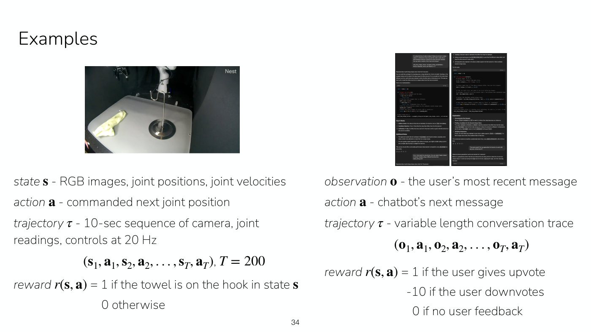

*Slide 34 — the two worked examples: the robot's state, action, 200-step trajectory and sparse reward (left); the chatbot's observation, action, conversation and upvote/downvote reward (right). [Deck](https://cs224r.stanford.edu/spring_2025/slides/01_cs224r_intro_2025.pdf)*

The chatbot example (slide 34, ≈28:33–29:20). There is no compact state representation, so it
uses **observations**: the observation is the user's most recent message, and the **action** is
the chatbot's next message, which could be a sentence or a paragraph and so potentially very
large. The **trajectory** is the conversation trace. Unlike the robot's, it does not tick at a
fixed frequency: a time step is "when the user responds next", however long that takes. An
example **reward** is 1 if the user gives an upvote, −10 for a downvote and 0 for no feedback.
(The slide writes this reward as $r(\mathbf{s}, \mathbf{a})$, although the column otherwise uses
observations.)

## Think-pair-share: formulate your own problem

The class is asked to define the state or observation, action, trajectory and reward for
autonomous driving, a web agent, a poker player, or an example of their own (slide 35,
≈29:20–30:07). The discussion that follows makes several general points.

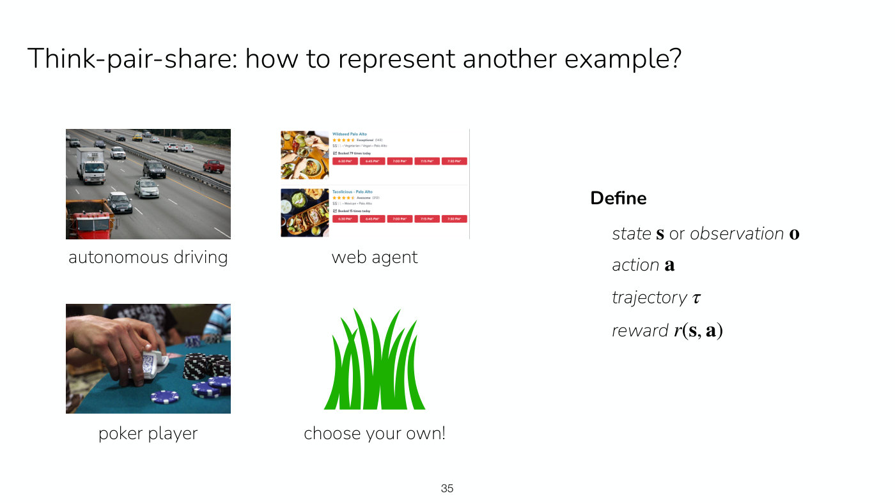

*Slide 35 — the think-pair-share prompt: formulate autonomous driving, a web agent, a poker player or an example of your own. [Deck](https://cs224r.stanford.edu/spring_2025/slides/01_cs224r_intro_2025.pdf)*

- **State or observation is often a judgment call.** For driving, a LiDAR scan of the current
  depth around the car and a picture of what is in front of it miss how fast the other cars are
  moving, which matters a great deal (stopped versus 60 mph). Including a short history, say the
  last three seconds of LiDAR, recovers the velocities. This is a recurring theme: to handle
  observations, use a little history, and let that form the state representation (≈30:07–30:53).
- **Sparse rewards need help to get started.** With a reward of 1 only when the towel is on the
  hook, a robot that never succeeds sees zero reward everywhere and gets almost no signal. In the
  towel video the robot was first shown how to do the task a couple of times, which helped with
  what the course will call *exploration*. When rewards carry little signal and are not shaped
  towards the goal, such data can be important for jump-starting RL (≈30:53–31:38).
- **A web agent**, as a student proposes: the state is the page's HTML and URL, the action is an
  interaction with the page, and the reward is whether the task was completed (≈31:38–32:24).
- **Is everything really an observation, since sensors are imperfect?** One can always choose to
  model something as an observation, but adding a lot of history has real costs. So something is
  often treated as a state even when it occasionally lacks information, for example a sensor that
  returns a black image once in 10,000 frames (≈32:24–33:12).
- **Observations as deltas.** Representing each observation as a change from the previous one is
  a trade-off; when a lot of history is included, compressing it into deltas can make sense
  (≈33:12).

## Representing behavior: the policy

Behavior is represented by a **policy**, denoted $\pi$, mapping states, observations or a
sequence of observations to actions (slide 36, ≈33:12–35:29). It can be any function
approximator: a convolutional network (as drawn on the slide), a transformer, a fully connected
network, or a linear function. Its parameters, the neural network's weights that are learned,
are written $\theta$, so the policy is $\pi_\theta(\mathbf{a} \mid \mathbf{s})$.

*Slide 36 — the policy as a convolutional network from camera image to action, with θ marking that every layer's weights are learned; below it, the roll-out loop. [Deck](https://cs224r.stanford.edu/spring_2025/slides/01_cs224r_intro_2025.pdf)*

Using a policy is a loop: observe the state $\mathbf{s}_ t$; take an action $\mathbf{a}_ t$, for
example by **sampling** from $\pi_\theta(\cdot \mid \mathbf{s}_ t)$, which means running a forward
pass of the network; then observe the next state $\mathbf{s}_ {t+1}$, which is sampled from the
unknown world dynamics $p(\cdot \mid \mathbf{s}_ t, \mathbf{a}_ t)$. The result is a trajectory
$\mathbf{s}_ 1, \mathbf{a}_ 1, \ldots, \mathbf{s}_ T, \mathbf{a}_ T$, also called a policy
**roll-out** or an **episode**. An episode is one attempt; "roll-out" refers to unrolling the
alternation of policy, dynamics, policy, dynamics into a trajectory (≈34:44).

With only observations, the policy needs **memory**:
$\pi_\theta(\mathbf{a}_ t \mid \mathbf{o}_ {t-m}, \ldots, \mathbf{o}_ t)$, for instance with a
sequence model, as language models do. A policy given the true state needs no memory, which is
convenient because a long history takes a lot of memory on the computer or GPU (≈35:29).

Four questions follow (≈35:29–38:32). Capital $T$ is the end of the trajectory, its length;
lowercase $t$ is a time step, and statements written with $t$ hold at every step from $t = 1$ to
$t = T$. Conditioning on both the observation and the state adds nothing, because the state has
strictly more information than the current observation. History helps with observations because
past observations tell you about the underlying state: in a conversation where the user asked for
some code and then gave feedback on it, the earlier messages are essential. And a two-stage
approach, first inferring the state and then predicting the action from it, can be useful when
there is a good idea of what the underlying state should look like; otherwise it is simplest to
go straight from observations to actions.

See [Policies](policies.md).

## The goal of reinforcement learning

The goal is to maximize reward, not at one time step but across the whole trajectory: maximize
the sum of rewards $\sum_t^T r(\mathbf{s}_ t, \mathbf{a}_ t)$ (slide 37, ≈38:32). But this sum is
**not a deterministic quantity**: running the same policy twice gives different rewards. Asked
for the sources of variability, the class suggests stochastic dynamics, a stochastic policy, a
stochastic reward function, and goals that change over time (≈39:18–40:49). Finn's answers: the
reward is typically modeled as a deterministic function, with the randomness coming from states
and actions, although with only observations it can look stochastic. If goals change, that is
usually modeled as a different decision process altogether, or the unobserved goal is pushed into
the state so that the reward stays deterministic; without loss of generality, randomness can be
moved into the state. That leaves **two main sources of variability**: the world is stochastic
(the dynamics are a distribution, not a deterministic function), and the policy is stochastic. In
driving, other cars behave randomly, and your own car may not make the same decision every time
(≈40:49–41:36).

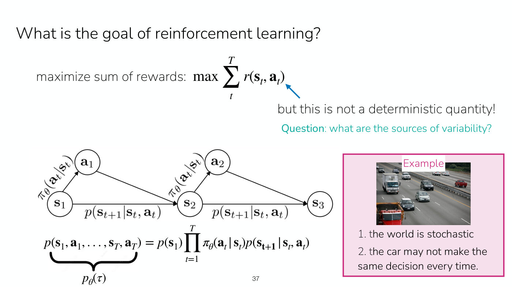

*Slide 37 — the sum of rewards is random: the policy (state to action) and the dynamics (state and action to next state) in the graphical model are the two sources, and the trajectory probability multiplies them. [Deck](https://cs224r.stanford.edu/spring_2025/slides/01_cs224r_intro_2025.pdf)*

To reason about rewards under that randomness, add the policy to the graphical model and write a
**probability distribution over trajectories** (≈41:36–43:09). There may be randomness in the
initial state too, the way the cards are dealt in a card game. The probability of a trajectory is
the initial-state probability, times the probability of each action under the policy, times the
probability of each next state under the dynamics:

$$p_\theta(\tau) = p(\mathbf{s}_ 1, \mathbf{a}_ 1, \ldots, \mathbf{s}_ T, \mathbf{a}_ T) = p(\mathbf{s}_ 1) \prod_{t=1}^{T} \pi_\theta(\mathbf{a}_ t \mid \mathbf{s}_ t) \thinspace p(\mathbf{s}_ {t+1} \mid \mathbf{s}_ t, \mathbf{a}_ t)$$

(slides 37–38). Finn says "plus the product" at ≈43:09; the slides multiply. The objective is
then to maximize the **expected** sum of rewards over trajectories drawn from that distribution
(slide 38, ≈43:09–44:42):

$$\max_{\theta} \thinspace \mathbb{E}_ {\tau \sim p_\theta(\tau)} \left[ \sum_{t}^{T} r(\mathbf{s}_ t, \mathbf{a}_ t) \right]$$

Unlike a supervised loss, the policy does not appear in the summand at all. It enters only
through the distribution of trajectories, which depends on $\pi$, and the task is to find the
policy that leads to the highest reward. Much of the course is about how to optimize behavior
under exactly this objective (≈44:42).

Two further points. The horizon $T$ does not have to be fixed; it can vary, and is written as
fixed only because that is easier (≈44:42–45:28). And the plain sum weights every reward equally,
caring about the immediate future as much as the far future, which is not always wanted: if $T$
were 1,000 years, rewards 1,000 years from now would matter less than today's. A **discount
factor** fixes this by weighting the reward at time $t$ by the discount factor raised to the
power $t$. It is usually greater than 0 and at most 1; a value of 1 recovers the original
objective, and lower values make the agent greedier, caring more about near-term rewards. The
discount factor is spoken only and appears on no slide of this deck, and no symbol is given for
it; it returns in a later lecture (≈45:28–47:01).

See [The RL objective](rl-objective.md).

## Aside: why stochastic policies?

There are two reasons to make the policy a distribution rather than a deterministic function
(slide 39, ≈47:01–47:47). **Exploration**: to learn from your own experience you must try
different things, the way someone learning tennis should not repeat the exact same technique
over and over. **Modeling stochastic behavior**: data collected from people or other systems
shows varying strategies, and modeling the different ways they approach a problem needs a
stochastic policy. This is where tools from **generative modeling** come in: a generative model
over actions given states or observations, rather than a network that maps one input to one
output (≈47:47).

## How good is a policy? Value and Q-functions

Improving a policy requires knowing how good it is (slide 40, ≈47:47–49:20). The **value
function** $V^\pi(\mathbf{s})$ is the future expected reward starting at state $\mathbf{s}$ and
following $\pi$ from then onward: the objective above, but starting from $\mathbf{s}$. The
**Q-function** $Q^\pi(\mathbf{s}, \mathbf{a})$ is the future expected reward starting at
$\mathbf{s}$, taking action $\mathbf{a}$, which may differ from what $\pi$ would have chosen, and
then following $\pi$. Finn introduces both now without going into depth, because the course uses
them heavily; Q-functions come in from the week after this lecture (≈49:20). See
[Value functions](value-functions.md).

## Types of algorithms, and why there are so many

The course's algorithms all target the expected-reward objective (slide 41, ≈49:20–50:53):

1. **Imitation learning** mimics a policy that achieves high reward (the next lecture; see
   [Lecture 2](02-imitation-learning.md)).
2. **Policy gradients** directly differentiate the objective, learning from practice and
   experience.
3. **Actor-critic** methods estimate the value of the current policy and use it to make the
   policy better.
4. **Value-based** methods estimate the value of the *optimal* policy and use it to back out a
   good policy.
5. **Model-based** methods learn to model the dynamics of the world, predicting the future, and
   use the model for planning or to improve the policy.

Supervised learning has one workhorse, gradient descent, which is simple and works. RL has many
algorithms because they make different trade-offs and thrive under different assumptions
(slide 42, ≈50:53–51:39): how easy or cheap it is to collect data with the policy (a simulator
versus interacting with a person who writes responses); how easy or cheap different forms of
supervision are (demonstrations, detailed rewards); how important stability and ease of use are
compared with data efficiency; whether the action space is high-dimensional, and continuous or
discrete; and whether the dynamics model is easy to learn. See
[RL algorithm families](rl-algorithm-families.md).

## Recap: the MDP

The lecture closes by naming what it built (slides 43–44, ≈51:39–52:25). States (or
observations), actions, a reward function, an initial state distribution $p(\mathbf{s}_ 1)$ and
unknown dynamics $p(\mathbf{s}_ {t+1} \mid \mathbf{s}_ t, \mathbf{a}_ t)$ together form a **Markov
decision process (MDP)**, or, with only observations, a **partially observed Markov decision
process (POMDP)**. Finn held back the names until the end because they do not really matter, but
they are useful to know when people refer to MDPs. On top of the MDP sit trajectories, policies,
the RL objective, value functions and Q-functions.

The last slide's reminders were not spoken: Homework 1 comes out on Friday, due 4/18 at 11:59 pm
PT, and students should start forming final-project groups. Friday has the imitation learning
lecture (10:30, Hewlett 200) and a PyTorch tutorial (1:30, Gates B1) (slide 45). Slide 45 prints
"due Weds 4/18", but slide 15 has "due Fri 4/18", and April 18, 2025 was a Friday; the course
site also lists it as due Friday, April 18.

## Related pages

- [MDPs and RL notation](mdp-and-notation.md) — states, observations, actions, dynamics, rewards,
  the Markov property, MDP and POMDP.
- [Policies](policies.md) — policies as neural networks, roll-outs, memory, stochastic policies.
- [The RL objective](rl-objective.md) — the trajectory distribution, expected return, horizon and
  discounting.
- [Value functions](value-functions.md) — $V^\pi$ and $Q^\pi$.
- [RL algorithm families](rl-algorithm-families.md) — the five families and where the course
  covers each.
- [Course logistics](course-logistics.md) — staff, prerequisites, grading, homework and project.
