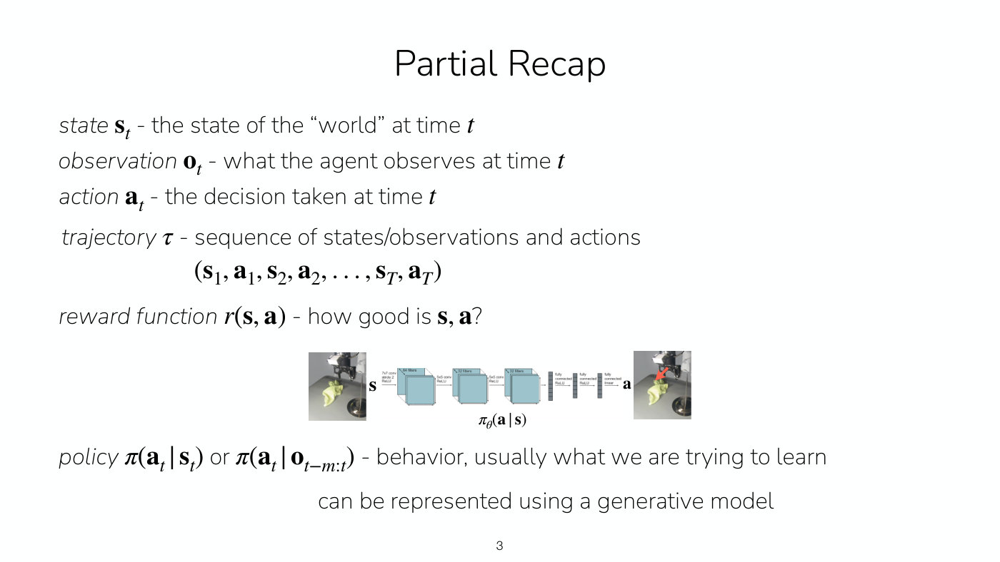
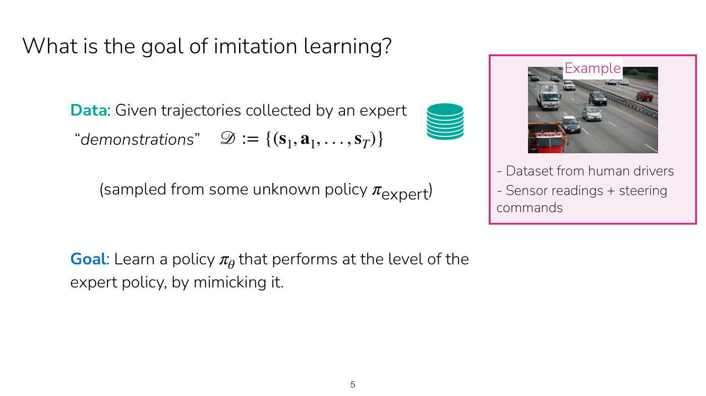
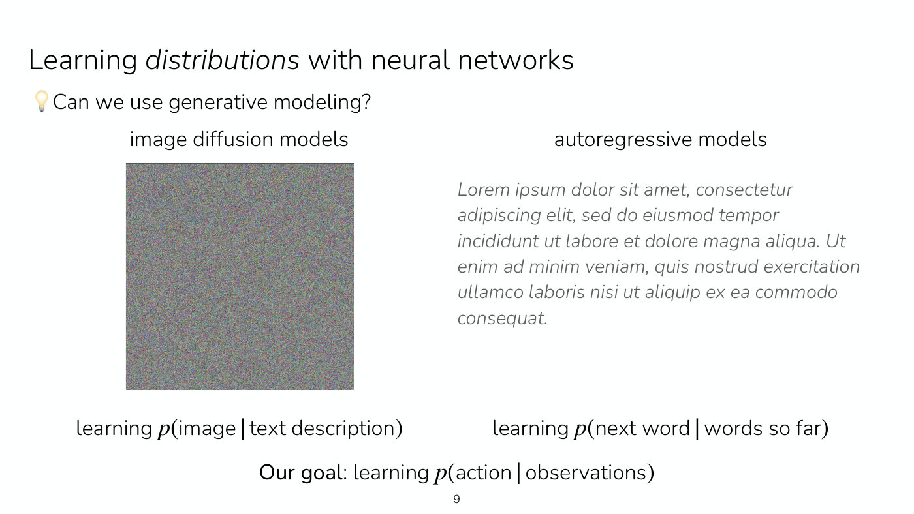
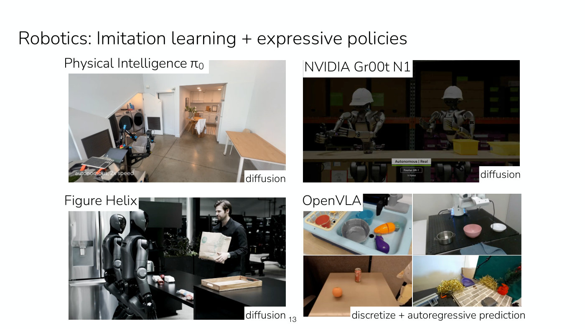
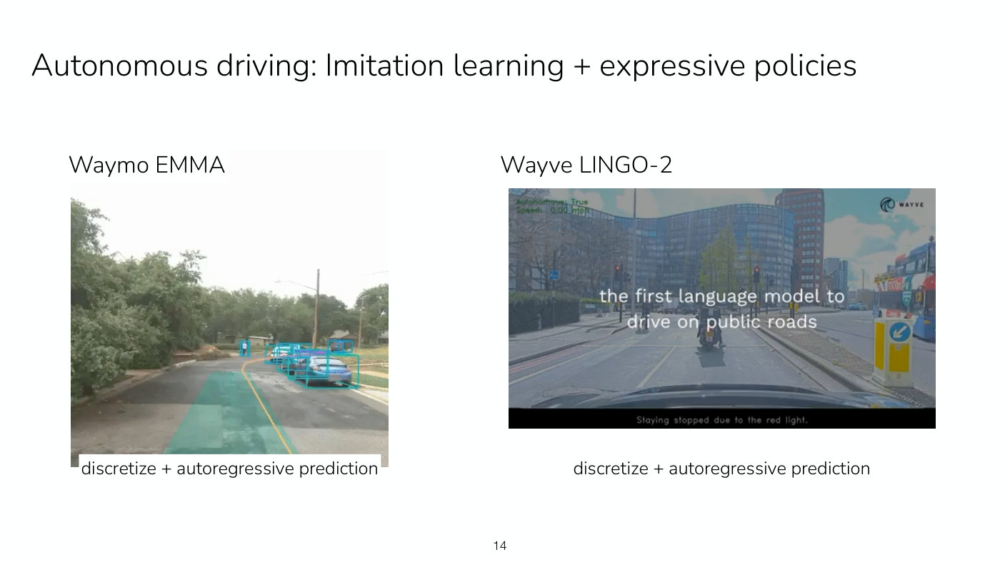
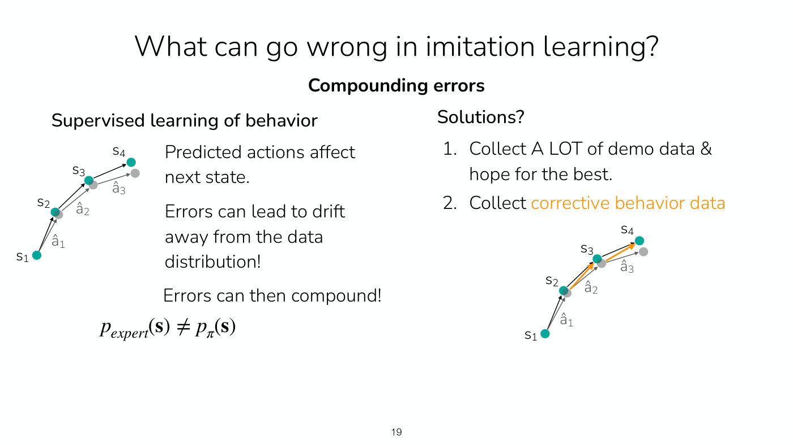

# Lecture 2 — Imitation Learning

Stanford CS224R, Spring 2025 (Friday, April 4) ·
[video](https://www.youtube.com/watch?v=WxRDyObrm_M) (67 min) ·
[slides (PDF)](https://cs224r.stanford.edu/spring_2025/slides/02_cs224r_imitation_2025.pdf) ·
[slide-by-slide text](../raw/slides/02-imitation-learning.md) ·
[transcript](../raw/transcripts/02-imitation-learning.md)

**What this lecture establishes.** Imitation learning trains a policy to mimic demonstrations
collected by an expert, and in its simplest form it is supervised learning on state-action pairs.
The lecture makes two arguments about why that simple form fails. First, demonstrations are often
multimodal (different people do the same thing different ways), and a policy trained to regress to
the expert's actions learns their mean, which can be an action nobody took. The fix is to make the
policy an expressive distribution, using generative models (Gaussian mixtures, discretized
autoregressive models, diffusion) trained by maximum likelihood. Second, a learned policy's small
mistakes take it to states the demonstrations never covered, where it makes bigger ones:
compounding errors, caused by covariate shift. The fix is to collect corrective data from the
policy's own states, as in DAgger and its human-gated variant. Behavior cloning on its own is
fully offline and needs no reward function, but it may need a great deal of data.

Slide numbers below are the numbers printed on the slides, which equal the PDF page numbers.
Timestamps (≈M:SS) point into the video and the [transcript](../raw/transcripts/02-imitation-learning.md).
**The recording stops before the end of the deck.** It ends at about 67:05, in the questions after
the human-gated DAgger slide, so the last part of the plan (how to collect demonstrations), the
lecture's summary slide and the closing reminders are never discussed. Their content, from the
slides alone, is in [the last section](#not-in-the-recording-collecting-demonstrations-and-the-summary).

The lecturer's whiteboard drawings are not in the recording; where the transcript refers to them
("this", "here"), this page reconstructs what was said from the surrounding words and the slides.

## Contents

1. [Recap and plan](#recap-and-plan)
2. [The imitation learning problem](#the-imitation-learning-problem)
3. [Version 0: regress to the expert's actions](#version-0-regress-to-the-experts-actions)
4. [What goes wrong: multimodal demonstrations](#what-goes-wrong-multimodal-demonstrations)
5. [Learning distributions with neural networks](#learning-distributions-with-neural-networks)
6. [Generative models as policies](#generative-models-as-policies)
7. [Training an expressive policy: maximum likelihood](#training-an-expressive-policy-maximum-likelihood)
8. [Network expressivity is not distribution expressivity](#network-expressivity-is-not-distribution-expressivity)
9. [Version 1, and the evidence for it](#version-1-and-the-evidence-for-it)
10. [Expressive policies in deployed systems](#expressive-policies-in-deployed-systems)
11. [Summary of part 1: offline and reward-free](#summary-of-part-1-offline-and-reward-free)
12. [Compounding errors and covariate shift](#compounding-errors-and-covariate-shift)
13. [Corrective data: DAgger](#corrective-data-dagger)
14. [Letting the expert take over: human-gated DAgger](#letting-the-expert-take-over-human-gated-dagger)
15. [Not in the recording: collecting demonstrations, and the summary](#not-in-the-recording-collecting-demonstrations-and-the-summary)

## Recap and plan

The lecture opens with a partial recap of Lecture 1's notation (slide 3, ≈0:05–1:36): the state
$\mathbf{s}_ t$ or the more partial observation $\mathbf{o}_ t$, the action $\mathbf{a}_ t$, the
trajectory $\tau$, the reward function $r(\mathbf{s}, \mathbf{a})$, and the policy, conditioned
either on the current state, $\pi(\mathbf{a}_ t \mid \mathbf{s}_ t)$, or on a history of
observations, $\pi(\mathbf{a}_ t \mid \mathbf{o}_ {t-m:t})$. The policy is usually what is being
learned, and the slide notes that it "can be represented using a generative model", which this
lecture takes up. The goal of RL, not on the slide, is to maximize the expected sum of rewards
([the RL objective](rl-objective.md)); imitation learning is one way to approach it, by imitating
a good policy (≈0:51–1:36). Symbols are defined on [MDPs and RL notation](mdp-and-notation.md).

*Slide 3 — the recap's policy network from Lecture 1, camera image of the towel and hook in, action out, with the reminder that a policy can be represented by a generative model. [Deck](https://cs224r.stanford.edu/spring_2025/slides/02_cs224r_imitation_2025.pdf)*

The plan has four parts (slide 4, ≈1:36–2:23): imitation learning basics, learning expressive
policy distributions, learning from online interventions, and, time permitting, how to collect
demonstrations. A brace on the slide marks the first three as the topic of Homework 1. The key
learning goals are how to represent distributions with neural networks rather than deterministic
functions, why expressive distributions matter for imitation learning, and what compounding errors
are and how to address them. The lecturer calls the first of these somewhat orthogonal to the
course's main topic but very important for getting imitation learning systems that perform
(≈1:36).

## The imitation learning problem

As in reinforcement learning, the goal is a policy that achieves high reward and does the task
well. Imitation learning gets there from data: trajectories collected by an expert, called
**demonstrations**, a special kind of trajectory that shows how to perform the task (slide 5,
≈2:23). Each demonstration is a sequence of states and actions.

*Slide 5 — the imitation learning setup: demonstrations sampled from an unknown expert policy, and a learned policy meant to perform at the expert's level; human driving is the running example. [Deck](https://cs224r.stanford.edu/spring_2025/slides/02_cs224r_imitation_2025.pdf)*

The dataset of demonstrations is written

$$\mathcal{D} := \lbrace(\mathbf{s}_ 1, \mathbf{a}_ 1, \ldots, \mathbf{s}_ T)\rbrace$$

For autonomous driving, the demonstrations
could be people driving, since people are good at it most of the time: record the car's sensors
together with the steering commands, acceleration and so on, and train an agent to mimic them
(≈3:09). Nobody knows exactly how humans drive, so the demonstrations are treated as samples from
some **unknown** policy $\pi_{\text{expert}}$. The goal is to learn a policy $\pi_\theta$, with
parameters $\theta$, that performs at the level of the expert, or close to it, by mimicking what is
in the data (≈3:55).

## Version 0: regress to the expert's actions

The simplest approach (slide 6, ≈3:55–6:14): take the states in the demonstrations, run each one
through the policy to get a predicted action $\hat{\mathbf{a}}$, and make the prediction as close
as possible to the action the demonstrator took, over every state-action pair in the dataset. For
a deterministic policy, this is supervised regression to the expert's actions:

$$\min_\theta \frac{1}{|\mathcal{D}|} \sum_{(\mathbf{s}, \mathbf{a}) \in \mathcal{D}} \lVert \mathbf{a} - \hat{\mathbf{a}} \rVert^2 \qquad \text{where } \hat{\mathbf{a}} = \pi_\theta(\mathbf{s})$$

Then deploy the learned policy. With a neural network this is ordinary supervised training: sample
a mini-batch, run a forward pass to get the predicted actions, compute the loss, back-propagate it
into the network's parameters, and repeat with "your favorite optimizer", some form of stochastic
gradient descent (≈6:14). The lecturer first writes the predicted action as sampled from
$\pi_\theta$, then corrects the board: version 0 is a **deterministic** policy trained with
$\ell_2$ regression (≈7:01). The expert, though, might not be deterministic, and that is the
problem.

## What goes wrong: multimodal demonstrations

Back to driving (≈7:01–7:47). In the same situation some human drivers go straight and
others merge left, perhaps to move to a faster lane, so the dataset contains both. The lecturer
asks what a policy trained with $\ell_2$ regression would do, and a student answers that it might
drive down the middle of the two lanes (≈8:32).

The steering command shows why (≈8:32–10:05). The drivers who stay straight have a distribution of
steering commands centred on zero; the drivers who merge left have one centred on about $-2$. The
dataset as a whole mixes the two: a **multimodal** distribution with two peaks, the straight one
higher because more people stayed straight. $\ell_2$ regression predicts the **mean** action, which
falls between the peaks. That is probably a bad action, one that might straddle the lane lines, and
it is also "objectively or mathematically a poor choice", because it has very low probability
under the data (≈10:05). Slide 7's chart draws exactly this: the "merge left data" (blue) peaks at
a steering command of $-2$, the "stay straight data" (yellow) at $0$, the "combined data" (black
dashed) has a low bump at $-2$ and a high one at $0$, and a teal dashed line marks the "mean of
data" at about $-0.5$, where almost no demonstration lies. (On the whiteboard the lecturer drew
the straight drivers in green, the merging drivers in blue and the combined data in red, ≈10:52;
the slide uses yellow, blue and black, ≈12:24.)

*Slide 7 — the multimodal steering data: blue merge-left and yellow stay-straight demonstrations, their black dashed mixture, and the teal mean near minus 0.5 that an L2-trained policy predicts and almost no driver took. [Deck](https://cs224r.stanford.edu/spring_2025/slides/02_cs224r_imitation_2025.pdf)*

A student asks why the policy cannot simply sample from the dataset and do what is there
(≈11:38). That is essentially a nearest-neighbors approach, viable for some machine learning
problems, but a driving agent will face situations that differ from everything in the dataset, and
there it has no example to pick from (≈11:38–12:24).

How often does this happen? "All the time!" (slide 7, ≈13:13). Demonstrators often do things in
different ways, not only in driving and not only at key decision points, and especially when the
data comes from several people, who have their own preferences and ways of doing things that
cannot be observed. When there is a single expert who always takes a consistent strategy, a
deterministic policy is fine; in many other cases the multimodality has to be accounted for
(≈13:58). Hence the slide's question: how can we represent more than the mean?

## Learning distributions with neural networks

A deterministic policy is a network that takes the state and outputs the mean action, the mean of
a distribution, so "it's hardly a distribution at all" (≈14:43). Instead, have the network output
the **parameters of a distribution** over actions (slide 8, ≈14:43–15:30). How much of the data's
distribution the policy can capture then depends on how expressive the chosen distribution class
is.

*Slide 8 — a network that outputs a distribution's parameters: a categorical over Mario's buttons is maximally expressive, a single Gaussian over the steering angle is not. [Deck](https://cs224r.stanford.edu/spring_2025/slides/02_cs224r_imitation_2025.pdf)*

**Discrete actions.** For a one-dimensional discrete action, such as the buttons of Super Mario (up
arrow, down arrow, press A, press B), the network outputs the probability of each action: a
categorical distribution, so learning it is like a classification problem (≈16:16). This is
**maximally expressive**: there is no distribution over those actions it cannot represent (slide 8,
≈16:16–17:02). But most of the world is not a single discrete choice.

**Continuous actions.** For a steering command, the most natural choice is a Gaussian, with the
network outputting its mean $\mu$ and standard deviation $\sigma$ (slide 8). Outputting only the
mean corresponds to minimizing the squared error, as in version 0. Outputting the variance as well
does not help much in the driving example: the network just widens the Gaussian to cover more
probability mass. The slide's verdict: "Not very expressive!" (≈17:02–17:47).

Three questions from students sharpen what the goal is (≈17:47–20:52):

- **Would a perfectly modelled multimodal policy dither between modes?** Not with a good state
  representation. Once the car has started to merge left and its velocity points left, the data
  from that state continues to the left, so the distribution there is no longer split. With a good
  demonstration dataset and a good state representation, modelling the demonstrations perfectly
  gives a good policy (≈18:34–19:20).
- **Is the only goal to mimic the expert?** Generally the data is assumed to be good, but not
  necessarily optimal; in many messy real-world problems the optimal policy is out of reach anyway
  (≈19:20). Doing *better* than the demonstrator is where reinforcement learning and other tools
  come in, or curating the dataset to keep more of the better behavior. Everything in this lecture
  aims to **match** the demonstrator, not exceed it (≈20:07).
- **Do the distribution's parameters depend on the state?** Yes. They are the output of a network
  conditioned on the state, so the policy can be very multimodal in some states and unimodal in
  others (≈20:07–20:52).

## Generative models as policies

Richer distributions come from generative modeling (slide 9, ≈20:52–23:10). **Image diffusion
models** generate images and videos and can represent a very diverse distribution over images.
**Autoregressive models**, as in language modeling, predict one token or word at a time. They are
usually used to learn $p(\text{image} \mid \text{text description})$ and
$p(\text{next word} \mid \text{words so far})$, but the underlying techniques are general, and the
goal here is $p(\text{action} \mid \text{observations})$. The lecture does not go into all the
details of these models (≈20:52).

*Slide 9 — the generative models the lecture borrows from, image diffusion (a noise image) and autoregressive language models (placeholder text), pointed at the probability of an action given observations. [Deck](https://cs224r.stanford.edu/spring_2025/slides/02_cs224r_imitation_2025.pdf)*

Slide 10 shows three ways to approximate $p(\mathbf{a} \mid \mathbf{s})$, each a network taking
the state $\mathbf{s}_ t$, with a different output (≈23:10–25:30).

*Slide 10 — three generative policies side by side: a Gaussian mixture's means, widths and weights; a discretized action predicted one dimension at a time; and diffusion's loop that denoises an action over N steps. [Deck](https://cs224r.stanford.edu/spring_2025/slides/02_cs224r_imitation_2025.pdf)*

**Mixture of Gaussians.** The network outputs the parameters of a Gaussian mixture model (GMM):
the mean, standard deviation and weight of each component,
$\mu_1, \sigma_1, w_1, \mu_2, \sigma_2, w_2, \ldots$ (≈23:10–23:57). Asked what "more expressive"
means, the lecturer gives one way to think about it: the number of distributions a representation
can capture perfectly. A single Gaussian can only model Gaussians perfectly; a GMM can model any
Gaussian and also anything that is a combination of Gaussians, so it is **strictly more
expressive** (≈24:43). Comparing two distribution classes is not always that clean. The number of
components has to be chosen ahead of time, as a hyperparameter, by checking how well different
numbers fit the data (≈25:30).

**Discretize + autoregressive.** This is the language-model approach (≈25:30–26:17). If the actions
are already discrete there is nothing to discretize; if they are continuous and multi-dimensional,
discretize (tokenize) them first and then model them autoregressively. The lecture's example is a
two-dimensional driving action: steering angle, then acceleration (≈27:02).

- *Discretize.* The steering distribution the policy should predict might be one a Gaussian cannot
  represent, so divide the steering angles into bins and output a probability for each bin. The
  bars form a staircase that approximates the original distribution (≈27:48–28:35). A finer
  discretization can represent more, but means outputting more numbers: a trade-off (≈29:21).
- *Autoregressive.* The acceleration should depend on the steering angle chosen: a driver merging
  left probably accelerates more, while one going straight more likely keeps their speed
  (≈29:21). So predict the distribution over the angle, sample an angle (the first action dimension,
  which the lecture calls "a t 1"), pass it back into the model, and output a distribution over
  acceleration conditioned on it. Conditioned on an angle of about $-2$ the acceleration
  distribution puts more weight on higher accelerations; conditioned on about $0$, on smaller ones
  (≈30:07–30:52). A third dimension is conditioned on both before it, and so on (≈42:25). Slide 10
  writes the outputs as
  $p(\mathbf{a}_ {t,1}), p(\mathbf{a}_ {t,2} \mid \hat{\mathbf{a}}_ {t,1}), p(\mathbf{a}_ {t,3} \mid \hat{\mathbf{a}}_ {t,1:2}), \ldots$,
  where $\mathbf{a}_ {t,d}$ is dimension $d$ of the action at time $t$.
- *Architecture.* This is typically a sequence model such as a transformer: the state goes in, a
  distribution over the first action dimension comes out, a sample from it goes back in, and the
  distribution over the next dimension comes out. "This is exactly how language models work", only
  over the dimensions of an action instead of the words of a sentence (≈32:29–33:14). It is very
  scalable and handles fairly long sequences of actions, as language models do (≈43:58).

Questions about this approach (≈33:14–36:18):

- **Which order should the dimensions go in?** Generally chosen by hand, or treated as a
  hyperparameter. Sometimes there is a natural order: for a robot arm, go down the kinematic chain
  from the base joint to the next joint and onward. In principle the order does not change the
  distribution's expressive power, since the goal is the full joint distribution over all the
  dimensions. Going one dimension at a time is just more efficient than predicting the joint
  directly, which would mean predicting many pairwise probabilities (≈34:00–34:45).
- **Why discretize at all?** Because the bars can take any heights, a discretized distribution can
  represent things far more expressive than a Gaussian mixture, up to the fineness of the bins
  (≈35:31). The cost is dimensionality: with 100 bins for each dimension of a 10-dimensional action,
  a table over all the combinations blows up, and the autoregressive model is what avoids it. (The
  recording gives the size of that table as "10 to the fifth", ≈35:31; 100 bins in each of 10
  dimensions is $100^{10}$ combinations.) An autoregressive model could also be paired with a
  Gaussian mixture per dimension, but that is not a common choice, since discretization is
  powerful once you are using an autoregressive model anyway (≈35:31–36:18).

**Diffusion.** Diffusion is a very appealing choice especially for continuous actions, including
high-dimensional ones, like images (≈43:58). It generates an action by starting from complete noise
and denoising it iteratively, each step a less noisy version of the action, until it ends with a
clean action prediction. On slide 10 the network takes the state $\mathbf{s}_ t$ and a noisy action
$\mathbf{a}_ t + \sum_{i=1}^{n} \epsilon_i$, outputs $\epsilon_n$, and loops for
$n = N \ldots 1$, beside a photo of a robot arm pushing a T-shaped block captioned "iteratively
denoise". Both autoregressive models and diffusion are iterative: the first over the dimensions of
the prediction, the second over denoising steps (≈44:44).

## Training an expressive policy: maximum likelihood

All three model classes are trained the same way (≈36:18–38:34). Sample a state-action pair, or a
mini-batch of them, from the dataset; run a forward pass, which gives a probability over the
action's dimensions; then back-propagate an objective. The common objective is to **maximize the
probability of the dataset's actions** under the policy, or equivalently to minimize their negative
log probability with respect to $\theta$. That is, evaluate how likely the demonstrated action is
under the policy, and make it as likely as possible (≈37:48–38:34). (At ≈37:48 the recording first
says "minimizing the log probability"; the negative is meant, as the lecturer says at ≈38:34.)

What the log probability looks like differs by model (≈38:34–40:54):

- **Gaussian mixture.** Write down the GMM's probability density function and differentiate it
  with respect to the means, variances and weights the network outputs.
- **Discretized autoregressive.** The probability factors into the probability of the first
  dimension, the probability of the second given the first, and so on. Each factor is a categorical
  distribution, so each term of the loss is a **cross-entropy loss**. To build the training data,
  bin each sampled action with the same binning scheme and apply the cross-entropy loss between the
  model's predicted distribution and the action's bin: a classification problem for each dimension
  (≈31:41). During training, the earlier dimensions fed into the network are the ones **in the
  dataset**; at test time the network is fed its own predictions (≈40:08).

Two student questions about the discretized version (≈40:54–43:12):

- **Cross-entropy ignores how close two bins are.** Predicting a neighbouring bin is penalized as
  much as predicting a distant one. That is a downside of discretized actions. In practice the
  network tends to learn that structure fairly quickly and results are often still good, but it
  may need more data. How fine to make the bins is an important hyperparameter, because with very
  fine bins it becomes hard to get a signal. Smoothing the labels, so the target is not a one-hot
  vector, can also help, though that is "a little bit more advanced" (≈41:39).
- **How does back-propagation handle discrete actions?** Only the labels are discrete. The network
  outputs the heights of the bars, which are continuous probabilities, and the loss on those
  probabilities back-propagates in the usual way. Discrete weights would be the problem, not
  discrete labels (≈42:25–43:12).

## Network expressivity is not distribution expressivity

The lecturer asks the room a question that slide 10 also prints: none of this changed the network's
architecture, so how is it different from keeping the $\ell_2$ loss and making the network bigger?
Bigger networks are generally more expressive (≈44:44–45:31). The answer, in the driving example:
however large the network, it still outputs only the mean. It may output the mean very accurately,
but that does not change its ability to represent a more complex distribution (≈45:31).

So there are two separate kinds of expressivity in the picture of a network that outputs a
distribution's parameters: how many functions from states to parameters the network can represent,
and how many distributions those parameters can represent in the first place (≈46:16). A network
that outputs a mean and variance can represent the mapping from state to mean and variance very
expressively, but it cannot represent anything more complex than a Gaussian (≈47:02). Slide 10's
"Important Note" says it in one line: "Neural network expressivity is often distinct from
distribution expressivity!"

More on these model classes: [expressive policy distributions](expressive-policy-distributions.md).

## Version 1, and the evidence for it

Version 1 replaces regression with a generative model of the expert's actions (slide 11,
≈47:02–47:51). Given demonstrations $\mathcal{D}$, train

$$\min_\theta - \mathbb{E}_ {(\mathbf{s}, \mathbf{a}) \sim \mathcal{D}} \left[ \log \pi_\theta(\mathbf{a} \mid \mathbf{s}) \right]$$

with an expressive distribution $\pi(\cdot \mid \mathbf{s})$, then deploy the learned policy
$\pi_\theta$. The slide's colour-coded gloss reads the equation as "maximize the log probability of
the demo actions under the policy". A policy that fits this objective should match what the expert
does better, and so perform the task better (≈47:51).

Slide 12 compares the two versions on two tasks (≈47:51–50:10).

*Slide 12 — success rates: diffusion holds up on multi-human transport data where the GMM falls to about half, and beats an L1-trained deterministic policy on real shirt hanging, about 0.70 to 0.25. [Deck](https://cs224r.stanford.edu/spring_2025/slides/02_cs224r_imitation_2025.pdf)*

**Simulated transport task.** One policy controls two robots, one of which transports a tool to
the other. It compares diffusion with a Gaussian mixture model, each trained on a dataset collected
by one person and on one collected by multiple people. Read off the chart, the success rates are
about 1.0 (one person) and 0.88 (multiple people) for diffusion, against about 0.87 and 0.43 for the
GMM. Diffusion, which is far more expressive than a GMM, does well on both but degrades with
multiple humans: more diversity in the data can lower performance. The GMM does worse than
diffusion, and drops much more on the multi-human data, so the expressivity of the distribution
matters most when the data contains more kinds of behavior (≈48:38–49:25).

**Real shirt-hanging task.** Hanging a shirt on a hanger is quite difficult. The dataset is large,
so it was collected by many people with different strategies; at that scale it is very hard for
one person to collect everything with a single consistent strategy. Diffusion is compared with an
$\ell_1$ loss, a deterministic policy. Both succeed less than in simulation, but the expressive
policy again matters a lot: the chart shows about 0.70 for diffusion against about 0.25 for
$\ell_1$, which the lecturer describes as a drop of "nearly 50%" (≈49:25–50:10). The slide cites
<https://diffusion-policy.cs.columbia.edu/> and <https://aloha-unleashed.github.io/>.

Asked whether a mixture of some other model than a Gaussian is ever worth using, the lecturer says
not to their knowledge, since the other models are often expressive enough already, though it is
not inconceivable (≈50:10).

## Expressive policies in deployed systems

Large models built in robotics and autonomous driving build on what the lecture has covered
(≈50:10–50:56). Slide 13 shows robot foundation models trained on many demonstration datasets:
Physical Intelligence $\pi_0$, NVIDIA Gr00t N1 and Figure Helix, each labelled "diffusion", and the
open-source vision-language-action model OpenVLA, labelled "discretize + autoregressive
prediction". Expressive distributions with large datasets are a key component of these models.
Slide 14 shows two driving models, Waymo EMMA and Wayve LINGO-2, both labelled "discretize +
autoregressive prediction" (≈50:56).

*Slide 13 — robot foundation models built on imitation with expressive policies; the label under each panel names its action distribution, diffusion for π0, Gr00t N1 and Helix and discretize plus autoregressive for OpenVLA. [Deck](https://cs224r.stanford.edu/spring_2025/slides/02_cs224r_imitation_2025.pdf)*

*Slide 14 — two driving models, Waymo EMMA and Wayve LINGO-2, both predicting discretized actions autoregressively. [Deck](https://cs224r.stanford.edu/spring_2025/slides/02_cs224r_imitation_2025.pdf)*

A student asks, if imitation learning is this straightforward, what the research is (≈53:14). The
lecturer's answer is that each system needed more than this lecture (≈54:00–54:46). For the first
example a lot went into curating the data and into the model's architecture. NVIDIA's work focused
on using simulation data, because collecting data on humanoids is hard. Figure made architectural
choices that help run models at very high frequency, and OpenVLA also involved many architectural
choices. Some used different co-training objectives (the captions are unclear on this word). Still,
"what we talked about is a huge driving factor" behind all of them.

## Summary of part 1: offline and reward-free

Slide 15 summarizes with two cartoons (≈50:56–51:42). With data from **one consistent
demonstrator**, a unimodal policy distribution is enough. With **multimodal data**, for example from
multiple demonstrators, the policy needs an expressive generative model, which is very important
when the data comes from multiple people.

The key idea, per slide 16, is to train an expressive policy class by generative modeling on a
dataset of demonstrations. The algorithm is fully **offline**, which introduces a distinction
important across reinforcement learning (≈51:42–52:29):

- **offline**: using only an existing dataset, with no new data from the learned policy;
- **online**: using new data from the learned policy.

An online algorithm has to recollect data as it runs, which can be expensive, and running an
undertrained policy can be unsafe; in a medical domain, for example, you might not want to collect
data from a policy that does not fully work yet (≈52:29). So behavior cloning has two advantages:
it needs no data from the policy, and it needs **no reward function**. Lecture 1 showed that rewards
can be hard to write down; in driving, you do not have to write down all the ways it should drive
(≈52:29–53:14). Its disadvantage is that it may need **a lot** of data, many demonstrations, for
reliable performance, which leads to learning from online interventions (≈53:14). See
[offline and online algorithms](offline-and-online.md).

## Compounding errors and covariate shift

The third part asks what can go wrong in imitation learning, and the comparison is supervised
learning (slide 18, ≈54:46–55:32). There, the model trains on one fixed dataset, and its inputs are
completely independent of the predictions it makes: the slide draws inputs $\mathbf{x}_ 1$,
$\mathbf{x}_ 2$, $\mathbf{x}_ 3$ inside a distribution $p(\mathbf{x})$, "independent of predicted
labels $\hat{\mathbf{y}}$".

*Slide 18 — why imitation is not ordinary supervised learning: on the right, the grey states reached by the policy's predicted actions drift further from the teal expert states at every step. [Deck](https://cs224r.stanford.edu/spring_2025/slides/02_cs224r_imitation_2025.pdf)*

In imitation learning that changes, because **predicted actions affect the next state**
(≈55:32–57:06). Take a demonstration, a sequence of states and actions, and roll out a policy
trained to mimic it from the same start. At first it may track the demonstration well. But the
policy will not be perfect, and at some point it makes a mistake, perhaps a small one, and lands a
little away from where the demonstration went. There it may have little data, because the state is
under-represented, so it is even more likely to make another mistake, which takes it further from
the data, where it may make a bigger one. Because mistakes can push the policy off the data's
distribution, they **compound** as the policy rolls out. The slide's drift figure shows this: the
teal expert states $\mathbf{s}_ 1, \ldots, \mathbf{s}_ 4$, and grey points reached by the predicted
actions $\hat{\mathbf{a}}_ 1, \hat{\mathbf{a}}_ 2, \hat{\mathbf{a}}_ 3$ that drift steadily away from
them.

The result is that the states the learned policy visits are distributed differently from the states
the expert visits (≈57:06):

$$p_{\text{expert}}(\mathbf{s}) \neq p_\pi(\mathbf{s})$$

This is called **covariate shift**, a kind of distribution shift, and it can lead to worse
performance. It is what fundamentally distinguishes imitation learning from supervised learning
(slide 18, ≈57:06–57:53). It is also one more reason to fit the demonstrations' distribution well:
a policy that learns only the mean is even more likely to compound errors. But even a well-fitted
policy can make mistakes and drift (≈57:53).

## Corrective data: DAgger

Slide 19 offers two solutions (≈57:53–59:24). The first is to collect a lot of demonstration data,
train as long as possible to fit it as well as possible, "and hope for the best"; with the capacity
to do it, that is "not a terrible solution". The second, quite popular in practice, is to collect
**corrective behavior data**: as the policy starts to make a mistake, record what the correct action
would have been from where it is (the orange arrows on the slide). Combined with the original
demonstrations, this teaches the policy how to recover from its own mistakes and get back to the
distribution, because the examples come from running the policy itself (≈58:39–59:24).

*Slide 19 — the two remedies for compounding errors; the orange arrows in the right-hand figure are corrective actions leading from the drifted states back onto the expert's path. [Deck](https://cs224r.stanford.edu/spring_2025/slides/02_cs224r_imitation_2025.pdf)*

Two student questions clarify it. Does the corrective data make the policy overfit and generalize
less? It can, if the corrections are collected only in a narrow set of scenarios, so they should be
collected in diverse ones (≈59:24). The lecturer's example comes later: if the original driving data
spans the whole United States but the corrections are collected only on Stanford's campus, the
policy may learn the corrective behavior only for that narrow setting and overfit to it (≈1:06:16).
And what separates the learned policy's distribution from the expert's is how the actions led to
particular states; corrections widen the set of states the dataset covers to include the ones the
policy is likely to visit when it makes mistakes (≈1:00:09; one word in this passage is unclear in
the captions).

As an algorithm (≈1:00:56–1:01:42), repeat:

1. Roll out the learned policy $\pi_\theta$, giving states $\mathbf{s}'_ 1, \hat{\mathbf{a}}_ 1, \ldots, \mathbf{s}'_ T$.
2. Query the expert's action at the visited states, $\mathbf{a}^{\ast} \sim \pi_{\text{expert}}(\cdot \mid \mathbf{s}')$.
3. Aggregate the corrections with the existing data, $\mathcal{D} \leftarrow \mathcal{D} \cup \lbrace(\mathbf{s}', \mathbf{a}^{\ast})\rbrace$.
4. Update the policy, $\min_\theta \mathcal{L}(\pi_\theta, \mathcal{D})$.

These are slide 20's four steps. The update can fine-tune the existing policy, warm-starting from training on the original data, or
retrain from scratch if there is a concern about biases; often one fine-tunes. Repeating matters
because the improved policy may make different mistakes, and a new failure mode calls for
corrective data from the new policy (≈1:01:42). The method is called **dataset aggregation**, or
**DAgger**, because it aggregates data; the lecturer thinks the name is a bad choice because it is
not descriptive, but useful to know (≈1:01:42).

*Slide 20 — DAgger's loop: roll out the policy, ask the expert for the right action at each visited state, add those labels to the dataset, retrain, and repeat. [Deck](https://cs224r.stanford.edu/spring_2025/slides/02_cs224r_imitation_2025.pdf)*

DAgger is a data-efficient way to learn from an expert, but querying the expert can be hard
(slide 20, ≈1:02:27). It means taking each state the policy visited, $\mathbf{s}_ 1$,
$\mathbf{s}_ 2$ and so on along the trajectory it drove, and asking a person what the action should
have been there: "this is what my car did on the road, what steering command should it have done
instead?" Such labels can be very hard to give, and in some scenarios impossible (≈1:02:27–1:03:13).
The slide closes with "Is there another way to collect corrective data?"

## Letting the expert take over: human-gated DAgger

Instead of asking for the exact action at every state, let the expert **take full control** when
something goes wrong (slide 21, ≈1:03:13–1:04:45). The policy drives; the expert notices it
drifting, takes over (for example, starts driving the car), and the expert's partial demonstration
is added to the dataset.

*Slide 21 — human-gated DAgger: the policy drifts for three steps, then the expert takes control (orange) and steers to the goal state, and that partial demonstration joins the dataset. [Deck](https://cs224r.stanford.edu/spring_2025/slides/02_cs224r_imitation_2025.pdf)*

The steps are:

1. Start to roll out the learned policy $\pi_\theta$: $\mathbf{s}'_ 1, \hat{\mathbf{a}}_ 1, \ldots, \mathbf{s}'_ t$.
2. The expert intervenes at time $t$, when the policy makes a mistake.
3. The expert provides a (partial) demonstration $\mathbf{s}'_ t, \mathbf{a}^{\ast}_ t, \ldots, \mathbf{s}'_ T$.
4. Aggregate the new demonstrations with the existing data, $\mathcal{D} \leftarrow \mathcal{D} \cup \lbrace(\mathbf{s}'_ i, \mathbf{a}^{\ast}_ i)\rbrace$ for $i \geq t$.
5. Update the policy, $\min_\theta \mathcal{L}(\pi_\theta, \mathcal{D})$, and repeat to cover the
   policy's different failure modes.

The slide calls this "human gated DAgger": a much more practical interface for providing
corrections, at the cost that mistakes can be hard to catch quickly in some application domains.

From the questions that follow (≈1:04:45–1:06:16):

- In all of these methods, the policy's best performance is upper-bounded by the expert's.
- What counts as a mistake is subjective and largely up to the demonstrator, who usually wants to
  be proactive and take control *before* the car hits something. That is the method's weakness:
  if the policy suddenly and unpredictably changes its action drastically, there may be no time to
  prevent it. It works best where drift is predictable, such as recentring a car that has started
  to drift into another lane.
- Driving companies do this. They let the policy run with a **safety driver**, who takes full
  control if the policy seems not to know what to do (stalling, say) or starts to make a mistake.
  There have been cases where safety drivers could not prevent a more major mistake. Even so, it
  is a practical interface for providing corrections in many scenarios and can improve performance
  significantly.

Slide 21 also asks "could you automatically detect when intervention is needed?"; the recording
does not take that question up.

## Not in the recording: collecting demonstrations, and the summary

The recording ends during the questions on slide 21. The rest of the deck is summarized here from
the slides alone.

**How to collect demonstrations** (slide 23). In some domains people already produce demonstrations
that can be recorded, such as driving cars or writing text messages.

*Slide 23 — three ways to collect robot demonstrations and their trade-offs: kinesthetic teaching, remote controllers, and puppeteering with handheld leader arms. [Deck](https://cs224r.stanford.edu/spring_2025/slides/02_cs224r_imitation_2025.pdf)*

For robotics, the slide lists three interfaces:

- **Kinesthetic teaching**, physically guiding the robot's arm (pictured with a PR2): an easy
  interface, but the human is visible in the scene.
- **Remote controllers**, such as a game controller, a 3D mouse or a VR hand controller: how easy
  the interface is varies, and it can have high latency.
- **Puppeteering**, moving small handheld leader arms that the robot follows: an easy interface,
  but it requires double the hardware.

In other domains it may not be viable to collect demonstrations at all, for example for a quadruped
robot.

**Videos of people and animals** (slide 24). Robots face an **embodiment gap**: they differ from
people and animals in appearance and in physical capabilities and degrees of freedom. Human and
animal data is hard to imitate directly, "but can potentially guide exploration". The slide's
example shows video frames of a person doing a cartwheel and a backflip above simulated characters
performing the same motions, from Peng, Kanazawa, Malik, Abbeel and Levine, "SFV: Reinforcement
Learning of Physical Skills from Videos" (SIGGRAPH Asia 2018).

*Slide 24 — the embodiment gap: video frames of a person's cartwheel and backflip above simulated characters reproducing them, from SFV (Peng et al., 2018). [Deck](https://cs224r.stanford.edu/spring_2025/slides/02_cs224r_imitation_2025.pdf)*

**Summary** (slide 25). Part 1 trains a policy to mimic offline demonstrations, best with an
expressive generative model over actions; the algorithm is fully offline and is often called
**behavior cloning (BC)**. Part 2 improves the policy with online interventions; it requires an
interface for human or expert intervention, runs the policy online, and is often called **DAgger**
or **HG-DAgger**. Offline BC is simple and needs no data from the policy; DAgger is a possible path
to reliable performance and is more data-efficient than offline BC; neither needs a reward function.
Against them: they may need an impractically large amount of data for reliable performance, and
they provide no framework for the policy to improve on its own, from practicing. The slide ends:
"Many successful methods **combine** imitation learning and reinforcement learning!"

**Next time** (slide 27): the start of reinforcement learning algorithms. The reminders repeat
slide 2's: form final project groups (survey due Wednesday, April 16); Homework 1 is out, due
Friday, April 18; a PyTorch tutorial at 1:30 pm in Gates B1.

## Related pages

- [Imitation learning](imitation-learning.md): the method as a whole, from behavior cloning to
  DAgger, with what each part assumes.
- [Expressive policy distributions](expressive-policy-distributions.md): categorical, Gaussian,
  mixture, discretized autoregressive and diffusion policies, and how each is trained.
- [Offline and online algorithms](offline-and-online.md): the distinction slide 16 introduces.
- [Policies](policies.md): the policy as a network and as a distribution.
- [RL algorithm families](rl-algorithm-families.md): where imitation learning sits among the
  course's methods.
