# Lecture 3 — Policy Gradients

Stanford CS224R, Spring 2025 (Wednesday, April 9) ·
[video](https://www.youtube.com/watch?v=KCAOXd4IO9o) (62 min) ·
[slides (PDF)](https://cs224r.stanford.edu/spring_2025/slides/03_cs224r_policy_gradients_2025.pdf) ·
[slide-by-slide text](../raw/slides/03-policy-gradients.md) ·
[transcript](../raw/transcripts/03-policy-gradients.md)

**What this lecture establishes.** Policy gradients are the course's first online reinforcement
learning algorithm: run the policy to collect a batch of trajectories, use the batch to improve
the policy, and repeat. The lecture derives the gradient of the RL objective directly. Writing the
expectation as an integral and applying a "convenient identity" (the log-gradient trick) turns the
gradient into an expectation over the policy's own trajectories, and expanding the log-probability
of a trajectory makes the unknown initial-state distribution and dynamics drop out, leaving only
the gradient of the policy's log-probabilities. The result, the REINFORCE or vanilla policy
gradient algorithm, reads as an imitation-learning gradient weighted by reward: do more of the
high-reward stuff and less of the low-reward stuff. Three worked examples show that the estimate is
noisy, high-variance and sensitive to the scale of the reward, and the lecture improves it twice:
with causality (weight each action only by the rewards that come after it) and with a baseline
(subtract the average reward). Vanilla policy gradient is on-policy, needing fresh data for every
gradient step; importance sampling gives an off-policy version that can take several gradient
steps on one batch.

Slide numbers below are the numbers printed on the slides, which equal the PDF page numbers.
Timestamps (≈M:SS) point into the video and the
[transcript](../raw/transcripts/03-policy-gradients.md). The recording runs from the recap slide
to the next-lecture slide. It does not discuss slide 2's course reminders, and it shows the KL
constraint on slide 25 but skips it for time (≈1:01:40); the
[last section](#review-and-next-time) gives that slide's content.

Parts of the derivation are worked on the whiteboard, which the recording does not show. Where the
transcript says "this term" or "over here", this page reconstructs what was meant from the
surrounding words and the slides, which carry the same derivation (≈12:38).

## Contents

1. [Recap and plan](#recap-and-plan)
2. [The online RL loop](#the-online-rl-loop)
3. [Evaluating the objective](#evaluating-the-objective)
4. [Deriving the policy gradient](#deriving-the-policy-gradient)
5. [Estimating the gradient: REINFORCE](#estimating-the-gradient-reinforce)
6. [What the gradient means](#what-the-gradient-means)
7. [Example 1: a humanoid learning to walk](#example-1-a-humanoid-learning-to-walk)
8. [Improvement 1: causality](#improvement-1-causality)
9. [Example 2: when every reward is positive](#example-2-when-every-reward-is-positive)
10. [Improvement 2: baselines](#improvement-2-baselines)
11. [Example 3: folding a jacket](#example-3-folding-a-jacket)
12. [Implementing it: the surrogate objective](#implementing-it-the-surrogate-objective)
13. [Summary of the on-policy algorithm](#summary-of-the-on-policy-algorithm)
14. [The trouble with on-policy](#the-trouble-with-on-policy)
15. [Importance sampling](#importance-sampling)
16. [The off-policy policy gradient](#the-off-policy-policy-gradient)
17. [Review and next time](#review-and-next-time)

## Recap and plan

The recap restates the problem from Lecture 1 (slide 3, ≈0:05–0:54): states $\mathbf{s}_ t$,
actions $\mathbf{a}_ t$, trajectories $\tau$ (sequences of states and actions), a reward function
$r(\mathbf{s}, \mathbf{a})$ saying how good a state and action are, and a policy
$\pi(\mathbf{a} \mid \mathbf{s})$, usually what is being learned. The goal is a policy $\pi_\theta$,
with parameters $\theta$, that maximizes the **expected** sum of rewards,

$$\max_\theta \thinspace \mathbb{E}_ {\tau \sim p_\theta(\tau)} \left[ \sum_{t}^{T} r(\mathbf{s}_ t, \mathbf{a}_ t) \right]$$

where the trajectory distribution $p_\theta(\tau)$ depends on the policy acting in the world, on
the environment's dynamics, which may be stochastic, and on the initial state distribution:

$$p_\theta(\tau) = p(\mathbf{s}_ 1) \prod_{t} \pi_\theta(\mathbf{a}_ t \mid \mathbf{s}_ t) \thinspace p(\mathbf{s}_ {t+1} \mid \mathbf{s}_ t, \mathbf{a}_ t)$$

See [the RL objective](rl-objective.md) for how Lecture 1 builds this up.

Lecture 2's approach, imitation learning, maximizes the likelihood of a demonstrator's actions
(slide 4, ≈0:54–1:40):

$$\min_\theta - \mathbb{E}_ {(\mathbf{s}, \mathbf{a}) \sim \mathcal{D}} \left[ \log \pi_\theta(\mathbf{a} \mid \mathbf{s}) \right]$$

where $\mathcal{D}$ is the dataset of demonstrations. It is simple and scalable, but it cannot
outperform the demonstrator and does not allow improvement through practice. The slide also repeats
Lecture 2's definitions: an **offline** algorithm uses only an existing dataset, and an **online**
algorithm uses new data from the learned policy (see
[offline and online algorithms](offline-and-online.md)).

This lecture is about using RL to outperform the demonstrator and improve from practice, starting
with online algorithms, and the first of them is the policy gradient (slide 5, ≈1:40–2:27). The
plan has two parts. The first is the on-policy policy gradient: its derivation and intuition, the
full algorithm, and how to make it better with causality and baselines. The second is off-policy
policy gradients, via importance sampling and KL constraints. The key learning goals are the
intuition behind policy gradients, and how and when to implement them.

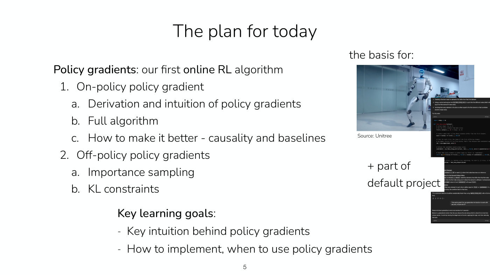

*Slide 5 — the plan, beside what policy gradients are "the basis for": a Unitree humanoid robot, a language-model chat screenshot, and the default final project. [Deck](https://cs224r.stanford.edu/spring_2025/slides/03_cs224r_policy_gradients_2025.pdf)*

Policy gradients are the basis for popular RL algorithms, including ones used to train legged
robots and ones used to train language models, and they are part of the default final project
(≈2:27). This lecture gets "halfway there" to those algorithms, and the next lecture covers most of
the rest (≈2:27).

## The online RL loop

An online RL algorithm has the outline on slide 6 (≈2:27–4:47). First **initialize the policy**,
as when training any neural network: randomly, with imitation learning, or with heuristics,
depending on the problem setting. Then loop:

1. **run the policy to collect a batch of data**, actually trying things out in the world;
2. **improve the policy using that batch of data**;

and repeat, collecting new data with the updated policy each time.

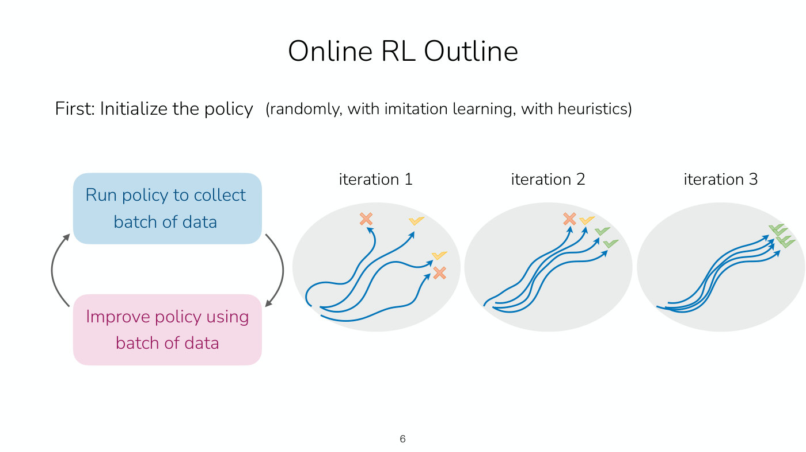

*Slide 6 — the online RL loop, with three iterations of a simple navigation task: scattered trajectories with mixed crosses and checks become a tight bundle of successes. [Deck](https://cs224r.stanford.edu/spring_2025/slides/03_cs224r_policy_gradients_2025.pdf)*

The slide illustrates it on a simple 2D navigation task. In the first iteration some trajectories
get bad reward and others get reward that is "okay". After more iterations the policy is better and
gets higher reward some of the time, though not always. After more still, the policy hopefully
succeeds every time (≈3:14–4:00). The trajectories bunch together as the policy improves.

## Evaluating the objective

To know how good a policy is, looking at the weights of its neural network is not enough; it has
to be run (≈4:00–4:47). The objective is an expectation over trajectories from the policy, so run
the policy several times, observe the reward of each run and average them (slide 7):

$$J(\theta) = \mathbb{E}_ {\tau \sim p_\theta(\tau)} \left[ \sum_t r(\mathbf{s}_ t, \mathbf{a}_ t) \right] \approx \frac{1}{N} \sum_i \sum_t r(\mathbf{s}_ {i,t}, \mathbf{a}_ {i,t})$$

Here $J(\theta)$ names the objective, the quantity being maximized, and the optimal parameters
are $\theta^{\ast} = \arg\max_\theta J(\theta)$. $N$ is the number of sampled trajectories,
$i$ indexes them, and $\mathbf{s}_ {i,t}$, $\mathbf{a}_ {i,t}$ are the state and action at time
$t$ of trajectory $i$. The slide labels the outer sum "sum over samples from $\pi_\theta$".

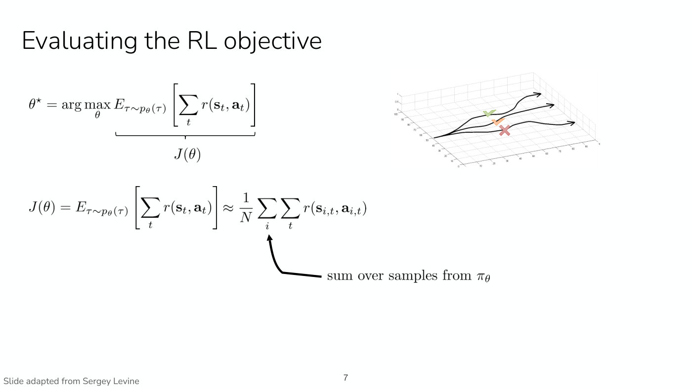

*Slide 7 — the objective J(θ) estimated by averaging the summed rewards of N trajectories sampled from the policy. [Deck](https://cs224r.stanford.edu/spring_2025/slides/03_cs224r_policy_gradients_2025.pdf)*

Collecting the data is straightforward: sample an action from the policy, observe the next state,
run it through the policy again, and repeat (≈4:47–5:34). The question for the rest of the lecture
is how to improve the policy once the data is in hand.

## Deriving the policy gradient

Neural networks are trained by gradient methods, so the natural move is to take the gradient of the
objective with respect to $\theta$ (≈6:20). Using the shorthand $r(\tau)$ for the sum of rewards
along a trajectory, $r(\tau) = \sum_{t=1}^{T} r(\mathbf{s}_ t, \mathbf{a}_ t)$ (slide 8, ≈6:20),
the objective is

$$J(\theta) = \mathbb{E}_ {\tau \sim p_\theta(\tau)} \left[ r(\tau) \right]$$

This is hard to differentiate directly, because $\theta$ affects it only through the trajectories
that are sampled. There is no way to differentiate through that sampling process, which also
depends on the dynamics of the world, and the dynamics are unknown (≈7:06).

**Step 1: write the expectation as an integral** (slide 8, ≈7:52). By the definition of an
expectation,

$$J(\theta) = \int p_\theta(\tau) \thinspace r(\tau) \thinspace d\tau$$

An integral is a linear operation, so the gradient can move inside it:
$\nabla_\theta J(\theta) = \int \nabla_\theta p_\theta(\tau) \thinspace r(\tau) \thinspace d\tau$
(≈8:44). On its own this does not help, since evaluating the integral is exactly what we want to
avoid.

**Step 2: a convenient identity** (slide 8, ≈8:44–10:21). The derivative of a log is one over its
argument, so by the chain rule

$$p_\theta(\tau) \nabla_\theta \log p_\theta(\tau) = p_\theta(\tau) \frac{\nabla_\theta p_\theta(\tau)}{p_\theta(\tau)} = \nabla_\theta p_\theta(\tau)$$

Replacing $\nabla_\theta p_\theta(\tau)$ in the integral with the left-hand side turns the integral
back into an expectation (≈10:21–11:07):

$$\nabla_\theta J(\theta) = \int \nabla_\theta p_\theta(\tau) \thinspace r(\tau) \thinspace d\tau = \int p_\theta(\tau) \nabla_\theta \log p_\theta(\tau) \thinspace r(\tau) \thinspace d\tau = \mathbb{E}_ {\tau \sim p_\theta(\tau)} \left[ \nabla_\theta \log p_\theta(\tau) \thinspace r(\tau) \right]$$

The slide underlines the identity's two sides in yellow and blue, and the same colours mark where
each side is swapped into the integral.

A student asks why this is more useful than the original form, since both still involve sampling
(≈11:52). The answer: we still cannot differentiate through the sampling, but now $\theta$ appears
*inside* the expectation, so the expectation can be estimated with samples, potentially very many,
and the thing inside can be differentiated with respect to $\theta$ (≈11:52–12:38).

**Step 3: expand the log-probability of a trajectory** (slide 9, ≈13:26–15:46). The term
$\log p_\theta(\tau)$ still does not look like $\pi_\theta(\mathbf{a} \mid \mathbf{s})$. Taking
the log of the trajectory distribution turns its product into a sum:

$$\log p_\theta(\tau) = \log p(\mathbf{s}_ 1) + \sum_{t=1}^{T} \log \pi_\theta(\mathbf{a}_ t \mid \mathbf{s}_ t) + \log p(\mathbf{s}_ {t+1} \mid \mathbf{s}_ t, \mathbf{a}_ t)$$

$\theta$ affects neither the initial state distribution nor the dynamics, so their gradients are
zero; slide 9 crosses both terms out in red. What remains is the gradient of the policy's own
log-probabilities, which can be evaluated: it is a backward pass through the log of the neural
network's output (≈14:57). Substituting back gives the **policy gradient**, or **vanilla policy
gradient** (slide 9, ≈15:46–16:34):

$$\nabla_\theta J(\theta) = \mathbb{E}_ {\tau \sim p_\theta(\tau)} \left[ \left( \sum_{t=1}^{T} \nabla_\theta \log \pi_\theta(\mathbf{a}_ t \mid \mathbf{s}_ t) \right) \left( \sum_{t=1}^{T} r(\mathbf{s}_ t, \mathbf{a}_ t) \right) \right]$$

This is much nicer than the starting point: sample trajectories from the policy, compute their
rewards, compute the gradient of the log-probability of each action, and multiply (≈16:34–17:21).
Nothing in it requires knowing the dynamics. (Slides 7–10 print the expectation with a plain $E$;
this page writes $\mathbb{E}$ throughout, as the later slides do.)

## Estimating the gradient: REINFORCE

The expectation is estimated with the $N$ sampled trajectories, and the estimate is used for a
gradient step on the policy parameters (slide 10, ≈18:10–18:58):

$$\nabla_\theta J(\theta) \approx \frac{1}{N} \sum_{i=1}^{N} \left( \sum_{t=1}^{T} \nabla_\theta \log \pi_\theta(\mathbf{a}_ {i,t} \mid \mathbf{s}_ {i,t}) \right) \left( \sum_{t=1}^{T} r(\mathbf{s}_ {i,t}, \mathbf{a}_ {i,t}) \right)$$

$$\theta \leftarrow \theta + \alpha \nabla_\theta J(\theta)$$

where $\alpha$ is the step size. The larger $N$ is, the better the estimate of the expectation;
with infinitely many samples it would be exact, which is not possible (≈18:58, ≈20:31). The full
algorithm (slide 10) loops over three steps:

1. sample trajectories $\lbrace \tau^i \rbrace$ from $\pi_\theta(\mathbf{a}_ t \mid \mathbf{s}_ t)$;
2. estimate $\nabla_\theta J(\theta)$ from them;
3. update $\theta \leftarrow \theta + \alpha \nabla_\theta J(\theta)$, and go back to step 1.

This is the **REINFORCE algorithm**, also called the vanilla policy gradient algorithm (slide 10,
≈20:31). The slide underlines the estimate's $\frac{1}{N} \sum_{i=1}^{N}$ in blue, the colour of
the loop's "Run policy to collect batch of data" box, and the update in pink, the colour of its
"Improve policy using batch of data" box. (The update adds the gradient, since $J$ is maximized;
the lecture calls the step "gradient descent" in passing at ≈18:10. The slide's step 2 also leaves
out the $\frac{1}{N}$.)

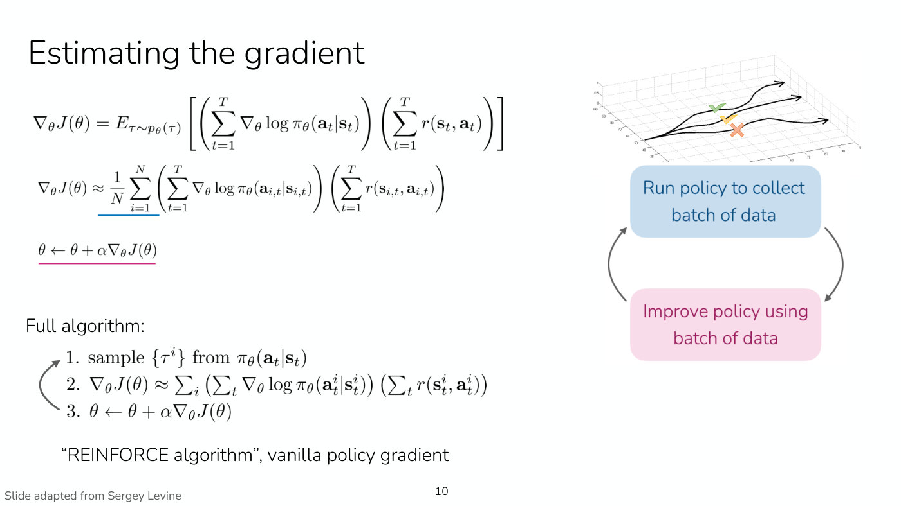

*Slide 10 — the REINFORCE algorithm: the blue-underlined sample average is the "run policy" half of the loop, and the pink-underlined update is the "improve policy" half. [Deck](https://cs224r.stanford.edu/spring_2025/slides/03_cs224r_policy_gradients_2025.pdf)*

What using the data looks like concretely (≈19:44–20:31): take the $N$ trajectories, each with $T$
time steps; pass each state through the policy in a forward pass to get a distribution over
actions; evaluate the probability of the action in the data under that distribution (for a
categorical distribution, just read it off); take its log; and take the gradient of that with a
backward pass through the network. Asked whether this gradient has to be computed by hand, Finn
answers that automatic differentiation in a library such as PyTorch does it (≈21:16).

## What the gradient means

The first factor of the gradient is the same as the gradient of the imitation-learning objective
(slide 11, ≈21:16–22:50). Imitation learning maximizes the log-probability of the actions in a
demonstration dataset, and its gradient is the gradient of the log-probability. So the policy
gradient is the **imitation gradient, weighted by reward**: it increases the likelihood of the
actions in the online data, weighted by how good the trajectory was. The slide puts the two side by
side, shading the shared part in teal:

$$\nabla_\theta J(\theta) \approx \frac{1}{N} \sum_{i=1}^{N} \left( \sum_{t=1}^{T} \nabla_\theta \log \pi_\theta(\mathbf{a}_ {i,t} \mid \mathbf{s}_ {i,t}) \right) \left( \sum_{t=1}^{T} r(\mathbf{s}_ {i,t}, \mathbf{a}_ {i,t}) \right)$$

$$\nabla_\theta J_{\text{BC}}(\theta) \approx \frac{1}{N} \sum_{i=1}^{N} \left( \sum_{t=1}^{T} \nabla_\theta \log \pi_\theta(\mathbf{a}_ {i,t} \mid \mathbf{s}_ {i,t}) \right)$$

where $J_{\text{BC}}$ is the behavior cloning objective. (Slide 11 prints the second inner sum's
lower limit as $t-1$, with a minus sign; it means $t=1$.)

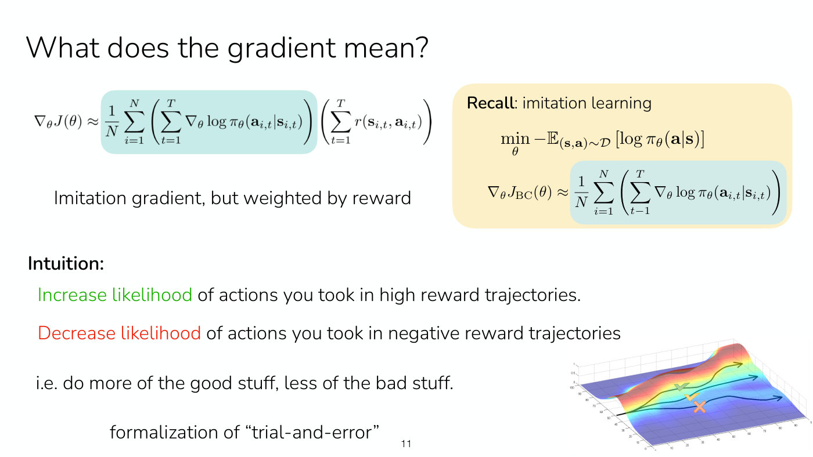

*Slide 11 — the policy gradient beside imitation learning's gradient, with the shared term shaded teal: the policy gradient is the imitation gradient weighted by each trajectory's reward. [Deck](https://cs224r.stanford.edu/spring_2025/slides/03_cs224r_policy_gradients_2025.pdf)*

The intuition on the slide: **increase the likelihood** of actions taken in high-reward
trajectories and **decrease the likelihood** of actions taken in negative-reward trajectories,
"i.e. do more of the good stuff, less of the bad stuff." The policy is imitating its own data,
collected by itself, and a negative reward gives a negative gradient that pushes it away from the
bad behavior (≈22:04–22:50). Finn calls it a formalization of trial and error: try different
things, do more of what turned out well, and stop doing what was a mistake (≈26:42). The lecture
illustrates this at ≈25:54 with a picture of an initial distribution of trajectories (drawn in red)
pushed up where a trajectory had good reward and down where one had bad reward, so the policy's
actions become more like the high-reward trajectory's. Slide 11's plot shows three trajectories on
a heat-mapped surface, marked with two checks and a cross; whether the spoken description refers to
an animated version of that plot cannot be told from the recording.

Students' questions about the gradient (≈22:50–25:54):

- **How is this different from imitation learning?** One student suggests that imitation learning
  is either right or wrong, while here an action can be right or wrong by some amount. Finn notes
  that the method applies even when the reward is very sparse, such as 1 for success and 0
  otherwise, although it may not do well there. The key differences are that the policy collects
  and learns from its own rollouts, and that the reward is used, whereas imitation learning
  imitates all the data blindly and assumes it is good (≈22:50–23:36).
- **How is the first state sampled?** It is usually defined by the problem setting, a property of
  the environment: for an agent playing pinball, the machine gives the initial state; in language
  modeling it might be the user's first question (≈23:36–24:23).
- **Could imitation learning be improved by weighting trajectories by reward?** Yes, and the
  lecture returns to what is good and bad about this objective (≈24:23).
- **Does it make sense to start with imitation learning and then switch to policy gradients?** It
  can. A randomly initialized policy does random things, which can be fine with a very dense reward
  signal; with demonstrations available, initializing from them can be a very good fit, and the
  policy then improves on top of that (≈24:23–25:09).
- **Without a clear idea of the reward, can imitation learning give a first sense of it?** Reward
  learning, including from expert data, comes in a later lecture; in practice it is challenging
  (≈25:09).

## Example 1: a humanoid learning to walk

The first think-pair-share (slide 12, ≈26:42–28:14). A humanoid learns to walk in simulation, with
reward $r(\mathbf{s}, \mathbf{a})$ equal to the robot's forward velocity: positive moving forward,
negative moving backward, zero standing still. The policy is not very good yet, and five
trajectories are sampled:

- $\tau^1$ falls backwards;
- $\tau^2$ falls forwards, which technically earns positive reward;
- $\tau^3$ manages to stand still, for a reward of about zero;
- $\tau^4$ takes one small step forward and then falls backwards, so positive rewards early and
  negative later, summing to a negative total;
- $\tau^5$ takes one large step backwards and then a small step forwards, also summing to
  negative.

What will the gradient encourage the policy to do?

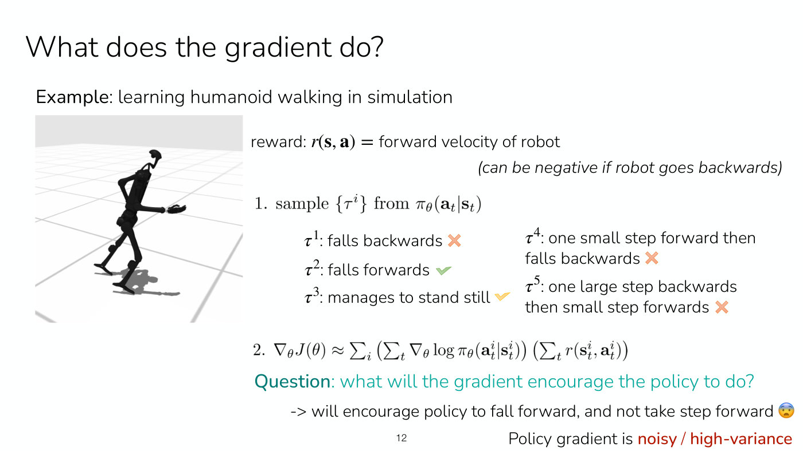

*Slide 12 — the first example: a simulated humanoid rewarded for forward velocity, and five sampled trajectories, of which only "falls forwards" has a positive total. [Deck](https://cs224r.stanford.edu/spring_2025/slides/03_cs224r_policy_gradients_2025.pdf)*

The class's answer, which Finn calls mostly correct: fall forwards, and perhaps stand still
(≈28:14–29:02). Trajectories 1, 4 and 5 have negative total reward, so every action in them gets a
negative gradient; trajectory 2 has positive total reward, so every action in it gets a positive
gradient; trajectory 3's actions get roughly zero gradient. The gradient therefore **encourages
the policy to fall forward and discourages it from taking steps**, backwards or forwards, and from
falling backwards (≈29:02–29:48). That is distressing: the goal was walking.

This is what it means for the gradient to be **noisy, or high-variance** (slide 12, ≈29:48):
depending on which trajectories happen to be sampled, the gradient can vary drastically. A batch
that included some trajectories walking forward would give a very different estimate.

Asked why several trajectories are sampled from the same policy rather than one, Finn gives two
reasons: the policy is not deterministic, so samples explore different strategies; and the
environment may be stochastic, so even a deterministic policy sees different outcomes worth
learning about (≈29:48–30:34).

## Improvement 1: causality

A first, fairly simple improvement (slide 13, ≈30:34–34:34). An action taken in the middle of a
trajectory has no influence on earlier states, yet the gradient above weights every action by the
rewards of the *whole* trajectory, including rewards before it. In $\tau^5$, one large step
backwards then a small step forwards, we ought to be able to learn that the small step forward was
good.

So, since "policy behavior at time $t$ does not affect rewards at time $t' \lt t$" (slide 13),
weight the action at time $t$ only by the rewards from $t$ onward, moving the reward sum inside the
sum over time steps (≈31:21–32:12):

$$\nabla_\theta J(\theta) \approx \frac{1}{N} \sum_{i=1}^{N} \sum_{t=1}^{T} \nabla_\theta \log \pi_\theta(\mathbf{a}_ {i,t} \mid \mathbf{s}_ {i,t}) \left( \sum_{t'=t}^{T} r(\mathbf{s}_ {i,t'}, \mathbf{a}_ {i,t'}) \right)$$

where $t'$ runs over the time steps from $t$ to the horizon $T$. The slide circles the lower limit
$t'=t$ in blue and labels the bracket "sum of *future* rewards". The action at time 100, for
example, cannot affect states 50, 51 or 99, and because of that independence their rewards can be
dropped from its weight (≈32:12–33:48). Finn says it is a little hard to write out mathematically
why this is allowed, and that it is really about causality in the world (≈33:48). In
$\tau^5$ this decreases the likelihood of the early backward step and, because the sum of future
rewards after the step forward is positive, increases the likelihood of taking a small step
forwards (≈34:34).

Two student points refine this:

- **A step forward followed by a step backward** is still not rewarded, which is a good point.
  But the step forward might have *caused* the step backward. A big part of RL is learning from
  experience what influence actions have on the future, so those later rewards cannot be dropped
  (≈34:34–35:20).
- **A good action late in a short trajectory.** With horizon $T = 10$ and a good action at time
  step 6, its weight is the sum of rewards from $t' = 6$ to 10, so a high reward from that action
  in the next few steps increases its likelihood (≈35:20–36:11). But with a fixed horizon, the
  gradient differs depending on whether 10 or 4 rewards are summed, and a state is only truly
  Markovian if it tells the policy how many time steps are left; that information can be
  incorporated into the state (≈36:11–36:57). See
  [MDPs and RL notation](mdp-and-notation.md#the-markov-property).

## Example 2: when every reward is positive

The second think-pair-share uses the causal version and a better policy (slide 14, ≈36:57–38:31).
Same humanoid and reward; the four trajectories fall forwards, slowly stumble forwards, steadily
walk forwards, and run forwards.

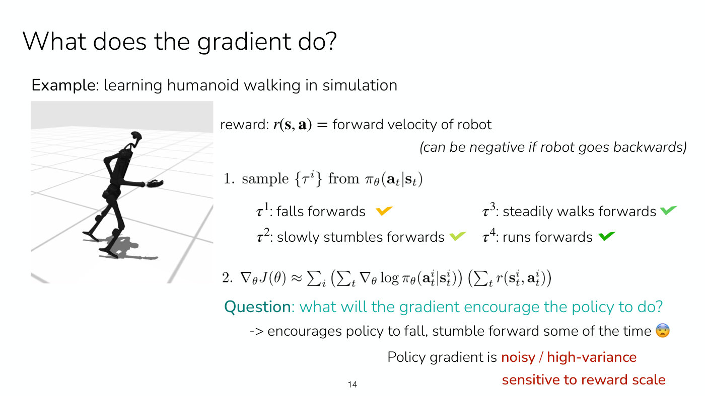

*Slide 14 — the second example: four trajectories that all move forward, so every total reward is positive and every one of them is reinforced, running most strongly. [Deck](https://cs224r.stanford.edu/spring_2025/slides/03_cs224r_policy_gradients_2025.pdf)*

Students suggested that the policy would be pushed hardest toward the fastest forward motion but
still pushed toward any forward progress; that it might learn to fall forward and get back up
repeatedly, though getting up is harder; and that running might dominate if its reward were much
larger than the others' (≈38:31). Finn draws them together: **all** the rewards are positive, so
running is encouraged most, but falling, stumbling and walking forwards are still encouraged too,
because a positive weight always increases likelihood. The gradient "encourages policy to fall,
stumble forward some of the time" (slide 14), when the ideal policy runs as fast as possible
(≈39:16–40:02).

Asked whether this is a local optimum, Finn says the cause is variance, not a local minimum. With a
policy that sometimes runs, each batch encourages running a bit more, and the next batch runs more
again, so it eventually converges to the global optimum, but slowly, because the other data in each
batch pulls the gradient around (≈40:02–40:50). With this data it would not learn to roll forward,
barring some odd combination of gradients; data of rolling forward would encourage that (≈40:50).

The second problem the example shows is that the gradient is **sensitive to the scale of the
reward** (slide 14, ≈41:35). If every reward were negative, the policy would get only negative
gradients and no positive ones.

## Improvement 2: baselines

A very simple fix for reward scale (slides 15–16, ≈41:35–42:21): subtract a constant $b$ from the
reward, for example the average reward of the batch.

$$\nabla_\theta J(\theta) = \mathbb{E}_ {\tau \sim p_\theta(\tau)} \left[ \nabla_\theta \log p_\theta(\tau) \thinspace (r(\tau) - b) \right] \qquad b = \frac{1}{N} \sum_{i=1}^{N} r(\tau)$$

(the slide's summand means the reward of the $i$-th trajectory). The constant is called a
**baseline**. Behavior better than average now gets its likelihood increased, and behavior below
average gets a negative gradient (slide 16, ≈42:21).

**Is that allowed?** Subtracting a constant has zero effect on the gradient in expectation
(slide 16, ≈43:08–46:15). The proof runs the log-gradient identity in reverse:

$$\mathbb{E} \left[ \nabla_\theta \log p_\theta(\tau) \thinspace b \right] = \int p_\theta(\tau) \nabla_\theta \log p_\theta(\tau) \thinspace b \thinspace d\tau = \int \nabla_\theta p_\theta(\tau) \thinspace b \thinspace d\tau = b \thinspace \nabla_\theta \int p_\theta(\tau) \thinspace d\tau = b \thinspace \nabla_\theta 1 = 0$$

The gradient and $b$ move outside the integral because integration is linear and $b$ is a
constant; the integral of a probability distribution is 1; and the gradient of 1 is 0. In the
slide's words, subtracting a constant baseline "does not change the gradient in expectation. It is
**unbiased**", and it "can reduce **variance** of the gradient". "Unbiased" is a term from
statistics about the effect on random variables (≈47:01).

The questions that followed (≈46:15–48:34):

- **If it changes nothing in expectation, why bother?** If the expectation could be evaluated
  exactly, it would not be needed. It helps because the expectation is estimated from samples, and
  the baseline is an unbiased way to reduce the variance of that estimate (≈46:15–47:01).
- **Is $b$ really a constant, if it depends on the trajectories?** The same value of $b$ is used
  for every example in a batch: collect the batch, compute $b$, and use it for all the updates on
  that batch (≈47:01–47:47).
- **How does it reduce variance?** The variance can be written down analytically to show it,
  which the lecture skips for time; intuitively it encourages more of the above-average behavior
  and less of the below-average (≈47:47).
- **Is average reward the best baseline?** No. Deriving the variance, taking its derivative and
  setting it to zero gives the optimal baseline, which is very close to the average reward with
  some additional weighting terms; average reward is "pretty good" (≈47:47–48:34; slide 16:
  "Average reward is a pretty good baseline.").

## Example 3: folding a jacket

The third example adds the baseline (slide 17, ≈48:34–50:52). A robot learns to fold a jacket,
with reward 1 if it is neatly folded, 0.5 if folded with some wrinkles, and 0 if not folded. The
four sampled trajectories: $\tau^1$ doesn't touch the jacket; $\tau^2$ folds only the sleeves;
$\tau^3$ flattens the jacket but does not fold it; $\tau^4$ folds the jacket.

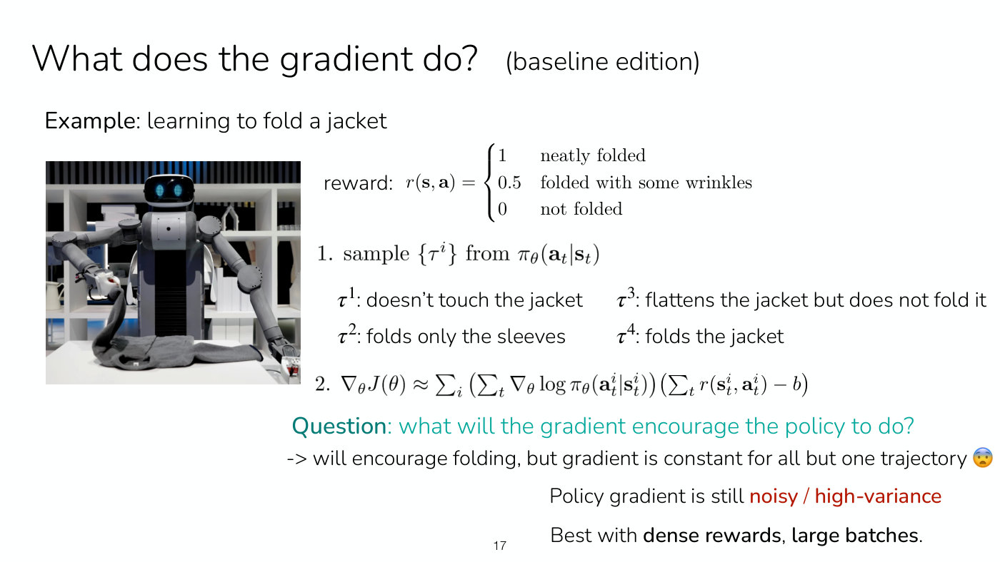

*Slide 17 — the baseline example: a humanoid folding a jacket, a reward of 1, 0.5 or 0, and four trajectories of which only the last folds it. [Deck](https://cs224r.stanford.edu/spring_2025/slides/03_cs224r_policy_gradients_2025.pdf)*

Trajectories 1–3 have zero reward and trajectory 4 has positive reward, so after subtracting the
baseline, trajectory 4 gets a positive gradient and the other three are discouraged (≈49:21). That
is partly good, since folding is encouraged. Two things are unsatisfying. The gradient is
**identical for trajectories 1, 2 and 3**, though some are better than others, partly because the
reward is sparser than it could be. And folding the sleeves is a good thing that is now actively
discouraged; the next lecture's techniques can make use of the good parts of such trajectories
(≈49:21–50:07). The slide's conclusion: policy gradient "will encourage folding, but gradient is
constant for all but one trajectory", it is still noisy and high-variance, and it is "Best with
**dense rewards, large batches**." Without the lucky fourth trajectory, a batch of failures would
give zero gradient and no improvement at all (≈50:52).

Follow-up questions (≈50:52–52:26):

- **Can the reward function just be improved?** A denser reward would definitely help here. It
  still leaves cases to do better on: a robot that folds the sleeves, earns reward, and then drops
  the jacket would not make good use of the first part, which the next lecture addresses
  (≈50:52–51:39).
- **Can the baseline be combined with only using future rewards?** Yes, but the baseline needs
  more thought, since the number of rewards summed depends on where in the trajectory an action is
  (≈51:39).
- **Does the average-reward baseline need updating?** Yes. As the policy improves, what counts as
  above or below average changes, so recompute it on the latest batch (≈51:39–52:26).

## Implementing it: the surrogate objective

Computing each $\nabla_\theta \log \pi_\theta(\mathbf{a}_ {i,t} \mid \mathbf{s}_ {i,t})$
separately would take $N \times T$ backward passes, which is inefficient (slide 18, ≈52:26). It
is better to run automatic differentiation once over the whole objective, with one forward pass and
one backward pass. The way to do that is a **surrogate objective** whose gradient is the same as
$\nabla_\theta J(\theta)$; it is called a surrogate because it is not the original objective of
maximizing expected reward (≈53:11):

$$\tilde{J}(\theta) \approx \frac{1}{N} \sum_{i=1}^{N} \sum_{t=1}^{T} \log \pi_\theta(\mathbf{a}_ {i,t} \mid \mathbf{s}_ {i,t}) \left( \left( \sum_{t'=t}^{T} r(\mathbf{s}_ {i,t'}, \mathbf{a}_ {i,t'}) \right) - b \right)$$

It is the gradient with the $\nabla_\theta$ taken off the log-probabilities, so back-propagation
and autodiff software produce the policy gradient in one backward pass. Slide 18 prints the reward
sum outside the sum over $t$; Finn points out the typo, "this second sum should be inside the first
sum" (≈53:11), and it is written inside here. The weighted reward is treated as a fixed number when
differentiating.

In practice the log-probability term looks like a **cross-entropy loss for a discrete-action
policy** and something like a **squared error for a Gaussian policy**, and more sophisticated
policies such as diffusion can be used too (slide 18, ≈53:56). The slide calls this "weighted
maximum likelihood": the same training signal as maximum likelihood in
[imitation learning](imitation-learning.md), with each action weighted by its reward. See
[expressive policy distributions](expressive-policy-distributions.md) for the distributions.

## Summary of the on-policy algorithm

Slide 19 (≈53:56–54:41) summarizes the first half. The gradient of the RL objective is estimated
with the log-gradient trick, weighting the policy's likelihood by future rewards and subtracting a
baseline such as the average reward. Even with these tricks the gradient is noisy, so the method
works best with large batches and dense rewards. It is the course's first RL algorithm, alternating
between collecting a batch of data with the policy and improving the policy by applying the
gradient, and it formalizes trial-and-error learning. Key intuition: do more of the high-reward
stuff and less of the low-reward stuff.

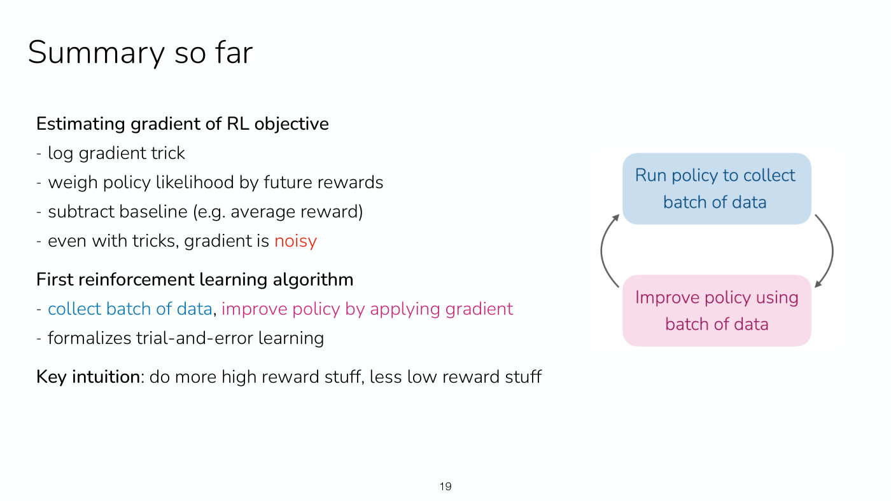

*Slide 19 — the summary of the on-policy algorithm, colour-keyed to the two halves of the online loop. [Deck](https://cs224r.stanford.edu/spring_2025/slides/03_cs224r_policy_gradients_2025.pdf)*

## The trouble with on-policy

The latest version of the gradient (slide 20, ≈54:41–55:27) is an expectation under
$p_\theta(\tau)$, which "assumes samples from current policy $\pi_\theta$". But $\theta$ changes in
step 3 of the algorithm. So after every single gradient step, data has to be recollected to
estimate the next gradient, when neural networks are normally trained with thousands and thousands
of gradient steps.

This makes vanilla policy gradient **on-policy**. Slide 20 defines the distinction as an attribute
of online RL algorithms (≈55:27–56:14):

- **on-policy**: the update uses only data from the current policy;
- **off-policy**: the update can reuse data from other, past policies.

See [offline and online algorithms](offline-and-online.md#on-policy-and-off-policy).

## Importance sampling

The goal for the rest of the lecture is a policy gradient that is only "a little off policy": one
that can take more than one gradient step on a single batch of data (≈56:14). The tool is
**importance sampling**, which Finn calls a really cool technique that is useful outside RL as well: a way to
estimate an expectation under one distribution without sampling from it (slide 21, ≈56:14–58:34).

Suppose we want $\mathbb{E}_ {x \sim p(x)} [f(x)]$ but can only sample from a **proposal
distribution** $q(x)$. Multiply inside the integral by $q(x)/q(x)$, which equals 1:

$$\mathbb{E}_ {x \sim p(x)} \left[ f(x) \right] = \int p(x) f(x) \thinspace dx = \int \frac{q(x)}{q(x)} p(x) f(x) \thinspace dx = \int q(x) \frac{p(x)}{q(x)} f(x) \thinspace dx = \mathbb{E}_ {x \sim q(x)} \left[ \frac{p(x)}{q(x)} f(x) \right]$$

So the expectation can be estimated by sampling from $q$ and weighting each sample by
$p(x)/q(x)$ (≈57:49–58:34). In RL, $q$ is the old policy, whose samples we have, and $p$ the new
policy after a gradient step.

The slide's note: it is important for $q$ to have non-zero support wherever $p(x)$ has high
probability. That is the only real catch, and the technique works best when the old and new
policies are very similar (≈59:22). What the lecture says happens when $q(x)$ is zero is unclear in
the recording (≈59:22).

See [importance sampling](importance-sampling.md) for the technique on its own page.

## The off-policy policy gradient

**The objective** (slide 21, ≈58:34–59:22). Write $\bar{p}(\tau)$ for the trajectory distribution
of a previous policy $\bar{\pi}$ that the samples came from. Then

$$J(\theta) = \mathbb{E}_ {\tau \sim \bar{p}(\tau)} \left[ \frac{p_\theta(\tau)}{\bar{p}(\tau)} r(\tau) \right]$$

The reward of each trajectory is weighted by its probability under the new policy over its
probability under the old one. Fortunately the ratio simplifies: the initial-state and dynamics
factors appear in both numerator and denominator and cancel (crossed out in red on slide 21),
leaving only the policies (≈1:00:08):

$$\frac{p_\theta(\tau)}{\bar{p}(\tau)} = \frac{\prod_{t=1}^{T} \pi_\theta(\mathbf{a}_ t \mid \mathbf{s}_ t)}{\prod_{t=1}^{T} \bar{\pi}(\mathbf{a}_ t \mid \mathbf{s}_ t)}$$

**The gradient** (slide 22). To update the latest policy $\pi_{\theta'}$ using samples from
$\pi_\theta$, importance-weight the latest gradient:

$$\nabla_{\theta'} J(\theta') = \mathbb{E}_ {\tau \sim p_\theta(\tau)} \left[ \prod_{t=1}^{T} \frac{\pi_{\theta'}(\mathbf{a}_ t \mid \mathbf{s}_ t)}{\pi_\theta(\mathbf{a}_ t \mid \mathbf{s}_ t)} \left( \sum_{t=1}^{T} \nabla_{\theta'} \log \pi_{\theta'}(\mathbf{a}_ t \mid \mathbf{s}_ t) \right) \left( \left( \sum_{t'=t}^{T} r(\mathbf{s}_ {t'}, \mathbf{a}_ {t'}) \right) - b \right) \right]$$

(printed, like slide 18, with the reward sum outside the sum over $t$). The product of ratios is the
problem: "This can become very small or very large, for larger $T$" (slide 22). Multiplying 100
numbers above 1 gets very large; multiplying 100 numbers below 1 goes to zero very quickly
(≈1:00:08–1:00:54).

**Over time steps instead** (slide 23, ≈1:00:54). In practice, the expectation is often taken over
time steps instead of trajectories, which gives one ratio per time step. The hitch is that this
ratio has to be over state-action pairs rather than actions given states,
$\pi_{\theta'}(\mathbf{s}_ {i,t}, \mathbf{a}_ {i,t}) / \pi_\theta(\mathbf{s}_ {i,t}, \mathbf{a}_ {i,t})$,
which is "much less likely to explode/vanish ...but, hard to measure" (slide 23). The state part,
$\pi_{\theta'}(\mathbf{s}_ {i,t}) / \pi_\theta(\mathbf{s}_ {i,t})$, is "often approximated as 1".
Finn calls that approximation incorrect but "the best that we can do" (≈1:00:54). What is
left is the **common final form** (slides 23–24):

$$\nabla_{\theta'} J(\theta') \approx \frac{1}{N} \sum_{i=1}^{N} \sum_{t=1}^{T} \frac{\pi_{\theta'}(\mathbf{a}_ {i,t} \mid \mathbf{s}_ {i,t})}{\pi_\theta(\mathbf{a}_ {i,t} \mid \mathbf{s}_ {i,t})} \nabla_{\theta'} \log \pi_{\theta'}(\mathbf{a}_ {i,t} \mid \mathbf{s}_ {i,t}) \left( \left( \sum_{t'=t}^{T} r(\mathbf{s}_ {i,t'}, \mathbf{a}_ {i,t'}) \right) - b \right)$$

the causal, baselined policy gradient with each term weighted by the ratio of new-policy to
old-policy probability of the action taken.

**The algorithm** (slide 24, ≈1:01:40) looks the same as before, except that it can take
**multiple gradient steps on the same batch**: the slide adds an orange arrow from step 3 back to
step 2, beside the usual arrow back to step 1.

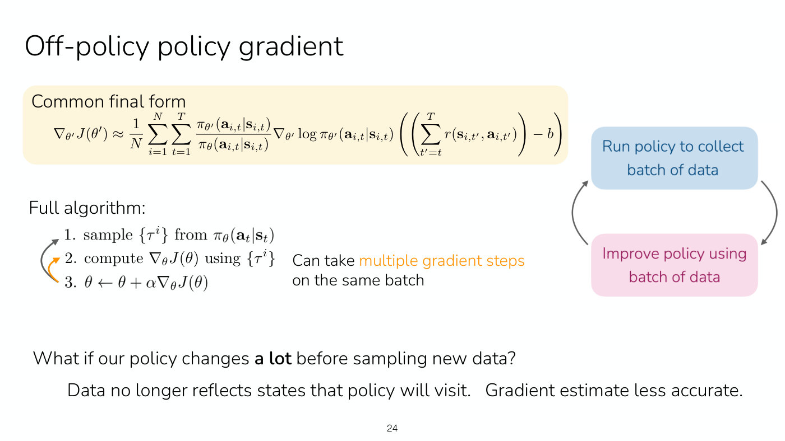

*Slide 24 — the off-policy policy gradient's common final form; the orange arrow from the update back to the gradient step is the change that allows several gradient steps per batch. [Deck](https://cs224r.stanford.edu/spring_2025/slides/03_cs224r_policy_gradients_2025.pdf)*

Slide 24 also raises the limit of this approach: "What if our policy changes **a lot** before
sampling new data? Data no longer reflects states that policy will visit. Gradient estimate less
accurate." Slide 25 asks whether the policy can be constrained not to stray too far during gradient
updates, and gives "one common choice", a bound $\delta$ on the expected KL divergence between the
new and old policies:

$$\mathbb{E}_ {\mathbf{s} \sim \pi_\theta} \left[ D_{KL}\left( \pi_{\theta'}(\cdot \mid \mathbf{s}) \Vert \pi_\theta(\cdot \mid \mathbf{s}) \right) \right] \leq \delta$$

The lecture does not cover it: "we don't have time to cover KL constraints today" (≈1:01:40).

## Review and next time

The review (slide 26, ≈1:01:40–1:02:26): **online RL via policy gradients** is an on-policy
algorithm that differentiates the RL objective, uses baselines and causality to reduce the
gradient's variance, and alternates collecting a batch of data with improving the policy by
applying the gradient. The **off-policy policy gradient** uses importance sampling, with a KL
constraint on the policy, so that it can apply multiple gradient updates per batch. The intuition:
do more high-reward stuff and less low-reward stuff. The gradient is still very noisy, and works
best with large batches and dense rewards.

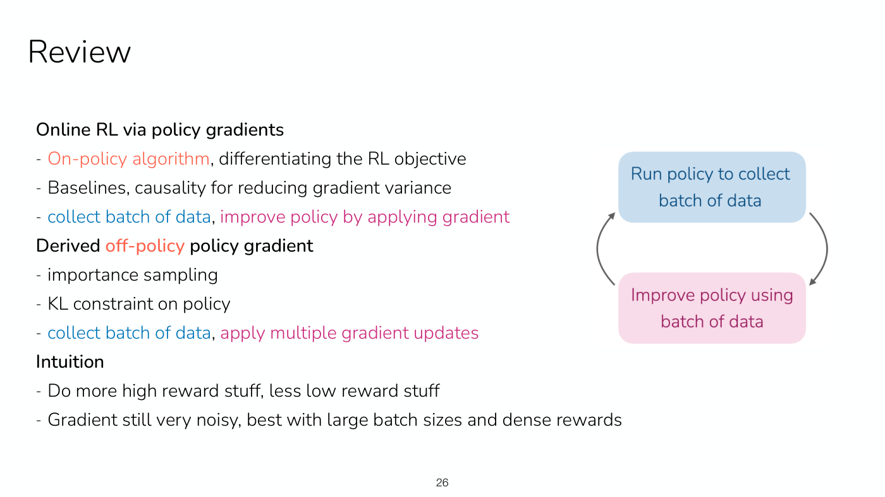

*Slide 26 — the review: the on-policy algorithm, the off-policy version with importance sampling and a KL constraint, and the intuition, keyed to the online loop. [Deck](https://cs224r.stanford.edu/spring_2025/slides/03_cs224r_policy_gradients_2025.pdf)*

**Next time** (slide 28, ≈1:02:26): actor-critic methods, which build closely on policy gradients
and are the basis for popular algorithms such as PPO; see
[Lecture 4 — Actor-Critic Methods](04-actor-critic.md). The slide's course reminders, not read out in the recording, are to start forming
final project groups (survey due next Wednesday) and that Homework 1 is out, due next Friday
(slide 2 dates it Friday, April 18).

## Related pages

- [Policy gradients](policy-gradients.md): the method as a whole, from the derivation to the
  off-policy version, with what each improvement fixes.
- [Importance sampling](importance-sampling.md): estimating an expectation under one distribution
  with samples from another, and its caveats.
- [The RL objective](rl-objective.md): the objective this lecture differentiates.
- [Offline and online algorithms](offline-and-online.md): offline and online, and the on-policy
  and off-policy distinction this lecture adds.
- [Imitation learning](imitation-learning.md): the objective whose gradient the policy gradient
  reweights.
- [RL algorithm families](rl-algorithm-families.md): where policy gradients sit among the
  course's methods.
- [Actor-critic methods](actor-critic.md): the next lecture's method, which replaces the reward to
  go with an estimated advantage.
