# Lecture 4 — Actor-Critic Methods

Stanford CS224R, Spring 2025 (Friday, April 11) ·
[video](https://www.youtube.com/watch?v=oejFZShW9hU) (63 min) ·
[slides (PDF)](https://cs224r.stanford.edu/spring_2025/slides/04_cs224r_actor_critic_2025.pdf) ·
[slide-by-slide text](../raw/slides/04-actor-critic.md) ·
[transcript](../raw/transcripts/04-actor-critic.md)

**What this lecture establishes.** Actor-critic methods build on
[policy gradients](policy-gradients.md). Policy gradients weight each action by the rewards that
happened to follow it in one sampled trajectory, which is noisy and wastes data. Actor-critic
methods instead learn to estimate how good each action was and weight the action by that
estimate. The ideal weight is the **advantage** $A^\pi(\mathbf{s}, \mathbf{a})$, the Q-value of
the action minus the value of the state. Since $A^\pi$ can be approximated from the value function
$V^\pi$ alone, the algorithm fits a neural network to $V^\pi$. This step is called
**policy evaluation**, and the lecture gives three ways to do it. The first is **Monte Carlo
estimation**, which regresses onto the observed sum of future rewards and is unbiased but
high-variance. The second is **bootstrapping**, or temporal difference learning, which regresses
onto the reward plus the network's own estimate of the next state's value; it has lower variance
but is biased by the estimate's errors. The third is **n-step returns**, which sit in between. A
**discount factor** keeps the values finite. The result is an algorithm with two networks: an
actor, the policy, and a critic, the value function.

Slide numbers below are the numbers printed on the slides, which equal the PDF page numbers (slide
6 prints none). Timestamps (≈M:SS) point into the video and the
[transcript](../raw/transcripts/04-actor-critic.md). **The recording covers slides 3–23 only.** It
opens on the recap and ends at about 1:03:07 on the review slide (23). It does not discuss slide
2's reminders or the deck's last fourteen slides (24–37), which cover off-policy actor-critic
methods, including replay buffers and soft actor-critic. The
[last section](#not-in-the-recording-off-policy-actor-critic) summarizes those slides from the
[slide file](../raw/slides/04-actor-critic.md), which is the only source for them.

Several steps are worked on the whiteboard, which the recording does not show. Where the
transcript says "this" or "right here", this page reconstructs what was meant from the surrounding
words and the slides, which carry the same equations.

## Contents

1. [Recap and plan](#recap-and-plan)
2. [Value, Q and advantage functions](#value-q-and-advantage-functions)
3. [Example: learning to play the drums](#example-learning-to-play-the-drums)
4. [What is dissatisfying about policy gradients](#what-is-dissatisfying-about-policy-gradients)
5. [Improving the gradient with Q and a baseline](#improving-the-gradient-with-q-and-a-baseline)
6. [The online loop gets a third step](#the-online-loop-gets-a-third-step)
7. [Why fit only the value function](#why-fit-only-the-value-function)
8. [Estimating the value function, version 1: Monte Carlo](#estimating-the-value-function-version-1-monte-carlo)
9. [Estimating the value function, version 2: bootstrapping](#estimating-the-value-function-version-2-bootstrapping)
10. [Monte Carlo versus bootstrapping: an example](#monte-carlo-versus-bootstrapping-an-example)
11. [N-step returns](#n-step-returns)
12. [Aside: discount factors](#aside-discount-factors)
13. [The full actor-critic algorithm](#the-full-actor-critic-algorithm)
14. [Review](#review)
15. [Not in the recording: off-policy actor-critic](#not-in-the-recording-off-policy-actor-critic)

## Recap and plan

The recap restates where Lecture 3 left off (slide 3, ≈0:05–1:37). Online RL collects a batch of
data by running the policy, uses it to improve the policy, and repeats. The policy gradient
estimate samples $N$ trajectories $\tau_i$ from the policy $\pi_\theta$, a distribution over
actions $\mathbf{a}$ given states $\mathbf{s}$ with parameters $\theta$, and weights the gradient
of the log-probability of each action by the reward that followed it, minus a baseline $b$:

$$\nabla_\theta J(\theta) \approx \frac{1}{N} \sum_{i=1}^{N} \sum_{t=1}^{T} \nabla_\theta \log \pi_\theta(\mathbf{a}_ {i,t} \mid \mathbf{s}_ {i,t}) \left( \left( \sum_{t'=t}^{T} r(\mathbf{s}_ {i,t'}, \mathbf{a}_ {i,t'}) \right) - b \right)$$

Here $J(\theta)$ is the [RL objective](rl-objective.md), the expected sum of rewards, $T$ is the
horizon and $r$ the reward. The slide labels the parts as samples from the policy, the policy log
likelihood, the reward to go, and the baseline. With the baseline set to the average reward, the
update raises the likelihood of actions whose futures were above average and lowers it for those
below: "Do more of the above average stuff, less of the below average stuff."

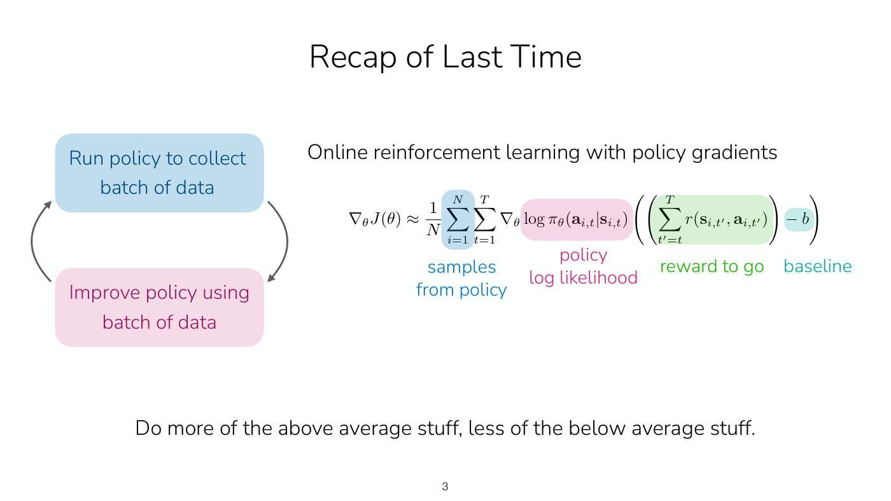

*Slide 3 — the recap: the online loop beside the policy gradient, its four parts colour-labelled (samples from the policy, policy log likelihood, reward to go, baseline). [Deck](https://cs224r.stanford.edu/spring_2025/slides/04_cs224r_actor_critic_2025.pdf)*

This vanilla policy gradient is fully **on-policy**. It needs samples from the current policy, so
it can take only one gradient step per batch of data, which means collecting "a ton and ton of
data" to improve (slide 4, ≈1:37–2:22). Importance weights, the ratio of the new policy's
action probability to the old one's, give an off-policy estimate that reuses past data (see
[importance sampling](importance-sampling.md)). Finn adds a caution the slide also prints: the math
is simple and nice, "but it's important to remember that this isn't a silver bullet" (≈2:22). It
suits only policies that are very similar; when they differ, the ratio gets very large or very
small and the gradient estimate gets worse (≈3:08).

Today's methods, actor-critic methods, build on policy gradients and "are the basis for algorithms
like PPO, which are used to train language models, and that are used to train humanoids in
simulation" (≈3:08). The plan has three parts: improving policy gradients, estimating the value of
a policy, and off-policy actor-critic (slide 5). The recording covers the first two. The learning
goals are how to estimate how good a state and action is for a policy, which "is called policy
evaluation" (≈3:55), and how to use those estimates to form a better RL algorithm.

## Value, Q and advantage functions

The lecture rests on three objects, two of them from Lecture 1 (slide 6, ≈3:55–9:19). See
[value functions](value-functions.md) for the topic page.

The **value function** $V^\pi(\mathbf{s})$ is the future expected reward starting at state
$\mathbf{s}$ and following the policy $\pi$. Finn writes it as a sum of expected rewards from the
current time step $t$ to the end of the trajectory, where the expectation is over the states and
actions the policy visits, conditioned on starting at $\mathbf{s}_ t$ (≈4:41–5:28):

$$V^\pi(\mathbf{s}_ t) = \sum_{t'=t}^{T} \mathbb{E}_ {\pi_\theta} \left[ r(\mathbf{s}_ {t'}, \mathbf{a}_ {t'}) \mid \mathbf{s}_ t \right]$$

That is the form slide 31 prints. Intuitively, collect many trajectories from that state with the
policy, sum the rewards from this time step to the end of each, and average: that defines how good
the state is for the policy (≈6:13). The caption is garbled for a few words in the middle of this
definition, at ≈4:41.

The **Q-function** $Q^\pi(\mathbf{s}, \mathbf{a})$ is the future expected reward from starting at
$\mathbf{s}$, taking the action $\mathbf{a}$, and then following $\pi$. The first action "may or
may not have been what the policy would have been likely to choose", and it too can lead to
different states, because the environment is stochastic (≈7:00–7:47).

The two are related by an expectation over the policy's own actions, which the slide calls a
"useful relation":

$$V^\pi(\mathbf{s}) = \mathbb{E}_ {\mathbf{a} \sim \pi(\cdot \mid \mathbf{s})} \left[ Q^\pi(\mathbf{s}, \mathbf{a}) \right]$$

The value of a state is the average of the Q-values over the actions the policy would have taken
(≈8:33). Asked how one gets from the definitions to this relation, Finn points out that in
$Q^\pi$ the first action is given as input while all later actions are sampled from $\pi$. In
$V^\pi$, the first action is sampled from $\pi$ too, so sampling the action from the policy and
feeding it into $Q^\pi$ gives $V^\pi$ (≈10:05–11:37). Another student asks whether there is a
normalization between $V$ and $Q$. An expectation is an average, so in that sense there is: an
estimate from two samples divides by two and one from five samples by five (≈9:19–10:05).

The third object is new. The **advantage**
$A^\pi(\mathbf{s}, \mathbf{a}) = Q^\pi(\mathbf{s}, \mathbf{a}) - V^\pi(\mathbf{s})$ is how much
better it is to take $\mathbf{a}$ than to follow the policy at $\mathbf{s}$ (≈9:19).

*Slide 6 — the value function averages the rewards of trajectories that run the policy from s; the Q-function first takes the action a (green) and then runs the policy. [Deck](https://cs224r.stanford.edu/spring_2025/slides/04_cs224r_actor_critic_2025.pdf)*

## Example: learning to play the drums

An exercise makes the three quantities concrete (slide 7, ≈11:37–15:27). You want to learn to play
the drums. The reward is 1 if you can play the piece in a month and 0 otherwise, so the horizon
$T$ is a month from now. There are three actions: $\mathbf{a}_ 1$, sit on the beach;
$\mathbf{a}_ 2$, watch TV; $\mathbf{a}_ 3$, practice the drums. The current policy sits on the
beach in every state, $\pi(\mathbf{a}_ 1 \mid \mathbf{s}) = 1$ for all $\mathbf{s}$, and in the
current state you cannot yet play. What are the value, Q and advantage functions for each action?

The answers, reported after the class discussed them (≈13:09–14:41), follow.

- **Value.** $V^\pi = 0$, because a policy that always sits on the beach never learns to play.
- **Q-function.** For sitting on the beach or watching TV at this time step, $Q^\pi = 0$. For
  practicing, it would be 1 if that amount of practice is enough. It could be lower than 1, for
  example if you practice for an hour and then follow the policy by sitting on the beach
  afterwards. It depends on how long a time step is.
- **Advantage.** $A^\pi = Q^\pi - V^\pi$ is positive for practicing and zero for the other two
  actions.

*Slide 7 — the drum example: three actions (beach, TV, practicing) from the current state, a reward for playing the piece in a month, and a policy that always picks the beach. [Deck](https://cs224r.stanford.edu/spring_2025/slides/04_cs224r_actor_critic_2025.pdf)*

A student asks what happens if practicing once is not enough. Then the Q-value is the probability
that you would be able to play, given that you practiced for that amount of time. It could be zero
if the piece is really hard, or higher for someone extremely talented (≈14:41). Along the same
lines, in a game of chess the value function is the probability of winning, for a given person and
a given game state (≈14:41–15:27).

## What is dissatisfying about policy gradients

Lecture 3's examples showed policy gradients wasting data (slide 8, ≈15:27–17:46). A simulated
humanoid that takes one small step forward and then falls backwards has a low reward-to-go after
the step, so the gradient pushes down the likelihood of the step forward. If the algorithm
understood that the step was making progress, that it was "advantageous", it could raise that
likelihood instead. A robot folding a jacket under a sparse reward gets nothing from trajectories
that fold only the sleeves or flatten the jacket without folding it. If it understood that those
actions made progress on the task, it could use them positively. The slide's conclusion is that
"Policy gradients doesn't make efficient use of data!", followed by the question "Can we learn what
is good & bad?"

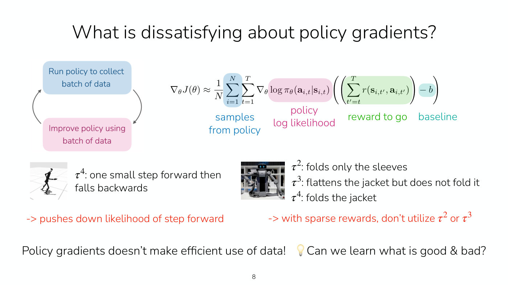

*Slide 8 — the two examples carried over from Lecture 3: a humanoid that steps forward and then falls back, and a robot partly folding a jacket under a sparse reward. [Deck](https://cs224r.stanford.edu/spring_2025/slides/04_cs224r_actor_critic_2025.pdf)*

A student asks whether that step forward counts as negative or neutral. In the policy-gradient
algorithm, the trajectory was net negative, below average in its batch, because its reward to go
was quite negative, so the step forward is pushed down. The algorithms of this lecture could in
principle raise the likelihood of the step forward and lower that of falling backwards
(≈17:00–18:33).

## Improving the gradient with Q and a baseline

The weak part of the gradient is the reward to go: the sum of rewards from $t$ onwards in one
sampled trajectory, an estimate of the future rewards if $\mathbf{a}_ {i,t}$ is taken in
$\mathbf{s}_ {i,t}$ (slide 9, ≈18:33–20:04). In the falling humanoid the observed rewards were
negative. Running the policy many times from that state and action would give the true expected
reward to go, which is exactly the Q-function:

$$\sum_{t'=t}^{T} \mathbb{E}_ {\pi_\theta} \left[ r(\mathbf{s}_ {t'}, \mathbf{a}_ {t'}) \mid \mathbf{s}_ t, \mathbf{a}_ t \right] = Q(\mathbf{s}_ t, \mathbf{a}_ t)$$

"This would be way better" (≈19:18). The gradient would then raise the likelihood of actions with
high Q-values and lower it for actions with low ones:

$$\nabla_\theta J(\theta) \approx \frac{1}{N} \sum_{i=1}^{N} \sum_{t=1}^{T} \nabla_\theta \log \pi_\theta(\mathbf{a}_ {i,t} \mid \mathbf{s}_ {i,t}) \thinspace Q(\mathbf{s}_ {i,t}, \mathbf{a}_ {i,t})$$

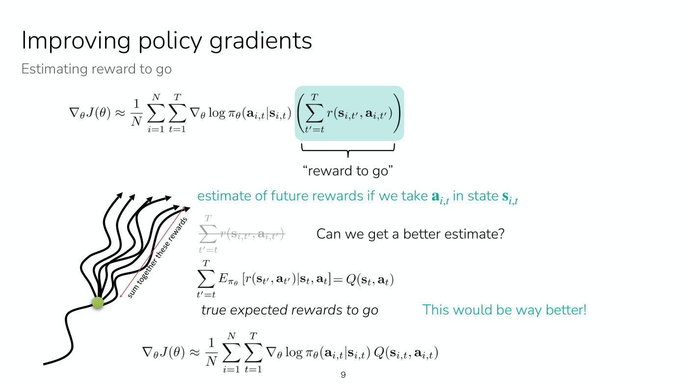

*Slide 9 — the reward to go is one sampled trajectory's sum of rewards; replacing it with the true expected reward to go, the Q-function, would be way better. [Deck](https://cs224r.stanford.edu/spring_2025/slides/04_cs224r_actor_critic_2025.pdf)*

Next, the baseline (slide 10, ≈20:04–22:22). In Lecture 3 the baseline was the average reward;
here the analogue would be the average Q-value over sampled states and actions. By the useful
relation, the expectation of $Q$ over the policy's actions is the value function, so the natural
baseline is $V^\pi(\mathbf{s}_ t)$. On the slide the $b$ is struck through and replaced by it.
$Q - V$ is the advantage, so the gradient becomes

$$\nabla_\theta J(\theta) \approx \frac{1}{N} \sum_{i=1}^{N} \sum_{t=1}^{T} \nabla_\theta \log \pi_\theta(\mathbf{a}_ {i,t} \mid \mathbf{s}_ {i,t}) \thinspace A^\pi(\mathbf{s}_ {i,t}, \mathbf{a}_ {i,t})$$

which raises the likelihood of actions with high advantage and lowers it for actions with low
advantage. In the drum example, practicing has a high advantage relative to the current policy, so
its likelihood goes up and the other actions' go down (≈22:22). "Better estimates of $A$ lead to
less noisy gradients!" (slide 10). With the true advantage the gradient would be very good, but the
true advantage is not known, so the rest of the lecture is about estimating it (≈22:22–23:09).

Students ask four questions about this form (≈23:09–25:27).

- **How does it differ from the original sampling?** Before, the reward sum came from one sample:
  one trajectory, one data point, so a very noisy estimate. Conceptually, the true advantage of an
  action is what you would get by rolling out the policy an infinite number of times after that
  action, compared with following the policy.
- **Does it still optimize an objective?** Yes, the same one, the expected sum of rewards. With a
  perfect $A$ it gives the correct gradient, "modulo the sampling here being used to sample states
  and actions" (≈24:41).
- **Is the baseline an average over the current trajectory or over all of them?** The true value
  function is, conceptually, an average over an infinite number of samples; how to estimate it
  comes next.
- **Is it unbiased?** Yes. With the true advantage it is an unbiased estimate of the gradient.
  Finn skips the math for time and says that biased estimates will appear later in the lecture
  (≈25:27).

## The online loop gets a third step

Policy gradients alternate two steps, running the policy and improving it. Actor-critic methods
add a third between them: fit a model that estimates the expected return (slide 11, ≈25:27–26:14).
The fitted model estimates $V^\pi$, $Q^\pi$ or $A^\pi$, and the improvement step then uses that
estimate in the gradient and updates $\theta \leftarrow \theta + \nabla_\theta J(\theta)$ (slide 12,
≈26:14–27:00).

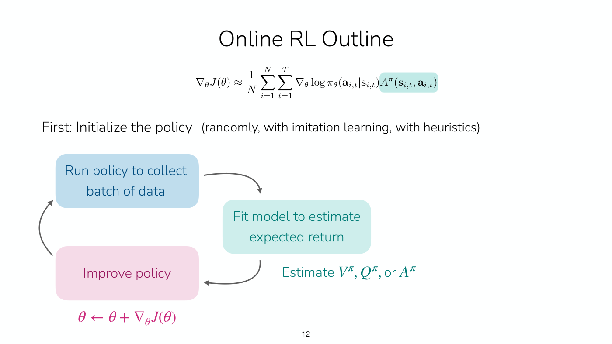

*Slide 12 — the online loop with its new third step: a teal box that fits a model to estimate the expected return, between collecting data and improving the policy. [Deck](https://cs224r.stanford.edu/spring_2025/slides/04_cs224r_actor_critic_2025.pdf)*

## Why fit only the value function

Which of the three should the model fit (slide 14, ≈27:00–34:00)? Fitting $A^\pi$ directly is hard,
because it is difficult to get direct supervision for advantages. Fitting both $Q^\pi$ and $V^\pi$
means two objects. But the advantage can be rewritten so that it depends on $V^\pi$ alone. The
Q-value is the reward at the current step plus the rewards after it. The next state
$\mathbf{s}_ {t+1}$ is drawn from the environment's dynamics $p$, and the rewards from there on
are, by definition, the value of $\mathbf{s}_ {t+1}$:

$$Q^\pi(\mathbf{s}_ t, \mathbf{a}_ t) = r(\mathbf{s}_ t, \mathbf{a}_ t) + \mathbb{E}_ {\mathbf{s}_ {t+1} \sim p(\cdot \mid \mathbf{s}_ t, \mathbf{a}_ t)} \left[ V^\pi(\mathbf{s}_ {t+1}) \right] \approx r(\mathbf{s}_ t, \mathbf{a}_ t) + V^\pi(\mathbf{s}_ {t+1})$$

The expectation over the dynamics cannot be sampled at will, but the data collected when the policy
ran contains one outcome, the next state actually observed, and the approximation uses it
(≈29:21–30:07). Subtracting $V^\pi(\mathbf{s}_ t)$ gives the advantage in terms of $V^\pi$ only:

$$A^\pi(\mathbf{s}_ t, \mathbf{a}_ t) \approx r(\mathbf{s}_ t, \mathbf{a}_ t) + V^\pi(\mathbf{s}_ {t+1}) - V^\pi(\mathbf{s}_ t)$$

The advantage is the reward observed, plus the value of the next state, minus the value of the
current state. "Let's just fit $V^\pi$!" (slide 14).

Students raise four points (≈31:43–34:00).

- **Why is it an approximation?** There are many possible next states, and the estimate uses one
  sample of them, the one in the data. It is good when the environment is nearly deterministic,
  "because there aren't that many futures", and worse when it is more stochastic. Later the
  lecture shows ways to use lots of data and many gradient steps that make it not too bad
  (≈31:43–32:28).
- **Does it need new interaction with the environment?** No. $\mathbf{s}_ t$, $\mathbf{a}_ t$ and
  $\mathbf{s}_ {t+1}$ come from the same trajectory in the data (≈32:28).
- **The superscript $\pi$ matters.** Finn admits to sometimes forgetting the $\pi$, and notes
  that a lot of RL work "drops the pi just for simplicity". It is important, because the
  function estimates a value for a particular policy, not for any policy (≈32:28–33:14).
- **Why $V$ and not $Q$ or $A$?** It is a little simpler in practice. There are ways to estimate
  $Q$ directly, which the course covers the following week (≈33:14).

$\hat{V}^\pi$ is represented by a neural network with parameters $\phi$, written
$\hat{V}^\pi_\phi$. It takes a state as input and outputs "a single scalar value, not as pictured
here" (the drawing on the slide has many output nodes), the value of that state for that policy
(≈34:00).

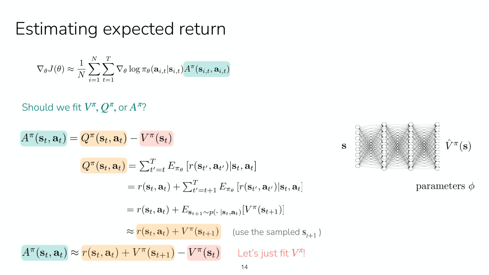

*Slide 14 — the derivation that turns the advantage into rewards and values of V alone, colour-coded A (teal), Q (orange) and V (pink), and the value network with parameters phi. [Deck](https://cs224r.stanford.edu/spring_2025/slides/04_cs224r_actor_critic_2025.pdf)*

## Estimating the value function, version 1: Monte Carlo

Vanilla policy gradients used a single trajectory's sum of rewards as the estimate, with no model
at all (slide 15, ≈34:00):

$$V^\pi(\mathbf{s}_ t) \approx \sum_{t'=t}^{T} r(\mathbf{s}_ {t'}, \mathbf{a}_ {t'})$$

In principle one could average many samples from the same state,
$V^\pi(\mathbf{s}_ t) \approx \frac{1}{N} \sum_{i=1}^{N} \sum_{t'=t}^{T} r(\mathbf{s}_ {t'}, \mathbf{a}_ {t'})$,
but that requires resetting the world to that state and rolling out from it many times, and "in
many scenarios, it's very hard to reset the state". A simulator can sometimes be reset, but in
practice this is typically not done (slide 16, ≈34:46–35:31).

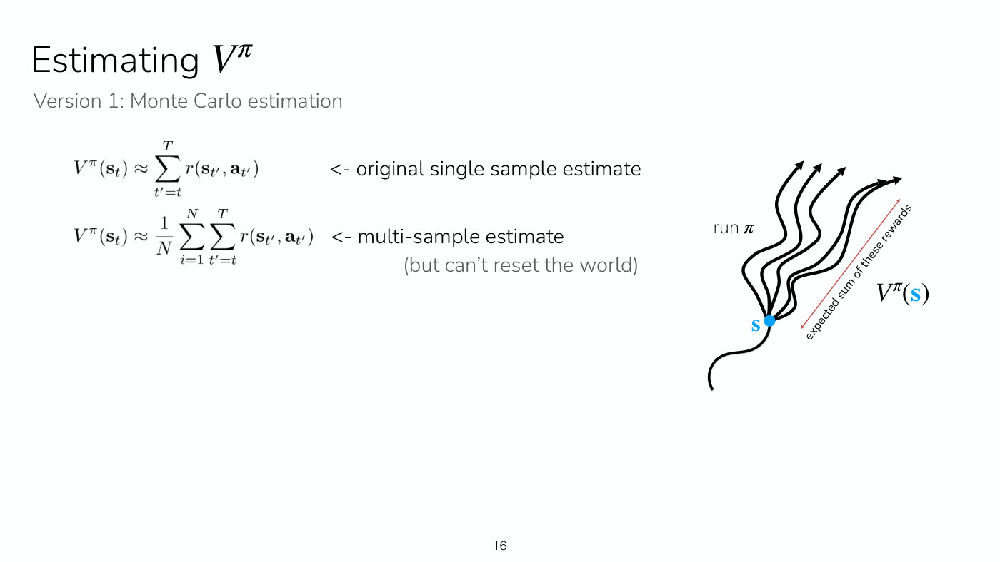

*Slide 16 — the single-sample estimate against the multi-sample one, which needs several rollouts from the same state and so the ability to reset the world. [Deck](https://cs224r.stanford.edu/spring_2025/slides/04_cs224r_actor_critic_2025.pdf)*

Instead, train one model on the single-sample estimates from all the trajectories collected
(slide 17, ≈35:31–40:07). Trajectories pass through similar states, and with that repetition in
the data a neural network can "learn how to amortize the data", in effect pooling the rewards seen
from similar states (≈35:31–36:16). It takes two steps. Step 1 aggregates a dataset of single-sample
estimates, pairing each state visited with the sum of rewards observed after it:

$$\left\lbrace \left( \mathbf{s}_ {i,t}, \thinspace y_{i,t} \right) \right\rbrace, \qquad y_{i,t} = \sum_{t'=t}^{T} r(\mathbf{s}_ {i,t'}, \mathbf{a}_ {i,t'})$$

where $i$ indexes the trajectories and $t$ the time steps within them. The dataset has the number
of trajectories times the average number of time steps as its size (≈37:04). Step 2 runs supervised
learning, minimizing an L2 error between the predicted value and the label over all the data
points (≈38:35–40:07):

$$\mathcal{L}(\phi) = \frac{1}{2} \sum_i \left\Vert \hat{V}^\pi_\phi(\mathbf{s}_ i) - y_i \right\Vert^2$$

The sum can equally be written over $i$ and $t$ (≈40:07). This is **Monte Carlo estimation**:
run many rollouts and learn to predict their outcome, the future rewards (≈40:53).

*Slide 17 — Monte Carlo estimation as supervised learning: two trajectories pass close to the same state (circled), so a network trained on many single-sample labels learns from both. [Deck](https://cs224r.stanford.edu/spring_2025/slides/04_cs224r_actor_critic_2025.pdf)*

Three questions follow.

- **Does the value function have to be refit every time the policy changes?** With this approach,
  yes: "This is the simplest and kind of dumbest approach you can use to fit a value function"
  (≈37:50). Later approaches reuse other data.
- **Why not learn to predict future states instead?** With a very small state space one could
  store things directly. Training a network to predict future states from current states and
  actions is what model-based approaches do, which the course covers in a few weeks
  (≈37:50–38:35).
- **Is a new network trained for every policy gradient step?** No. Unlike the policy gradient,
  the gradient steps here fit the value function and do not change the policy, so many gradient
  steps can be taken on this objective without recollecting data (≈40:07).

## Estimating the value function, version 2: bootstrapping

There is a better approach than Monte Carlo (slide 18, ≈40:53–47:45). Partway through training,
the network already has some estimate of how good the next state is, so it can use that estimate
as part of its own supervision target. The ideal target is the true expected sum of rewards, which
is the reward now plus the expected rewards from the next step, which is the value of the next
state, which is approximately the current fitted network's estimate:

$$y_{i,t} = \sum_{t'=t}^{T} \mathbb{E}_ {\pi_\theta} \left[ r(\mathbf{s}_ {t'}, \mathbf{a}_ {t'}) \mid \mathbf{s}_ {i,t} \right] \approx r(\mathbf{s}_ {i,t}, \mathbf{a}_ {i,t}) + V^\pi(\mathbf{s}_ {i,t+1}) \approx r(\mathbf{s}_ {i,t}, \mathbf{a}_ {i,t}) + \hat{V}^\pi_\phi(\mathbf{s}_ {i,t+1})$$

The slide's brace under the last term reads "directly use previous fitted value function!". The
regression is the same $\mathcal{L}(\phi)$ as before; only the labels differ. Because the labels
contain the network's own output, they change as gradient descent runs, and they are usually
recomputed after every gradient update (≈43:58–44:43). This is called **bootstrapping**,
"because we're bootstrapping off of our own estimate of the value function as part of the
learning process" (≈43:58). The slide notes it is also a form of **temporal difference
learning**.

*Slide 18 — the bootstrapped target: the reward now plus the fitted network's own estimate of the next state's value, with labels updated after every gradient step. [Deck](https://cs224r.stanford.edu/spring_2025/slides/04_cs224r_actor_critic_2025.pdf)*

The student questions here (≈43:58–47:45) clarify five points.

- **How often is $\hat{V}^\pi$ updated?** Typically every gradient step. With a really huge
  network that is expensive, and it could be updated less often.
- **Is each label from one trajectory or from many?** The dataset spans many trajectories, and
  each label belongs to one data point; nothing is re-simulated. But the label now estimates what
  would have happened from the next state, rather than taking the one outcome the trajectory
  happened to have. That gives a better estimate of all the possible outcomes (≈44:43–45:28).
- **Why is the input only the current state, not earlier ones?** The future rewards are a
  function of where the agent is now, and only of that (≈45:28–46:14).
- **Does it need a good initial value estimate?** Usually nothing fancy is needed. Initializing
  the network so that the values are around "negative a thousand" would be bad, but networks are
  not usually initialized that way. One could also start with the Monte Carlo objective to get
  into the right ballpark and then switch (≈46:14–46:59).
- **Is this backpropagation?** Backpropagation optimizes the objective. Bootstrapping is
  something else: it propagates information backwards in time, "which is distinct from
  propagating gradients through the network". Another name for it is temporal difference
  learning, after the difference between the next time step and the current one
  (≈46:59–47:45). Part of this question is unclear in the recording.

## Monte Carlo versus bootstrapping: an example

In summary, Monte Carlo supervises with a rollout's summed rewards, and bootstrapping supervises
with the reward plus the current value estimate of the next state (≈47:45). A think-pair-share
shows where they differ (slide 19, ≈47:45–51:38). Two trajectories start from the same state.
Every reward along the way is 0, and the final reward is $-1$ on one trajectory and $1$ on the
other. The black trajectory passes through a pink state and then a blue state and ends at $-1$.
The grey one loops around the pink state, joins the black one at the blue state, and ends at $1$.
What does each method estimate for the blue state and the pink state?

*Slide 19 — the think-pair-share: both trajectories pass through the blue state, only the black one (which ends at reward -1) passes through the pink state, and the question is what Monte Carlo and bootstrapping estimate at each. [Deck](https://cs224r.stanford.edu/spring_2025/slides/04_cs224r_actor_critic_2025.pdf)*

The answers, from the class (≈48:32–50:04), are these.

- **Monte Carlo, blue state: 0.** The blue state appears in the data for both trajectories, with
  labels $-1$ and $1$, and the regression averages them.
- **Monte Carlo, pink state: $-1$.** Only the black trajectory passes through it, and Monte
  Carlo supervises with that trajectory's own sum of future rewards. Likewise, on the black
  trajectory beyond the blue state the Monte Carlo target is $-1$, and on the grey one it is $1$
  (≈50:04–50:51).
- **Bootstrapping, blue state: 0.** There is nothing special to bootstrap from, so it averages the
  future rewards just as Monte Carlo does.
- **Bootstrapping, pink state: 0.** Its target uses the estimate for the blue state, which comes
  next, and that estimate is 0.

The two methods disagree at the pink state, and the bootstrapped value is arguably more accurate,
"because it's able to look at its estimated value and actually aggregate information across
trajectories more effectively" (≈50:04). Monte Carlo pools the two trajectories only at the blue
state, because only there does the same exact state appear in the data with two different labels
(≈50:51).

The trade-off is between bias and variance (≈51:38–52:23). "Monte Carlo is going to have high
variance, but it is completely unbiased, whereas the bootstrapped estimate has much lower
variance". Bootstrapping can be incorrect, though, because the current value estimate will
inevitably have at least a small amount of error in it.

## N-step returns

Is there a middle ground between the two (slide 20, ≈52:23–56:13)? Monte Carlo sums all the
rewards to the end, and one-step bootstrapping uses one reward plus the value right after it. One
can interpolate: sum the rewards for the next $n$ steps, "before the variance has increased
substantially", and then use the value estimate at step $t+n$:

$$y_{i,t} = \sum_{t'=t}^{t+n-1} r(\mathbf{s}_ {i,t'}, \mathbf{a}_ {i,t'}) + \hat{V}^\pi_\phi(\mathbf{s}_ {i,t+n})$$

This target has much less variance than full Monte Carlo, especially for small $n$, and lower bias
than a one-step bootstrap, because more of the rewards were directly observed. It is called
**n-step returns** (≈53:55–54:41). With $n = 1$ it is the bootstrapped version, and with $n = T$
it is full Monte Carlo. Something in between "works the best in practice"; the slide puts it as
$n \gt 1$, $n \lt T$. That is especially useful when time steps are very short: if a step is
10 milliseconds, very little happens between steps (≈54:41). The caption is garbled where Finn
names the range for $n$; the slide's wording is the reliable one.

*Slide 20 — Monte Carlo sums every reward (red), one-step bootstrapping uses one reward plus a value, and n-step returns sum n rewards (purple) and then use the value at t plus n (blue). [Deck](https://cs224r.stanford.edu/spring_2025/slides/04_cs224r_actor_critic_2025.pdf)*

Slide 20 prints the n-step target without a discount factor; slide 22, after discounting has been
introduced, multiplies the value term by $\gamma^n$.

Asked whether one could put labels of every kind into the dataset at once, Finn says that is
possible in principle. But high-variance labels can deteriorate learning, and poor value estimates
are a challenge too, so in practice one version is picked and used for supervision
(≈55:28–56:13).

## Aside: discount factors

So far the targets sum every future reward. Lecture 1 noted that this is not always wanted, and
with infinite or very long episodes the value estimates can get very large (slide 21,
≈56:13–57:00). The slide asks "what if $T$ (episode length) is $\infty$?" and notes that
$\hat{V}^\pi_\phi$ can then grow without bound. The simple trick is to prefer rewards sooner
rather than later, by putting a coefficient on the next state's value:

$$y_{i,t} \approx r(\mathbf{s}_ {i,t}, \mathbf{a}_ {i,t}) + \gamma \hat{V}^\pi_\phi(\mathbf{s}_ {i,t+1})$$

The **discount factor** $\gamma \in [0, 1]$ weights current rewards more than future ones. With
$\gamma = 1$ the target is the same as before; Finn suggests something like 0.9 or 0.99, and the
slide says 0.99 works well (≈57:00).

Discounting can be read as changing the decision process (≈57:47–58:33). It is equivalent to the
agent dying at any point in time with some probability. With $\gamma = 0.99$, there is a 1% chance
at each step of entering a state with zero reward and staying there forever. In the slide's
diagram, every transition $p(\mathbf{s}' \mid \mathbf{s}, \mathbf{a})$ of the original MDP is
multiplied by $\gamma$, and with probability $1 - \gamma$ the agent goes to a death state, where it
"can't do anything else after that" (≈58:33).

*Slide 21 — discounting as a change to the MDP: each original transition keeps probability gamma times its old value, and with probability one minus gamma the agent drops into a death state. [Deck](https://cs224r.stanford.edu/spring_2025/slides/04_cs224r_actor_critic_2025.pdf)*

Two student questions connect discounting to n-step returns (≈58:33–1:00:04).

- **Is $\gamma$ related to the n-step targets?** In the n-step target, the value term is
  multiplied by $\gamma$ to the $n$. The choices are interconnected, since the choice of $\gamma$
  depends on the environment. Looking further into the future may mean the environment is more
  deterministic or has smaller time steps, which would also affect the choice of $\gamma$.
- **Does choosing how far to look ahead change whether short-term or long-term reward is
  prioritized?** No. Choosing $n$ does not change how greedy the agent is, because every target
  still estimates "the same exact quantity", the value function (≈59:19). The choice depends on
  how fast the variance grows: if it grows slowly, one can look further ahead; if it grows very
  quickly, a smaller $n$ is better (≈1:00:04).

## The full actor-critic algorithm

Put together, the algorithm has five steps (slide 22, ≈1:00:04–1:01:36).

1. Sample a batch of trajectories from $\pi_\theta$.
2. Fit $\hat{V}^{\pi_\theta}_ \phi$ to the summed rewards in the data, for example with the n-step
   target
   $y_{i,t} = \sum_{t'=t}^{t+n-1} r(\mathbf{s}_ {i,t'}, \mathbf{a}_ {i,t'}) + \gamma^n \hat{V}^\pi_\phi(\mathbf{s}_ {i,t+n})$,
   taking multiple gradient steps on $\mathcal{L}(\phi)$.
3. Evaluate the advantage of every action in the data, using the reward and the critic's values:
   $\hat{A}^{\pi_\theta}(\mathbf{s}_ {t,i}, \mathbf{a}_ {t,i}) = r(\mathbf{s}_ {t,i}, \mathbf{a}_ {t,i}) + \gamma \hat{V}^{\pi_\theta}_ \phi(\mathbf{s}_ {t+1,i}) - \hat{V}^{\pi_\theta}_ \phi(\mathbf{s}_ {t,i})$.
   According to the value function and the observed reward, this says how good the action taken
   in the data was.
4. Evaluate the policy gradient
   $\nabla_\theta J(\theta) \approx \sum_{t,i} \nabla_\theta \log \pi_\theta(\mathbf{a}_ {t,i} \mid \mathbf{s}_ {t,i}) \thinspace \hat{A}^{\pi_\theta}(\mathbf{s}_ {t,i}, \mathbf{a}_ {t,i})$.
   It raises the likelihood of actions estimated to be advantageous and lowers it for the others.
5. Update $\theta \leftarrow \theta + \alpha \nabla_\theta J(\theta)$, with step size $\alpha$, and
   repeat from step 1 with the new policy.

There are two neural networks: the policy $\pi_\theta(\mathbf{a} \mid \mathbf{s})$ and the value
function $\hat{V}^\pi(\mathbf{s})$. Hence the name: "This is called an actor-critic algorithm,
because one of the networks is the actor, and one of the networks is the value function, which can
also be called a critic, because it's criticizing how good a state and policy is" (≈1:01:36).

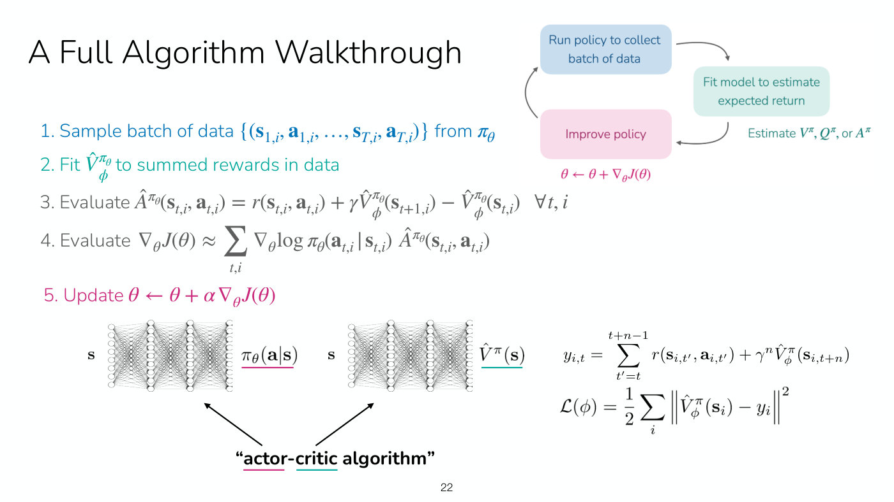

*Slide 22 — the full algorithm in five steps, colour-keyed to the three-step loop, with the two networks labelled actor (the policy) and critic (the value function). [Deck](https://cs224r.stanford.edu/spring_2025/slides/04_cs224r_actor_critic_2025.pdf)*

This answers the opening complaint. Given data in which the humanoid takes a step forward and then
falls backwards, the critic can learn, especially from bootstrapped estimates, that the step
forward has a positive advantage compared with other actions. So the algorithm makes much more
efficient use of the data it collects (≈1:02:21).

## Review

The review compares the two families (slide 23, ≈1:02:21–1:03:07). Policy gradients "do more of
the good stuff, less of the bad stuff, based on what you observe". Actor-critic methods "are
learning to estimate what's good and bad, and then doing more of the good stuff according to your
estimate". They get a better policy gradient by using a neural network to estimate the value
function, which is the third step in the loop. The three ways to estimate value make up
**policy evaluation**: supervised learning on the observed sum of future rewards (Monte Carlo),
on the current reward plus the value estimate of the next state (bootstrapping), or on the sum of
the next $n$ rewards plus the value of the state after that (the hybrid, n-step returns).

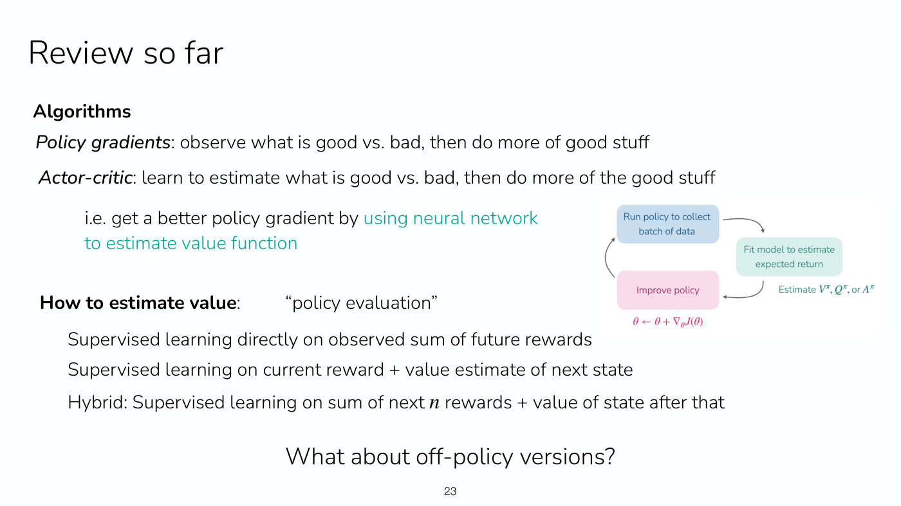

*Slide 23 — the review: policy gradients against actor-critic, and the three ways of estimating value, beside the three-step loop. [Deck](https://cs224r.stanford.edu/spring_2025/slides/04_cs224r_actor_critic_2025.pdf)*

The recording ends here. The slide's last line asks "What about off-policy versions?"

## Not in the recording: off-policy actor-critic

The deck continues for fourteen more slides that the recording does not reach. Everything in this
section comes from the [slide file](../raw/slides/04-actor-critic.md) alone, with no spoken
explanation, so it states what the slides print and no more. The course schedule's next lecture
is titled Off-Policy Actor Critic (see [`sources.md`](../sources.md#lectures)). This knowledge base
does not cover that lecture yet.

Slide 24 repeats the plan with the names the lecture gave: policy evaluation, Monte Carlo
estimation, bootstrapping or temporal difference learning, and n-step returns. The third part,
off-policy actor-critic, has two versions.

**Version 1: multiple gradient steps** (slides 25–27). The algorithm of slide 22 takes one
gradient step per batch. To take several, step 4 uses importance weights, as the off-policy
policy gradient did. Here $\theta'$ is the policy being updated and $\theta$ the one that collected
the data:

$$\nabla_{\theta'} J(\theta') \approx \sum_{t,i} \frac{\pi_{\theta'}(\mathbf{a}_ {i,t} \mid \mathbf{s}_ {i,t})}{\pi_\theta(\mathbf{a}_ {i,t} \mid \mathbf{s}_ {i,t})} \nabla_{\theta'} \log \pi_{\theta'}(\mathbf{a}_ {t,i} \mid \mathbf{s}_ {t,i}) \thinspace \hat{A}^{\pi_\theta}(\mathbf{s}_ {t,i}, \mathbf{a}_ {t,i})$$

The slide notes that the policy will increase probability on actions with high advantages, while
the advantages are based on the old policy and "will get out-dated", and it asks "What can go wrong
if you take too many gradient steps?" (slide 27). It offers two ideas. Idea 1 is a KL constraint on
the policy, bounding the expected KL divergence between new and old policies by $\delta$, which
the course will meet again in LLM preference optimization. Idea 2 is to bound the importance
weights, which "Doesn't directly constrain policy, but removes incentives" and is the
"Key idea behind proximal policy optimization (PPO)".

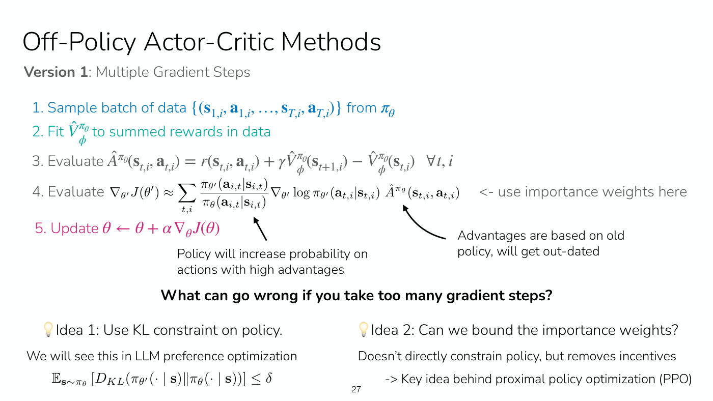

*Slide 27 — version 1 of off-policy actor-critic: importance weights in the gradient, advantages that go stale, and the two fixes, a KL constraint and bounded importance weights (the idea behind PPO). [Deck](https://cs224r.stanford.edu/spring_2025/slides/04_cs224r_actor_critic_2025.pdf)*

**Version 2: replay buffers** (slides 28–34). So far, one batch of policy data gives one gradient
step (fully on-policy) or several (starting to be off-policy). Slide 28 asks whether data from all
previous batches, "all of the past trial-and-error data", can be reused. The key ideas are to keep a
**replay buffer** of all past data and to adjust the equations to remove on-policy assumptions.
Slide 29 puts a buffer into the algorithm: collect experience and add it to the buffer, then run
steps 2–5 on minibatches sampled from all previous data. Its timeline diagram alternates getting
transitions $(\mathbf{s}, \mathbf{a}, \mathbf{s}', r)$ with updating $\theta$ from transitions seen
at earlier time steps.

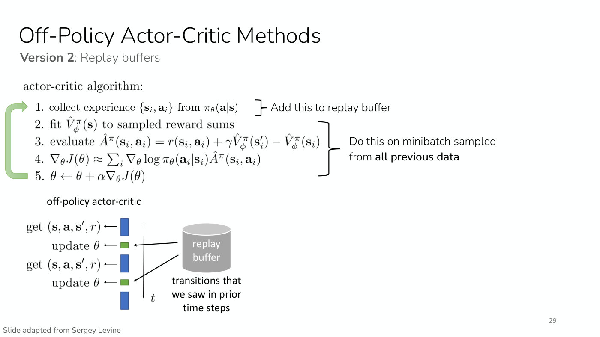

*Slide 29 — version 2 with a replay buffer: experience is added to the buffer, and the value and policy updates run on minibatches drawn from all past data. [Deck](https://cs224r.stanford.edu/spring_2025/slides/04_cs224r_actor_critic_2025.pdf)*

Slide 30 then declares "The algorithm is currently broken". Two places are circled. The value
target $y_i = r_i + \gamma \hat{V}^\pi_\phi(\mathbf{s}'_ i)$ is "not the right target value", and
in the policy gradient the action $\mathbf{a}_ i$ from the buffer is "not the action $\pi_\theta$
would have taken!"

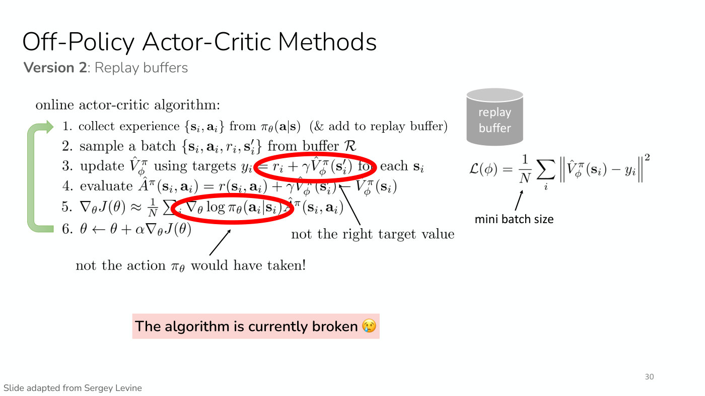

*Slide 30 — the naive replay-buffer algorithm is broken: the circled value target is not the right one, and the circled buffer action is not one the current policy would have taken. [Deck](https://cs224r.stanford.edu/spring_2025/slides/04_cs224r_actor_critic_2025.pdf)*

Slide 31 fixes the value function by switching the critic from $V^\pi$ to $Q^\pi$, the total
reward from taking $\mathbf{a}_ t$ in $\mathbf{s}_ t$ and then following $\pi$. The critic
$\hat{Q}^\pi_\phi$ is fitted to targets
$y_i = r_i + \gamma \hat{Q}^\pi_\phi(\mathbf{s}'_ i, \mathbf{a}'_ i)$, where the next action is
sampled from the current policy, $\mathbf{a}'_ i \sim \pi_\theta(\mathbf{a}'_ i \mid \mathbf{s}'_ i)$,
and is "**not** from replay buffer", with loss
$\mathcal{L}(\phi) = \frac{1}{N} \sum_i \Vert \hat{Q}^\pi_\phi(\mathbf{s}_ i, \mathbf{a}_ i) - y_i \Vert^2$.

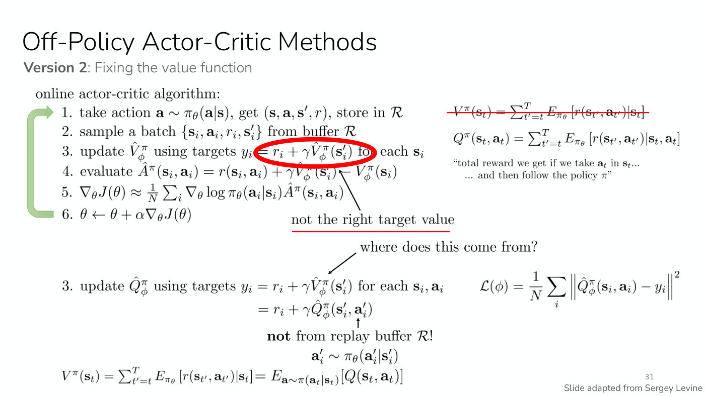

*Slide 31 — fixing the value function: the V definition is struck through, and the critic becomes a Q-function whose target uses a next action sampled from the current policy, not from the buffer. [Deck](https://cs224r.stanford.edu/spring_2025/slides/04_cs224r_actor_critic_2025.pdf)*

Slide 32 fixes the policy update with "the same trick, but this time for $\mathbf{a}_ i$". It
samples $\mathbf{a}^\pi_ i \sim \pi_\theta(\mathbf{a} \mid \mathbf{s}_ i)$, again not from the
buffer, and uses it in the gradient. In practice, the slide says, the gradient weights the action by
$\hat{Q}^\pi$ rather than by the advantage:

$$\nabla_\theta J(\theta) \approx \frac{1}{N} \sum_i \nabla_\theta \log \pi_\theta(\mathbf{a}^\pi_ i \mid \mathbf{s}_ i) \thinspace \hat{Q}^\pi(\mathbf{s}_ i, \mathbf{a}^\pi_ i)$$

The slide says this has "higher variance, but convenient" and asks "why is higher variance OK
here?"; the slide gives no answer.

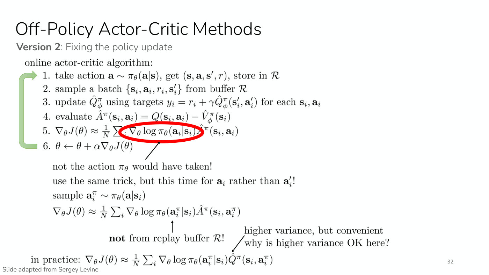

*Slide 32 — fixing the policy update: the gradient uses an action freshly sampled from the current policy, and in practice weights it by the Q-function rather than the advantage. [Deck](https://cs224r.stanford.edu/spring_2025/slides/04_cs224r_actor_critic_2025.pdf)*

Slide 33 names one remaining problem: the states $\mathbf{s}_ i$ did not come from the current
policy's state distribution $p_\theta(\mathbf{s})$, and "nothing we can do here, just accept it".
The intuition it gives is that we want the optimal policy on $p_\theta(\mathbf{s})$ but get the
optimal policy on a broader distribution. Slide 34 adds implementation details. There are fancier
ways to fit Q-functions, covered in the next two lectures. The **reparameterization trick** can
give a better gradient estimate for a Gaussian policy. The slide's example of a practical algorithm
is soft actor-critic (Haarnoja, Zhou, Abbeel, Levine, 2018).

Slide 35 compares more and less off-policy methods with two learning-curve charts pasted from a
paper the slide does not name. They plot average return against million steps on two humanoid
tasks for SAC, DDPG, PPO, SQL and TD3. SAC is labelled "more off-policy", with a replay buffer,
and PPO "less off-policy", with no replay buffer. On the second task SAC reaches roughly
5,500 by 10 million steps, against roughly 2,300 for PPO. The slide's conclusions cut both ways.
On the plus side, off-policy methods with a replay buffer, such as soft actor-critic, "can be far
more data efficient". On the minus side, they "can also generally be harder to tune
hyperparameters, less stable (than e.g. PPO)". The slide file gives each curve.

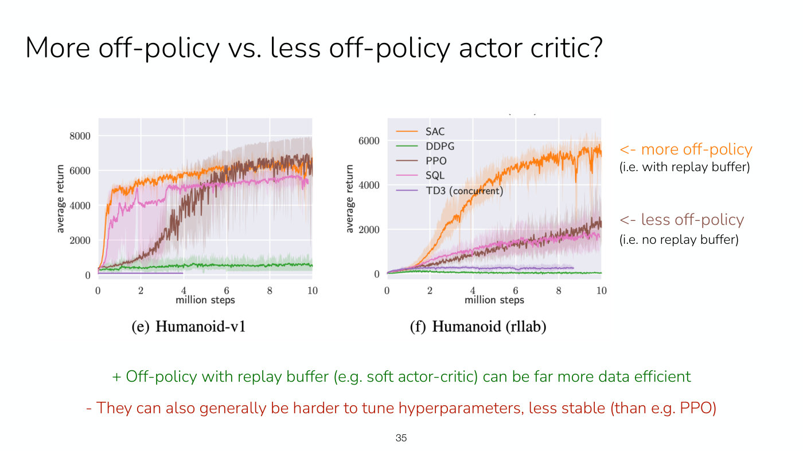

*Slide 35 — learning curves on two humanoid tasks: SAC (orange, with a replay buffer) learns far faster than PPO (brown, no replay buffer) on the second task, at the cost of being harder to tune. [Deck](https://cs224r.stanford.edu/spring_2025/slides/04_cs224r_actor_critic_2025.pdf)*

Slide 36 recaps the plan. Slide 37 announces next week's topics, Q-learning ("last big online RL
method") and the practical implementation of online RL algorithms. Its reminders are to form final
project groups and ideas (survey due next Wednesday) and that Homework 1 is due next Friday.

## Related pages

- [Actor-critic methods](actor-critic.md): the method as a whole, from the advantage-weighted
  gradient to the off-policy versions.
- [Policy evaluation](policy-evaluation.md): Monte Carlo, bootstrapping and n-step returns, and
  their bias and variance.
- [Value functions](value-functions.md): $V^\pi$, $Q^\pi$ and the advantage $A^\pi$.
- [Policy gradients](policy-gradients.md): the method this lecture improves.
- [The RL objective](rl-objective.md): horizon and discounting, including this lecture's reading
  of the discount factor.
- [Importance sampling](importance-sampling.md): the importance weights behind version 1 of
  off-policy actor-critic.
- [Offline and online algorithms](offline-and-online.md): the on-policy and off-policy
  distinction.
- [RL algorithm families](rl-algorithm-families.md): where actor-critic methods sit among the
  course's methods.
