# Lecture 6 — Q-Learning

Stanford CS224R, Spring 2025 (Friday, April 18) ·
[video](https://www.youtube.com/watch?v=-7kv6jf0isQ) (61 min) ·
[slides (PDF)](https://cs224r.stanford.edu/spring_2025/slides/06_cs224r_qlearning_2025.pdf) ·
[slide-by-slide text](../raw/slides/06-q-learning.md) ·
[transcript](../raw/transcripts/06-q-learning.md)

**What this lecture establishes.** Given an accurate Q-function for some policy, the policy that
always takes the action with the highest Q-value is at least as good as the original, whatever the
original was. So an actor-critic algorithm can drop its policy network and its policy gradient:
fit the Q-function, act greedily on it, and repeat, which is **policy iteration**. Moving the
maximization into the Q-function's own regression target gives **Q-learning**. Its target is the
right-hand side of the **Bellman optimality equation**, which only the optimal policy's Q-function
satisfies. Q-learning is off-policy, so its data can come from an exploration policy such as
**epsilon-greedy** or **Boltzmann exploration**, kept in a replay buffer. It converges when the
Q-values fit in a table and is not guaranteed to otherwise, and three tricks make it work in
practice. A **target network**, frozen between periodic updates, stabilizes the target, and with it
the algorithm is **DQN**. **Double Q-learning** picks the next action with the current network and
evaluates it with the target network, which cuts the Q-values' overestimation. **N-step returns**
lean on observed rewards while the Q-function is still poor. The lecture closes with Atari and
robot-grasping results and Finn's advice on choosing among PPO, DQN and SAC.

Slide numbers below are the numbers printed on the slides, which equal the PDF page numbers
(slides 3, 15, 20, 26 and 27 print none). Timestamps (≈M:SS) point into the video and the
[transcript](../raw/transcripts/06-q-learning.md). **The recording covers slides 3–29.** It opens
on the recap and ends at about 1:01:12 on the first line of slide 29, "Done with online RL
methods!" It does not discuss slide 2's reminders or slide 29's next-week topics; the
[last section](#not-in-the-recording-reminders-and-next-time) gives them from the
[slide file](../raw/slides/06-q-learning.md).

The thought exercise of slide 7 is answered aloud while pointing at parts of the slide's picture
("this row", "here"), and the algorithm with its targets is written on the board (≈18:00–19:34),
which the recording does not show. Where the transcript says "this" or "right here", this page
reconstructs what was meant from the surrounding words and the slides, and says so.

## Contents

1. [Recap: Q-functions and off-policy policy evaluation](#recap-q-functions-and-off-policy-policy-evaluation)
2. [Plan: value-based RL](#plan-value-based-rl)
3. [A thought exercise: act greedily on the Q-function](#a-thought-exercise-act-greedily-on-the-q-function)
4. [Can we omit the policy gradient?](#can-we-omit-the-policy-gradient)
5. [Policy iteration: from actor-critic to critic only](#policy-iteration-from-actor-critic-to-critic-only)
6. [Improving the policy inside the Q-function update](#improving-the-policy-inside-the-q-function-update)
7. [Why it works: the Bellman optimality equation](#why-it-works-the-bellman-optimality-equation)
8. [Does Q-learning converge?](#does-q-learning-converge)
9. [What data to collect: epsilon-greedy and Boltzmann exploration](#what-data-to-collect-epsilon-greedy-and-boltzmann-exploration)
10. [Full Q-learning with a replay buffer](#full-q-learning-with-a-replay-buffer)
11. [Trick 1: a target network, and DQN](#trick-1-a-target-network-and-dqn)
12. [Are the Q-values accurate?](#are-the-q-values-accurate)
13. [Trick 2: double Q-learning](#trick-2-double-q-learning)
14. [Trick 3: n-step returns](#trick-3-n-step-returns)
15. [Q-learning in practice: Atari and robot grasping](#q-learning-in-practice-atari-and-robot-grasping)
16. [Which online RL algorithm to use](#which-online-rl-algorithm-to-use)
17. [Summary](#summary)
18. [Not in the recording: reminders and next time](#not-in-the-recording-reminders-and-next-time)

## Recap: Q-functions and off-policy policy evaluation

The last few lectures were about [value functions](value-functions.md) and Q-functions (≈0:05).
The value function $V^\pi(\mathbf{s})$ is the future expected reward starting at state
$\mathbf{s}$ and following the policy $\pi$; the Q-function $Q^\pi(\mathbf{s}, \mathbf{a})$ is the
future expected reward starting at $\mathbf{s}$, taking the action $\mathbf{a}$, and then following
$\pi$ (slide 3). With $r$ the reward and $T$ the horizon,

$$V^\pi(\mathbf{s}_ t) = \sum_{t'=t}^{T} E_{\pi_\theta} \left[ r(\mathbf{s}_ {t'}, \mathbf{a}_ {t'}) \mid \mathbf{s}_ t \right] \qquad Q^\pi(\mathbf{s}_ t, \mathbf{a}_ t) = \sum_{t'=t}^{T} E_{\pi_\theta} \left[ r(\mathbf{s}_ {t'}, \mathbf{a}_ {t'}) \mid \mathbf{s}_ t, \mathbf{a}_ t \right]$$

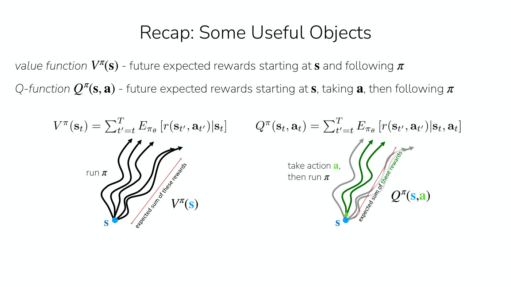

*Slide 3 — the value function averages the reward of trajectories that run the policy from s; the Q-function's trajectories first take the action a (green) and then run the policy. [Deck](https://cs224r.stanford.edu/spring_2025/slides/06_cs224r_qlearning_2025.pdf)*

Two methods came before (slide 4, ≈0:56–1:42). [Policy gradients](policy-gradients.md) alternate
between collecting data and improving the policy $\pi_\theta$, with parameters $\theta$: they
sample from the policy and raise the log-likelihood of actions followed by more reward than a
baseline, so the policy does more of the above-average things and less of the below-average ones.
[Actor-critic methods](actor-critic.md) add a step to the loop that first estimates the expected
future reward and then uses it to improve the policy, raising the likelihood of actions estimated
to be good and lowering it for those estimated to be bad, through the advantage $A^\pi$:

$$\nabla_\theta J(\theta) \approx \frac{1}{N} \sum_{i=1}^{N} \sum_{t=1}^{T} \nabla_\theta \log \pi_\theta(\mathbf{a}_ {i,t} \mid \mathbf{s}_ {i,t}) \thinspace A^\pi(\mathbf{s}_ {i,t}, \mathbf{a}_ {i,t})$$

Here $J(\theta)$ is the [RL objective](rl-objective.md) and $N$ the number of sampled
trajectories.

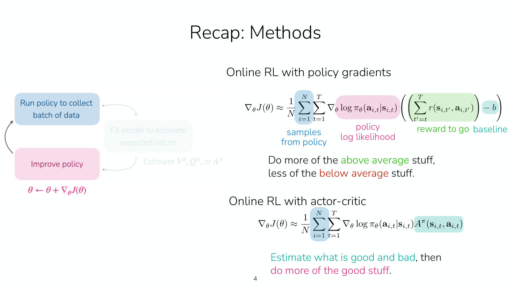

*Slide 4 — the online loop with its middle step faded, beside the policy gradient, whose reward to go has a baseline subtracted, and the actor-critic gradient, which uses the advantage instead. [Deck](https://cs224r.stanford.edu/spring_2025/slides/06_cs224r_qlearning_2025.pdf)*

[Lecture 5](05-off-policy-actor-critic.md) made actor-critic off-policy, using the data of all past
iterations rather than only the current one (≈1:42). That needed a Q-function estimated from past
policies' data: a neural network $\hat{Q}^\pi_\phi$, with parameters $\phi$, that takes a state and
an action and outputs a value (slide 5). It rests on a recursive definition, the reward at the
first step plus the Q-function at the next state and action, which holds for every state and
action (≈2:29). With $\gamma$ the discount factor, $p$ the transition probabilities and
$\mathbf{s}'$ the next state,

$$Q^{\pi_\theta}(\mathbf{s}, \mathbf{a}) = r(\mathbf{s}, \mathbf{a}) + \gamma \mathbb{E}_ {\mathbf{s}' \sim p(\cdot \mid \mathbf{s}, \mathbf{a}), \bar{\mathbf{a}}' \sim \pi_\theta(\cdot \mid \mathbf{s}')} \left[ Q^{\pi_\theta}(\mathbf{s}', \bar{\mathbf{a}}') \right]$$

Because it holds everywhere, transitions from earlier policies can train it. Sample a state, action
and next state $(\mathbf{s}_ i, \mathbf{a}_ i, \mathbf{s}'_ i)$ from the buffer of previous data,
sample the next action $\bar{\mathbf{a}}'_ i$ from the *current* policy rather than the past one,
and do supervised learning on targets $y_i = r(\mathbf{s}_ i, \mathbf{a}_ i) + \gamma Q^{\pi_\theta}(\mathbf{s}'_ i, \bar{\mathbf{a}}'_ i)$
built from the current estimate (≈2:29–3:16):

$$\mathcal{L}(\phi) = \frac{1}{N} \sum_i \left\Vert \hat{Q}^\pi_\phi(\mathbf{s}_ i, \mathbf{a}_ i) - y_i \right\Vert^2$$

For the targets to be accurate, the data needs sufficient coverage of the actions the newest policy
takes (slide 5, ≈3:16).

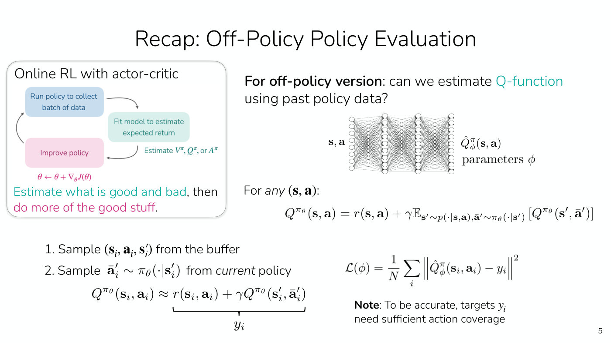

*Slide 5 — fitting a Q-network from past policies' data: sample a transition from the buffer, sample the next action from the current policy, and regress onto the bootstrapped target. [Deck](https://cs224r.stanford.edu/spring_2025/slides/06_cs224r_qlearning_2025.pdf)*

## Plan: value-based RL

Today's subject is value-based RL methods, and in particular what Finn calls arguably the very first
deep reinforcement learning method, which was based on the Q-learning algorithm (slide 6,
≈3:16–4:01). The lecture covers Q-learning, then how to implement it in practice and make it
stable. Its learning goals are how Q-functions relate to policies, how to do RL without learning an
explicit policy, and how to stabilize Q-learning in practice (slide 6, ≈4:01). The slide marks the
material as "Part of homework 2!"

## A thought exercise: act greedily on the Q-function

Suppose that for some policy $\pi$ you have an accurate estimate $\hat{Q}^\pi(\mathbf{s}, \mathbf{a})$
for every state and action (slide 7, ≈4:01–4:48). Instead of following the policy, you could take
a bunch of candidate actions at a given state and pick the one with the highest Q-value. Define a
new policy that does exactly that: probability one for the action that maximizes the Q-value and
zero otherwise, a deterministic policy that always does what the Q-values say is best
(≈4:48–5:33):

$$\pi_{\text{new}}(\mathbf{a}_ t \mid \mathbf{s}_ t) = \begin{cases} 1 & \text{if } \mathbf{a}_ t = \arg\max_{\mathbf{a}} Q_\phi(\mathbf{s}_ t, \mathbf{a}) \cr 0 & \text{otherwise} \end{cases}$$

(The slide writes the estimate as $\hat{Q}^\pi$ in its text and as $Q_\phi$ inside the
$\arg\max$.)

The example is 2D navigation (≈5:33–6:20). The agent starts somewhere in a blue box, the initial
state distribution $p(\mathbf{s}_ 1)$, and the goal is a star; the reward is one at the star and
zero elsewhere. The current policy always goes right. Moving up, it takes one time step to travel
one marked distance and two time steps to travel a longer one, the orange and magenta bars beside
the world. The questions: is the new policy better than, worse than, or the same as the current
policy, is it the optimal policy, and why (slide 7, ≈6:20)?

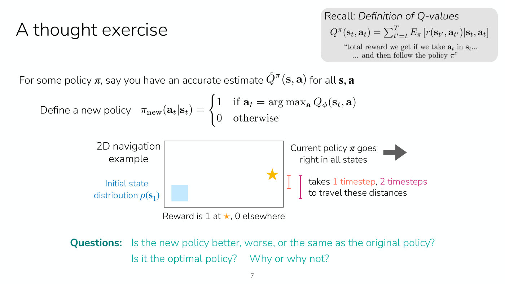

*Slide 7 — the thought exercise: from the blue start region the current policy goes right and passes below the star; the orange and magenta bars are one and two time steps of upward travel. [Deck](https://cs224r.stanford.edu/spring_2025/slides/06_cs224r_qlearning_2025.pdf)*

After the class discussed it in pairs, Finn summarizes a student's answer (≈7:08–10:13). The
recording does not show which part of the picture each "row" is, so the row names below are
reconstructed from what is said about them. The old policy is not optimal, because starting in the
blue region and going right never reaches the star. Everything is worked with a discount factor of
one for simplicity (≈11:00).

- **The star's row.** $V^\pi$ is one for every state in it. The Q-value depends on the action:
  going right, as the policy does, gives one, while doing something else, such as going up and then
  following the policy, may miss the star (≈7:55–8:41).
- **The row one step below.** Going right gives a Q-value of zero for every state, but going up and
  then following the policy reaches the star, so going up has a Q-value of one (≈8:41).
- **The row below that.** Going up has a Q-value of zero, since after one step up, going right
  still misses (≈8:41). All of this row's Q-values are zero, because all of the next row's are too
  (≈9:27).

So the new policy goes right in the star's row and up in the row below it. In the lowest row every
Q-value is zero, and defaulting to the previous behaviour it keeps going right (≈9:27). It is
better than the old policy but not optimal, because in those states the best policy would also go
up (≈10:13). From the initial state it still just goes right and never gets the reward of one, so
it does not get a reward of one from all states (≈10:13).

Students asked several follow-ups:

- **Does iterating reach the optimal policy?** Yes, and the student is "a couple of slides ahead" (≈10:13).
  Getting the optimal policy means repeating the step, re-estimating the Q-function for the latest
  policy each time (≈11:46).
- **Is the Q-value higher closer to the star?** Not with a discount factor of one. With a discount
  factor below one it is; with 0.9, the Q-value is one next to the star, 0.9 a step further, and
  smaller still further away, while the lowest row stays at zero (≈11:00). The captions garble the
  later numbers; see the [transcript](../raw/transcripts/06-q-learning.md).
- **A denser reward.** If the reward were, for example, the negative distance to the star, then even
  a single step of this improvement from the go-right policy would give a policy that goes to the
  star. Finn does not work this case on the board (≈11:00–11:46).
- **Is the new policy always better?** It is always at least as good as the previous policy,
  assuming $Q^\pi$ is accurate, and if the previous policy is already optimal it is the same
  (≈11:46–12:32).

## Can we omit the policy gradient?

The argument generalizes (slide 8, ≈12:32–13:18). $Q^\pi(\mathbf{s}_ t, \mathbf{a}_ t)$ is the
expected reward from taking $\mathbf{a}_ t$ and following $\pi$ afterwards, so
$\arg\max_{\mathbf{a}_ t} Q^\pi(\mathbf{s}_ t, \mathbf{a}_ t)$ is the best action from
$\mathbf{s}_ t$ if we then follow $\pi$. It is "*at least* as good as any
$\mathbf{a}_ t \sim \pi(\mathbf{a}_ t \mid \mathbf{s}_ t)$ *regardless* of what
$\pi(\mathbf{a}_ t \mid \mathbf{s}_ t)$ is", because it takes the action with the maximum expected
reward. Hence the slide's "forget policies, let's just do this!": rather than learn a neural network
for the policy, define

$$\pi'(\mathbf{a}_ t \mid \mathbf{s}_ t) = \begin{cases} 1 & \text{if } \mathbf{a}_ t = \arg\max_{\mathbf{a}} Q^\pi(\mathbf{s}_ t, \mathbf{a}) \cr 0 & \text{otherwise} \end{cases}$$

which is "as good as $\pi$ (probably better)".

As an iterative algorithm (slide 8, ≈13:18–14:05): run the policy to collect data, fit a model to
estimate $Q^\pi$ from that latest batch (or off-policy, as in Lecture 5), and improve the policy by
defining it as the policy that maximizes the Q-function, $\pi \leftarrow \pi'$. Then collect new
data and estimate the Q-function again, now for the new policy. No neural network represents the
policy; $\pi$ is notation for the greedy rule, and the only model is the Q-function (≈14:05).

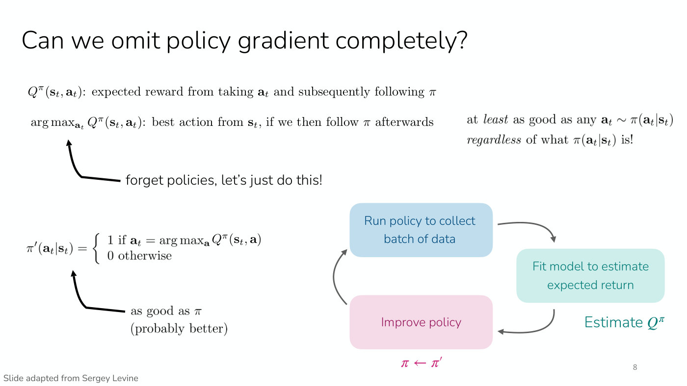

*Slide 8 — taking the action with the highest Q-value is at least as good as any action the policy would take, so the loop's improve-policy step becomes simply setting the policy to the greedy one. [Deck](https://cs224r.stanford.edu/spring_2025/slides/06_cs224r_qlearning_2025.pdf)*

**Continuous or more expressive actions** (≈14:05–15:40). This is easiest with a discrete set of
actions, like going up or going right. With continuous actions the algorithm still applies, but the
max has to be computed somehow. Gradient descent on the action is possible in principle but turns
out not to work very well. If the actions are not very high-dimensional it can be better simply to
sample a bunch of actions and pick the one with the highest Q-value, and other sampling-based
optimization algorithms iteratively sample and refine the estimate. For a discrete space such as
text, some kind of search over the options could maximize the Q-value; the captions are unclear on
the word Finn uses (≈15:40).

**Sparse rewards** (≈15:40–16:26). The example's reward was sparse and it still worked, but the
loop may have to run many times: the first pass only made the row next to the star good, and in a
bigger environment the improvement has to keep spreading. This is often called a **backup**: the
reward is backed up from the goal to the other states, and the backups have to continue for as long
as the horizon of the problem, so run many iterations.

## Policy iteration: from actor-critic to critic only

Take the off-policy actor-critic algorithm that fits a Q-function and, instead of the policy
gradient update, define a new greedy policy (slide 9, ≈16:26). The slide strikes through the old
policy-gradient steps and the title "Off-policy actor critic with replay buffer":

1. take action $\mathbf{a} \sim \pi(\mathbf{a} \mid \mathbf{s})$, get $(\mathbf{s}, \mathbf{a}, \mathbf{s}', r)$, store in the replay buffer $\mathcal{R}$
2. sample a batch $\lbrace \mathbf{s}_ i, \mathbf{a}_ i, r_i, \mathbf{s}'_ i \rbrace$ from $\mathcal{R}$
3. update $\hat{Q}^\pi_\phi$ using targets $y_i = r_i + \gamma \hat{Q}^\pi_\phi(\mathbf{s}'_ i, \mathbf{a}'_ i)$, where $\mathbf{a}'_ i \sim \pi(\cdot \mid \mathbf{s}'_ i)$
4. define the new policy $\pi(\mathbf{a}_ t \mid \mathbf{s}_ t)$ as one for $\arg\max_{\mathbf{a}} \hat{Q}_ \phi(\mathbf{s}_ t, \mathbf{a})$ and zero otherwise

The loop has two key steps (slide 10, ≈17:12). Estimating $Q^\pi$ is **policy evaluation**, since
it learns the values of a policy, and it can take multiple gradient steps, because it is not
on-policy and is only fitting targets. Defining the greedy policy is **policy improvement**. The
two-step iterative procedure is called **policy iteration**, and it is on the way to the algorithm
this lecture is building (≈17:12–18:00).

On the board, Finn writes the algorithm out (≈18:00–18:48): collect data, often from $\pi$ though
it could be from another policy; fit the estimated Q-function for that policy with the targets from
the last lecture, the reward plus $\gamma$ times the Q-value at the next state, with the state,
action and next state from the buffer and the next action sampled from the policy; and improve the
policy by defining the new one as one for the maximizing action and zero otherwise. The board is not
visible and the captions garble the target as dictated, so this follows slide 9.

**Is this policy deterministic?** Yes (≈18:48–19:34). That is one reason you might not want to
collect data from it, and a later slide takes up which policy to collect data from (slide 14).

**Why sample the next action from $\pi$, rather than averaging or maximizing over actions?**
Averaging over several samples is possible and gives a better estimate of the target (≈19:34). But
the improvement step can also go into the Q-function's target itself (≈20:19), which is the next
slide.

## Improving the policy inside the Q-function update

Instead of evaluating the old policy and then improving it, the target can take the reward plus
$\gamma$ times the max over the next action of the Q-function (slide 11, ≈20:19). The slide strikes
out the superscript $\pi$ and the sampled-action target and writes

$$y_i = r_i + \gamma \max_{\mathbf{a}'} \hat{Q}_ \phi(\mathbf{s}'_ i, \mathbf{a}')$$

labelled "Q-values for new policy!" This is what gets to Q-learning. One way to see it is that
these targets already are the Q-values of the new, greedy policy: the improvement step sits inside
the Q-function update, which therefore learns the Q-values of the policy about to be defined
(≈21:04).

## Why it works: the Bellman optimality equation

The algorithm is now **Q-learning** (slide 12):

1. take action $\mathbf{a} \sim \pi(\mathbf{a} \mid \mathbf{s})$, get $(\mathbf{s}, \mathbf{a}, \mathbf{s}', r)$, store in $\mathcal{R}$
2. sample a batch $\lbrace \mathbf{s}_ i, \mathbf{a}_ i, r_i, \mathbf{s}'_ i \rbrace$ from $\mathcal{R}$
3. update $\hat{Q}_ \phi$ using targets $y_i = r_i + \gamma \max_{\mathbf{a}'} \hat{Q}_ \phi(\mathbf{s}'_ i, \mathbf{a}')$
4. define the new policy as one for $\arg\max_{\mathbf{a}} \hat{Q}_ \phi(\mathbf{s}_ t, \mathbf{a})$ and zero otherwise

The second way to see why this makes sense starts from the recursive equation of the recap (≈21:04).
It holds for all states and actions, and for any policy, including the optimal policy $\pi^\ast$
(≈21:50). The optimal policy always takes the actions that maximize future reward, so the action it
picks is always the one that maximizes the Q-value. For the optimal policy, then, the expectation
over the next action becomes a maximization over the next action (≈21:50–22:37):

$$Q^{\pi^\ast}(\mathbf{s}, \mathbf{a}) = r(\mathbf{s}, \mathbf{a}) + \gamma \mathbb{E}_ {\mathbf{s}' \sim p(\cdot \mid \mathbf{s}, \mathbf{a})} \left[ \max_{\bar{\mathbf{a}}'} Q^{\pi^\ast}(\mathbf{s}', \bar{\mathbf{a}}') \right]$$

The Q-function is the reward at the current time step plus the sum of future rewards; that sum is an
expectation over the next state, and because the optimal policy takes the action that maximizes the
Q-value, it is the max of the Q-value at the next state (≈22:37). The max term is "the action
$\pi^\ast$ would take in state $\mathbf{s}'$" (slide 12).

Step 3 fits a Q-function to exactly this right-hand side, so when we optimize step 3, "we are trying
to make this equation hold!" (slide 12, ≈24:56–25:42): make the left side equal the right side. The
equation is an if and only if: it holds only for the optimal policy, so when it holds, the policy is
optimal (≈25:42).

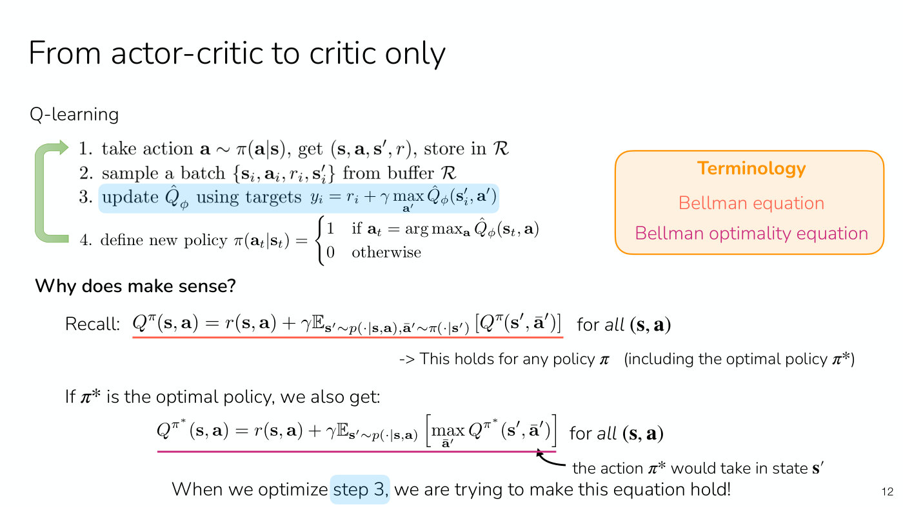

*Slide 12 — the Q-learning algorithm with its max target (blue), and the two equations it rests on, colour-matched to the terminology box: the Bellman equation (orange-red) and the Bellman optimality equation (magenta). [Deck](https://cs224r.stanford.edu/spring_2025/slides/06_cs224r_qlearning_2025.pdf)*

**Terminology** (slide 12, ≈26:29–27:15). RL has a lot of terminology, and some of it is worth
knowing for talking to people and reading papers. The first equation, for any policy, is the
**Bellman equation**, the one used for policy evaluation. The second is the **Bellman optimality
equation**, because it is specifically for the optimal policy, though people sometimes informally
call it a Bellman equation too. Equations like these can be derived for the value function $V$
instead of the Q-function, and they go by the same names (≈27:15). See
[Bellman equations](bellman-equations.md).

**Why Q and not V?** (≈23:24–24:56). The same equations can be written for $V$ in a very similar
way. What is nice about Q is that a policy comes straight out of it: if you know Q, the
$\arg\max$ over actions gives a policy better than the previous one. Knowing only
$V(\mathbf{s})$ does not say which action leads to a higher value. In principle you could look
ahead: with a sense of the dynamics, predict the next state $\mathbf{s}'$ and pick actions that lead
to a higher expected value. But the dynamics are unknown and the next state cannot necessarily be
predicted, so it is a lot harder to get a policy out of a value function, and to improve it, than
out of a Q-function.

## Does Q-learning converge?

Asked whether this converges if the Q estimates are good, Finn answers with good news and bad news
(slide 13, ≈25:42; ≈27:15–28:01). The good news: in a very simple setting, where every state and
action's Q-value can be stored in a table, as in a very small discrete state and action space, and
with sufficient exploration, the algorithm converges. The bad news: in basically any other
scenario it is not guaranteed to converge, and you can construct scenarios where it diverges even
with linear functions. The flip side is that it can be made to work very well, as the examples at
the end show. The slide prints "Yes, if you maintain a table of Q-values for every state and
action. More generally, no." and "Can construct scenarios where it diverges, even with linear Q.
*But*, it can be made to work well".

Asked what that "if" means, Finn says it is a bit vague (≈28:01–28:48). It is not about the accuracy
of the Q-values, which this process is fitting anyway. It is about the size of the state and action
space, small enough to keep the table, plus a condition on exploration: the dataset needs full
coverage of the states and actions.

## What data to collect: epsilon-greedy and Boltzmann exploration

**Q-learning is off-policy** (slide 13, slide 14, ≈28:48). The Bellman optimality equation holds
for all states and actions, so the actions in the data need not come from the current policy. It
may make sense for the data to be broader than the current policy, because the max in the target
considers many possible actions, with discrete actions perhaps all of them (≈28:48–29:34). Those
Q-values should all be accurate. An action with no data could be erroneously high, and then the
target is wrong. So rather than collect data with the current, deterministic policy, collect it with
an **exploration policy** that takes a broader set of actions. The coverage is wanted for many
actions, specifically for the max term (slide 14, ≈29:34–30:19).

**Epsilon-greedy** (slide 14, ≈30:19–31:51). Follow the policy most of the time, but with some small
probability $\epsilon$ take a completely random action:

$$\pi(\mathbf{a}_ t \mid \mathbf{s}_ t) = \begin{cases} 1 - \epsilon & \text{if } \mathbf{a}_ t = \arg\max_{\mathbf{a}_ t} Q_\phi(\mathbf{s}_ t, \mathbf{a}_ t) \cr \epsilon / (\vert \mathcal{A} \vert - 1) & \text{otherwise} \end{cases}$$

Here $\vert \mathcal{A} \vert$ is the number of actions, so the probability $\epsilon$ is spread
evenly over the actions that are not greedy. Taking actions uniformly at random gives very good
coverage of the actions the max considers. Often training starts with a larger $\epsilon$, for more
exploration at the beginning, and lowers it as the policy and the Q estimate improve (slide 14,
≈31:06). The name comes from being greedy most of the time and not greedy $\epsilon$ of the time
(≈31:51). This $\epsilon$ is an exploration probability, unrelated to PPO's clipping range of
Lecture 5.

**Boltzmann exploration** (slide 14, ≈31:51–32:37). Somewhat reasonable too, though a bit more
complicated: take actions with probability proportional to their Q-values, more often for higher
Q-values and less often for lower ones. One way is to exponentiate the Q-values so that they are all
positive and then normalize them into a probability distribution, named after the Boltzmann
distribution:

$$\pi(\mathbf{a}_ t \mid \mathbf{s}_ t) \propto \exp(Q_\phi(\mathbf{s}_ t, \mathbf{a}_ t))$$

**With continuous actions** (≈32:37–33:23), epsilon-greedy is a lot more common for discrete
actions. It still works for continuous ones given some uniform-ish distribution over them, which
needs a range, or a Gaussian with a wide standard deviation. Finn thinks the second option is a bit
more common in continuous action spaces. How to sample from it there, Finn could not remember off
the top of the head and offered to post on Ed; possibly it is done by fitting a policy.

## Full Q-learning with a replay buffer

Putting the pieces together (slide 15, ≈33:23–34:55):

1. collect data $\lbrace (\mathbf{s}_ i, \mathbf{a}_ i, \mathbf{s}'_ i, r_i) \rbrace$ using some policy, and add it to the replay buffer $\mathcal{R}$
2. sample a batch $(\mathbf{s}_ i, \mathbf{a}_ i, \mathbf{s}'_ i, r_i)$ from $\mathcal{R}$, uniformly
3. take a gradient step on the squared (L2) error between the Q-value and its target, with step size $\alpha$:

$$\phi \leftarrow \phi - \alpha \sum_i \frac{dQ_\phi}{d\phi}(\mathbf{s}_ i, \mathbf{a}_ i) \left( Q_\phi(\mathbf{s}_ i, \mathbf{a}_ i) - \left[ r(\mathbf{s}_ i, \mathbf{a}_ i) + \gamma \max_{\mathbf{a}'} Q_\phi(\mathbf{s}'_ i, \mathbf{a}') \right] \right)$$

The bracket is the inside of the L2 loss, and the chain rule gives the derivative of the Q-network
that backpropagates into its parameters (≈34:09). Sampling a batch separately from what was just
collected decorrelates the data and samples it i.i.d. from the buffer (≈34:09). Steps 2 and 3 repeat
$K$ times per round of collection: "K = 1 is common, though larger K more efficient", since more
gradient steps per batch of data are more data-efficient (slide 15, ≈34:55). Then collect more data
and repeat. The result is $Q_\phi$, and the final policy to deploy takes the actions that maximize
it (slide 15, ≈38:00–38:45).

Visually (slide 15, ≈36:27): initialize the replay buffer as empty, run an exploration policy such
as epsilon-greedy in the environment, put the resulting transitions into the buffer, and update the
Q-function on the buffer's data.

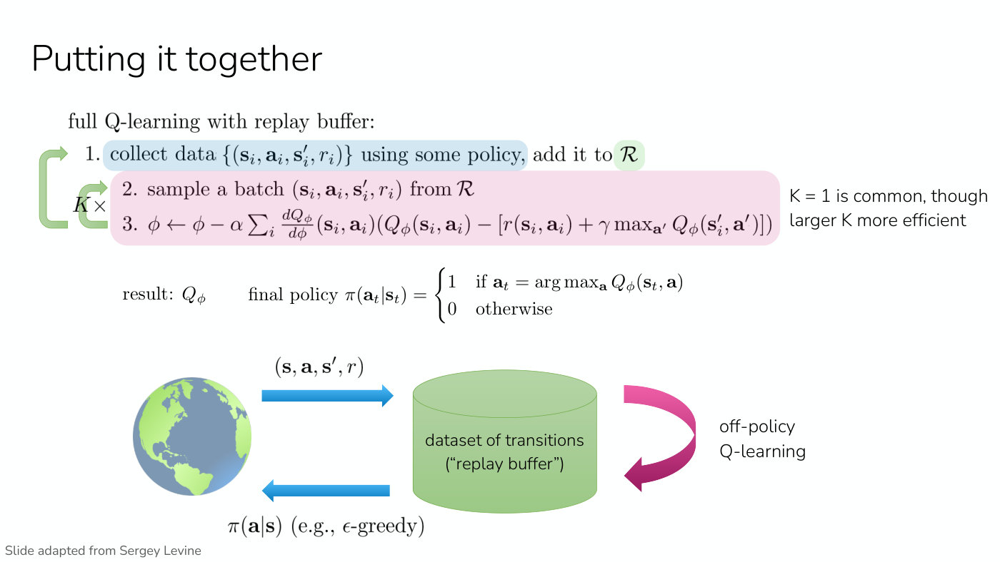

*Slide 15 — the full algorithm: an exploration policy such as epsilon-greedy fills the replay buffer from the world, and off-policy Q-learning samples batches from it, with K gradient steps per round of collection. [Deck](https://cs224r.stanford.edu/spring_2025/slides/06_cs224r_qlearning_2025.pdf)*

The questions on this slide were mostly about the data:

- **Isn't data from an exploration policy worse than data from the current policy?** It is
  collected to learn a more accurate Q-function, which helps learn a better policy later: less
  optimal data now in exchange for better results later (≈34:55–35:40). Finn's example is an RL
  agent helping a particular person pick restaurants. Before it has explored many restaurants it
  should try things, even ones that might be suboptimal, to estimate what a good restaurant is for
  that person; once it has a good Q-function it can explore less (≈35:40–36:27).
- **Is it still off-policy if the exploration policy is close to the current one?** It is called
  off-policy because the updates use a replay buffer of essentially all past experience. Some of the
  buffer's data comes from the current policy; off-policy means the method uses data from other
  policies too, not only that data (≈36:27–37:14).
- **What is "some policy" in practice?** Epsilon-greedy or Boltzmann exploration, as on slide 14,
  possibly with $\epsilon$ changing during training (≈37:14–38:00).
- **Is the Q-network reset each iteration?** Usually not: the old parameters are kept and
  warm-started, with training continuing on top of them (≈38:00).
- **A replay buffer of size one.** Finn first answers that a tiny buffer is fully on-policy, then
  agrees with the student that it is still off-policy whenever the collecting policy differs from
  the current one, as an exploration policy does (≈38:45).
- **Managing the buffer.** This is an important consideration (≈38:45–40:18). Usually old data is
  discarded, first in, first out: pick a fixed size, which for Q-learning is often pretty large, and
  once it is full discard the oldest data first. At the very start the buffer is small, so the
  first iteration sometimes collects more data to pre-populate it. Asynchronous algorithms, not
  covered here, collect data and update the network in separate threads because both take time;
  there it matters especially how the buffer is managed, so that one data point does not get a
  thousand gradient steps while another gets one. See
  [replay buffers](replay-buffers.md).

## Trick 1: a target network, and DQN

Run with neural networks, Q-learning can be unstable (slide 16, slide 17, ≈40:18–41:03). One reason
is the **moving target**: the max of the Q-function in the target changes whenever the parameters
do, so the optimization is very non-stationary, especially with $K = 1$. The slide's brace under the
target reads "this is a moving target" and "can lead to unstable optimization". The trick is to slow
down how often the target changes (slide 17): "freeze parameters used for the target Q-values,
update periodically", for example only once every 100 gradient steps (≈41:03).

So save a separate copy of the Q-function's parameters, $\phi'$, and use those frozen parameters
only in the target (slide 18, ≈41:53). Inside the inner loop the labels then do not change, and the
loop is essentially supervised learning, with some data being added to the replay buffer, which is
generally much more stable. Only periodically are the target network's parameters set to the
latest Q-function's (≈42:38):

0. save target network parameters: $\phi' \leftarrow \phi$
1. collect data $\lbrace (\mathbf{s}_ i, \mathbf{a}_ i, \mathbf{s}'_ i, r_i) \rbrace$ using some policy, add it to $\mathcal{R}$
2. sample a batch $(\mathbf{s}_ i, \mathbf{a}_ i, \mathbf{s}'_ i, r_i)$ from $\mathcal{R}$
3. $\phi \leftarrow \phi - \alpha \sum_i \frac{dQ_\phi}{d\phi}(\mathbf{s}_ i, \mathbf{a}_ i) \left( Q_\phi(\mathbf{s}_ i, \mathbf{a}_ i) - \left[ r(\mathbf{s}_ i, \mathbf{a}_ i) + \gamma \max_{\mathbf{a}'} Q_{\phi'}(\mathbf{s}'_ i, \mathbf{a}') \right] \right)$

Steps 2–3 repeat $K$ times, steps 1–3 repeat $N$ times, and then the loop returns to step 0. The
slide labels the inner loop "doing supervised learning" and the bracketed target "labels don't change
in inner loop".

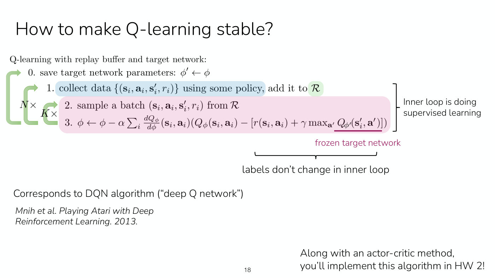

*Slide 18 — DQN: the target uses frozen parameters phi prime, saved in step 0 and refreshed every outer loop, so the inner loops are supervised learning on labels that do not change. [Deck](https://cs224r.stanford.edu/spring_2025/slides/06_cs224r_qlearning_2025.pdf)*

With a target network this is the **DQN** algorithm, "deep Q network" (slide 18, ≈42:38). It was
introduced in 2013 (Mnih et al., Playing Atari with Deep Reinforcement Learning, slide 18), and in
Finn's opinion it was basically the first deep RL method. It trained neural networks to play a
variety of Atari games directly from the game's pixel observations, one of the first examples of RL
training neural networks for a fairly complicated task, where earlier RL examples were in toy or
very low-dimensional settings (≈42:38–43:25). Students implement it in homework 2, alongside an
actor-critic method (slide 18, ≈43:25–44:11).

**Why not store a table of target Q-values instead of a copy of the parameters?** Because the loop
keeps collecting new data, and the target Q-values for new data have to be computed, which needs the
parameters (≈43:25).

## Are the Q-values accurate?

Two more things make Q-learning work a lot better, and the first starts from how accurate the
Q-values are (slide 19, ≈44:11). On the games Breakout and Seaquest, the average reward goes up over
training, and so does the average predicted Q-value, as expected, since the Q-value represents the
average reward: "As predicted Q increases, so does the return". On Breakout the average Q rises from
0 to nearly 4 over 100 training epochs, and on Seaquest to about 8.8 (slide 19).

A practical tip (≈44:57): the loss on the Q-values often goes *up* during training, which can be
alarming. The reason is that newly collected data has higher Q-values, so the scale of the loss
grows; at the very beginning the loss can be very easy to get low (the captions garble the reward
described there). A rising loss is not cause for alarm, and sometimes it means that the policy is
starting to improve; the captions cut off the end of that sentence.

The values also look sensible when visualized (slide 19, ≈45:42). In the paddle game in the lower
right of the slide, the action values are fairly uniform in the first frame. In frames where the
agent really has to move up, the Q-value of up is higher than those of down or no-op. In the last
frame the ball is on the opponent's side, so the choice does not matter much and the Q-values are
more uniform.

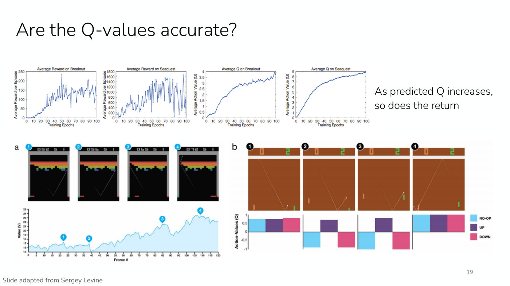

*Slide 19 — on Breakout and Seaquest the average reward and the average predicted Q rise together; below, the predicted value along a Breakout episode, and action values in a paddle game where only moving up is good in frames 2 and 3. [Deck](https://cs224r.stanford.edu/spring_2025/slides/06_cs224r_qlearning_2025.pdf)*

But comparing against the true returns tells a different story (slide 20, ≈46:28). Each panel draws
the true return of the learned policy as a horizontal line and the Q-network's estimate as a curve,
and the estimate sits far above the true value. This is **overestimation**: the Q-function
overestimates how good the policy is. An algorithm called **double DQN** gets much more accurate
values and overestimates far less. On Alien, DQN's estimate peaks near 20 and settles around 14–15
against a true value of about 8.8, while double DQN's estimate stays near 11 against about 10. On
Zaxxon, DQN's estimate climbs to about 7.5 against a true value under 1; double DQN's reaches about
3 against about 1.2 (slide 20).

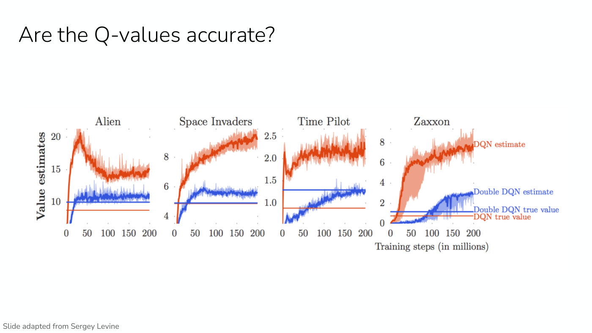

*Slide 20 — on four Atari games, DQN's value estimates (orange) sit far above the true value of its policy (red line), while double DQN's estimates (blue) lie much closer to theirs (blue line). [Deck](https://cs224r.stanford.edu/spring_2025/slides/06_cs224r_qlearning_2025.pdf)*

## Trick 2: double Q-learning

The target takes a max over actions (slide 21, ≈47:16–48:03):

$$y_j = r_j + \gamma \max_{\mathbf{a}'_ j} Q_{\phi'}(\mathbf{s}'_ j, \mathbf{a}'_ j)$$

Here $j$ indexes the samples in the batch. The max chooses the action that maximizes the
Q-value, and equivalently it is the Q-function evaluated at the maximizing action:

$$\max_{\mathbf{a}'} Q_{\phi'}(\mathbf{s}', \mathbf{a}') = Q_{\phi'}\left(\mathbf{s}', \arg\max_{\mathbf{a}'} Q_{\phi'}(\mathbf{s}', \mathbf{a}')\right)$$

The same Q-function both selects the action and evaluates it (≈48:03). Neural networks are not
perfect and generally have some noise in them, and when one network does both jobs it is easy to
pick actions whose Q-values are high only because of that noise. So "this last term is the
problem": the max *overestimates* the next value (slide 21, ≈48:03–48:49). If a different
Q-function picked the action from the one that evaluates it, the noise would be decorrelated, since
different Q-functions naturally have different noise and errors (≈48:49–49:35).

So **double Q-learning** uses two networks, network A to pick the actions and network B to
evaluate them; if they are noisy in different ways, the target stops exploiting the noise and stops
overestimating (slide 22, ≈49:35–50:22):

$$Q_{\phi_A}(\mathbf{s}, \mathbf{a}) \leftarrow r + \gamma Q_{\phi_B}\left(\mathbf{s}', \arg\max_{\mathbf{a}'} Q_{\phi_A}(\mathbf{s}', \mathbf{a}')\right)$$

$$Q_{\phi_B}(\mathbf{s}, \mathbf{a}) \leftarrow r + \gamma Q_{\phi_A}\left(\mathbf{s}', \arg\max_{\mathbf{a}'} Q_{\phi_B}(\mathbf{s}', \mathbf{a}')\right)$$

In practice the two Q-functions are already there: the current network and the target network
(slide 23, ≈51:55–52:42). Use the current network $Q_\phi$ to pick the action and the target network
$Q_{\phi'}$ to evaluate it:

$$\text{standard Q-learning:} \quad y = r + \gamma Q_{\phi'}\left(\mathbf{s}', \arg\max_{\mathbf{a}'} Q_{\phi'}(\mathbf{s}', \mathbf{a}')\right)$$

$$\text{double Q-learning:} \quad y = r + \gamma Q_{\phi'}\left(\mathbf{s}', \arg\max_{\mathbf{a}'} Q_\phi(\mathbf{s}', \mathbf{a}')\right)$$

The slide circles the one change, the $\phi$ of the network that selects the action, and adds "still
use target network to evaluate value!"

Students asked three questions:

- **Can you guarantee the two networks have different noise?** No, and some noise may come from the
  network's architecture. But in practice using different networks generally does a very good job.
  Some overestimation remains, visible on slide 20, but it helps substantially (≈50:22–51:08).
- **What about triple or quadruple DQN?** More samples of the noise could help if the noise really
  is decorrelated, and it could be interesting to try; if the noise comes from something held
  constant, such as the architecture, it might not (≈51:08). The captions leave unclear whether Finn
  then says that using more than two networks is, or is not, very impactful in practice.
- **Why does it help when the target network is just an earlier copy with the same noise?** The
  target network is outdated, and the current network has had many gradient updates since, and seen
  new data. The noise is not only about initialization; it also depends on which gradient updates
  were applied (≈52:42). The captions are garbled at two words of this answer.

## Trick 3: n-step returns

The last trick, already seen for actor-critic methods, is the n-step return (slide 24, ≈52:42). The
Q-learning target is

$$y_{j,t} = r_{j,t} + \gamma \max_{\mathbf{a}_ {j,t+1}} Q_{\phi'}(\mathbf{s}_ {j,t+1}, \mathbf{a}_ {j,t+1})$$

If the Q-values are good, the max term plays most of the role in the update. If the Q-function is
bad, as at the beginning of training, the reward is the only value that matters (slide 24's two
arrows), and a single reward may not say much about how good the action was (≈53:28).

Recall the targets for fitting value functions (slide 24, ≈53:28–54:16; see
[policy evaluation](policy-evaluation.md)). Monte Carlo uses the sum of rewards; bootstrapping uses
the reward at the current step plus $V$ at the next; and in between, sum the rewards over the next
$n$ steps and then use the value at the step after that. That has less variance than Monte Carlo
and lower bias than one-step bootstrapping, lower bias in the sense that when the value estimates
are bad, the rewards are more accurate.

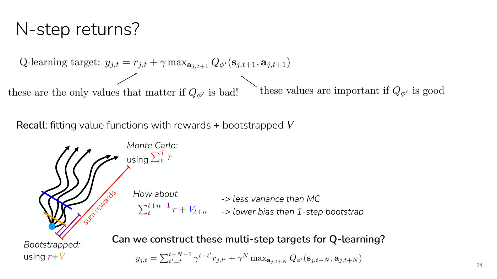

*Slide 24 — the Q-learning target leans on the reward when the Q-network is bad; the trajectory fan recalls Monte Carlo, bootstrapped and n-step targets for value functions, and the n-step Q-learning target is at the bottom. [Deck](https://cs224r.stanford.edu/spring_2025/slides/06_cs224r_qlearning_2025.pdf)*

For Q-values (≈54:16–55:02): the target is the reward at the current step plus the reward at the
next step and so on up to the reward at step $t + n - 1$, and then the max of the Q-value at state
$\mathbf{s}_ {t+n}$, maximized over the action there. Slides 24 and 25 print it as

$$y_{j,t} = \sum_{t'=t}^{t+N-1} \gamma^{t-t'} r_{j,t'} + \gamma^N \max_{\mathbf{a}_ {j,t+N}} Q_{\phi'}(\mathbf{s}_ {j,t+N}, \mathbf{a}_ {j,t+N})$$

The printed discount exponent $t - t'$ is negative for every reward after the first. Lecture 5's
slides 12–13, which discount a reward $t' - t$ steps ahead, write $\gamma^{t'-t}$, so the sum is
presumably meant as $\sum_{t'=t}^{t+N-1} \gamma^{t'-t} r_{j,t'}$. The lecture reads the target aloud
without discounts and does not comment on it.

**What is wrong with this target?** A student answers, and Finn restates (slide 25, ≈55:47–56:33).
Off-policy, the rewards in the sum come from whatever policy collected the data in the buffer, not
from the optimal policy whose Q-function is being estimated: "these are the rewards for policy that
collected the data". So there are pros and cons. The slide's pros are "(far) less biased target
values when Q-values are inaccurate" and "typically faster learning, especially early on"; the
captions have Finn saying "a lot more biased" at this point, which the slide contradicts. The con is
that the target is "only actually correct when learning on-policy". This is not an issue with
$N = 1$, because the single reward depends only on the state and action whose Q-value is being
estimated (≈56:33).

**Ways to fix it** (slide 25, ≈56:33–57:19). The unsatisfying answer is that most commonly people
ignore the problem and still use $N \gt 1$, and n-step returns very often improve the algorithm's
performance despite being incorrect. There are alternatives. One is to choose $N$ dynamically so
that only data following the current policy is used, by checking whether the actions taken agree
with the maximum Q-value; that is only worth doing when the action space is small and the data
mostly on-policy. Spoken but not printed, $N$ could also shrink later in training, when the Q-values
are likely to be more accurate. Another is importance sampling, weighting the rewards by importance
weights (see [importance sampling](importance-sampling.md)).

## Q-learning in practice: Atari and robot grasping

Finn calls these the three tricks for Q-learning in practice, and shows two of its successes
(slide 26, ≈57:19–58:05).

**Atari** (Mnih et al. 2015). For games, whether to see how well an agent can do or to play against
humans, Q-learning outperformed most people on Atari games (≈58:05). The slide's bar chart gives
DQN's score on 49 games as a percentage, from Video Pinball (2539%), Boxing (1707%) and Breakout
(1327%) at the top down to Montezuma's Revenge (0%), with a grey bar for the best linear learner
behind each blue DQN bar. Everything above the horizontal line is at human level or above, and
everything below it is worse than human level. The line separates 29 games from 20, and sits
between H.E.R.O. (76%) and Asterix (69%); the slide does not state the threshold it marks.

**Robot grasping** (Kalashnikov et al. 2018). Q-learning also trained a robot grasping system, a
case with continuous actions: the robot uses a Q-function trained with Q-learning and runs a
continuous optimization over actions to find a good way to grasp (≈58:05–58:55). As Lecture 5
noted, RL can give much higher success rates and more reliable policies, and this system reached a
96% success rate. The slide's table compares QT-Opt with 580k off-policy plus 28k on-policy grasps
(96% test success), with 580k off-policy grasps only (87%), and Levine et al. with 900k grasps
(78%) and with 400k grasps from QT-Opt's dataset (67%). Grasping sometimes needs more than going
down and picking something up: the robot has to move the object around first, and RL learns that as
well (≈58:55–59:41).

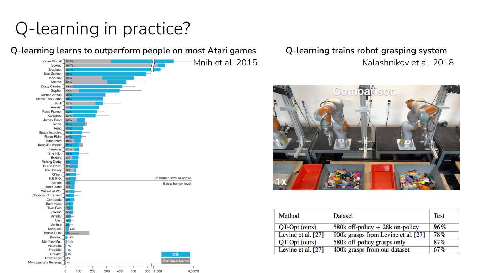

*Slide 26 — DQN's score per Atari game as a percentage, with a line separating the games at human level or above from those below, and QT-Opt's robot grasping with its 96% test success. [Deck](https://cs224r.stanford.edu/spring_2025/slides/06_cs224r_qlearning_2025.pdf)*

## Which online RL algorithm to use

This is the last online RL method of the course for now, so Finn closes with advice on choosing
among the three main practical algorithms covered, PPO, SAC and DQN (slide 27, "Chelsea's advice",
≈59:41–1:00:27):

| Method | When to use it |
| --- | --- |
| PPO and variants | You care about stability and ease of use, and not about data efficiency. It generally needs little tuning but is very data-inefficient. |
| DQN and variants | You have discrete actions or low-dimensional continuous actions. It can be fairly data-efficient, depending on some of the details. |
| SAC and variants | You care most about data efficiency, and are fine with tuning hyperparameters and less stability. |

See [PPO](ppo.md), [replay buffers and soft actor-critic](replay-buffers.md) and
[RL algorithm families](rl-algorithm-families.md).

## Summary

The lecture covered Q-learning, Q-learning in practice with its three tricks (target networks,
double DQN and n-step returns), and the Bellman equation and Bellman optimality equation; together,
an overview of how to do RL without learning an explicit policy (slide 28, ≈1:00:27–1:01:12). That
finishes the course's online RL algorithms for now (slide 29, ≈1:01:12).

## Not in the recording: reminders and next time

The recording begins on the recap and ends on slide 29's first line, so these are known only from
the [slide file](../raw/slides/06-q-learning.md). Slide 2's reminders, repeated on slide 29: Homework
1 is due and Homework 2 is out that day; the course is sending out 100 dollars of AWS credits and a
form for GPU quota, "Very important" "if you want GPUs, especially for default project"; and there is
an extra Q-learning section from 1:30 to 2:30 pm. Slide 29 announces the next week: offline RL
("can we learn behavior from existing datasets?"), and reward learning with the start of RL for
LLMs. Offline RL is [Lecture 7](07-offline-rl.md).

## Related pages

- [Q-learning](q-learning.md): the algorithm as a whole, from the greedy policy to DQN and its
  three tricks.
- [Bellman equations](bellman-equations.md): the Bellman equation for any policy and the Bellman
  optimality equation, and how each is used.
- [Value functions](value-functions.md): $V^\pi$, $Q^\pi$, $A^\pi$, and why a policy comes out of Q
  but not out of V.
- [Policy evaluation](policy-evaluation.md): Monte Carlo, bootstrapping and n-step targets, and
  policy evaluation as half of policy iteration.
- [Replay buffers and soft actor-critic](replay-buffers.md): the buffer Q-learning samples from, and
  how it is managed.
- [Policies](policies.md): deterministic greedy policies, epsilon-greedy and Boltzmann exploration.
- [Offline and online algorithms](offline-and-online.md): why Q-learning is off-policy.
- [RL algorithm families](rl-algorithm-families.md): value-based methods among the course's
  algorithms, and when to use which.
- [Lecture 5 — Off-Policy Actor Critic](05-off-policy-actor-critic.md): the off-policy actor-critic
  algorithm this lecture starts from.
- [Lecture 7 — Offline RL](07-offline-rl.md): the next lecture, which runs off-policy methods on a fixed
  dataset and shows why that fails.
- [Exploration](exploration.md): exploration as a topic, from this lecture's epsilon-greedy to Lecture 14's
  bandit strategies and learned exploration.
