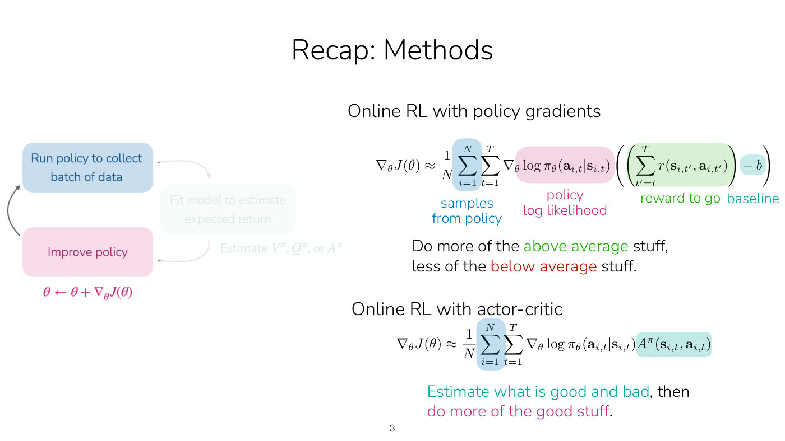
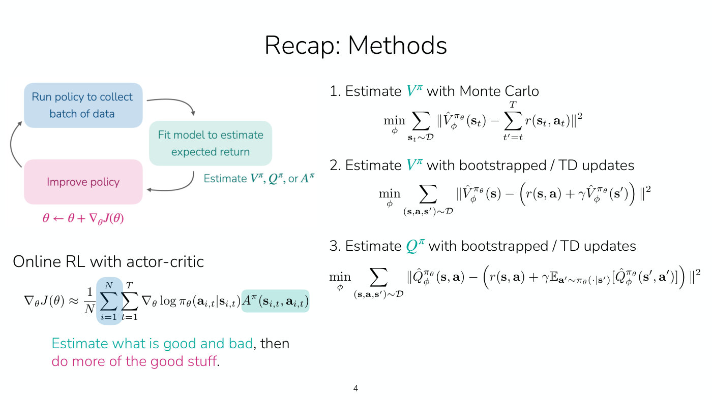
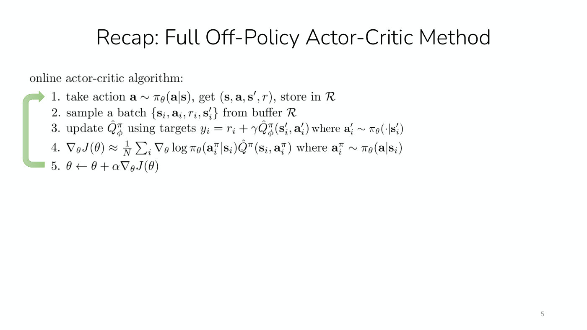
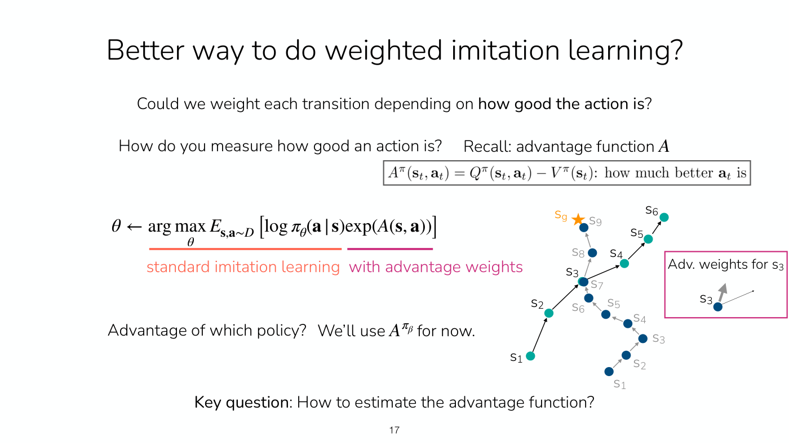
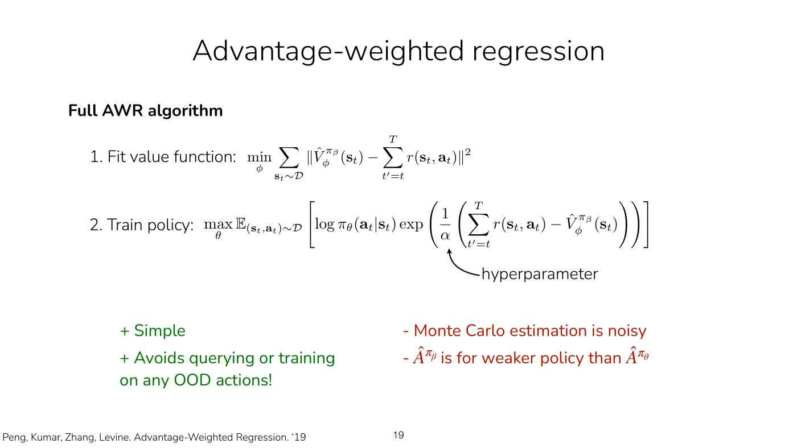
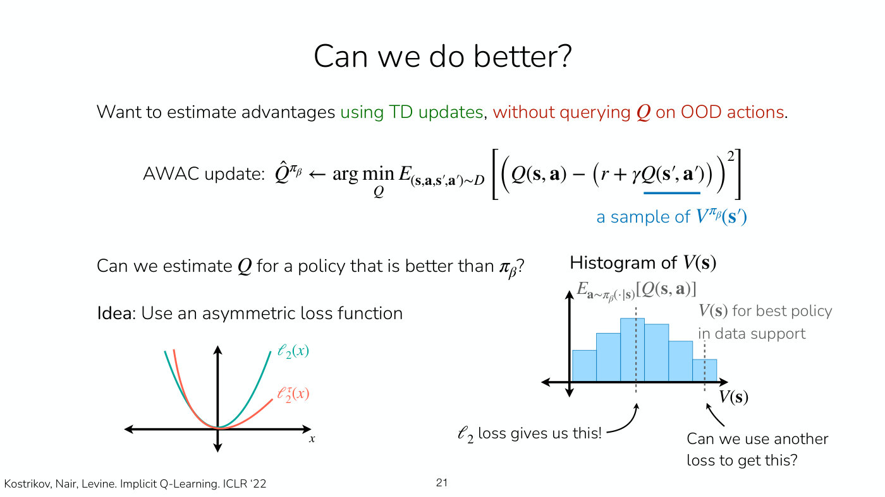
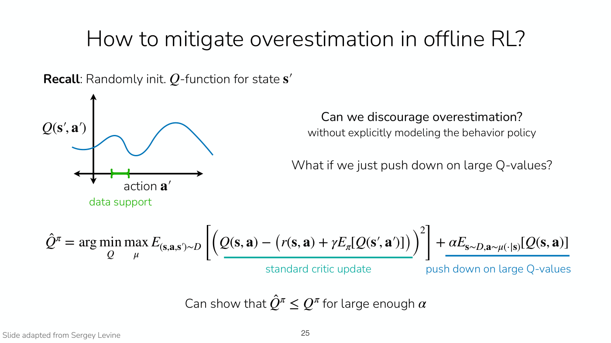
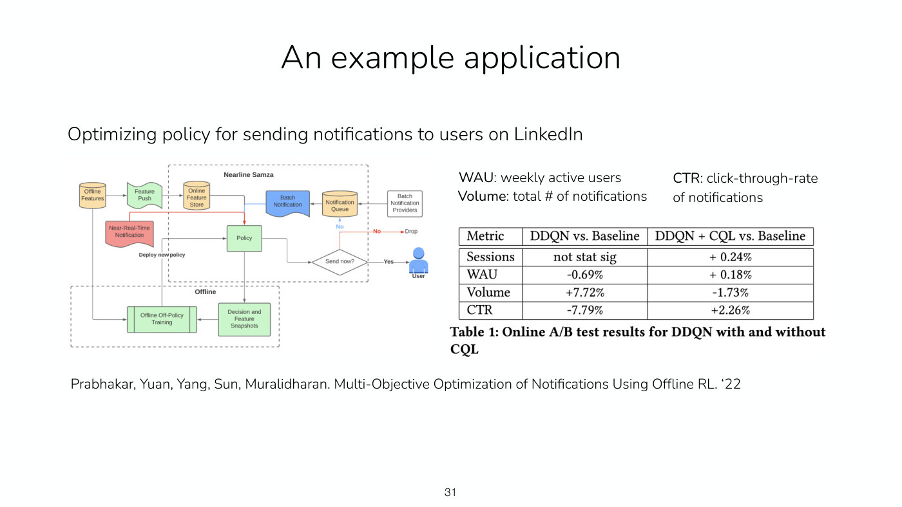

# Lecture 7 — Offline RL

Stanford CS224R, Spring 2025 (Wednesday, April 23) ·
[video](https://www.youtube.com/watch?v=lRDaXnPIzks) (68 min) ·
[slides (PDF)](https://cs224r.stanford.edu/spring_2025/slides/07_cs224r_offline_rl_2025.pdf) ·
[slide-by-slide text](../raw/slides/07-offline-rl.md) ·
[transcript](../raw/transcripts/07-offline-rl.md)

**What this lecture establishes.** Offline reinforcement learning trains a policy on a dataset
that was given in advance, collected by some unknown **behavior policy** $\pi_\beta$, with no
chance to collect more. The obvious approach, running an off-policy algorithm such as soft
actor-critic on the fixed data, fails. Its critic is evaluated on actions the data never contains,
the policy seeks out the ones the critic happens to overrate, and the Q-values become badly
**overestimated**. Mitigating that overestimation is the core goal of every offline RL method.
Imitation learning avoids the problem, because it only supervises on actions in the data, but it
cannot beat the data. Offline RL can, by using rewards and by **stitching** together good parts of
different trajectories. The lecture builds a family of **implicit policy constraint** methods that
keep imitation's safety and add reward information. **Filtered behavior cloning** imitates only the
best trajectories. **Advantage-weighted regression (AWR)** weights imitation by exponentiated
Monte Carlo advantages. **Advantage-weighted actor-critic (AWAC)** fits a Q-function by
bootstrapping, using only actions from the data. **Implicit Q-learning (IQL)** fits the value
function with an asymmetric **expectile** loss, so it estimates the value of a policy better than
the behavior policy without ever querying an action outside the data.

Slide numbers below are the numbers printed on the slides, which equal the PDF page numbers
(slide 28 prints none). Timestamps (≈M:SS) point into the video and the
[transcript](../raw/transcripts/07-offline-rl.md). **The recording covers slides 3–23 and 30–32.**
It opens on the recap without discussing slide 2's reminders. **It does not teach the deck's third
part, conservative methods (slides 24–28)**, which is conservative Q-learning (CQL). After implicit
Q-learning it goes straight to the summary (≈1:05:55), and it passes over slide 31's application as
one "for the algorithm we didn't cover" (≈1:06:42). It ends at about 1:07:51 on slide 32's pointer to
IDQL. The [last section](#not-in-the-recording-conservative-q-learning-and-the-closing-slides) gives
CQL, the application and the closing slides from the [slide file](../raw/slides/07-offline-rl.md)
alone.

Much of the lecture is worked live, with Finn writing and drawing while talking: the recap's
targets, the formal setting, a randomly initialized Q-function over a car's actions, the stitching
example, the filtered and advantage-weighted objectives, AWR's advantage estimates, and the
histogram and asymmetric loss behind expectile regression. This page has that work only as the
transcript describes it. Where the transcript says "this" or "right here", the page reconstructs
what was meant from the surrounding words and the slides, and says so.

## Contents

1. [Recap: three ways to fit a value function](#recap-three-ways-to-fit-a-value-function)
2. [Plan: offline RL](#plan-offline-rl)
3. [Why offline RL?](#why-offline-rl)
4. [The formal setting: a behavior policy and distribution shift](#the-formal-setting-a-behavior-policy-and-distribution-shift)
5. [Can we just use off-policy algorithms?](#can-we-just-use-off-policy-algorithms)
6. [Offline RL versus imitation learning: stitching](#offline-rl-versus-imitation-learning-stitching)
7. [Filtered behavior cloning](#filtered-behavior-cloning)
8. [Weighting imitation by the advantage](#weighting-imitation-by-the-advantage)
9. [Advantage-weighted regression (AWR)](#advantage-weighted-regression-awr)
10. [Advantage-weighted actor-critic (AWAC)](#advantage-weighted-actor-critic-awac)
11. [Estimating a better policy's value: expectile regression](#estimating-a-better-policys-value-expectile-regression)
12. [Implicit Q-learning (IQL)](#implicit-q-learning-iql)
13. [Summary](#summary)
14. [Which offline RL algorithm to use](#which-offline-rl-algorithm-to-use)
15. [Not in the recording: conservative Q-learning and the closing slides](#not-in-the-recording-conservative-q-learning-and-the-closing-slides)

## Recap: three ways to fit a value function

The lecture opens by recalling the online methods (slides 3–4, ≈0:05–0:51). Policy gradients
collect data from the policy and raise the likelihood of actions that led to above-average
outcomes. A [value function](value-functions.md) then lets the algorithm estimate how good an
action is and do more of what it estimated to be good, which is the actor-critic approach of PPO
and SAC.

*Slide 3 — the policy gradient with its parts labelled (samples from the policy, log-likelihood, reward to go, baseline) beside the actor-critic gradient, where the advantage takes the place of the reward to go and baseline. [Deck](https://cs224r.stanford.edu/spring_2025/slides/07_cs224r_offline_rl_2025.pdf)*

Finn reviews the ways of fitting a value function because they "play a pretty important
role in today's lecture" (≈0:51). With $\mathcal{D}$ the dataset, $\hat{V}^{\pi_\theta}_ \phi$ a
value network with parameters $\phi$ for the policy $\pi_\theta$, $r$ the reward, $T$ the horizon
and $\gamma$ the discount (slide 4), the three are as follows.

1. **Monte Carlo.** Regress the value of a state onto the sum of rewards from that state onward
   (≈1:38).

$$\min_\phi \sum_{\mathbf{s}_ t \sim \mathcal{D}} \left\Vert \hat{V}^{\pi_\theta}_ \phi(\mathbf{s}_ t) - \sum_{t'=t}^{T} r(\mathbf{s}_ {t'}, \mathbf{a}_ {t'}) \right\Vert^2$$

   The slide prints the reward inside the sum as $r(\mathbf{s}_ t, \mathbf{a}_ t)$, with the index
   $t'$ unused, and so do slides 18 and 19. The sum of rewards from time $t$ onward, as the lecture
   describes it, is the form written here.

2. **Bootstrapping, or temporal difference (TD) updates.** Use the reward at the current step plus
   the estimated value at the next state $\mathbf{s}'$ as the target (≈2:26–3:59).

$$\min_\phi \sum_{(\mathbf{s}, \mathbf{a}, \mathbf{s}') \sim \mathcal{D}} \left\Vert \hat{V}^{\pi_\theta}_ \phi(\mathbf{s}) - \left( r(\mathbf{s}, \mathbf{a}) + \gamma \hat{V}^{\pi_\theta}_ \phi(\mathbf{s}') \right) \right\Vert^2$$

3. **A Q-function, bootstrapped with the current policy's next action.** The first two are
   on-policy: the data must come from the policy being evaluated. To use data from a mixture of old
   policies, the course fitted a Q-function $\hat{Q}^{\pi_\theta}_ \phi(\mathbf{s}, \mathbf{a})$.
   Its target takes $\mathbf{s}$, $\mathbf{a}$ and $\mathbf{s}'$ from the dataset but samples the
   next action $\mathbf{a}'$ from the policy being learned (≈4:45–5:31).

$$\min_\phi \sum_{(\mathbf{s}, \mathbf{a}, \mathbf{s}') \sim \mathcal{D}} \left\Vert \hat{Q}^{\pi_\theta}_ \phi(\mathbf{s}, \mathbf{a}) - \left( r(\mathbf{s}, \mathbf{a}) + \gamma \mathbb{E}_ {\mathbf{a}' \sim \pi_\theta(\cdot \mid \mathbf{s}')} \left[ \hat{Q}^{\pi_\theta}_ \phi(\mathbf{s}', \mathbf{a}') \right] \right) \right\Vert^2$$

*Slide 4 — the online loop with its fit-a-model step, and the three regressions: Monte Carlo and bootstrapped targets for V, and the bootstrapped Q target whose next action comes from the current policy. [Deck](https://cs224r.stanford.edu/spring_2025/slides/07_cs224r_offline_rl_2025.pdf)*

The third target is the one that can use old data, and it carries a requirement Finn singles out.
Because the label is the Q-function's own estimate at the next state and action, the Q-function must
have been trained on actions resembling the ones it is evaluated on. If the policy is very different
from the old policies, the label is not accurate and the Q-function cannot be learned: it "needs good
coverage over actions" (≈6:17–7:02). The full off-policy actor-critic method stores data from the
policy in a buffer $\mathcal{R}$, samples a batch, updates the Q-function with these targets, and
raises the policy's likelihood of actions with high Q-values (slide 5, ≈7:02); see
[replay buffers and soft actor-critic](replay-buffers.md).

*Slide 5 — the five-step off-policy actor-critic loop: act and store, sample a batch, update the Q-function with the current policy's next actions, take a policy-gradient step on the policy's own actions, repeat. [Deck](https://cs224r.stanford.edu/spring_2025/slides/07_cs224r_offline_rl_2025.pdf)*

*[Student question, inaudible]* A student asks whether this is Q-learning (≈7:49). It is not: this
is the soft actor-critic setting of two lectures earlier, which learns the Q-function of the policy
being learned. [Q-learning](q-learning.md) learns the Q-function of the optimal policy. Instead of
sampling the next action from a policy, its target takes the best action under the Q-function, the
reward plus $\gamma$ times a max over the next action. That can also be done off-policy, without data
from the optimal policy, "as long as your estimates have good coverage" (≈8:35–9:21).

## Plan: offline RL

Offline RL means learning from a dataset that was given, not collected by the agent's own policy
(≈7:02–7:49). The plan has three parts (slide 6): why offline RL, and whether off-policy methods can
simply be run on the data; implicit policy constraint methods; and conservative methods. A brace on
the last two reads "Part of homework 3!". The slide's learning goals are the key challenges in
offline RL, two approaches and why they work, and how offline RL can improve over imitation
learning. The recording teaches the first two parts; the third is covered
[at the end of this page](#not-in-the-recording-conservative-q-learning-and-the-closing-slides) from
the slides.

## Why offline RL?

Online RL, on-policy or off-policy, collects data, updates the policy on the latest data or on all
data so far, and repeats (slide 7, ≈9:21). Offline RL is given a static dataset in advance and trains
a policy on it, without collecting data iteratively (≈10:06). The slide lists when that is more
useful.

- **Existing data, and risky collection.** A dataset may already exist, collected by people or an
  existing system, while running the current policy would be risky or unsafe. Finn's examples are
  driving, where there is plenty of data of people driving and deploying a poor driving policy would
  be unsafe, and medicine, including a project on seizure prevention, where a policy can be learned
  from an existing system's data without running a policy that is not yet good (≈10:06–11:39).
- **Reuse.** Rerunning an online algorithm means recollecting its data every time, which is
  inefficient when the algorithm itself is still being iterated on, for example a robot learning to
  grasp. "Online data is more expensive than offline data", because offline data can be reused many
  times (≈11:39–12:27). The slide's examples of reusable data are previous experiments, projects,
  robots and institutions.

Offline and online RL can also be blended: train on existing data, such as human driving, then
improve the policy with online collection once it is fairly good, perhaps with a safety driver. Many
real-world uses want this, so that a deployed policy keeps improving (slide 7's note, ≈12:27).

*[Student question, inaudible]* Is offline RL a special case of off-policy online RL, where the
data's source is unknown (≈12:27–13:13)? That is "sort of a correct way to view it", Finn says, with
one strict difference: pure offline RL has no ability to collect more data, which online off-policy RL
has. Algorithmically, though, offline methods draw on off-policy techniques, because those already use
data from old policies. See [offline and online algorithms](offline-and-online.md).

## The formal setting: a behavior policy and distribution shift

Finn sketches a driving dataset: trajectories of people driving in many ways, places and cars
(≈13:13–14:49). Formally (slide 8), the offline dataset is

$$\mathcal{D} = \lbrace (\mathbf{s}, \mathbf{a}, \mathbf{s}', r) \rbrace$$

sampled from some unknown policy $\pi_\beta$, the **behavior policy**. States come from that policy's
state distribution, actions from the policy, next states from the dynamics, and rewards from the
reward function:

$$\mathbf{s} \sim p_{\pi_\beta}(\cdot), \qquad \mathbf{a} \sim \pi_\beta(\cdot \mid \mathbf{s}), \qquad \mathbf{s}' \sim p(\cdot \mid \mathbf{s}, \mathbf{a}), \qquad r = r(\mathbf{s}, \mathbf{a})$$

The behavior policy is not known. If people collected the data, they are many policies, and none is
directly accessible, but it is useful mathematically to think of one (≈14:49). Several collecting
policies make $\pi_\beta$ a mixture, an average or weighted sum of the constituent policies, so
nothing is lost by speaking of a single policy (slide 8, ≈14:49–15:35).

The goal is a policy $\pi_\theta$ that maximizes the expected sum of rewards (≈16:23–17:11):

$$\max_\theta \mathbb{E}_ {p_\theta(\tau)} \left[ \sum_t r(\mathbf{s}_ t, \mathbf{a}_ t) \right]$$

where $p_\theta(\tau)$ is the distribution of trajectories $\tau$ under $\pi_\theta$. That expectation
is under the learned policy, while the data came from a different one, and the learned policy cannot
be sampled. This **distribution shift** is one of the big challenges of offline RL (slide 8,
≈17:11–17:57). The dynamics are the same in the data and for the learned policy, so the shift is
caused only by the change of policy (≈17:57).

*[Student question, inaudible]* If the dataset is comprehensive enough, could the learned policy's
distribution and the behavior policy's turn out identical (≈17:57–18:44)? That is "extremely rare".
Usually the goal is to do better than the data, better than the average driver, and the learned policy
may then have a narrower distribution than the behavior policy. Even when the behavior policy is very
good, which is closer to imitation learning, the learned policy can still drift away from the data's
distribution.

The data can come from people, from a hand-designed system or controller, from previous RL runs, or
from a mixture of these (slide 9, ≈18:44).

## Can we just use off-policy algorithms?

One natural idea is to run an off-policy algorithm such as soft actor-critic on the offline dataset
instead of recollecting data (slide 10, ≈19:29). Its critic update is the third regression of the
recap, and its policy update raises the likelihood of the policy's own actions weighted by their
Q-values:

$$\nabla_\theta J(\theta) \approx \frac{1}{N} \sum_i \nabla_\theta \log \pi_\theta(\mathbf{a}^\pi_ i \mid \mathbf{s}_ i) \hat{Q}^{\pi_\theta}_ \phi(\mathbf{s}_ i, \mathbf{a}^\pi_ i), \qquad \mathbf{a}^\pi_ i \sim \pi_\theta(\mathbf{a} \mid \mathbf{s}_ i)$$

The slide asks what happens when this is optimized on a static dataset, say one collected by a
mediocre policy. *[Student answer, inaudible]* Finn restates a student's answer (≈19:29–20:16). The
Q-function's target evaluates it on actions sampled from the learned policy, and the policy update
raises the likelihood of actions with high Q-values. When the learned policy differs from the policy
that collected the data, the Q-function never saw those actions in the data, so the target may be
inaccurate, the Q-function learned from it may be inaccurate, and a bad policy may follow.

*Slide 11 — the circled term evaluates Q on next actions from the learned policy; in the plot, a randomly initialized Q-function over actions has data only under the short green bracket, and its larger hump to the right is where the policy will go. [Deck](https://cs224r.stanford.edu/spring_2025/slides/07_cs224r_offline_rl_2025.pdf)*

Finn makes it concrete with the car (≈21:03–23:25). The data holds a few of the car's actions, A1, A2
and A3. Other actions are possible and absent: going off "on an adventure" (A4), a U-turn (A5), driving
backwards (A6). At the start of training the Q-function is randomly initialized, so for a given state
its value across actions is somewhat arbitrary. Only a narrow range of actions is in the data; outside
it, nothing corrects the Q-function. The policy update raises the likelihood of whatever action has a
high Q-value. If that action lies outside the data, it keeps looking good, "because it'll never actually
know what the proper Q-value for that action is" (≈22:36). The dataset never shows a car making a U-turn
on the highway, so that Q-value stays at its random initial value. Some out-of-distribution actions will
arbitrarily score high, some low, and "your policy will exploit those inaccuracies on the
out-of-distribution actions" (≈23:25).

Slide 11 states the mechanism (≈24:12). For a randomly initialized Q-function at a state
$\mathbf{s}'$, with data support covering only part of the action axis:

- the Q-function will be unreliable on out-of-distribution (OOD) actions;
- the policy will seek out actions where the Q-function is over-optimistic;
- after the policy update, the Q-values will become substantially overestimated, because the update
  keeps reinforcing behavior that is not in the data.

The slide's other perspective is that this happens when the learned policy deviates too much from the
behavior policy. The OOD actions are things the behavior policy did not do; staying closer to it would
have avoided the issue (≈24:12–24:58).

*[Student question, inaudible]* With a discrete action space the same thing happens (≈24:58). If every
state in the dataset had full coverage of all actions, everything would be in distribution and the
problem would vanish. In practice some states lack full coverage, and they overestimate.

*[Student question, inaudible]* Could the Q-function update simply exclude OOD actions (≈24:58–26:30)?
There are approaches that do, but the catch is that "we don't actually know what's in-distribution
and out-of-distribution". The data is only samples of states and actions. One state might take A1 and a
different but very similar state A2; A2 was technically never seen at the first state, but there is no
way to know, for a given state, what is in distribution. A key idea behind offline RL methods is to
stay close to the behavior policy and avoid OOD actions.

Hence the question of slide 12, "How to mitigate overestimation in offline RL?", which the slide calls
"the **core goal** of offline RL methods" (≈26:30).

## Offline RL versus imitation learning: stitching

One approach to offline RL is [imitation learning](imitation-learning.md) (slide 13, ≈26:30). It works
because it only ever supervises with actions seen in the data, so it avoids OOD actions implicitly. But
plain imitation is not the goal, because the offline data may not be optimal: the dataset's human
drivers may not drive the way an autonomous vehicle should (slide 14, ≈27:15). An offline method should
beat the policy behind the data by using reward information, recognizing that one behavior was good and
another not as good. Imitation learning cannot outperform the expert, or what the data provides.

A good offline method can also **stitch together** good behaviors (≈28:01–29:33). Take two trajectories
in the data that cross. One ends with a good reward, the other with a negative reward, but the first
part of the bad one is fine. A good offline method should realize that the first part of that trajectory
and the second part of the good one combine into a good behavior. Vanilla imitation learning does not.
At the crossing state it averages the two action distributions.

*Slide 14 — two trajectories cross: the teal one's start (s1 to s3) is good and the blue one's end (s7 to s9, reaching the goal star) is good, so offline RL can learn to go from the teal s1 to the blue s9. [Deck](https://cs224r.stanford.edu/spring_2025/slides/07_cs224r_offline_rl_2025.pdf)*

On slide 14, $s_1 \to s_3$ is good behavior and $s_7 \to s_9$ is good behavior, so "offline RL methods
can learn a policy that goes from $s_1$ to $s_9$!" Imitation learning methods cannot (≈29:33).

## Filtered behavior cloning

Before any method that can stitch, Finn gives a very simple baseline (slide 15, ≈29:33–31:51): take
the trajectories with high rewards and imitate only the good ones.

1. Rank the trajectories by return, $r(\tau) = \sum_{(\mathbf{s}_ t, \mathbf{a}_ t) \in \tau} r(\mathbf{s}_ t, \mathbf{a}_ t)$.
2. Filter the dataset to the top $k$ percent, $\tilde{D} : \lbrace \tau \mid r(\tau) \gt \eta \rbrace$,
   keeping trajectories whose return exceeds a threshold $\eta$. The threshold can be a percentile of
   the dataset's returns: the 70th percentile keeps the top 30% of trajectories (≈31:05).
3. Imitate the filtered dataset with the usual imitation objective:

$$\max_\theta \sum_{(\mathbf{s}, \mathbf{a}) \in \tilde{D}} \log \pi_\theta(\mathbf{a} \mid \mathbf{s})$$

The slide calls it "a very primitive approach to using reward information", and therefore "a **good
baseline** to test against". It cannot stitch. A bad trajectory may simply be filtered out entirely,
along with its good first half (≈31:51). Finn's advice: try it first on any offline RL problem, use it
as a benchmark, and make sure the offline method does better (≈31:51–32:37).

## Weighting imitation by the advantage

Some of the best offline RL methods are not all that different from filtered imitation, Finn says,
because they too have an imitation learning component (≈32:37). Instead of keeping only the good
trajectories, they imitate all the data but weight each transition by how good its action was
(slide 16). The measure of that is the advantage, how much better the action $\mathbf{a}_ t$ is than
what the policy does on average:

$$A^\pi(\mathbf{s}_ t, \mathbf{a}_ t) = Q^\pi(\mathbf{s}_ t, \mathbf{a}_ t) - V^\pi(\mathbf{s}_ t)$$

The objective weights the standard imitation objective by the **exponentiated** advantage, over the
states and actions of the dataset $D$ (≈33:22–34:10):

$$\theta \leftarrow \arg\max_\theta E_{\mathbf{s}, \mathbf{a} \sim D} \left[ \log \pi_\theta(\mathbf{a} \mid \mathbf{s}) \exp(A(\mathbf{s}, \mathbf{a})) \right]$$

*Slide 16 — the standard imitation objective (coral) times advantage weights (magenta); the boxed s3 at right has two candidate steps, toward the teal trajectory or up toward the blue one and the goal. [Deck](https://cs224r.stanford.edu/spring_2025/slides/07_cs224r_offline_rl_2025.pdf)*

The exponential can be derived, and the lecture does not go through it (≈34:10). The slide's aside
says the advantage-weighted objective approximates a KL-constrained objective, which maximizes the
Q-value subject to staying close to the behavior policy (≈35:42):

$$\pi_{new} = \arg\max_\pi E_{\mathbf{a} \sim \pi(\cdot \mid \mathbf{s})} Q(\mathbf{s}, \mathbf{a}) \quad \text{s.t.} \quad D_{KL}(\pi \Vert \pi_\beta) \lt \epsilon$$

That is a reasonable objective for offline RL, because a policy too far from the behavior policy gets
no good information about how to improve. The slide cites Peters et al. (REPS) and Rawlik et al.
("psi-learning").

With a good advantage function, this objective can stitch (≈34:10–35:42). At the crossing state in
the example, the action toward the good outcome has a Q-value of one, the action toward the bad outcome
a Q-value of zero, at least in the data, and the state's value is the average of the two. So the first
action's advantage is positive and the second's negative, and the weighted objective tells the policy
to head for the good outcome.

*[Student question, inaudible]* Must the trajectories share states exactly for this to beat imitation
(≈36:29–37:16)? No. In the diagram, Finn "actually tried to have S7 and S3 not be exactly the same
state". With neural networks for the policy and the advantage, similar states get similar outputs, so
the method generalizes across states that are close but not identical. How well depends on how close
the states are and how large the dataset is.

*[Student question, inaudible]* Can the exponential explode (≈37:16–38:02)? The practical algorithm
adds a temperature hyperparameter, dividing the advantage by $\alpha$, which keeps the weights from
getting extremely large.

*[Student question, inaudible]* How does this differ from the actor-critic objective (≈38:02–39:34)?
The actor-critic objective looks similar but multiplies by the advantage itself rather than its
exponential. And here the actions come from the offline dataset, where actor-critic samples them from
online data, and in soft actor-critic from the policy itself. There is no quick derivation of the
differences. One way to think about it is that online objectives often optimize a reverse KL objective
and offline ones look more at a forward KL objective, "but it's a longer explanation". See
[actor-critic methods](actor-critic.md).

An advantage belongs to a policy: it is the advantage of taking $\mathbf{a}$ in $\mathbf{s}$ and then
following some policy. Which one? "For now", the behavior policy, $A^{\pi_\beta}$ (slide 17, ≈39:34). The
key question becomes how to estimate it, ideally in a way that prevents the overestimation seen before.

*Slide 17 — slide 16 with the aside replaced by the two lines that set up the rest of the lecture: use the behavior policy's advantage for now, and the key question of how to estimate it. [Deck](https://cs224r.stanford.edu/spring_2025/slides/07_cs224r_offline_rl_2025.pdf)*

## Advantage-weighted regression (AWR)

The first, simplest estimate uses Monte Carlo returns (slide 18, ≈40:19–43:30). The value function is
fitted for the behavior policy, and the data comes from the behavior policy, so plain supervised
regression onto the empirical return is valid:

$$\min_\phi \sum_{\mathbf{s}_ t \sim \mathcal{D}} \left\Vert \hat{V}^{\pi_\beta}_ \phi(\mathbf{s}_ t) - \sum_{t'=t}^{T} r(\mathbf{s}_ {t'}, \mathbf{a}_ {t'}) \right\Vert^2$$

There are two ways to get an advantage from it (≈41:52–43:30). The earlier one is the reward plus the
next state's value minus the current state's value, a one-step temporal difference that relies on a
fairly accurate value function. The simpler alternative is the empirical sum of rewards into the future
minus the current value:

$$\hat{A}^{\pi_\beta}(\mathbf{s}_ t, \mathbf{a}_ t) = \sum_{t'=t}^{T} r(\mathbf{s}_ {t'}, \mathbf{a}_ {t'}) - \hat{V}^{\pi_\beta}_ \phi(\mathbf{s}_ t)$$

This estimate gives a "fairly simple and fairly popular algorithm called advantage-weighted regression"
(≈43:30). The one-step form "is also valid" (≈44:17); AWR is simply the method used commonly, and it
works well in practice on offline data. The slide cites Peng, Kumar, Zhang and Levine (2019).

*[Student question, inaudible]* Earlier lectures said Monte Carlo is high-variance and generalized
advantage estimation (GAE) better; could GAE be used here? Yes, definitely; the Monte Carlo version is
simpler (≈44:17).

*[Student question, inaudible]* Is Monte Carlo used because a large offline dataset makes the sum of
rewards accurate enough (≈44:17–45:49)? That is one reason: with a large dataset variance is less of a
concern. A big part is simplicity, an algorithm that fits the value function by supervised learning and
the policy by weighted supervised learning. Even offline, this estimate has more variance than the ones
that follow.

### Think-pair-share: a deterministic behavior policy

Slide 18 asks what this learns when $\pi_\beta$ is deterministic (≈45:49–47:20). Take the car again: in
some lanes it always goes straight and never turns left or right. Students discussed for two minutes.
*[Student answer, inaudible]* Finn reports the answer. If the same action is always taken, the sum of
rewards equals $V$, because there is no variability in actions, so every advantage estimate is zero. The
exponentiated weight is then one, and the objective is vanilla imitation learning. Finn calls that nice:
with no variability in actions, no method can do better than the behavior policy, and this algorithm
falls back on imitation learning.

*[Student question, inaudible]* Should data collection then sometimes deviate from the expert to show
more actions? Generally yes: more diverse actions in the offline dataset are good for offline RL,
especially if the expert is not optimal, because variability is what makes outperforming the expert
possible (≈47:20–48:09).

*[Student question, inaudible]* Are the advantage estimates often zero in practice? The true advantage
of the behavior policy is not zero for other actions; they are just not in the data. With variability
in the data's actions, the advantages differ a good deal from zero; it depends on how broad the dataset
is (≈48:09).

*[Student question, inaudible]* What would the advantage function do on actions outside the dataset
(≈48:09–48:56)? The objective only evaluates it on actions in the dataset, so it never goes outside the
support. Evaluated elsewhere it would be whatever the network's optimization produced: perhaps
reasonable near the data, arbitrarily wrong far from it.

### The full algorithm

*Slide 19 — AWR's two steps: fit V to the empirical return, then train the policy by imitation weighted by the exponentiated return-minus-value, with the temperature hyperparameter marked. [Deck](https://cs224r.stanford.edu/spring_2025/slides/07_cs224r_offline_rl_2025.pdf)*

AWR first fits a value function by Monte Carlo regression, then trains the policy with the likelihood
weighted by the exponentiated advantage estimate (slide 19, ≈48:56–49:42):

$$\max_\theta \mathbb{E}_ {(\mathbf{s}_ t, \mathbf{a}_ t) \sim \mathcal{D}} \left[ \log \pi_\theta(\mathbf{a}_ t \mid \mathbf{s}_ t) \exp \left( \frac{1}{\alpha} \left( \sum_{t'=t}^{T} r(\mathbf{s}_ {t'}, \mathbf{a}_ {t'}) - \hat{V}^{\pi_\beta}_ \phi(\mathbf{s}_ t) \right) \right) \right]$$

The hyperparameter $\alpha$ controls the temperature, how spiky the weighting is. The slide's pros are
that it is simple ("probably the simplest thing that you can implement that has the possibility of
improving over filtered imitation learning") and that it avoids querying or training on any OOD
actions, which makes it more stable (≈49:42). Its cons are that Monte Carlo estimation is noisy, and
that $\hat{A}^{\pi_\beta}$ is for a weaker policy than $\hat{A}^{\pi_\theta}$: it is the behavior
policy's advantage, not the learned policy's, so the improvement over the data is limited (≈50:28).

*[Student question, inaudible]* Isn't the advantage always close to zero, since the value is fitted to
the very returns it is subtracted from (≈50:28–52:01)? Not with a broad dataset, because one state, or
states very similar to it, see diverse actions. Finn's example gives three outcomes from a state, with
sums of rewards of +10, +1 and −5 as captioned. The value is their average, "that is three, I think",
and the advantages are then 7, −2 and −8 (the last captioned as "8"). As captioned, the three numbers
average to 2, not 3, so either a number was mis-heard or the average was mis-stated; the point is that
variability in outcomes from similar states is what makes the advantages differ.

## Advantage-weighted actor-critic (AWAC)

The next goal is to estimate advantages with TD updates, bootstrapping rather than relying on Monte
Carlo returns alone, without querying the Q-function on OOD actions (slide 20, ≈52:01). The off-policy critic of the recap
queried OOD actions in exactly one place, the next action sampled from the learned policy. The very
simple fix is to take the next action $\mathbf{a}'$ from the dataset instead. Then the Q-function is only
ever evaluated on actions the data contains, and every $(\mathbf{s}', \mathbf{a}')$ it sees has a
supervision target (≈52:01–52:46). On slide 20, the target's $\mathbf{a}' \sim \pi(\cdot \mid \mathbf{s})$
is struck through in red and replaced by $\mathbf{a}' \sim D$, with $\hat{Q}^\pi_ \psi$ the Q-network
with parameters $\psi$:

$$\min_\psi E_{(\mathbf{s}, \mathbf{a}, \mathbf{s}') \sim D} \left[ \left( \hat{Q}^\pi_ \psi(\mathbf{s}, \mathbf{a}) - \left( r + \gamma E_{\mathbf{a}' \sim D} \left[ \hat{Q}^\pi_ \psi(\mathbf{s}', \mathbf{a}') \right] \right) \right)^2 \right]$$

Estimating the Q-function this way and taking advantages from it gives **advantage-weighted
actor-critic (AWAC)** (≈52:46). It removes one weakness of AWR, since it can bootstrap. The other remains:
it still estimates the value of $\pi_\beta$, not of the policy being learned. Slide 20's note says the estimate is for $\pi_\beta$,
the policy underlying the data, and not for $\pi_\theta$ (≈52:46–53:32).

## Estimating a better policy's value: expectile regression

The next step is a Q-function for a policy better than the behavior policy (slide 21, ≈53:32). In the
AWAC update the target's $Q(\mathbf{s}', \mathbf{a}')$, with $\mathbf{a}'$ from the data, is "a sample of
$V^{\pi_\beta}(\mathbf{s}')$":

$$\hat{Q}^{\pi_\beta} \leftarrow \arg\min_Q E_{(\mathbf{s}, \mathbf{a}, \mathbf{s}', \mathbf{a}') \sim D} \left[ \left( Q(\mathbf{s}, \mathbf{a}) - \left( r + \gamma Q(\mathbf{s}', \mathbf{a}') \right) \right)^2 \right]$$

So the data holds a distribution of outcomes at each state (≈53:32–55:06). Different actions from a state,
or from a group of similar states, lead to different sums of rewards, which Finn draws as a histogram.
Regression with the L2 (squared-error) loss fits the mean of that distribution, the average outcome, and
that is the behavior policy's value. To get the value of a better policy, the idea is to fit something
above the mean, such as the 70th percentile (≈55:06–55:52). On slide 21's histogram of $V(\mathbf{s})$,
the L2 loss gives the dashed line at $E_{\mathbf{a} \sim \pi_\beta(\cdot \mid \mathbf{s})}[Q(\mathbf{s}, \mathbf{a})]$,
and the target is the dashed line further right, the value "for best policy in data support" (≈56:41).

*Slide 21 — the AWAC target is one sample of the behavior policy's value; the histogram shows the L2 loss landing on the mean outcome, while the goal is the dashed line at the right, the best policy within the data; bottom left, the asymmetric loss that gets there. [Deck](https://cs224r.stanford.edu/spring_2025/slides/07_cs224r_offline_rl_2025.pdf)*

The idea is an asymmetric loss (≈56:41–58:15). The L2 loss of an error $e$ is $e^2$, symmetric on either
side of zero. A loss that penalizes errors in one direction less than in the other gives a value higher
than the mean, one that "looks more like this", better than the behavior policy. Finn writes the loss as
$x^2$ weighted by a hyperparameter $\lambda$ that depends on the error's sign (slide 22, ≈58:15–59:46):

$$\ell_2^\lambda(x) = \begin{cases} (1 - \lambda) x^2 & \text{if } x \lt 0 \cr \lambda x^2 & \text{otherwise} \end{cases}$$

With $\lambda = 0.5$ both sides are weighted equally, which is the typical L2 objective. With
$\lambda \lt 0.5$ the loss is down-weighted for errors above zero and up-weighted for errors below zero,
and the reverse holds for $\lambda \gt 0.5$. This is **expectile regression**, "a kind of cool trick"
(≈59:46): instead of getting the mean of a random variable, it gets a higher or lower expectile
(slide 22). Slide 21 writes the asymmetric loss as $\ell_2^\tau(x)$; slides 22 and 23 write
$\ell_2^\lambda(x)$.

*Slide 22 — left, the expectile loss for five values of lambda, from steep-on-the-left at 0.01 to steep-on-the-right at 0.99, with 0.5 symmetric; right, five expectile curves fitted to the same cloud of points, the orange 0.5 curve through its middle and the others above or below it. [Deck](https://cs224r.stanford.edu/spring_2025/slides/07_cs224r_offline_rl_2025.pdf)*

Slide 22's left chart plots $\ell_2^\lambda(x)$ for $x$ from −1 to 1 and five values of $\lambda$. At
$\lambda = 0.01$ the loss is about 0.99 at $x = -1$ and about 0.01 at $x = 1$. At $\lambda = 0.5$ it is
0.5 at both ends. At $\lambda = 0.99$ it is the mirror image of $\lambda = 0.01$. Its right chart fits
curves $m_\lambda(x)$ to a cloud of points shaped like an arch. The $m_{0.5}$ curve is the mean, which
Finn calls "the red curve" (≈1:00:32), about 1.0 at $x = 0$. The curves for 0.9 and 0.99 run above it,
at about 1.2 and 1.25, and those for 0.1 and 0.01 run below, at about 0.8 and 0.7.

Fitting the value function with this expectile loss estimates the value of a policy better than the
behavior policy (≈1:00:32–1:02:05). It still penalizes both overestimating and underestimating, "but it
won't be penalizing you as much if you overestimate a little bit". In the earlier example of outcomes,
the mean is three. For some value of $\lambda$ the optimum would instead be something higher, "like six,
for example", because overestimating is penalized less; Finn notes not having written down exactly what
the optimum would be.

## Implicit Q-learning (IQL)

The full algorithm fits two critics (slide 23, ≈1:02:05–1:02:51). The value function $\hat{V}$ is fitted
with the expectile loss, against the Q-function's values on the data's actions, with a small $\lambda$,
below 0.5. The Q-function $\hat{Q}$ is fitted with the typical mean squared error loss, using
the value function as the target. The two alternate:

$$\hat{V}(\mathbf{s}) \leftarrow \arg\min_V E_{(\mathbf{s}, \mathbf{a}) \sim D} \left[ \ell_2^\lambda \left( V(\mathbf{s}) - \hat{Q}(\mathbf{s}, \mathbf{a}) \right) \right]$$

$$\hat{Q}(\mathbf{s}, \mathbf{a}) \leftarrow \arg\min_Q E_{(\mathbf{s}, \mathbf{a}, \mathbf{s}') \sim D} \left[ \left( Q(\mathbf{s}, \mathbf{a}) - \left( r + \gamma \hat{V}(\mathbf{s}') \right) \right)^2 \right]$$

The argument of the loss is $x = V(\mathbf{s}) - \hat{Q}(\mathbf{s}, \mathbf{a})$. With a small $\lambda$, a value
below a data action's Q-value ($x \lt 0$) is penalized with weight $1 - \lambda$, close to one, and a value
above it only with weight $\lambda$. So the value settles toward the upper end of the Q-values the data
shows. Then the advantage is $\hat{Q} - \hat{V}$, and the policy is extracted with the same AWR objective,
weighting the likelihoods by the exponentiated $\hat{Q} - \hat{V}$ (≈1:02:51):

$$\hat{\pi} \leftarrow \arg\max_\pi E_{\mathbf{s}, \mathbf{a} \sim D} \left[ \log \pi(\mathbf{a} \mid \mathbf{s}) \exp \left( \frac{1}{\alpha} \left( \hat{Q}(\mathbf{s}, \mathbf{a}) - \hat{V}(\mathbf{s}) \right) \right) \right]$$

*Slide 23 — implicit Q-learning: a loop between fitting V with the expectile loss and fitting Q to the reward plus V at the next state, then extracting the policy with AWR; no step queries an action outside the data. [Deck](https://cs224r.stanford.edu/spring_2025/slides/07_cs224r_offline_rl_2025.pdf)*

The slide notes that "policy improvement is implicit", hence the name **implicit Q-learning (IQL)**, from
Kostrikov, Nair and Levine (ICLR 2022), and that "You will implement IQL in homework 3!" (≈1:05:10).

*[Student question, inaudible]* Does this overestimate the value (≈1:02:51–1:03:37)? The algorithm never
passes an action outside the data as input, and that was a major source of overestimation before. How much
it estimates above $V^{\pi_\beta}$ depends on $\lambda$. Set to zero, it would probably overestimate; a
typical choice is a value "more in the middle, that's not so aggressive". The captions give that value as
"0 2 or 3", perhaps 0.2 or 0.3; the slide says only $\lambda \lt 0.5$. The estimate of $V^{\pi_\beta}$
is deliberately high, because the target is the value of a policy better than $\pi_\beta$ (≈1:03:37).

*[Student question, inaudible]* Since the policy improves gradually, should $\lambda$ decrease gradually
(≈1:03:37–1:04:25)? No data is collected from the policy; all of it is the offline dataset, so keeping
$\lambda$ constant makes sense, always a fixed amount better than the behavior policy. If online data were
collected, the dataset would skew toward a better policy, and it might make sense to bring $\lambda$
closer to 0.5 (Finn first says "closer to zero", then corrects it to 0.5).

The pros on slide 23 (≈1:04:25–1:05:10) are that it never needs to query OOD actions, that the policy is
still only trained on actions in the data, and that actor and critic training are decoupled, which makes
it computationally fast. The value and Q-functions are fitted on the data first, and the policy is trained
once that has converged or trained enough.

*[Student question, inaudible]* Why fit a Q-function at all (≈1:05:10–1:05:55)? The expectile idea also
works with Monte Carlo returns. Q is used because a bootstrapped target, which needs a Q-function, has
lower variance than the sum of rewards.

## Summary

Slide 30 (≈1:05:55–1:06:42) summarizes the lecture. Online data is expensive, because it is recollected
every time the algorithm runs, so reusing offline data is good. The key challenge is overestimating
Q-values because of the shift between $\pi_\beta$ and $\pi_\theta$. Filtered or weighted imitation
learning is a simple baseline. The second approach constrains the policy to $\pi_\beta$ implicitly, by
supervising it only on actions in the data, which sidesteps the distribution shift. Trajectory stitching
lets offline RL methods improve over imitation. The slide's third approach, a conservative objective that
penalizes Q-values, is not read aloud; it is the
[part of the deck the recording skips](#not-in-the-recording-conservative-q-learning-and-the-closing-slides).

## Which offline RL algorithm to use

Slide 32 (≈1:06:42–1:07:51) gives Finn's recommendations.

- **To train offline only:** filtered behavior cloning is a good first approach to using offline data.
  Implicit Q-learning can stitch data and is explicitly constrained to the data's support, and it will
  probably work better, especially with a broader dataset. Conservative Q-learning has "just one
  hyperparameter" (slide only).
- **For offline pre-training followed by online fine-tuning:** implicit Q-learning "seems most
  performant". It can also be used quite effectively with online data collection.

Slide 32 also points to IDQL (Hansen-Estruch et al., "IDQL: Implicit Q-Learning as an Actor-Critic
Method with Diffusion Policies", 2023), a variant of IQL that uses
[diffusion policies](expressive-policy-distributions.md) and also works well. Beyond diffusion, it
differs in how the update is done, and Finn encourages anyone interested in IQL-like algorithms to look
at it (≈1:06:42–1:07:51). The slide adds that offline RL is "still an active area of research!"

## Not in the recording: conservative Q-learning and the closing slides

The recording does not teach slides 24–28, the deck's third part, so everything in this section comes
from the [slide file](../raw/slides/07-offline-rl.md) alone. It is part of homework 3 (slides 24 and 28).

**Pushing down on large Q-values** (slide 25). The deck returns to the randomly initialized Q-function of
slide 11 and asks whether overestimation can be discouraged without explicitly modeling the behavior
policy: "What if we just push down on large Q-values?" To the standard critic update it adds a term that
maximizes over a distribution $\mu$ and pushes down on Q-values of actions drawn from it, weighted by
$\alpha$:

$$\hat{Q}^\pi = \arg\min_Q \max_\mu E_{(\mathbf{s}, \mathbf{a}, \mathbf{s}') \sim D} \left[ \left( Q(\mathbf{s}, \mathbf{a}) - \left( r(\mathbf{s}, \mathbf{a}) + \gamma E_\pi [Q(\mathbf{s}', \mathbf{a}')] \right) \right)^2 \right] + \alpha E_{\mathbf{s} \sim D, \mathbf{a} \sim \mu(\cdot \mid \mathbf{s})} [Q(\mathbf{s}, \mathbf{a})]$$

The slide says one "can show that $\hat{Q}^\pi \leq Q^\pi$ for large enough $\alpha$".

*Slide 25 — slide 11's randomly initialized Q-function again, beside the first step toward CQL: the standard critic update plus a term that pushes down on large Q-values. [Deck](https://cs224r.stanford.edu/spring_2025/slides/07_cs224r_offline_rl_2025.pdf)*

**Conservative Q-learning (CQL)** (slide 26) adds a third term that pushes **up** on Q-values for the
state-action pairs in the data:

$$\hat{Q}^\pi = \arg\min_Q \max_\mu E_{(\mathbf{s}, \mathbf{a}, \mathbf{s}') \sim D} \left[ \left( Q(\mathbf{s}, \mathbf{a}) - \left( r(\mathbf{s}, \mathbf{a}) + \gamma E_\pi [Q(\mathbf{s}', \mathbf{a}')] \right) \right)^2 \right] + \alpha E_{\mathbf{s} \sim D, \mathbf{a} \sim \mu(\cdot \mid \mathbf{s})} [Q(\mathbf{s}, \mathbf{a})] - \alpha E_{(\mathbf{s}, \mathbf{a}) \sim D} [Q(\mathbf{s}, \mathbf{a})]$$

With it, $\hat{Q}^\pi \leq Q^\pi$ is no longer guaranteed for every $(\mathbf{s}, \mathbf{a})$. "BUT" the
slide says it is guaranteed that the policy's expected estimate is a lower bound for every state in the
data:

$$E_{\pi(\mathbf{a} \mid \mathbf{s})} \left[ \hat{Q}^\pi(\mathbf{s}, \mathbf{a}) \right] \leq E_{\pi(\mathbf{a} \mid \mathbf{s})} \left[ Q^\pi(\mathbf{s}, \mathbf{a}) \right] \quad \text{for all } \mathbf{s} \in D$$

*Slide 26 — the CQL objective in three coloured parts: the standard critic update (teal), a term pushing down on large Q-values (blue), and a term pushing up on Q-values for the data's own state-action pairs (magenta). [Deck](https://cs224r.stanford.edu/spring_2025/slides/07_cs224r_offline_rl_2025.pdf)*

**The full CQL algorithm** (slide 27) alternates two steps: update $\hat{Q}^\pi$ using the CQL loss
$L_{CQL}$ on the dataset $D$, then update the policy $\pi$. With discrete actions the policy is greedy,
taking the action $\arg\max_{\bar{\mathbf{a}}} \hat{Q}^\pi(\mathbf{s}, \bar{\mathbf{a}})$ with probability
one. With continuous actions it takes a gradient step with step size $\eta$:

$$\theta \leftarrow \theta + \eta \nabla_\theta E_{\mathbf{s} \sim D, \mathbf{a} \sim \pi_\theta(\cdot \mid \mathbf{s})} \left[ \hat{Q}^\pi(\mathbf{s}, \mathbf{a}) \right]$$

**Computing the CQL objective** (slide 28). The objective gains a regularizer $R(\mu)$ on the inner
maximization. A common choice is the entropy $\mathcal{H}$ of $\mu$, $R(\mu) = E_{\mathbf{s} \sim D}[\mathcal{H}(\mu(\cdot \mid \mathbf{s}))]$.
With this maximum-entropy regularizer the optimal $\mu(\mathbf{a} \mid \mathbf{s})$ is proportional to
$\exp(Q(\mathbf{s}, \mathbf{a}))$, and then

$$E_{\mathbf{s} \sim D, \mathbf{a} \sim \mu(\cdot \mid \mathbf{s})} [Q(\mathbf{s}, \mathbf{a})] = \log \sum_{\mathbf{a}} \exp \left( Q(\mathbf{s}, \mathbf{a}) \right)$$

so $\mu$ never has to be constructed directly. "You will implement CQL in homework 3!" Slides 25–28 are
credited "Slide adapted from Sergey Levine".

**An example application** (slide 31, mentioned aloud only as an application "for the algorithm we didn't
cover", ≈1:06:42). Prabhakar, Yuan, Yang, Sun and Muralidharan (2022) optimized the policy for sending
notifications to users on LinkedIn with offline RL. The architecture diagram shows a policy deciding
"Send now?" for each notification, with decision and feature snapshots logged to offline off-policy
training, which deploys a new policy. The slide's table gives online A/B test results against a baseline.

| Metric | DDQN vs. baseline | DDQN + CQL vs. baseline |
| --- | --- | --- |
| Sessions | not stat sig | +0.24% |
| WAU (weekly active users) | −0.69% | +0.18% |
| Volume (total number of notifications) | +7.72% | −1.73% |
| CTR (click-through rate of notifications) | −7.79% | +2.26% |

*Slide 31 — LinkedIn's notification system: a policy decides whether to send each notification, its decisions are logged for offline training, and the table compares double DQN with and without CQL in online A/B tests. [Deck](https://cs224r.stanford.edu/spring_2025/slides/07_cs224r_offline_rl_2025.pdf)*

**Reminders and next time** (slides 2 and 33). Project CA mentors have been assigned; fill out the AWS
form for GPU quota; the project proposal is due Friday, "graded fairly lightly" and "for your benefit".
Homework 2 is due next Friday ("start early!!"). The next lecture, on Friday, asks "How do we get
rewards??"

## Related pages

- [Offline reinforcement learning](offline-rl.md): the setting, the overestimation problem, stitching,
  and the methods of this lecture side by side, with CQL.
- [Implicit policy constraint methods](implicit-policy-constraints.md): filtered behavior cloning, AWR,
  AWAC, expectile regression and IQL as one line of development.
- [Offline and online algorithms](offline-and-online.md): where offline RL sits among the course's
  online, on-policy and off-policy methods.
- [Imitation learning](imitation-learning.md): behavior cloning, which offline RL generalizes with
  rewards and stitching.
- [Value functions](value-functions.md) and [policy evaluation](policy-evaluation.md): Monte Carlo and
  bootstrapped targets, and the advantage of the behavior policy.
- [Replay buffers and soft actor-critic](replay-buffers.md): the off-policy method that fails offline, and
  its action-coverage requirement.
- [Q-learning](q-learning.md): overestimation, and Q-learning's own target, recalled at ≈8:35.
- [Lecture 6 — Q-Learning](06-q-learning.md): the lecture before, which ends the course's online methods.
