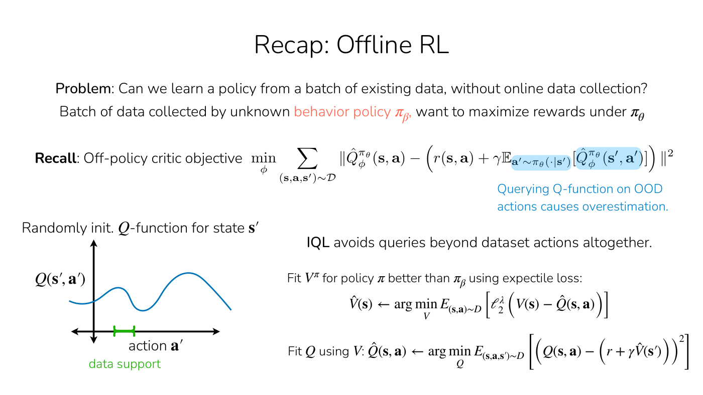
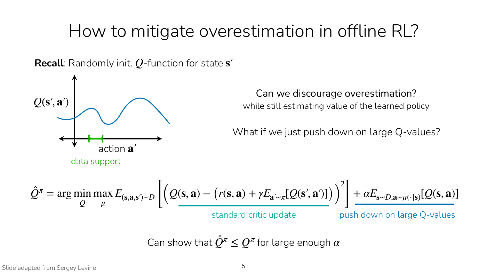
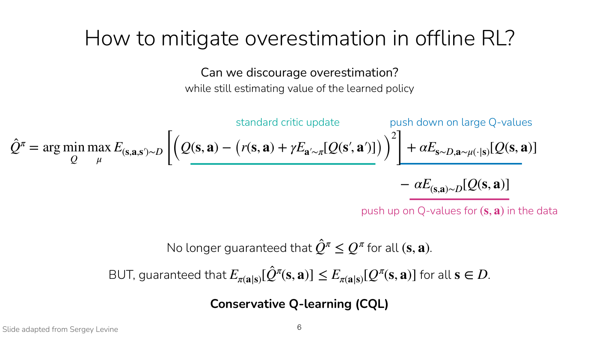
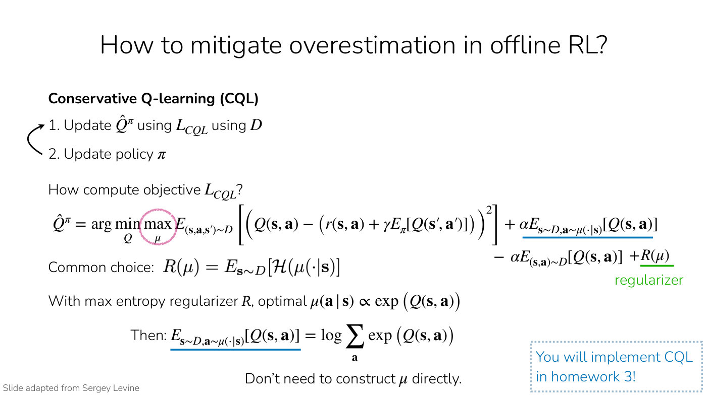
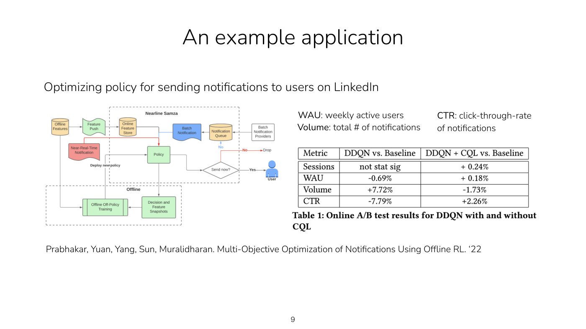
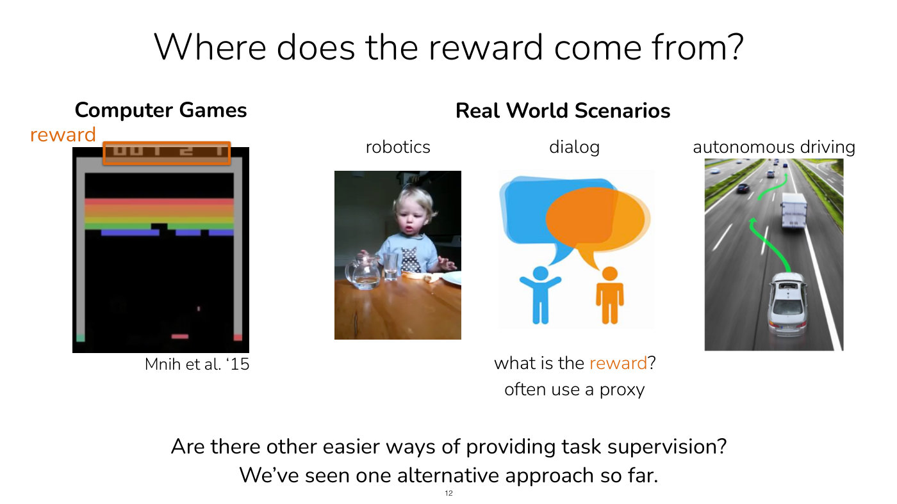
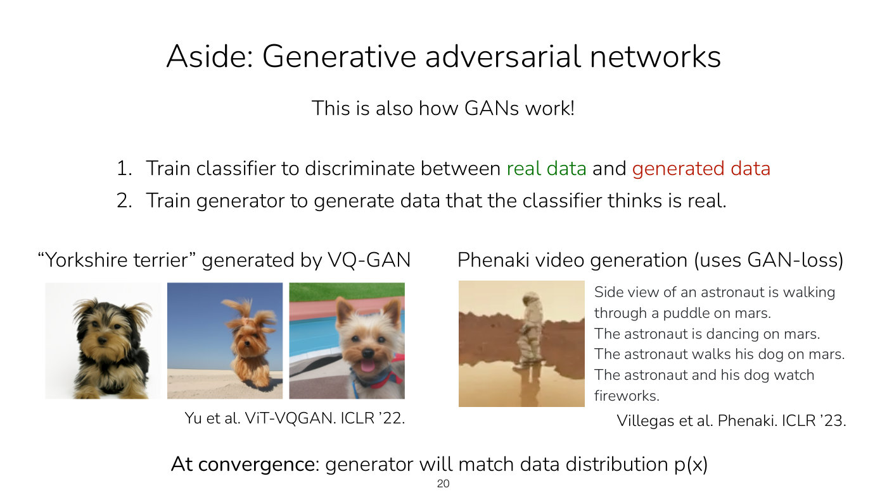
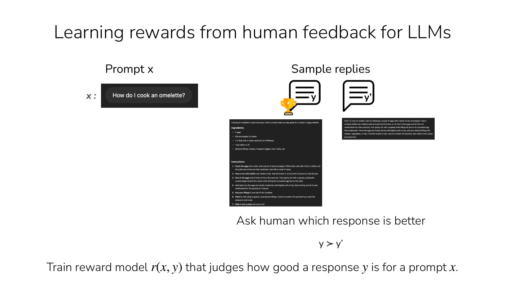
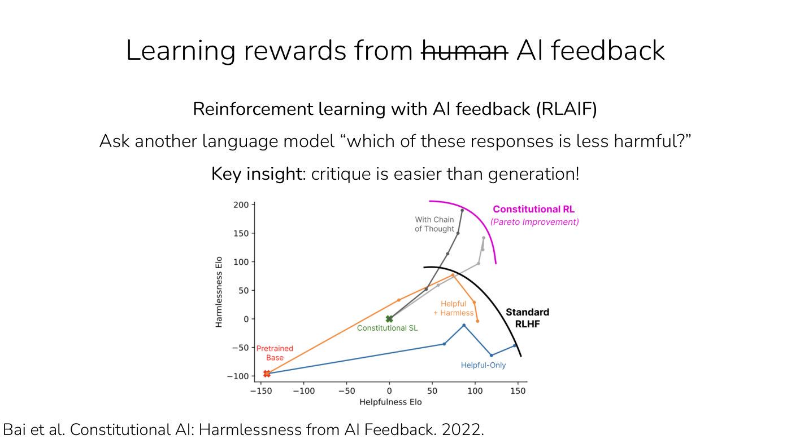

# Lecture 8 — Reward Learning

Stanford CS224R, Spring 2025 (Friday, April 25) ·
[video](https://www.youtube.com/watch?v=PDIxDhA9Z6Y) (66 min) ·
[slides (PDF)](https://cs224r.stanford.edu/spring_2025/slides/08_cs224r_reward_learning_2025.pdf) ·
[slide-by-slide text](../raw/slides/08-reward-learning.md) ·
[transcript](../raw/transcripts/08-reward-learning.md)

**What this lecture establishes.** The lecture has two parts. The first finishes
[offline RL](offline-rl.md). It recalls why implicit Q-learning fits its value function with an
asymmetric loss but its Q-function with an ordinary one, and then teaches **conservative Q-learning
(CQL)**, which Lecture 7's recording left out. CQL adds two terms to the critic's loss: one pushes
down on large Q-values, found by a distribution $\mu$ that seeks them out, and one pushes back up on
the Q-values of the dataset's own actions. The learned Q-function is then pessimistic outside the
data's support and accurate inside it. The second part asks where rewards come from. Outside
computer games the world does not hand an agent a reward, so the lecture teaches two ways to learn
one from human supervision. **Goal classifiers** learn a reward from examples of success and
failure. Because RL exploits a fixed classifier's mistakes, the states the policy visits are added
as negatives and the classifier is retrained during RL, which is the structure of a generative
adversarial network. **Learning from preferences** asks people which of two trajectories is better,
which is easier than scoring one, and fits a reward model so that the sigmoid of the difference in
summed rewards is the probability of that preference. This is how rewards are learned for language
models in RL from human feedback, and, with another model as the judge, from AI feedback.

Slide numbers below are the numbers printed on the slides, which equal the PDF page numbers (seven
pages print none, and their labels are inferred). Timestamps (≈M:SS) point into the video and the
[transcript](../raw/transcripts/08-reward-learning.md). The deck's title page reads "Reward
Learning" with "Conservative Offline RL and" added above it. **The recording covers the deck from
the plan on slide 3 to the closing goal-setting example.** It does not discuss the reminders on
slides 2 and 34 or the repeated plan on slide 33; the [last section](#not-in-the-recording-reminders)
gives them from the [slide file](../raw/slides/08-reward-learning.md). Much of the CQL part and of
the goal-classifier discussion is worked live, with Finn writing and drawing while talking: the
recap's example values, the CQL objective written in terms of the critic's parameters, a sketch of a
lower-bound Q-function, and a 2D picture of goal states and a classifier's decision boundary. This
page has that work only as the transcript describes it, and says so where it reconstructs it.

## Contents

1. [The plan](#the-plan)
2. [Recap: offline RL and implicit Q-learning](#recap-offline-rl-and-implicit-q-learning)
3. [Why IQL's asymmetric loss is for V and not for Q](#why-iqls-asymmetric-loss-is-for-v-and-not-for-q)
4. [Pushing down on large Q-values](#pushing-down-on-large-q-values)
5. [Conservative Q-learning (CQL)](#conservative-q-learning-cql)
6. [The full CQL algorithm](#the-full-cql-algorithm)
7. [Computing the CQL objective without constructing mu](#computing-the-cql-objective-without-constructing-mu)
8. [An application: LinkedIn notifications](#an-application-linkedin-notifications)
9. [Offline RL summary](#offline-rl-summary)
10. [Where does the reward come from?](#where-does-the-reward-come-from)
11. [Imitation, and reasoning about what the expert wants](#imitation-and-reasoning-about-what-the-expert-wants)
12. [Goal classifiers](#goal-classifiers)
13. [What can go wrong: exploiting the classifier](#what-can-go-wrong-exploiting-the-classifier)
14. [Adding visited states as negatives](#adding-visited-states-as-negatives)
15. [Will it work? Overfitting, balancing and false negatives](#will-it-work-overfitting-balancing-and-false-negatives)
16. [A robot example](#a-robot-example)
17. [Aside: generative adversarial networks](#aside-generative-adversarial-networks)
18. [Recap of reward classifiers](#recap-of-reward-classifiers)
19. [Feedback on roll-outs: relative preferences](#feedback-on-roll-outs-relative-preferences)
20. [A reward function from preferences](#a-reward-function-from-preferences)
21. [The complete reward-learning algorithm](#the-complete-reward-learning-algorithm)
22. [Examples: a backflip and driving](#examples-a-backflip-and-driving)
23. [Rewards for language models](#rewards-for-language-models)
24. [AI feedback](#ai-feedback)
25. [Summary of reward learning](#summary-of-reward-learning)
26. [Can RL agents propose their own goals?](#can-rl-agents-propose-their-own-goals)
27. [Not in the recording: reminders](#not-in-the-recording-reminders)

## The plan

The lecture opens on the plan (slide 3, ≈0:05): finish offline reinforcement learning with a recap
and conservative methods, then reward learning, asking where rewards come from, how to learn them
from example goals and behaviors, and how to learn them from human preferences. The key learning
goals are "why task specification is hard (& why naïve methods fail)" and "methods for learning
rewards from human supervision" (slide 3). The slide marks the offline RL part as part of homework 3
and the reward-learning part as part of the default project.

## Recap: offline RL and implicit Q-learning

Offline RL learns a policy from a batch of existing data, with no online data collection
(slide 4, ≈0:05–0:51). The data was collected by an unknown **behavior policy** $\pi_\beta$, and the
goal is to maximize rewards under the learned policy $\pi_\theta$, so there is a distribution shift
between the two. A traditional method fits a Q-function and improves the policy against it; the
off-policy critic objective (slide 4) is

$$\min_\phi \sum_{(\mathbf{s}, \mathbf{a}, \mathbf{s}') \sim \mathcal{D}} \left\lVert \hat{Q}^{\pi_\theta}_ \phi(\mathbf{s}, \mathbf{a}) - \left( r(\mathbf{s}, \mathbf{a}) + \gamma \mathbb{E}_ {\mathbf{a}' \sim \pi_\theta(\cdot \mid \mathbf{s}')} \left[ \hat{Q}^{\pi_\theta}_ \phi(\mathbf{s}', \mathbf{a}') \right] \right) \right\rVert^2$$

where $\mathcal{D}$ is the dataset of states $\mathbf{s}$, actions $\mathbf{a}$ and next states
$\mathbf{s}'$, $r$ the reward, $\gamma$ the discount, and $\hat{Q}^{\pi_\theta}_ \phi$ the critic with
parameters $\phi$. Its target queries the Q-function on actions $\mathbf{a}'$ sampled from the
learned policy, which may not be covered by the data, and "querying Q-function on OOD actions
causes overestimation" (slide 4). The slide redraws Lecture 7's randomly initialized Q-function: the
data covers only a narrow range of actions for the state, and a policy that optimizes the
Q-function heads for actions outside that range that happen to have a higher Q-value (≈1:36).

**Implicit Q-learning (IQL)**, the main algorithm of the last lecture, avoids any function queries
beyond the dataset's actions altogether (slide 4, ≈1:36–2:23). It learns a value function and a
Q-function from the states and actions in the data. With the normal updates that would give
$V^{\pi_\beta}$ and $Q^{\pi_\beta}$, the behavior policy's value functions, which do not allow much
improvement over it. So the value function is fitted with an asymmetric (expectile) loss
$\ell_2^\lambda$, to learn the value of a policy better than $\pi_\beta$, while the Q-function uses a
standard L2 loss (≈2:23–3:09; slide 4):

$$\hat{V}(\mathbf{s}) \leftarrow \arg\min_V \mathbb{E}_ {(\mathbf{s}, \mathbf{a}) \sim D} \left[ \ell_2^\lambda \left( V(\mathbf{s}) - \hat{Q}(\mathbf{s}, \mathbf{a}) \right) \right]$$

$$\hat{Q}(\mathbf{s}, \mathbf{a}) \leftarrow \arg\min_Q \mathbb{E}_ {(\mathbf{s}, \mathbf{a}, \mathbf{s}') \sim D} \left[ \left( Q(\mathbf{s}, \mathbf{a}) - \left( r + \gamma \hat{V}(\mathbf{s}') \right) \right)^2 \right]$$

See [implicit policy constraint methods](implicit-policy-constraints.md) for the expectile loss and
the rest of IQL.

*Slide 4 — the off-policy critic objective with its out-of-distribution query highlighted, the randomly initialized Q-function with its narrow data support, and IQL's two fitting steps. [Deck](https://cs224r.stanford.edu/spring_2025/slides/08_cs224r_reward_learning_2025.pdf)*

## Why IQL's asymmetric loss is for V and not for Q

Lecture 7 did not say why only the value function gets the asymmetric loss, so Finn adds it here
(≈3:09–7:43), working an example on the board. When a policy is rolled out there are two sources of
variability: which action is taken, and, given the action, which state the environment produces
next. The Q-value of an action and the value of the state that actually followed it can therefore
differ.

The example, as the transcript gives it: after one action, the next state's value is 8, because the
agent "got somewhat unlucky" in the next state, and this is less than the Q-value of that action
(the Q-value itself is not read out in the recording). A second action $a_2$ is worse, with
$Q(s, a_2) = 5$, but the state it led to has a true value of 8: "maybe you got lucky this time". A
third action $a_3$ is very risky, with $\hat{Q}(s, a_3) = -5$, but when it was taken the outcome was
not as bad as it could have been, and the next state's value is 0 (≈3:55–4:40).

The value function's loss regresses $V$ onto the different Q-values. Leaning toward the larger
Q-values means leaning toward better actions, which is the value of a policy better than the
behavior policy. The Q-function's targets are the next states' values. An asymmetric loss there would
regress toward the next-state values that came out higher, which optimizes "not a better policy, but
a more lucky policy", and luck is something "you can't control with your actions" (≈5:26–6:12). So
the Q-function keeps a symmetric loss.

IQL fits both functions because the goal is $\hat{V}^\pi$ for a policy better than the one behind the
dataset, which the asymmetric value loss gives, while the Q-function is what says which actions are
better when the policy is extracted, for example with advantage-weighted regression (≈6:12–6:57).

## Pushing down on large Q-values

CQL is another way to learn from an offline dataset. Unlike IQL it still estimates the value of the
learned policy and still queries actions from it, and it instead discourages the RL algorithm from
taking actions whose Q-values look high only because they are out of distribution (≈6:57–7:43).

The idea is to minimize the Q-values outside the data's support: to "push down" on them, so the
critic is pessimistic, or conservative, about everything out of distribution and less so inside the
support (≈7:43–8:29). Finn writes this as the usual critic loss, $L_\text{critic}$, plus a term that
minimizes Q-values on actions drawn from some other distribution $\mu$ that is not the dataset's,
for states from the dataset (≈8:29–10:02). Ideally $\mu$ covers the out-of-distribution actions the
policy might consider, and the policy will consider the ones with high Q-values, so $\mu$ is chosen to
maximize the Q-values (≈10:02–10:50). Slide 5 writes it with $\hat{Q}^\pi$ the learned Q-function:

$$\hat{Q}^\pi = \arg\min_Q \max_\mu \mathbb{E}_ {(\mathbf{s}, \mathbf{a}, \mathbf{s}') \sim D} \left[ \left( Q(\mathbf{s}, \mathbf{a}) - \left( r(\mathbf{s}, \mathbf{a}) + \gamma \mathbb{E}_ {\mathbf{a}' \sim \pi} [Q(\mathbf{s}', \mathbf{a}')] \right) \right)^2 \right] + \alpha \mathbb{E}_ {\mathbf{s} \sim D, \mathbf{a} \sim \mu(\cdot \mid \mathbf{s})} [Q(\mathbf{s}, \mathbf{a})]$$

The first term is the "standard critic update" and the second will "push down on large Q-values"
(slide 5). The weight $\alpha$ is a hyperparameter. With a large enough $\alpha$, the critic learned
this way is a lower bound on the true Q-function, $\hat{Q}^\pi \leq Q^\pi$ (slide 5, ≈10:50). Finn
sketches it as a plot of Q-values over actions with the data's support marked, where the learned
$\hat{Q}$ lies below the true Q-function (≈11:35).

*Slide 5 — the randomly initialized Q-function beside the first step toward CQL, the standard critic update plus a term that pushes down on large Q-values. [Deck](https://cs224r.stanford.edu/spring_2025/slides/08_cs224r_reward_learning_2025.pdf)*

## Conservative Q-learning (CQL)

That first version can be too pessimistic, because it pushes down on all Q-values, including those of
the actions inside the data's support, where there is more data and no reason to push down
(≈11:35–12:20). So CQL adds a term that cancels it there: the same term, subtracted, for states and
actions from the dataset. It minimizes Q-values for actions from $\mu$ and maximizes them for actions
in the data (slide 6, ≈12:20–13:06):

$$\hat{Q}^\pi = \arg\min_Q \max_\mu \mathbb{E}_ {(\mathbf{s}, \mathbf{a}, \mathbf{s}') \sim D} \left[ \left( Q(\mathbf{s}, \mathbf{a}) - \left( r(\mathbf{s}, \mathbf{a}) + \gamma \mathbb{E}_ {\mathbf{a}' \sim \pi} [Q(\mathbf{s}', \mathbf{a}')] \right) \right)^2 \right] + \alpha \mathbb{E}_ {\mathbf{s} \sim D, \mathbf{a} \sim \mu(\cdot \mid \mathbf{s})} [Q(\mathbf{s}, \mathbf{a})] - \alpha \mathbb{E}_ {(\mathbf{s}, \mathbf{a}) \sim D} [Q(\mathbf{s}, \mathbf{a})]$$

The new term will "push up on Q-values for $(\mathbf{s}, \mathbf{a})$ in the data" (slide 6). The goal is a
Q-function that is accurate inside the support of the data and has low Q-values outside it, where an
accurate Q-function cannot be learned (≈13:06).

With the last term, $\hat{Q}^\pi \leq Q^\pi$ is no longer guaranteed for all states and actions. It is
guaranteed in expectation for the states in the dataset (slide 6, ≈16:09):

$$\mathbb{E}_ {\pi(\mathbf{a} \mid \mathbf{s})} [\hat{Q}^\pi(\mathbf{s}, \mathbf{a})] \leq \mathbb{E}_ {\pi(\mathbf{a} \mid \mathbf{s})} [Q^\pi(\mathbf{s}, \mathbf{a})] \quad \text{for all } \mathbf{s} \in D$$

Finn does not derive it, but calls it a nice property that suggests the objective is reasonable. It
does not hold if $\alpha$ is zero; $\alpha$ must be large enough, and the exact conditions and the
proof are in the CQL paper (≈16:09–16:57). This is **conservative Q-learning**.

Students asked several questions about it.

- **Does this hurt generalization outside the data's support?** Certainly: it makes the critic more
  pessimistic there. The hyperparameter $\alpha$ controls how pessimistic. In a regime where you
  might generalize better, a smaller $\alpha$ puts more weight on the original critic objective and
  less on the regularization term (≈13:06–13:52).
- **Should it be $Q$ or $\hat{Q}$?** On the board Finn writes the objective as a minimization over the
  learned Q-function's parameters, while the slides treat $Q$ as the thing being minimized over;
  Finn apologizes for "the difference there" (≈13:52). The captions garble the exact symbol Finn
  names.
- **What is $\mu$?** You can think of $\mu$ "as sort of a policy". It is not the policy that will be run.
  It seeks out actions with large Q-values, in or outside the distribution; once it is inside the
  distribution, the push-up term cancels it, giving a more accurate estimate inside the support of
  the data (≈14:37). Asked whether that is what pushes the Q-values down outside the support, Finn
  says it is "basically what it's doing" (≈14:37–15:23; the captions garble the question's verb).
  Maximizing over $\mu$ means picking a $\mu$ with high Q-values, and in practice $\mu$ need not be
  represented explicitly (≈15:23).
- **Why not just do behavior cloning?** Because CQL can do better: like any RL method it uses the
  reward information to learn a policy with high Q-values, and it can do "considerably better than
  behavior cloning". The last lecture's methods also beat behavior cloning, and methods that train
  the policy only on the data's actions are a valid way to do offline RL; CQL is an alternative
  (≈15:23–16:09).

*Slide 6 — the CQL objective in three coloured parts, the standard critic update (teal), pushing down on large Q-values (blue) and pushing up on Q-values for the data's own state-action pairs (magenta), with the lower bound it keeps. [Deck](https://cs224r.stanford.edu/spring_2025/slides/08_cs224r_reward_learning_2025.pdf)*

## The full CQL algorithm

The algorithm optimizes this objective on the dataset to get a Q-function, updates the policy, and
repeats (slide 7, ≈16:57–17:45). With discrete actions the policy can be read out directly, as the
action with the largest Q-value:

$$\pi(\mathbf{a} \mid \mathbf{s}) = \begin{cases} 1 & \text{if } \mathbf{a} = \arg\max_{\bar{\mathbf{a}}} \hat{Q}^\pi(\mathbf{s}, \bar{\mathbf{a}}) \cr 0 & \text{otherwise} \end{cases}$$

With continuous actions the policy needs its own update toward actions with high Q-values, a gradient
step with step size $\eta$ (slide 7):

$$\theta \leftarrow \theta + \eta \nabla_\theta \mathbb{E}_ {\mathbf{s} \sim D, \mathbf{a} \sim \pi_\theta(\cdot \mid \mathbf{s})} \left[ \hat{Q}^\pi(\mathbf{s}, \mathbf{a}) \right]$$

## Computing the CQL objective without constructing mu

Constructing $\mu$ explicitly would be annoying, another moving part in the algorithm (slide 8,
≈17:45–18:31). It should put weight on actions with high Q-values, because that is where it pushes
down erroneously large values; applied to small Q-values it has no meaningful effect. But as written,
$\mu$ could collapse to a deterministic choice of the single action with the largest Q-value, and it
should consider a broader set (≈18:31–19:18). So a regularizer $R(\mu)$ is added that favors a high
**entropy** $\mathcal{H}$, a broader distribution (slide 8):

$$R(\mu) = \mathbb{E}_ {\mathbf{s} \sim D} \left[ \mathcal{H}(\mu(\cdot \mid \mathbf{s})) \right]$$

Maximizing Q together with entropy has a closed-form solution: the optimal $\mu(\mathbf{a} \mid \mathbf{s})$
is proportional to the exponentiated Q-values, $\exp(Q(\mathbf{s}, \mathbf{a}))$, and the push-down
term comes out as a log-sum-exp over the Q-values (slide 8, ≈19:18–20:05):

$$\mathbb{E}_ {\mathbf{s} \sim D, \mathbf{a} \sim \mu(\cdot \mid \mathbf{s})} [Q(\mathbf{s}, \mathbf{a})] = \log \sum_{\mathbf{a}} \exp \left( Q(\mathbf{s}, \mathbf{a}) \right)$$

Finn skips the derivation and says something may be posted on Ed after the lecture (≈20:05). The
final objective is then the critic loss, plus $\alpha$ times the log-sum-exp of the Q-values, minus
$\alpha$ times the expected Q-values of the dataset's states and actions. The log-sum-exp replaces
the only term that depended on $\mu$, so $\mu$ never has to be constructed directly (≈20:52). With
a continuous action space the log-sum-exp has to be estimated from samples (≈21:39). Students
implement CQL in homework 3 (slide 8).

*Slide 8 — computing the CQL objective, with the circled max over mu, the entropy regularizer, and the log-sum-exp that replaces the push-down term. [Deck](https://cs224r.stanford.edu/spring_2025/slides/08_cs224r_reward_learning_2025.pdf)*

## An application: LinkedIn notifications

Finn's application of CQL (slide 9, ≈21:39–23:13): a team at LinkedIn used it to optimize a policy
for sending notifications, such as email notifications (Prabhakar, Yuan, Yang, Sun and Muralidharan,
2022). A notification policy should get people clicking, because a click means the notification is
potentially interesting, while keeping the total number of notifications down so as not to spam the
user; weekly active users may matter too. The team took the double DQN algorithm, compared it with
their existing system as the baseline, and also added the CQL terms to the DQN objective. Trained on
an offline dataset and run in an online A/B test, the CQL policy got a higher click-through rate,
fewer notifications in total and a slight increase in usage. The slide's table:

| Metric | DDQN vs. baseline | DDQN + CQL vs. baseline |
| --- | --- | --- |
| Sessions | not stat sig | +0.24% |
| WAU (weekly active users) | −0.69% | +0.18% |
| Volume (total number of notifications) | +7.72% | −1.73% |
| CTR (click-through rate of notifications) | −7.79% | +2.26% |

The architecture diagram on slide 9 shows the policy deciding "Send now?" for each notification, with
its decisions and feature snapshots logged for offline off-policy training, which deploys a new policy.

*Slide 9 — LinkedIn's notification pipeline, where a policy decides whether to send each notification and is retrained offline, and the online A/B results for double DQN with and without CQL. [Deck](https://cs224r.stanford.edu/spring_2025/slides/08_cs224r_reward_learning_2025.pdf)*

**Why be conservative at all?** A student asked. It comes back to the motivation for offline RL:
outside the support of the data, with no way to collect online data, you cannot learn a policy far
beyond the data. The point is to be conservative specifically outside the support, where more data
cannot be collected. Assuming you can go far beyond the data risks an inaccurate Q-function and a poor
policy (≈23:13–23:58).

## Offline RL summary

Online data is expensive, and reusing offline data is good (slide 10, ≈23:58–24:48). The key challenge
is overestimating Q-values because of the shift between the policy behind the data and the policy
being learned. There are three approaches: filtered or weighted imitation learning as a simple
baseline; implicitly constraining the policy to $\pi_\beta$ by supervising it only on actions in the
data; and, today's, a conservative objective that explicitly penalizes Q-values. Offline methods can
improve over imitation learning, including filtered imitation, by stitching together good behaviors
and by using reward information.

## Where does the reward come from?

Every method in the course except imitation learning maximizes a sum of rewards, which raises the
question of where the rewards come from (slides 11–12, ≈24:48). In computer games, among the first
uses of RL, the game's score is the reward, and the result is a player that plays very well; slide 12
shows Atari Breakout with its score boxed as "reward" (Mnih et al. '15).

The real world rarely gives rewards so directly (≈24:48–26:21). Pouring water from a pitcher into a
cup is fairly complex for a robot, although young children do it fairly well. People may get some
satisfaction from drinking the water; robots do not. A reward for the pouring task would have to
represent where the water is, whether any spilled, and whether it got into the cup. A chatbot's users
do not say "that was a reward of 1, that was a reward of 10". In autonomous driving the reward
depends on many factors, such as the rules of the road and how comfortable the ride is.

Sometimes a **proxy** for the true reward works: a human giving a reward of one for success and zero
otherwise, or a click-through rate, which nobody cares about for its own sake but which stands in for
what we might care about (≈26:21–27:07). Proxies have many downsides, which is why it is worth asking
for other ways to supervise RL algorithms (slide 12: "often use a proxy"; "Are there other easier ways
of providing task supervision?").

*Slide 12 — Breakout's score is its reward, while pouring water, dialog and driving have no reward to read off. [Deck](https://cs224r.stanford.edu/spring_2025/slides/08_cs224r_reward_learning_2025.pdf)*

## Imitation, and reasoning about what the expert wants

The alternative seen so far is [imitation learning](imitation-learning.md), which needs no reward
function at all (slide 13, ≈27:07). But it does not reason about outcomes: it optimizes for mimicking
the actions, not for a particular outcome. It can also be hard to provide demonstrations, or the
expert may have different degrees of freedom from the robot, which makes good demonstration data hard
to get. Reward learning instead asks what outcome we want to see: "what is the expert trying to
achieve? What do humans want?" (≈27:07–27:53; slide 13: "Can we reason about what an expert is trying
to achieve?"). People infer rewards readily. Finn mentions fun videos in which even very small
children figure out what someone's objective is and act to help the person (≈27:53); slide 13 embeds
one, credited to Warneken and Tomasello, whose frame on the page is black.

The lecture takes two approaches to learning rewards: from **examples of goals**, and from **human
preferences** (≈27:53).

## Goal classifiers

One of the simplest things to try is to give examples of what success looks like and train a
classifier to predict success versus failure (slide 15, ≈27:53–29:25). To get a robot to put a
pencil case behind a notebook, give it a few examples of the pencil case behind the notebook and a few
negative examples where it is not, train a binary classifier to label the positives one and the
negatives zero, and use the classifier's output as the reward. The steps on slide 15:

1. Collect examples of successful and unsuccessful states, that is, states inside and outside a goal
   set $G$.
2. Train a binary classifier, with inputs $s_i$ and labels $\mathbb{1}(s_i \in G)$.
3. Run RL with the classifier as the reward.

*Slide 15 — positive and negative example photos for putting the pencil case behind the notebook, and a trained classifier mapping new images to 1 or 0 as the reward. [Deck](https://cs224r.stanford.edu/spring_2025/slides/08_cs224r_reward_learning_2025.pdf)*

## What can go wrong: exploiting the classifier

Finn asks the class what could go wrong (slide 16, ≈29:25–30:58). The first answer is that the reward
is very **sparse**: it says only whether the agent is inside the set of goal states, and the agent has
to work out how to make progress toward it. The second is that the policy may learn to **fool the
classifier** without doing the task. The classifier was trained on some distribution of examples,
but the policy can visit many states unlike them. As in offline RL, optimizing against the classifier
can "hack it or fool it" and find states where it is inaccurate, and some of its errors are
optimistic. Finn confirms the first answer is correct, and calls the second the thing that can go
extra wrong: "the RL algorithm will seek out states that the classifier thinks are good", and it "may
simply find states that the classifier wasn't trained on", exploiting the classifier's weaknesses
(slide 16).

## Adding visited states as negatives

The fix looks much like CQL, which Finn finds a nice coincidence of timing (≈30:58). On the board, Finn
draws positive goal states in one region of an abstract state space and negative examples in another,
with the binary classifier's decision boundary between them (≈30:58–31:44). The RL algorithm then
goes somewhere new, into a region where some states are good and some are not. To keep the
classifier from being exploited, the states the policy visited are added to the classifier's
training data. Without a reward function or online supervision their true labels are unknown, so the
conservative choice is to label them all negative, as if every one were a failure, and retrain
(≈32:32–33:19). The retrained boundary tightens, the policy visits somewhere else, and eventually
the classifier is more accurate around the states the policy reaches (≈33:19).

Explicitly (slide 17, ≈33:19–34:07):

1. Collect an initial set of successful states $D_+$ and unsuccessful states $D_-$.
2. Update the classifier using $D_+$ and $D_-$, balancing the dataset 50/50.
3. Collect experience $s_t, a_t, \ldots$ using the policy $\pi$.
4. Update the policy $\pi$ using the classifier-based reward.
5. Add the visited states to the negatives, $D_- \leftarrow D_- \cup \lbrace s_t \rbrace$, and return to
   step 2.

*Slide 17 — the algorithm that adds the states the policy visits to the negatives and retrains the balanced classifier; the arrow loops from step 5 back to step 2. [Deck](https://cs224r.stanford.edu/spring_2025/slides/08_cs224r_reward_learning_2025.pdf)*

## Will it work? Overfitting, balancing and false negatives

Slide 17 asks why this might or might not work: will it learn an accurate classifier, what will the
classifier output for successful states, and should we expect the policy to work? The class raised
several concerns (≈34:07–41:02).

**Overfitting to the positives.** With few positives the classifier may learn a decision boundary that
contains only each positive example and not the states right around them. Regularizing the classifier
helps, and even standard regularizers that encourage it to be smoother can help (≈34:07–34:54).

**Balancing.** Negatives keep being added, and if the dataset is not rebalanced the classifier might
just predict negative everywhere. So it is critical to balance the dataset 50/50, with negatives half
of the data sampled and positives the other half (≈34:54–35:40). A student suggested also balancing
the original negatives against the sampled ones, which will eventually swamp them; Finn says you
certainly could, depending on how large the initial set of negatives is (≈35:40).

**Visited states that are actually successes.** The policy will start visiting goal states, possibly
the same states as the positives, and they get labelled negative, which is wrong: they are true
positives (≈35:40–36:27). It turns out this may be fine if the data is balanced, with enough
regularization or large enough positive and negative datasets. Finn's numbers: half the balanced data
is true positives. Of the other half, suppose 40% of the whole is false negatives (successes labelled
negative) and 10%, including the original negatives, true negatives. The classifier then will not
output probability one for a positive, but it will still output a probability above 50% that it is
positive, and above the probability that it is negative (≈36:27–38:00). With balancing, the
probability of a true positive under a properly trained classifier is always above 50%: exactly 50% if
the negative half were entirely false negatives, and strictly above 0.5 as long as some true negatives
are present, such as the original ones, with true negatives below 0.5 (≈38:00–38:46). Slide 18 says
the same: as long as batches are balanced, the classifier will output $p \geq 0.5$ for successful states.

**Further questions** (≈38:46–41:02):

- Would soft confidences instead of zero-or-one help? The classifier's probability can be used as the
  reward without thresholding, and that is fine. Confidence intervals might help, though Finn has not
  thought much about it, and they would probably need a more sophisticated RL method.
- A state that is very hard to tell apart from the positives is likely to be labelled positive if the
  classifier is regularized, because regularization makes the function smooth; it depends a lot on
  how different the state is (≈39:31).
- Is this a generative adversarial network, with the classifier as discriminator and the agent as
  generator? Yes, "exactly a form of a GAN": the classifier discriminates between the given positive
  examples and everything the policy visits, and the policy is the generator (≈39:31–40:16).
- After running a trajectory, do we learn its true label? No; the method assumes no human supervision
  beyond the initial dataset. One can also have some of the policy's data labelled positive or
  negative to keep updating the classifier, without labelling every trajectory, which is a valid
  approach and can help stabilize training (≈40:16–41:02).

## A robot example

A paper by Sharma, Ahmed, Ahmad and Finn ('23, "Self-Improving Robots") used this approach on a real
robot (slide 19, ≈41:02–42:36). It collected 50 demonstrations, used their final states as the success
examples for the classifier, and initialized the replay buffer with the demonstrations. Directly
imitating the demonstrations gave a success rate of about 26%, because 50 demonstrations is not much,
and even with more it would be hard to reach 100%. Running RL from that initialization with a
classifier learned this way gave 62%: "not awesome yet", but substantially higher than imitation.
The research also found that regularizing the classifier is very important, so that it does not
overfit to the 50 positive examples (slide 19: "Important to regularize the classifier!").

*Slide 19 — one video frame of each policy on the cloth task, 26% success from imitating 50 demonstrations and 62% after RL with the learned classifier. [Deck](https://cs224r.stanford.edu/spring_2025/slides/08_cs224r_reward_learning_2025.pdf)*

## Aside: generative adversarial networks

This is how GANs work (slide 20, ≈42:36–43:23). A generative adversarial network is a generative
model, often used for image generation. It trains a classifier to discriminate real examples from
generated data (in the RL version, the given positives from the states the policy visits), and trains
a generator to produce data the classifier thinks is real. Slide 20 shows Yorkshire terriers generated
by VQ-GAN (Yu et al., ICLR '22) and a frame from Phenaki (Villegas et al., ICLR '23), "a cool video of
an astronaut dancing on Mars and later walking his dog on Mars", which also uses a GAN loss. At
convergence the generator matches the data distribution (slide 20).

*Slide 20 — the GAN recipe, with Yorkshire terriers generated by VQ-GAN and a frame of Phenaki's astronaut video. [Deck](https://cs224r.stanford.edu/spring_2025/slides/08_cs224r_reward_learning_2025.pdf)*

## Recap of reward classifiers

Pre-trained classifiers can be exploited when optimized against, and the solution is to update the
classifier during RL, with the policy's data as negatives (slide 21, ≈43:23). Finn mentions, while
skipping it for time, that the same idea learns full reward functions and not only goal classifiers:
with all of the demonstrations' states as positives and all the policy's roll-out states as
negatives, it learns a reward over state distributions rather than just goal states (≈43:23–44:11;
slide 21: "Can learn goal classifier with success examples, full reward with demos.").

On the upside it is a practical framework for task specification. Adversarial training of this kind
can be unstable, but many regularization tricks can be taken directly from the GAN literature, and
that helps. The big downside is that it needs examples of the goal or desired behavior, which can be
challenging or time-consuming to produce (slide 21, ≈44:11–44:57).

## Feedback on roll-outs: relative preferences

The second approach applies when we want more than reaching a set of goal states: to learn good
behavior versus bad, which may involve more than the final state (slides 22–23, ≈44:57). Instead of,
or in addition to, demonstrations or example goals, a person could give feedback on whole roll-outs.

One option is to ask "how good is this trajectory?". For a trajectory from a start point to a goal
star, meant to get there as efficiently as possible, that is actually hard to answer. Another is to
ask "which trajectory is better?". When Finn asks who thinks the blue trajectory is better than the
pink one, everyone does: "that's a much easier question to answer" (slide 23, ≈45:45). Relative
preferences are often easier to provide than an absolute evaluation of a trajectory, for lines in 2D
and in many real-world uses (≈45:45–46:32).

*Slide 23 — scoring one trajectory to the star (left) against choosing the best of three (right); the class picked the blue one. [Deck](https://cs224r.stanford.edu/spring_2025/slides/08_cs224r_reward_learning_2025.pdf)*

## A reward function from preferences

If a person says trajectory $\tau_w$ is better than $\tau_l$, written $\tau_w \succ \tau_l$, with $w$
and $l$ for the winning and losing trajectories, a natural reading is that the sum of rewards over
the states and actions of the better trajectory should be larger than over the worse one
(slide 24, ≈46:32–47:18). One binary preference label tells a little about the reward, and the task is
to aggregate many of them into a reward function (≈47:18–48:05). Given a dataset of trajectory pairs,
each labelled with which is better, model the reward as a neural network $r_\theta(s, a)$ with
parameters $\theta$, taking a state and action and outputting a scalar (≈48:05–48:51). Then we want

$$\sum_{(s, a) \in \tau_w} r_\theta(s, a) > \sum_{(s, a) \in \tau_l} r_\theta(s, a)$$

with the shorthand $r_\theta(\tau)$ for the sum over a trajectory (slide 24). "Humans are classifying
which trajectory is better. Reward should be discriminative as well" (slide 24).

So $r_\theta(\tau_w) - r_\theta(\tau_l)$ should be positive (≈48:51). To train by maximum likelihood,
pass the difference through a sigmoid $\sigma$, which squashes it to between 0 and 1, and treat the
result as the probability that one trajectory is better than the other (slide 25, ≈49:39). Then
maximize that probability over the pairs in the dataset (slide 25, ≈50:25):

$$\max_\theta \mathbb{E}_ {\tau_w, \tau_l} \left[ \log \sigma \left( r_\theta(\tau_w) - r_\theta(\tau_l) \right) \right]$$

In words: for each pair, sum the rewards of each trajectory, subtract, take the sigmoid, and maximize
that with gradient descent (≈50:25).

*Slide 25 — the preference inequality on summed rewards, the sigmoid of the reward difference read as a probability, and the log-likelihood to maximize. [Deck](https://cs224r.stanford.edu/spring_2025/slides/08_cs224r_reward_learning_2025.pdf)*

**Full or partial trajectories.** The trajectories $\tau$ need not be full ones (slide 24's note: $\tau$ could be a
full or partial roll-out). A full trajectory such as driving from Palo Alto to San
Francisco, or cleaning a kitchen, has many parts, some better and some worse, so the comparison can
be made on parts of trajectories (≈51:14).

**The human doesn't say how much better.** A student pointed out that a preference says nothing about
the margin: one trajectory may be slightly better than another, and a third much worse
(≈52:00–52:45). With a lot of data, Finn answers, there are many pairwise preferences among the
trajectories, which together form a ranking, and that forces the reward function to give the best
trajectory a much higher reward than the worst, so the objective already does what you want. People
can also be asked to rank a whole batch, which makes it more explicit (≈52:45–53:30).

## The complete reward-learning algorithm

Slide 26's algorithm (≈53:30–55:49):

1. Given a dataset of trajectories $\lbrace \tau_i \rbrace$, sample batches of $k$ trajectories and ask
   humans to rank them. For language models, the $k$ trajectories all have the same prompt.
2. Compute $r_\theta(\tau_1), \ldots, r_\theta(\tau_k)$ under the current reward model $r_\theta$: a
   forward pass, summing over the states and actions.
3. For all $\binom{k}{2}$ pairs in each batch, compute the gradient of the objective, a backward pass.
4. Update $\theta$ with the computed gradient, and repeat from step 2.

Repeating corresponds to gradient descent on the objective over a single dataset (≈55:02–55:49).

Ranking responses to the same prompt is a common way to learn reward functions for language models,
and the reason is the starting point (≈53:30–55:02). Trajectories that start from the same place can
be compared; with different starting places it is much harder to say which is better, since one may
have reached the goal faster only because it had an easier start. So batches are sampled with
similar starting positions.

*Slide 26 — the complete reward-learning algorithm, ranking batches of k trajectories, computing rewards, taking gradients over every pair, updating and repeating. [Deck](https://cs224r.stanford.edu/spring_2025/slides/08_cs224r_reward_learning_2025.pdf)*

The procedure can also run **in the loop of online RL** (slide 26, ≈55:49–56:34): sample from the
policy, have humans rank the samples, update the reward model, update the policy with the improved
reward, collect new roll-outs, have those labelled, and repeat.

## Examples: a backflip and driving

Some of the first uses of preference learning were in simulation (slide 27, ≈56:34–57:20). Writing a
reward function for a simulated agent's backflip is very hard, so Christiano et al. (NeurIPS 2017)
asked humans "is this better than this?" 900 times, in the loop of RL, and got a policy that learned
to do a backflip, learning a reward function for a human-preferred backflip along the way. In
driving, where reward functions are also hard to get, work by Sadigh et al. (RSS 2017) used the
approach to learn how much factors such as staying within the lane, keeping a certain speed and
avoiding collisions matter. You would expect collision avoidance to matter much more than keeping a
certain speed, and the reward can be learned that way (≈57:20). Slide 27's chart shows a probability
density over each of five learned weights: road boundary, staying within lanes, keeping speed,
heading and collision avoidance.

*Slide 27 — the simulated agent that learned a backflip from 900 preference queries, and learned densities over five driving-reward weights beside a two-car road diagram. [Deck](https://cs224r.stanford.edu/spring_2025/slides/08_cs224r_reward_learning_2025.pdf)*

## Rewards for language models

Preference learning is a very popular way to learn rewards for language models (slide 28,
≈57:20–58:06). Take a prompt $x$, such as "How do I cook an omelette?", sample two responses from the
language model, and ask a person which is better. In training, people may be paid to label the data,
and a user of ChatGPT may sometimes be asked the same question, giving OpenAI labels to learn a reward
function better matched to the user's preferences (≈58:06). From the labels, train a reward model
$r(x, y)$ that judges how good a response $y$ is for the prompt $x$ (slide 28).

*Slide 28 — one prompt, two sampled replies, the human's pick marked by the trophy, and the reward model trained from such picks. [Deck](https://cs224r.stanford.edu/spring_2025/slides/08_cs224r_reward_learning_2025.pdf)*

The full pipeline for training something like ChatGPT has three stages (slide 29, ≈58:06–59:38).
**Large-scale pre-training** predicts the next token on very large, mixed-quality data; the result
knows a lot but is hard to control and may not answer questions or do what is asked, just predict
reasonable next tokens. **Supervised fine-tuning** trains on a higher-quality dataset that shows, for a
given prompt, how to reply, which is basically imitation learning. **RL from human feedback**
fine-tunes the supervised model on higher-quality preference data (≈59:38). Slide 29 prints this
box's sub-line as "on higher-quality (prompt, response)", the same as the supervised box's, which looks
like a copy slip; Finn describes this step as preference data. It has three steps: gather preference
data (existing preference datasets can be used, rather than collecting them with your own model);
train a reward model; and run reinforcement learning to maximize it, fine-tuning the model to produce
responses $y$ with high reward for prompts $x$. One somewhat common choice is [PPO](ppo.md)
(≈1:00:23). Preference learning returns on Wednesday next week (≈59:38).

*Slide 29 — the three stages of training a chat model (pre-training, supervised fine-tuning, RL from human feedback) and the three steps of the last. [Deck](https://cs224r.stanford.edu/spring_2025/slides/08_cs224r_reward_learning_2025.pdf)*

Students asked three questions (≈1:00:23–1:01:57).

- **Is $x$ just the prompt, or the whole history?** Often the whole history. An RL problem for a
  language model can be modelled as a sequential problem, or, more simply but more crudely, by taking
  all the history as $x$ and treating the next response as the thing being optimized.
- **How do rankings become the probability?** A ranking of $k$ trajectories, such as A better than B
  better than C, gives $\binom{k}{2}$ pairs, each saying which of the two is better; $\tau_w$ is the
  preferred trajectory or response and $\tau_l$ the dispreferred one. Sample one of those pairs and
  plug it into the objective.
- **What is $\sigma$?** A sigmoid, "a function that squashes the values between 0 and 1".

## AI feedback

Instead of human feedback, an AI model can supply it: ask a strong model whether one response is
better than another (slide 30, ≈1:01:57). There are many axes along which something can be preferred
or dispreferred, and with a model you may be able to ask about the particular ones you care about.
This is **reinforcement learning with AI feedback (RLAIF)** (≈1:02:43). It has been used to keep models
from producing harmful content, by feeding two responses into a model and asking which is less
harmful. The insight is that "critique is often easier than generation", which is one reason AI
feedback can produce a stronger model than otherwise, and works have shown it improving model
performance on different axes (≈1:02:43–1:03:29).

Slide 30's chart is from Bai et al., "Constitutional AI: Harmlessness from AI Feedback" (2022). It plots
harmlessness Elo against helpfulness Elo for several training runs, with an arc marking the
frontier of "Standard RLHF" and, beyond it, an arc labelled "Constitutional RL (Pareto Improvement)".

*Slide 30 — RLAIF, with harmlessness against helpfulness Elo for several training runs and the Constitutional RL arc lying beyond the standard RLHF one. [Deck](https://cs224r.stanford.edu/spring_2025/slides/08_cs224r_reward_learning_2025.pdf)*

## Summary of reward learning

"Rewards can't be taken for granted!" (slide 31, ≈1:03:29–1:04:16). Learning rewards from goals and
demonstrations is a practical framework for task specification; adversarial training can be a little
tricky to optimize; and it requires examples of desired behavior or outcomes. Pairwise preferences are
really easy to provide and need no example goals or demonstrations; the approach has been deployed at
very large scale with language models; but it may require supervision in the loop of RL, which usually
takes more human time (slide 31).

The slide ends with a thought exercise: are there other forms of feedback or supervision that might
help? Goals and preferences are only two. An agent could be told verbally that something was good, or
helpful, or "helpful but kind of mean"; Finn thinks more could be done in this area of research
(≈1:04:16).

## Can RL agents propose their own goals?

Finn closes with research in which RL agents propose their own goals instead of having a human provide
them, part of the area of **unsupervised reinforcement learning**, where no human tells the agent what
to do and the agent should have its own sort of curiosity (slide 32, ≈1:04:16–1:05:46). In one example
one agent sets a goal and another tries to reach it, formulated as a game between the two, and playing
them against each other produces some interesting behavior. Slide 32's figure (Sukhbaatar et al.,
"Intrinsic Motivation and Automatic Curricula via Asymmetric Self-Play", ICLR 2018) shows a grid world
with a key, a door and a light switch: in a self-play episode with only internal reward, Alice moves
and stops, then Bob is given the task; afterwards Bob is applied to a target task with external
reward, reaching a flag.

*Slide 32 — asymmetric self-play, where Alice sets a task by moving and stopping, Bob must reach it, and Bob is then applied to a target task with external reward. [Deck](https://cs224r.stanford.edu/spring_2025/slides/08_cs224r_reward_learning_2025.pdf)*

## Not in the recording: reminders

The recording does not discuss the reminders on slides 2 and 34, which are the same, or the
repeated plan on slide 33; this section is from the [slide file](../raw/slides/08-reward-learning.md)
alone. Fill out the AWS form for GPU quota; the project proposal is due today, "graded fairly lightly-
it's for your benefit!"; homework 2 is due next Friday ("start early!!"). Next week has two guest
lectures, both "very useful for default project": Archit Sharma (researcher on the Gemini team, lead
author of DPO) on preference optimization for LLMs, and Aviral Kumar (professor at CMU) on RL for LLM
reasoning. "Please join lecture in person!"

## Related pages

- [Conservative Q-learning (CQL)](conservative-q-learning.md): the objective, its bound, the role of
  $\mu$ and $\alpha$, the log-sum-exp form, and the application, from this lecture and Lecture 7's
  slides.
- [Reward learning](reward-learning.md): where rewards come from, goal classifiers, adding visited
  states as negatives, the GAN connection, and agents proposing their own goals.
- [Learning rewards from preferences](preference-learning.md): the preference objective, the
  algorithm, its uses for control, driving and language models, and AI feedback.
- [Offline reinforcement learning](offline-rl.md) and
  [implicit policy constraint methods](implicit-policy-constraints.md): the first part's context,
  including IQL.
- [Imitation learning](imitation-learning.md): the reward-free alternative, and why it is not enough.
- [The RL objective](rl-objective.md): the sum of rewards that every method here needs a reward for.
- [Lecture 7 — Offline RL](07-offline-rl.md): the lecture before, whose recording stops before CQL.
