# Lecture 9 — RL for LLMs: Preference Optimization

Stanford CS224R, Spring 2025 (Wednesday, April 30) · guest lecture by Archit Sharma ·
[video](https://www.youtube.com/watch?v=XKLGuwvSKvI) (63 min) ·
[slides (PDF)](https://cs224r.stanford.edu/spring_2025/slides/09_cs224r-2025-rlhf.pdf) ·
[slide-by-slide text](../raw/slides/09-rl-for-llms.md) ·
[transcript](../raw/transcripts/09-rl-for-llms.md)

**What this lecture establishes.** A language model pretrained to predict the next token learns a
great deal, but completing text is not the same as helping a user. The lecture covers three ways of
closing that gap. **Instruction finetuning** trains the model on (instruction, output) pairs across
many tasks. It is simple and generalizes well in large models, but it needs expensive ground-truth
answers, and it treats every answer as simply right or wrong. **RL from human feedback (RLHF)**
instead asks people which of two outputs they prefer. It fits a reward model to those comparisons
with the Bradley-Terry objective, then maximizes that reward with a policy gradient, while a KL
penalty keeps the model close to where it started. **Direct preference optimization (DPO)** starts
from the observation that this KL-constrained objective has a closed-form optimal policy. The reward
can therefore be written in terms of the language model itself, the intractable normalizer cancels in
the Bradley-Terry difference, and the model is trained with a simple classification loss directly on
the preference data, with no RL loop. The lecture ends with how these methods built InstructGPT,
ChatGPT and open models, and with their limits: reward hacking, over-optimization of the reward
model, sycophancy and hallucination.

The lecture continues [Lecture 8](08-reward-learning.md#rewards-for-language-models), which
introduced learning rewards from preferences and the three-stage pipeline for chat models. Lecture 8's
reminder slides introduce Archit Sharma as a researcher on the Gemini team and lead author of DPO
(Lecture 8, slide 2), and the lecture refers to "when we were looking into direct preference
optimization" (≈36:25). The deck's title slide says it is based on slides from CS224N (slide 1); an
earlier version of the full deck is in the [CS224N knowledge base](../SEE_ALSO.md).

**Slide numbers below are the numbers printed on the slides, which are not the PDF page numbers.**
The PDF has 57 pages, but their printed numbers run from 1 to 99, because slides hidden in the
source deck were not exported. Eight pages print no number, and four of those labels are only the
lowest number that fits; the [slide file](../raw/slides/09-rl-for-llms.md#slide-numbers-vs-pdf-pages)
gives the full page-to-slide table. Timestamps (≈M:SS) point into the video and the
[transcript](../raw/transcripts/09-rl-for-llms.md). **The recording follows the deck in order**,
except that at ≈58:14 Sharma jumps ahead to the sycophancy slide and then comes back for reward
hacking and what's next. Slides 81, 93, 97 and 98 are not discussed aloud; the
[last section](#from-the-slides-only) gives them from the slide file. Part of the DPO derivation, the
cancellation of the normalizer $Z(x)$, is written on the board (≈42:37–44:11); this page reconstructs
it from the spoken words and from the slide that states the result.

## Contents

1. [From language models to assistants](#from-language-models-to-assistants)
2. [Language modeling is not assisting users](#language-modeling-is-not-assisting-users)
3. [Instruction finetuning](#instruction-finetuning)
4. [Bigger models gain more](#bigger-models-gain-more)
5. [Limitations of instruction finetuning](#limitations-of-instruction-finetuning)
6. [Optimizing for human preferences](#optimizing-for-human-preferences)
7. [The RLHF pipeline](#the-rlhf-pipeline)
8. [A recap of the policy gradient](#a-recap-of-the-policy-gradient)
9. [A reward model from pairwise comparisons](#a-reward-model-from-pairwise-comparisons)
10. [Why RL, when the reward model is differentiable?](#why-rl-when-the-reward-model-is-differentiable)
11. [The KL penalty](#the-kl-penalty)
12. [RLHF beats human-written summaries](#rlhf-beats-human-written-summaries)
13. [Questions on reward models](#questions-on-reward-models)
14. [Direct preference optimization: why](#direct-preference-optimization-why)
15. [The DPO derivation](#the-dpo-derivation)
16. [Reading the DPO loss, and the questions on it](#reading-the-dpo-loss-and-the-questions-on-it)
17. [DPO results](#dpo-results)
18. [Summary: RLHF and DPO](#summary-rlhf-and-dpo)
19. [InstructGPT and ChatGPT](#instructgpt-and-chatgpt)
20. [DPO in open models](#dpo-in-open-models)
21. [What preference training changes: style](#what-preference-training-changes-style)
22. [Questions on whose preferences](#questions-on-whose-preferences)
23. [Frontier and challenges](#frontier-and-challenges)
24. [What's next](#whats-next)
25. [From the slides only](#from-the-slides-only)
26. [Related pages](#related-pages)

## From language models to assistants

The lecture opens with a trend of the last five to ten years: ever larger models, trained with ever
more compute, a very consistent trend on which some people base predictions (≈0:05). Slide 2 shows
The Economist's chart "The blessings of scale", estimated training compute in floating-point
operations on a log scale, rising from about 1 for Theseus around 1950 to about $10^{24}$ for systems
such as GPT-3, LaMDA and PaLM by 2022, beside a screenshot of the AI 2027 forecasting website.

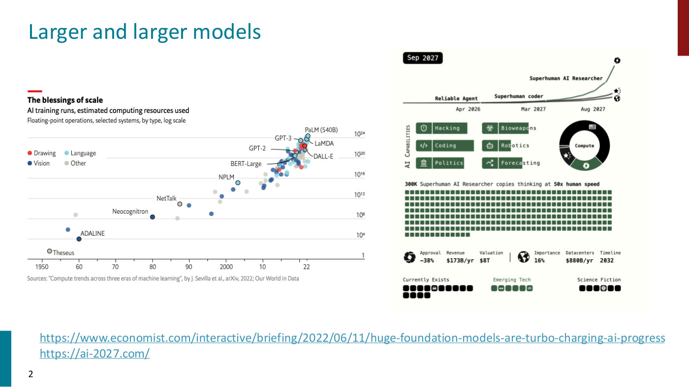

*Slide 2 — training compute of selected AI systems on a log scale, from 1950 to 2022, beside the AI 2027 forecast site. [Deck](https://cs224r.stanford.edu/spring_2025/slides/09_cs224r-2025-rlhf.pdf)*

The question for the lecture is how to get from a large language model pretrained to predict text to
the chat assistants students have used (slide 4, ≈0:51). Sharma notes that this is not an NLP course
and recommends taking one to learn more about pretraining, a very deep topic.

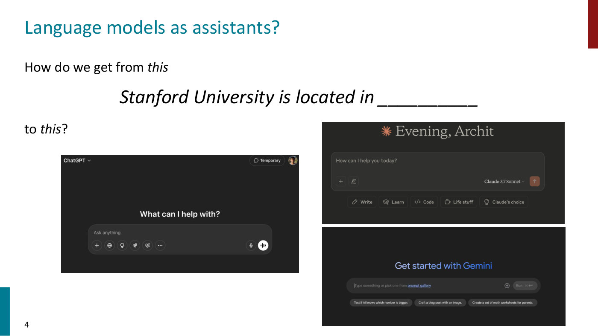

*Slide 4 — from completing "Stanford University is located in ___" to the start screens of ChatGPT, Claude and Gemini. [Deck](https://cs224r.stanford.edu/spring_2025/slides/09_cs224r-2025-rlhf.pdf)*

**What pretraining learns.** A language model is pretrained on a gigantic corpus of internet text,
roughly by predicting the next word or token (≈0:51). Predicting the blank in "Stanford University is
located in __________, California" teaches facts and trivia; other blanks teach syntax, coreference,
lexical semantics and sentiment (slide 5, ≈1:36). Predicting what Zuko left in "Iroh went into the
kitchen to make some tea. Standing next to Iroh, Zuko pondered his destiny. Zuko left the ______"
requires knowing facts and syntax and perhaps some reasoning (slide 5, which labels it "some
reasoning – this is harder"). The slide adds that models learn some basic arithmetic but not the
Fibonacci sequence.

**Language models as world models.** There is some evidence that next-token prediction learns some
notion of how the world operates (≈2:23). In slide 6's example (Andreas, 2022), the prompt "Pat
watches a demonstration of a bowling ball and a leaf being dropped at the same time in a vacuum
chamber. Pat, who is a physicist, predicts that" is completed with "the bowling ball and the leaf will
fall at the same rate". Changing the last sentence to "Pat, who has never seen this demonstration
before, predicts that" gives a different completion, that the bowling ball will fall first. To predict
these words the model must in some way understand the situation and the agent in it; the slide's
claim is that models "may do rudimentary modeling of agents, beliefs, and actions". Models can also
answer math questions (slide 7), generate code (slide 8) and show fairly reasonable medical
understanding (slide 9), and they can start to be turned into assistants (slide 10, ≈3:08).

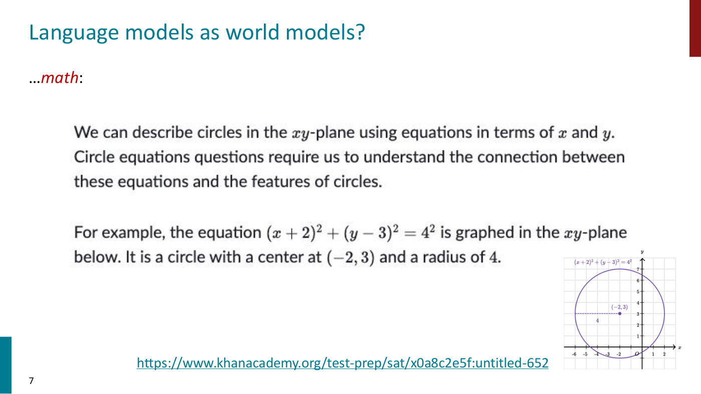

*Slide 7 — a Khan Academy explanation of circle equations, with the graph of a circle of radius 4 centred at (−2, 3). [Deck](https://cs224r.stanford.edu/spring_2025/slides/09_cs224r-2025-rlhf.pdf)*

**The plan** (slide 13, ≈3:08–3:54): instruction finetuning; optimizing for human preferences, with
RLHF and then DPO; and what's next, including what is missing and where these methods go wrong.

## Language modeling is not assisting users

Pretraining models language, and that teaches more than language, but it is still not the same as
assisting users (≈3:54). Asked by GPT-3 to "Explain the moon landing to a 6 year old in a few
sentences", the pretrained model continues the text with what it thinks comes next in its corpus:
"Explain the theory of gravity to a 6 year old. / Explain the theory of relativity to a 6 year old in
a few sentences. / Explain the big bang theory to a 6 year old." (slide 39). What a user wants is an
explanation, such as the human's "A giant rocket ship blasted off from Earth carrying astronauts to the
moon…" (slide 40, ≈4:40). That is the discrepancy between language modeling and assisting users:
"Language models are not *aligned* with user intent" (slides 39–40, citing Ouyang et al., 2022).
"Finetuning to the rescue!" (slide 40).

## Instruction finetuning

**The pretraining/finetuning paradigm** (slide 41, ≈4:40–5:26). The general paradigm, still used
today, is to pretrain a language model on a large corpus of text and then finetune it for a specific
task. Finetuning collects a set of inputs with target outputs and increases the log-likelihood of the
targets given the inputs. Slide 41's diagram has the same decoder in both steps: in step 1 it is
pretrained on lots of text to predict each next token ("Iroh goes to make tasty tea"); in step 2 it is
finetuned with "not many labels", for example to predict whether "… the movie was …" is good or bad.
Pretraining serves as the parameter initialization.

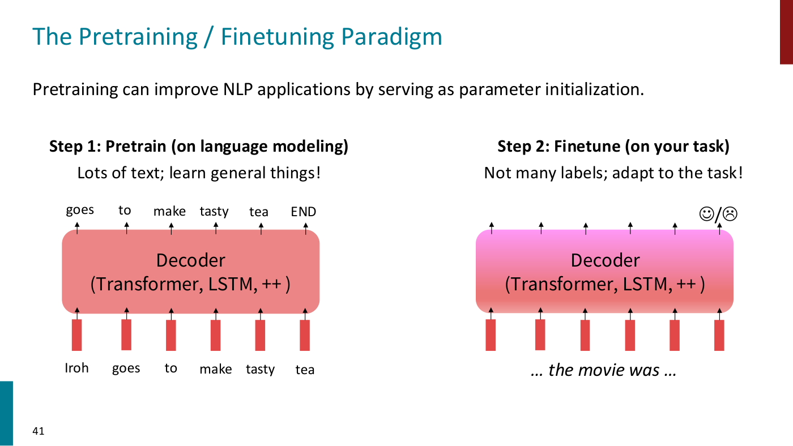

*Slide 41 — one decoder, pretrained on next-token prediction (left) and then finetuned on a labelled task such as sentiment (right). [Deck](https://cs224r.stanford.edu/spring_2025/slides/09_cs224r-2025-rlhf.pdf)*

**Scaling up finetuning** (slide 42, ≈5:26–6:11). Because pretrained models are good for many more
things, the number of tasks they are finetuned on was scaled up: not one task such as sentiment
prediction, but many tasks at the same time. Slide 42 changes step 2 to "Finetune (on many tasks)"
with "~~Not~~ many labels".

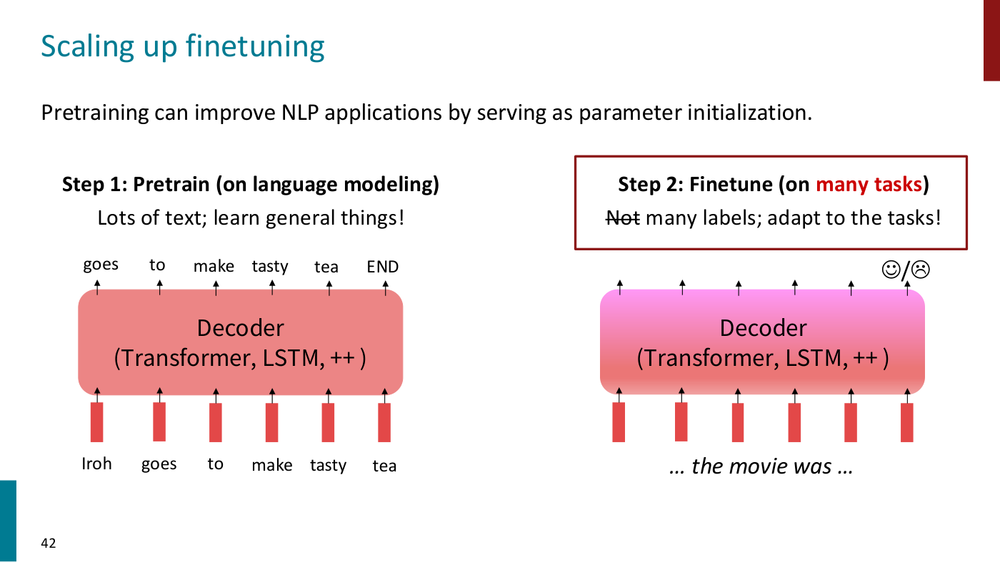

*Slide 42 — the same paradigm with step 2 finetuning on many tasks, and "Not" struck out of "not many labels". [Deck](https://cs224r.stanford.edu/spring_2025/slides/09_cs224r-2025-rlhf.pdf)*

**Instruction finetuning** (slide 43, ≈6:11–6:58) is broadly this: "Collect examples of (instruction,
output) pairs across many tasks and finetune an LM". For the instruction "Please answer the following
question. What is the boiling point of Nitrogen?" the target is "-320.4F", and the model is trained to
predict the answer conditioned on the input. The model is then evaluated on **unseen tasks**, such as
"Can Geoffrey Hinton have a conversation with George Washington? Give the rationale before answering",
to which it produces a reasonable output (slide 43 shows it reasoning from their dates to "no").

*Slide 43 — FLAN-T5's recipe: instruction and output pairs across many tasks (blue and pink) train one model, which is then evaluated on an unseen task (green). [Deck](https://cs224r.stanford.edu/spring_2025/slides/09_cs224r-2025-rlhf.pdf)*

## Bigger models gain more

What happens when language models of different sizes are instruction-finetuned on the same corpus?
Much prior work observed that **larger models generalize much better**, even from a very small corpus
of instruction-output data (≈6:58). Slide 50's table (Chung et al., 2022) gives the normalized average
score on BIG-bench and MMLU, which are question-answer sets like the one above, before and after
finetuning T5 into Flan-T5 on 1.8K additional tasks:

| Params | Model | BIG-bench + MMLU avg (normalized) |
| --- | --- | --- |
| 80M | T5-Small / Flan-T5-Small | −9.2 / −3.1 (+6.1) |
| 250M | T5-Base / Flan-T5-Base | −5.1 / 6.5 (+11.6) |
| 780M | T5-Large / Flan-T5-Large | −5.0 / 13.8 (+18.8) |
| 3B | T5-XL / Flan-T5-XL | −4.1 / 19.1 (+23.2) |
| 11B | T5-XXL / Flan-T5-XXL | −2.9 / 23.7 (+26.6) |

The gain grows with every step in size: "Bigger model = bigger Δ" (slide 50). The larger the model,
the larger the gain from instruction finetuning, which suggests that models start responding to and
generalizing on questions even from very small corpora (≈7:44). The slide's bullet recalls the T5
encoder-decoder "from lecture 10", a reference carried over from the CS224N deck, and cites Flan-T5 as
"Chung et al., 2020" beside a footer citation of 2022.

*Slide 50 — T5 against Flan-T5 at five sizes; the gain from instruction finetuning rises from +6.1 to +26.6 with model size. [Deck](https://cs224r.stanford.edu/spring_2025/slides/09_cs224r-2025-rlhf.pdf)*

Before and after, on a fairly simple question (slides 51–52, ≈7:44–8:31): asked to explain the
antecedent of the pronoun in "The reporter and the chef will discuss their favorite dishes", or state
that it is ambiguous, the model before instruction finetuning behaves like a raw language model and
keeps generating variations of the sentence ("doesn't answer question"). After instruction finetuning
it gives what the user intended: the sentence "does not indicate whose favorite dishes they will
discuss. So, the answer is (C)", ambiguous.

## Limitations of instruction finetuning

Instruction finetuning is fairly simple, and Sharma asks the class to reflect on its limitations
(slide 56, ≈8:31–11:34):

- **It is expensive** to collect ground-truth data. Someone has to write the answer to every
  question, and as questions get harder, very few people can answer them, so the data collection is
  hard to scale (≈8:31).
- **Some tasks have no right answer.** Many uses of language models are creative. For "Write me a
  story about a dog and her pet grasshopper" there is no single story that is the right one (slide 56,
  ≈9:17).
- **Mistakes are penalized equally.** With a predefined answer the whole answer is either correct or
  wrong; "language modeling penalizes all token-level mistakes equally, but some errors are worse than
  others" (slide 56). For "Avatar is a fantasy TV show", the sentence is not entirely correct or
  incorrect; it would have been better to call Avatar an adventure TV show (≈10:02). Slide 56's
  diagram shows the targets "fantasy" and "show" with the crossed-out alternatives "adventure" and
  "musical".
- **Humans generate suboptimal answers.** A recent problem is that language models are truly better
  than humans at generating some answers, so a model trained on human answers is limited by how well
  the humans answer (≈10:02–10:47).
- **The objective is mismatched.** What we want is for the model to engage well with people and
  follow their intent, while the finetuning objective says to predict this answer well. Slide 56:
  "Even with instruction finetuning, there a mismatch between the LM objective and the objective of
  'satisfy human preferences'!" (printed without "is"). Hence the question: "Can we explicitly attempt
  to satisfy human preferences?" (≈10:47).

*Slide 56 — the three problems, with the language model trained on "Avatar is a fantasy TV show" while "adventure" and "musical" are crossed out above its outputs. [Deck](https://cs224r.stanford.edu/spring_2025/slides/09_cs224r-2025-rlhf.pdf)*

Two questions from the class (≈11:34–12:21). How much of the improvement from instruction tuning comes
from following a format, and how much from new knowledge? Most work suggests it is largely formatting,
with most knowledge coming from the base model; one way to see this is to train the model on wrong
answers, after which it still does quite well on downstream tasks. Are the corpora always in
question-answer format? Not anymore: that was the early days of LLM finetuning. Instruction-finetuning
corpora are now very diverse, covering uses such as function calling and tools.

See [instruction finetuning](instruction-finetuning.md) for the topic as a whole.

## Optimizing for human preferences

The section uses summarization as its running example, because there is not necessarily a single good
summary to train on (slide 60, ≈12:21–13:52). For an instruction $x$ and a language-model sample $y$,
imagine a way to obtain a **human reward** for the summary, $R(x, y) \in \mathbb{R}$, higher being
better. For a CNN article on a magnitude 4.2 earthquake in San Francisco, "An earthquake hit San
Francisco. There was minor property damage, but no injuries." gets $R(x, y_ 1) = 8.0$, and "The Bay
Area has good weather but is prone to earthquakes and wildfires." gets $R(x, y_ 2) = 1.2$. The goal is
then the standard RL objective, maximizing the expected reward of samples from the language model
$p_\theta$ with parameters $\theta$ (slide 60):

$$\mathbb{E}_ {\hat{y} \sim p_\theta(y \mid x)}[R(x, \hat{y})]$$

This is the core of how chatbots are trained (≈13:52).

## The RLHF pipeline

Slide 61's diagram, from the InstructGPT paper, is the rough pipeline (≈13:52–14:39):

1. **Collect demonstration data and train a supervised policy.** A labeler writes the desired output
   for a sampled prompt, and the data fine-tunes GPT-3 with supervised learning (SFT). This is
   instruction finetuning, used to get the format right.
2. **Collect comparison data and train a reward model.** Several outputs for one prompt are ranked by
   a labeler from best to worst ("D > C > A = B"), and the rankings train a reward model (RM), which
   lets the model align with human intent.
3. **Optimize a policy against the reward model with RL.** For a new prompt the policy generates an
   output, the reward model scores it, and the reward updates the policy using PPO.

The slide's two bullets: "First step: instruction tuning!" and "Second + third steps: maximize reward (but how??)" (slide 61).

*Slide 61 — InstructGPT's three steps: demonstrations train a supervised policy, rankings train a reward model, and PPO optimizes the policy against that reward model. [Deck](https://cs224r.stanford.edu/spring_2025/slides/09_cs224r-2025-rlhf.pdf)*

Lecture 8 introduced the same pipeline (Lecture 8, slide 29); see
[RL from human feedback](rlhf.md) for the method as a whole.

## A recap of the policy gradient

Supposing for now that there is a reward to maximize, how do we change the parameters? Gradient
ascent (slide 62, ≈14:39–15:25), in practice with more complicated optimizers. For this recap the
notation is generic: a sample $\hat{s}$ from a distribution $p_\theta(s)$, and a reward $R$. The
update would be

$$\theta_{t+1} := \theta_t + \alpha \thinspace \nabla_{\theta_t} \mathbb{E}_ {\hat{s} \sim p_{\theta_t}(s)}[R(\hat{s})]$$

with learning rate $\alpha$. Slide 62 asks two questions of it: how to estimate the expectation, and
what to do if the reward function is non-differentiable. Reward functions often are: if a person gives
the score, there is nothing to backpropagate through ("my human mind is not differentiable",
≈15:25). That is why we resort to RL, and policy gradient methods such as REINFORCE (Williams, 1992),
which Finn covered earlier in the course, give tools for estimating and optimizing the objective
(slide 62, ≈15:25–16:12).

**The derivation** (slide 63, ≈16:12–18:31). Write the expectation as a sum over samples and move the
gradient inside by linearity:

$$\nabla_\theta \mathbb{E}_ {\hat{s} \sim p_\theta(s)}[R(\hat{s})] = \nabla_\theta \sum_s R(s) p_\theta(s) = \sum_s R(s) \thinspace \nabla_\theta p_\theta(s)$$

Then use the **log-derivative trick**. By the chain rule
$\nabla_\theta \log p_\theta(s) = \frac{1}{p_\theta(s)} \nabla_\theta p_\theta(s)$, so
$\nabla_\theta p_\theta(s) = p_\theta(s) \thinspace \nabla_\theta \log p_\theta(s)$. Substituting
gives an expectation again:

$$\sum_s R(s) \thinspace \nabla_\theta p_\theta(s) = \sum_s p_\theta(s) R(s) \thinspace \nabla_\theta \log p_\theta(s) = \mathbb{E}_ {\hat{s} \sim p_\theta(s)}[R(\hat{s}) \thinspace \nabla_\theta \log p_\theta(\hat{s})]$$

Why bother? An expectation over sentences cannot be computed by enumerating every possible sentence,
which is intractable, so a stochastic estimator is needed, and the trick turns the gradient into an
expectation that can be sampled (≈17:45–18:31).

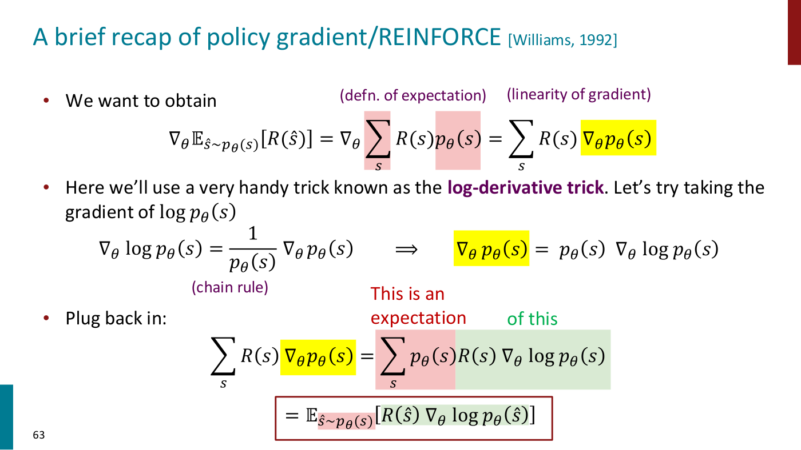

*Slide 63 — the log-derivative trick, colour-coded: pink marks the expectation, yellow the gradient of the probability being replaced, green what the expectation is taken of. [Deck](https://cs224r.stanford.edu/spring_2025/slides/09_cs224r-2025-rlhf.pdf)*

Asked why this gradient is taken at all (≈18:31–19:17), Sharma gives two reasons. The reward cannot be
assumed differentiable, and, more precisely, the parameters sit in the distribution the expectation is
taken over, so the gradient has to reach them there. If the reward were differentiable, other
objectives that backpropagate end to end would be possible.

**Monte Carlo estimate and update** (slide 64, ≈19:17–20:49). With the gradient inside the
expectation, it can be approximated with $m$ samples $s_i$:

$$\nabla_\theta \mathbb{E}_ {\hat{s} \sim p_\theta(s)}[R(\hat{s})] \approx \frac{1}{m} \sum_{i=1}^{m} R(s_i) \thinspace \nabla_\theta \log p_\theta(s_i)$$

and plugged into an optimizer, giving the update rule

$$\theta_{t+1} := \theta_t + \alpha \frac{1}{m} \sum_{i=1}^{m} R(s_i) \thinspace \nabla_{\theta_t} \log p_{\theta_t}(s_i)$$

It is an intuitive objective: if a sample's reward is high, take gradient steps that increase its
log-likelihood; if it is bad, move the other way. "This is why it's called 'reinforcement learning':
we reinforce good actions, increasing the chance they happen again" (slide 64). The slide warns that
this is "heavily simplified! There is a lot more needed to do RL w/ LMs." Asked whether the samples are
full sentences or tokens: in this context, full sentences; the notation was set up generally, and the
lecture returns to $x$ and $y$ (≈20:04–20:49). The same derivation for trajectories is in
[Lecture 3](03-policy-gradients.md#deriving-the-policy-gradient).

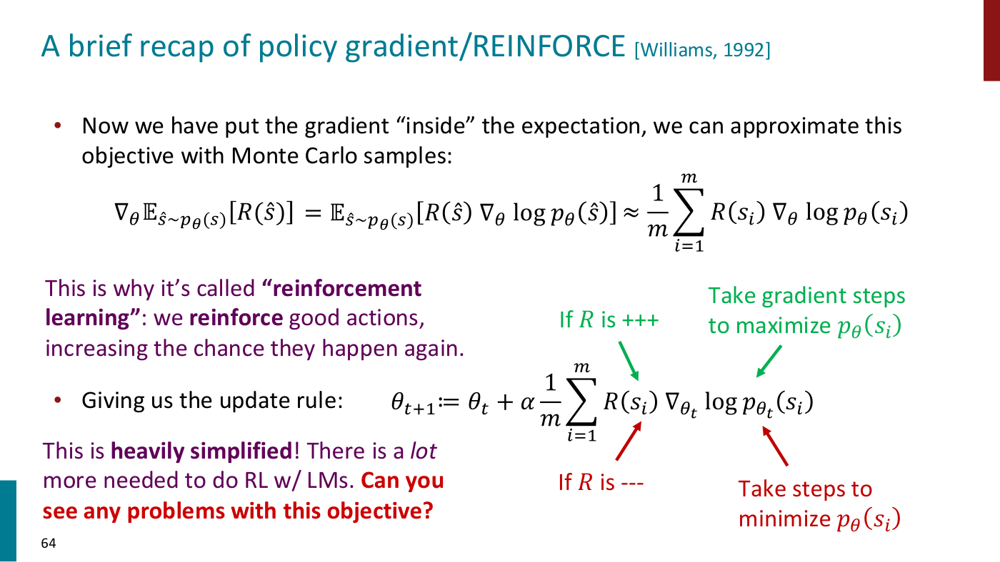

*Slide 64 — the Monte Carlo estimate and update rule, annotated: when the reward is positive take steps to raise the sample's probability, when negative to lower it. [Deck](https://cs224r.stanford.edu/spring_2025/slides/09_cs224r-2025-rlhf.pdf)*

## A reward model from pairwise comparisons

**Problem 1: a human in the loop is expensive** (slide 65, ≈20:49–21:38). So far the lecture assumed a
reward function that scores a summary, but training a large model needs millions of such queries, and
there is no army of humans to label every answer. The general solution is to make preference learning
a separate optimization problem: "instead of directly asking humans for preferences, model their
preferences as a separate problem!" (slide 65, citing Knox and Stone, 2009). "Train a $RM_ \phi(x, y)$ to
predict human reward from an annotated dataset, then optimize for $RM_ \phi$ instead" (slide 65), where
$RM_\phi$ is a reward model with parameters $\phi$. Slide 65's title recalls Lecture 8.

**Problem 2: human judgments are noisy and miscalibrated** (slide 66, ≈22:23). Two people have
completely different calibration, so a summary that scores 7 means something different to each, and
there is no easy way to aggregate. Even one person would probably score the same summary differently
at different times, depending on what they ate for lunch. Reward models learned from direct scores
are not very useful for training language models. Slide 66 shows a third summary with the candidate
scores "4.1? 6.6? 3.2?".

**The solution: ask for pairwise comparisons** (slide 67, ≈22:23–23:56), "which can be more reliable"
(slide 67, citing Phelps et al., 2015, and Clark et al., 2018). Show people a few summaries and ask
whether they prefer one over another. The data is a set $D$ of triples $(x, y^w, y^l)$: an input $x$, a
winning summary $y^w$ and a losing summary $y^l$. The reward model should give winning summaries
higher scores than losing ones. The **Bradley-Terry** paired comparison model (1952) turns such
preferences into an implicit reward score, by minimizing the negative log-sigmoid of the difference in
rewards (slide 67, ≈23:56):

$$J_{RM}(\phi) = -\mathbb{E}_ {(x, y^w, y^l) \sim D}\left[\log \sigma(RM_\phi(x, y^w) - RM_\phi(x, y^l))\right]$$

where $\sigma$ is the sigmoid. All it says is that the reward for the winning summary should be higher
than the reward for the losing one; in slide 67's words, $y^w$ should score higher than $y^l$.

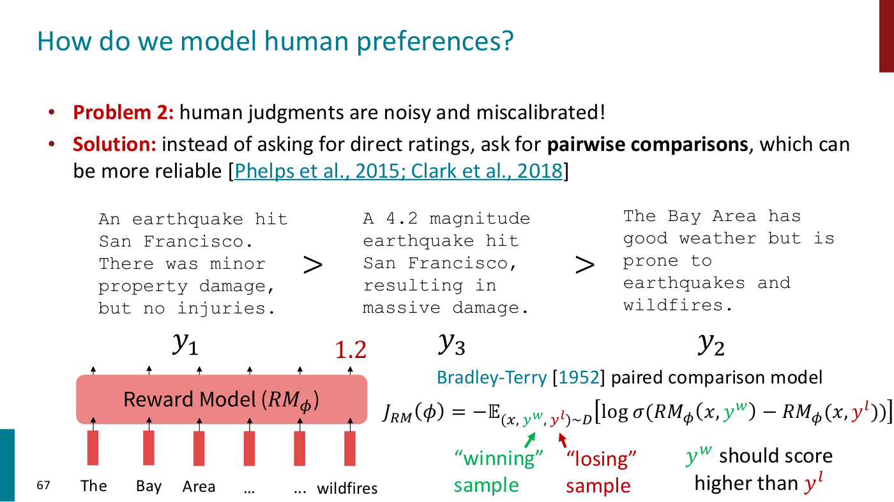

*Slide 67 — three summaries in preference order, a reward model scoring the worst at 1.2, and the Bradley-Terry objective with the winning sample in green and the losing in red. [Deck](https://cs224r.stanford.edu/spring_2025/slides/09_cs224r-2025-rlhf.pdf)*

Two questions (≈23:56–25:29). **Is the reward unbounded, or normalized?** The objective only asks for
the difference to be large, and it is just as large for rewards in the thousands as for a difference
from 1 to 999 (one pair of numbers is garbled in the captions, ≈24:42); nothing fixes the scale. In practice some post hoc normalization is needed so that different
prompts get rewards on the same scale, or the optimization can get "a little wonky". Sharma calls this
a very important observation, one used to develop DPO. **Why the sigmoid?** Not for that reason. Other
functions could be used; the sigmoid maps naturally to the probability that one sample wins over the
other, and all the objective needs is to push the difference up.

This is the same objective as Lecture 8's preference objective over trajectories, with a minus sign
for minimizing; see [learning rewards from preferences](preference-learning.md).

## Why RL, when the reward model is differentiable?

Back in the RL loop there is an instruction-tuned model $p^{PT}(y \mid x)$, "a pretrained (possibly
instruction-finetuned) LM", and a reward model $RM_\phi(x, y)$ trained on human comparisons that
returns a scalar (slide 69, ≈25:29). RLHF copies the model into $p^{RL}_ \theta(y \mid x)$, with
parameters $\theta$ to optimize, and maximizes (slide 69, ≈26:16)

$$\mathbb{E}_ {\hat{y} \sim p^{RL}_ \theta(\hat{y} \mid x)}[RM_\phi(x, \hat{y})]$$

Sharma then asks the class a "slightly hard" question (≈26:16–27:02). The lecture began by saying RL is
needed because rewards are non-differentiable, but a reward model is a neural network, and very much
differentiable. So why do RL? The answer, which a student gave: **the outputs are discrete tokens.** The
model generates an output, the output goes into the reward model, and the gradient would have to go
back to the language model's parameters, but there is a discrete bottleneck in the middle that
gradients cannot pass through (≈27:02). If $\hat{y}$ were continuous and everything were a continuous
function, backpropagation could update the model so that the reward-model score keeps rising, with no
RL. Not doing RL is often very good, because RL is expensive because of the sampling (≈27:48). But
$\hat{y}$ here is sampled discrete tokens, and backpropagating through sampling is hard; there are
tricks, but they are not very stable (≈28:34).

Asked about the Gumbel-softmax (≈28:34–29:21): it has not scaled well so far. $\hat{y}$ is a sentence
that can be thousands of tokens long, with vocabularies on the order of hundreds of thousands of
tokens, so the space is combinatorial, and Gumbel-softmax usually does not scale beyond about a
thousand dimensions. The lesson Sharma draws is that you should never assume you need RL.

## The KL penalty

**Reward models are never perfect** (slide 70, ≈29:21–30:10). They are fit to human preferences on a
certain distribution, and cannot be trusted to score every input and output well. "Learned rewards are
imperfect; this quantity can be imperfectly optimized" (slide 70). Naive optimization of the objective
above produces models that hack the reward model. So a penalty is added to the reward (slide 70,
≈30:10):

$$\mathbb{E}_ {\hat{y} \sim p^{RL}_ \theta(\hat{y} \mid x)}\left[RM_\phi(x, \hat{y}) - \beta \log \left(\frac{p^{RL}_ \theta(\hat{y} \mid x)}{p^{PT}(\hat{y} \mid x)}\right)\right]$$

where $p^{RL}_ \theta$ is the model being optimized, $p^{PT}$ is the model it started from (which could
be instruction-finetuned), and $\beta$ weighs the penalty. Whenever the model's probabilities deviate
from the starting model's, the score is lower. In expectation this term is exactly the
**Kullback-Leibler (KL) divergence** between the two models (slide 70, ≈30:58). The reason for it is
that the reward model is more accurate on the distribution of preferences it was trained on, so the
model should stay close to where it started (≈30:58). Slide 70: "Pay a price when
$p^{RL}_ \theta(\hat{y} \mid x) \gt p^{PT}(\hat{y} \mid x)$". It also prints "drifting too for from
the initialization" for "too far".

*Slide 70 — the RLHF objective with the KL penalty, whose brace explains that it keeps the model from diverging too far from the pretrained model. [Deck](https://cs224r.stanford.edu/spring_2025/slides/09_cs224r-2025-rlhf.pdf)*

Asked what happens when $p^{RL}_ \theta$ is below $p^{PT}$, which would seem to reward moving in that
direction (≈34:07–34:54): the KL divergence is always greater than or equal to zero, which Sharma
leaves as an exercise to prove, so the penalty is always positive. The same kind of penalty appeared
for PPO in [Lecture 5](ppo.md#two-ways-to-stay-close).

## RLHF beats human-written summaries

One of the first examples of RLHF working well is summarization (slide 72, Stiennon et al., 2020;
≈31:45–32:31). The x-axis is model size and the y-axis is how often the model's summary is preferred
over a reference summary of a news article; the dashed line at 0.5 marks the reference summaries.
The pretrained models (light blue, "Pretrain only") improve with size, from about 0.22 at 1.3B to
about 0.36 at 12.9B. Supervised finetuning (green, "Supervised learning") improves on them, at about
0.39 to 0.43. RL from human feedback (orange) is about 0.61 at 1.3B and 0.70 at 6.7B: **the first
model to exceed the human-written summaries**, even at a small size. Sharma presents it as one of the
earlier results showing the power of optimizing for preferences directly.

*Slide 72 — fraction of summaries preferred to the reference against model size: only the RLHF curve rises above the dashed line at 0.5. [Deck](https://cs224r.stanford.edu/spring_2025/slides/09_cs224r-2025-rlhf.pdf)*

## Questions on reward models

**Are there preference models that are not just binary?** (≈32:31–34:07). It is known that human
preferences can be **intransitive**: someone prefers A over B and B over C, yet C over A, which should
not happen. Real preference data is very noisy, and there is no great solution. Preference learning is
a binary classification task, predicting which sample wins. Most binary classification tasks reach 90
or 95% accuracy, but reward models for language models reach about **65 to 70%**, barely better than
chance; even that is enough for large improvements in performance.

**What changed to make this differentiable?** (≈34:07). Nothing. The policy gradient estimator needs
only the gradient of the model's log probabilities; it does not backpropagate into the reward at all.

**Can prompts be chosen to get preferences where the model is bad?** (≈34:54–35:39). There is work on
this, related to active exploration: gathering preference signal where the model is confused, for
example to maximize information gain. Sharma knows of no well-established standard, and calls it a
good problem to look into.

## Direct preference optimization: why

**RLHF can be complex** (slide 74, ≈35:39–36:25). In practice, at the scale of a 100-billion or
trillion-parameter model, it is expensive: every answer must be sampled and scored by the reward
model, and depending on the RL algorithm, value functions and other things must be computed just to
optimize the model. Slide 74 lists "Fitting a value function", "Online sampling is slow" and
"Performance can be sensitive to hyperparameters", beside a diagram of the PPO-based pipeline (Zheng et
al., 2023, "Secrets of RLHF"). Sharma says students do not need to understand the figure; it is there
to show the whole flow of pieces that are hard to get right, and the more parameters in the system,
the harder that is.

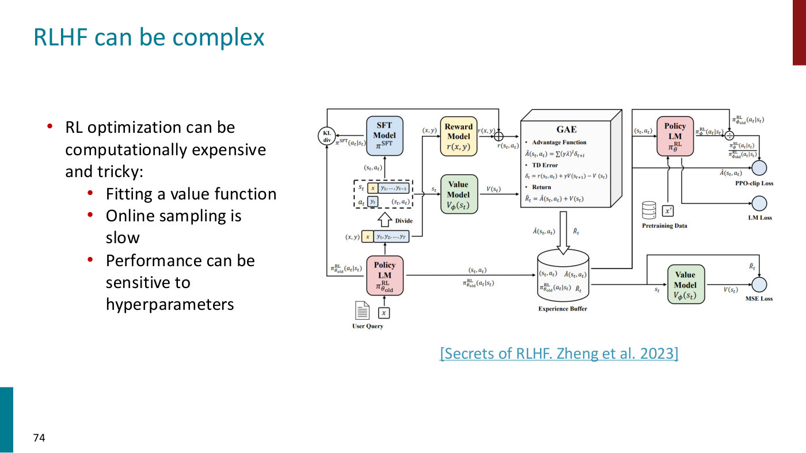

*Slide 74 — the PPO-based RLHF pipeline: policy, SFT, reward and value models, a KL term, generalized advantage estimation, an experience buffer and three losses. [Deck](https://cs224r.stanford.edu/spring_2025/slides/09_cs224r-2025-rlhf.pdf)*

**Can it be simpler?** (slide 75, ≈36:25–37:59). The pipeline fits a reward model, then optimizes the
instruction-tuned model into a final RL model. But there is a language model and a set of
preferences, so why not train on the preference data directly, without the intermediate reward model?
That is why the method is called **direct** preference optimization: it goes directly from preferences
to an optimized language model. At a high level the idea is to write the reward model in terms of the
language model itself. The reward model is fit to preferences with a simple classification loss, the
Bradley-Terry loss, so if the reward model and the language model are connected, the language model's
parameters can be fit through that loss directly (≈37:59). Slide 75: "What if there was a way to write
$RM_\phi(x, y)$ in terms of $p^{RL}_ \theta(\hat{y} \mid x)$?", and "How is this possible? The only
external information to the optimization comes from the preference labels".

## The DPO derivation

**Step 1: the KL-constrained objective has a closed-form solution** (slide 76, ≈37:59–40:18). Recall
the objective, with $p^{RL}_ \theta$ being optimized while $p^{PT}$ and the reward model are fixed:

$$\mathbb{E}_ {\hat{y} \sim p^{RL}_ \theta(\hat{y} \mid x)}\left[RM(x, \hat{y}) - \beta \log \left(\frac{p^{RL}_ \theta(\hat{y} \mid x)}{p^{PT}(\hat{y} \mid x)}\right)\right]$$

Plain expected-reward maximization has no closed-form solution, but with the KL constraint it does,
which Sharma calls rare and "really cool" (≈38:46). The optimal policy $p^\ast$ is

$$p^\ast(\hat{y} \mid x) = \frac{1}{Z(x)} p^{PT}(\hat{y} \mid x) \exp\left(\frac{1}{\beta} RM(x, \hat{y})\right)$$

It takes the starting model's probabilities and multiplies them by the exponentiated reward, scaled by
$1/\beta$. A completion with a higher reward is upweighted under the optimal policy, and one with a
low reward is downweighted (≈39:32). $Z(x)$ is a normalizing factor that makes this a probability
distribution, so only the numerator matters. Sharma asks the class to take the solution on trust and
offers to share a derivation later (≈40:18); the lecture does not derive it.

**Step 2: rearrange for the reward** (slide 76, ≈40:18–41:50). Because the optimal solution is known,
the reward model can be written in terms of the optimal policy:

$$RM(x, \hat{y}) = \beta \log \frac{p^\ast(\hat{y} \mid x)}{p^{PT}(\hat{y} \mid x)} + \beta \log Z(x)$$

where $\beta \log Z(x)$ is constant over $y$. Intuitively, a completion that should score highly has a
high probability under $p^\ast$; $p^{PT}$ is fixed; so the log-ratio is high whenever the reward is
high, and low when it is low (≈41:03–41:50).

**Step 3: it holds for any language model** (slide 76, ≈41:50). This is not only true for the optimal
policy: any model $p^{RL}_ \theta$ is the optimal policy for some reward model. So replace $p^\ast$
with the learnable model, which defines a reward model $RM_\theta$ in terms of the language model:

$$RM_\theta(x, \hat{y}) = \beta \log \frac{p^{RL}_ \theta(\hat{y} \mid x)}{p^{PT}(\hat{y} \mid x)} + \beta \log Z(x)$$

*Slide 76 — the KL-constrained objective, its closed-form optimal policy, the rearrangement for the reward, and the same identity for any language model. [Deck](https://cs224r.stanford.edu/spring_2025/slides/09_cs224r-2025-rlhf.pdf)*

**Step 4: the partition function cancels** (slide 77, ≈42:37–45:02). The reward model is fit with the
Bradley-Terry loss, which needs only the **difference** between the rewards of $y^w$ and $y^l$. Sharma
writes this out on the board. For the winning completion,
$RM_\theta(x, y^w) = \beta \log \frac{p^{RL}_ \theta(y^w \mid x)}{p^{PT}(y^w \mid x)} + \beta \log Z(x)$,
and the same for the losing completion $y^l$. Both completions answer the same input $x$, so the two
$\beta \log Z(x)$ terms are equal and cancel when the rewards are subtracted (≈44:11). This matters
because $Z(x)$ is intractable to compute. What remains (slide 77) is

$$RM_\theta(x, y^w) - RM_\theta(x, y^l) = \beta \log \frac{p^{RL}_ \theta(y^w \mid x)}{p^{PT}(y^w \mid x)} - \beta \log \frac{p^{RL}_ \theta(y^l \mid x)}{p^{PT}(y^l \mid x)}$$

**Step 5: plug it into the Bradley-Terry loss** (slide 77, ≈45:02). The final DPO loss is

$$J_{DPO}(\theta) = -\mathbb{E}_ {(x, y^w, y^l) \sim D}\left[\log \sigma\left(RM_\theta(x, y^w) - RM_\theta(x, y^l)\right)\right]$$

with the difference above substituted. This is a classification objective, with no RL loop: it goes
directly from the preference dataset to the language model's parameters. "We have a simple
classification loss function that connects preference data to language model parameters directly!"
(slide 77).

*Slide 77 — the Bradley-Terry loss, the difference of rewards in which the partition function has cancelled, and the final DPO loss. [Deck](https://cs224r.stanford.edu/spring_2025/slides/09_cs224r-2025-rlhf.pdf)*

The full derivation, with the notation defined, is on
[direct preference optimization](direct-preference-optimization.md).

## Reading the DPO loss, and the questions on it

**What the gradient does** (≈45:02–46:36). Answering a question: at the start the two models are the
same, but the gradient flows only through $p^{RL}_ \theta$, and $p^{PT}$ stays fixed throughout. The
loss pushes $RM_\theta$ up for the winning completion and down for the losing one, and the way to raise
$RM_\theta$ is to raise the probability of $y^w$ under the current model; for $y^l$, lower it. It is a
very intuitive objective, "good thing go up, bad thing go down", done without RL or its complexity.

**Do you not still need a reward model first?** (≈45:47–46:36). The question was about something like
distillation. Any approach first needs preference data to get a reward model at all. DPO's point is
that once preference data is collected, the language model can be optimized directly instead of
fitting an explicit reward model.

**Is DPO still kept close to the starting model?** (≈46:36–47:22). Yes. The loss is a log-sigmoid, and
the sigmoid's gradients vanish once the difference is already large enough. $\beta$ controls how
quickly the difference becomes large: with a very high $\beta$ even a small discrepancy saturates the
sigmoid, and the parameters do not change much. Asked later how the sigmoid relates to the KL
divergence, Sharma puts it more precisely: it is the $\beta$ term that controls how far the model may
drift, as it does in the original RL objective, where a high $\beta$ penalizes any divergence heavily
(≈48:55–49:41).

**Is the advantage that no reward model is trained?** (≈47:22–48:09). In a sense a reward model is
still trained, since the objective is the same. What DPO provides is the connection between a reward
model and its optimal policy, so no explicit RL loop is needed to go from one to the other: the reward
model is parameterized in terms of the language model, so fitting it to preferences optimizes the
language model.

**Is RLHF still needed, given that DPO is cheaper?** (≈48:09–48:55). It depends on the situation and
the budget. RLHF has some benefits: the reward model can generalize to grade generations that were not
in the preference data.

**Which sampling does DPO remove?** (≈49:41). There are two kinds: sampling to build the preference
dataset that humans label, and sampling during RL to score outputs under the reward model. DPO removes
the second; the first is still needed. A follow-up: online RL needs only prompts, not a preference
dataset, so the set of prompts used during RL is typically larger than the set used for preference
training (≈49:41–50:28).

**Can the strength of a preference be used, not just a binary label?** (≈50:28). This is a limitation
of both RLHF and DPO. When preference datasets are collected, annotators are typically asked how strong
their preference is, and only strong preferences are kept. How to learn from noisy data and from weak
or strong preferences is still an unsolved problem.

## DPO results

Slide 78's bar charts give win rates against ground truth (≈50:28–51:13). On summarization
helpfulness, DPO is about 0.62, best-of-128 sampling about 0.61, PPO about 0.60, and PFT and SFT about
0.41 each. On dialogue helpfulness, DPO is about 0.62, best-of-128 about 0.60, PFT about 0.45 and the
base model about 0.24. Sharma summarizes: there is a theoretical equivalence between optimizing the
DPO objective and running the KL-constrained RL procedure, and in practice DPO does similarly or
better on these win rates, though that is debatable; in general it does pretty well. The $\beta$ in the
DPO loss corresponds exactly to the $\beta$ of the RL objective, its extra hyperparameter (≈51:13).
(The slide's legend colours PFT dark green on the left and brown on the right.)

*Slide 78 — win rates against ground truth for summarization (DPO, best of 128, PPO, PFT, SFT) and dialogue (DPO, best of 128, PFT, base). [Deck](https://cs224r.stanford.edu/spring_2025/slides/09_cs224r-2025-rlhf.pdf)*

## Summary: RLHF and DPO

Slide 79 (≈51:13–52:49):

- We want to optimize for human preferences, because that is closer to how these models are used.
  Instead of humans writing the answers or giving uncalibrated scores, humans rank different
  generated answers, and a reward model is learned from them, through DPO or through RLHF.
- **RLHF** trains an explicit reward model on comparison data to predict a score for a given
  completion, and optimizes the language model to maximize the predicted score under a KL constraint,
  so that the model does not drift too far from where it was initialized. It is very effective when
  tuned well, sometimes perhaps more effective than DPO (≈52:49), but computationally expensive,
  because of the sampling, and tricky to get right.
- **DPO** optimizes the language model's parameters directly on preference data by solving a binary
  classification problem, skipping the sampling. It is simple and effective, has similar properties to
  RLHF, and "does not leverage online data" (slide 79).

## InstructGPT and ChatGPT

These are roughly how chatbots are built (≈52:49). InstructGPT scaled RLHF up to "tens of thousands of
tasks" (slide 80, Ouyang et al., 2022, with "30k tasks!" beside step 1 of the pipeline), and Sharma
describes it as one of the first instruction-following chatbots available to the public, one that
worked well across many tasks (≈53:34).

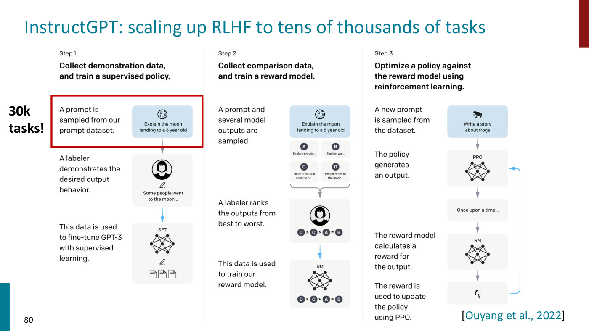

*Slide 80 — InstructGPT's three-step pipeline, with "30k tasks!" marking the prompt dataset of step 1. [Deck](https://cs224r.stanford.edu/spring_2025/slides/09_cs224r-2025-rlhf.pdf)*

Slides 82 and 83 compare the pretrained and the InstructGPT answer (≈53:34). For "Explain the moon
landing to a 6 year old in a few sentences", GPT-3 again lists similar instructions, while InstructGPT
answers "People went to the moon, and they took pictures of what they saw, and sent them back to the
earth so we could all see them." For "Write a short poem about a wise frog", GPT-3 lists story prompts
and InstructGPT writes an eight-line poem. ChatGPT applies instruction finetuning and RLHF to dialogue
(slides 84–85): its blog post describes supervised finetuning on conversations in which human trainers
played both sides, then reward models trained on rankings of alternative completions, with the model
finetuned by Proximal Policy Optimization over several iterations. The more data collected and the
more tasks covered, the better these models understand intent and respond to people's needs (≈53:34–
54:20).

## DPO in open models

DPO has been used a lot in the open-source community since it was launched: it is fairly cheap and
performant, and at one point essentially all open LLMs used it for alignment with human feedback;
Llama and Mistral models were also post-trained using DPO (slide 87, ≈54:20). Slide 87 shows the
Hugging Face Open LLM Leaderboard with a handwritten "DPO" beside nearly every one of the top thirteen
models, Mistral's MT-Bench scores (8.61 for Mistral Medium against 8.32 for GPT-3.5), and Meta's Llama
3 post that "Learning from preference rankings via PPO and DPO also greatly improved the performance of
Llama 3 on reasoning and coding tasks". Its caption: "Open source LLMs now almost all just use DPO (and
it works well!)".

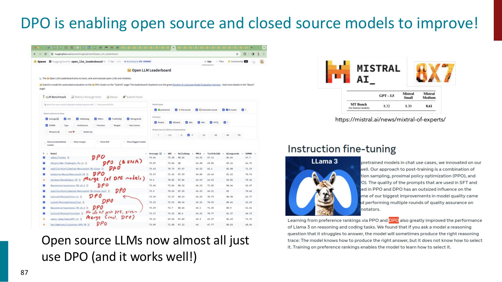

*Slide 87 — the Open LLM Leaderboard annotated "DPO" model by model, Mistral's MT-Bench table, and the Llama 3 post on learning from preference rankings. [Deck](https://cs224r.stanford.edu/spring_2025/slides/09_cs224r-2025-rlhf.pdf)*

## What preference training changes: style

A clear stylistic difference separates instruction-tuned and preference-trained models: answers become
more detailed and better formatted, closer to the kind of text people find easy to read (slide 88,
≈54:20–55:06). Asked "What are the five most common causes of stress among people?", Alpaca,
finetuned on 10k examples, gives a good one-line answer ("work, money, relationships, health, and
family"); Alpaca with PPO gives a longer, clearer, well-formatted numbered list (slide 88, Dubois et
al., 2023). These are **emergent properties**: what the model has discovered that people like and
prefer, which is why it generates answers of that form (≈55:06).

## Questions on whose preferences

**Can people's feedback be trusted, when people do not always know what they want?** (≈55:06–55:54).
There is a misalignment between short-term and long-term incentives: some behaviors look good in the
short term, and people give feedback on that basis, but are very undesirable in the long term. That
is truly a hard problem to solve within the RLHF pipeline.

**Are two answers ranked, or more?** (≈55:54–56:40). For efficiency people typically rank more than
two answers, since a ranking of $N$ answers gives $\binom{N}{2}$ preference pairs. There is also the
**Plackett-Luce** family, a generalization of Bradley-Terry that trains on ranked completions
directly. Both probably work fine. (Lecture 8 makes the same point with $\binom{k}{2}$ pairs from a
ranked batch; see [learning rewards from preferences](preference-learning.md#the-algorithm).)

**Are companies incentivized to optimize for engagement rather than people's interests?**
(≈56:40–58:14). Sharma says this goes well beyond the lecture's scope, but history helps: it is not
only an issue for LLMs. YouTube had a lot of issues with its recommendation systems, with people
engaging far more than they wanted to, a broader problem of how technology interfaces with people and
societies. As Sharma recalls it, long-term healthy engagement was in YouTube's own interest, since
someone spending 20 hours a day on it is probably not good for the product either. Optimizing for
long-term engagement should ideally not fall into short-term behaviors such as the sycophancy seen
from GPT-4o.

## Frontier and challenges

**Sycophancy** (slide 95, ≈58:14–59:48). Sharma jumps ahead to this slide because the class has
already raised it: this is a fast-evolving topic that is touching our lives as we decide how chatbots
should interface with people. After a model update, GPT-4o became fairly sycophantic, endorsing its
users' good and bad ideas alike in a way everyone deemed unhealthy (the slide shows OpenAI's post of
April 29, 2025, "Sycophancy in GPT-4o: What happened and what we're doing about it"). Sharma, who does
not work at OpenAI, makes no comment on the incident itself, but says these issues are very real: how
feedback data shapes a final model's emergent behaviors, and so how the products are used, is still
being worked out. Slide 95's last bullet: "There is a real concern of AI mis(alignment)!"

**Reward hacking** (slides 92 and 94, ≈59:48–1:00:35). "Human preferences are unreliable!" and
"'Reward hacking' is a common problem in RL" (slide 92, with a still from OpenAI's boat-racing game).
Models trained against learned reward models align with human preferences up to a point, but as
training continues against them they start drifting away from what we truly want. This is common in RL
whenever a proxy reward stands in for the true one, and in machine learning generally. It limits how
far RL can be scaled, because training has to be stopped at some point once hacking starts; it is an
active problem.

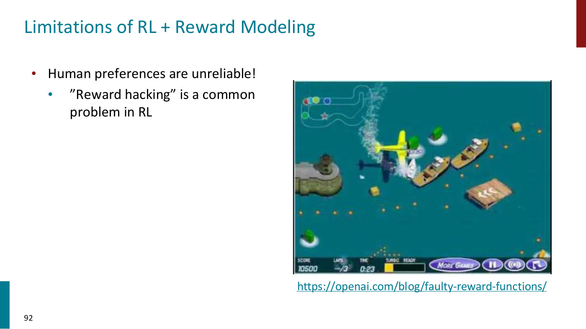

*Slide 92 — reward hacking, illustrated with a still from the boat-racing game in OpenAI's post on faulty reward functions. [Deck](https://cs224r.stanford.edu/spring_2025/slides/09_cs224r-2025-rlhf.pdf)*

Slide 94 adds "Models of human preferences are even more unreliable!" and shows it (Stiennon et al.,
2020): as the policy moves further from the supervised baseline, measured by KL from 0 to 250, the
reward model's predicted preference rises steadily to about 1.0, while the actual human preference
rises from about 0.24 to a peak of about 0.47 near a KL of 10 and then falls, to about 0.05 at 250.
The slide prints the penalized reward $R(s) = RM_\phi(s) - \beta \log \left(\frac{p^{RL}_ \theta(s)}{p^{PT}(s)}\right)$
beneath the chart.

*Slide 94 — reward-model over-optimization: the reward model's prediction (dashed) keeps rising with KL from the supervised baseline while actual preference (solid) peaks and collapses. [Deck](https://cs224r.stanford.edu/spring_2025/slides/09_cs224r-2025-rlhf.pdf)*

**Covering every situation** (≈1:00:35–1:01:21). Answering a question, Sharma says the field is moving
toward rubric-based approaches that score responses on several different aspects, and that many kinds
of data are collected to teach the behaviors we want and the right way to respond to situations. No
dataset can cover every situation a chatbot will meet, so we rely on the model to generalize from what
it is taught, and it breaks all the time, with unexpected behaviors no one anticipated.

## What's next

Slides 96 and 99 (≈1:01:21–end): RLHF "is a fast evolving field; the basic structure remains intact
but several areas for improvement" (slide 96). Preference data is still expensive to collect and not
necessarily representative of the behaviors we want, so better kinds of feedback are being sought.
Sharma points to reasoning, where models generate their own outputs and are graded by verifiable
rewards, as one of the most exciting topics in post-training, which students will hear more about
(≈1:01:21; [Lecture 10](10-rl-for-reasoning.md) is the guest lecture on RL for LLM reasoning). Language models
are aligned to the aggregate preferences of people, but each person interacts with them one on one, so
**personalizing** language models, with more context about each user and their preferences, is an
area Sharma finds very interesting (slide 99, ≈1:02:08). Slide 99 shows the PRISM Alignment Project
(Kirk et al., 2024) and few-shot preference optimization (FSPO, Singh, Hsu et al., 2024). Hallucination
and uncontrolled emergent behaviors remain active problems (≈1:02:08). Slide 99 prints "by the next
lecture (2024) these slides may look completely different!", a year carried over from the earlier
CS224N deck.

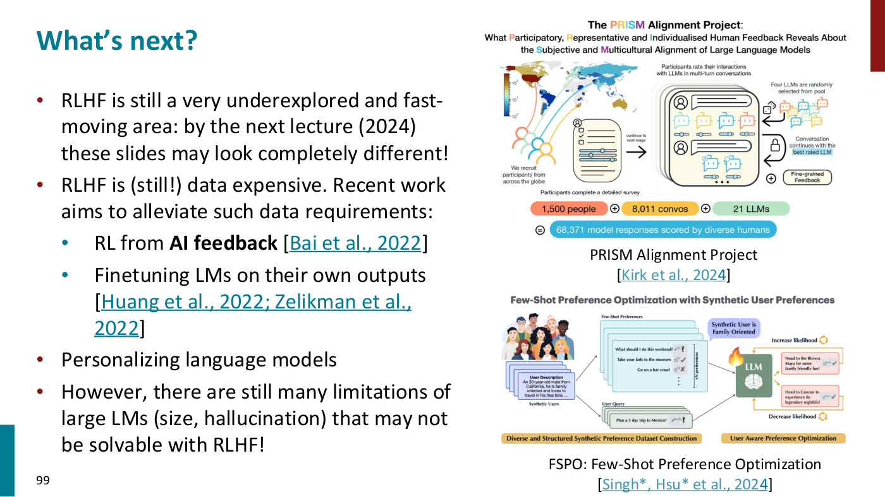

*Slide 99 — what's next, with figures from the PRISM Alignment Project (feedback from 1,500 people worldwide) and few-shot preference optimization with synthetic users. [Deck](https://cs224r.stanford.edu/spring_2025/slides/09_cs224r-2025-rlhf.pdf)*

## From the slides only

These slides are not discussed aloud; this section is from the
[slide file](../raw/slides/09-rl-for-llms.md) alone.

- **Tasks collected from labelers for InstructGPT** (slide 81): "Plain" (arbitrary tasks, ensuring
  diversity), "Few-shot" (an instruction with several query/response pairs) and "User-based" (prompts
  for use-cases stated in waitlist applications to the OpenAI API), with examples such as
  brainstorming ("List five ideas for how to regain enthusiasm for my career") and generation.
- **Hallucination** (slide 93): "Chatbots are rewarded to produce responses that seem authoritative
  and helpful, regardless of truth", which "can result in making up facts + hallucinations". The slide
  shows NPR's headline "Google shares drop" by 100 billion dollars "after its new AI chatbot makes a
  mistake" (February 9, 2023) and Bing answering that the Philadelphia Eagles won the most recent Super
  Bowl.
- **RL from AI feedback** (slide 97, Bai et al., 2022): one direction for making high-quality data
  collection scale. A "Constitutional" AI example: the assistant agrees to help hack a neighbor's wifi;
  a critique request asks how the response is harmful; the critique names the invasion of privacy; and
  a revision request produces a response that advises against it. Lecture 8 covers AI feedback aloud;
  see [learning rewards from preferences](preference-learning.md#ai-feedback).
- **Finetuning language models on their own outputs** (slide 98), "especially code and reasoning":
  "Large Language Models Can Self-Improve" (Huang et al., 2022) and the Self-Taught Reasoner (STaR,
  Zelikman et al., 2022), drawn as a language model whose chain of thought loops back into it.

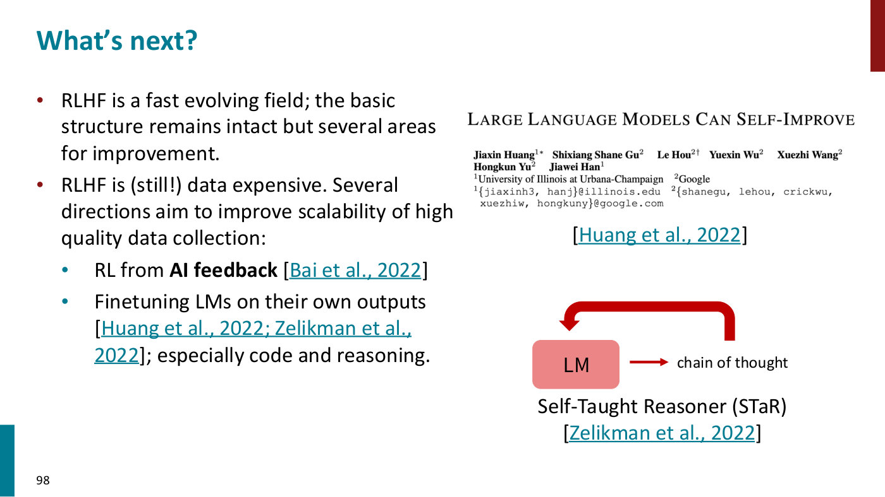

*Slide 98 — finetuning language models on their own outputs: the "Large Language Models Can Self-Improve" paper and STaR's loop from a model's chain of thought back to the model. [Deck](https://cs224r.stanford.edu/spring_2025/slides/09_cs224r-2025-rlhf.pdf)*

## Related pages

- [Instruction finetuning](instruction-finetuning.md): why a pretrained model is not an assistant,
  finetuning on many tasks, the scaling result and the limitations.
- [RL from human feedback (RLHF)](rlhf.md): the pipeline, the reward model, why RL, the KL penalty,
  the results and the limitations.
- [Direct preference optimization (DPO)](direct-preference-optimization.md): the derivation in full,
  what the loss does, and how it compares with RLHF.
- [Learning rewards from preferences](preference-learning.md): Lecture 8's preference objective and
  algorithm, of which the Bradley-Terry reward model is the language-model version.
- [Policy gradients](policy-gradients.md): the estimator the RL step uses, derived for trajectories
  in Lecture 3.
- [PPO](ppo.md): the RL algorithm in InstructGPT's third step and slide 74's pipeline.
- [The RL objective](rl-objective.md): the expected reward, and its KL-penalized form.
- [Lecture 8 — Reward Learning](08-reward-learning.md): the lecture before, which introduces RLHF.
- [Lecture 10 — RL for LLM Reasoning](10-rl-for-reasoning.md): the lecture after, on RL for
  reasoning with verifiable rewards.
- [Lecture 18 — Frontiers](18-frontiers.md#evaluating-generalist-systems): the same GPT-4o update as an
  example of how hard RL-trained models are to evaluate, what human preferences reward, and RLHF's effect on
  calibration.
