# Lecture 10 — RL for LLM Reasoning

Stanford CS224R, Spring 2025 (Friday, May 2) · guest lecture by Aviral Kumar ·
[video](https://www.youtube.com/watch?v=O2VpNnwB4lM) (70 min) ·
[slides (PDF)](https://cs224r.stanford.edu/spring_2025/slides/10_cs224r-rl_for_reasoning_lecture.pdf) ·
[slide-by-slide text](../raw/slides/10-rl-for-reasoning.md) ·
[transcript](../raw/transcripts/10-rl-for-reasoning.md)

**What this lecture establishes.** Training a language model to imitate reference solutions to math
problems improves only slowly as the data grows, and high-quality data of that kind is running out.
Posed as a Markov decision process, with the problem as the initial state, each step of the solution
as an action, and a reward of 1 only if the final answer is right, reasoning becomes an RL problem
with a sparse reward and deterministic dynamics. The lecture then works through ways of training on
the model's own samples, in increasing order of how much RL they use. **Rejection finetuning** (RFT)
imitates the model's own correct solutions; it is about twice as data-efficient as supervised
finetuning, but trained too far it gets worse, because the model learns **spurious steps** that
happened not to derail a correct solution. **Per-step credit assignment** fixes this by estimating
each step's Q-value, the chance of finishing correctly from that prefix under a rollout policy, and
its advantage, the change in that chance the step caused. The advantages can filter which steps to
imitate, or build preference pairs for DPO, an offline RL method that needs about eight times less
data than supervised finetuning. **Online RL** trains with a policy gradient on the 0/1 reward, or
adds a learned per-step advantage as a dense reward (process advantage verifiers), which is 5–6
times as sample-efficient as the outcome reward alone. The lecture closes with Kumar's account of
the "thinking" models such as DeepSeek-R1. The RL objective is unchanged, but the base models can
now take "macro" actions such as verifying and backtracking, and they are given a far larger token
budget.

The lecture is a guest lecture by Aviral Kumar (title slide, slide 1, with the Carnegie Mellon
University School of Computer Science logo). Kumar had covered similar material in Kumar's own class
two weeks earlier (≈0:05). Part 1 is built around two of Kumar's papers (slide 8), chosen, Kumar
says, not because they invented the techniques but because they analyze empirically why each method
works or fails (≈12:23). It draws on [Lecture 7](07-offline-rl.md)'s advantage-weighted regression
and trajectory stitching and on [Lecture 9](09-rl-for-llms.md)'s DPO and reward models, and Lecture
9 ends by pointing to reasoning with verifiable rewards as the next topic (Lecture 9, ≈1:01:21).

**What the recording covers.** The recording (about 70 minutes) follows the deck from slide 2 to the
online-RL results (slide 27). At ≈1:06:56 Kumar says "I'm going to skip some of these things" and
turns to the thinking models of Part 2, discussing slide 32 until the recording ends. Slides 28–31
and 33–41 are not discussed aloud; they are summarized under [From the slides
only](#from-the-slides-only). Three things are worked on a board the recording does not show: the
language MDP (≈10:03–10:50, ≈46:58), the rejection finetuning algorithm (≈13:54–18:29) and the
per-step DPO algorithm (≈55:22–56:09). This page reconstructs them from the spoken words and says
so. At ≈58:27 Kumar says the result plots "were supposed to be gifs"; the PDF holds only their first
frame, so slides 10, 19 and 23 show a few points at the left edge of empty axes, and their results
come from what Kumar says.

## Contents

1. [The setting: solving math problems](#the-setting-solving-math-problems)
2. [Why imitation is not enough](#why-imitation-is-not-enough)
3. [The plan: classical techniques, then thinking models](#the-plan-classical-techniques-then-thinking-models)
4. [Reasoning as a Markov decision process](#reasoning-as-a-markov-decision-process)
5. [Three ways to scale the data](#three-ways-to-scale-the-data)
6. [Rejection finetuning](#rejection-finetuning)
7. [Supervised finetuning improves slowly; RFT is twice as efficient](#supervised-finetuning-improves-slowly-rft-is-twice-as-efficient)
8. [Too much on-policy imitation hurts](#too-much-on-policy-imitation-hurts)
9. [Spurious steps](#spurious-steps)
10. [Assigning credit to steps with rollouts](#assigning-credit-to-steps-with-rollouts)
11. [The Q-value of a step](#the-q-value-of-a-step)
12. [Advantages: one Q-value minus the previous one](#advantages-one-q-value-minus-the-previous-one)
13. [Option 1: filtering steps by advantage](#option-1-filtering-steps-by-advantage)
14. [Option 2: offline RL with per-step DPO](#option-2-offline-rl-with-per-step-dpo)
15. [Offline RL results: eight times the data efficiency](#offline-rl-results-eight-times-the-data-efficiency)
16. [Online RL with a 0/1 reward](#online-rl-with-a-01-reward)
17. [Dense rewards: process advantage verifiers](#dense-rewards-process-advantage-verifiers)
18. [Thinking models: what changed](#thinking-models-what-changed)
19. [From the slides only](#from-the-slides-only)
20. [Related pages](#related-pages)

## The setting: solving math problems

Reasoning means different things to different people, so the lecture restricts itself to solving
math problems (≈0:05). Slide 2 shows a problem from the 2025 AIME exam, a benchmark people use to measure these models
(≈0:52): find the sum of all
integer bases greater than 9 for which $17_b$ divides $97_b$, with two reference solutions reaching
the answer 70. The goal is a model that, given such a question, can write a solution like these in
natural language and reach the right answer (≈1:37).

The conventional way to train a language model, or any foundation model, is next-token prediction:
tokenize the data and train with a negative log-likelihood loss to predict each next token (slide 3,
≈1:37). For reasoning, that means tokenizing the question and a reference solution and training the
model to predict the solution conditioned on the question (≈2:23). Why does this work? Kumar calls
it an open research question, and offers one perspective, the relation on slide 3:

$$\left| \hat{p}_ \theta(\mathbf{y} \mid \mathbf{x}) - p^\ast(\mathbf{y} \mid \mathbf{x}) \right| \propto \frac{1}{|\mathcal{D}(\mathbf{y} \mid \mathbf{x})|^\alpha}$$

Here $\mathbf{x}$ is the input (the question), $\mathbf{y}$ the output (the answer),
$\hat{p}_ \theta$ the learned model, $p^\ast$ the ground-truth model, and
$|\mathcal{D}(\mathbf{y} \mid \mathbf{x})|$ the amount of training data similar to the target, raised
to some power $\alpha$. The slide's annotation says the error reduces with "more data similar to
the target x". With many questions and answers the error would be low and the model would approximate a
highly capable expert; in reality, for many reasoning problems there is not enough data to make this
bound small (≈3:10–3:55).

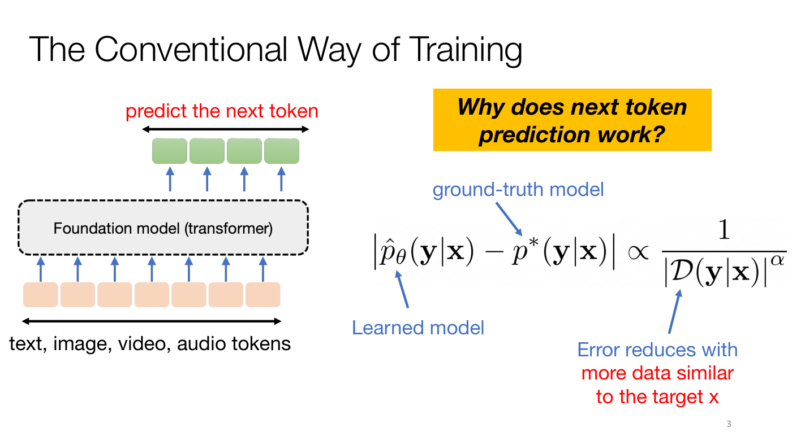

*Slide 3 — next-token prediction over text, image, video and audio tokens, beside the relation that bounds the learned model's error by the amount of similar data. [Deck](https://cs224r.stanford.edu/spring_2025/slides/10_cs224r-rl_for_reasoning_lecture.pdf)*

## Why imitation is not enough

Studies of data supply estimate that we will run out of high-quality internet text by 2028 (slide 4,
≈3:55), and supervised training on high-quality solutions scraped from the internet will not reach
a level where models can do great research or replace human researchers. The same holds in robotics
and embodied AI (≈4:41): slide 4 sets the DROID dataset (76k episodes, 564 scenes) and a larger
collection (1M episodes from 311 scenes, 22 embodiments) against the token counts of language models,
with the caption "Real-world is stochastic, this is little data compared to LLMs!"

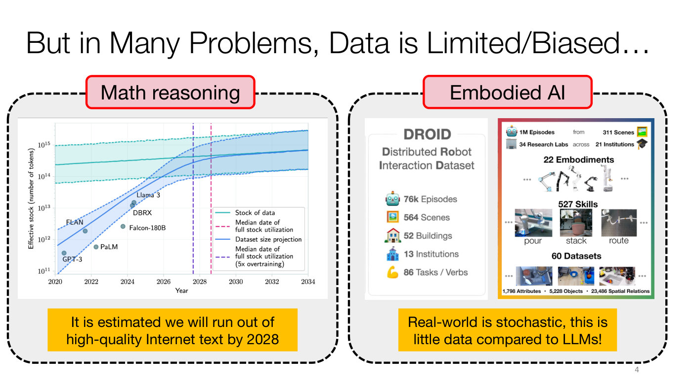

*Slide 4 — left, the projected size of training datasets meeting the stock of internet text around 2028; right, the robot datasets, small next to language-model data. [Deck](https://cs224r.stanford.edu/spring_2025/slides/10_cs224r-rl_for_reasoning_lecture.pdf)*

Slide 5 shows what models trained on current data do with a problem from IMO 2021, which Kumar
notes is presumably in their training sets (≈4:41): prove that
$\sum_{i=1}^{n} \sum_{j=1}^{n} \sqrt{|x_i - x_j|} \leq \sum_{i=1}^{n} \sum_{j=1}^{n} \sqrt{|x_i + x_j|}$
for all real numbers $x_1, \ldots, x_n$. The proof needs the whole sum to be treated as a whole, but
the solution, which Kumar got from an OpenAI o-series model, "I think o1" (≈5:27), analyzes
individual terms, and in its third case simply asserts the inequality. The slide's annotations read
"Analyzing individual terms is not good enough", and say that the model asserts its way out with no
realization of its mistake and no backtracking. Kumar's summary is that supervised training produces "a solution
that looks very much like a legitimate solution that you could have written on an exam; it's just
that that solution ends up being wrong" (≈5:27), and that this is what RL tries to fix (≈6:12).

## The plan: classical techniques, then thinking models

Slide 6 splits the field on a timeline at the release of DeepSeek-R1 in January 2025 (≈6:12–6:59).
DeepSeek-R1 comes from a company in China named DeepSeek and is very good at competition math and
coding; it belongs to the same family of "thinking" models as OpenAI's o-series, the Gemini thinking
model and the Claude Sonnet thinking version (≈6:59). Part 1 covers the classical techniques from
before, in three groups: imitation learning, offline RL and online RL. Its takeaway is "Training with
RL can help improve efficiency of learning!" Part 2 covers their modern extensions to thinking
models, with the summary "Still the old recipes and RL ideas are helpful!" (slide 6, ≈7:46).

## Reasoning as a Markov decision process

Seen through an RL lens, solving a problem is a Markov decision process (≈8:32). The string of
tokens in the question is the **initial state**. The solution is broken into a sequence of
**steps**, and each step is an **action**. When the solution ends in an answer, the model gets a
sparse **reward** of 1 if the answer is correct and 0 if not (≈9:17). Slide 7 labels these on a
worked problem, with the three shaded steps marked "Steps = actions", the boxed final answer 8 marked
"reward = 1 if answer is correct", and the summary "Sparse-reward MDP with deterministic dynamics".

*Slide 7 — the problem is the initial state, each shaded step of the solution is an action, and the circled final answer earns the 0/1 reward. [Deck](https://cs224r.stanford.edu/spring_2025/slides/10_cs224r-rl_for_reasoning_lecture.pdf)*

The dynamics are deterministic because there is no external environment: nothing outside the model
supplies the next state (≈10:03). Kumar draws the MDP on the board, which the recording does not
show; from the spoken words (≈10:03–10:50), with $\mathbf{s}_ 0$ the problem and $\mathbf{a}_ t$ the
step taken at time $t$, the states are concatenations,

$$\mathbf{s}_ 1 = [\mathbf{s}_ 0, \mathbf{a}_ 0], \qquad \mathbf{s}_ 2 = [\mathbf{s}_ 0, \mathbf{a}_ 0, \mathbf{a}_ 1], \qquad \ldots$$

until the model produces a final answer, say 8, and receives the reward $r(8, \text{ground truth})$,
which is either 1 or 0. In Kumar's words, "this is a lot like a sparse-reward MDP with deterministic
dynamics" (≈10:03).

Three questions follow. There are infinitely many actions: unlike continuous control's
fixed-dimension vector of real values, an action is a variable-length string of discrete tokens
(≈10:50–11:35). For problems whose answer is a proof rather than a number, the community has not yet
found the right techniques, which is why the lecture sticks to competition problems with a
deterministic final answer (≈11:35). And yes, a model can reach the right answer through suboptimal
steps, which the lecture takes up below (≈11:35).

## Three ways to scale the data

Part 1 is a **data-scaling analysis**: it trains reasoning models on a dataset of problems with
oracle solutions, which are needed to check answers and so define the reward, and compares methods
by how their performance grows with the amount of data (slide 9, ≈13:08). Slide 9 draws three axes
from a common origin:

- **SFT** scales the number of questions, each with one reference answer obtained from bigger
  models or from humans: imitation learning on the dataset (≈13:54).
- **RFT** (rejection finetuning) scales the number of correct solutions per question, sampled
  on-policy from the learner itself (≈13:54).
- **RL** also uses the learner's incorrect solutions, the rollouts with reward 0 (≈18:29–19:15).
  Unlike imitation, RL does not need its data to be high quality; offline RL can learn from data
  that does not succeed (≈18:29, and see [offline RL](offline-rl.md)).

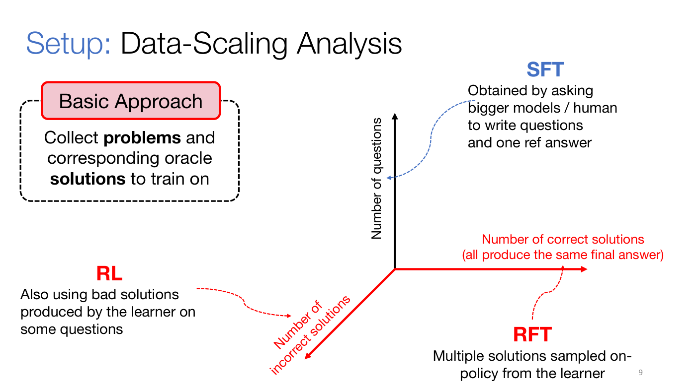

*Slide 9 — the three axes along which the training data can grow: more questions with reference answers (SFT), more of the learner's own correct solutions (RFT), and its incorrect solutions too (RL). [Deck](https://cs224r.stanford.edu/spring_2025/slides/10_cs224r-rl_for_reasoning_lecture.pdf)*

## Rejection finetuning

Kumar writes the algorithm on the board (≈13:54–18:29). From the spoken words, with $\pi_\theta$
the model being trained, $\mathbf{x}$ a question from the dataset and $\mathbf{y}^\ast$ its
ground-truth answer, each iteration $1, \ldots, T$ does three things:

1. **Sample.** For each question, sample $N$ solutions $\mathbf{y}_ 1, \ldots, \mathbf{y}_ N$ from
   $\pi_\theta(\cdot \mid \mathbf{x})$, and compute each one's reward $r(\mathbf{y}_ j)$ by checking
   whether its final answer matches $\mathbf{y}^\ast$ (≈14:40–16:12).
2. **Filter.** Keep only the correct ones, the set $\tilde{S} = \lbrace \mathbf{y}_ j : r(\mathbf{y}_ j) = 1 \rbrace$
   (≈16:12–17:44).
3. **Imitate.** Train $\pi_\theta$ on $\tilde{S}$ by behavior cloning, also called SFT (≈17:44).

The wrong samples are rejected, hence the name (≈18:29). Its appeal is that "it's not actually
asking you for oracle solutions that a human wrote" (≈18:29): the training data are on-policy
rollouts filtered for correctness, which is possible because the reward function is known. Here
$\mathbf{y}_ 1, \ldots, \mathbf{y}_ N$ are independent whole solutions; from slide 16 on, the
subscript indexes the steps within one solution instead, a notation mismatch Kumar points out
(≈36:10).

Three student questions probe it. Does it make answers verbose? No: it imitates whichever samples
succeed, and if most samples of "2 plus 2" write 4 right away, it trains the model to write 4 right
away (≈20:00–20:47). If a sample reaches the right answer by a wrong approach, is that reinforced?
Yes, and that is what the empirical results below examine (≈20:47). Is the data biased toward easy
problems? In some way, yes; in practice the model is first trained with SFT on oracle
question-answer pairs, so that it can answer some of the questions, and RFT runs on top of that
(≈20:47–21:34).

## Supervised finetuning improves slowly; RFT is twice as efficient

The experiments use two benchmarks, GSM8K and MATH, which Kumar notes are now fully solved but were
representative in 2024 (≈21:34–22:19). Slide 10 plots the test error after finetuning a DeepSeek
model (the captions name it DeepSeek V2; the slide prints only "DeepSeek") against the number of
questions, from 8k to 128k (≈22:19). The error does fall as questions are added, but slowly: a
smooth curve fitted to it goes as $|\mathcal{D}|^{-0.15}$ on GSM8K and $|\mathcal{D}|^{-0.05}$ on
MATH, where $|\mathcal{D}|$ is the dataset size (slide 10, ≈23:05). An exponent like $-1/2$ would
let a reasonable amount of data solve the benchmark; these do not. The goal for reasoning methods is
therefore to push the curve down and to the left (≈23:51).

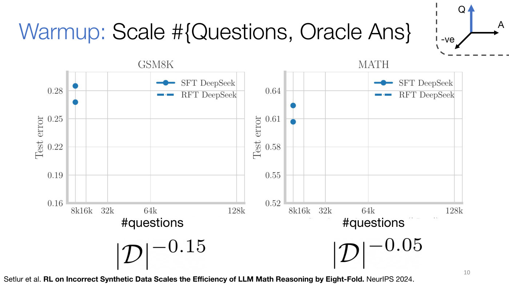

*Slide 10 — test error against the number of questions on GSM8K and MATH, with the fitted exponents below; the PDF holds only the first frame of an animation, so only the leftmost points appear. [Deck](https://cs224r.stanford.edu/spring_2025/slides/10_cs224r-rl_for_reasoning_lecture.pdf)*

The first improvement is rejection finetuning. On both benchmarks, RFT reaches the same test error
as SFT trained with twice the questions and twice the human-written solutions (≈23:51). On-policy
imitation, sampling from the policy and imitating its correct answers, is therefore about 2x more
efficient than off-policy imitation of human solutions (≈24:37). The animated curves are not in the
PDF, so this comparison comes from what Kumar says.

## Too much on-policy imitation hurts

Scaling RFT further means raising $N$, sampling many more solutions per question and imitating all
the correct ones. "It turns out that that recipe does not actually work" (≈24:37). Slide 11 plots
test error against the number of correct answers kept per question (≈25:22–26:08; Kumar explains
that the axis is the size of $\tilde{S}$ times the 8k prompts, a constant factor). Every curve falls
and then rises. On MATH with 8k prompts the error goes from about 0.620 at 10k to about 0.599 at
50k–60k and back up to about 0.606 at 128k. On GSM8K with 8k prompts it goes from about 0.280 to
about 0.263 at 30k and up to about 0.290 at 128k (slide 11). The slide's observation: "On-policy
imitation eventually degrades if you train too much on it".

*Slide 11 — RFT with a fixed set of prompts: test error on MATH (red) and GSM8K (purple) falls as more correct answers per question are imitated, then rises again. [Deck](https://cs224r.stanford.edu/spring_2025/slides/10_cs224r-rl_for_reasoning_lecture.pdf)*

Asked whether the correct samples are deduplicated, Kumar says yes, a detail left off the slide.
Edit-distance rejection is one mechanism, and a common recipe samples more than $N$, say $2N$, and
keeps the $N$ most diverse (≈26:54). The conclusion is that "fitting on self-generated data on a
limited number of initial states actually hurts generalization of the model" (≈26:54). In MDP
terms, the model trains on one set of initial states and is tested on new ones, and training too
much on the same initial states hits a generalization bottleneck (≈27:41).

## Spurious steps

Why does this happen? Slide 12's picture: prompts are initial states, and each sampled solution
moves step by step toward an answer. Sampling a lot from the model and training on its own outputs
picks up traces with **spurious steps**, steps that are incorrect but happen not to derail that
particular sample, which recovers and reaches the correct answer (≈27:41–28:26). The model can learn
to recover on the training problems, but not on test problems, where the same step derails it (slide
12).

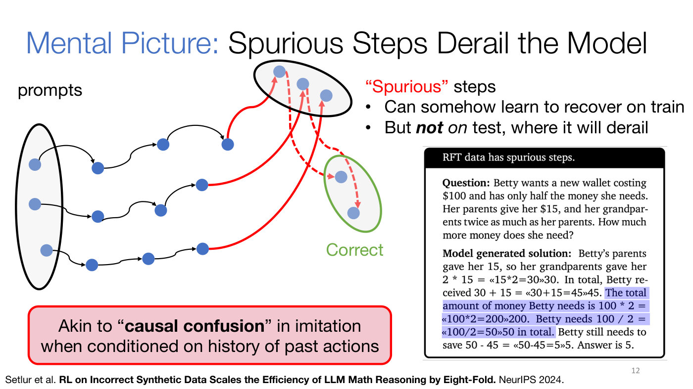

*Slide 12 — left, solution paths from prompts that wander through spurious steps yet still reach the correct answers; right, the GSM8K solution whose highlighted line computes 100 times 2 and then 100 divided by 2. [Deck](https://cs224r.stanford.edu/spring_2025/slides/10_cs224r-rl_for_reasoning_lecture.pdf)*

The starkest example the paper found is from GSM8K (slide 12, ≈29:13). Betty needs money for a
100-dollar wallet. The model's solution says the total needed is 100 times 2, which is 200, and on
the next line reverses itself to 100 divided by 2, which is 50, and still reaches the right answer.
The line computing 200 is a spurious step: "It's a step that is not needed. It's an incorrect step
that exists in the solution" (≈29:13). Slide 12 likens this to "causal confusion" in imitation
learning: by imitating everything in successful traces, the model learns incorrect associations
alongside the right ones (≈31:32–32:19).

Several questions follow. A step, for now, is a sentence; there is no universally agreed definition,
and Part 2 uses steps that are whole blocks (≈29:59). Are spurious steps the main cause of the
rising error, and can they be measured? They are one of the main causes; ordinary measures of fit do
not reveal them, but the paper counted them and found they grow over training, though Kumar cannot
prove they are the only cause (≈29:59–30:44). The method samples entire trajectories (≈30:44).
Whether the model overfits to a "method" of reaching the answer depends on what counts as a method,
which Kumar calls a semantic question (≈30:44–31:32). Asked whether such a step is incorrect or just
irrelevant, Kumar says it is irrelevant in a way, but irrelevance still hurts: "Imagine for a second
that you pass to a language model a million irrelevant tokens and ask it to dig out the information
that actually matters." (≈35:22).

## Assigning credit to steps with rollouts

The way out is the third axis, learning from incorrect data, and the idea is to assign credit to
each step (slides 13–14, ≈32:19). Slide 14's key insight is "If we can identify spurious steps
somewhat *precisely*, then we can avoid this issue", shown on a six-step correct solution to a
problem about the cost of apples and pears (an example the recording does not read out). This ties
back to value functions and advantages (≈33:06).

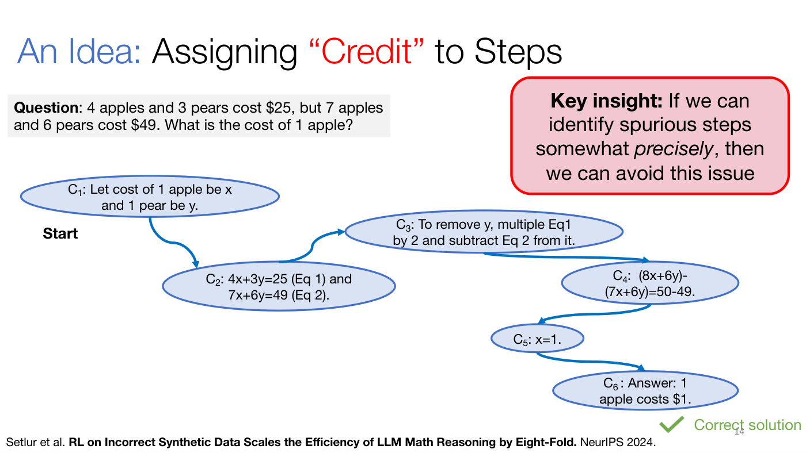

*Slide 14 — a correct solution as a chain of six steps, each of which could be given credit for the outcome. [Deck](https://cs224r.stanford.edu/spring_2025/slides/10_cs224r-rl_for_reasoning_lecture.pdf)*

Take one sampled solution that ended in a wrong answer. For each prefix, the problem plus the steps
so far, ask a separate **rollout policy** to complete the solution many times (slide 15,
≈33:06–33:52). If the completions mostly succeed, the prefix was probably fine, since it did not
damage the rollout policy's problem solving. If they never succeed, something in the prefix is
wrong. If they sometimes succeed, the prefix is "sort of OK" (slide 15, ≈33:52–34:37). The slide
names the connection: "This is equivalent to the value function of the *rollout* policy…." Doing
rollouts estimates the expected future 0/1 reward of the rollout policy from that prefix (≈35:22).

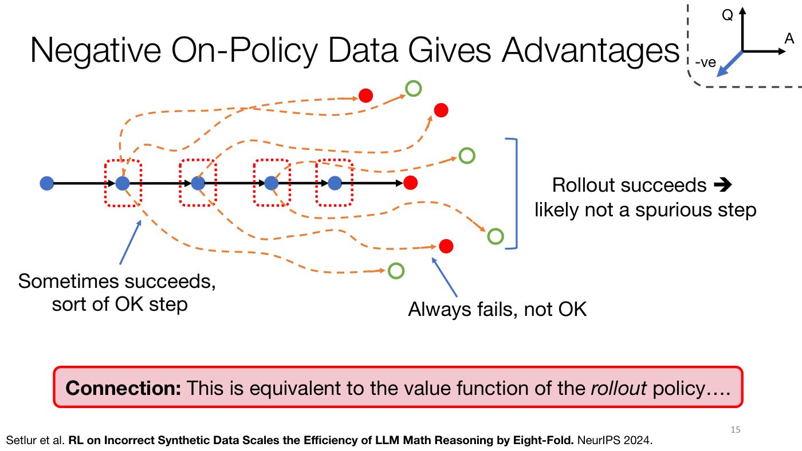

*Slide 15 — from each boxed step of a failed solution, orange rollouts are run to completion; green circles are successes and red dots failures, so a step whose rollouts mostly succeed is likely not spurious. [Deck](https://cs224r.stanford.edu/spring_2025/slides/10_cs224r-rl_for_reasoning_lecture.pdf)*

## The Q-value of a step

Written as math (slide 16, ≈36:10–36:55), with $\boldsymbol{x}$ the problem, $\hat{\boldsymbol{y}}_ i$
the $i$-th step of a sampled solution, $\hat{\boldsymbol{y}}_ {1:i-1}$ the steps before it,
$\tilde{\pi}$ the rollout policy, and $\boldsymbol{y}$ the reference solution that the reward checks
the answer against:

$$Q_{\tilde{\pi}}(\boldsymbol{x}, \hat{\boldsymbol{y}}_ {1:i-1};\thinspace \hat{\boldsymbol{y}}_ i) = \mathbb{E}_ {\boldsymbol{y}^{\text{new}}_ {i+1:L} \sim \tilde{\pi}(\cdot \mid \boldsymbol{x}, \hat{\boldsymbol{y}}_ {1:i})} \left[ r\left( [\hat{\boldsymbol{y}}_ {1:i}, \boldsymbol{y}^{\text{new}}_ {i+1:L}], \boldsymbol{y} \right) \right]$$

The state is the problem and the prefix, $(\boldsymbol{x}, \hat{\boldsymbol{y}}_ {1:i-1})$; the action
is the step $\hat{\boldsymbol{y}}_ i$. The rollout policy samples new steps
$\boldsymbol{y}^{\text{new}}_ {i+1:L}$ to the end of the solution, and the reward $r$ scores the
completed solution. The slide's gloss: "expected future reward under new actions (i.e., steps)
sampled by policy" $\tilde{\pi}$.

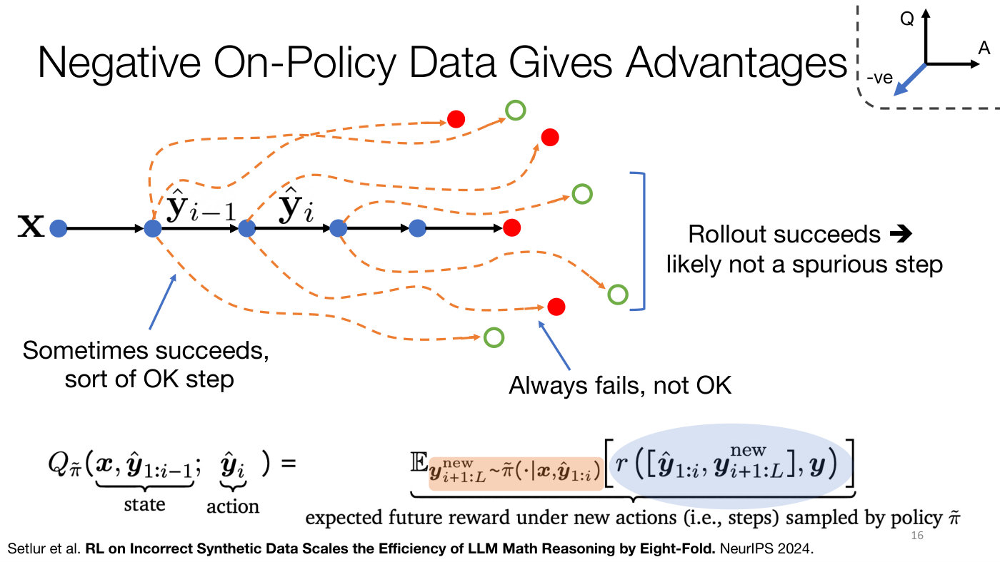

*Slide 16 — the rollout picture with its notation, and the Q-value of step i under the rollout policy, with the prefix braced as the state and the step as the action. [Deck](https://cs224r.stanford.edu/spring_2025/slides/10_cs224r-rl_for_reasoning_lecture.pdf)*

This is an ordinary Q-function. Kumar recalls the definition on the board (≈36:55–37:42): the
expected discounted sum of rewards from time 0 onward, given the first state and action,

$$Q^\pi(\mathbf{s}, \mathbf{a}) = \mathbb{E}_ {\pi} \left[ \sum_{t=0}^{\infty} \gamma^t r(\mathbf{s}_ t, \mathbf{a}_ t) \mid \mathbf{s}_ 0 = \mathbf{s}, \mathbf{a}_ 0 = \mathbf{a} \right]$$

with $\gamma$ the discount factor. Here $\gamma = 1$ and the reward is 0 at every step until the
final answer, so the sum collapses to the expectation of the one terminal reward, and the immediate
reward $r(\mathbf{s}, \mathbf{a})$ that usually appears in front is zero (≈37:42–38:27). See
[value functions](value-functions.md#the-q-function-qpi) for the course's definitions.

**Which policy should do the rollouts?** The equation does not care (≈38:27). In Kumar's opinion,
"the policy that you're doing the rollout with should be a different policy compared to the current
one, otherwise it can fail in the same way" (≈39:13). Some work argues that the same policy is good
enough, and part of the NLP community uses it and finds it works reasonably; Kumar has not seen an
apples-to-apples comparison that settles it (≈39:13). Asked whether this resembles trajectory
stitching and advantage weights, Kumar says "exactly yes": the paper discusses stitching, though the
slides leave it out (≈39:13–40:00; see [Lecture 7](07-offline-rl.md) and [implicit policy
constraints](implicit-policy-constraints.md)).

## Advantages: one Q-value minus the previous one

With the Q-function defined, steps can be judged the way advantages judge actions, much as in
advantage-weighted regression (≈40:00). The advantage is usually
$A^\pi(\mathbf{s}, \mathbf{a}) = Q^\pi(\mathbf{s}, \mathbf{a}) - V^\pi(\mathbf{s})$ (≈40:47). In this MDP the dynamics are
deterministic and each state is the previous one with a step appended, so the value of the state
before step $i$ is the Q-value of step $i-1$, and the advantage becomes a difference of consecutive
Q-values (slide 17, ≈40:47):

$$A_{\tilde{\pi}}(\boldsymbol{x}, \hat{\boldsymbol{y}}_ {1:i-1};\thinspace \hat{\boldsymbol{y}}_ i) = Q_{\tilde{\pi}}(\boldsymbol{x}, \hat{\boldsymbol{y}}_ {1:i-1};\thinspace \hat{\boldsymbol{y}}_ i) - Q_{\tilde{\pi}}(\boldsymbol{x}, \hat{\boldsymbol{y}}_ {1:i-2};\thinspace \hat{\boldsymbol{y}}_ {i-1})$$

The slide calls it the "relative change in the value function having committed to a step". Its
worked example is a failed five-step solution whose Q-values are 0.66, 0.0, 1.0, 0.25 and 0.0, giving
advantages of −0.66, 1.0, −0.75 and −0.25, each Q-value minus the one before it. A step that lowers
the Q-value, like the second step here, gets a negative or low advantage and is probably a bad or
spurious step not worth learning from; a positive advantage marks a good step (≈41:32–42:19).

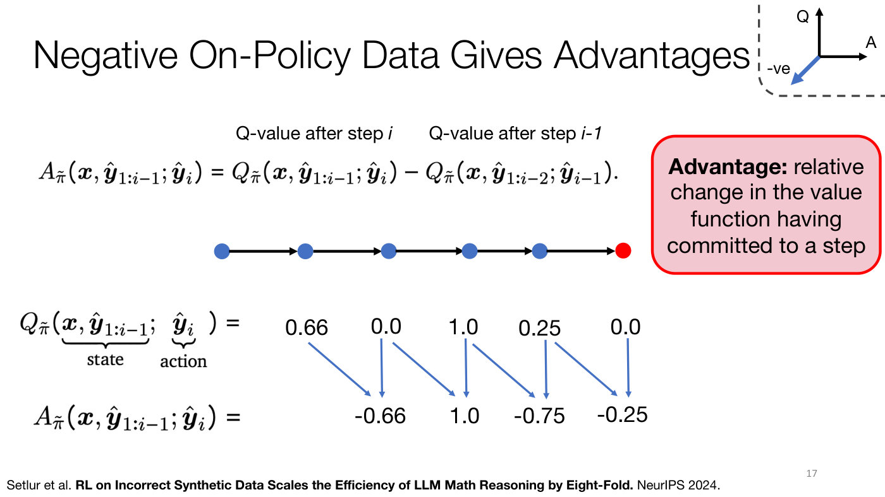

*Slide 17 — the advantage of a step as its Q-value minus the previous step's, worked through on a failed solution: the arrows show which two Q-values each advantage subtracts. [Deck](https://cs224r.stanford.edu/spring_2025/slides/10_cs224r-rl_for_reasoning_lecture.pdf)*

Is a Q-function being fitted? There are two kinds of work (≈42:19–43:05). One explicitly fits a
Q-function-like model, which the NLP community calls a **process reward model** (PRM): where the
reward models of RLHF score a whole answer, a PRM scores every step, the process. Kumar does not
think PRMs and Q-values are necessarily the same thing semantically. The other kind estimates
advantages directly with rollouts, as above. Asked how this helps a model learn general
problem-solving strategies, Kumar answers that it breaks the success of a long trace into the
success of its steps. A model that can localize which of four steps went wrong learns that step,
instead of guessing that step three caused a failure that step one caused, and this greatly improves
data efficiency (≈43:05–43:52).

## Option 1: filtering steps by advantage

The first way to use the advantages extends RFT (slide 18, ≈43:52–45:23): sample solutions from the
model, run rollouts from every step to estimate its advantage, and put a step into the imitation
dataset if its advantage is positive. A good step from an incorrect solution is kept; a step with a
very negative advantage is thrown away even if it comes from a correct solution.

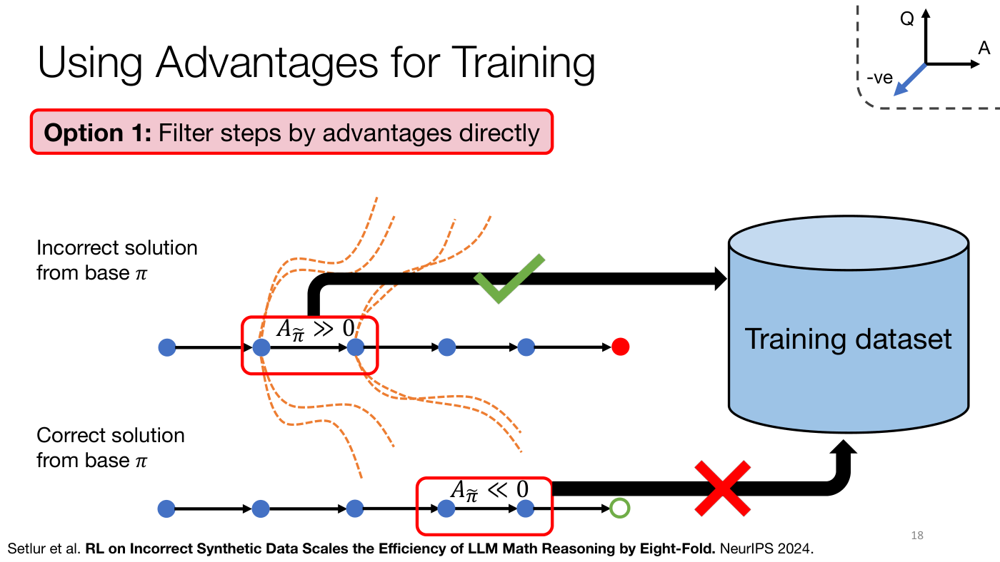

*Slide 18 — option 1: a high-advantage step from an incorrect solution goes into the training dataset, while a low-advantage step from a correct solution is kept out. [Deck](https://cs224r.stanford.edu/spring_2025/slides/10_cs224r-rl_for_reasoning_lecture.pdf)*

This is reminiscent of [advantage-weighted regression](implicit-policy-constraints.md#awr-monte-carlo-advantages),
with a filter in place of exponentiated weights (≈45:23). One can instead train on everything and
multiply each step's loss by $e^{A}$, but "I think that objective requires a lot of tuning, and if
you can only run one experiment, you probably prefer this objective over e to the A in general"
(≈45:23). In the lecture's own summary it is "a lot like filtered imitation learning or
advantage-weighted regression" (≈50:48).

What exactly is trained? Only the step given its prefix (≈46:10–46:58). Kumar draws it on the board:
from $\mathbf{s}_ 0$ the model takes $\mathbf{a}_ 0$ to reach $\mathbf{s}_ 1$, then $\mathbf{a}_ 1$
to reach $\mathbf{s}_ 2$. If $A(\mathbf{s}_ 1, \mathbf{a}_ 1)$ is very positive and
$A(\mathbf{s}_ 0, \mathbf{a}_ 0)$ very negative, the model is trained to produce $\mathbf{a}_ 1$
given $\mathbf{s}_ 1 = [\mathbf{s}_ 0, \mathbf{a}_ 0]$, and is not trained to produce
$\mathbf{a}_ 0$. Three follow-up questions:

- **Is there a separate prompter that drives the steps?** No. As in offline RL or imitation
  learning, the policy is trained on individual actions, but at deployment it writes the whole
  solution in one go, each step conditioned on everything before it (≈47:45–48:30).
- **Is training on single steps justified by the Markov property?** Not exactly: the state
  $\mathbf{s}_ 1$ contains the whole history. Viewed one way the policy is non-Markovian, conditioned
  on all past steps; defining the state as the concatenation makes it Markov. The point of working
  per step is to find which part of a solution derailed it (≈48:30–49:16).
- **What about a step whose advantage is positive but whose Q-value is very low?** They did keep good
  steps from incorrect traces. Filtering out traces where every Q-value is zero, from which no
  prefix can succeed, might help a little, but Kumar has no concrete result to show, and since the
  prefix is never trained on, the method seems largely insensitive to this (≈49:16–50:02).

Advantage filtering fixed the rising-error problem (slide 19, ≈50:48): compared with plain RFT,
whose error went up as more correct answers per question were added, advantage-filtered RFT kept
improving, and by a heuristic measure the number of spurious steps fell. Slide 19's finding reads
"Advantage-filtered RFT does not fall prey to spurious steps". Its two charts are again only an
animation's first frame (its left chart's title prints "GMS8k" for GSM8K), so the curves themselves
are not in the PDF.

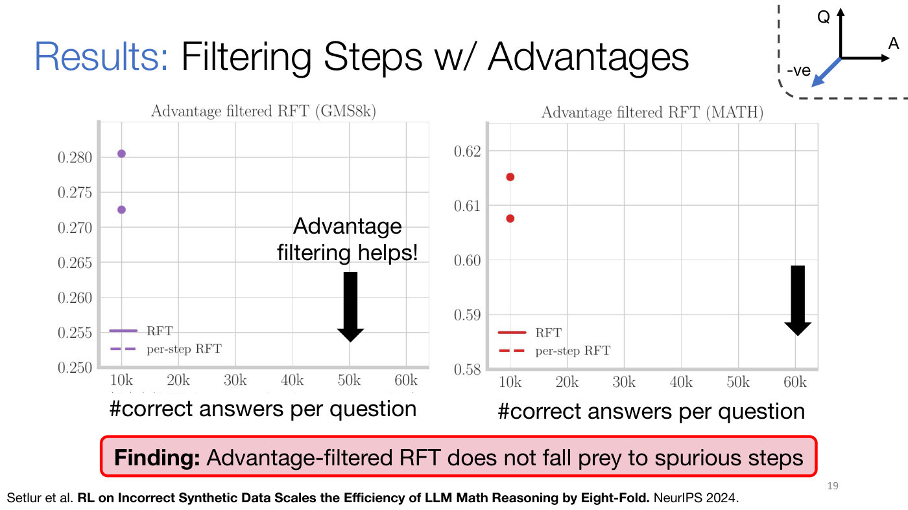

*Slide 19 — advantage-filtered RFT against RFT on GSM8K and MATH; only the animation's first frame survives in the PDF, with the arrow "Advantage filtering helps!" pointing at where the curves would fall. [Deck](https://cs224r.stanford.edu/spring_2025/slides/10_cs224r-rl_for_reasoning_lecture.pdf)*

## Option 2: offline RL with per-step DPO

The second way keeps the rollouts themselves and turns them into preference pairs for
[DPO](direct-preference-optimization.md), an offline RL method (slides 20–22, ≈51:34–52:20). Take a
solution from the model. If it is incorrect, find a rollout from one of its prefixes that succeeds:
the pair is the shared prefix followed by the successful correction, preferred over the same prefix
followed by the model's wrong steps (slide 21). If it is correct, find a rollout from a prefix that
fails, and prefer the model's correct continuation (slide 22). Either pair goes into the DPO training
data.

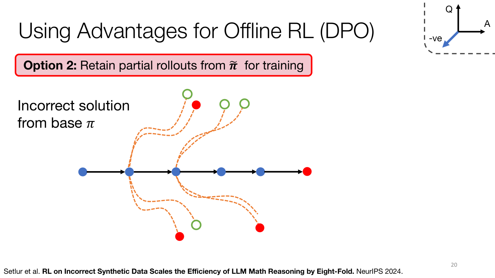

*Slide 20 — option 2: keep the partial rollouts from the rollout policy, some succeeding (green) and some failing (red), instead of only using them to estimate advantages. [Deck](https://cs224r.stanford.edu/spring_2025/slides/10_cs224r-rl_for_reasoning_lecture.pdf)*

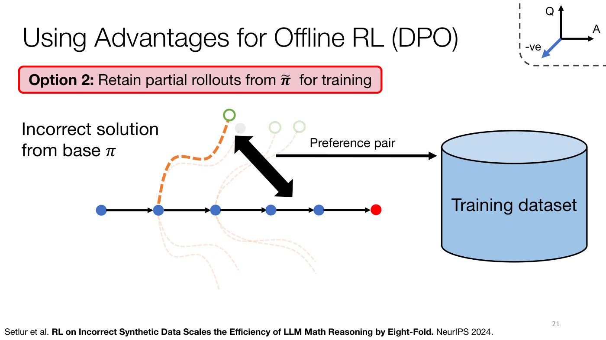

*Slide 21 — from an incorrect solution, a successful rollout and the failing original share a prefix and become a preference pair. [Deck](https://cs224r.stanford.edu/spring_2025/slides/10_cs224r-rl_for_reasoning_lecture.pdf)*

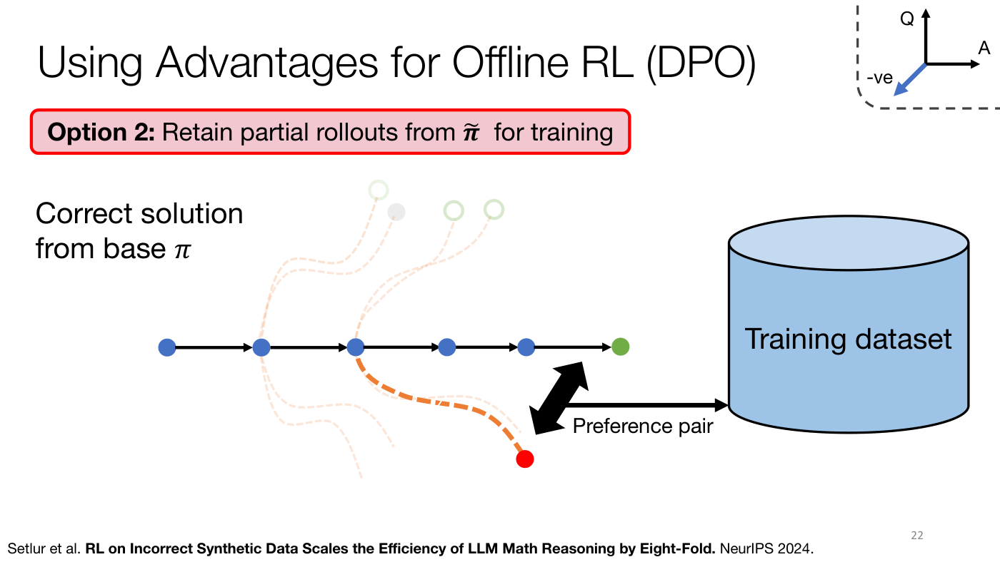

*Slide 22 — from a correct solution, a rollout that fails from a shared prefix is paired against the correct ending. [Deck](https://cs224r.stanford.edu/spring_2025/slides/10_cs224r-rl_for_reasoning_lecture.pdf)*

Two things differ from filtering (≈53:05). The shared prefix localizes the difference between a
correct and an incorrect solution to the segment after it. And the rollout tokens are no longer used
only to compute advantages: they are kept and trained on. The loss is "the same old DPO loss on top
of these two segments of solutions" (≈53:50), so the slides do not write it out. Kumar writes the
algorithm on the board (≈55:22–56:09); from the spoken words, each iteration $1, \ldots, T$:

1. samples solutions $\mathbf{y}_ 1, \ldots, \mathbf{y}_ N$ from the current policy for each question;
2. runs rollouts from their prefixes and builds the preference dataset, which the captions render as
   "dref" and "deep ref" and the edited transcript reads as D pref, from prefixes generated by the
   current model, with one side of each pair from $\pi_\theta$ and the other from the rollout policy;
3. minimizes the DPO loss on that dataset.

**What makes a good rollout policy: quality or diversity?** Both, and Kumar says one of the papers
writes down an exact expression for it, which the lecture does not cover (≈53:50–55:22). If the
model is bad and mostly fails, the rollout policy must be able to succeed sometimes, since "How can
you even learn to solve that problem if you only see failures?" (≈54:36). If the model is decent,
say 50% accurate, what helps is diverse ways of solving the problem, for coverage of the ways it
fails. As everywhere in RL, it is a balance between exploration and exploitation (≈54:36). Slide 26,
not read out, states it informally: "The optimal rollout policy $\tilde{\pi}$ is one which produces
advantages that **most effectively distinguish** good and bad steps from *all* $\pi$."

**How is a solution split into steps?** In this work, at every sentence (≈56:09). More generally it
is a choice that can be built into the model. Models that follow instructions can be prompted to
write in a particular style, for example a logical block of calculation followed by a horizontal
line, and heuristics on that style then partition the solution (≈56:54–57:41). There is no
universal convention for special step tokens; one that Kumar's group and other papers use writes
"step hash one colon" before each step, and a follow-up to this work used it (≈57:41).

## Offline RL results: eight times the data efficiency

Slide 23 returns to test error against the number of questions, now for two base models, a Llama 2
model and a DeepSeek model (≈58:27–59:13). The per-step DPO algorithm (the dashed line) reaches the
same test error as SFT on human-written solutions (the solid line) with 8x fewer samples, roughly
for both models; RFT, for comparison, was 2x (≈59:13–1:00:46). The slide's finding: "Using offline
RL (via per-step RL) gives you 8x data efficiency in performance over imitation only." The chart is
again the animation's first frame, so the 8x figure comes from Kumar and the slide's finding box.

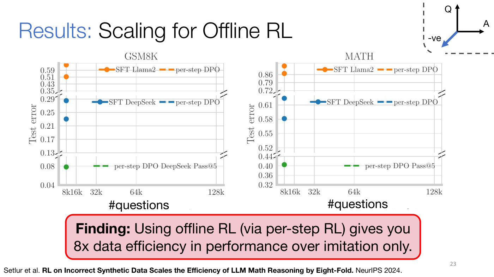

*Slide 23 — test error against number of questions for Llama 2 (orange) and DeepSeek (blue) models with per-step DPO, plus a best-of-five-tries series (green); the finding box states the 8x data efficiency over imitation. [Deck](https://cs224r.stanford.edu/spring_2025/slides/10_cs224r-rl_for_reasoning_lecture.pdf)*

The green series is $\text{pass@}5$: whether the model succeeds at least once if given five tries, a common
way to evaluate models, generalized as $\text{pass@}n$; Kumar says it does not matter for this result
(≈59:59). Asked what sampling temperature to use, Kumar's answer is garbled in the recording: the
captions give "6", and nothing settles the value (≈1:00:46). The solid line is SFT on human-written
solutions with no per-step advantage (≈1:00:46). A further remark about a line removed from the
plot is also unclear in the captions (≈1:01:32).

## Online RL with a 0/1 reward

The last group of methods is online RL, in two versions (≈1:01:32). The basic recipe uses no
advantages. It generalizes RFT: instead of sampling, filtering for correct solutions and imitating
them, sample rollouts from the current policy, correct or not, reward them by checking the answer,
and train with policy gradients (slide 24, ≈1:02:18). The reward can be shaped, for instance
penalizing a solution that gives no answer or violates the format (≈1:02:18). Since the problem is
just an MDP with states, actions and a reward, any RL algorithm applies. Slide 24's key idea is
"Train with a binary 0/1 reward using policy gradients", with the gradient

$$\mathbb{E}_ {\mathbf{x} \sim \mathcal{D}_ {\text{train}}, \mathbf{y} \sim \pi(\cdot \mid \mathbf{x})} \left[ \sum_j \nabla_\pi \log \pi(\mathbf{y}_ j \mid \mathbf{x}, \mathbf{y}_ {0:j-1}) \cdot r(\mathbf{x}, \mathbf{y}) \right]$$

where $\mathcal{D}_ {\text{train}}$ is the set of training problems, $\mathbf{y}_ j$ is the $j$-th
piece of the response conditioned on the problem and everything before it, and
$r(\mathbf{x}, \mathbf{y}) \in \lbrace 0, 1 \rbrace$. It is "grad log pi times the reward" (≈1:03:06),
the [REINFORCE](policy-gradients.md) estimator with a terminal 0/1 reward.

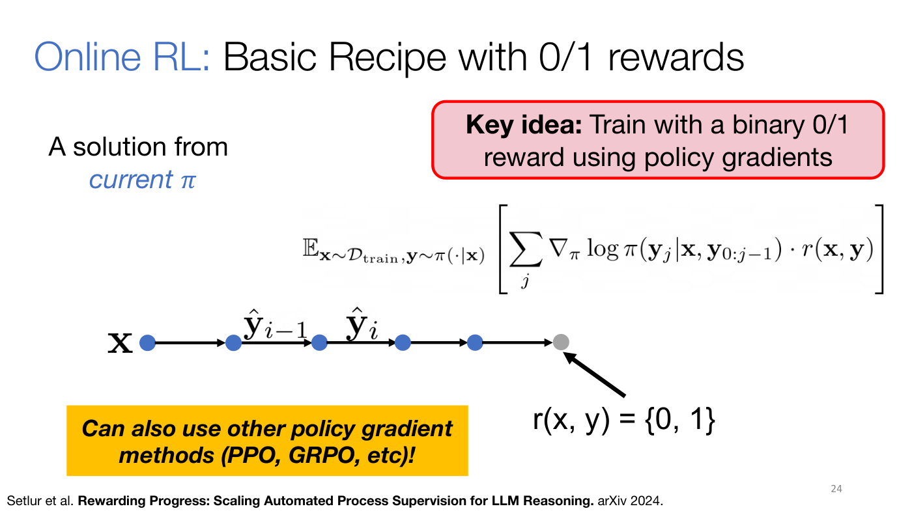

*Slide 24 — online RL on solutions from the current policy, scored only by the 0/1 reward on the final answer, with the policy-gradient expression above. [Deck](https://cs224r.stanford.edu/spring_2025/slides/10_cs224r-rl_for_reasoning_lecture.pdf)*

Slide 24 adds "Can also use other policy gradient methods (PPO, GRPO, etc)!" Much recent work goes
beyond REINFORCE to **GRPO**, which Kumar describes as an extension of [PPO](ppo.md) for this
setting: PPO uses a learned value function, and GRPO replaces it with the rollout-based estimates of
advantages (≈1:03:06).

## Dense rewards: process advantage verifiers

The second version adds the per-step advantages to online RL (slide 25, ≈1:03:52–1:04:39). Take
solutions from the current policy during training. The advantages can be computed with rollouts, or,
in place of rollouts, a reward-model-like network can be trained to predict the advantages (or the
Q-values) and queried on every step of every new rollout. It is like the reward model of
[RLHF](rlhf.md), except that it scores every step rather than the whole sequence. The policy is then
optimized for the reward at the end plus these per-step advantages (≈1:04:39). The faded background
of slide 26 reads "Advantage as dense reward bonus in RL".

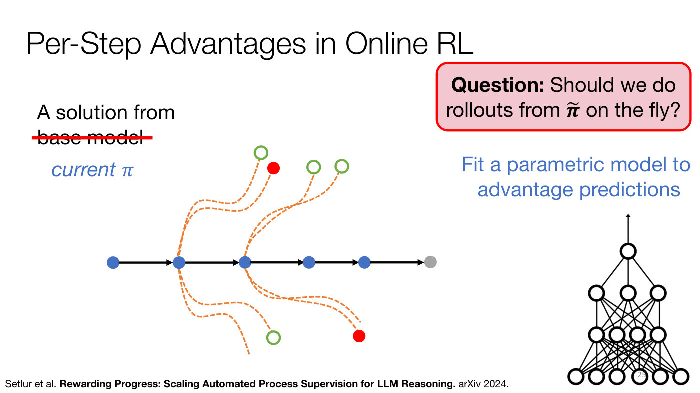

*Slide 25 — the solution now comes from the current policy, not the base model, and a small network is fitted to the rollouts' advantage predictions so they need not be recomputed. [Deck](https://cs224r.stanford.edu/spring_2025/slides/10_cs224r-rl_for_reasoning_lecture.pdf)*

Kumar's group calls the method **process advantage verifiers** (PAVs): process because it rewards
every step, advantage because it fits an advantage function, and verifier because in reasoning,
reward models are often called verifiers (≈1:06:10). Dense-reward RL of this kind reaches much
better accuracy than RL with the sparse 0/1 outcome reward, called ORM RL, after outcome reward
model (≈1:06:10). Slide 27 shows it for 2B and 9B models. For the 2B model, PAV-RL reaches in about
1,000 iterations the accuracy (about 0.20) that ORM-RL reaches only after about 7,000, marked "6 ×",
and at 8,000 iterations it is ahead by "7%". For the 9B model the marks are "5 ×" and "6%".
The slide's summary: 5–6x sample efficiency over outcome rewards only, and a 6–7% improvement. The
numbers look small, but Kumar says that with 2B and 9B models this was apparently the best result
attainable on the datasets they tried (≈1:06:56).

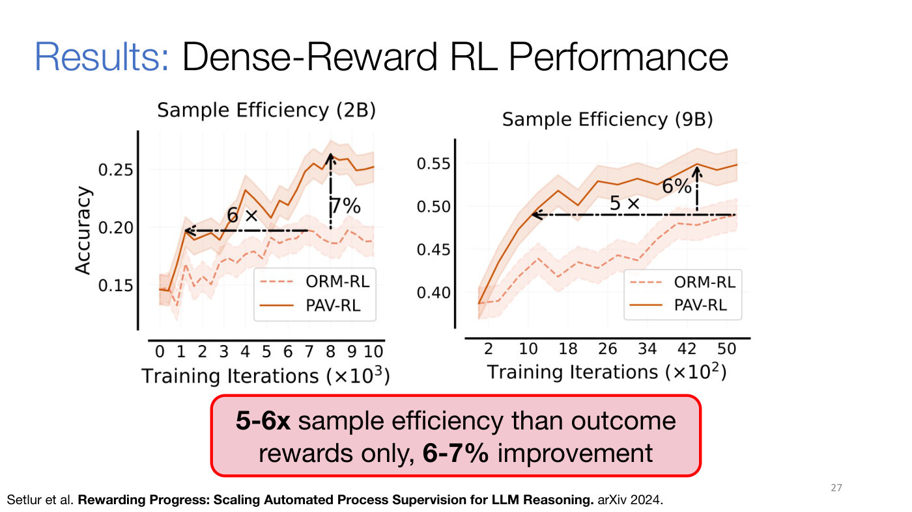

*Slide 27 — accuracy over training iterations for PAV-RL (solid) and outcome-reward ORM-RL (dashed) on 2B and 9B models; the horizontal arrows mark the 6x and 5x sample-efficiency gains and the vertical ones the 7% and 6% accuracy gaps. [Deck](https://cs224r.stanford.edu/spring_2025/slides/10_cs224r-rl_for_reasoning_lecture.pdf)*

Asked how general reasoning learned this way is, Kumar says that training on one dataset does not
by itself improve another, which many people have shown; the captions name the two as math and
GSM8K, which is unclear, since GSM8K is itself a math benchmark (≈1:04:39). Training on a mixture of
prompts of varied difficulty does get there. The basic online RL recipe was used to train many of the
thinking models with open recipes, including DeepSeek-R1 (the captions garble the name at this
point), and it generalizes to a fairly good extent, though not to every problem (≈1:05:25).

## Thinking models: what changed

The newer thinking models, the DeepSeek-R1 family and OpenAI's o-series, can think for longer and
produce better answers (≈1:06:56–1:07:42). In Kumar's opinion they are trained with recipes very
similar to the ones in this lecture, and slide 32, headed "(Disclaimer: this is my version!)", lists
what changed:

- **The RL training objectives remained the same.** DeepSeek-R1 uses GRPO, "basically PPO with
  some tweaks", and Kimi 1.5 uses a version of APA, advantage-induced policy alignment. "You don't
  need to know what those methods are": think of them roughly as policy gradient methods with slight
  tweaks (slide 32, ≈1:07:42–1:08:28). The reward function changed in minor
  ways (slide 32).
- **Crudely, the action space changed.** In Kumar's words, "what has changed is that the action space
  in a way has changed for these models, in my opinion" (≈1:08:28). Kumar admits that this sounds wrong, since
  the models still emit one token at a time. But the base models have become better at meta
  procedures: producing a solution, verifying it, backtracking to some point and trying something
  else. These are more interesting steps than computing one more quantity, so the same algorithms
  are running on a better notion of an action (≈1:08:28–1:09:13).
- **The token budget increased drastically**, to chain many such macro actions: with no limit on how
  many tokens a solution may use during RL, "just get me the right answer" (≈1:09:13).

Kumar adds a counterfactual: base models that cannot do basic answer checking or verification
cannot be trained well with RL today (≈1:09:13–1:09:59). The closing words: "So really nothing has
changed in terms of the higher-level techniques that I talked about, except that the base models
have become more interesting, in that they can sample interesting kinds of steps to train on"
(≈1:09:59).

## From the slides only

These slides are not discussed in the recording; their content here comes from the slide file.

**Solving hard questions** (slide 28). PAVs help on problems that SFT could not solve even with 256
independent samples. The y-axis is the success rate on those problems as the number of samples $N$
grows from 2 to 256. With $A_{\tilde{\pi}}$, the rollout policy's advantages, it rises to about 0.15
at $N = 256$; with $A_\pi$, the current policy's own advantages, it stays near 0.03. The insight: "PAVs
give exploration crucial for solving hard questions".

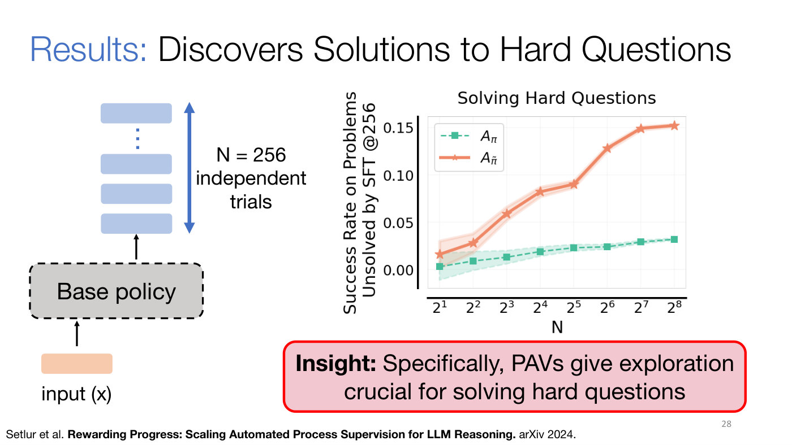

*Slide 28 — success on problems that SFT never solved in 256 tries: training with the rollout policy's advantages (orange) solves far more of them than with the current policy's own (green). [Deck](https://cs224r.stanford.edu/spring_2025/slides/10_cs224r-rl_for_reasoning_lecture.pdf)*

**Part 1 takeaways** (slide 29). The challenge: "Imitating positive data scales (slowly), but it
induces spurious steps, that are memorized." The algorithm: "Careful, model-specific negative data can
help with addressing this issue via offline / online RL". The result: offline RL gives 8x sample
efficiency over imitation, and online RL with a dense advantage reward improves sample efficiency 5-6x.

**Part 2's papers** (slide 30): DeepSeek-R1 (2025), Kimi K1.5, and, optionally, "Optimizing
Test-Time Compute requires Solving a Meta-RL Problem" (Setlur, Qu, Yang, Zhang, Smith, Kumar, CMU MLD
Blog, 2025).

**A thinking trace** (slide 31), from Marjanović et al.'s study of DeepSeek-R1 (the footer prints the
title as "DeepSeek-R1 Thoughtolgy"). For a word problem about letters, the model's text between
think tags is full of the meta behaviors slide 32 names, highlighted on the slide: "Hmm", "Wait",
"Let me check that", "Alternatively", "Is that right?", "I need to double-check". The answer, 624
pages, follows the closing tag.

**The formulation** (slides 33–34). Starting from the final goal, maximize the expected reward on
test problems of a response $\mathbf{z}$ sampled from the model, longer than a typical solution,
under a fixed compute budget $C_0$ per problem:

$$\max_\pi \thinspace \mathbb{E}_ {\mathbf{x} \sim \mathcal{D}_ {\text{test}}} \left[ \mathbb{E}_ {\mathbf{z} \sim \pi(\cdot \mid \mathbf{x})} \left[ r(\mathbf{x}, \mathbf{z}) \right] \right] \quad \text{s.t.} \quad \forall \mathbf{x}, \thinspace \mathbb{E}_ {\pi(\cdot \mid \mathbf{x})} |\mathbf{z}| \leq C_0$$

Training replaces the test distribution $\mathcal{D}_ {\text{test}}$ with the training distribution
$\mathcal{D}_ {\text{train}}$. Slide 34 lists two ways to optimize it: RL with an outcome reward, as
in DeepSeek-R1, or SFT/RFT ("collect data, filter by correctness, maximize likelihood").

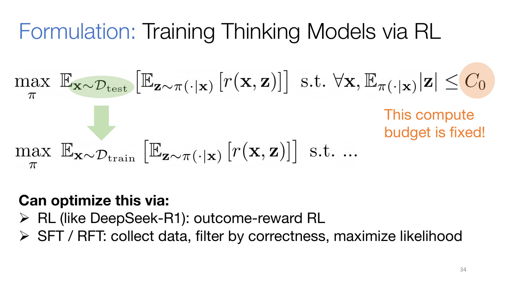

*Slide 34 — the thinking-model objective: expected reward on test problems under a fixed per-problem compute budget, then the same with training problems in place of test ones. [Deck](https://cs224r.stanford.edu/spring_2025/slides/10_cs224r-rl_for_reasoning_lecture.pdf)*

**Meta strategies in the action space** (slide 35, Gandhi et al., "Cognitive Behaviors that Enable
Self-Improving Reasoners"). Four behaviors are illustrated: verifications ("Let me check my
answer …"), subgoal setting, backtracking and backward chaining. Two models, identified only by
logos, are trained with RL. In the first, verifications and backtracking rise sharply in the first 60
RL steps, reaching average counts of about 11.5 and 8.6, before falling. The second shows none of the
four behaviors, and the slide notes "This model does not improve during RL".

*Slide 35 — the four cognitive behaviors, and their counts over RL for two base models: one develops verification and backtracking, the other shows none and does not improve. [Deck](https://cs224r.stanford.edu/spring_2025/slides/10_cs224r-rl_for_reasoning_lecture.pdf)*

**RL amplifies length** (slide 36, from the Kimi 1.5 technical report). On eight benchmarks, from
AIME 2024 to GPQA, both accuracy and response length in tokens grow over RL training. On AIME 2024,
for example, accuracy goes from about 0.13 to about 0.40 while the length grows from about 2,000 to
about 19,000 tokens. The slide asks "Why?"

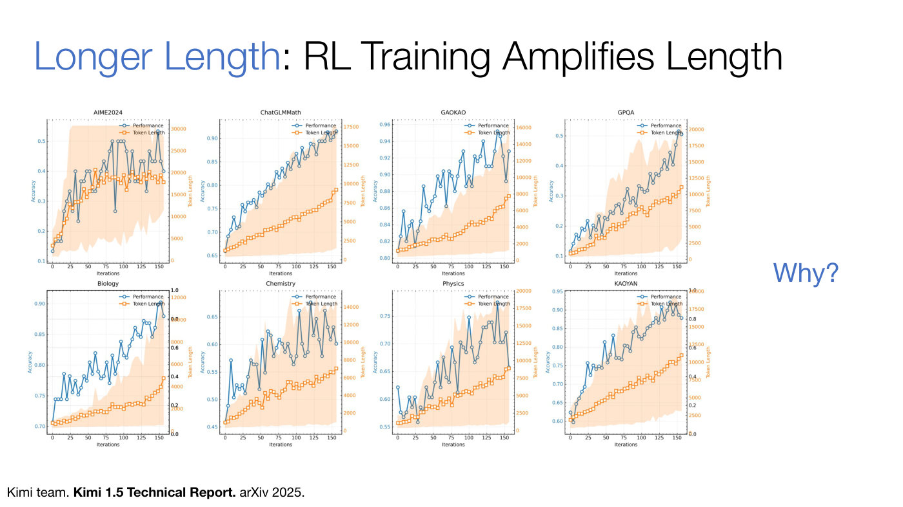

*Slide 36 — eight panels from the Kimi 1.5 report in which accuracy (blue) and response length in tokens (orange) both climb over RL iterations. [Deck](https://cs224r.stanford.edu/spring_2025/slides/10_cs224r-rl_for_reasoning_lecture.pdf)*

**A new paradigm: test-time scaling** (slides 37–39, citing Snell et al., ICLR 2025). Instead of a
bigger language model, a model of the same size can produce longer responses, with more thinking
and self-correction (slide 39).

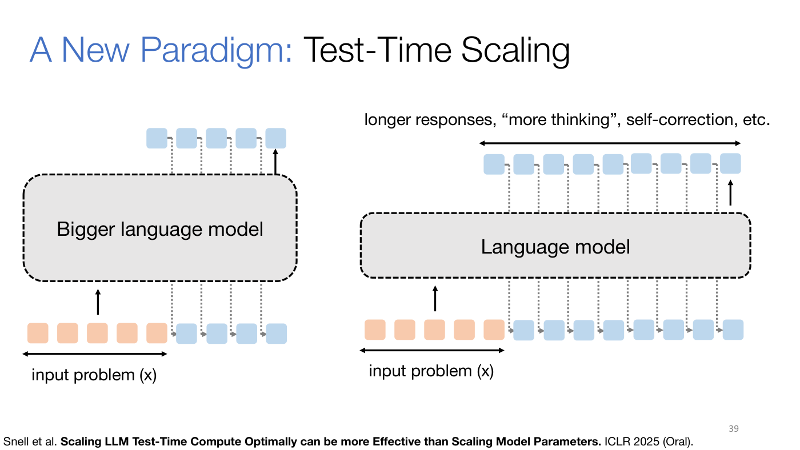

*Slide 39 — two ways to spend compute on a problem: a bigger language model (left) or the same model generating a longer response (right). [Deck](https://cs224r.stanford.edu/spring_2025/slides/10_cs224r-rl_for_reasoning_lecture.pdf)*

**Results** (slide 40, from OpenAI's o3 and o4-mini blog post). Codeforces Elo of 1891 for o1, 2073
for o3-mini, 2706 for o3 and 2719 for o4-mini (both with a terminal). On Humanity's Last Exam, accuracy
of 8.12% for o1-pro up to 24.90% for o3 with Python and browsing tools and 26.60% for deep research. On
AIME 2024 ($\text{pass@}1$), 79.8 for DeepSeek-R1, 79.2 for OpenAI-o1-1217 and 39.2 for DeepSeek-V3.

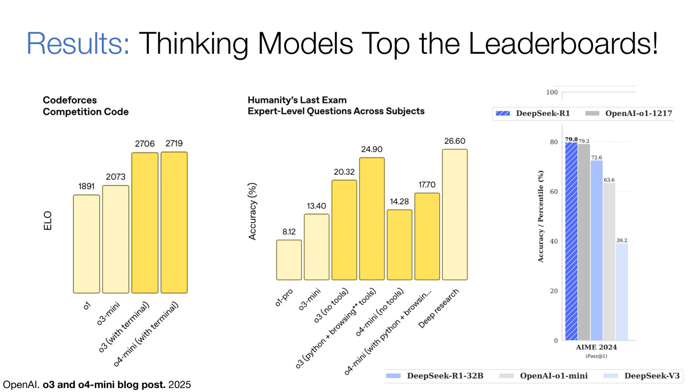

*Slide 40 — thinking models on Codeforces, Humanity's Last Exam and AIME 2024. [Deck](https://cs224r.stanford.edu/spring_2025/slides/10_cs224r-rl_for_reasoning_lecture.pdf)*

**Open questions** (slide 41), in three panels. First, desiderata and formulation: train an algorithm
to spend extra test compute, search over responses and discover the final answer, posed as an
adaptation problem. Second, dense rewards: a reward that rises over the test-compute budget, against
an outcome reward that is 0 until the very end ("More than outcome reward needed"). Third, RL against
SFT: as test-time compute $H$ scales, RL's reward keeps rising while SFT or distillation flattens,
with the gap growing as $\sqrt{H}$ ("Use reward signals for training").

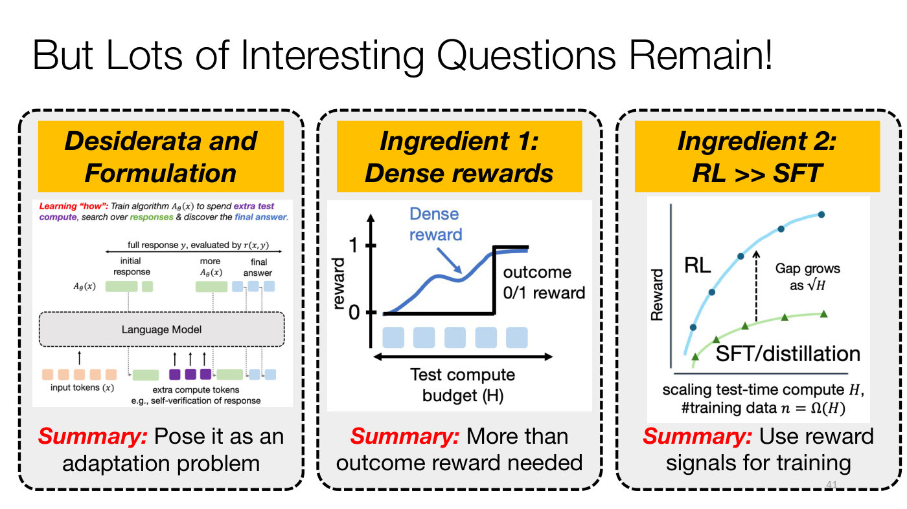

*Slide 41 — three open directions: posing test-time compute as adaptation, dense rather than outcome rewards, and RL over SFT as test-time compute grows. [Deck](https://cs224r.stanford.edu/spring_2025/slides/10_cs224r-rl_for_reasoning_lecture.pdf)*

Printed slips noted in the slide file: slide 14 writes "multiple Eq1 by 2" for multiply; slide 19's
title prints "GMS8k"; slide 40 prints "browsing**"; and slide 8 cites the "Rewarding Progress" paper
as ICLR 2025 while the footers of slides 24–28 cite it as arXiv 2024, under a slightly different
title.

## Related pages

- [RL for LLM reasoning](llm-reasoning.md): the topic as a whole, from the reasoning MDP and
  rejection finetuning to thinking models.
- [Process rewards and per-step credit](process-rewards.md): the Q-value and advantage of a step,
  rollout policies, process reward models and process advantage verifiers.
- [Value functions](value-functions.md): the Q-function and advantage this lecture applies to
  prefixes of a solution.
- [Implicit policy constraints](implicit-policy-constraints.md): advantage-weighted regression and
  filtered behavior cloning, of which advantage filtering is a variant.
- [Direct preference optimization](direct-preference-optimization.md): the loss used for per-step
  DPO.
- [Policy gradients](policy-gradients.md) and [PPO](ppo.md): online RL with the 0/1 reward, and
  GRPO.
- [Imitation learning](imitation-learning.md): SFT and RFT as imitation, and causal confusion.
- [Lecture 9 — RL for LLMs](09-rl-for-llms.md): the guest lecture before, on preference optimization.
