# Lecture 11 — Model-Based RL

Stanford CS224R, Spring 2025 (Wednesday, May 7) ·
[video](https://www.youtube.com/watch?v=PvqyGnOirgA) (73 min) ·
[slides (PDF)](https://cs224r.stanford.edu/spring_2025/slides/11_cs224r_mbrl_2025.pdf) ·
[slide-by-slide text](../raw/slides/11-model-based-rl.md) ·
[transcript](../raw/transcripts/11-model-based-rl.md)

**What this lecture establishes.** Model-based RL learns a "simulator": a dynamics model that
predicts the next state from the current state and action, usually fitted by regression on data
from some base policy. With a learned dynamics model, and a reward model if the reward is not known,
the agent can **plan**: choose a sequence of actions that maximizes the predicted sum of rewards
over a short horizon. The optimization over actions can run by **backpropagation** through the
model, or by **sampling**: random shooting, which picks the best of many sampled action sequences,
or the **cross-entropy method**, which refits a sampling distribution to the best samples and
repeats. Planning exploits the model's errors wherever the data did not reach, so the actions it
executes are added to the data and the model refit. Executing only the first planned action and
replanning from the state that results is **model predictive control**, which corrects for model
errors at the price of compute. Planning is simple and lets the reward be swapped at test time,
but it is expensive at test time and practical only for short horizons. A planner's actions can be
distilled into a policy, and a value function at the end of the horizon extends it to longer
problems. The lecture closes with a case study: PDDM, a model-based method that learns to rotate
Baoding balls with a 24-degree-of-freedom robot hand from about four hours of real data.

Slide numbers below are the numbers printed on the slides, which equal the PDF page numbers
(slide 3 prints none). Timestamps (≈M:SS) point into the video and the
[transcript](../raw/transcripts/11-model-based-rl.md). **The recording covers slides 4–25 and
32–36.** It opens on the recap without discussing slide 2's reminders. After the first half of
slide 25, at ≈1:06:40, Finn says "I think I might cover this second approach on Friday" and moves to
the case study. So model-based policy optimization (slides 26–30), when to use model-based RL (slide
29) and other kinds of models (slide 30) are not taught aloud; the
[section on them](#not-in-the-recording-model-based-policy-optimization) gives them from the
[slide file](../raw/slides/11-model-based-rl.md), and [Lecture 12](12-multi-task-rl.md#model-based-policy-optimization-synthetic-data-from-a-model) teaches
them aloud from its own version of those slides, at the start of its deck.

Finn works several things on a board the recording does not show: a latent-state model with an
encoder (≈15:23–17:49), the gradient-based planning algorithm with its chain rule and update
(≈23:17–31:07), sketches of gradient-based and sampling-based optimization over actions
(≈31:54–35:44), and open-loop against closed-loop execution (≈51:13–52:52). Where the transcript
says "this" or "right here", this page reconstructs what was meant from the surrounding words and
the slides, and says so.

## Contents

1. [Recap: where the course's algorithms sit](#recap-where-the-courses-algorithms-sit)
2. [The key idea: learn a simulator](#the-key-idea-learn-a-simulator)
3. [A notional algorithm, and what might go wrong](#a-notional-algorithm-and-what-might-go-wrong)
4. [How to learn a dynamics model](#how-to-learn-a-dynamics-model)
5. [Approach 1a: planning by backpropagation](#approach-1a-planning-by-backpropagation)
6. [Aside: gradient-based against sampling-based optimization](#aside-gradient-based-against-sampling-based-optimization)
7. [Approach 1b: planning by sampling](#approach-1b-planning-by-sampling)
8. [How planning fails: the cliff](#how-planning-fails-the-cliff)
9. [Open loop and closed loop: model predictive control](#open-loop-and-closed-loop-model-predictive-control)
10. [So far: planning with learned models](#so-far-planning-with-learned-models)
11. [Training a policy, and longer horizons](#training-a-policy-and-longer-horizons)
12. [Not in the recording: model-based policy optimization](#not-in-the-recording-model-based-policy-optimization)
13. [Case study: deep dynamics models for dexterous manipulation](#case-study-deep-dynamics-models-for-dexterous-manipulation)
14. [Summary](#summary)
15. [Not in the recording: reminders and next time](#not-in-the-recording-reminders-and-next-time)

## Recap: where the course's algorithms sit

Finn opens with a slide made in response to feedback in office hours, asking for a high-level recap
of where the algorithms covered so far fit together (≈0:05). Slide 4 splits them into **offline**
algorithms, where "No policy collection" happens and the learner is given a dataset with no further
data collection, and **online** algorithms, which "Involves policy data collection". The online side
divides in two. **On-policy RL** can collect data, but "Only use data from curr. policy", so it never
reuses past data; this is REINFORCE, the vanilla policy gradient (≈0:50). **Off-policy RL** "Can
reuse data from other policies", in two ways: taking multiple gradient steps on data from a policy
before its last update, which is PPO and importance sampling, and keeping a replay buffer of data
from even more different past policies, which is DQN and SAC (≈0:50–1:35).

The colours on the slide mark a second axis. The blue algorithms train only a policy, so they are
**policy gradient** methods (actor only); PPO and SAC learn a policy and a critic, so they are
**actor-critic** methods (both); and DQN learns only a critic, with no separate policy, which makes it
a **Q-learning** method (critic only) (≈1:35–2:21). Finn notes that PPO is often called a policy
gradient method, since its value function is only an aid; this class calls it actor-critic to avoid
confusion (≈2:21).

**Offline RL** builds on the online ideas but has to cope with collecting no data at all. One
approach constrains the policy to actions in the data (AWR, AWAC and IQL); the other, CQL, constrains
it implicitly, through conservatism (≈2:21–3:06). An arrow along the bottom of the slide reads
"Requires more online data": moving right, the methods need more online data, and since online data
is usually more expensive than offline data, they tend to be more expensive to use (≈3:06).

Across the top sits **imitation learning**, offline as behavior cloning and online as DAgger, which
queries an expert for the right action on newly collected data. It is in a separate band because its
assumptions differ: the slide says it "Requires expert data. Doesn't need reward." It needs no reward
function, but it needs fairly good data, and it cannot outperform the average behavior in its dataset
(≈3:51). See [offline and online algorithms](offline-and-online.md) and
[RL algorithm families](rl-algorithm-families.md).

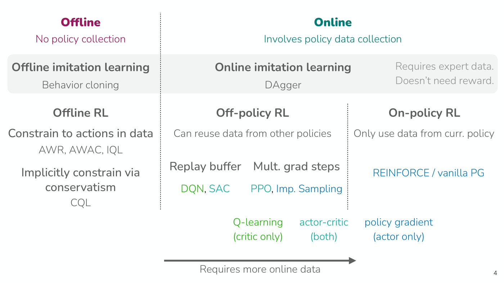

*Slide 4 — the course's algorithms on one page: offline at left, online at right, imitation learning across the top, and the colour of each name saying whether it learns an actor, a critic or both. [Deck](https://cs224r.stanford.edu/spring_2025/slides/11_cs224r_mbrl_2025.pdf)*

## The key idea: learn a simulator

Model-based RL "can actually be applied to all of the different classes" of methods on the recap
slide (≈4:36). Finn says it has a special place in Finn's heart, having done quite a bit of work on
it. The plan (slide 5) is the key idea, how to learn a dynamics model (in brief), and how to use one,
for planning and for data generation, followed by a case study in dexterous robotic manipulation. The
learning goals are how to learn and use dynamics models and "The key challenges and trade-offs
arising in model-based RL". As a teaser, slide 5 plays a video of a robot hand that Finn says has more
than 20 degrees of freedom, more than 20 joints that it is controlling (≈5:22).

The key idea is to learn a simulator: "Can we learn a "simulator"?", which slide 6 glosses as a
"predictive model of $\mathbf{s}_ {t+1}$ given $\mathbf{s}_ t$, $\mathbf{a}_ t$", where
$\mathbf{s}_ t$ is the state at time $t$ and $\mathbf{a}_ t$ the action taken in it. It predicts the
future for actions the agent might take (≈5:22). What that model looks like depends on the domain
(slide 6, ≈6:11–8:29):

- **Robotics and physical systems.** If the underlying physical entities can be directly observed,
  the model is a model of the system's physics. If they cannot, it looks more like **video prediction
  conditioned on the agent's actions**: predicting how someone will react to what I say, or whether I
  will fall if I move my legs a certain way. Slide 6 shows stills from videos generated by Veo 2 and
  Sora, and Finn suggests that models like these could be very useful for training cars, robots and
  quadrotors to learn how their actions affect the world (≈6:56).
- **Finance.** A simulator for trading would predict what happens to the stock market over time, and
  whether the agent's actions have any effect on it (≈6:56–7:42).
- **Games.** The model is the rules of the game, which are often known already, so no model needs to
  be learned at all; in chess, the outcome of moving a piece is known (≈7:42). In games with two or
  more players the other players may need to be modelled. That can be treated as part of the
  dynamics, but is often modelled separately (the slide says "multi-agent RL"), and an agent can
  sometimes use its model of itself as a model of another agent (≈7:42–8:29).

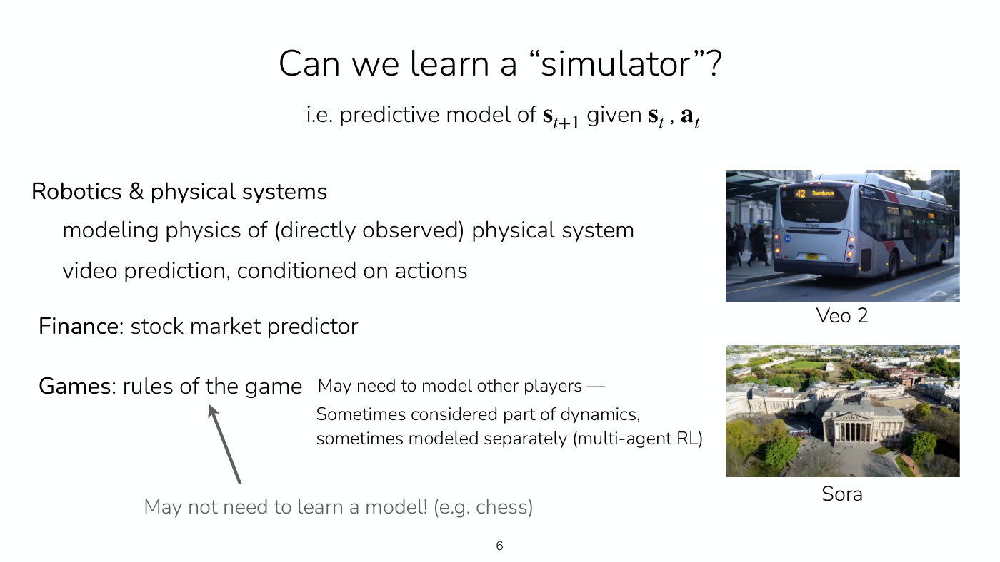

*Slide 6 — what a learned simulator means in robotics, finance and games, beside frames of videos generated by Veo 2 (a city bus) and Sora (an aerial view of a city). [Deck](https://cs224r.stanford.edu/spring_2025/slides/11_cs224r_mbrl_2025.pdf)*

## A notional algorithm, and what might go wrong

If a simulator can be learned, the sketch of an algorithm is three steps (slide 7, ≈8:29–9:15).
First, get some data $\mathcal{D} = \lbrace \mathbf{s}_ i, \mathbf{a}_ i, \mathbf{s}'_ i \rbrace$
of states, actions and next states, "collected using some base policy
$\pi_0(\mathbf{a} \mid \mathbf{s})$". Second, learn a "simulator" $f(\mathbf{s}, \mathbf{a}) = \mathbf{s}'$
that predicts the next state from the present one and an action, for example a neural network
trained to minimize the squared (L2) error between its prediction and the next state observed in
the data:

$$\min_ f \sum_ i \Vert f(\mathbf{s}_ i, \mathbf{a}_ i) - \mathbf{s}'_ i \Vert^2$$

Third, "Run your favorite RL method inside "simulator" $f$", either one of the RL methods the course
has covered or a planning method, two of which this lecture covers (≈9:15). The running example is
getting from a green point to a red point, with data collected by some policy (≈9:15).

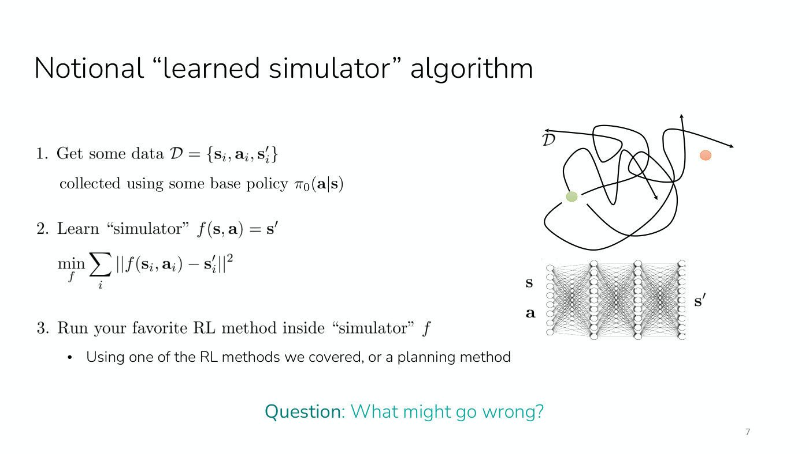

*Slide 7 — the three-step sketch beside a tangle of data trajectories and the network that maps a state and an action to the next state; the question at the bottom is what might go wrong. [Deck](https://cs224r.stanford.edu/spring_2025/slides/11_cs224r_mbrl_2025.pdf)*

Finn then asks what might go wrong (slide 7, ≈9:15–10:02). The answers from the room, and slide 8,
give three problems, one per step:

1. **Data coverage matters a lot.** A student answers that the simulator might not be accurate, and,
   as with reward models and arguably with Q-functions, the policy may **exploit** those inaccuracies;
   they may compound, so what was learned in the simulator does not transfer to the real problem
   (≈10:02). A second answer is coverage: if the base policy $\pi_0$ differs from the policy finally
   learned, the model may not be accurate on the states the learned policy visits (≈10:02–10:47). In
   slide 8's maze, the data cover only the upper-left corner, so the model knows little about the
   rest of the maze and no policy for reaching those parts can be learned from it (≈10:47–11:33).
2. **Modeling is domain dependent.** "Some domains much easier to simulate than others!" (slide 8).
   Finn plays a video Sora generated from the prompt printed under it, a humanoid robot stacking red,
   green and blue cubes with red on the bottom and blue on top. The video "does some creative things
   with physics": it changes the colours of the blocks and makes blocks out of thin air, which is not
   what robots can do (≈11:33). Building a model also means domain-dependent choices: what the model's
   inputs are, how it is trained and what architecture it has, for a video prediction model, a
   low-level physics model with friction, or a model of the stock market (≈12:19).
3. **Even a good simulator does not make the RL easy.** "Even if we have a good simulator, this part
   isn't necessarily easy!" The RL still has to be run inside it, and it has to "account for model
   inaccuracies", because the model is usually not perfect (slide 8, ≈12:19–13:05).

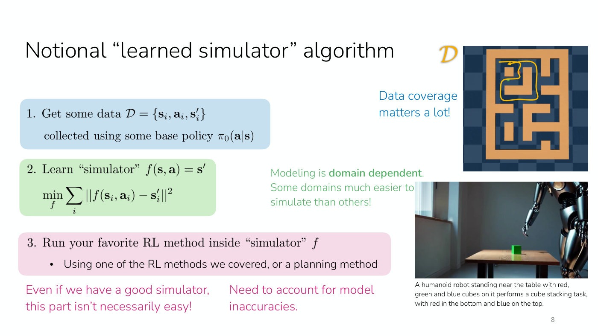

*Slide 8 — the same three steps, each with its problem: a maze whose data cover only one corner, a frame of a Sora video that gets the physics of stacking cubes wrong, and the reminder that the RL step must account for model errors. [Deck](https://cs224r.stanford.edu/spring_2025/slides/11_cs224r_mbrl_2025.pdf)*

## How to learn a dynamics model

The lecture treats this briefly and spends most of its time on using a model (≈13:05). Slide 10
gives three cases:

- **"You know it already"**, as in some games, in which case use it (≈13:05).
- **"You approximately know most of it"**, as with certain physical models. Pushing an object on a
  table, you may know everything but the table's friction coefficient; in driving, you may have a
  good model of how the car accelerates for a given steering command and need to model only a few
  additional things. Then known structure can be kept and the unknown parameters fitted from data
  (≈13:51), which Finn calls one of the cooler ways to bring domain-specific knowledge into RL
  algorithms (≈14:36).
- **"You don't know it"**, which is almost every case in practice: how an object with many
  properties will behave, how people or other drivers will act. Then the typical practice is to learn
  the model from scratch with a neural network or some other function approximator (≈14:36).

With image observations there are two options (≈15:23–17:49, on the board). Call the image of the
current scene, say a road with other cars, $\mathbf{s}_ t$. One option is to predict the entire future
video, conditioned on actions, which is expensive because every detail of how every pixel changes has
to be modelled (≈16:12). The other is to learn an encoder that maps the image to a lower-dimensional
representation $\mathbf{z}_ t$ and learn a model that predicts future representations, such as
$\mathbf{z}_ {t+1}$ (slide 10, "Learn a (low-dim) state representation, then learn model over
representations"). That can be a good alternative when a full model would be very expensive, but it
has its own challenge: the representation has to come from somewhere (≈17:02).

A student asks whether going to a lower dimension loses information, and whether the reason is cost
(≈17:49). Finn agrees: the main reason is computational, and the bet is that parts of the observation
do not matter. The exact texture of the road, whether it is dark black or a little worn, is irrelevant
in many scenarios, and a representation that discards it saves the compute of modelling it (≈17:49).

The model of the dynamics is usually not enough. "Note: Often also need to learn a reward model!"
(slide 10): to use the model to see into the future, the agent needs to know not just the future
states but the rewards they lead to (≈18:36). See [reward learning](reward-learning.md).

Asked whether model learning has to happen end to end, Finn says the model is trained for its ability
to generate future states, an objective with pros and cons that come up later (≈18:36–19:24). It can be
thought of as how well the model captures the distribution $p(\mathbf{s}_ {t+1} \mid \mathbf{s}_ t)$
of the next state, or, especially for more deterministic dynamics, how small the error between the
predicted and the actual $\mathbf{s}_ {t+1}$ is (≈19:24).

## Approach 1a: planning by backpropagation

The first way to use a model is **planning**, which is different from running RL inside a learned
simulator (≈20:10). In the MDP, the current state and an action determine the next state and a
reward, which may also depend on the action, and the process repeats. The methods of earlier lectures
did not know how actions affect future states, so they had to optimize rewards without direct
gradients. With a learned reward model and dynamics model, the rewards can be backpropagated directly
into the actions (≈20:57–21:45).

The objective is to choose the next sequence of actions, over some horizon $H$, that maximizes the sum
of future rewards (slide 12, ≈21:45–22:31):

$$\max_ {\mathbf{a}_ {t:t+H}} \sum_ t r(\mathbf{s}_ t, \mathbf{a}_ t)$$

where $r(\mathbf{s}_ t, \mathbf{a}_ t)$ is the reward. Looking into the future to choose a sequence of
actions that maximizes reward is what is meant by "planning". Slide 12 draws the unrolled chain of
states, with each action feeding the next state and each state its reward, and magenta arrows running
backward along every link but the first, which is the gradient flowing from the rewards through the
states into the actions.

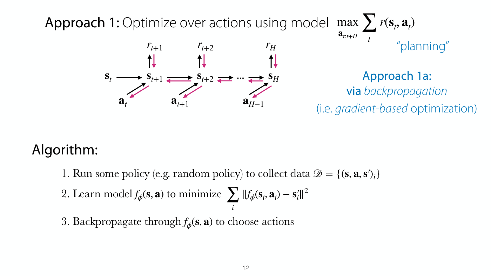

*Slide 12 — the objective over an action sequence, the unrolled chain of states, actions and rewards with the backward gradient in magenta, and the three-step algorithm. [Deck](https://cs224r.stanford.edu/spring_2025/slides/11_cs224r_mbrl_2025.pdf)*

The algorithm, which Finn also writes on the board (slide 12, ≈23:17–24:04), is:

1. Run some policy (for example a random policy) to collect data
   $\mathcal{D} = \lbrace (\mathbf{s}, \mathbf{a}, \mathbf{s}')_ i \rbrace$.
2. Learn a model $f_ \phi(\mathbf{s}, \mathbf{a})$, with parameters $\phi$, to minimize
   $\sum_ i \Vert f_ \phi(\mathbf{s}_ i, \mathbf{a}_ i) - \mathbf{s}'_ i \Vert^2$, the error between
   the predicted and the true next state.
3. Backpropagate through $f_ \phi(\mathbf{s}, \mathbf{a})$ to choose actions: find the course of
   actions $\hat{\mathbf{a}}_ {t:t+H}$ that is the argmax of the sum of rewards from $t$ to $t + H$,
   with each future state predicted by the model (≈24:04).

Backpropagating into actions is unusual: backprop normally runs with respect to a network's
parameters, and here it runs into the actions themselves (≈24:55). Step 3 therefore looks like
training. Initialize the actions, just as network parameters are initialized at random; compute the
gradient of the sum of rewards with respect to the actions; and take a gradient step (≈24:55–26:28).
By the chain rule, the gradient is the derivative of the rewards with respect to the states, which
comes from the reward model, times the derivative of the states with respect to the actions, which
comes from the dynamics model (≈25:41–26:28). Schematically (the board is not visible in the recording):

$$\frac{d \sum r}{d \mathbf{a}} = \frac{d \sum r}{d \mathbf{s}} \thinspace \frac{d \mathbf{s}}{d \mathbf{a}}$$

The update is a step of size $\alpha$ along that gradient:

$$\hat{\mathbf{a}}_ {t:t+H} \leftarrow \hat{\mathbf{a}}_ {t:t+H} + \alpha \thinspace \nabla_ {\mathbf{a}} \sum_ {t'=t}^{t+H} r(\mathbf{s}_ {t'}, \mathbf{a}_ {t'})$$

As first written (≈26:28) the update had a minus sign. A few minutes later Finn points out "a small
mistake here. There should be a plus sign because we're maximizing not minimizing" (≈32:40), which
appears to refer to this update; this page writes the corrected form. Once actions are chosen, a
fourth step, added on the board, is to execute $\hat{\mathbf{a}}_ {t:t+H}$ in the environment, and
then return to step 3 and plan again after those $H$ actions (≈30:19–31:07).

The questions on this algorithm (≈26:28–31:54) fill in its assumptions:

- **The actions are continuous** in this setting; the lecture also covers ways to handle discrete
  actions (≈26:28–27:13).
- **The rewards are assumed deterministic**, as they always have been in the course; any
  non-determinism can be folded into the dynamics and the state (≈27:13).
- **A reward function is needed too.** It can be trained with the reward learning techniques the course
  has covered, or it may be known, such as forward velocity for learning to walk or the distance to a
  goal (≈27:13–28:00).
- **A stochastic dynamics model** is harder to backpropagate through, in a way that depends on how the
  stochasticity is modelled. A Gaussian has tricks for differentiating through its samples; a diffusion
  model would look different. So far the lecture assumes deterministic models (≈28:00).
- **The optimization exploits errors** in the reward model and the dynamics model. If either is
  inaccurate, the chosen actions may not be good in the world (≈28:00–28:46), which the lecture returns
  to below.
- **No policy is learned.** The optimization itself is the "policy", in quotes: at every state, the
  agent plans forward, thinking ahead about which actions will lead to good reward, and it runs that
  optimization at every state. This is what is called planning (≈28:46–29:32).
- **The horizon is short.** Asked what happens with an infinite horizon, Finn says the lecture considers
  only short-horizon planning for now, and comes back to long horizons and the shortcomings later
  (≈31:07).

## Aside: gradient-based against sampling-based optimization

Gradient descent is the optimization technique most familiar from training neural networks, but not
the only one (≈31:54). On the board, Finn draws the sum of rewards as a function of an action. Gradient
descent starts from a random action, evaluates the gradient there, moves a step size in the direction
it suggests, evaluates again, moves less where the slope is less steep, and stops where the gradient is
zero; that value is its final choice (≈32:40–33:27).

The alternative is **sampling-based**, or gradient-free, optimization, which uses no gradients at all
(≈33:27). The first version samples a bunch of actions in parallel and picks the one with the highest
value, which is just random sampling and "sometimes it actually works better than you think it might"
(≈34:13). It can be improved without gradients: look at which samples did best, fit a simple
distribution such as a Gaussian to them, and sample again from that distribution, so the second round
hones in on what a good action might be (≈34:58–35:44).

Slide 13 makes the same comparison with parameters $\theta$ and a loss $L(\theta)$ to be minimized
rather than actions and rewards to be maximized: "all the ideas are the same" (≈35:44). Gradient-based
optimization is **first-order**: pick an initial value, evaluate the gradient, move in its direction and
repeat, on an underlying function that is not known (the left plot, with a tangent line). Sampling-based
optimization is **zeroth-order**: sample points and work out a good value from the samples alone (the
right plot, with dots along the curve) (≈35:44–36:31). Because it needs no gradients, sampling applies
to discrete variables, and to rewards whose values are known but whose gradient is not, such as a
discrete reward function (≈36:31–37:18).

The **cross-entropy method (CEM)** formalizes the iterative version ("Not to be confused with the
cross-entropy loss!") (slide 13, ≈37:18–38:50):

1. Sample from a distribution $p_ i(\theta)$, which could start out uniform.
2. Rank the samples according to their loss, $\theta_ 1, \ldots, \theta_ K$: best, second best, third
   best and so on.
3. Fit a Gaussian distribution $p_ {i+1}$ to the "elite" samples $\theta_ 1, \ldots, \theta_ k$, the
   best few, and repeat from step 1.

After some number of iterations it returns the best sample of the last iteration, $\theta_ 1$. It is a
general optimization technique, usable for any objective. With discrete actions, if the action space is
small enough, plain random sampling can also be used (≈37:18).

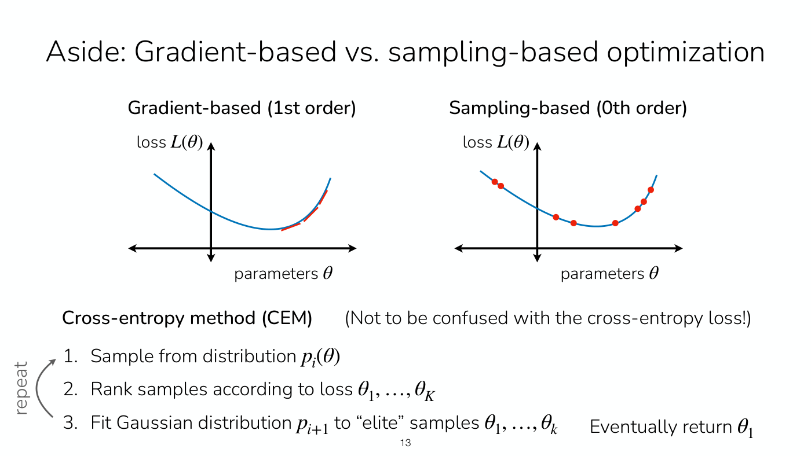

*Slide 13 — first-order optimization follows the tangent, zeroth-order optimization only evaluates samples; below, the cross-entropy method's sample, rank and refit loop. [Deck](https://cs224r.stanford.edu/spring_2025/slides/11_cs224r_mbrl_2025.pdf)*

Five questions follow (≈38:50–43:28):

- **Can sampling approximate gradients?** Yes, by finite differences: sample points very close together
  and use the difference in their values to estimate the gradient, which has pros and cons but is a
  valid approach (≈38:50).
- **Why is "policy" in quotes?** Because no parametric policy is learned: there is no neural network
  representing it. It is a policy in the sense that it maps a state to an action, or to several future
  actions, but underneath it is an iterative optimization process rather than a compact closed form
  that gives an action for a state (≈39:35–40:21).
- **How is the policy stored?** It is not. The only things learned are the parameters of the dynamics
  model and of the reward model. At every time step the agent thinks through what would happen if it
  did this, this or this, and chooses actions accordingly, which uses much more compute, in real time
  (≈40:21–41:08).
- **Can sampled actions be out of distribution?** Yes: actions drawn from the sampling distribution
  can be out of distribution for the data the model was trained on, which the next slides address
  (≈41:08).
- **What if the state has changed by the time the computation finishes?** Finn has no great answer.
  In practice people make the computation as fast as possible. Since a whole sequence is planned, if
  the computation is known to take two time steps, the agent could start by executing the plan's
  third or second action rather than its first, depending on the off-by-one. The catch is that the
  actions actually executed in the meantime may differ from the plan's, so the agent may be in a
  different state than it thinks. Handling this, especially when planning runs asynchronously while the
  world evolves, is somewhat of an open research problem (≈41:08–43:28).

Slide 14 sets out the trade-off, which explains why sampling can be a good choice for planning
(≈43:28–45:01). Gradient-based optimization is "scalable to high dimensions" and "works well
*especially* in overparametrized regimes", such as a big network representing a function that may
have fewer free parameters, but it "requires nice optimization landscape", with fairly smooth
gradients. For neural networks, with their high-dimensional, overparameterized parameter spaces, the
pros heavily outweigh the cons (≈43:28–44:14). Sampling-based optimization is "parallelizable", since
many samples can be evaluated at once where gradient descent is inevitably sequential, which can make
it faster; it "requires no gradient information"; but it "scales poorly to high dimensions", because
samples have to cover the space well to find a good optimum. In one dimension it can work really well
(≈44:14–45:01).

## Approach 1b: planning by sampling

Planning with sampling keeps the first two steps (run a policy, train a model) and the goal of choosing
actions that maximize reward; only the optimization changes (slide 15, ≈45:01). Step 3 becomes
"Iteratively sample action sequences, run through model $f_ \phi(\mathbf{s}, \mathbf{a})$ to choose
actions": sample many action sequences, imagine with the model what happens and what rewards follow,
and refine the selection iteratively (≈45:47).

Write $\mathbf{A} := \mathbf{a}_ t, \ldots, \mathbf{a}_ {t+H}$ for the action sequence (slide 16,
≈45:47). There are two versions:

- **Version 1, "Guess & check", or random shooting.** Sample many sequences
  $\mathbf{A}_ 1, \ldots, \mathbf{A}_ N$ from some distribution, such as a uniform one, and choose the
  one with the highest predicted sum of rewards, $\arg\max_ i \sum_ {t'=t}^{t+H} r(\mathbf{s}_ {t'}, \mathbf{a}_ {t'})$,
  then run it in the environment (≈45:47–46:34). The name comes from shooting out possible samples of
  the future, imagining each, evaluating its reward and picking the one shot with the highest reward
  (≈46:34). What is unsatisfying is that the sampling distribution may not be very good: "Can we
  improve this distribution?"
- **Version 2, the cross-entropy method.** Sample many $\mathbf{A}_ 1, \ldots, \mathbf{A}_ N$ from
  $p(\mathbf{A})$; evaluate each,
  $J(\mathbf{A}_ i) = \sum_ {t'=t}^{t+H} r(\mathbf{s}_ {t'}, \mathbf{a}_ {t'})$; pick the $M \lt N$
  elites with the largest $J(\mathbf{A}_ i)$; refit $p(\mathbf{A})$ to the elites; and repeat, so each
  round samples from a better distribution (≈46:34–47:19).

The cross-entropy method is fast if parallelized, and simple to implement for low-dimensional actions,
but it "doesn't scale to high dimensions", "including both $H$ and $\vert \mathbf{a} \vert$" (slide 16).
The optimization is over the whole sequence, so its size is the dimensionality of the action space
times the horizon, and it works best when that is fairly small (≈47:19–48:05). Slide 17 adds to step 3
"(e.g. with random shooting or cross-entropy method)". See
[planning with a learned model](planning-with-models.md).

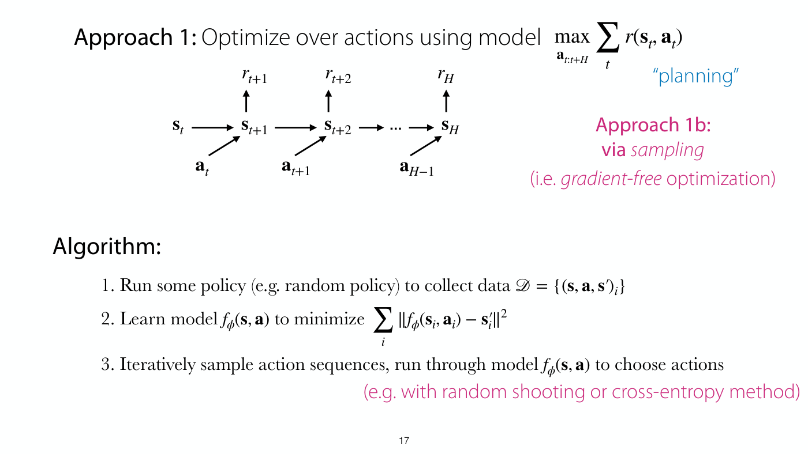

*Slide 17 — the same planning objective and chain as slide 12 but with no backward arrows: the action sequences are sampled and run through the model, with random shooting or the cross-entropy method. [Deck](https://cs224r.stanford.edu/spring_2025/slides/11_cs224r_mbrl_2025.pdf)*

## How planning fails: the cliff

Slide 18's example is a simple environment where the reward is the height reached, since the highest
point has the nicest view (≈48:05–48:50). A policy collects some data on the grass, and a model trained
on it learns that moving right means going higher, because generally the elevation rose to the right.
Planning with that model then chooses to go right, which is good for a while, until the agent falls off
the cliff (≈48:50–49:38). This is the **data distribution mismatch** from the start of the lecture: the
data collected at the beginning do not cover the states the final policy reaches, or in the slide's
notation $p_ {\pi_ 0}(\mathbf{s}) \neq p_ {\pi_ f}(\mathbf{s})$, where $p_ {\pi_ 0}(\mathbf{s})$ is the
distribution of states visited by the base policy and $p_ {\pi_ f}(\mathbf{s})$ that of the final
policy (≈49:38). The slide asks, as a thought exercise, how this might be alleviated.

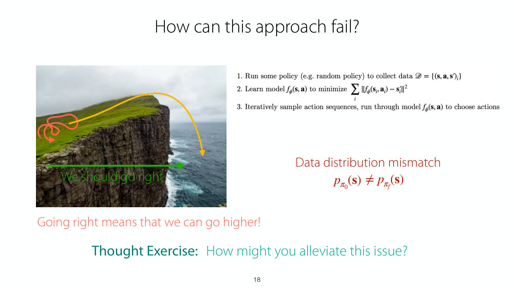

*Slide 18 — the base policy's data are the scribble on the grass; the model learns that going right goes higher, and the planned path runs over the cliff edge into the sea. [Deck](https://cs224r.stanford.edu/spring_2025/slides/11_cs224r_mbrl_2025.pdf)*

The simple fix is a fourth step (slide 19, ≈49:38–50:24): "Execute planned actions, appending visiting
tuples $(\mathbf{s}, \mathbf{a}, \mathbf{s}')$ to $\mathcal{D}$", then refit the model on the larger
dataset and repeat from step 2. The algorithm now looks more like reinforcement learning: it collects
data iteratively, fits a better model (here a dynamics model), samples and chooses actions, and runs
them in the environment (≈50:24).

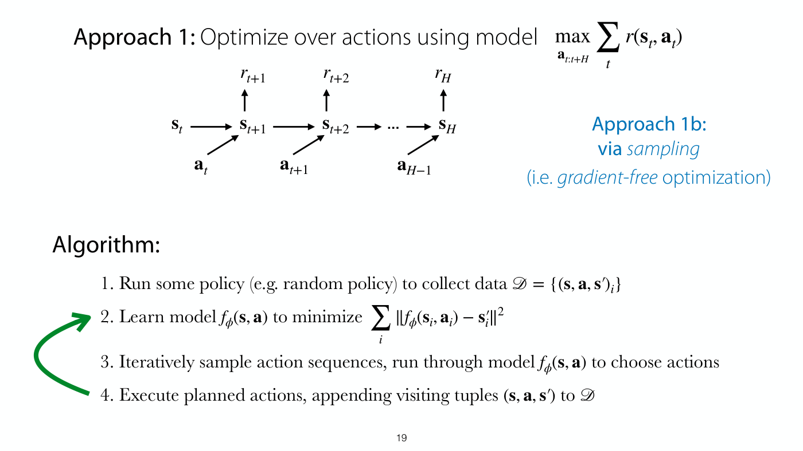

*Slide 19 — step 4 executes the planned actions and appends what was visited to the dataset, and the green arrow sends the loop back to refitting the model. [Deck](https://cs224r.stanford.edu/spring_2025/slides/11_cs224r_mbrl_2025.pdf)*

On the cliff, the agent executes its plan and goes off the edge; the model becomes more accurate, having
learned that going right past that point leads to very low elevation, which means very negative reward;
and the final policy goes to the top and stops (slide 20, ≈50:24).

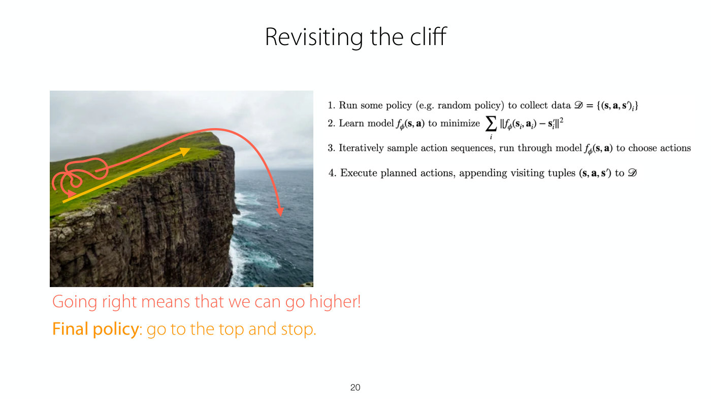

*Slide 20 — after the fall is added to the data, the refitted model's plan, in yellow, climbs to the top of the cliff and stops before the edge. [Deck](https://cs224r.stanford.edu/spring_2025/slides/11_cs224r_mbrl_2025.pdf)*

## Open loop and closed loop: model predictive control

So far the planned sequence is executed whole: the agent runs $H$ actions, $\mathbf{a}_ t$,
$\mathbf{a}_ {t+1}$, $\mathbf{a}_ {t+2}$ and so on, without access to the intermediate states
(≈51:13–52:03). The alternative is still to plan $\mathbf{a}_ t$ to $\mathbf{a}_ {t+H}$ but to execute
only $\mathbf{a}_ t$, get the next state back, and replan a new sequence at the next time step
(≈52:03–52:52). The first is called **open loop**, because it does not use the environment's feedback,
the intermediate states, when executing later actions; the second is **closed loop**, because it
replans as new states arrive (slide 21, ≈52:52).

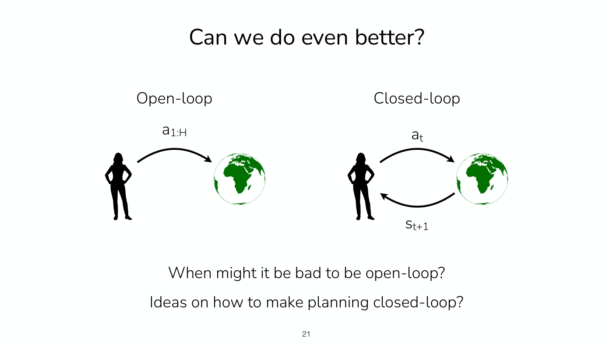

*Slide 21 — open loop sends the whole action sequence to the world at once; closed loop sends one action, gets the next state back, and decides again. [Deck](https://cs224r.stanford.edu/spring_2025/slides/11_cs224r_mbrl_2025.pdf)*

Finn asks when it might be bad to be open loop (slide 21, ≈52:52–53:37). A student answers: when the
environment changes a lot. If it changes in a way the agent did not anticipate, because it could not
predict everything, an open-loop agent will not react, while a closed-loop agent reconsiders from the
latest state and can sometimes have a much better policy (≈53:37). In a more deterministic world it can
be fine to be somewhat open loop at times, but $H$ should never be so large that the agent is executing
too open loop (≈54:25).

**Model predictive control (MPC)** is planning made closed loop (slide 22, ≈54:25–55:11). The agent
still plans a whole sequence, because it has to consider how all its actions affect future rewards, but
executes only the first action, observes the resulting state and replans from it; as before, it adds
the data to the dataset and periodically refits the model:

1. Run a base policy $\pi_0(\mathbf{a}_ t \mid \mathbf{s}_ t)$ (for example a random policy) to collect
   $\mathcal{D} = \lbrace (\mathbf{s}, \mathbf{a}, \mathbf{s}')_ i \rbrace$.
2. Learn a model $f_ \phi(\mathbf{s}, \mathbf{a})$ to minimize
   $\sum_ i \Vert f_ \phi(\mathbf{s}_ i, \mathbf{a}_ i) - \mathbf{s}'_ i \Vert^2$.
3. Use the model to optimize an action sequence.
4. Execute the first planned action and observe the resulting state $\mathbf{s}'$; return to step 3.
5. Append $(\mathbf{s}, \mathbf{a}, \mathbf{s}')$ to the dataset $\mathcal{D}$; periodically return to
   step 2.

MPC is very widely used in certain robotic systems, and in other control systems where lower-dimensional
systems can be modelled (≈55:11). It can be quite effective for legged robots, planning over the next
couple of seconds (≈55:56). Replanning at every step means that if something changes, or the agent makes
a mistake or slips, it can consider a completely different course of action. Besides changing
environments, it corrects for **model errors**: if the model is accurate in a large part of the state
space but inaccurate in some parts, this approach is much more robust to its errors (≈55:56–56:42). The
slide's car, drawn in two poses drifting across the centre line, carries the label "REPLANNING HELPS WITH
MODEL ERRORS".

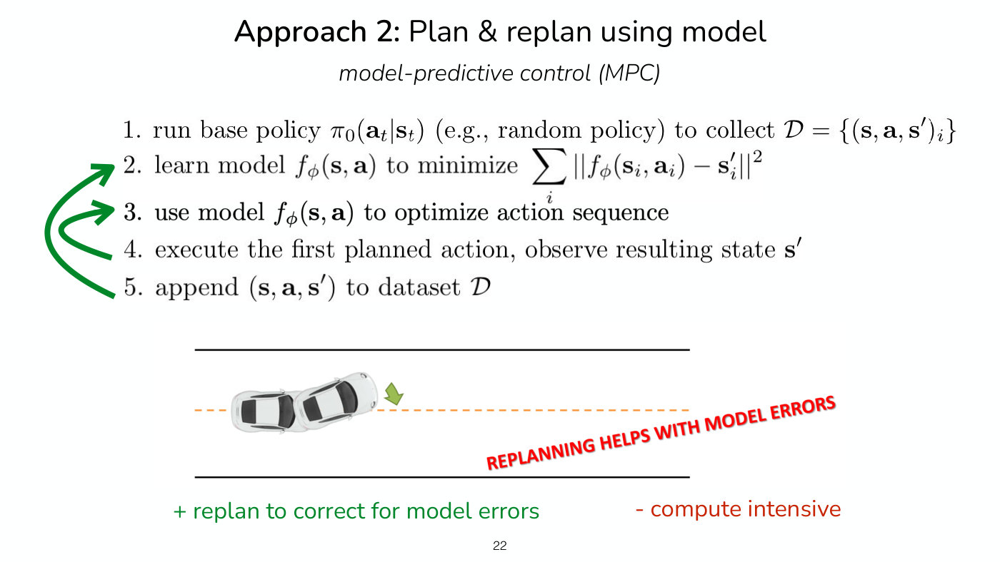

*Slide 22 — model predictive control: the inner arrow replans after every executed action, the outer one refits the model, and the car drifting across the line is the model error replanning corrects. [Deck](https://cs224r.stanford.edu/spring_2025/slides/11_cs224r_mbrl_2025.pdf)*

Four questions on MPC (≈56:42–1:00:33):

- **Does replanning oscillate between several good paths?** It can: replanning all the time, the agent
  may start in one direction and then switch. Sometimes it will not, if the state shows it has clearly
  committed to one direction (≈56:42–57:28). A remedy that also saves compute is to **warm-start** each
  plan from the previous one. Having planned $\mathbf{a}_ t$ to $\mathbf{a}_ {t+H}$, the plan at the
  next step, from $\mathbf{s}_ {t+1}$, is $\mathbf{a}_ {t+1}$ to $\mathbf{a}_ {t+1+H}$. Initialize it
  with everything but the first action of the previous plan and a random last action, which gives a
  sensible starting plan, a shorter optimization, and a commitment to the previous plan (≈57:28–58:15).
  In a sampling-based planner, the sampling can start close to the previous plan with some noise or
  extra variance, so that it does not consider only that plan (≈58:15).
- **Is replanning at every step too expensive?** It is compute intensive, and warm-starting helps
  (≈58:15–59:01). A middle ground is to replan every three or every 10 steps rather than every step,
  with a horizon of perhaps 110 steps (≈59:01; the captions give that number).
- **Can a better model replan less often?** As learning gathers data and the model improves, the agent
  might replan less frequently, insofar as replanning is there to correct model errors. That is very
  viable, and the final model used after learning can have different replanning hyperparameters from
  the ones used during learning (≈59:01–59:47). During learning, model errors also help exploration to
  some extent: the planner is drawn to exploit inaccuracies, so it explores exactly the regions where
  the model is wrong (≈59:47).
- **Is this off-policy, and how should the data-collecting policy be chosen?** Yes, it is an off-policy
  algorithm: it does not need data from the current policy. A fairly broad policy makes sense, because
  then the model is accurate in more places, assuming it is expressive enough to fit the broader data
  (≈59:47–1:00:33). See [offline and online algorithms](offline-and-online.md).

## So far: planning with learned models

Slide 23 sums up (≈1:00:33–1:02:51). Actions $\mathbf{a}_ 1, \ldots, \mathbf{a}_ H$ can be planned with
gradient-based or sampling-based optimization; the model is updated with data collected while planning;
and replanning periodically helps account for mistakes.

Its pros are that it is simple, and that it is "Easy to plug in different goals / rewards (possibly even
at test time!)". With a model that is universally good, the same model can make a walking robot run
forwards, walk backwards or crouch, just by changing the reward the planner maximizes at test time; the
model is quite task agnostic (≈1:00:33–1:01:20). Its cons are that it is "Compute intensive at test
time", which may rule it out with an expensive model and planning process (≈1:01:20), and that it is
"Only practical for short-horizon problems (or very shaped reward functions)" (≈1:02:06). A shaped,
dense reward that says a lot about good and bad states lets short-horizon planning approximate a long
problem: to walk forward forever, a forward-velocity reward suffices. A long-horizon problem without a
dense reward is not a good fit (≈1:02:06).

Why only short horizons? The slide gives "(a) too compute expensive to make long plans" and "(b) model
is not accurate for long horizons"; Finn names the model's accuracy and the cost of planning out a very
long sequence of actions without a learned policy (≈1:02:51).

## Training a policy, and longer horizons

"Can we *train a policy* using a learned model?" (slide 23). The first option on slide 25 is to
**distill the planner's actions into a policy**: store the planner's actions and train a policy to
match them (≈1:02:51). That fixes the compute problem, since acting becomes one forward pass through a
network, but not the horizon problem, because the actions still come from the same short-horizon
optimization (slide 25, "no longer compute intensive at test time" and "still limited to short-horizon
problems"; ≈1:03:36). See [imitation learning](imitation-learning.md) for training a policy to match
given actions.

For longer horizons, slide 25 lists two solutions (≈1:03:36). The first is to **plan with a terminal
value function**. Optimizing a longer sum of rewards would otherwise mean optimizing a longer, higher-
dimensional sequence of actions. Instead, with an estimate of a value function, the planner maximizes
the sum of rewards over the next $H$ steps plus the estimated value of the state reached after those
$H$ actions (≈1:04:23). The algorithm then learns both a model and a value function: the planner
considers many action sequences over the horizon, and past the horizon asks the value function whether
the state is good or bad. That is a valid way to combine planning with value-based RL (≈1:04:23–1:05:09).
See [value functions](value-functions.md).

A student asks why use the model at all, rather than just a Q-function (≈1:05:09). That is why Finn did
not want to spend long on this method: it learns a value function and a model, with many moving pieces.
It still has merit. If the model is known, it gives a better estimate of near-term rewards than the
value function, and in games it is common to do rollouts through a model of the game as far as is
computationally feasible and then use a value function, because that gives a better estimate of how good
an action is. But it only pays with a really good model, or when a good model is practical to learn
(≈1:05:09–1:05:55). The second solution is the subject of the next section, which the recording leaves
for Friday (≈1:06:40).

## Not in the recording: model-based policy optimization

The rest of the "data generation" section is only in the
[slide file](../raw/slides/11-model-based-rl.md). [Lecture 12](12-multi-task-rl.md#model-based-policy-optimization-synthetic-data-from-a-model) teaches
them aloud from its own version of these slides, with students' questions on convergence, rewards,
compute and stability. Slide 25's second solution is to "Augment model-free RL methods with data from model", and it
says "Let's focus on #2".

The key idea is to "augment data with model-simulated roll-outs" (slides 26–28). Given a real trajectory
$\mathbf{s}_ 1, \ldots, \mathbf{s}_ 6$, slide 26 asks how to augment it. Generating full trajectories from
the initial states fails because the "model may not be accurate for long horizons". Generating partial
trajectories from the initial states "may not get good coverage of later states". Slide 27's answer,
marked with a light bulb, is to "generate *partial trajectories* from *all states* in the data": short
model roll-outs branching off states along the real trajectory.

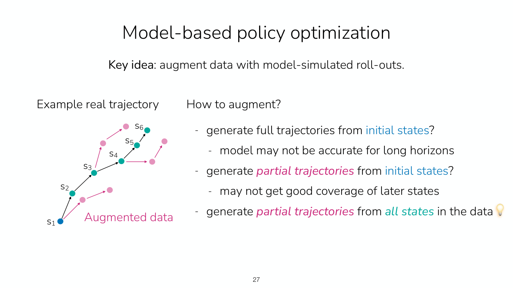

*Slide 27 — short model roll-outs, the pink dots, branch off states all along the real trajectory rather than running long from its start. [Deck](https://cs224r.stanford.edu/spring_2025/slides/11_cs224r_mbrl_2025.pdf)*

The full algorithm on slide 28 is written in the slide's own notation, with plain $s$, $a$, a policy
$\pi_\phi$ and a model $p_\theta$ (note that $\phi$ here is the policy's parameters, where slides 12–22
use $f_\phi$ for the model):

1. Collect data using the current policy $\pi_\phi$, and add it to $D_ {env}$.
2. Update the model $p_\theta(s' \mid s, a)$ using $D_ {env}$.
3. Collect synthetic roll-outs using $\pi_\phi$ in the model $p_\theta$ from states in $D_ {env}$, and
   add them to $D_ {model}$.
4. Update the policy $\pi$ (and the critic $Q$) using $D_ {model}$, and repeat.

It is "compatible with variety of model-free RL methods (step 4)", and it "could additionally use
$D_ {env}$ in policy update".

Slide 29, "When to use model-based RL?", answers "Big upsides and big downsides". Model-based RL is
"Immensely useful, far more data efficient if model is easy to learn"; the model "can be trained on data
without reward labels (fully self-supervised)"; and it "is somewhat task-agnostic (can sometimes be
transferred across rewards)". Against that, "Models don't optimize for task performance", are
"Sometimes harder to learn than a policy", and are "Another thing to train, more hyperparameters, more
compute intensive". Its verdict: "Whether to use a model depends on how hard it is to learn!"

Slide 30 lists "Other kinds of models" beyond the forward model
$p(\mathbf{s}_ {t+1} \mid \mathbf{s}_ t, \mathbf{a}_ t)$: an inverse model
$p(\mathbf{a}_ t \mid \mathbf{s}_ t, \mathbf{s}_ {t+1})$; a multi-step inverse model
$p(\mathbf{a}_ t \mid \mathbf{s}_ t, \mathbf{s}_ {t+n})$ or $p(\mathbf{a}_ {t:t+n} \mid \mathbf{s}_ t, \mathbf{s}_ {t+n})$;
future prediction without actions, $p(\mathbf{s}_ {t+1:t+n} \mid \mathbf{s}_ t)$; video interpolation,
$p(\mathbf{s}_ {t+1:t+n} \mid \mathbf{s}_ t, \mathbf{s}_ {t+n+1})$; and the transition distribution
$p(\mathbf{s}_ t, \mathbf{a}_ t, \mathbf{s}_ {t+1})$. "These kinds of models can be useful too! Have
various purposes." See [model-based RL](model-based-rl.md).

## Case study: deep dynamics models for dexterous manipulation

The case study is "Deep Dynamics Models for Learning Dexterous Manipulation", by Anusha Nagabandi, Kurt
Konoglie (as the slide prints the name), Sergey Levine and Vikash Kumar of Google Brain, dated September
2019 on the slide (slide 32). It uses planning for dexterous manipulation, and Finn covers it because it
is still, in Finn's view, one of the most impressive robotics results with a five-fingered hand, and
because its comparisons show what matters for good performance in model-based RL and planning
(≈1:06:40–1:07:26).

The setup (slide 33, ≈1:07:26–1:09:47):

- **State:** the positions of the hand and of the objects. The object's 3D position is assumed known,
  which can be estimated with a computer vision system or with motion-capture markers on the objects;
  the hand's position comes from sensors in the hand itself.
- **Action:** controlling the five-fingered hand, with 24 joints (24 DoF).
- **Reward:** tracking a target object trajectory, with a penalty for dropping the object.
- **Model:** fairly simple, a neural network with two hidden layers of size 500, but trained as an
  **ensemble** of three networks, which differ only in their random initialization and minibatch
  sampling, that is, their random seeds. If one model is very optimistic about what will happen, the
  others can counterbalance it; models err in different ways, so the planner does not exploit the
  errors of any one model (≈1:08:12–1:09:01).
- **Planner:** a modified cross-entropy method, iteratively resampling the actions, with a softer,
  reward-weighted mean and temporal smoothing of the actions, which encourages smoother trajectories
  (≈1:09:01).
- **Loop:** alternate between collecting about 30 trajectories with the planner and updating the
  model (≈1:09:01–1:09:47).

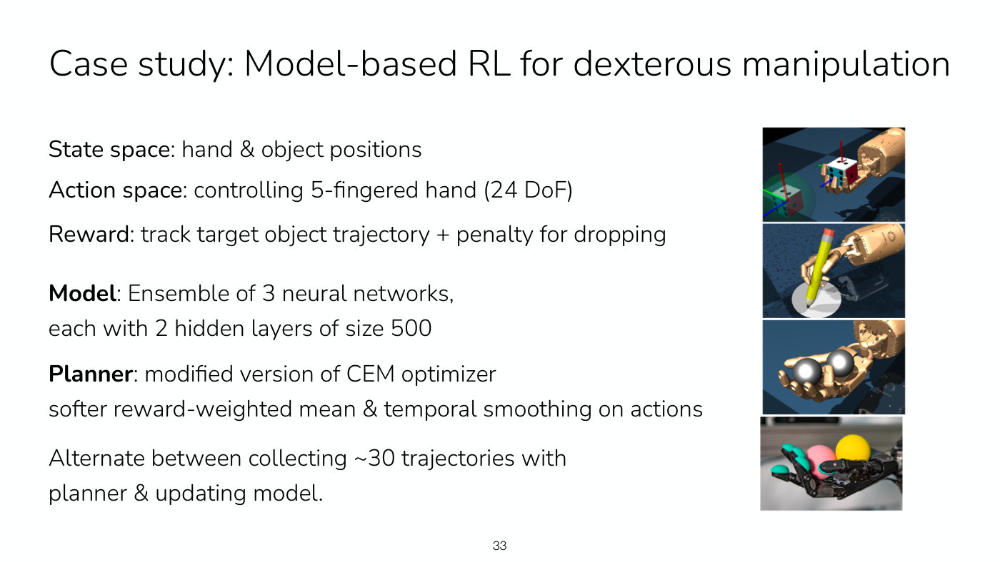

*Slide 33 — the state, action, reward, model and planner of the case study, beside its simulated tasks (a cube, a pencil, two balls) and the real hand. [Deck](https://cs224r.stanford.edu/spring_2025/slides/11_cs224r_mbrl_2025.pdf)*

The simulated experiments (slide 34) compare two model-free methods, SAC, an actor-critic method, and
NPG, natural policy gradient, a policy gradient method, with four model-based ones: PDDM, the proposed
method; MBPO, "RL with model-generated data"; PETS, a CEM-based planner; and Nagabandi et al., random
shooting with no ensembles (≈1:09:47). The planner runs in the loop during execution, and the videos
show the hand rotating Baoding balls and writing digits on paper (≈1:10:35). In the reward curves,
higher is better, plotted against the number of data points collected to fit the model or, for the
model-free methods, the policy (≈1:10:35).

On the Baoding balls, which is really challenging, only the proposed method solves the task: its green
curve climbs to the dashed line near the top while the others stay low and noisy (≈1:10:35). Methods
without iterative resampling, which just do random sampling, perform very poorly, because they cannot
reach a good part of the distribution and hone in on good actions (≈1:10:35–1:11:21); on the chart that
is the orange Nagabandi et al. curve, which Finn calls yellow. Handwriting is a bit easier. There SAC and
natural policy gradient do reach high performance, but they need far more data than the model-based
method in green. Finn puts the model-based method at maybe on the order of 100,000 time steps of data
and the model-free methods at around half a million (≈1:11:21). On the chart, PDDM's tracking error
reaches the dashed line almost at once, SAC reaches it at about 0.4 million data points and NPG at about
1.0 million. A box over the charts gives the conclusion: "More efficient than model-free methods" and
"More performant than other model-based methods".

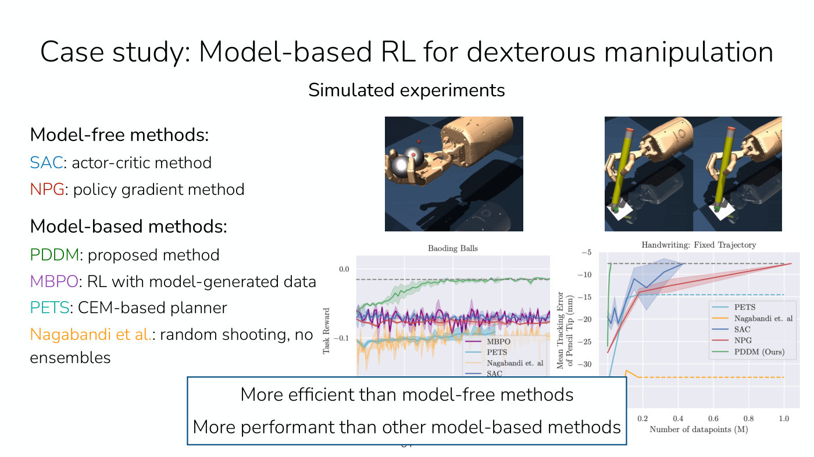

*Slide 34 — on the Baoding balls only PDDM, in green, climbs to the dashed line; on handwriting, SAC and NPG get there too but only after far more data. The boxed text covers the lower part of both charts. [Deck](https://cs224r.stanford.edu/spring_2025/slides/11_cs224r_mbrl_2025.pdf)*

The ablations (slide 35) say that the model needs to be sufficiently large and that the ensemble is
needed for good performance; and there are trade-offs in the planning horizon, since planning too far
into the future is too high-dimensional (≈1:11:21–1:12:06). The slide's four charts plot normalized task
reward against data:

- **Model architecture:** two hidden layers of 500 units (2x500) and of 250 reach about 0.9 to 1.0,
  while 2x64 levels off near 0.4 to 0.5: "Need sufficiently large model".
- **Ensemble size:** 1, 3 and 5 members all end near 1.0, but one member is lowest and noisiest on the
  way: "Need at least 3 ensemble members".
- **Horizon:** horizons of 5 and 7 end near 0.75, while 2 ends near 0.5 and 15 stays lowest for most of
  the run: "Planning horizon trade-offs".
- **Controller:** the modified planner, "Filtering + Reward Weighting", reaches about 0.95, against
  about 0.55 for plain CEM and a very noisy curve for random shooting: "Modified CEM is crucial".

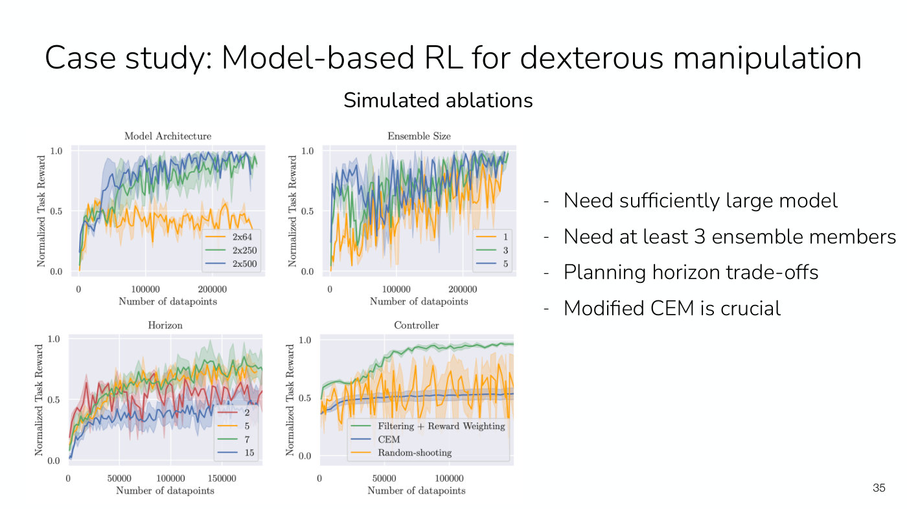

*Slide 35 — the four ablations: a bigger model, at least three ensemble members, a middling horizon and the modified CEM controller each matter. [Deck](https://cs224r.stanford.edu/spring_2025/slides/11_cs224r_mbrl_2025.pdf)*

The method also ran on a real hand, the ShadowHand (slide 36, ≈1:12:06). Data efficiency is really
important for fragile hardware: "Efficiency is key for fragile hardware". Finn mentions that there is
one of these hands at Stanford, in the Gates building, and that students are afraid to touch it in case
they break it, since it is also really complicated to fix (≈1:12:06). The success rate for 90° turns is
around 100% after just four hours of data; for 180° turns, which are harder, it is lower, but still a
significant result from four hours of data (≈1:12:06–1:12:52). On the chart, the 90° curve reaches 100%
at about four hours and the 180° curve about 52%. When the hand dropped a ball, another robot arm reset
the system (≈1:12:52).

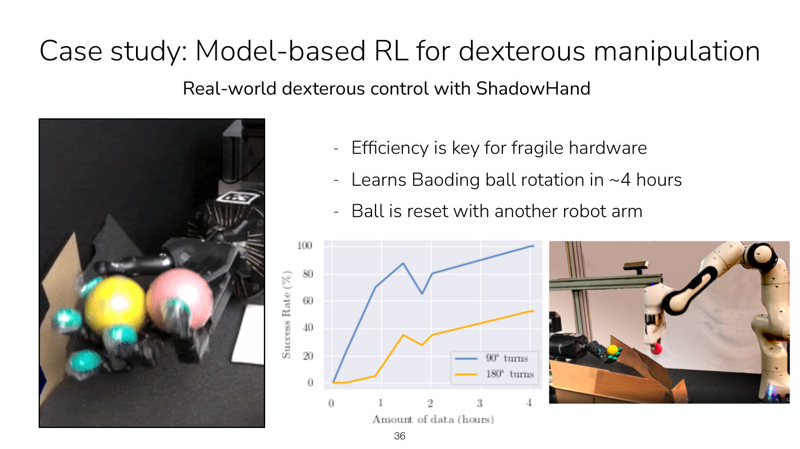

*Slide 36 — the real hand with its two Baoding balls, its success rate over four hours of data for 90° and 180° turns, and the robot arm that puts a dropped ball back. [Deck](https://cs224r.stanford.edu/spring_2025/slides/11_cs224r_mbrl_2025.pdf)*

## Summary

The lecture covered the key idea of model-based RL, learning a simulator that predicts the next state;
how to learn a dynamics model, briefly; and the first way to use one, planning. Planning optimizes a
short sequence of actions against the model, by backpropagation or by sampling with random shooting or
the cross-entropy method. It exploits the model where the data are thin, so executed actions are added
to the data and the model refit; and model predictive control replans after every action, which
corrects for model errors at a cost in compute. Planning is simple and lets the reward change at test
time, but is expensive at test time and limited to short horizons; distilling the planner into a policy
fixes the first, and a terminal value function extends the second. The case study showed a model-based
planner, with an ensemble of models and a modified cross-entropy method, learning dexterous manipulation
with far less data than model-free methods. The second way to use a model, generating data for
model-free RL, is in the slides and is left for Friday (≈1:06:40); [Lecture 12](12-multi-task-rl.md#model-based-policy-optimization-synthetic-data-from-a-model)
teaches it.

## Not in the recording: reminders and next time

Slides 2 and 38 remind students that Homework 3 is due next Friday, May 16, and the project milestone on
Friday, May 23. Slide 38 announces next time: "RL for multiple tasks and goals (e.g. learning generalist
policies)", and Finn closes by saying that next time covers the last part of model-based RL and RL with
multiple tasks and goals (≈1:12:52). See [course logistics](course-logistics.md).

## Related pages

- [Model-based RL](model-based-rl.md): the family as a whole, from learning a simulator to planning,
  model-based policy optimization and when to use a model.
- [Planning with a learned model](planning-with-models.md): gradient-based and sampling-based planning,
  random shooting, the cross-entropy method, model predictive control and their limits.
- [Offline and online algorithms](offline-and-online.md): the recap's map of offline, off-policy and
  on-policy methods, and why planning with a model is off-policy.
- [RL algorithm families](rl-algorithm-families.md): model-based methods among the course's algorithms.
- [Reward learning](reward-learning.md): the reward model a planner needs when the reward is not known.
- [Value functions](value-functions.md): the terminal value function that extends planning to longer
  horizons.
- [Imitation learning](imitation-learning.md): training a policy to match given actions, as in
  distilling a planner.
- [Replay buffers and soft actor-critic](replay-buffers.md): SAC, one of the case study's model-free
  baselines.
- [Lecture 10 — RL for LLM Reasoning](10-rl-for-reasoning.md): the previous lecture.
- [Lecture 12 — Multi-Task RL](12-multi-task-rl.md): the next lecture, which opens by teaching model-based
  policy optimization and when to use model-based RL aloud.
