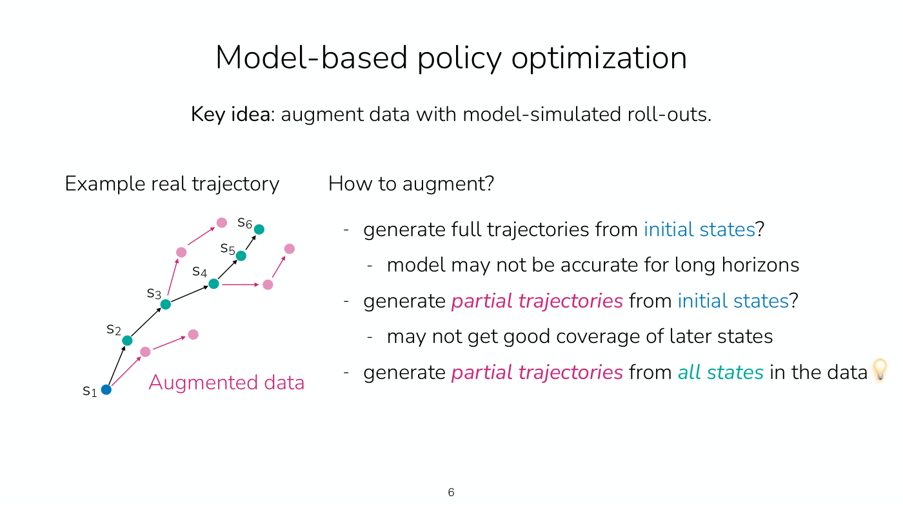
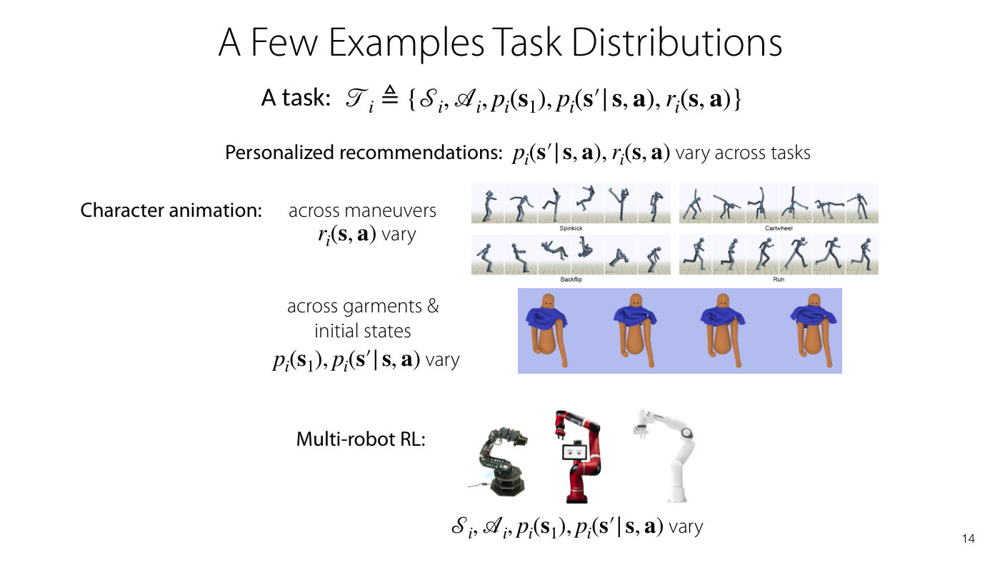
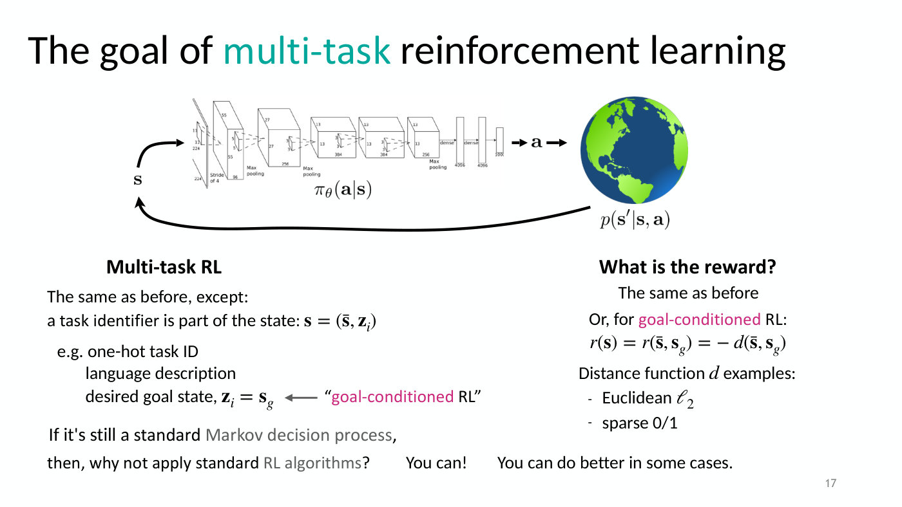
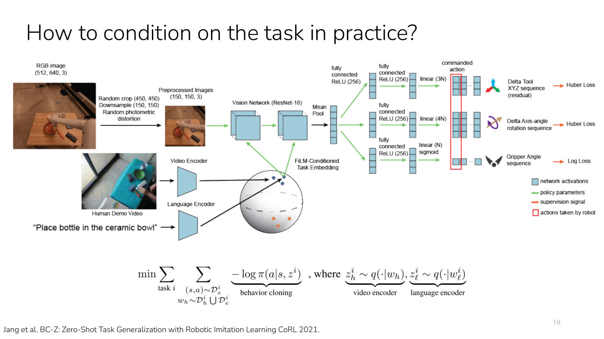
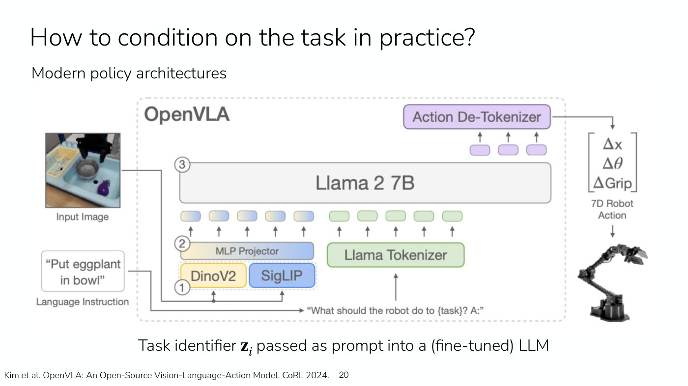
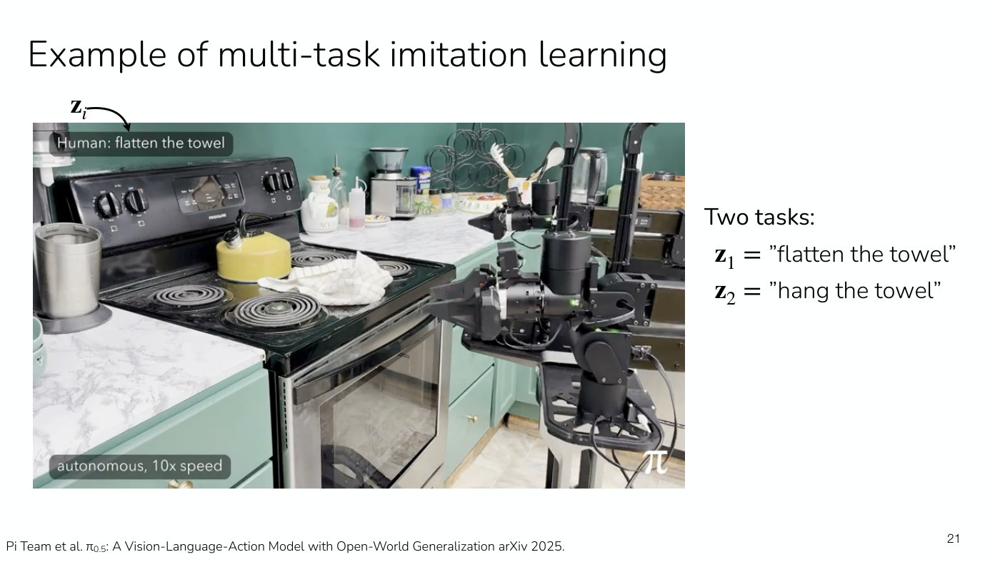
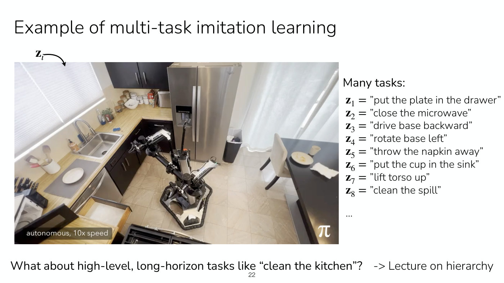
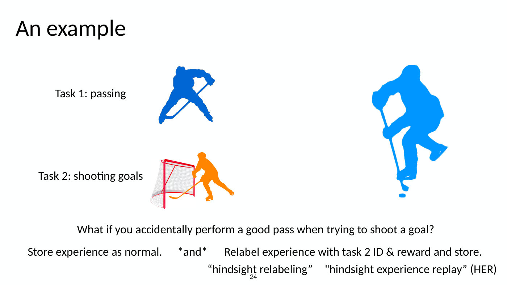
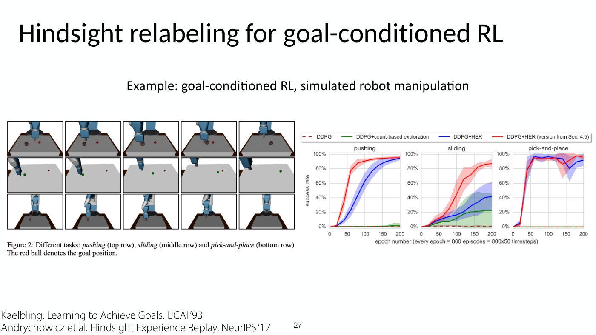

# Lecture 12 — Multi-Task RL

Stanford CS224R, Spring 2025 (Friday, May 9) ·
[video](https://www.youtube.com/watch?v=qNdsI_4AQJw) (70 min) ·
[slides (PDF)](https://cs224r.stanford.edu/spring_2025/slides/12_cs224r_mtrl_gcrl_2025.pdf) ·
[slide-by-slide text](../raw/slides/12-multi-task-rl.md) ·
[transcript](../raw/transcripts/12-multi-task-rl.md)

**What this lecture establishes.** The lecture first finishes model-based RL with its second use of a
learned model: instead of planning with it, use it to **generate synthetic data** for a model-free
learner, as short roll-outs that branch off every state in the real data (model-based policy
optimization). It then weighs when a model is worth learning at all, which depends on how hard the
model is to learn compared with the policy. The second half turns to **multi-task** learning: one
policy that does many tasks, where a task is formally its own MDP and the policy is told which task
to do by a **task identifier** $\mathbf{z}_ i$ (an index, a language string, a video, or a goal
state), which can be treated as part of the state. Multi-task imitation learning averages the
imitation loss over tasks; multi-task RL conditions the policy and Q-function on the task, and can
go further by **sharing data across tasks**: experience collected for one task is **relabeled** with
another task's identifier and reward. This is **hindsight relabeling**, and when the tasks are goals
it becomes goal-conditioned RL with hindsight relabeling, which students implement in Homework 4.

Slide numbers below are the numbers printed on the slides, which equal the PDF page numbers.
Timestamps (≈M:SS) point into the video and the [transcript](../raw/transcripts/12-multi-task-rl.md).
**The recording covers slides 3–25 and the start of slide 26.** It opens by stating the plan
(slide 3) and recapping planning (slide 4) without discussing slide 2's reminders. Finn begins the
goal-conditioned version at ≈1:09:21, and the recording ends about a minute later, at about 1:10:21,
partway through slide 26. So slide 26's relabeling rule, slide 27's simulated-manipulation results
and the closing slides (28–29) are not taught aloud; the
[section on them](#not-in-the-recording-the-rest-of-goal-conditioned-relabeling-and-next-time) gives
them from the [slide file](../raw/slides/12-multi-task-rl.md).

Finn works several things on a board the recording does not show: the model-based policy
optimization algorithm (≈7:47–9:20), the reward and dynamics of a single MDP built from many tasks
(≈38:31–40:48), a one-hot vector (≈43:55), the multi-task imitation objective (≈44:40–46:11) and the
relabeling algorithm (≈1:00:54–1:02:26). Where the transcript says "this" or "right here", this page
reconstructs what was meant from the surrounding words and the slides, and says so.

## Contents

1. [Recap: planning with learned models](#recap-planning-with-learned-models)
2. [Model-based policy optimization: synthetic data from a model](#model-based-policy-optimization-synthetic-data-from-a-model)
3. [When to use model-based RL](#when-to-use-model-based-rl)
4. [Other kinds of models](#other-kinds-of-models)
5. [What multi-task RL is, and why](#what-multi-task-rl-is-and-why)
6. [A task is an MDP](#a-task-is-an-mdp)
7. [Task identifiers, and the task as part of the state](#task-identifiers-and-the-task-as-part-of-the-state)
8. [Multi-task imitation learning](#multi-task-imitation-learning)
9. [Conditioning on the task in practice](#conditioning-on-the-task-in-practice)
10. [Examples of multi-task imitation learning](#examples-of-multi-task-imitation-learning)
11. [Multi-task RL, and sharing data across tasks](#multi-task-rl-and-sharing-data-across-tasks)
12. [Hindsight relabeling](#hindsight-relabeling)
13. [When relabeling applies](#when-relabeling-applies)
14. [Goal-conditioned RL with hindsight relabeling](#goal-conditioned-rl-with-hindsight-relabeling)
15. [Not in the recording: the rest of goal-conditioned relabeling, and next time](#not-in-the-recording-the-rest-of-goal-conditioned-relabeling-and-next-time)
16. [Summary](#summary)

## Recap: planning with learned models

Lecture 11 learned a model of the dynamics, which could be deterministic or could model a
distribution over next states, approximating the next state given the current state and action. The
model predicts, or imagines, what would happen for actions the agent is considering. Planning
behaves without learning a mapping from states to actions: for a given state it thinks through, on
the fly, what actions to take, by gradient-based or sampling-based optimization over a future horizon
(slide 4, ≈0:05–1:39). The model is updated with the data collected while planning, so that it
becomes better where it is used, and the agent replans periodically to account for mistakes and
model errors and to react to changes in the environment (≈1:39).

Planning is simple, and it is easy to plug in different goals or rewards, possibly even at test
time, given a general enough model. But it is compute intensive at test time, and this instantiation
is practical only for short-horizon problems or very shaped rewards. Slide 4 gives the two reasons:
long plans are too compute expensive, and the model is not accurate when it is applied many times to
generate a long trajectory (≈2:25–3:12). Its closing question is the start of this lecture: "Can we
*train a policy* using a learned model?" See [planning with a learned model](planning-with-models.md).

## Model-based policy optimization: synthetic data from a model

The second way to use a learned model is to learn a policy, and the key idea is to "augment data
with model-simulated roll-outs" (slide 5). The model, "this learned simulator", augments
whatever data has been collected in the real environment, some of which might have come from an
offline dataset (≈3:12).

Finn asks how to use the model to generate synthetic data from a real trajectory (≈3:57). One
student suggests taking the last state of the trajectory and generating more from there. Another
suggests something like DAgger, where the first part is run by the policy and the second part comes
from the model. Finn draws the conclusion that the roll-outs do not have to start at the end: they
can start anywhere in the middle, from really any state in the buffer (≈4:42). Finn draws the
result with the synthetic, imagined data in red and the real data from the environment in black. But
the model cannot be trusted for a long roll-out, so the synthetic trajectories should be kept short:
little roll-outs that add coverage around the trajectory in the data. That picture, of short
branches, is often what people find works really well in practice, because of inaccuracies in the
model (≈5:28–6:13).

Slides 5 and 6 set out the options against an example real trajectory
$\mathbf{s}_ 1, \ldots, \mathbf{s}_ 6$ (≈6:13–7:47). Generating full trajectories from the initial
states is the simple first idea, but the "model may not be accurate for long horizons", and with
only short roll-outs from the initial states the agent would not get good state coverage.
Generating partial trajectories from the initial states "may not get good coverage of later states".
What gets the best of both, good coverage and short trajectories, is to "generate *partial
trajectories* from *all states* in the data".

*Slide 6 — the pink branches are model roll-outs, each about two steps long, starting from real states along the trajectory rather than from its start. [Deck](https://cs224r.stanford.edu/spring_2025/slides/12_cs224r_mtrl_gcrl_2025.pdf)*

Finn writes the full algorithm on the board (≈7:47–9:20), and slide 7 prints it (≈13:08). In the
slide's notation, $\pi_\theta$ is the policy, $p_\psi$ the model and $Q_\phi$ a critic; Lecture 11's
version of this slide named the policy $\pi_\phi$ and the model $p_\theta$.

1. Collect data using the current policy $\pi_\theta$, and add it to $D_ {env}$.
2. Update the model $p_\psi(s' \mid s, a)$ using $D_ {env}$.
3. Collect short synthetic roll-outs using $\pi_\theta$ in the model $p_\psi$ from states in
   $D_ {env}$, and add them to $D_ {model}$.
4. Update the policy $\pi_\theta$ (and the critic $Q_\phi$) using $D_ {env} \cup D_ {model}$.

On the board, the model is first updated with the real data, so that it is as accurate as it can
be. Generation samples a state $s$ from the real data, then rolls out the policy, "or whatever
exploration policy you have", from $s$ inside the learned model, the world the model instantiates
rather than the real environment, and puts the result in a second dataset Finn calls D gen, for
generated data. The policy is updated with both the real and the generated data, and the process
repeats (≈7:47–9:20). The caption calls the board's name for the real data "dn"; slide 7 calls it
$D_ {env}$. The model may also model rewards by trying to mimic the data from the environment, and
the last step can optionally update a value function as well (≈13:08).

Step 4 can use a variety of RL algorithms, even on-policy ones: an on-policy method needs data from
the exact $\pi_\theta$ it takes a gradient step on, which only means that $\pi_\theta$ must be the
policy that collected the synthetic data through the model (slide 7, ≈13:54). The last update can use
both the environment's data and the model's, and some methods update the policy only on the model's
data and find that works fine as well (≈14:40). Either way it only makes sense with an estimate of
the reward function; without one, the policy cannot be updated on generated data (≈14:40).

Students' questions fill in how the method behaves:

- **Do short roll-outs slow convergence to a goal?** The synthetic data supplements the real data.
  Roll-outs from states near the goal get close to rewards, and RL lets the value learned there feed
  back into other states in the data. If a real trajectory took an indirect path, the policy may
  learn a shortcut, and exploring it in synthetic data can help learn a better policy. What is
  usually being minimized is the amount of real data, and the red trajectories let the agent get a
  good policy with less of it (≈9:20–11:37).
- **Where do the rewards come from?** Sometimes the form of the reward function is known, or a
  reward function was learned as part of the problem. If the real world only gives rewards as part
  of the data, then this model, or a separate one, also has to learn the reward function by
  supervised learning (≈11:37–12:22). See [reward learning](reward-learning.md).
- **What does it cost in compute?** More during training: rolling out through a model takes compute,
  so the method trades data in the environment for compute. The trade is often favorable because
  collecting online data in the real environment might be unsafe, or expensive if experiments run on
  physical equipment. Unlike planning, it costs nothing extra at test time, because the synthetic
  data trains a policy and the policy is what runs (≈12:22–13:08).
- **Is learning stable with synthetic data?** How much synthetic data to generate, and how to
  balance it in the last update, depends on how good the model is. The method does add
  hyperparameters, since the model has to be trained, and a badly trained model can make the
  algorithm perform worse. With a fairly accurate model there are usually no stability issues
  (≈14:40–16:13).
- **Which hyperparameters?** Mainly step 2: the model's architecture, which may need to be
  completely different from the policy's if it generates images or states; a learning rate; how long
  to train it, in epochs; and any regularization. Beyond the model, the length of the roll-outs and
  how much synthetic data to generate (≈19:18–20:49).
- **Does data collection continue after each policy update?** As written the algorithm is online:
  it keeps collecting real data and updating the model. A completely offline version takes a fixed
  prior dataset, augments it with a model, trains a policy and stops. Whether it is on-policy or
  off-policy depends on whether the update uses only this iteration's D n and D gen or earlier
  iterations' too, which depends on the policy-update algorithm. "Generally models are very flexible"
  (≈20:03–21:34). See [offline and online algorithms](offline-and-online.md).

## When to use model-based RL

Slide 8 answers "Big upsides and big downsides" (≈16:13–19:18). If a pretty good model can be learned,
it is "immensely useful" to predict the future, and far less real data is needed; in domains where a
model is feasible to learn it is really useful, and it allows test-time planning as well. Finn adds
an upside not on the slides: anticipating future states as an outcome of one's actions "seems like a
fairly fundamental thing" that models should have some understanding of (≈17:00).

Two more upsides concern data. A model can be trained without reward labels, so when only part of the
real data has rewards, the model can train on the rest and leverage more data than a model-free method
could; there are settings with very large amounts of data without rewards and a small amount with
them (≈17:00–17:46). And the model is somewhat task-agnostic: trained on a broad enough distribution
it can sometimes transfer across tasks or rewards, which helps when the goal is to learn many tasks
rather than one (≈17:46).

The downsides (≈17:46–19:18): the model does not optimize for task performance. With image
observations it tries to get the details of the pixels right, the color of the sky for example, which
is often not what matters for a good policy, so what the model is trained for and what the policy
needs do not match. Sometimes a model is harder to learn than the policy, and then learning one
presents a harder problem than the downstream one. And it is another thing to train, with more
hyperparameters and more compute. So whether to learn a predictive model depends a lot on the domain
and on how hard the model is to learn: "Whether to use a model depends on how hard it is to learn!"

How hard a model is relative to a policy is "extremely domain dependent" (≈21:34–23:06). In a maze
with walls, the model is easy: an action to go right goes right unless a wall is there. The policy is
complicated, since from each place it may need to go in various directions, so learning a model could
be a good choice. Pouring water from a cup into a bowl is the reverse: if the cup is already in hand,
the policy may be as simple as rotating the wrist, but the model involves the fluid dynamics of the
pour and what happens if the water hits the edge or the center of the bowl. There it may be much
easier to learn the policy without a model.

Asked how successful model-based RL has been in robotics (≈23:06–24:38): with high-dimensional
image observations it has arguably been less successful; with a compact state, such as the positions
of joints and of objects, a lot more. Legged robots can use it pretty successfully for a blind walking
policy, and it was very successful for Lecture 11's dexterous hand, where the positions of the two
balls were known; Finn says model-free RL or even imitation learning would be very challenging for
that problem. With image observations it gets a lot harder, but video generative models are getting
a lot better, and Finn can see a future in which this approach is quite successful there too. See
[model-based RL](model-based-rl.md).

## Other kinds of models

Everything so far models $p(\mathbf{s}_ {t+1} \mid \mathbf{s}_ t, \mathbf{a}_ t)$, but there are many
other things one could learn (slide 9, ≈24:38–26:12). An **inverse model**
$p(\mathbf{a}_ t \mid \mathbf{s}_ t, \mathbf{s}_ {t+1})$ asks which action leads from the current state
$\mathbf{s}_ t$ to $\mathbf{s}_ {t+1}$; a **multi-step inverse model**,
$p(\mathbf{a}_ t \mid \mathbf{s}_ t, \mathbf{s}_ {t+n})$ or
$p(\mathbf{a}_ {t:t+n} \mid \mathbf{s}_ t, \mathbf{s}_ {t+n})$, asks which action, or sequence of actions,
would end up at $\mathbf{s}_ {t+n}$. Both look closer to a policy, except that they take a future state
as input as well as the current one, and both can be learned from data without rewards: they learn
about the environment rather than the task at hand. **Future prediction without actions**,
$p(\mathbf{s}_ {t+1:t+n} \mid \mathbf{s}_ t)$, asks what the affordances of the environment are, what
could happen irrespective of the agent's actions. **Video interpolation** fills in the states
between two given ones, and a generative model of transitions,
$p(\mathbf{s}_ t, \mathbf{a}_ t, \mathbf{s}_ {t+1})$, has "some cool properties". "These kinds of models
can be useful too! Have various purposes", and there is a lot of research on them (≈26:12).

A student asks whether training the model on data without rewards creates a mismatch between how well
it predicts next states and how well it predicts rewards (≈26:12–27:00). It could. Rewards are
generally easier to predict than future states, so even with more data for the dynamics the model can
end up less accurate than the reward estimate; but the reward can also end up less accurate, and then
data has to be gathered specifically for it.

## What multi-task RL is, and why

Can one policy be trained to do many "tasks", not just one (slide 11, ≈27:00–29:17)? A generalist
LLM assistant that books travel and does online grocery shopping; a legged robot that walks, runs,
dances and crouches; a mobile robot that hangs up a towel, unloads a dishwasher and wipes a spill; a
music recommender system that personalizes recommendations to many distinct people; a game player
for Pokémon, pinball and Flappy Bird. Treated as separate RL problems, these tasks can have different
reward functions, different dynamics (different games, different people), even different action
spaces. "Key idea will be to condition on the task": in many cases, ordinary RL works with a policy
conditioned on both the state and the task it should perform in that state (≈28:31–29:17).

Why bother (slide 12, ≈29:17–31:35)? A topic recurring through the course, across imitation learning,
on-policy, off-policy and offline RL, model-based RL and reward functions, is data efficiency. If the
goal is a policy that does many tasks, training it across tasks can amortize the cost of learning any
one of them, because tasks typically share structure: for an LLM assistant, grammar, and how to
interact with websites; for a legged robot that walks forward and backward, staying balanced; for a
personalized recommender, the similarities between users. There is also a deeper motivation:
generalist systems often end up more reliable and more performant than ones trained on a single task,
which Finn calls a pretty cool finding that has empirically been true in recent years in AI.

## A task is an MDP

What makes something a different task is not well defined, but one way to think about it is that
different tasks are different RL problems, different Markov decision processes (slide 13,
≈31:35–33:07):

$$\mathcal{T}_ i \triangleq \lbrace \mathcal{S}_ i, \mathcal{A}_ i, p_i(\mathbf{s}_ 1), p_i(\mathbf{s}' \mid \mathbf{s}, \mathbf{a}), r_i(\mathbf{s}, \mathbf{a}) \rbrace$$

Task $i$ has its own state space $\mathcal{S}_ i$, action space $\mathcal{A}_ i$, initial state
distribution $p_i(\mathbf{s}_ 1)$, dynamics $p_i(\mathbf{s}' \mid \mathbf{s}, \mathbf{a})$ and reward
$r_i(\mathbf{s}, \mathbf{a})$. This "allows for much more variety than the semantic meaning of 'task'":
two tasks may have the same reward function and differ only in their dynamics. Walking forward on
grass and walking forward on flat terrain could be two different tasks in this framework, although
both are walking forward (≈32:21–33:07). See [MDPs and notation](mdp-and-notation.md).

Slide 14 gives examples, and Finn asks what varies across the tasks in each (≈33:07–37:01). In
**personalized recommendations**, tasks are users: one person may love rock music and another hip-hop,
so rewards differ, and how often each listens to music changes the dynamics. In **character
animation**, an application of RL the course has not discussed, used to animate characters such as the
ones in movies, the tasks are maneuvers like a backflip, a run or a cartwheel; a student answers that
the reward varies while the physics of the simulator stays the same. When a character puts on a
shirt, a long-sleeve shirt or a dress, students answer that the physics of the garment varies, and
Finn adds that the initial state distribution varies, since the garment is part of the initial state.
The policy, Finn notes, varies in all of these cases. In **multi-robot RL**, controlling arms with
four, six or seven degrees of freedom to grasp an object, students answer that the actions differ in
dimension, the dynamics differ because moving one joint affects the others differently, and the
states differ too.

*Slide 14 — three kinds of task distribution: character animation varies the reward across maneuvers, or the initial state and dynamics across garments, and multi-robot RL varies everything but the reward. [Deck](https://cs224r.stanford.edu/spring_2025/slides/12_cs224r_mtrl_gcrl_2025.pdf)*

## Task identifiers, and the task as part of the state

The policy has to be told which task to do (slide 15, ≈37:01–37:46). One way is to assign an index,
task 0, task 1, task 2, which is what one resorts to without a better way to identify a task. Others
are a language description of the task or a video illustration of what to do, and there are many ways
to be creative. These are **task identifiers**, $\mathbf{z}_ i$.

An alternative view puts the task identifier in the state: $\mathbf{s} = (\bar{\mathbf{s}}, \mathbf{z}_ i)$,
where $\bar{\mathbf{s}}$ is the original state (slide 16, ≈37:46–38:31). A collection of MDPs then
becomes a single MDP that covers all the tasks. Finn writes its pieces on the board (≈38:31–40:48):
the state is the original state together with the task identifier, the reward of the combined MDP is
the task's reward, $r(\mathbf{s}, \mathbf{a}) = r_i(\bar{\mathbf{s}}, \mathbf{a})$, and its dynamics
are the task's dynamics,
$p(\mathbf{s}' \mid \bar{\mathbf{s}}, \mathbf{z}_ i, \mathbf{a}) = p_i(\mathbf{s}' \mid \bar{\mathbf{s}}, \mathbf{a})$.
These are reconstructed from the spoken words ("r i of s bar, a"; "s prime given s bar, z i, a"),
since the board is not visible. It gets more complicated when the tasks have different state and
action spaces, for example different dimensionalities, because one has to decide how to represent the
combined state space; with the same state and action spaces, the combined MDP is just these equations
(≈40:48).

*Slide 17 — the usual policy and environment loop, with the task identifier folded into the state, and the goal-conditioned reward as a negative distance to the goal. [Deck](https://cs224r.stanford.edu/spring_2025/slides/12_cs224r_mtrl_gcrl_2025.pdf)*

So multi-task RL is "the same as before, except: a task identifier is part of the state" (slide 17,
≈40:48–43:08). The identifier can be a one-hot task ID, a language description, or a **desired goal
state**, $\mathbf{z}_ i = \mathbf{s}_ g$, which is often called **goal-conditioned RL**. The reward is
the same as before; for goal-conditioned RL it is often a negative distance between the current state
and the goal state,

$$r(\mathbf{s}) = r(\bar{\mathbf{s}}, \mathbf{s}_ g) = -d(\bar{\mathbf{s}}, \mathbf{s}_ g)$$

where the distance function $d$ could be Euclidean $\ell_2$ or a sparse 0/1 (≈41:34–42:22). Answering a
student, Finn says "Euclidean L2, that's just mean squared" (≈43:08). So aggregating the tasks still gives a
standard Markov decision process, with something like a task string in the state, and standard RL
algorithms can be applied to it: "You can!" In many cases that is a great approach. But in some cases
one can do better by using the known structure between the tasks, and goal-conditioned RL is one of
them, which the rest of the lecture builds to (≈42:22–43:08).

Is there a better way to represent people, if people are tasks, than a one-hot vector (≈43:08–44:40)?
Finn draws a one-hot vector on the board: to represent the number two, a vector with a one in that
position. There are definitely better ways, though one-hot is fairly common in RL methods. One could
use a language description of the person or their preferences, or, as next week's material covers,
examples of things they like and do not like as part of the task descriptor, which becomes something
more like in-context learning, where the task descriptor contains data about the task. (The caption
names that descriptor "DI"; it is unclear whether Finn said $\mathbf{z}_ i$.)

## Multi-task imitation learning

In multi-task imitation learning with a relatively small number of tasks, there is a set of expert
demonstrations $\mathcal{D}_ i$ for each task $i = 1, \ldots, n$ (≈44:40–45:26). Single-task imitation
learning, as in the first lectures, minimizes the negative log probability of the demonstrated actions
given the states, which slide 18 abbreviates as a loss $\mathcal{L}$:

$$\min_ \theta \thinspace -E_ {(\mathbf{s}, \mathbf{a}) \sim \mathcal{D}} \log \pi_\theta(\mathbf{a} \mid \mathbf{s}) \quad = \quad \min_ \theta \thinspace \mathcal{L}(\theta, \mathcal{D})$$

The multi-task version minimizes one set of policy parameters $\theta$ over the loss averaged over all
the tasks (slide 18, ≈45:26–46:11):

$$\min_ \theta \sum_ {i=1}^{T} \mathcal{L}(\theta, \mathcal{D}_ i)$$

The slide's sum runs to $T$, the number of tasks; Finn speaks of $n$ tasks. "So this is basically
multi-task imitation learning, pretty simple, hopefully." See [imitation learning](imitation-learning.md).

One useful trick, from multi-task supervised learning, is **stratified sampling** (≈46:11–47:44). If
the tasks are very different, one telling the policy to go forwards, one backwards, one to lie down,
then a minibatch that is mostly going forward followed by one that is mostly lying down makes the
gradient vary a lot from one step to the next. The policy should use the task identifier to tell
them apart, but that can be tricky for the network. So construct each minibatch with data from every
task: to optimize for a uniform distribution over $n$ tasks, $1/n$ of the minibatch comes from the
first task, $1/n$ from the second, and so on, which gives lower-variance gradients. Another thing not
on the slides that helps is putting states and actions on similar scales across tasks, with per-task
normalization (≈47:44).

## Conditioning on the task in practice

The trained policy takes a state and a task descriptor and outputs an action. The descriptor might be
a language string or a one-hot vector while the state is an image, so the input is inherently
multimodal, with very different dimensions, and the architecture has to handle that (≈47:44–48:32).

Finn's first example uses several modalities of task descriptor: BC-Z (Jang et al., CoRL 2021), a
multi-task imitation learning system training a robot to do simple manipulation tasks (slide 19,
≈48:32–50:51). The paper is a little old, so it does not use a transformer for the policy. It
downsamples the current image before passing it into the network. It uses two different task
descriptors: a language string, which Finn reads as "put bottle in the ceramic bowl" (the slide prints
"Place bottle in the ceramic bowl"), and, in place of the language, a video of a person placing the
bottle in the bowl. The language goes through a language encoder of the kind used in language models,
which Finn believes was a transformer here; the video goes through a separate video encoder, because
video data looks very different. The embedding is then multiplied into different layers of the
backbone that processes the state, which the slide labels a "FiLM-Conditioned Task Embedding". Training
samples the task descriptor from either the video encoder or the language encoder, and trains the whole
model, encoders included, with a behavior cloning loss:

$$\min \sum_ {\text{task } i} \thinspace \sum_ {(s,a) \sim \mathcal{D}_ e^i, \thinspace w_h \sim \mathcal{D}_ h^i \cup \mathcal{D}_ e^i} -\log \pi(a \mid s, z^i)$$

where $z_h^i \sim q(\cdot \mid w_h)$ comes from the video encoder and $z_\ell^i \sim q(\cdot \mid w_\ell^i)$
from the language encoder (slide 19, in the paper's plain notation).

*Slide 19 — BC-Z: a human demo video and a language instruction are encoded into one embedding, which conditions the vision network's layers; three heads output the robot's commanded action. [Deck](https://cs224r.stanford.edu/spring_2025/slides/12_cs224r_mtrl_gcrl_2025.pdf)*

In a language model, the natural task descriptor is a language string: the prompt (slide 20,
≈50:51–51:37). So all of a language model's imitation learning, its supervised fine-tuning, can be
seen as multi-task imitation learning, with different prompts as different tasks, and passing the
task to a transformer is easy. Modern robot policies also tend to use a transformer: OpenVLA (Kim et
al., CoRL 2024) projects pre-trained image encoders into the input space of a language model, passes
the task descriptor in as tokens, outputs actions, and trains the whole model, including the image
encoder and the text encoder (≈51:37); the last words of that sentence are unclear in the caption.
On the slide, the instruction "Put eggplant in bowl" fills the prompt template "What should the robot
do to {task}? A:". The task identifier $\mathbf{z}_ i$ is "passed as prompt into a (fine-tuned) LLM",
so it is basically the prompt for the model. See [instruction finetuning](instruction-finetuning.md).

*Slide 20 — OpenVLA: image features from DinoV2 and SigLIP are projected into Llama 2's token space beside the tokenized instruction, and output tokens are decoded into a 7D robot action. [Deck](https://cs224r.stanford.edu/spring_2025/slides/12_cs224r_mtrl_gcrl_2025.pdf)*

How does this compare with traditional RL in task performance (≈51:37–53:11)? Conditioning on a
prompt or task identifier works with both imitation learning and RL, and the usual trade-off holds:
imitation learning cannot use a reward to improve over the expert data, but it is very simple and
simple things are easy to scale to large datasets; RL helps a lot when there is reward information
to optimize, and can do much better than a provided dataset.

## Examples of multi-task imitation learning

The robots in those two architectures do very simple things, so Finn shows a more recent example
(slides 21–22, ≈53:11–54:44), from $\pi_{0.5}$ (Pi Team et al., 2025). In the first video there are
two tasks, $\mathbf{z}_ 1$ = "flatten the towel" and $\mathbf{z}_ 2$ = "hang the towel", with the task
identifier shown in the top left. The robot flattens the towel, and once the towel is more flattened,
the human switches the task and tells it to hang the towel; again the instruction is passed into a
transformer.

*Slide 21 — a frame of the two-task video: the caption bar at the top left is the task identifier, here "flatten the towel", which the human later switches to "hang the towel". [Deck](https://cs224r.stanford.edu/spring_2025/slides/12_cs224r_mtrl_gcrl_2025.pdf)*

The second video has more than ten tasks, ten different language strings the robot follows: put the
plate in the drawer, close the microwave, drive the base backward, rotate the base left. Tasks can
have different levels of abstraction, from "drive forward" or "move your right gripper lower" to
something much higher, like "throw the napkin away" (≈53:56–54:44).

*Slide 22 — one policy, many prompts: the list beside the video frame runs from low-level commands like "drive base backward" to higher-level ones like "throw the napkin away". [Deck](https://cs224r.stanford.edu/spring_2025/slides/12_cs224r_mtrl_gcrl_2025.pdf)*

Questions on these examples:

- **One policy per task instead?** Here it is one policy with the prompt as input. With completely
  separate parameters for every task and no weight sharing, each set of weights is trained only on
  its own, smaller dataset, which in many scenarios performs worse than a single policy. It also uses
  much more memory, and switching tasks can mean reloading a model. But fitting many tasks into one
  model can pose optimization challenges, so separate policies are sometimes useful (≈54:44–55:30).
- **Is it hierarchical?** Slide 22 asks about high-level, long-horizon tasks like "clean the kitchen".
  The videos show one single policy; told to clean the kitchen, it could not do what it did in the
  video. Hierarchy is very useful for higher-level tasks, and a lecture on it comes in about two
  weeks; but even a single flat policy does reasonable things for somewhat high-level tasks
  (≈55:30–56:15).
- **What is a long-horizon task?** One that takes many time steps and many different actions. It
  brings challenges: deciding what to do to complete it when there are many ways to, which can create
  multimodality, and in RL sparse rewards with no feedback for a long time (≈56:15–57:02).
- **What about vision tasks?** This model was also trained on vision tasks, such as answering
  questions about an image and captioning it. With a big enough model that is not too hard, but doing
  more things generally needs larger models (≈57:02).

## Multi-task RL, and sharing data across tasks

For multi-task RL "the story is pretty similar" (slide 23, ≈57:02–58:34): the task descriptor is
fed into the policy and into the Q-function or value function, whatever is being learned,

$$\pi_\theta(\mathbf{a} \mid \bar{\mathbf{s}}) \rightarrow \pi_\theta(\mathbf{a} \mid \bar{\mathbf{s}}, \mathbf{z}_ i), \qquad Q_\phi(\bar{\mathbf{s}}, \mathbf{a}) \rightarrow Q_\phi(\bar{\mathbf{s}}, \mathbf{a}, \mathbf{z}_ i)$$

With a discrete number of tasks it can help to keep a separate replay buffer per task, especially to
balance the sampling of each batch, as stratified sampling does. See
[replay buffers](replay-buffers.md).

Then comes a question that arises in RL and not in imitation learning: **sharing data across tasks**
(≈57:47–59:21). Suppose the policy was told to pick up the sponge, and in exploring did something
else, perhaps making a mistake. That experience might be useful for other task descriptors. With one
replay buffer per task, the other tasks never learn from it. To reuse data from one task to help
another, the data must be relabeled: if the tasks have different reward functions but the same
dynamics, the reward label in the data has to change to the other task's reward. Slide 23 puts it
as: if policy data was collected conditioning on $\mathbf{z}_ 1$, can it be reused for task 2? It
"Would require relabeling the data with $\mathbf{z}_ 2$!"

## Hindsight relabeling

The example is hockey (slide 24, ≈59:21–1:00:54). As Finn describes it, there are teammates in blue
and a goalkeeper from the other team in orange; one task is passing, another is shooting a goal. Trying to shoot a goal, the
player messes up and accidentally makes a pretty good pass to a teammate. Although the intention was
to shoot, that data is probably useful for getting better at passing. So the experience is stored as
normal under the original task identifier, and also relabeled with the passing task's ID and reward
and stored in the replay buffer for that task. The slide prints "Relabel experience with task 2 ID",
but passing is task 1, and Finn relabels "with the task one ID, specifically the passing ID" and says
"There's a typo there" (≈1:00:08).

*Slide 24 — a failed shot that happens to be a good pass is stored twice: under the shooting task and relabeled for passing. The slide's "task 2 ID" should read task 1, as Finn says. [Deck](https://cs224r.stanford.edu/spring_2025/slides/12_cs224r_mtrl_gcrl_2025.pdf)*

Finn writes the algorithm on the board (≈1:00:54–1:02:26). Pick a task $i$ and its identifier
$\mathbf{z}_ i$, and collect data with the policy conditioned on that identifier, so that each
transition holds $\mathbf{s}_ t, \mathbf{a}_ t, \mathbf{s}_ {t+1}, r_t$ and $\mathbf{z}_ i$; store it in
the replay buffer for task $i$. Then consider the same $\mathbf{s}_ t, \mathbf{a}_ t, \mathbf{s}_ {t+1}$
for a different task $j$: its reward is task $j$'s reward function evaluated on that state and action,
and its identifier is $\mathbf{z}_ j$. Add the relabeled data to a shared replay buffer or to task
$j$'s, possibly for several tasks, then update the policy $\pi_\theta$, collect more data and repeat.
Experience from one task is now used to learn another. Because it looks at what was done and, if it
was something good, relabels it in hindsight as a different task, this is called **hindsight
relabeling** (≈1:03:57), or "hindsight experience replay" (HER) on slide 24.

Slide 25 prints the algorithm with a single combined replay buffer $\mathcal{D}$, where the board kept
one per task; either works (≈1:03:57–1:04:44):

1. Collect data $\mathcal{D}_ k = \lbrace (\mathbf{s}_ {1:T}, \mathbf{a}_ {1:T}, \mathbf{z}_ i, r_{1:T}) \rbrace$ using some policy.
2. Store data in the replay buffer, $\mathcal{D} \leftarrow \mathcal{D} \cup \mathcal{D}_ k$.
3. Perform hindsight relabeling: relabel the experience in $\mathcal{D}_ k$ for task $\mathcal{T}_ j$,
   $\mathcal{D}'_ k = \lbrace (\mathbf{s}_ {1:T}, \mathbf{a}_ {1:T}, \mathbf{z}_ j, r'_ {1:T}) \rbrace$ where
   $r'_ t = r_j(\mathbf{s}_ t)$, and store it, $\mathcal{D} \leftarrow \mathcal{D} \cup \mathcal{D}'_ k$.
4. Update the policy using the replay buffer $\mathcal{D}$, and repeat with $k$ incremented.

**Which task $j$?** A student asks whether to relabel for every $j$, for some, or only some of the
time (≈1:02:26–1:03:57). It ends up a somewhat heuristic process, because it is hard to tell in general
whether data will help learn a task; learning is "somewhat of an amorphous process". One heuristic: if
$r_j$ was high, the data may be good for task $j$, because something good was done for it by accident.
Another is to relabel for tasks sampled uniformly at random. Slide 25 lists "randomly" and "task(s) in
which the trajectory gets high reward", and Finn notes that it can be the trajectory, not just the
transition, that gets a high reward: if there is a high reward somewhere in a trajectory, other parts
of it may also have done something good (≈1:04:44). Asked how it works for continuous states, Finn
says nothing here assumes discrete states (≈1:03:12).

## When relabeling applies

Relabeling cannot be applied universally; it restricts both the set of tasks' MDPs and the RL
algorithm (≈1:04:44–1:09:21). Finn asks the class what has to be shared:

- **The state and action spaces.** If there is one replay buffer, the dimensions of the states and
  actions have to match, and generally the state and action spaces should be the same (≈1:05:31–1:06:17).
- **A similar initial state distribution** $p(\mathbf{s}_ 1)$ across tasks, because if it is drastically
  different, sharing data probably will not be as useful (≈1:06:17).
- **Rewards.** A student points out that one task having denser rewards and another sparse ones could
  be a problem. Finn agrees that is a problem for multi-task RL in general, but not especially here,
  since the relabeled data uses the new task's own reward function. It helps for the rewards to be on
  the same scale (≈1:06:17–1:07:03).
- **The dynamics must be the same.** This is really important: relabeling changes the reward, not the
  dynamics, so if the dynamics differ across tasks, the data from one task teaches the model the wrong
  dynamics for another (≈1:07:03–1:07:50).
- Relabeling is most useful when **the reward functions differ**; otherwise the data is already in the
  buffer with the right reward (≈1:07:50).
- **An off-policy algorithm.** The action in a relabeled transition was taken by the policy conditioned
  on $\mathbf{z}_ i$; conditioned on $\mathbf{z}_ j$ it might have done something different. So the
  relabeled data is off-policy data, and the update of $\pi_\theta$ really needs an off-policy algorithm,
  because the data does not follow the policy conditioned on $\mathbf{z}_ j$ (≈1:07:50–1:08:35).

On importance weights, Finn first agrees with a student that one would need to store which policy
collected the data, then reconsiders: since the relabeled data is changed from the original, as if it
had been collected using $\mathbf{z}_ j$, one would want to use $\mathbf{z}_ j$, not $\mathbf{z}_ i$, as
the old policy, so "you don't need to store which policy it came from" (≈1:08:35–1:09:21). The slide
itself says only "using an off-policy algorithm*", with an asterisk the page does not explain. See
[importance sampling](importance-sampling.md) and [offline and online algorithms](offline-and-online.md).

Finally, the reward of the new task has to be computed, so its functional form must be known, or the
reward function must have been learned. Slide 25 sums up: the "reward function form is known,
evaluatable", the "dynamics consistent across goals/tasks", and the method is "using an off-policy
algorithm" (≈1:09:21). It cites Kaelbling, "Learning to Achieve Goals" (IJCAI '93), and Andrychowicz et
al., "Hindsight Experience Replay" (NeurIPS '17). See [hindsight relabeling](hindsight-relabeling.md).

## Goal-conditioned RL with hindsight relabeling

"And then lastly is the goal-conditioned version" (slide 26, ≈1:09:21–1:10:21). It is the same as
before, but the reward function is now the negative distance between states. For continuous states
the distance could be a mean squared error, a distance in an embedding space, or a zero-one loss
within some epsilon ball of the goal state. The recording ends there.

## Not in the recording: the rest of goal-conditioned relabeling, and next time

The rest of slide 26 and slides 27–29 are only in the [slide file](../raw/slides/12-multi-task-rl.md).
Slide 26 specializes slide 25's algorithm to goals. The data is collected with a goal,
$\mathcal{D}_ k = \lbrace (\mathbf{s}_ {1:T}, \mathbf{a}_ {1:T}, \mathbf{s}_ g, r_{1:T}) \rbrace$, and
hindsight relabeling uses **the last state as the goal**:

$$\mathcal{D}'_ k = \lbrace (\mathbf{s}_ {1:T}, \mathbf{a}_ {1:T}, \mathbf{s}_ T, r'_ {1:T}) \rbrace \quad \text{where} \quad r'_ t = -d(\mathbf{s}_ t, \mathbf{s}_ T)$$

Whatever state the trajectory actually reached becomes a goal it succeeded at. As "Other relabeling
strategies?", the slide offers to "use any state" from the trajectory. Its result: "exploration challenges
alleviated". And: "You will implement hindsight relabeling in homework 4!" The opening of the lecture
says the same (≈0:05); Homework 4's handout implements Hindsight Experience Replay on top of a
goal-conditioned DQN. See [course logistics](course-logistics.md).

Slide 27 shows the example from the Hindsight Experience Replay paper: goal-conditioned RL in simulated
robot manipulation, with three tasks, pushing, sliding and pick-and-place, where a red ball marks the
goal. Its chart plots success rate against training epochs (0 to 200, each 800 episodes) for four
methods: DDPG; DDPG with count-based exploration; DDPG+HER; and DDPG+HER in a variant from the paper's
Section 4.5. Plain DDPG stays near 0% on all three tasks, and count-based exploration reaches only about
22% on sliding and near 0% on the others. With HER, pushing climbs to about 94–95% by epoch 200; on
sliding the Section 4.5 variant reaches about 87% and plain DDPG+HER about 42%; on pick-and-place both
HER curves rise to about 95% by epoch 60. The values are read from the chart by eye.

*Slide 27 — without relabeling, DDPG's red dashed line stays at zero on all three tasks; the blue and red HER curves are what learn. Not discussed in the recording. [Deck](https://cs224r.stanford.edu/spring_2025/slides/12_cs224r_mtrl_gcrl_2025.pdf)*

Slide 28 repeats the plan. Slide 29 repeats slide 2's reminders, "Homework 3 due next Friday, May 16"
and "Project milestone due Friday, May 23", and announces next time: "Can we quickly adapt to new
tasks?" "(e.g. in-context learning for RL)". That is the subject of Lecture 13, on meta-RL.

## Summary

A learned model can train a policy as well as plan: model-based policy optimization generates short
synthetic roll-outs from every state in the real data, so they stay where the model is accurate while
covering the whole trajectory, and trains any model-free learner on real and synthetic data together.
It trades training compute for real data, costs nothing extra at test time, and adds the model's
hyperparameters. Whether a model is worth it depends on how hard it is to learn relative to the policy:
a maze favors the model, pouring water the policy. Multi-task RL trains one policy for many tasks,
each formally its own MDP, by conditioning on a task identifier, which can be folded into the state
to give one ordinary MDP; a goal state as the identifier gives goal-conditioned RL with a
negative-distance reward. Multi-task imitation learning sums the imitation loss over tasks, with
stratified minibatches; in practice the identifier enters as a learned embedding or, in modern
policies, as a prompt to a fine-tuned language model. Multi-task RL can do better than treating the
tasks separately by sharing data: hindsight relabeling stores experience under the tasks it turned
out to be good for, which requires a known or learned reward, the same dynamics, and an off-policy
learner. With goals, relabeling with the reached state turns failures into successes.

## Related pages

- [Multi-task RL](multi-task-rl.md): tasks as MDPs, task identifiers, the combined MDP, multi-task
  imitation learning and RL, and conditioning architectures.
- [Hindsight relabeling](hindsight-relabeling.md): sharing data across tasks by relabeling, its
  conditions, and the goal-conditioned version.
- [Model-based RL](model-based-rl.md): the family as a whole, including model-based policy
  optimization and when to use a model.
- [Planning with a learned model](planning-with-models.md): the first way to use a model, recapped on
  slide 4.
- [Imitation learning](imitation-learning.md): the single-task objective the multi-task one sums.
- [Replay buffers and soft actor-critic](replay-buffers.md): replay buffers, including per-task and
  relabeled ones.
- [Offline and online algorithms](offline-and-online.md): why relabeled data needs an off-policy method,
  and the offline and online versions of model-based policy optimization.
- [Instruction finetuning](instruction-finetuning.md): supervised fine-tuning, which this lecture reads
  as multi-task imitation learning with prompts as tasks.
- [Lecture 11 — Model-Based RL](11-model-based-rl.md): the previous lecture.
