# Lecture 13 — Meta RL

Stanford CS224R, Spring 2025 (Wednesday, May 14) ·
[video](https://www.youtube.com/watch?v=wSiyEpvoGkA) (69 min) ·
[slides (PDF)](https://cs224r.stanford.edu/spring_2025/slides/13_cs224r_metarl_2025.pdf) ·
[slide-by-slide text](../raw/slides/13-meta-rl.md) ·
[transcript](../raw/transcripts/13-meta-rl.md)

**What this lecture establishes.** Meta-reinforcement learning asks whether an RL agent can use its
experience of previous tasks to learn a **new** task from a small amount of experience, the way a
person who has made coffee before can learn a new espresso machine in minutes. It trains on a
**distribution of tasks**, each its own MDP, so that at test time a policy adapts to a new task from
the same distribution within a few episodes or time steps. Unlike few-shot learning in supervised
learning, the agent has to collect that small dataset itself, so the **exploration-exploitation
trade-off** is part of the problem. The lecture's method is **black-box meta-RL**: a sequence model
(a recurrent network or transformer) is the policy, its input is all of its experience in the current
task, rewards included, its memory runs **across episodes**, and it is trained with an ordinary RL
algorithm to maximize reward across all the training tasks. Two other views follow: the experience is
a task identifier, so meta-RL looks like multi-task RL, and since the task is hidden, meta-RL is a
**partially observed** MDP in which only the task is unobserved. End-to-end training can in principle
learn the best exploration strategy, but learning to explore and to exploit at the same time is hard
(the coupling problem); alternative exploration strategies such as posterior sampling are easier to
optimize but can be badly suboptimal.

Slide numbers below are the numbers printed on the slides, which equal the PDF page numbers.
Timestamps (≈M:SS) point into the video and the [transcript](../raw/transcripts/13-meta-rl.md).
**The recording covers slides 3–37.** It opens with recaps of multi-task and goal-conditioned learning
(slides 3–4) and the plan (slide 5) without discussing slide 2's reminders, and it ends at about
1:09:10 on slide 37's summary of alternative exploration strategies. The closing slides (38–39) are
not shown; the [section on them](#not-in-the-recording-the-plan-next-time-and-reminders) gives them
from the [slide file](../raw/slides/13-meta-rl.md).

Finn writes the black-box algorithm on a board the recording does not show (≈24:34–26:55) before
slide 17 prints it, along with its meta-test steps (≈30:03–30:49) and a discount factor (≈36:10).
Where the transcript says "this" or "right here", this page reconstructs what was meant from the
surrounding words and the slides, and says so. Two videos of an agent navigating mazes play on
slide 20 (≈33:08–34:40); the PDF holds only a frame of each.

## Contents

1. [Recap: multi-task and goal-conditioned RL](#recap-multi-task-and-goal-conditioned-rl)
2. [Why meta-RL: people are not starting from scratch](#why-meta-rl-people-are-not-starting-from-scratch)
3. [Three ways to transfer to a new task](#three-ways-to-transfer-to-a-new-task)
4. [Few-shot learning outside RL](#few-shot-learning-outside-rl)
5. [A meta-RL example: maze navigation](#a-meta-rl-example-maze-navigation)
6. [Meta-RL task distributions](#meta-rl-task-distributions)
7. [The meta-RL problem, more formally](#the-meta-rl-problem-more-formally)
8. [Black-box meta-RL](#black-box-meta-rl)
9. [The black-box algorithm](#the-black-box-algorithm)
10. [Architectures and optimizers](#architectures-and-optimizers)
11. [Example 1: navigating mazes from pixels](#example-1-navigating-mazes-from-pixels)
12. [Example 2: meta-RL for test-time compute](#example-2-meta-rl-for-test-time-compute)
13. [Experience as a task identifier](#experience-as-a-task-identifier)
14. [Meta-RL as a partially observed MDP](#meta-rl-as-a-partially-observed-mdp)
15. [Example 3: off-policy meta-RL](#example-3-off-policy-meta-rl)
16. [Black-box methods: summary so far](#black-box-methods-summary-so-far)
17. [Exploration in meta-RL: end-to-end optimization](#exploration-in-meta-rl-end-to-end-optimization)
18. [Alternative exploration strategies](#alternative-exploration-strategies)
19. [Not in the recording: the plan, next time and reminders](#not-in-the-recording-the-plan-next-time-and-reminders)
20. [Summary](#summary)

## Recap: multi-task and goal-conditioned RL

The previous lecture's multi-task RL gives an agent several tasks, which may correspond to several
reward functions. Slide 3 states it as "Multi-task RL as single-task RL in a joint MDP": the state
$\mathbf{s} = (\bar{\mathbf{s}}, \mathbf{z}_ i)$ pairs the original state $\bar{\mathbf{s}}$ with a task
descriptor $\mathbf{z}_ i$, such as a prompt, a goal or just an index. Training samples a task, runs
the policy in that task's MDP, samples another task, and so forth, and the result is a policy that
achieves high reward in many MDPs or, viewed another way, in a single aggregated MDP with the
augmented state (≈0:05–0:50). Slide 3's last line, "This is going to be a bit different for
meta-RL!", is the thread the lecture picks up later (≈0:50; see
[meta-RL as a partially observed MDP](#meta-rl-as-a-partially-observed-mdp)).

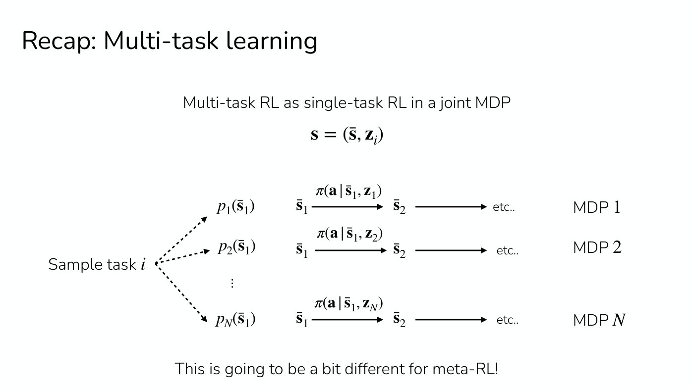

*Slide 3 — a sampled task picks one row: that MDP's initial-state distribution and that task's identifier, both fed to the single shared policy. [Deck](https://cs224r.stanford.edu/spring_2025/slides/13_cs224r_metarl_2025.pdf)*

Goal-conditioned RL is the special case in which each task is to reach a goal state, $\mathbf{z}_ i = \mathbf{s}_ g$
(slide 4, ≈0:50–2:22). With image states the policy takes the current image and the goal image; with
vector states, two vectors. The reward asks whether the agent reached the goal, for discrete states,
or came close to it, for continuous ones:

$$r(\mathbf{s}, \mathbf{a}, \mathbf{s}_ g) = \delta(\mathbf{s} = \mathbf{s}_ g) \qquad r(\mathbf{s}, \mathbf{a}, \mathbf{s}_ g) = \delta(\lVert \mathbf{s} - \mathbf{s}_ g \rVert \leq \epsilon)$$

where $\delta$ is 1 when its condition holds and 0 otherwise, and $\epsilon$ is a distance threshold.
What is nice about this formulation is that it is self-supervised: there is no need for task
descriptors or a manually defined set of tasks, since a collection of states can serve as the tasks,
and many tasks can be formulated as goal reaching. It can be pretty hard to train, and students
experiment with a simple goal-conditioned setting in the homework (≈1:37–2:22). See
[multi-task RL](multi-task-rl.md) and [hindsight relabeling](hindsight-relabeling.md).

Today's plan (slide 5, ≈2:22) is the meta-RL problem statement and a class of methods Finn refers to
as **black-box** meta-RL methods, what they look like and the challenges they face. A bracket on the
slide marks both items, and next time's exploration lecture, as "part of HW4".

## Why meta-RL: people are not starting from scratch

Slide 6 asks the learner to imagine learning to make coffee with an espresso machine they have never
used (≈3:07). A robot or RL agent would need a lot of data and a lot of attempts: the task has many
steps that must be done in sequence, and its reward signal is probably not very detailed. The slide
puts it as "Training a robot to do this with PPO would take **millions of attempts**." A person with
a little instruction, or some previous experience of making espresso, could learn it in minutes or
even less (≈3:07–3:54).

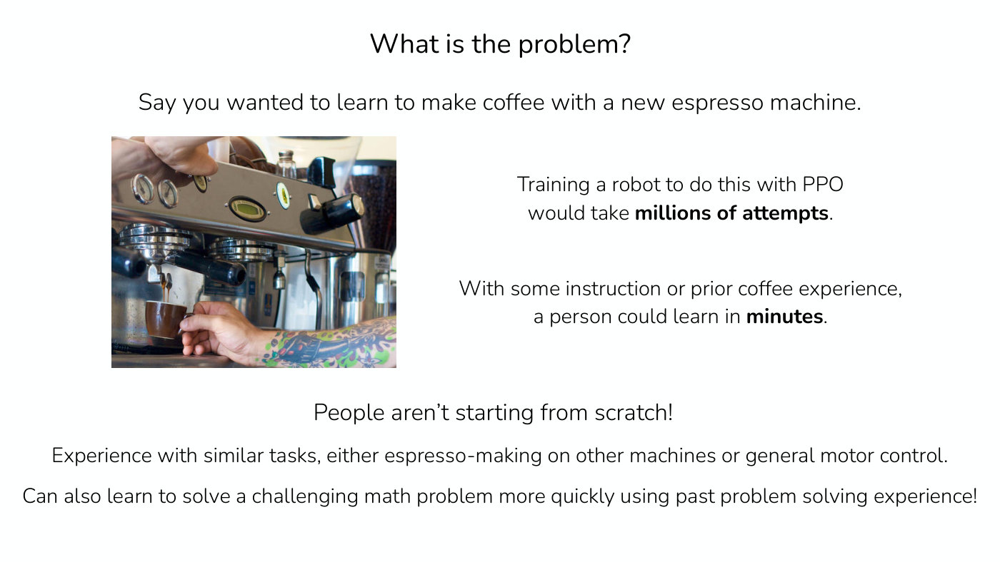

*Slide 6 — PPO would need millions of attempts at a new espresso machine; a person with prior coffee experience needs minutes. [Deck](https://cs224r.stanford.edu/spring_2025/slides/13_cs224r_metarl_2025.pdf)*

Finn calls that gap rather unsatisfying, and locates the difference in the fact that people are not
starting from scratch (≈3:54). They already know how to move objects around with their hands, may
know how to make coffee in other ways or with other machines, and have semantic knowledge of what to
do when told to pick up a cup and put it somewhere or to turn a knob; they leverage that experience
to solve the problem quickly (≈3:54–4:39). Experience with similar tasks, whether espresso-making on
other machines or general motor control and following instructions, helps with a new task. The
framing is general: it covers a robot facing a new environment or task, and many other RL systems.
Someone who has solved previous math problems can solve a new challenging one faster, because they
have learned strategies they can apply to the new scenario (slide 6, ≈4:39–5:25).

## Three ways to transfer to a new task

The question, in slide 7's title, is "Can RL algorithms leverage experience from *previous* tasks
when learning a *new* task?", with less data and less experience. It is often thought of as a
**transfer learning** problem: transferring knowledge, information and experience from previous tasks
to new ones (≈5:25). Slide 7, adapted from Sergey Levine, frames it three ways (≈6:13–8:31).

1. **Forward transfer**: "Train on source task, then fine-tune on target task." Fine-tuning as used in
   supervised learning applies to RL too: fine-tune a Q-function or a policy to the new task. For this
   to work well the tasks need to be quite similar to each other.
2. **Multi-task transfer**: train on many tasks and transfer to a new one. If the task prompt is just
   "task one, task two, task three", transfer is harder; if it has structure, such as "pick up a water
   bottle", "pick up a phone", "pick up a pen", the system may transfer **zero-shot**, with no new
   experience, simply by being passed the new prompt (≈6:59). The slide's condition is that the task
   descriptor $\mathbf{z}_ i$ "needs to capture task structure for zero-shot transfer".
3. **Meta-learning**: "learn to *learn* on many tasks", aiming for **few-shot** transfer instead:
   adapting to a task with a little experience, a few examples or a few trials. What distinguishes it
   from multi-task learning is that it "Accounts for the fact that we'll be adapting to a new task
   during training!" Another way to see it is that the task descriptor, instead of a prompt or an
   index, may be a dataset itself: a set of trials adapted to in the context of a policy. Another
   word for this is in-context learning, or few-shot learning (≈6:59–7:45).

The requirements differ (slide 7, ≈7:45–8:31). Forward transfer needs very similar source and target
tasks. Multi-task transfer and meta-learning no longer need an extremely similar task; the target
task must instead be similar to the *distribution* of training tasks, conceivably within it. That
makes them harder in one way: they need a number of training tasks, not just one, to transfer well.

## Few-shot learning outside RL

Before RL, the lecture looks at few-shot learning elsewhere (≈8:31). Slide 8 shows six paintings as
training data, three by Braque and three by Cezanne, and asks of a seventh, "By Braque or Cezanne?"
Finn picked the example so that it is not trivial; other test data points are much easier (≈8:31).

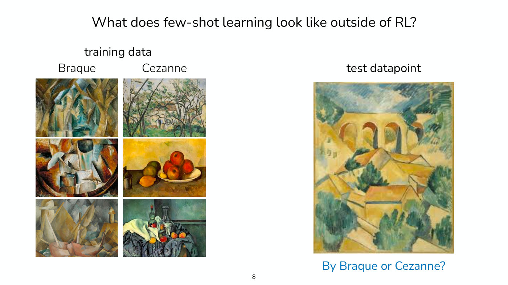

*Slide 8 — six training paintings, three by Braque and three by Cezanne, and the test painting to classify. [Deck](https://cs224r.stanford.edu/spring_2025/slides/13_cs224r_metarl_2025.pdf)*

That is the essence of few-shot image classification: a small number of data points, and a new one
to classify (≈9:16). Training from scratch on six images would give no hope of learning a classifier,
especially on high-dimensional images. Meta-learning instead constructs other tasks with a similar
structure, other image classification tasks, and trains a model to take a training dataset and a
query input and predict a label, so that each few-shot learning problem becomes a data point itself.
Slide 9 writes the model as $\hat{y} = f(x, D_{\text{train}})$, a prediction $\hat{y}$ for a test input $x$
that depends on the input and on a small training set $D_{\text{train}}$.

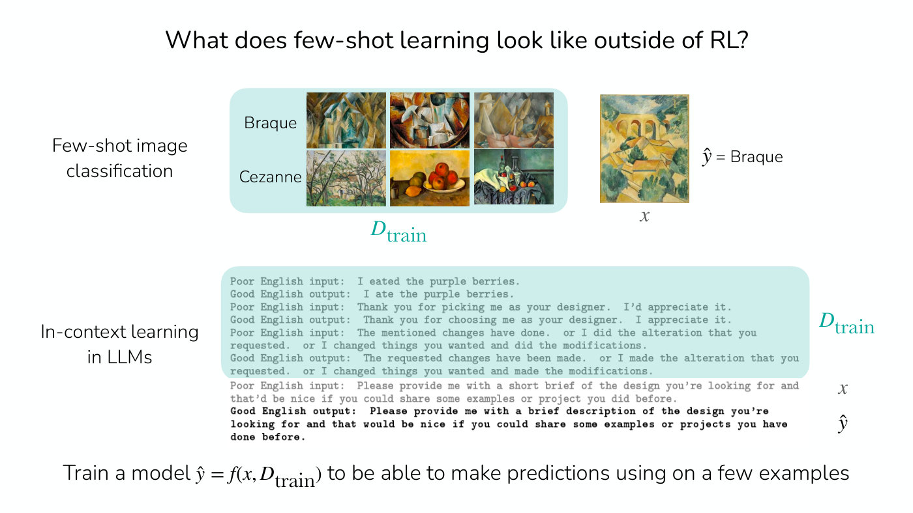

*Slide 9 — the same few-shot problem written as a function of a small training set and a query, for image classification and for in-context learning in a language model. [Deck](https://cs224r.stanford.edu/spring_2025/slides/13_cs224r_metarl_2025.pdf)*

The second example on slide 9 is **in-context learning in large language models** (≈10:02). The
prompt gives a few pairs of poor English input and good English output ("I eated the purple berries"
becomes "I ate the purple berries"), and the goal is a good output for a new input. Language models
see things like this during training, but what is special about them is that nobody set up the
training data to match it: the statistics of data on the internet lead to the ability to respond to
few-shot examples. Finn notes that this is just a base model, probably GPT-3, with no additional
supervised training; it is not perfect and does not work all the time (≈10:48). In each example the
goal is a model that takes a training dataset and a new example $x$ and predicts from both (≈10:48–11:34).

*[Student question]* Is in-context learning in meta-RL done the way it is in LLMs, by putting the
dataset into the prompt? Generally yes, and that is the case this lecture looks at. Other methods
achieve it with gradient updates, or with something that looks like nearest neighbors, but "the most
successful method" in meta-RL looks like prompting, and that is the topic today (≈11:34–12:19).

## A meta-RL example: maze navigation

Say the goal is to solve a new maze (slide 10, ≈12:19). The agent is in the maze and may not even see
the top-down view, perhaps only a first-person perspective. Because this is an RL problem, the job is
not just to output a label but to collect experience in the environment. The aim is to solve an RL
problem very quickly, framed as collecting a very small training dataset of one episode or a few
episodes, here exploring the maze to find the goal. The agent starts in the middle, explores, and
eventually reaches the goal; after exploring, it should have a policy that solves the maze from that
single episode of experience (≈12:19–13:05). Learning such a policy from one episode from scratch
would be very hard. Meta-RL instead constructs a set of training environments that facilitates this
kind of fast adaptation (≈13:05).

Slide 10's two panels name the parts: "Collect small amount of experience in new MDP", written
$\mathscr{D}_ {\text{tr}} \sim \pi^{\text{exp}}$ (a training set $\mathscr{D}_ {\text{tr}}$ collected by an
exploration policy $\pi^{\text{exp}}$), then "Learn policy that solves that MDP", written
$\mathscr{D}_ {\text{tr}} \rightarrow \pi^{\text{task}}$ (a task policy $\pi^{\text{task}}$ obtained from that
data). Compared with the supervised scenarios, there is now an **exploration problem**: the agent is
not given a training set to predict from, it constructs one through exploration, and it must work out
how to trade off exploring the environment against solving the task, and how much time to spend
exploring versus exploiting what it knows (≈13:51). The slide's last line: "Exploration-exploitation
trade-off is a unique part of meta-RL!"

*Slide 11 — meta-training explores and solves many mazes; meta-testing collects a little experience in a new maze and then goes straight to its goal. [Deck](https://cs224r.stanford.edu/spring_2025/slides/13_cs224r_metarl_2025.pdf)*

That is what should happen at test time. To set the agent up for it, at **meta-training** time, before
adapting to a new maze, the agent learns to explore efficiently and solve many related MDPs, here other
mazes, each a training task (slide 11, ≈13:51–14:37). One key assumption: the new MDPs cannot be
completely different from the ones seen before. There should be a distribution over tasks, and the new
MDPs should come from it. Slide 11: "Key assumption: Meta-testing MDPs come from same task distribution
as meta-training MDPs.", "(so that we can expect generalization)" (≈14:37).

## Meta-RL task distributions

Maze navigation is one meta-RL task distribution among many (slide 12, ≈15:23). In robotics, a useful
one is adapting quickly to different terrains and slopes for legged robots; the robot on the slide is
really small, but the idea applies to larger legged robots too. Sometimes the training environments
are in simulation and the real world is adapted to as just another environment. Manipulation can use
different objects and goals as tasks. Several language-modeling scenarios fit as well: meta-RL has
been relevant for adapting to users with different preferences, given in context examples of the
kinds of responses each wants, and the lecture later shows an example in reasoning (≈15:23–16:08).

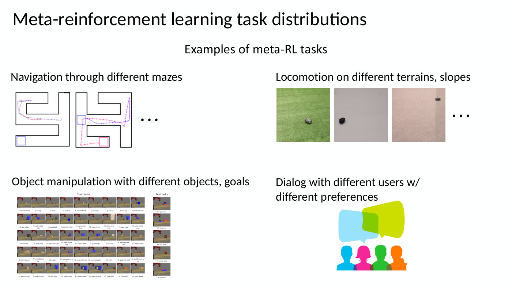

*Slide 12 — four task distributions: mazes, terrains for a small legged robot, 50 simulated manipulation tasks (45 for training, 5 held out for testing), and dialog with users who have different preferences. [Deck](https://cs224r.stanford.edu/spring_2025/slides/13_cs224r_metarl_2025.pdf)*

*[Student question]* What is the key difference between meta-RL and transfer learning, where one trains
and then fine-tunes? One view is that meta-RL training explicitly optimizes for transferability, for
the ability to adapt with a small dataset, and as a result transfer is much faster and needs a much
smaller dataset; comparisons of fine-tuning against few-shot in-context adaptation show much more
efficient transfer. That efficiency comes from giving the algorithm many training tasks rather than
one (≈16:08–16:53).

## The meta-RL problem, more formally

Slide 13 sets the three problem settings side by side (≈16:53–17:41). **Multi-task learning** solves
tasks $\mathcal{T}_ 1, \cdots, \mathcal{T}_ T$ at once,

$$\min_ {\theta} \sum_ {i=1}^{T} \mathcal{L}_ i(\theta, \mathcal{D}_ i)$$

summing each task's loss $\mathcal{L}_ i$ on its data $\mathcal{D}_ i$ over the parameters $\theta$. A
multi-task learner may transfer to a new task, but it is not optimizing for transferability. **Transfer
learning** solves a target task $\mathcal{T}_ b$ after a source task $\mathcal{T}_ a$, typically by
fine-tuning. **The meta-learning problem**: "Given data from $\mathcal{T}_ 1, \ldots, \mathcal{T}_ {n}$,
quickly solve new task $\mathcal{T}_ {\text{test}}$". In RL the tasks are MDPs, each with its own state
space, action space, dynamics and reward; slide 13's definition also gives each its own initial state
distribution:

$$\mathcal{T}_ i \triangleq \lbrace \mathcal{S}_ i, \mathcal{A}_ i, p_i(\mathbf{s}_ 1), p_i(\mathbf{s}' \mid \mathbf{s}, \mathbf{a}), r_i(\mathbf{s}, \mathbf{a}) \rbrace$$

with state space $\mathcal{S}_ i$, action space $\mathcal{A}_ i$, initial state distribution $p_i(\mathbf{s}_ 1)$,
dynamics $p_i(\mathbf{s}' \mid \mathbf{s}, \mathbf{a})$ and reward $r_i(\mathbf{s}, \mathbf{a})$. "Meta-reinforcement
learning = meta-learning with RL tasks". There is a nice analogy with meta-learning in supervised
learning, and the main difference is the exploration challenge (≈17:41).

Slide 14 states the problem as inputs and outputs (≈17:41–19:59). The policy receives a training set
and the current state and outputs an action,

$$\mathbf{a} \sim \pi^{\text{task}}(\cdot \mid \mathbf{s}, D_{\text{train}})$$

learning from a small amount of experience a policy that solves the task, and also collecting that
experience itself. There are two variants. In the **episodic variant**, $D_{\text{train}}$ is "k
rollouts from $\pi^{\text{exp}}$", several roll-outs of an exploration policy; in the **online
variant**, it is "1...k timesteps from $\pi^{\text{exp}}$", a few time steps. There is a continuum
between the two: a policy might adapt online within a few time steps and keep improving as episodes
accumulate into a growing dataset. Finn writes them separately to make clear that some settings need
fast adaptation within an episode while others care much more about several trials (≈18:26–19:12).

Slide 14's note says the exploration policy $\pi^{\text{exp}}$ and adaptation policy $\pi^{\text{task}}$
"could share parameters": in some settings they are separate networks, in others essentially the same
one (≈19:12). And insofar as the policy conditions on a training dataset, that dataset "can view as a
task identifier $\mathbf{z}_ i$", which puts the setting closer to multi-task learning (≈19:12–19:59; see
[experience as a task identifier](#experience-as-a-task-identifier)).

*[Student question]* When Finn says the test task must be in distribution, must it be one of the
training tasks? It can be a bit different, and the examples later show cases where it is (≈19:59).

## Black-box meta-RL

The good news is that there is a conceptually very simple way to address this general problem; the
bad news is that it can be challenging to optimize in practice (≈19:59). Train a sequence model, which
could be a transformer, any neural network with memory or a recurrent neural network, so that
everything passed into the policy is the experience the agent has collected: the policy conditions on
the training dataset and outputs actions based on the data it has seen so far in that MDP, and the
sequence-model policy is trained across all the training MDPs (slide 16, ≈20:45). Slide 16 draws it as
a chain of boxes, each taking the current state with the previous reward, $(\mathbf{s}_ 1, 0)$,
$(\mathbf{s}_ 2, r_ 1)$, $(\mathbf{s}_ 3, r_ 2)$ and so on up to $(\mathbf{s}_ t, r_ {t-1})$, and outputting an
action; the context or training set gets larger over time as experience in the MDP accumulates (≈21:31).

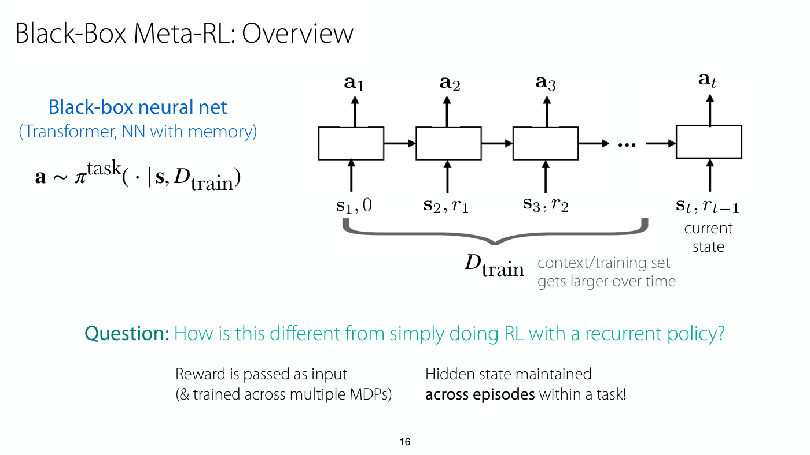

*Slide 16 — the black-box policy reads each state together with the previous reward, so the context that tells it the task grows as experience comes in. [Deck](https://cs224r.stanford.edu/spring_2025/slides/13_cs224r_metarl_2025.pdf)*

Finn asks the room how this differs from simply using a recurrent policy, or a sequence model such as
a transformer, in a standard RL setup (slide 16's question, ≈21:31). A student answers memory, and
Finn agrees that RL often does not use memory and this does; but compared with standard RL with
memory, what else is different (≈22:16)?

- **The reward is an input.** It goes into the memory, so the policy uses reward information from the
  current MDP to get better at the task. That also means the reward is needed at test time, when
  adapting to a new task, whereas RL often does not assume a reward is available when a policy is
  deployed (≈22:16).
- **Actions can be inputs too.** *[Student question]* Why are actions not passed as input? They can
  be. If the policy is mostly deterministic, information about past actions can be stored in the memory
  as well, since the policy generated them, so they are not needed; with a more stochastic policy the
  sampling is not in the memory, and passing the actions is good (≈23:02).
- **It is trained across MDPs.** A student notes that the states and actions may not be the same for
  different tasks: the model is trained across MDPs whose state and action spaces, dynamics and
  rewards differ (≈23:02–23:48). Slide 16's first answer: "Reward is passed as input (& trained across
  multiple MDPs)".
- **The memory spans episodes.** To learn not just within an episode but across episodes, the hidden
  state or memory is maintained across multiple episodes rather than reset at each one (≈23:48–24:34).
  Slide 16's second answer: "Hidden state maintained **across episodes** within a task!"

## The black-box algorithm

Finn writes the algorithm on the board, leaving slide 16's diagram up (≈24:34–26:55), and slide 17
prints it:

1. Sample a task $\mathcal{T}_ i$, an MDP.
2. Roll out the policy $\pi(a \mid s, \mathscr{D}_ i^{\text{tr}})$ in it for N episodes, under its dynamics
   $p_i(s' \mid s, a)$ and reward $r_i(s, a)$, with memory across those N episodes.
3. Store the sequence in a replay buffer for task $\mathcal{T}_ i$; this step is optional and applies
   when the learner is an off-policy algorithm with a replay buffer.
4. Update the policy to maximize the discounted return for all tasks, then repeat from step 1.

(Slide 17 prints $a$, $s$ non-bold.) For step 4 Finn describes the objective as the typical RL
objective, the expected sum of rewards under the policy over the time steps, but summed over the
tasks $i$ in a minibatch from the task distribution (≈26:07). Asked later why the agent learns to find
the goal quickly, Finn adds a discount factor to what is on the board (≈36:10). Reconstructed from
those descriptions, the board's objective reads

$$\max_ {\pi} \sum_ {i} \mathbb{E}_ {\pi}\Big[\sum_ {t} \gamma^{t} r_ i(\mathbf{s}_ t, \mathbf{a}_ t)\Big]$$

with $\gamma$ the discount factor and $r_ i$ task $i$'s reward; the recording does not show the board,
so the exact form written there is not known.

It is a pretty simple algorithm that looks a lot like RL: the main differences are that the
optimization runs across multiple MDPs and the policy has memory across a set of episodes (≈26:55).
N is usually pretty small: with a thousand episodes it would be hard to store everything in the
model's context, because the memory starts to grow substantially. In slide 17's diagram the network
runs over multiple episodes, taking actions, and then starts collecting for a new MDP, where the memory
is cut; in the diagram N is 2. Often each task has its own replay buffer. The policy is updated to
maximize the discounted return for all tasks collected, and the process repeats, continuously giving a
policy that is better at this kind of in-context adaptation (≈26:55–27:43).

*Slide 17 — the hidden state carries over from episode 1 into episode 2 of the same task, and is cut at the dashed line where a new task begins. [Deck](https://cs224r.stanford.edu/spring_2025/slides/13_cs224r_metarl_2025.pdf)*

*[Student question]* Does the policy know that a new episode is starting? A positional encoding could
tell it. In practice there will probably also be a discontinuity in the state, so it may see that the
current state is very different from the previous one, and a special token could also mark a new
episode (≈27:43–28:30). *[Student question]* Is $\mathbf{s}_ 1$ randomized across episodes? Each new episode
starts with a new sample from the initial state distribution, so $\mathbf{s}_ 1$ of one episode may differ
from $\mathbf{s}_ 1$ of the next, and $\mathbf{s}_ 2$ very likely differs (≈28:30).

The outcome is a policy that adapts across episodes using the experience from those episodes, and that
should decide on its own the best **exploration-exploitation trade-off**, which depends on the number of
episodes it is given (≈28:30–29:17). With N equal to 2 it has two episodes to maximize reward, so if it
needs to explore it will explore as quickly as possible. With a larger N it still wants to explore
quickly and efficiently, since that earns higher reward later, but it has slightly more budget to
explore. Finn calls this pretty cool: optimized end to end, the policy makes its decisions to explore
or exploit in whatever way gets it the highest reward (≈29:17–30:03).

At meta-test time (slide 18, ≈30:03–31:36), sample a new task $\mathcal{T}_ j$ and roll out the trained
policy $\pi(a \mid s, \mathscr{D}_ j^{\text{tr}})$ in it for up to N episodes, with its states, actions and
rewards. Rolled out for longer than that, "all bets are off" in terms of what it might do; to handle
varying numbers of episodes, the number can be varied during training.

## Architectures and optimizers

Slide 19 pairs three architectures with the RL optimizers they were trained with (≈31:36–32:21).

- **An RNN**, trained with TRPO or A3C, "similar to PPO". Some of the first works on meta-RL used a
  vanilla recurrent network; Finn thinks this was before PPO was introduced, with an algorithm similar
  in its assumptions (≈31:36). The slide cites Duan et al.'s $\text{RL}^2$ ("RL²: Fast Reinforcement
  Learning via Slow Reinforcement Learning", 2017) and Wang et al. ("Learning to Reinforcement Learn",
  CogSci 2017). Its diagram's hidden states $h_0$ to $h_6$ run unbroken from Episode 1 into Episode 2 of
  "MDP 1".
- **Attention and 1D convolutions**, trained with TRPO. Before transformers were really popular, a
  paper used self-attention and 1D convolutions, which can be thought of as a sort of transformer, and
  it also passes the actions as input (≈31:36–32:21). The slide cites Mishra et al., "A Simple Neural
  Attentive Meta-Learner", ICLR 2018; its inputs are observations, actions and rewards.
- **A feedforward network and an average**, trained with SAC, off-policy with a replay buffer. Instead
  of a transformer or an RNN, a feedforward network embeds each piece of experience and the embeddings
  are averaged. This is sometimes called a deep set; it is computationally fast because everything can
  be parallelized, and surprisingly expressive for what it can do (≈32:21). The slide cites Rakelly et
  al., "Efficient Off-Policy Meta-Reinforcement Learning via Probabilistic Context Variables", ICML 2019:
  each transition $(\mathbf{s}, \mathbf{a}, \mathbf{s}', r)$ passes through a shared network $\phi$, the
  results are multiplied into a Gaussian $q_\phi(\mathbf{z} \mid \mathbf{c})$ over a task variable
  $\mathbf{z}$ given the context $\mathbf{c}$, and $\mathbf{z}$ conditions a critic
  $Q_\theta(\mathbf{s}, \mathbf{a}, \mathbf{z})$ and an actor $\pi_\theta(\mathbf{a} \mid \mathbf{s}, \mathbf{z})$.
  The lecture returns to this design in [example 3](#example-3-off-policy-meta-rl) and
  [posterior sampling](#alternative-exploration-strategies).

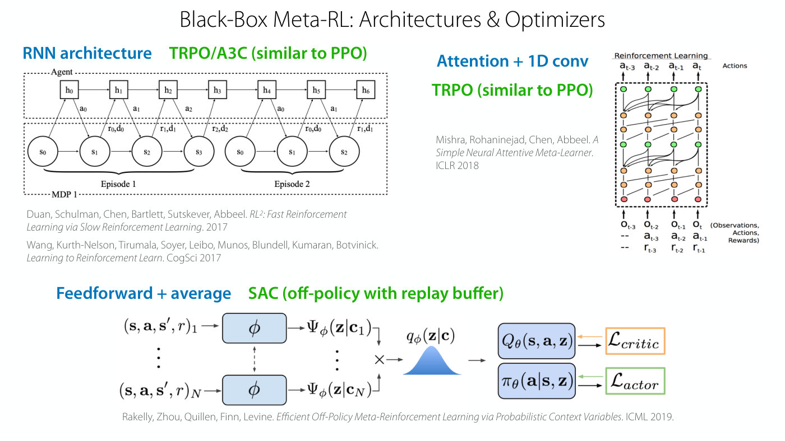

*Slide 19 — three black-box designs: an RNN trained with TRPO or A3C, attention with 1D convolutions trained with TRPO, and a feedforward-and-average encoder of a task variable trained with SAC. [Deck](https://cs224r.stanford.edu/spring_2025/slides/13_cs224r_metarl_2025.pdf)*

## Example 1: navigating mazes from pixels

The first example uses the attention-and-convolution architecture, something a bit like a transformer,
to learn to navigate mazes visually, specifically new mazes the agent had never been in (slide 20,
≈32:21–33:08). It was trained on a thousand small mazes and tested on held-out mazes, both small and
large; the large mazes show some extrapolation to tasks outside the training distribution (≈33:08).

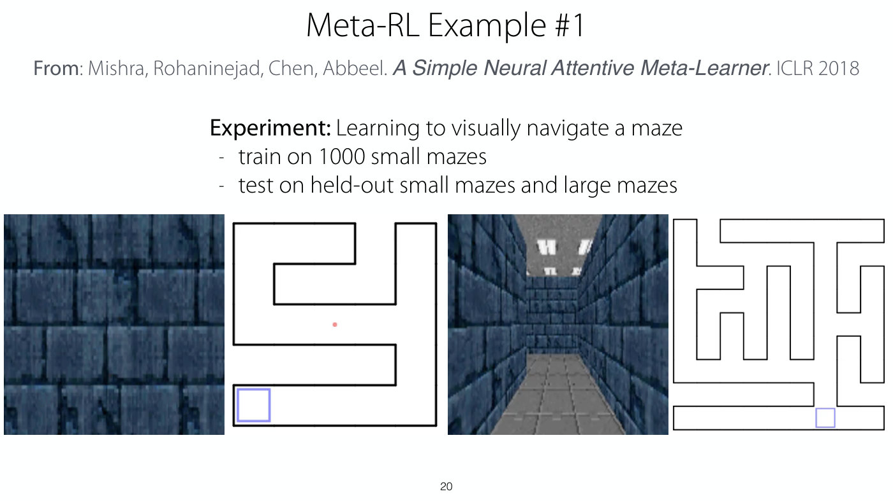

*Slide 20 — frames of the two test-time videos: the agent's first-person view of the maze beside the trace of its exploration on the layout. [Deck](https://cs224r.stanford.edu/spring_2025/slides/13_cs224r_metarl_2025.pdf)*

The videos are at test time (≈33:08–34:40). The agent explores the environment looking for the goal,
receiving only the images as input, and the trace of its exploration is drawn on the right. In the
small maze it starts in the middle, explores, and eventually finds the goal. In the second episode it
still has memory of the first, and uses it to go directly to the goal: in the first episode it chooses
to explore because it does not know where the goal is or the layout of the maze, and in the second it
goes straight to the goal because it has decided it already explored the extent of the maze. In the
larger maze it explores the top part, does not see the goal, realizes that part is a dead end it need
not explore further, then sees the goal, and after that first episode goes straight to it. In training,
N was 2: the agent was trained to explore and exploit over two episodes (≈34:40).

Slide 21's table gives the average time to find the goal in each episode:

| Method | Small maze, episode 1 | Small maze, episode 2 | Large maze, episode 1 | Large maze, episode 2 |
| --- | --- | --- | --- | --- |
| Random | 188.6 ± 3.5 | 187.7 ± 3.5 | 420.2 ± 1.2 | 420.8 ± 1.2 |
| LSTM | 52.4 ± 1.3 | 39.1 ± 0.9 | 180.1 ± 6.0 | 150.6 ± 5.9 |
| SNAIL (ours) | 50.3 ± 0.3 | 34.8 ± 0.2 | 140.5 ± 4.2 | 105.9 ± 2.4 |

The comparison is with a random policy, which occasionally happens upon the goal, and an LSTM, another
memory architecture (≈34:40–36:10). In the small mazes even the first episode is much faster than
random, because the agent explores efficiently and eventually finds the goal, and the second episode is
faster still, after learning in the first where the goal is and what the maze is like. The agent also
does significantly better than random in the large mazes, and in both cases the self-attention
architecture beats the LSTM.

*[Student question]* Is the reward for finding the goal, and if so why is it optimized to find it as
fast as possible? The reward is for finding the goal; Finn does not remember its exact structure. Finn
believes this work uses discounted rewards, with a discount factor that is not one, probably something
like 0.95 or 0.99, and adds it to the objective on the board; that objective is higher if the reward
comes sooner (≈36:10–36:56). *[Student question]* What is passed as input to the model? Everything up
to the current time step: the video from previous episodes and so far in this one, all the video
frames, all the actions and all the rewards (≈36:56). *[Student question]* Where in the algorithm is
exploration traded against exploitation? It all comes down to the objective. The agent knows little
about the task, here which maze it is in and its structure, so it cannot get high reward until it
explores and finds the goal; optimizing end to end for reward therefore incentivizes exploration, since
without it there is no high reward (≈36:56–37:42). To a further question Finn answers that the course
will get to it in a few lectures, and that there are lots of problems here: when the policy is bad and
the rewards are poor, it is very difficult to figure out a good policy (≈37:42).

*[Student question]* Instead of all this, could one do regular RL and then train at test time? Finn
answers that, depending on the view, language models with memory are in some ways already doing
something that looks like meta-RL, since they can adapt to the task they are given, and that one
important component of test-time compute is letting the model think through the problem. Test-time
compute is a broad term, and the next slide shows how meta-RL is relevant to it (≈38:28–39:13).

## Example 2: meta-RL for test-time compute

Solving different math problems is the canonical language-model example, especially for test-time
compute (slide 22, ≈39:13). The slide's problem is to show an inequality, which Finn thinks is possibly
the same one Aviral showed in [Lecture 10](10-rl-for-reasoning.md). Solving a math problem can itself
be thought of as an MDP: there are different strategies to try, such as guess and check or eliminating
terms, and which one will work is not known a priori. Ideally a model would explore those strategies
and produce an answer from the best one (≈39:13–39:58); the slide's line is "Explore different
strategies for solving the problem & then produce answer based on best strategy."

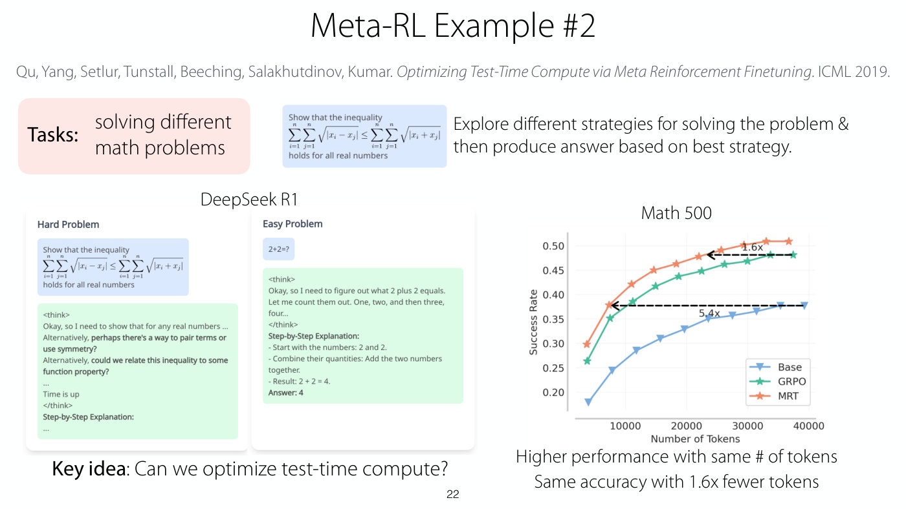

*Slide 22 — DeepSeek R1 thinks at length even about 2+2; on Math 500 the meta-RL-trained MRT curve sits above GRPO and the base model at every token budget. [Deck](https://cs224r.stanford.edu/spring_2025/slides/13_cs224r_metarl_2025.pdf)*

DeepSeek R1 is a language model that uses test-time compute to solve math problems (≈39:58). Given a
hard problem it thinks for a while, at some point cuts its thinking off so as not to think too long for
the user ("Time is up" in the slide's example), and outputs an explanation. Given a really easy problem
such as "2+2=?", it also thinks through what the solution might be ("Let me count them out. One, two,
and then three, four...") and then gives a step-by-step explanation, which is clearly somewhat wasteful
unless the problem is somehow challenging (≈39:58–40:45).

The notion of meta-RL can be used to optimize for test-time compute (≈40:45–41:31). If the model will
use test-time compute at test time, bring that into training, and encourage the model to use it
efficiently and to explore different strategies efficiently, so that on easy problems it answers as
quickly as possible and on hard ones it thinks as much as it needs, including exploration, before it
exploits and gives an explanation. The paper on the slide (Qu, Yang, Setlur, Tunstall, Beeching,
Salakhutdinov, Kumar, "Optimizing Test-Time Compute via Meta Reinforcement Finetuning"; the slide
prints the venue as ICML 2019) found that explicitly optimizing for effective use of test-time compute
gave higher performance with the same number of tokens, and reduced the number of tokens needed for the
same performance, so that, for example, simple problems do not use up a ton of tokens (≈41:31).

Slide 22's chart plots success rate on Math 500 against the number of tokens for three models: Base,
GRPO and MRT. MRT is highest throughout, from about 0.30 at the first point to about 0.51 near 37,000
tokens, against GRPO's 0.265 to 0.48 and Base's 0.18 to 0.375. Two dashed arrows mark the token savings:
MRT reaches GRPO's final success rate with "1.6x" fewer tokens, and Base's final rate with "5.4x" fewer.
The captions read "Higher performance with same # of tokens" and "Same accuracy with 1.6x fewer tokens".
See [RL for LLM reasoning](llm-reasoning.md), whose test-time scaling material comes from Lecture 10's
slides.

## Experience as a task identifier

A quick digression leads to a different way of thinking about meta-RL (slide 23, ≈41:31). Multi-task
policies condition on a task descriptor, $\pi_\theta(\mathbf{a} \mid \mathbf{s}, \mathbf{z}_ i)$: a robot told
where to stack, or a robot told which direction to walk. Meta-RL's policies take experience as input and
generate actions from that dataset. So one way to relate them is that meta-RL is just multi-task
learning in which the data is the task identifier, "Multi-task policy with experience as task
identifier", in the slide's words (≈42:16). The analogy is not perfect, because the experience changes
within a task rather than being fixed for it, but the policy can be thought of as conditioning on the
task insofar as its experience tells it what the task is.

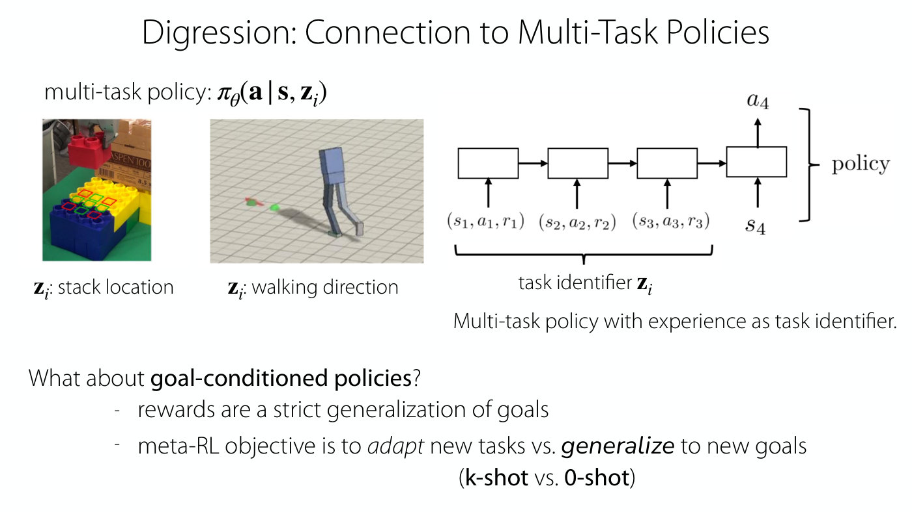

*Slide 23 — a multi-task policy told the stack location or walking direction, beside a policy whose task identifier is its own experience. [Deck](https://cs224r.stanford.edu/spring_2025/slides/13_cs224r_metarl_2025.pdf)*

Meta-RL can also be viewed as a generalization of goal-conditioned policies (≈43:03): goal-reaching
MDPs are one set of MDPs within the broader set of reward-maximizing MDPs, or, as slide 23 puts it,
"rewards are a strict generalization of goals". Instead of generalizing to new goals, meta-RL tries to
adapt to new tasks with a small amount of experience: zero-shot generalization in the goal-conditioned
case, against k-shot generalization, with k episodes or k time steps, in meta-RL ("**k-shot** vs.
**0-shot**").

## Meta-RL as a partially observed MDP

There is another way to look at the experience-as-prompt picture (slides 24–25, ≈43:48–44:34). In the
policy with memory, the information passed from the past experience to the current step (slide 24's
magenta arrow, "What information is passed here?") is presumably information about the task. When
$\mathbf{z}_ i$ is not part of the state there is ambiguity about which MDP is being solved, and the
experience is used to identify the MDP the agent is in: "Policy needs to *infer* $\mathbf{z}_ i$ from its
experience", some latent task descriptor. So meta-RL uses experience to infer what the task is, and
conditions the policy acting at the current time step on its current estimate of the task: "Meta-RL as
exploring to infer the unknown task, and then performing the task" (slide 25, ≈44:34).

*Slide 25 — the chain split in two: the first steps produce an estimate of the task, and the policy acts on that estimate together with the current state and reward. [Deck](https://cs224r.stanford.edu/spring_2025/slides/13_cs224r_metarl_2025.pdf)*

*[Student question]* If the task identifier is going to be inferred anyway, why not just give it to the
learning system? The main reason is representation (≈44:34–46:07). Without a compact way to describe
the task, it is not clear what to pass to the policy. One can always resort to an index, "this is task
one, this is task two, this is task three", but a policy told at test time "this is task 100" cannot
generalize to it. Conditioning on experience can generalize, because it can use the more continuous
space of states, rewards and so forth to figure out a new task. This can be viewed as learning a
$\mathbf{z}$ representation, a continuous vector that represents the task (≈46:07).

That returns to slide 3's warning (≈46:07–48:25). In multi-task RL, a state space made of the original
state and the $\mathbf{z}$ vector gives an aggregated MDP, still an MDP, with a new state space and new
dynamics to account for it. Meta-RL has no aggregated MDP: $\mathbf{z}_ i$ is not provided in the state,
so the problem is inherently partially observed, since the agent does not know the task and must
explore to figure it out from experience. Aggregated into a single decision process, it would have to
be a **partially observed Markov decision process (POMDP)**, and a special kind. In the general POMDP
the state $\mathbf{s}$ cannot be observed and the agent receives observations that are some function of
it; in meta-RL the only thing that cannot be observed is the task. So it is a POMDP whose hidden state
is the observation together with the task identifier, and inferring the task identifier from experience
amounts to inferring that underlying state, as a way to solve the POMDP (slide 25, ≈47:38–48:25). See
[MDPs and RL notation](mdp-and-notation.md) for the course's POMDP notation.

## Example 3: off-policy meta-RL

The third architecture on slide 19 explicitly outputs a distribution over $\mathbf{z}$ (≈48:25–49:13). At
the very beginning the agent does not know $\mathbf{z}$; it has some prior belief over it, and as
experience comes in its estimate gets better and better. Representing a distribution over the latent
task representation makes some cool things possible, which the lecture comes back to (see
[posterior sampling](#alternative-exploration-strategies)).

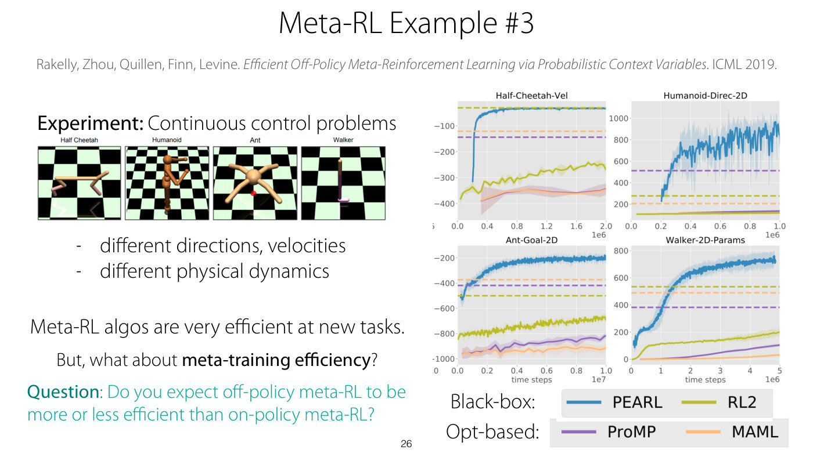

*Slide 26 — on all four control problems the off-policy black-box method PEARL (blue) climbs far faster than RL2, ProMP and MAML within the plotted time steps. [Deck](https://cs224r.stanford.edu/spring_2025/slides/13_cs224r_metarl_2025.pdf)*

This algorithm was applied to continuous control problems in which the tasks were walking in different
directions, running at different velocities, and different physical dynamics, so that the robot must
adapt when its friction or inertia changes (slide 26, ≈49:13). Everything seen before used a PPO
algorithm (a word after "PPO" is unclear in the recording), which is somewhat off-policy but not very, more
on-policy in some ways because it uses no replay buffer of past data. Meta-trained algorithms can adapt
really quickly, but if the base algorithm is fairly on-policy, the training process can be really slow
(≈49:13–50:00). The slide: "Meta-RL algos are very efficient at new tasks." "But, what about
**meta-training efficiency**?"

Finn asks whether an off-policy base algorithm, used in step 4 of the algorithm, should be more or less
efficient than an on-policy one, and a student answers more (≈50:00). Using a replay buffer to update
the policy with memory should be much more data efficient during meta-training; at test time, when
adapting, the efficiency will be similar, so this is only about the efficiency of training the
in-context learning system (≈50:00–50:46). The curves on slide 26 show the amount of data needed to
meta-learn: in blue, the off-policy algorithm with a replay buffer is much more data efficient and learns
much more quickly than $\text{RL}^2$ and PPO, which Finn says, hedging ("I want to say"), all use base
RL algorithms that are more on-policy (≈50:46–51:34). The slide's legend names the four methods as the
black-box PEARL (blue) and RL2 (olive), and the "opt-based" ProMP (purple) and MAML (orange); the lecture
does not discuss the dashed horizontal lines drawn in the methods' colours. In all four panels
(Half-Cheetah-Vel, Humanoid-Direc-2D, Ant-Goal-2D, Walker-2D-Params) the PEARL curve rises far above
the other three within the plotted time steps, for example to about 730 on Walker-2D-Params by 5 million
time steps, where RL2 reaches about 200.

*[Student question]* What exactly is in the replay buffer? Each entry is a sequence of episodes from a
given MDP, including states, actions and rewards (≈51:34–52:21). There is often a separate buffer per
task, so that a task can be sampled and its reward optimized using the memory from that trajectory.
Instead of single states and actions, the buffer stores full trajectories together, because the model
being trained has memory and the trajectory must be provided as its input. See
[replay buffers](replay-buffers.md).

## Black-box methods: summary so far

Slide 27 sums up (≈52:21–53:54). Black-box models can adapt to new MDPs; they are general and quite
expressive ("+ general & expressive"), and there is "+ a variety of design choices in architecture".
But they are "-- hard to optimize". The model must figure out how to adapt from data, and there are many
input features it could attend to: in maze navigation it has to work out what about the input videos is
useful for then exploiting and learning a policy, so with so many inputs to such a big model, it can be
hard to optimize. It is also hard from an exploration standpoint, which comes next. Finally, it "~
inherits sample efficiency from outer RL optimizer": vanilla policy gradient will be extremely data
inefficient, PPO more stable but still fairly inefficient, and SAC probably much more efficient, though
it may need more hyperparameter tuning (≈53:07–53:54).

## Exploration in meta-RL: end-to-end optimization

Exploration here means exploration in context, when trying to explore a new task (slide 28, ≈53:54).
So far the policy is optimized end to end for exploration and exploitation with respect to the final sum
of rewards. Slide 29 calls this "Solution #1: Optimize for Exploration & Exploitation *End-to-End* w.r.t.
Reward" and lists its pros and cons: it is "+ simple", "+ in principle, it yields optimal
exploration-exploitation trade-off", because it optimizes the sum of rewards directly, which is really
nice, but it is a "-- challenging optimization when exploration is hard". The slide cites Duan et al.
2016, Wang et al. 2016, Mishra et al. 2017, Stadie et al. 2018, Zintgraf et al. 2019 and Kamienny et al.
2020.

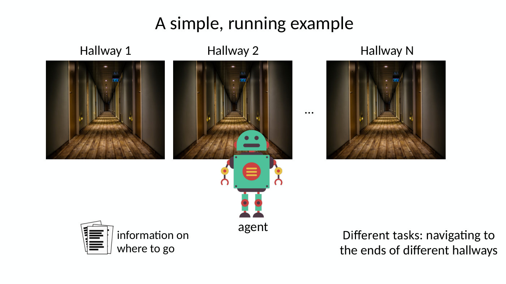

*Slide 30 — the running example: an agent, N hallways whose ends are the different tasks, and a document saying where to go. [Deck](https://cs224r.stanford.edu/spring_2025/slides/13_cs224r_metarl_2025.pdf)*

Why it is challenging comes from a running example (slide 30, ≈54:40–56:13). A robot needs to find
something, and there are hallways it might need to go down to find it. Different tasks correspond to
different locations of the object, at the ends of different hallways. To help the robot, there is a
piece of paper that says in words where the object is; if it is looking for, say, a replacement light
bulb, the paper says the light bulb is at the end of the fourth hallway. So the information about where
the reward is for the task is in the state.

How would the agent learn to explore? Consider three trajectories collected during meta-training
(slide 31, ≈56:13–59:17).

1. **The agent goes straight to the end of the correct hallway.** It got lucky and received reward, which
   optimizes the objective, but it does not know how to repeat that, because it did not explore any
   alternatives. The context leading up to the reward, zero reward and zero reward along the way, looks
   no different from what it would be for any other task, so the agent learns neither how to explore nor
   how to use exploration information to solve the task (≈56:13–57:45). Slide 31: "gets positive reward
   for current task, but $\mathscr{D}_ i^{\text{tr}}$ won't be different than for any other task".
2. **The agent goes down a wrong hallway, then the correct one.** Its experience rules out one task and
   then gets reward for another, so it teaches something about an exploration strategy that works; but
   that strategy is quite suboptimal, since looking at the instructions first and then going to the
   correct position would be much more efficient. It is somewhat good and somewhat bad: "+/- provides
   signal on a **suboptimal** exploration + exploitation strategy" (≈57:45–58:31).
3. **The agent looks at the instructions** and just stays there. Finn asks whether that is a useful
   trajectory for learning and agrees with a student's answer: the agent did something useful but gets
   no reward for it, since reward comes only if it then goes to the right hallway, so this trajectory is
   not very useful for learning either (≈59:17). Slide 31:
   "good exploratory behavior, but won't get any reward for this behavior".

In a problem like this, the agent learns something useful about exploring and exploiting only if it
successfully does the proper exploration behavior and then the exploitation behavior; done in separate
episodes, they give no good learning signal (≈1:00:03). The sample complexity is that the agent must get
lucky and do both things together to get signal that helps it learn: "It's hard to learn exploration &
exploitation at the same time!"

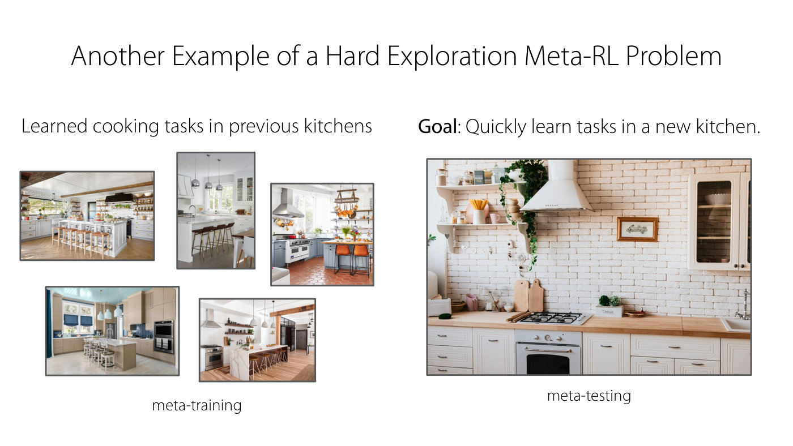

*Slide 32 — cooking tasks learned in five previous kitchens are meta-training; quickly learning tasks in a new kitchen is meta-testing. [Deck](https://cs224r.stanford.edu/spring_2025/slides/13_cs224r_metarl_2025.pdf)*

Another example: learning to cook, with data from previous kitchens, so as to learn quickly to cook in a
new one (slide 32, ≈1:00:03–1:00:48). To learn to cook, the agent has to find the ingredients. If it has
not figured out how to find them, because its exploration is bad, it cannot learn to cook, since it does
not have the ingredients, and it gets low reward. And if it does not yet know how to cook, because it has
not collected experience of it, it gets low reward whatever exploration it does. That is a chicken and
egg problem between learning to explore and learning to solve the task using what exploration found: a
**coupling problem**, in which exploration and execution, or exploitation, depend on each other to be
jointly successful (slide 33, ≈1:00:48–1:01:34). Slide 33 adds that it "can lead to poor local optima,
poor sample efficiency", citing Liu, Raghunathan, Liang and Finn, "Decoupling Exploration and
Exploitation for Meta-Reinforcement Learning without Sacrifices", ICML 2021.

*Slide 33 — the coupling problem: without finding the ingredients the agent cannot learn to cook, and without being able to cook no exploration earns reward. [Deck](https://cs224r.stanford.edu/spring_2025/slides/13_cs224r_metarl_2025.pdf)*

So end-to-end training is great in that it can learn the optimal trade-off, but it can be extremely
challenging when the exploration problem is hard, because the agent must figure out how to explore and
exploit to get any learning signal (slide 34, ≈1:01:34). *[Student question]* Is the ultimate challenge
that the reward is sparse? A dense reward would put the agent in a much better place, because it would
not have to take actions explicitly to explore. The problem really comes down to exploration being hard:
when exploration is easy this is not a problem, since only exploitation has to be solved
(≈1:01:34–1:02:20).

## Alternative exploration strategies

There are a couple of solutions; one is discussed today and more on Friday (see
[Lecture 14](14-exploration.md#exploring-at-test-time-meta-rl-revisited)), without complete detail on
how they work (≈1:02:20). The second solution (slide 35's "Solution #2: Leverage Alternative
Exploration Strategies") is, instead of optimizing only for end-to-end reward, to add auxiliary
exploration objectives that encourage the agent to figure out something more meaningful about the task.

**Posterior sampling**, also called Thompson sampling (slide 35, ≈1:02:20–1:03:59), builds on inferring
what the task is. Given the experience collected so far and an inferred distribution over the task, where
$\mathbf{z}_ i$ is now a latent representation rather than a known one, sample from that distribution and
act as if the sample were the correct task. The slide's two steps: learn a distribution over a latent
task variable, $p(\mathbf{z})$ and $q(\mathbf{z} \mid \mathscr{D}_ {\text{tr}})$, with corresponding task policies
$\pi(\mathbf{a} \mid \mathbf{s}, \mathbf{z})$; then sample $\mathbf{z}$ from the current posterior and sample from the
policy $\pi(\mathbf{a} \mid \mathbf{s}, \mathbf{z})$. Finn says this starts to decouple the problem a little
(the captions are garbled at that word): with policies that do the task for a given $\mathbf{z}$, the
agent learns an exploration strategy that goes down the different corridors to find the solution
(≈1:03:59). The slide credits PEARL (Rakelly, Zhou, Quillen, Finn, Levine, ICML '19).

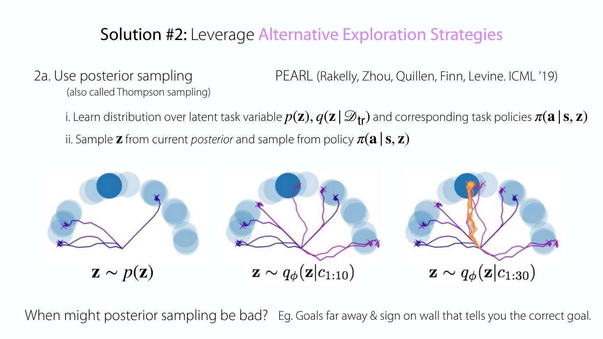

*Slide 35 — posterior sampling: tasks sampled from the prior send the agent to scattered goals, and as its context grows the samples concentrate on the true goal (orange). [Deck](https://cs224r.stanford.edu/spring_2025/slides/13_cs224r_metarl_2025.pdf)*

Slide 35's example looks somewhat like the corridors: a sparse reward for reaching one of the circles,
where different circles are different tasks (≈1:03:59–1:05:30). With no data yet, $\mathbf{z}$ is sampled
from the prior over tasks, $\mathbf{z} \sim p(\mathbf{z})$, the policy is run for those samples, and the
resulting exploration is used to infer what the task might be, narrowing it to one of a few places. More
trajectories follow, $\mathbf{z} \sim q_\phi(\mathbf{z} \mid c_{1:10})$, and once one of them collects
positive reward the distribution over the task becomes much narrower, and the policy executes according
to the samples, $\mathbf{z} \sim q_\phi(\mathbf{z} \mid c_{1:30})$. The method learns a latent representation
over tasks, samples tasks from that distribution and acts according to the policy for each (≈1:05:30).

Finn asks when posterior sampling might be bad, in what kinds of MDPs (≈1:05:30–1:07:01). One student
suggests a large action space: that could contribute, but it is not just the action space, since with a
dense reward a large action space would probably be fine. If $\mathbf{z}$ is out of distribution, things
will certainly be problematic, but even in distribution there are scenarios where the strategy is really
bad. Another scenario raised is that, after seeing some reward, the agent may start to exploit too early
when an even better reward is available elsewhere, though it will not rule out the higher-reward tasks if
it knows they exist. The scenario Finn had in mind is the hallway example itself (≈1:07:01). Posterior
sampling will not look at the instructions; it will go down each hallway in turn looking for the reward,
because it explores by executing the policies for different tasks. That is especially bad when the
hallways are very long: if each takes days to traverse, it spends days going down one, finds it is the
wrong one, and spends days on another, rather than seeking out information that would tell it what to
do. Slide 35's answer: "Goals far away & sign on wall that tells you the correct goal." Without the sign,
going down the corridors would be a good strategy, since the agent would have to anyway (≈1:07:48).

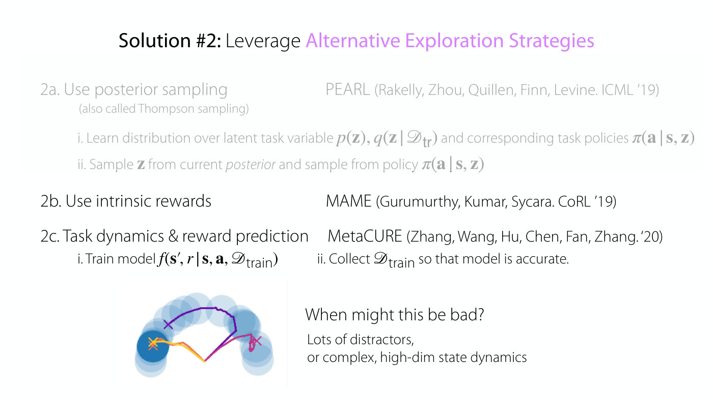

*Slide 36 — intrinsic rewards, and task dynamics and reward prediction, with a sketch of the more direct exploration they can produce. [Deck](https://cs224r.stanford.edu/spring_2025/slides/13_cs224r_metarl_2025.pdf)*

Two other approaches (slide 36, ≈1:07:48–1:08:35) add **intrinsic rewards** that encourage the agent to
visit new states (the slide cites MAME, Gurumurthy, Kumar, Sycara, CoRL '19), and try to visit states
that help distinguish the dynamics and reward models of different tasks, **task dynamics and reward
prediction** (MetaCURE, Zhang et al. '20): train a model $f(\mathbf{s}', r \mid \mathbf{s}, \mathbf{a}, \mathscr{D}_ {\text{train}})$
and collect $\mathscr{D}_ {\text{train}}$ so that the model of rewards and states is accurate. Such an
approach can produce an exploration strategy that looks much more efficient than posterior sampling,
which just samples trajectories for the different tasks. It can be bad when there are lots of
distractors or really complex state dynamics, which there is not time to go over (≈1:08:35).

To summarize (slide 37, ≈1:08:35): these approaches are easier to optimize than end-to-end training ("+
easy to optimize"), and many have a principle behind them ("+ many based on principled strategies"), but
they can be very suboptimal in certain environments, depending on the environment or domain; the slide
says "-- suboptimal by arbitrarily large amount in some environments". The recording ends here.

## Not in the recording: the plan, next time and reminders

Slide 38 repeats the plan: "1. Meta-RL problem statement" and "2. Black-box meta-RL methods", with "Next
time: Exploration + Learning to explore." bracketed with them as "part of HW4", and the lecture goals,
"Understand the meta-RL problem statement & set-up" and "Understand the basics & challenges of black-box
meta RL algorithms". Slide 39 gives next time as "**Today**: meta-RL basics" and "**Friday**: exploration
& meta-exploration", and repeats slide 2's reminders: "Homework 3 due **Friday**" and "Project milestone
due **next Friday**". Slide 2 also announces "More evening office hours!" "(Andy and Marcel moving to
evening times)". See [course logistics](course-logistics.md).

## Summary

Meta-RL trains on a distribution of tasks so that a policy can learn a new task from the same
distribution with a few episodes or time steps of experience, the RL counterpart of few-shot and
in-context learning, with the difference that the agent must collect its own data by exploring.
Black-box meta-RL makes the policy a sequence model over all its experience in the current task, rewards
and possibly actions included, with memory across episodes, and trains it with an ordinary RL optimizer
to maximize discounted return summed over tasks; the policy then chooses its own exploration-exploitation
trade-off for the number of episodes it is given. Examples include visual maze navigation, where the
agent explores in the first episode and goes straight to the goal in the second, using test-time compute
efficiently in language models, and off-policy meta-training with a replay buffer, which meta-trains far
faster than on-policy methods. The experience acts as a task identifier, and since the task is hidden,
meta-RL is a POMDP whose only unobserved part is the task. Black-box methods are general and expressive
but hard to optimize and inherit the outer optimizer's sample efficiency. End-to-end optimization can in
principle find the optimal exploration strategy, but because learning to explore and learning to exploit
depend on each other, it struggles when exploration is hard; alternatives such as posterior sampling,
intrinsic rewards and task dynamics and reward prediction are easier to optimize but can be arbitrarily
suboptimal, as when posterior sampling walks every long hallway instead of reading the sign.

## Related pages

- [Meta-RL](meta-rl.md): the problem, black-box methods, the task-identifier and POMDP views, and
  exploration, as a topic.
- [Multi-task RL](multi-task-rl.md): the aggregated MDP and task identifiers that this lecture contrasts
  meta-RL with.
- [Hindsight relabeling](hindsight-relabeling.md): goal-conditioned RL, recapped on slide 4.
- [Policies](policies.md): policies with memory, including memory that spans episodes.
- [MDPs and RL notation](mdp-and-notation.md): MDPs, POMDPs and the notation for tasks.
- [Replay buffers and soft actor-critic](replay-buffers.md): the off-policy learner behind example 3,
  and buffers that store whole trajectories per task.
- [RL for LLM reasoning](llm-reasoning.md): test-time compute and thinking models, the setting of
  example 2.
- [Lecture 12 — Multi-Task RL](12-multi-task-rl.md): the previous lecture.
- [Lecture 14 — Exploration](14-exploration.md): the next lecture, which returns to learning to explore
  and presents DREAM, decoupling exploration from execution.
