# Lecture 16 — RL for Robots: Autonomous Learning

Stanford CS224R, Spring 2025 (Friday, May 23) ·
[video](https://www.youtube.com/watch?v=rbaWQQLrzl0) (66 min) ·
[slides (PDF)](https://cs224r.stanford.edu/spring_2025/slides/16_cs224r_autonomy_2025.pdf) ·
[slide-by-slide text](../raw/slides/16-autonomous-rl.md) ·
[transcript](../raw/transcripts/16-autonomous-rl.md)

**What this lecture establishes.** Reinforcement learning is trial and error, and rolling out a policy is
already autonomous. But every algorithm in the course so far has assumed that after one attempt the agent
is somehow returned to its initial state distribution. In simulation that is a call to `env.reset()`; on a
real robot it means a person physically resetting the scene, after every one of the thousands of trials RL
needs. This lecture, the first of two on robotics, asks how robots could learn without that person in the
loop. It defines **autonomous RL**: initialize once, then interact with no resets, or very rare ones. Such
an agent can be judged in two ways: **deployed policy evaluation**, the quality of the policy it learned,
run from the initial state distribution; or **continuing policy evaluation**, the average reward it
collected over its lifetime. Running a standard algorithm with longer and longer episodes fails, for two
reasons: exploration drifts away from the good states, and the data collapses around the goal.
**Forward-backward RL** fixes this by learning a second, backward policy that undoes the task. **MEDAL**
instead learns a backward reward that returns the agent to the states an expert visits, from a few
demonstrations. With several tasks, the agent can practise a **cycle of tasks**, choosing what to practise
from the state it is in, possibly by asking a vision-language model. The last part turns to
**single-life RL**: after training, the agent has one "life" in a novel, out-of-distribution situation and
must adapt within that single episode. Two ideas help: steering towards familiar states, and adapting in a
space of pre-trained skills rather than of actions.

Slide numbers below are the slides' own numbers, which equal the PDF page numbers (the deck prints a number
only on slides 28, 30 and 32). Timestamps (≈M:SS) point into the video and the
[transcript](../raw/transcripts/16-autonomous-rl.md). **The recording covers slides 3–45.** It opens with
the plan for the day (slide 3, ≈0:05) without discussing slide 2's reminders, and closes on slide 45's
summary (≈1:05:07), ending at about 1:05:41. Slide 46's reminders and "next time" are not discussed; the
[section on them](#not-in-the-recording-the-reminders) gives them from the
[slide file](../raw/slides/16-autonomous-rl.md).

Finn writes on the slides in places the recording does not show: an agent's reset-free experience, drawn as
a red trajectory (≈9:16–11:35), the continuing-evaluation formula (≈13:53–14:40), a sketch of drift and
collapse (≈19:19–21:38), the forward-backward algorithm (≈23:14–25:33), a step "negative one" for the
demonstrations (≈30:12) and the task-cycle algorithm (≈44:02–45:35). Where the transcript says "here" or
"this", this page reconstructs what was meant from the surrounding words and the slides, and says so.
Videos play on slides 8, 26, 30, 31, 33, 39 and 42–44, and slide 32 most likely holds the first frame of
another; the PDF holds only a frame of each, and what they showed comes from the transcript. Most slides
are credited "Slide adapted from Archit Sharma".

## Contents

1. [Why aren't robots autonomous already?](#why-arent-robots-autonomous-already)
2. [Defining the problem: autonomous RL](#defining-the-problem-autonomous-rl)
3. [Two ways to evaluate an autonomous agent](#two-ways-to-evaluate-an-autonomous-agent)
4. [Why autonomy matters for robots](#why-autonomy-matters-for-robots)
5. [Standard RL with longer episodes](#standard-rl-with-longer-episodes)
6. [Why it fails: drift and state distribution collapse](#why-it-fails-drift-and-state-distribution-collapse)
7. [Forward-backward RL](#forward-backward-rl)
8. [Three alternatives](#three-alternatives)
9. [MEDAL: resetting to the expert's states](#medal-resetting-to-the-experts-states)
10. [Results on the EARL benchmark](#results-on-the-earl-benchmark)
11. [Forward-backward RL on real robots](#forward-backward-rl-on-real-robots)
12. [Practising a cycle of tasks](#practising-a-cycle-of-tasks)
13. [Which task to practise?](#which-task-to-practise)
14. [Tasks that can be done repeatedly](#tasks-that-can-be-done-repeatedly)
15. [Single-life RL](#single-life-rl)
16. [How to approach single-life RL](#how-to-approach-single-life-rl)
17. [Questions on safety and common sense](#questions-on-safety-and-common-sense)
18. [Not in the recording: the reminders](#not-in-the-recording-the-reminders)

## Why aren't robots autonomous already?

This lecture and the next focus on robotics use cases: today autonomy, and on Wednesday a guest lecture on
sim-to-real transfer and humanoid robots (≈0:05). The plan (slide 3) is why robots aren't autonomous
already, defining the problem of **autonomous RL**, and developing the algorithms, first for learning
policies without human intervention and then for a formulation called **single-life RL**. The slide's goal:
"Build autonomous agents that can learn and interact in the real world". In Finn's words, the aim is to
"imbue intelligent machines with autonomy, the ability to allow them to on their own learn, interact,
practice, get better without a human in the loop" (≈0:51).

### Trial and error, except for the reset

[Imitation learning](imitation-learning.md) trains an agent to mimic demonstrations provided by an expert,
whereas in reinforcement learning the agent practises through trial and error. That notion of practising is
already more autonomous, "because the agent is learning from its own experience in the world" (≈0:51–1:36).
It is not entirely autonomous when these algorithms run on physical robots, though.

Slide 5 frames the problem as learning a policy $\pi$ to go from $\rho_0$, the **initial state
distribution**, to $\rho_g$, a region of the state space with high reward (here, a region of goal states).
The initial state distribution is "the starting conditions that our agent might be faced with when it's
actually deployed" (≈1:36). RL repeats three steps: execute actions from the policy, observe data from the
environment, update the policy. The first attempt is poor because nothing has been learned yet; then the
agent retries the task, again starting from a state in the initial state distribution (≈2:22). Each
roll-out is under the agent's own control, sampling actions from its policy: "this part is fully
autonomous" (≈3:07).

The catch is what happens between attempts. After one attempt the agent is somewhere else, and the course
has assumed that "magically you'll somehow get back over here and attempt the task from this starting
place" (≈3:07). In practice that might mean "a human is actually physically moving the robot or physically
moving the objects in the scene back to some set of initial conditions. And as a result, this process isn't
actually fully autonomous." (≈3:54)

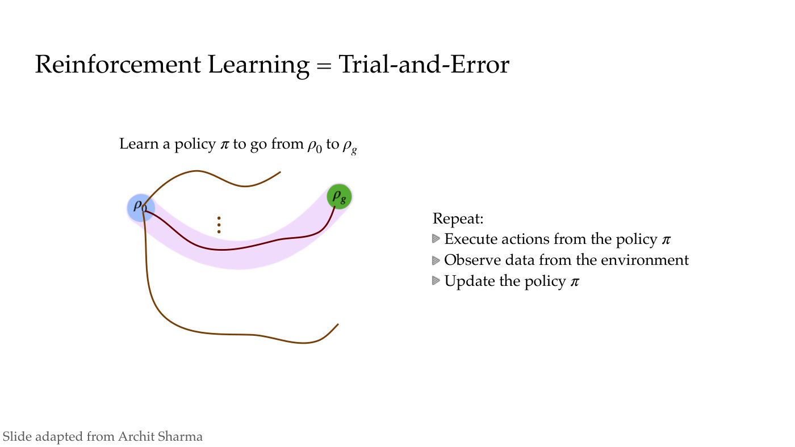

*Slide 5 — learning to go from the initial state distribution (blue) to the goal region (green): a few failed trials and one that stays inside the band of good states, by repeating execute, observe, update. [Deck](https://cs224r.stanford.edu/spring_2025/slides/16_cs224r_autonomy_2025.pdf)*

Slide 6 writes a trajectory $\mathbf{s}_ 0, \mathbf{a}_ 0, \mathbf{s}_ 1, \mathbf{a}_ 1, \ldots, \mathbf{s}_ H$
followed by a second one starting at $\mathbf{s}_ 0'$, where $H$ is the length of an episode, and asks how
the second one starts. In a simulation-based environment the answer is easy: create the environment, take
actions for a thousand time steps, and then call `env.reset`, "which is a very nice little friendly
utility" (≈4:41). The slide's Gym snippet for CartPole boxes the lines `if done: observation = env.reset()`
and labels them "Only in simulation!". On a robot, "We can't kind of reset the physical world to our own
will." (≈4:41)

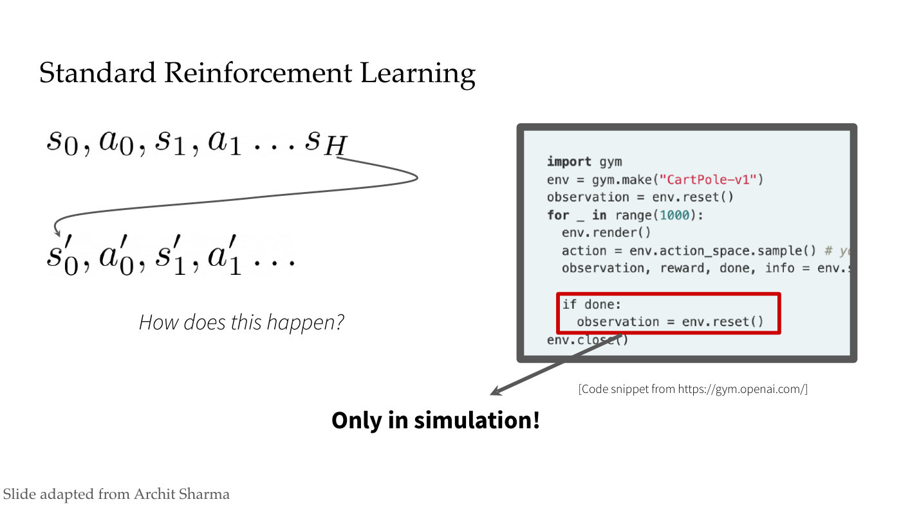

*Slide 6 — one episode loops back to the start of the next; the Gym code does it with env.reset(), which exists only in simulation. [Deck](https://cs224r.stanford.edu/spring_2025/slides/16_cs224r_autonomy_2025.pdf)*

### The continual real world

Slide 7 gives three examples (≈4:41–6:58). A mobile robot or an autonomous vehicle learning to navigate to
the basketball court may make a wrong turn; it then really is in that physical location, and has to find
its way either back to the start or onward from there. A robot manipulator learning to grasp a mug may
knock the mug over, and to try again the mug has to be back within the robot's reach. A mobile system
learning to put books on bookshelves will make mistakes and has to get back to a starting position where
the book is in reach.

This matters especially because RL takes many attempts: "It's not a matter of trying three times and then
solving the task." (≈6:13) The slide's bookshelf picture says "Several thousands of trials!", and every
time the agent tries again, some human or other intervention brings it back to the initial state
distribution (≈6:58).

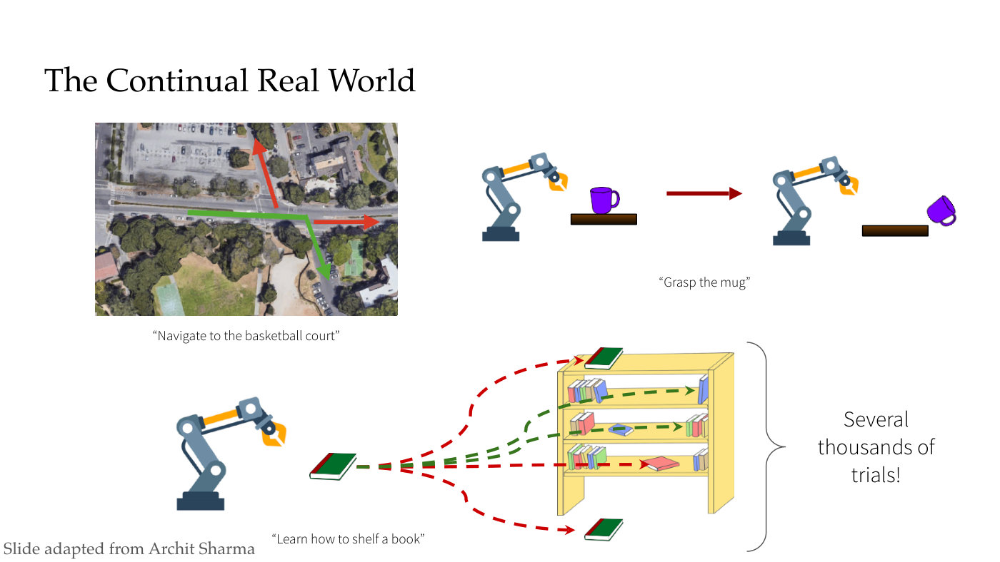

*Slide 7 — three tasks where a failed attempt leaves the world changed: a wrong turn on the way to the basketball court, a mug knocked off the shelf, books that miss the bookshelf over several thousand trials. [Deck](https://cs224r.stanford.edu/spring_2025/slides/16_cs224r_autonomy_2025.pdf)*

Slide 8 holds frames of three real examples (≈6:58–7:44). On the left a robot learns to hit a hockey puck
into a goal (Chebotar et al. 2017), and Finn's friend Yevgen, who resets it, is "probably doing more work
than the robot is right now"; [Lecture 1's slide 30](01-class-intro.md) shows the same hockey-puck task. At the top
right, Ali closes the doors so that the robot can learn to open them (Yahya et al. 2016). At the bottom
right, Archit, "who gave a guest lecture earlier this quarter", resets the robot so that it can attempt to
fold the towel (Sharma et al. 2023).

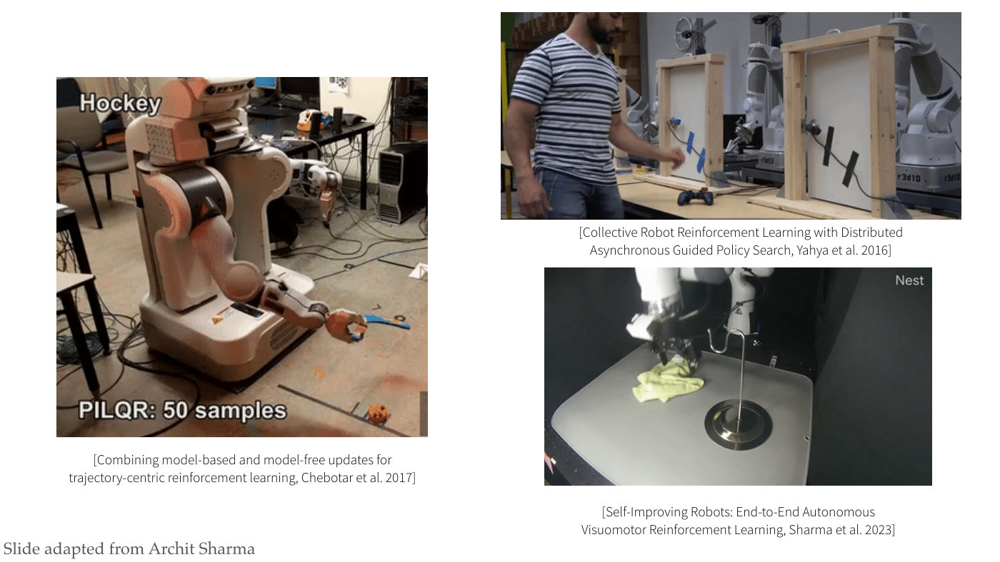

*Slide 8 — frames of three videos of real-world RL in which a person resets the task: hitting a hockey puck, opening doors, folding a towel. [Deck](https://cs224r.stanford.edu/spring_2025/slides/16_cs224r_autonomy_2025.pdf)*

## Defining the problem: autonomous RL

The reset "often in practice requires some sort of human intervention that we want to be able to ideally
eliminate so that our agents can practice and get better on their own" (≈7:44). Slide 10 flags it:
"Problem: this requires human supervision". One way out is to ask, "what if we could just increase H?"
(≈7:44): make the episodes longer, so that in principle less human supervision is needed and the same
algorithms from the course can be applied with less supervision during learning. The slide notes "Fewer
environment resets, less human supervision". The lecture comes back to what happens when you do this in
[standard RL with longer episodes](#standard-rl-with-longer-episodes).

The definition of what we want to accomplish (slide 11, ≈8:30–9:16): initialize the scene, the
environment, **once** at the beginning; then the agent interacts autonomously with the world with no
environment resets. The constraint can be relaxed to reset occasionally, or at a very low frequency, for
example if $H$ is very large.

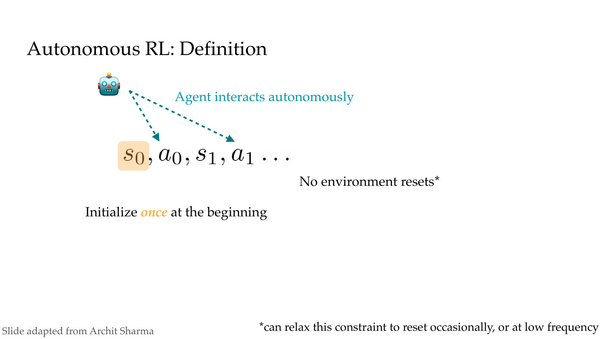

*Slide 11 — the definition: initialize once at the start, then the agent interacts autonomously with no environment resets, or only rare ones. [Deck](https://cs224r.stanford.edu/spring_2025/slides/16_cs224r_autonomy_2025.pdf)*

## Two ways to evaluate an autonomous agent

Once the agent learns without resets, there are "a couple different things that we might care about"
(≈9:16). Finn draws an agent's reset-free experience as a red trajectory with no going back to the initial
state (≈9:16–10:02); the drawing is not visible in the recording, and Finn then points to "my graphical
depiction of this on the slide" (≈11:35), slide 12.

- **Reward over the agent's lifetime.** Did the agent achieve high reward as it went, completing the task
  while it was learning? That is the sum of the rewards it accomplished over its lifetime (≈10:02). Finn's
  example is a Mars rover collecting scientific data: you do not care whether it learned a good policy to
  deploy afterwards, but whether it "did a good job as it was deployed, as it was learning" (≈10:48).
- **The quality of the learned policy.** After the learning process, did we learn a good policy that we
  could deploy to do the task repeatedly (≈10:02–10:48)? The example is a robot learning to cook meals: you
  do not much care how well it cooked during training, but whether you can then deploy it "to cook meals
  effectively repeatedly for a variety of customers in the future" (≈11:35).

Slide 12 lists the same two: "The amount of reward recovered over the course of its life (ex: Mars rover)"
and "The quality of the learned policy (ex: robot chef)". Its picture draws the lifetime as one long orange
curve that winds through several stars (rewards), against a teal dashed arrow straight from $\rho_0$ to the
goal for the learned policy.

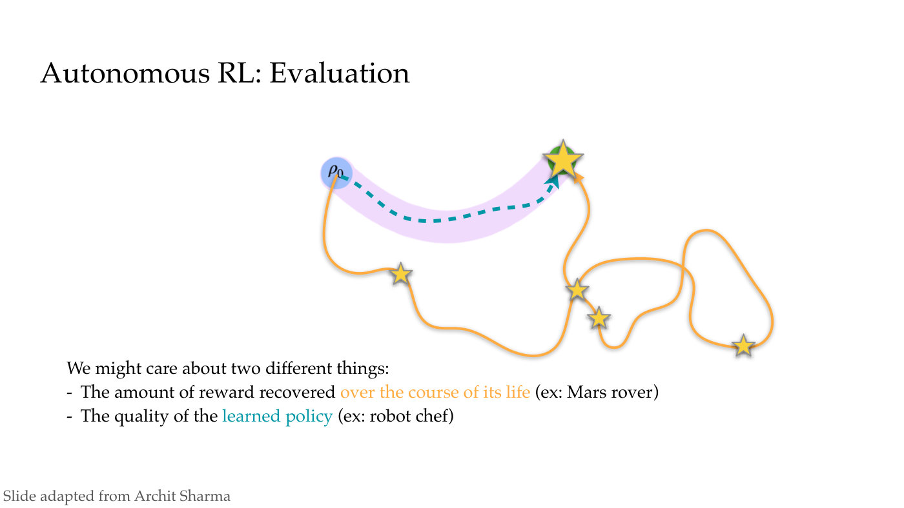

*Slide 12 — the two things to measure: the reward collected along the agent's whole winding lifetime (orange, stars marking rewards), or how well the learned policy goes from the start to the goal (teal). [Deck](https://cs224r.stanford.edu/spring_2025/slides/16_cs224r_autonomy_2025.pdf)*

Slide 13 writes each as an objective. The first, **deployed policy evaluation**, measures the quality of the
policy learned, and "looks very similar to what we've been seeing in the course previously" (≈12:20):
sample a state from the initial state distribution, act according to the policy, and measure the sum of
rewards, or of discounted rewards, over the episode (≈12:20–13:06). As Finn writes it, Finn adds: "This
should be, yeah, an expectation" (≈13:06). The slide's version, with $p(\mathbf{s}_ 1)$ the initial state
distribution, $\gamma$ the discount and $r(\mathbf{s}_ t, \mathbf{a}_ t)$ the reward, is

$$J(\pi) = \mathbb{E}_ {\mathbf{s}_ 1 \sim p(\mathbf{s}_ 1), \mathbf{a}_ t \sim \pi} \left[ \sum_ t \gamma^t r(\mathbf{s}_ t, \mathbf{a}_ t) \right]$$

with its three parts labelled "Start from initial state distribution", "Take actions according to $\pi$" and
"Total reward over the episode". This is the course's [RL objective](rl-objective.md).

The second, **continuing policy evaluation**, asks how good the agent is during the learning process, if
you just deploy it and it learns as it goes. That is the average reward it saw during learning, which Finn
writes as "1 / h, sum from t = 1 to h, of the reward" (≈13:53). Averaged over a short lifetime this says
little, so it is evaluated in the limit as the lifetime $h$ grows, and "there should be an expectation over
this quantity" (≈14:40). The slide prints

$$\lim_{h \to \infty} \mathbb{E} \left[ \frac{1}{h} \sum_{t=0}^{h} r(s_t, a_t) \right]$$

labelled "Average over reward accumulated in the lifetime"; its sum starts at $t = 0$ where Finn says
$t = 1$, and it prints plain $s_t, a_t$. A footnote names it "average reward RL". The expectation is the
second difference from the first objective: "Now this expectation isn't under a single policy. It's over
the learning process itself." (≈14:40) The slide promises "We'll look at algorithms for both!"

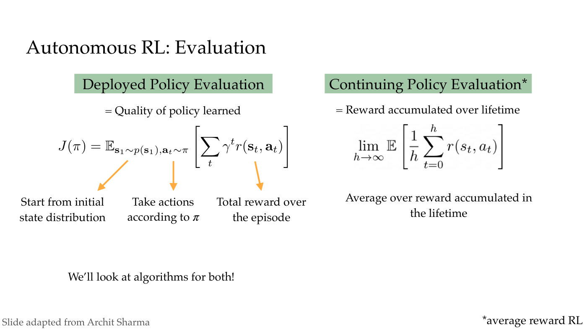

*Slide 13 — the two objectives side by side: deployed policy evaluation, the expected discounted return of the learned policy from the initial state distribution, and continuing policy evaluation, the average reward over a lifetime that grows without bound. [Deck](https://cs224r.stanford.edu/spring_2025/slides/16_cs224r_autonomy_2025.pdf)*

**Question: why do we need an expectation if we are just running one trajectory?** (≈14:40–15:29). To
evaluate a single lifetime, a single roll-out of your learning process, you could just run it and see how
well it does. But there is variability in the environment and in the learning process, such as how batches
are sampled, and to measure how good your *algorithm* is at the problem you want an expectation over
multiple runs of the algorithm.

## Why autonomy matters for robots

Slide 14 pairs robotics with autonomy (≈15:29–16:15): "We want robots to operate with minimal human
supervision" and "We want robots to *train* with minimal human supervision". RL on real robots is a
promising path towards high success rates and reliability, which Finn says is "compared to imitation
learning" (≈16:15). Training with minimal supervision lets you collect more data, and more data may unlock
both greater reliability and greater generalization, if these systems are deployed at scale in a variety
of real-world environments.

## Standard RL with longer episodes

Back to the question of just increasing the length of the episodes (≈17:00). Slide 16 runs a standard
algorithm, [soft actor-critic](replay-buffers.md) (SAC), with longer and longer episodes, which should in
principle need less and less supervision. The task is "a very simple fish control task where your goal is
to navigate, with what the fish can do, to a particular position" (≈18:32). The chart's x-axis is
environment steps (0 to 5 million) and its y-axis the reward of the deployed policy, "this blue equation
right here" (≈17:46), that is, deployed policy evaluation; the slide notes "this measures the deployed
policy evaluation".

There are five series, one per episode length. With episodes of 1000 steps (green) SAC learns a policy
that completes the task, rising to about 490 by 5 million steps. Doubling the episode length to 2000 (red)
does worse, ending near 345; a factor of 10, 10,000 steps (cyan), worse again, near 210; 50,000 steps
(purple) near 180; and at 100,000 steps (olive yellow) the algorithm "is hardly able to learn how to do the
task at all", staying near 130 (≈17:46–18:32). So "Even for this simple task, if you increase your episode
length and don't give it resets very frequently, you aren't able to learn a good policy." (≈18:32)

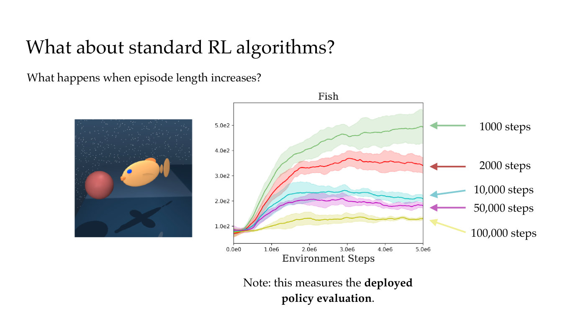

*Slide 16 — SAC on the Fish task with episodes of 1000 to 100,000 steps: the longer the episode, and so the fewer the resets, the worse the deployed policy. [Deck](https://cs224r.stanford.edu/spring_2025/slides/16_cs224r_autonomy_2025.pdf)*

## Why it fails: drift and state distribution collapse

Finn asks the class why (≈18:32), and a student's answer gives the first challenge. The agent can make a
mistake that "leads it to a part of the state space that is very hard to recover from"; in this
environment it probably cannot break its tail, "but you can basically drift away from the state
distribution that's good" (≈19:19). Finn sketches this (the sketch is not visible): the goal is to go from
the initial state distribution to the goal, and as it learns the agent may simply deviate from where the
set of good states is, and because of the drift find it very hard to get back to the parts with high
reward (≈19:19–20:05).

The second challenge "is actually a little bit more nuanced" (≈20:05). Suppose the agent does eventually
reach the goal. It may then simply stay in that region of the state space, collecting a lot of data there
and a lot of reward, so "the learning process is great". But if the goal is to learn a policy that starts
from the initial states and goes to the goal, "you're not actually visiting the states that will yield a
good policy" (≈20:52).

Slide 17 puts the two side by side, with $\rho^\ast$ the band of states visited by the optimal policy, "the
optimal state distribution for getting from start to goal" (≈20:52). In **episodic learning** you "Can
always retry the task from initial state distribution". In **non-episodic learning** you continue from
where you left off, and:

- **Challenge 1: exploration can cause the agent to drift far away** from the good states (≈21:38).
- **Challenge 2: state distribution collapse.** Even once the agent reaches the goal, "your state
  distribution in your replay buffer might collapse and might be concentrated around the goal rather than
  capturing the state distribution that's around the optimal policy" (≈21:38). Without states from the
  optimal policy's distribution, it will not know what actions to take there.

The slide's verdict, in a red banner: "The agent never learns a good policy".

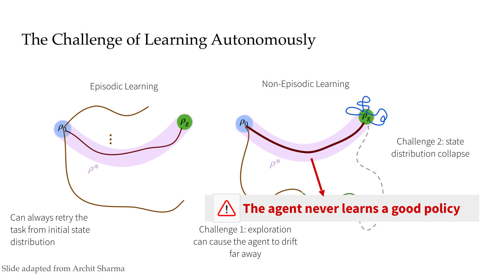

*Slide 17 — episodic learning (left) can always retry from the start; non-episodic learning (right) drifts away from the good band (challenge 1) or loops around the goal so its data collapses there (challenge 2), and never learns a good policy. [Deck](https://cs224r.stanford.edu/spring_2025/slides/16_cs224r_autonomy_2025.pdf)*

**Question: what does "episodic" mean?** (≈37:52–38:37, asked later). Episodic refers to the traditional
RL setting, where you attempt the task, reset, and attempt it again, each attempt being an episode. Finn
calls it "not the best term". Non-episodic is the setting without those resets: "It's just one long
learning process", sometimes also called **reset-free**.

## Forward-backward RL

Slide 18 points back at the Fish chart: the agent "Learns successfully if allowed to frequently retry *from
the initial state distribution*". The key idea, then: "learn a policy to reset?" (≈21:38–22:26). Learn a
policy that brings the agent from wherever it ended up after attempting the task back to the initial state
distribution, a reset or **backward policy** that undoes the task, beside the **forward policy** that does
it. Hence **forward-backward RL** (FBRL).

Finn writes the algorithm (≈23:14–24:48) before the slide shows it. Step zero is to initialize, sampling
an initial state. Then repeatedly run the forward policy $\pi_f$ and update it to maximize the sum of
rewards under the task's reward function $r_f$, the forward reward. Without resetting, run the backward
policy $\pi_b$ and update it for the reverse of the forward task, which needs a second reward function
$r_b$ that "will tell us if we are reaching the initial state distribution" (≈24:02). For the update steps,
"you can use your favorite reinforcement learning algorithm" (≈24:02–24:48). "And critically, after we run
the backward policy, we're not going to reset." (≈24:48)

Slide 19's version first defines $r_b(\mathbf{s}, \mathbf{a})$ for reaching $\rho_0$, then:

1. Initialize forward policy $\pi_f$ and backward policy $\pi_b$.
2. Repeat:
   1. Roll out $\pi_f$ for $H$ steps.
   2. Update $\pi_f$ using $r_f(\mathbf{s}, \mathbf{a})$.
   3. Roll out $\pi_b$ for $H$ steps.
   4. Update $\pi_b$ using $r_b(\mathbf{s}, \mathbf{a})$.
   5. No reset, or a very infrequent reset.

At test time, discard $\pi_b$ and deploy $\pi_f$, which should have learned to get efficiently from the
initial state distribution to the goal, or generally to maximize the forward reward (≈25:33). The
occasional reset is there "just in case it does get stuck in a really challenging state" (≈25:33).

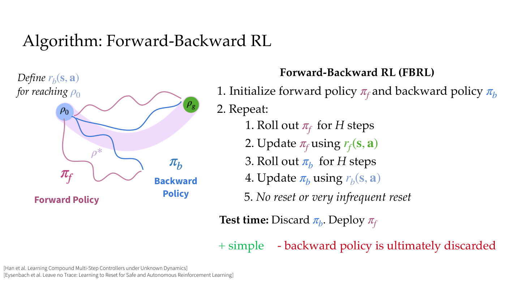

*Slide 19 — forward-backward RL: a forward policy (pink) heads for the goal, a backward policy (blue) rewarded for reaching the initial states brings the agent back, alternating with no resets; at test time only the forward policy is kept. [Deck](https://cs224r.stanford.edu/spring_2025/slides/16_cs224r_autonomy_2025.pdf)*

**How long to roll out each policy** (≈25:33–26:20). The simplest choice is a constant number of steps,
$H$. Something more sophisticated is possible: before the forward policy has learned anything, it is not
moving anywhere and the backward policy has no job to do, so you could run the forward policy longer at the
beginning, though at some point the backward policy also needs longer. A fixed number of steps is simpler,
and if the process is truly autonomous the number matters less anyway, "because you can go to sleep while
your robot is trying to learn" (≈26:20).

**Question: is there any information sharing between the forward and backward policies?** (≈26:20–27:05).
With replay buffers you could share data between the two and relabel the rewards, using the forward
policy's data for the backward policy and vice versa. In practice it is fairly common not to share much.
You could share an image encoder, some of the weights, which can help, but the two are learning very
different things, which makes it tricky; later algorithms in the lecture share more.

The slide's verdict: "+ simple", and "- backward policy is ultimately discarded". It seems "a little bit
wasteful to learn this policy" (≈27:51), but it does enable autonomous learning: "this is the most simple
algorithm you could use for trying to learn autonomously" (≈27:51). The slide cites Han et al., *Learning
Compound Multi-Step Controllers under Unknown Dynamics*, and Eysenbach et al., *Leave no Trace: Learning
to Reset for Safe and Autonomous Reinforcement Learning*.

## Three alternatives

Slide 20 lists alternatives with "a number of appealing properties" (≈27:51–28:39):

1. Learn to reset to the expert state distribution, rather than all the way back to the beginning
   (forward-backward with a modified backward reward).
2. Practise a *cycle* of different tasks, rather than one forward and one backward task.
3. Set up a task that can be done repeatedly, attempted over and over in certain special circumstances
   ("forward-forward RL"?, the slide asks).

The next sections take them in turn.

## MEDAL: resetting to the expert's states

Forward-backward RL tries the task, goes back, tries the task, goes back. The aim is to complete the task
from the initial state distribution, but the agent also needs "to know how to take good actions all along
the expert state distribution" (≈28:39). So instead of going all the way back to the beginning every time,
the backward policy could reset to different states along the expert state distribution. There is work
showing that if you could do this, you would learn more efficiently than always starting from the initial
state distribution, "even in episodic learning settings" (≈29:26); slide 23 cites Kakade and Langford,
*Approximately Optimal Approximate Reinforcement Learning* (ICML 2002).

The algorithm is the same as before with two modifications (≈29:26–30:58):

- **A few demonstrations.** To reset to the expert state distribution, the agent needs a way to
  approximate it, so it is given a small set of expert trajectories, examples of ways to accomplish the
  task; Finn calls this "step negative one" (≈30:12).
- **A different backward reward.** The backward policy's reward "shouldn't be to reach the initial state
  distribution but instead it should be to reach states that the expert visits" (≈30:12).

Ideally, after the backward policy has learned something reasonable, it brings the agent back somewhere in
"this pink region that is showing the distribution of states that are visited by the expert" (≈30:58), and
the forward policy runs again from there.

The backward reward is learned, exactly as in the lecture on
[learning reward functions](08-reward-learning.md) (≈31:44): train a discriminator to distinguish states
visited by the policy from states in the demonstrations, using the policy's states as examples of bad
states. Training the backward policy, "you'll be trying to trick this reward function into thinking that
the states it's visiting are states from the expert and not from the policy" (≈31:44). Again, discard the
backward policy at the end and deploy the forward policy (≈32:29).

Slide 22 names the method **MEDAL**, "Matching Expert Distributions for Autonomous Learning", with the
modified reward $r_b(\mathbf{s}, \mathbf{a})$: "learned reward for matching state distribution in demos".
Its algorithm adds "0. Given a small set of demonstrations" before forward-backward RL's steps and a sixth
step inside the loop, "Update learned reward $r_b(\mathbf{s}, \mathbf{a})$"; at test time, discard $\pi_b$
and deploy $\pi_f$.

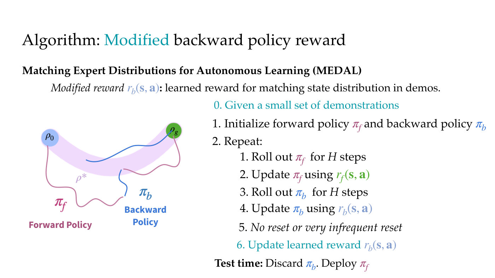

*Slide 22 — MEDAL is forward-backward RL with a small set of demonstrations and a learned backward reward that rewards reaching the states the demonstrations visit, updated inside the loop. [Deck](https://cs224r.stanford.edu/spring_2025/slides/16_cs224r_autonomy_2025.pdf)*

Slide 23 says how this answers both challenges: "Addressing challenge 1: agent doesn't drift away" and
"Addressing challenge 2: backward policy avoids collapse of state distribution". Its "Pro" is the upside
mentioned before: "Forward policy tries the task from wide set of initial states, both easy and hard,
improving the sample efficiency", with easier states closer to the goal and harder ones further away
(≈32:29–33:15). The demonstrations can also go into the replay buffers as data for training both the
forward and the backward policy (≈33:15).

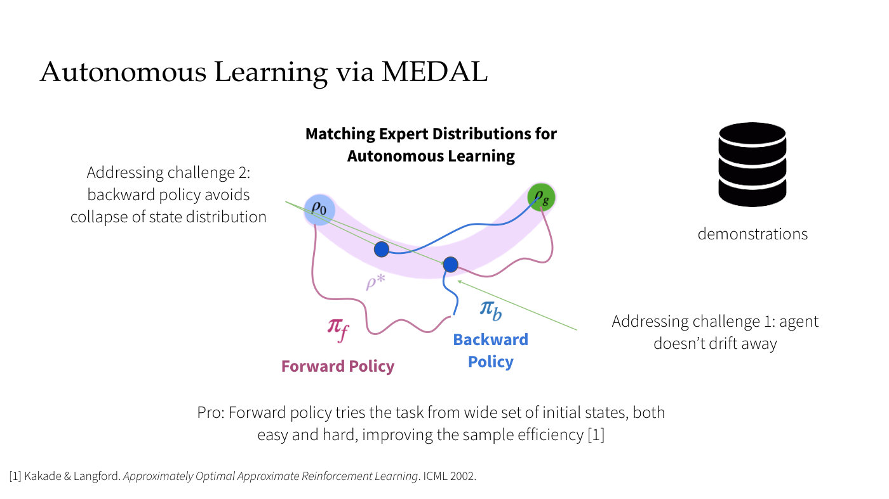

*Slide 23 — with demonstrations to match, the backward policy returns the agent to states along the expert's path, so the agent neither drifts away nor collapses onto the goal, and the forward policy practises from easy and hard starting points. [Deck](https://cs224r.stanford.edu/spring_2025/slides/16_cs224r_autonomy_2025.pdf)*

**Question: once the agent finishes the task, does the backward policy just stay there?** (≈33:15–34:01).
No. In forward-backward RL it goes back to the initial state. In MEDAL it pushes the agent to a state in
the expert state distribution: the classifier between policy states and expert states is trained on all
the states in the demonstrations, so the backward policy goes back to somewhere along that path, and the
forward policy practises the task from there "rather than only practicing it from the goal state"
(≈34:01).

**Question: what prevents it from staying in the goal state, which is part of the demonstrations?**
(≈34:01–34:46). The reward is "a state distribution matching objective, where its goal is to match the
states that it visits with the states in the demos". If the backward policy only resets to the goal state,
the discriminator learns that being only in the goal state is probably the policy and not the expert. This
can be formalized as a divergence between the distribution of states visited by the backward policy and
the distribution of states visited by the experts (≈34:46).

## Results on the EARL benchmark

**EARL** is a benchmark for autonomous RL (slides 24–25, ≈34:46–37:06). During training an agent gets a
reset only every 200,000 environment steps, and the evaluation is the deployed policy's performance from
the initial state distribution $\rho_0$. Slide 24's task is "probably the simplest task in the benchmark":
grab a cup and move it, with a very simple grabbing mechanism (≈35:33). Its chart plots deployed policy
evaluation (0 to 1) against environment steps (0 to 2.5 million) for six methods:

- **SAC without a backward policy** (non-episodic), which only gets the rare resets, like the fish, does
  badly (≈36:19): it rises to about 0.5 and falls back to about 0.35.
- **An oracle**, SAC with frequent episodic resets, learns a good policy, reaching about 0.82.
- Three reset-free algorithms: **R3L**, which perturbs the agent and encourages it to visit novel states
  (magenta, about 0.9 at the end); vanilla **forward-backward RL** (orange, about 0.9); and **VaPRL**,
  which gives the agent a goal curriculum and is not discussed further (green, about 0.95).
- **MEDAL** (blue), which resets to states in the demonstrations, about 0.96 at the end.

The main takeaway is that "these algorithms that are specifically designed for this autonomous or
reset-free learning setting are able to do much better than if you don't design it for that case" (≈37:06),
and in this simple environment they all perform fairly similarly.

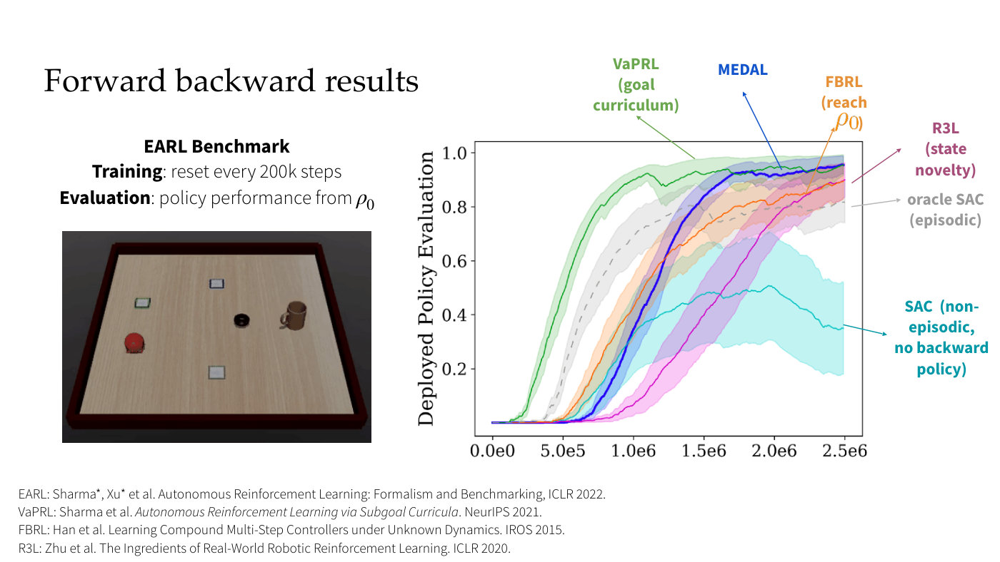

*Slide 24 — the EARL tabletop task, reset only every 200k steps: SAC with no backward policy rises and then falls, while the reset-free methods all end near or above the oracle with frequent resets. [Deck](https://cs224r.stanford.edu/spring_2025/slides/16_cs224r_autonomy_2025.pdf)*

On a more complex task, door closing (slide 25, up to 4 million steps), "forward-backward RL and MEDAL are
able to do the best, whereas simply if you instead try to encourage it to visit various states or goals,
those algorithms aren't doing quite as well" (≈37:06). MEDAL reaches 1.0 by about 1.6 million steps, just
behind the episodic oracle; forward-backward RL climbs more slowly to about 0.93; an unlabelled green
series (VaPRL's colour on slide 24) levels off near 0.63; R3L ends near 0.5; and SAC without a backward
policy never passes about 0.2 and ends near 0.

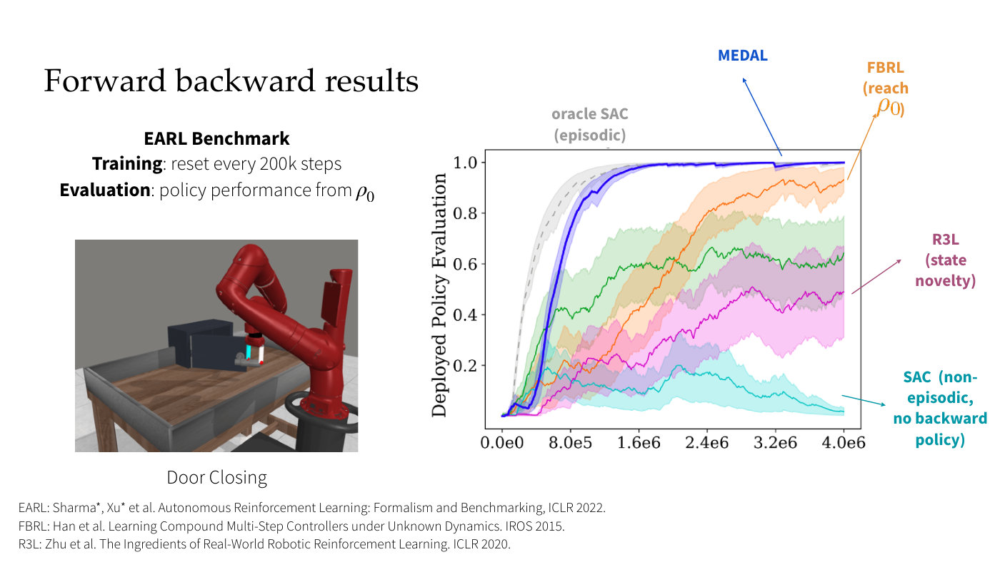

*Slide 25 — on EARL's door-closing task MEDAL matches the episodic oracle, forward-backward RL gets there more slowly, and the novelty and goal-curriculum methods level off lower. [Deck](https://cs224r.stanford.edu/spring_2025/slides/16_cs224r_autonomy_2025.pdf)*

This task also shows a common difficulty (≈38:37–39:23). Its forward task is to close the door and its
backward task to open it, which, depending on where the arm starts, can be quite a bit harder than the
forward task. Such mismatches mean the forward and backward policies learn at different rates, which can
make learning more challenging. Similarly, if the forward task were a backflip, doing the backflip is
really challenging, while getting up and standing ready to start one is comparably easy.

**Question: how are the expert trajectories generated?** (≈37:06–37:52). On a real robot, typically with a
teleoperation device: a puppeteering setup, a VR controller, a 3D mouse or a keyboard. In simulation, a
scripted policy designed by a person, or a policy trained with RL ahead of time just to test the
algorithms.

## Forward-backward RL on real robots

These algorithms can run on real robots, and "You can watch time lapses of them" (slide 26,
≈39:23–40:55). On the left, vanilla forward-backward RL learns a forward and a backward policy; both make
mistakes, and it improves "just through a fully autonomous process" (≈40:08). On the right is MEDAL, where,
for example, when the forward policy misses, the backward policy has little to do.

Rewards are "also something that the real world doesn't provide", so reward learning algorithms are often
combined with reset-free ones. In both videos the rewards came from models rather than from humans, so the
entire process is autonomous and can run overnight (≈40:08–40:55). The slide's captions say which:
"Demo initialized, VLM-provided rewards" for forward-backward RL, and "Demo initialized, learned rewards"
for MEDAL. See [reward learning](reward-learning.md).

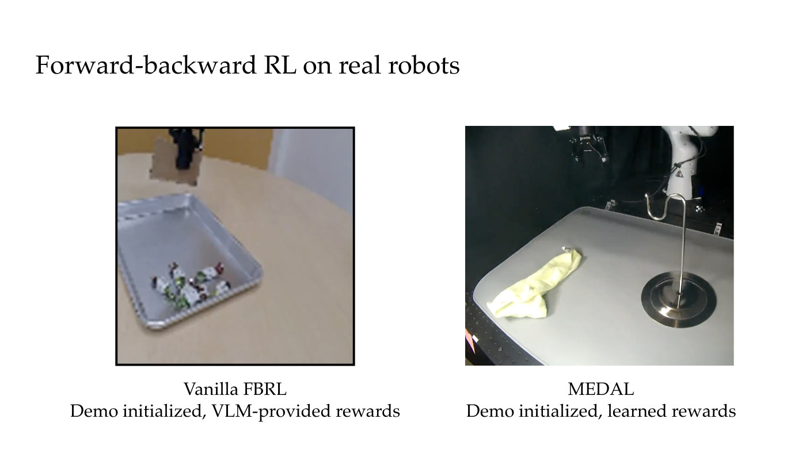

*Slide 26 — frames of two time-lapse videos: forward-backward RL with rewards from a vision-language model, and MEDAL with learned rewards, both started from demonstrations and learning without human resets. [Deck](https://cs224r.stanford.edu/spring_2025/slides/16_cs224r_autonomy_2025.pdf)*

**Question: if neither policy is good yet, how does either learn?** (≈40:55–41:42). Without a good backward
policy it is hard to learn the forward policy, and vice versa: without a good forward policy the robot never
picks up the towel, so the backward policy never sees useful states. One thing you can do is provide
demonstrations for both the forward and the backward task and use them to bootstrap both. Beyond that it is
a challenge to balance the two, and the algorithms work in some settings. Finn adds that this work is
certainly still in the research stages: "This is not something that robot companies are using today."
(≈41:42)

## Practising a cycle of tasks

The second alternative applies when the agent is learning several tasks (slides 27–28, ≈41:42–44:02).
Instead of only going forward and backward, it can practise "going in cycles and practicing different
tasks depending on what state you're in" (≈42:28). A robot making coffee might first try to put the cup in
the coffee machine and drop it by accident. Traditionally a human would reset the cup; instead, the next
task should not be to turn on the coffee machine but to pick up the cup. Task 2 then acts as a reset for
task 1, which can be practised again; if the robot does succeed at task 1 it moves on to task 3, and so on
(≈43:14). At each point the agent practises a task that is possible from the current state, and excludes
tasks that are not feasible from it (≈43:14–44:02).

Slide 28's graph has four tasks: "Task 1: put cup in coffee machine", "Task 2: pick up cup", "Task 3:
replace cup" and "Task 4: clean up spill from cup…". Failing task 1 leads to task 2, which loops on itself
until it succeeds and then leads back to task 1; succeeding at task 1 leads to task 3; failing task 3 leads
to task 4; tasks 3 and 4 both lead back to task 1. A crossed-out person marks that no human resets
anything.

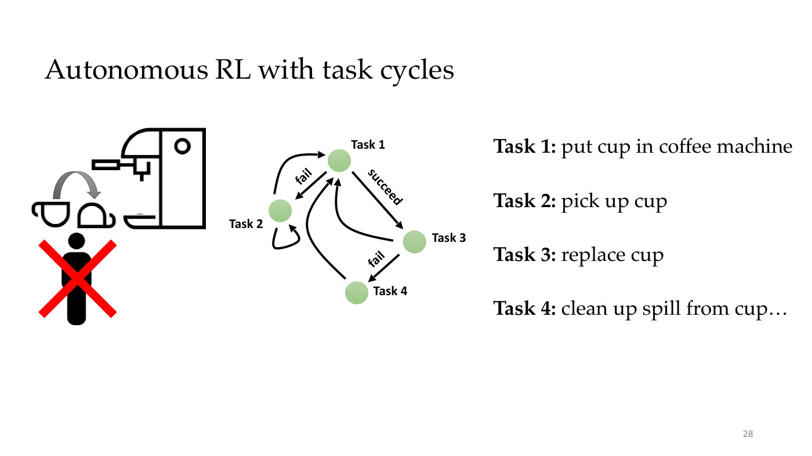

*Slide 28 — a graph of tasks for making coffee, where the outcome of each task (succeed or fail) decides which to practise next, so that one task's failure is reset by another and no person steps in. [Deck](https://cs224r.stanford.edu/spring_2025/slides/16_cs224r_autonomy_2025.pdf)*

Finn writes the algorithm (≈44:02–45:35), which slide 29 then shows. The agent learns a
**task-conditioned policy**, a [multi-task policy](multi-task-rl.md) $\pi(\cdot \mid \mathbf{s}, \mathbf{z})$
conditioned on a task descriptor $\mathbf{z}$:

1. Initialize the task-conditioned policy $\pi(\cdot \mid \mathbf{s}, \mathbf{z})$.
2. Repeat:
   1. Propose a task $\mathbf{z}_ i$ to practise, based on the current state $\mathbf{s}$.
   2. Roll out $\pi(\cdot \mid \mathbf{s}, \mathbf{z}_ i)$ for $H$ steps.
   3. Update $\pi$ using $r(\mathbf{s}, \mathbf{a}, \mathbf{z})$.
   4. No reset, or a very infrequent reset.

At test time, deploy $\pi$, which can do several tasks rather than one (≈45:35). With a more on-policy
algorithm, the update is for the task just practised; with an off-policy algorithm, it can update any of the
tasks (≈44:47). The method needs "a reward function for all of the tasks that we might be doing" (≈45:35).

Practising by state also addresses the imbalance between tasks seen earlier: if the forward policy has not
yet succeeded in changing the state, it may not make sense to run the backward policy, and the agent can
keep practising a task that does make sense (≈47:09).

### Examples

Slide 30 (Gupta et al. 2021, *Reset-Free Reinforcement Learning via Multi-Task Learning*) shows a robot
hand whose task has stages: pick up an object, flip it over, and rotate it (≈45:35–47:09). At first the
robot cannot flip or rotate it, so it mostly practises picking it up and putting it back down; once it is
better at picking it up, it starts to flip and rotate it. "And so depending on which state you're actually
in, you'll actually practice something that makes sense for that given state." (≈46:23) The slide's diagram
joins four skills, "Re-center", "In-Hand", "Lift" and "Flip", with arrows that its legend divides into
"Reset" and "Train".

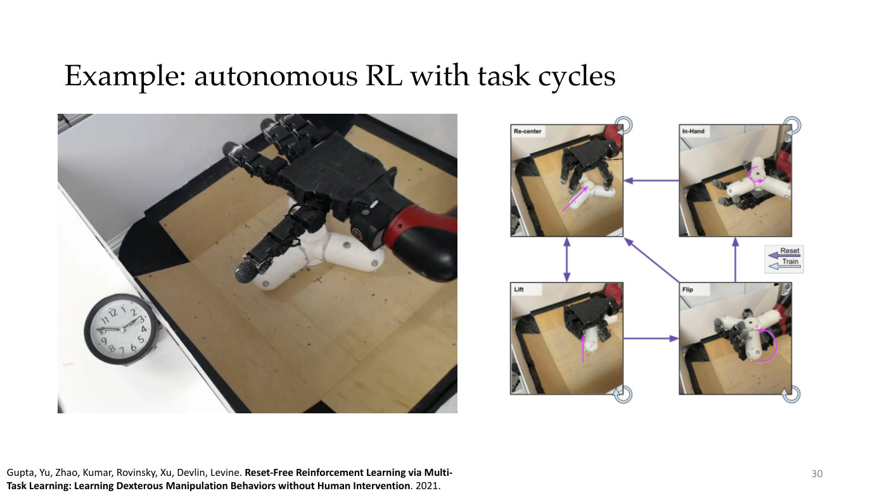

*Slide 30 — a dexterous hand practising re-centring, lifting, flipping and in-hand rotation of a valve-like object, with each skill serving as a reset for another. [Deck](https://cs224r.stanford.edu/spring_2025/slides/16_cs224r_autonomy_2025.pdf)*

Slide 31 has two more (≈47:09–47:55). On the left (Smith et al. 2021, *Legged Robots that Keep on
Learning*), a legged robot learns to walk forward and backward and, at the same time, to get back up; when
it has gone too far back it practises going forward. On the right (Han, Levine and Abbeel), a seven-stage
wrench task: pick the wrench up, position it and screw repeatedly, running different controllers based on
the state it is in, and eventually a backward policy that puts the wrench back on the table.

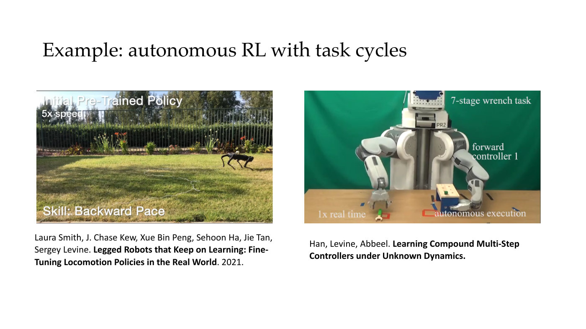

*Slide 31 — frames of two videos: a quadruped switching between walking forward, walking backward and getting up, and a PR2 running the controllers of a seven-stage wrench task by state. [Deck](https://cs224r.stanford.edu/spring_2025/slides/16_cs224r_autonomy_2025.pdf)*

## Which task to practise?

**Question: how do we select these tasks?** (≈47:55–49:31). This is "sort of at the bleeding edge of
research" (≈47:55), and there are two approaches. You can predefine a set of tasks and the graph, saying
up front which task to practise in which circumstance (for example, practise task 2 after failing task 1),
and act according to it. Or you can train a model that proposes tasks. Slide 32 asks "How to identify which
task to collect data for?": "In general: an open research question", and "One idea: Ask a vision language
model."

In the slide's example (SOAR, Zhou, Atreya et al.), from this frame of the scene the robot could open the
toy microwave, pick up the banana, push the eggplant or move the pot; it could not pick up the carrot,
which is not in the scene. So the tasks are scene dependent, and a vision-language model (VLM) can be asked
what can be done in this environment and predict, for example, "take the banana out of the silver pot",
which the robot then practises (≈49:31).

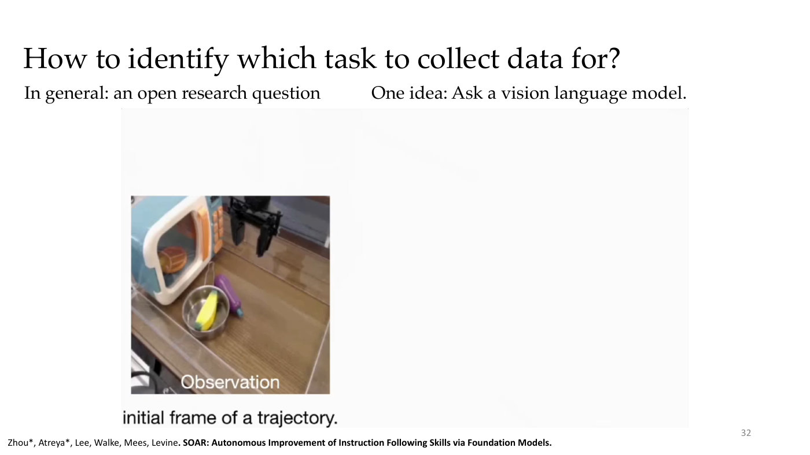

*Slide 32 — the scene SOAR's vision-language model looks at to propose a task to practise; the page holds the first frame of the figure, and the proposals come from what Finn says. [Deck](https://cs224r.stanford.edu/spring_2025/slides/16_cs224r_autonomy_2025.pdf)*

**Question: how is this different from hierarchical learning?** (≈49:31–51:06). The task proposer shares
some similarities with a [high-level policy](hierarchical-rl.md) that says what to do in a circumstance,
"But its purpose is actually quite different." The proposer suggests things that could be practised in the
environment, and you want it to give you lots of different things so that you learn lots of different
things. A high-level policy says what the next subtask is that will achieve some outcome; it is "much more
goal-directed in terms of accomplishing some sort of long-term objective" (≈50:19). This particular work
does use a hierarchical method, building on one from the previous lecture
([Lecture 15](15-hierarchical-rl.md)): it feeds the proposed task into an image-editing diffusion model to
generate a goal image, and trains the policy to reach it. That makes rewards easier, since a reward
function for every task is hard to define, while a reward can be based on whether the robot is close to
the goal image (≈51:06).

**Question: could the proposer give outputs like these in other settings?** (≈51:53). Absolutely: the
framework was applied to simple robot scenes, but in the hockey example you could ask what to do in a
situation, practise passing or practise shooting. For those examples, there are only a limited number of
things to practise, so one session each on shooting and passing would also be reasonable.

## Tasks that can be done repeatedly

The third alternative is to set up the task so that it can be done repeatedly (slide 33, ≈51:53–52:39).
"There isn't necessarily a lot of research on this particular idea" (≈52:39); in the slide's example, a frame of
a video labelled "DYNA-1 autonomous, un-cut 24 hours", the goal is to fold napkins "for businesses where you need to fold lots of napkins".

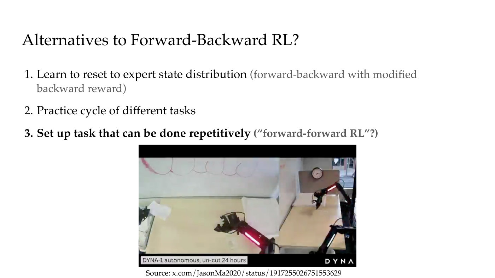

*Slide 33 — the third alternative, a task that can be repeated without undoing it: a frame of a 24-hour uncut video of a robot folding napkins. [Deck](https://cs224r.stanford.edu/spring_2025/slides/16_cs224r_autonomy_2025.pdf)*

Finn sums up the two categories of algorithm so far (≈51:53–52:39): doing the task and then undoing it in
various ways, and doing one task, then another, then another, trying to get better at many tasks at once.
All of these circumstances aim at a good policy, "rather than simply the Mars rover example where we want
to maximize rewards" (≈52:39), the second kind of problem.

## Single-life RL

So far (slide 35), learning without resets "Can improve the quality of the policy through *autonomous
practice*". What happens after deployment? "*Obviously*, everything works perfectly and nothing ever goes
wrong." Slide 36 strikes that line through: "The natural world is complex, and something likely will go
wrong, despite preparation." This latter setting asks whether a policy, once out in the world on its own,
"can it recover from mistakes and learn, after the deployment process?" (≈53:27)

Even humans do this (slides 37–39, ≈54:13–54:59). In a video, played twice, a person opening a door makes a
mistake and adapts in a split second: pushing, the person finds that the key isn't correctly in the hole,
draws it back out and puts it back into the keyhole.

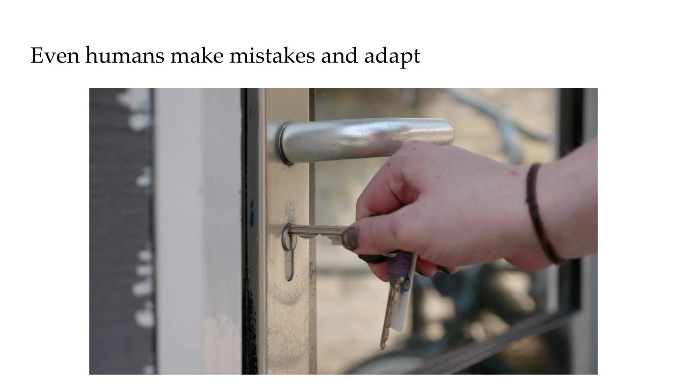

*Slide 39 — a frame of the video of a person unlocking a door, who finds the key is not in the lock properly and reinserts it within a split second. [Deck](https://cs224r.stanford.edu/spring_2025/slides/16_cs224r_autonomy_2025.pdf)*

The goal is to adapt within an episode, during deployment (≈54:59). Slide 40, **Single-Life Reinforcement
Learning (SLRL)** (Chen, Sharma, Levine and Finn, *You Only Live Once: Single-Life Reinforcement Learning*,
NeurIPS '22), compares three settings (≈54:59–55:45):

- **Episodic RL**, most of the course: attempt the task from the initial state repeatedly during training,
  then deploy the policy.
- **Reset-free RL**, earlier today: learn to attempt the task and undo it repeatedly, then deploy the
  policy.
- **Single-life RL**: given prior training data, perhaps a trained policy, the agent is in a new,
  out-of-distribution circumstance and must do some problem solving, adapting and learning during
  deployment "during a single episode without resets" (≈55:45). The slide gives the agent prior data from a
  training environment and one "life" to autonomously complete the task in a novel scenario.

As a simple example, the training experience might be running on flat ground, and at some point the agent
meets an obstacle it has never seen and has to get over it, using reinforcement learning, or ideas from it,
to adapt live within the episode (≈55:45). The slide's pictures show a legged walker on a checkerboard floor
in training and the same walker before a block in the test environment, and ask "Can we run RL in a single
episode at test time?". Slide 41 restates the setting for a "novel, OOD scenario" and asks "Can we fine-tune
with RL in a single episode at test time?"

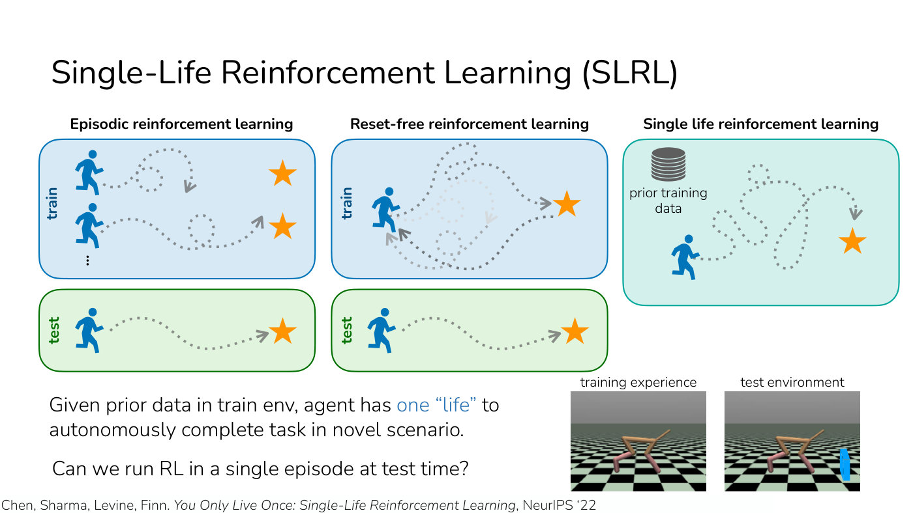

*Slide 40 — episodic RL trains in many episodes, reset-free RL in one long one, and single-life RL gets prior data and a single life in a new situation, here a walker trained on flat ground meeting a block. [Deck](https://cs224r.stanford.edu/spring_2025/slides/16_cs224r_autonomy_2025.pdf)*

## How to approach single-life RL

The obvious attempt is to keep fine-tuning the policy with reinforcement learning at test time, with TD
updates or policy gradients, live as the policy rolls out (slide 42, ≈56:35–57:20). In the video, a policy
fine-tuned this way on the obstacle course gets over the first obstacle, which it has never seen, but then
gets stuck flipped over. It is somewhat trying to get up, yet even though it is still running reinforcement
learning updates, "it isn't able to recover from these kinds of states that it hasn't seen before on its
own, without interventions" (≈57:20). The slide: "Agent fails to handle or recover from out-of-distribution
states without interventions."

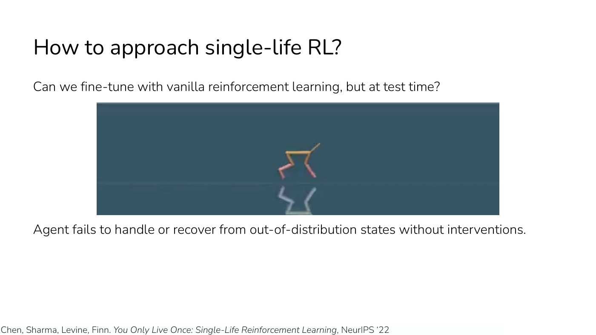

*Slide 42 — a frame of the video of a walker fine-tuned with plain RL at test time, which clears the first unseen obstacle and then gets stuck on its back. [Deck](https://cs224r.stanford.edu/spring_2025/slides/16_cs224r_autonomy_2025.pdf)*

This too is "at the bleeding edge of research" (≈57:20). Slide 43 lists "A few useful ideas" (≈58:06–59:40):

- **"Guide the learning process towards good, familiar states to avoid getting stuck".** When the agent is
  stuck in a state that is hard to recover from, RL updates towards the goal do not help. If it instead runs
  RL updates "to get back to states that are familiar, like good states that you visited in your previous
  experience", it may get unstuck, since those states may be closer to the ones at the goal and perturb it
  back to something it knows (≈58:06–58:54).
- **"Leverage pre-training".** RL on the policy weights, in the low-level action space, can only change the
  policy so much. With a set of pre-trained skills, the agent can adapt in *skill* space and change its
  strategy rather than its weights or actions (≈58:54). With a skill for walking forward and one for
  getting back on its feet, a stuck agent could explore its skills, including getting back up, "because
  you're basically able to try different strategies rather than just trying different actions or different
  weights" (≈59:40).
- **"Pre-trained LLMs may be able to reason through how to adapt"**, with common-sense reasoning that could
  help an agent try different strategies in novel circumstances (≈59:40).

On the same example, guiding the agent towards familiar states rather than towards the goal (slide 43's
video, ≈1:00:25): it still gets stuck on its back in this out-of-distribution environment, but by trying to
get back to a familiar state, such as one on its feet, it recovers after a few attempts and reaches the
goal.

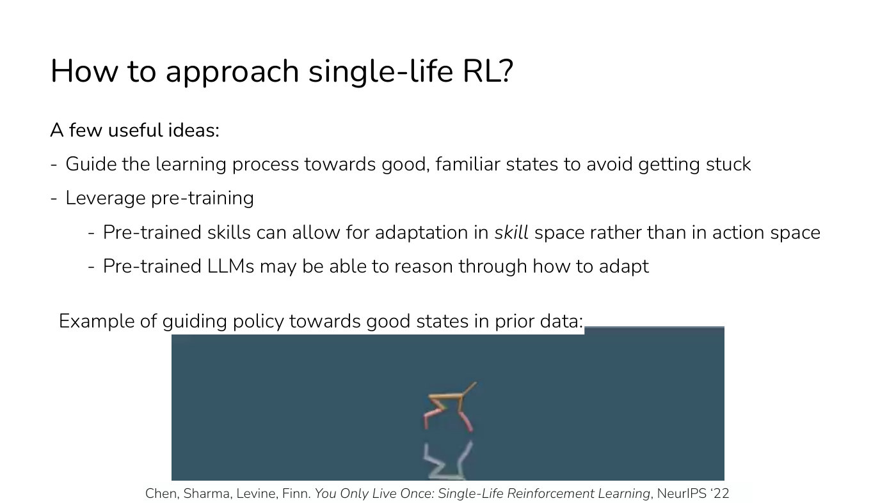

*Slide 43 — the ideas: steer towards familiar states, adapt in a space of pre-trained skills, use a language model's reasoning; the video frame is the walker guided towards familiar states, which gets back up and reaches the goal. [Deck](https://cs224r.stanford.edu/spring_2025/slides/16_cs224r_autonomy_2025.pdf)*

Slide 44 contrasts adapting at the two levels (≈1:00:25–1:02:00). **Adaptation in low-level action space**
(Kumar, Fu, Pathak and Malik, *RMA: Rapid Motor Adaptation for Legged Robots*, RSS 2021, which Ashish Kumar
presents in [Lecture 17](17-sim-to-real.md#rma-learning-to-walk-in-simulation)): a system trained
to adapt from recent history, which handles small out-of-distribution changes such as different terrains.
For situations more drastically different from anything seen before, **adaptation in high-level skill
space** can help (Chen, Lessing, Tang, Chada, Smith, Levine and Finn, *Commonsense Reasoning for Legged
Robot Adaptation with Vision-Language Models*, ICRA 2025). A legged robot is trying to reach a goal; a
policy run without any context just keeps trying to go forward, because it does not know that it already
tried. Trying different strategies, such as moving left or moving backwards, with context and adaptation,
the agent problem-solves its way through obstacles in an environment it has never seen to the goal
(≈1:01:13–1:02:00). Adapting in the low-level motor space, trying out different joint positions, would make
that very tricky.

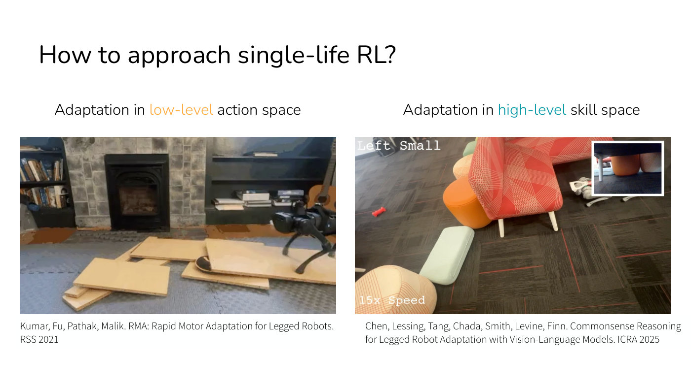

*Slide 44 — adapting in low-level action space (RMA's quadruped on uneven boards) against adapting in high-level skill space (a quadruped choosing strategies such as moving left, guided by a vision-language model). [Deck](https://cs224r.stanford.edu/spring_2025/slides/16_cs224r_autonomy_2025.pdf)*

## Questions on safety and common sense

**Question: how do we bake in safety constraints?** (≈1:02:00–1:04:20). Safety-critical mistakes are
another reason human oversight may be needed: a legged robot can fall in a way that damages it, and a
manipulator can drop a glass on the floor or hit objects hard. Some work builds directly on these ideas,
learning a notion of safety, recognizing a high-risk state, and learning a recovery policy that gets back
to states known to be less risky; some of these ideas were studied several years ago in safety settings.
The other practical step is to impose safety constraints on the controller itself where possible, so that
the motors are not driven to overheating, or a box around the robot keeps it from applying a lot of force
to parts of the state space. That is not possible everywhere, and learning notions of safety might be the
only general way, "Although to learn safety, you need examples of failing." So "it's generally a pretty
tricky problem" (≈1:04:20).

**Question: could a VLM say what to do at a high level, for example when navigating around people?**
(≈1:04:20–1:05:07). The work on slide 44 did use a VLM to indicate, from past experience, which strategies
were good to try. Such models may carry common sense, such as not walking or running into a person, or
waiting, and leveraging it "is fairly promising".

Finn closes with slide 45's summary (≈1:05:07): why RL algorithms do not already give robots autonomous
learning; the problem defined, in instances where we care about the lifetime of rewards or about learning a
good policy; and algorithms for each, which learn a backward policy, learn a task graph and try different
tasks, and single-life RL "to prevent drift".

## Not in the recording: the reminders

Slide 2 and slide 46 hold the reminders, which the recording does not discuss: "Project milestone due
tonight" and "Homework 4 due next Friday". Slide 46 adds "Next time": a guest lecture from Ashish Kumar
(Tesla Optimus), [Lecture 17](17-sim-to-real.md). At the start of the lecture Finn describes it as a guest lecture "talking about sim-to-real
transfer and humanoid robots" (≈0:05). See [course logistics](course-logistics.md).

## Summary

Reinforcement learning on real robots is not autonomous, because every algorithm assumes the agent is reset
to its initial state distribution after each attempt, and on a robot that is a person's job, repeated over
thousands of trials. Autonomous RL initializes once and then learns with no resets or very rare ones. It can
be judged by the deployed policy's expected return from the initial state distribution, when what matters
is a good policy (the robot chef), or by the average reward over a lifetime that grows without bound, an
expectation over the learning process itself, when what matters is how the agent does while learning (the
Mars rover). Standard RL with longer episodes fails, even on a simple fish task, because exploration drifts
away from the good states and the replay buffer collapses around the goal. Forward-backward RL learns a
backward policy, rewarded for reaching the initial states, that undoes each attempt, and discards it at test
time. MEDAL instead rewards the backward policy, through a learned discriminator, for reaching the states a
few demonstrations visit, which addresses both challenges and lets the forward policy practise from easy and
hard starting points; on the EARL benchmark it and forward-backward RL do best. With several tasks, a
task-conditioned policy can practise whichever task makes sense from the current state, in a predefined
graph or proposed by a vision-language model. Single-life RL asks a trained agent to adapt within one
episode in an out-of-distribution situation; plain RL fine-tuning gets stuck, while steering towards
familiar states and adapting in a space of skills or strategies, with a VLM's common sense, help. All of
this is still research rather than practice in robot companies.

## Related pages

- [Autonomous and single-life RL](autonomous-rl.md): the topic page: the reset problem, the two evaluation
  objectives, forward-backward RL, MEDAL, task cycles and single-life RL.
- [The RL objective](rl-objective.md): the episodic objective that deployed policy evaluation reuses, and
  the average-reward objective beside it.
- [Reward learning](reward-learning.md) and [Lecture 8](08-reward-learning.md): the discriminator behind
  MEDAL's backward reward, and rewards from models rather than humans.
- [Replay buffers and soft actor-critic](replay-buffers.md): SAC, the baseline here, and the replay buffer
  whose state distribution collapses.
- [Multi-task RL](multi-task-rl.md): the task-conditioned policy that practises a cycle of tasks.
- [Hierarchical RL and imitation](hierarchical-rl.md) and [Lecture 15](15-hierarchical-rl.md): how a task
  proposer differs from a high-level policy, and the image-subgoal method SOAR builds on.
- [Imitation learning](imitation-learning.md): the demonstrations MEDAL matches, and how they are collected.
- [Lecture 1 — Class Intro](01-class-intro.md): the same hockey-puck video, and reset-free RL as a course
  topic.
- [Course logistics](course-logistics.md): the project milestone and Homework 4 deadlines.
