# Lecture 18 — Frontiers and Open Problems in Deep RL, and How to Do Research

Stanford CS224R, Spring 2025 (Friday, May 30) · Chelsea Finn · the course's last lecture ·
[video](https://www.youtube.com/watch?v=FacJ_1tTSx4) (71 min) ·
[slides (PDF)](https://cs224r.stanford.edu/spring_2025/slides/18_cs224r_frontiers_how_to_research.pdf) ·
[slide-by-slide text](../raw/slides/18-frontiers.md) ·
[transcript](../raw/transcripts/18-frontiers.md)

**What this lecture establishes.** The last lecture has two parts. The first surveys open problems in deep
RL, sorted into problem set-up, methods, and deployment and evaluation, picked because Finn gets asked
about them or finds them exciting rather than to be exhaustive. Many domains have **no reward to verify**:
human preferences for chatbots favour confident answers that agree with the user over true ones, robot
tasks need rewards that even people cannot agree on, and recommendation systems blend objectives with
hand-tuned weights. **Prior data and pre-trained weights** help but can also constrain learning; one method
did better by loading prior data into the replay buffer without pre-training the weights. **Video generation
models** know a lot about the world but mispredict actions they were not trained on. **Scaling RL** beyond
short-horizon, very online problems may need value functions accurate enough to optimize policies, and
"batch online" RL, in which expressive policies such as diffusion policies matter. Deployment raises
**safety** without unsafe data, **human-AI systems** in which RLHF hurts a model's calibration, **reliability**
where no person checks the output, and the **evaluation** of generalist policies with no reliable offline
metric. The second part is Finn's advice on doing empirical research: pick an important problem with a plan
for it that you are excited about and that survives a brutally honest look at why it could fail; prefer
problems and their bottlenecks to ideas; cross topic boundaries; front-load the risk with quick experiments
on the core unknowns; get things to work by starting from something that works; formulate a pivot as a
choice between concrete projects; share the work, because knowledge nobody hears about has no output; lean
on mentors; and keep confidence, since "now is a better time than ever to do research".

Slide numbers below are the slides' own numbers, which equal the PDF page numbers (pages 40, 52 and 53
print no number and are labelled by their place). Timestamps (≈M:SS) point into the video and the
[transcript](../raw/transcripts/18-frontiers.md). The recording opens on the plan for both parts (≈0:05),
follows the deck in order and ends on the closing thoughts (slide 52, ≈1:08:48, ending at about 1:10:50).
Slide 2's course reminders are not mentioned in the recording, so the slide file is the only source for
them (they are under [course reminders](#course-reminders-in-the-slides-only) below), and slide 53's
thank-you is not read aloud. Five student questions are answered, at ≈19:22, 32:29, 51:01, 52:33 and
1:01:04; only Finn is audible, so they are known from Finn's restatements, and each is in the section it
belongs to. Finn's pronouns are not stated in the material, so this page writes "Finn".

The frontiers part of this lecture leans on most of the course: preference optimization
([Lecture 9](09-rl-for-llms.md)), reasoning ([Lecture 10](10-rl-for-reasoning.md)), offline RL
([Lecture 7](07-offline-rl.md)), model-based RL ([Lecture 11](11-model-based-rl.md)), expressive policies
([Lecture 2](02-imitation-learning.md)), PPO and value functions ([Lectures 4](04-actor-critic.md) and
[5](05-off-policy-actor-critic.md)) and exploration ([Lecture 14](14-exploration.md)). The research part
stands on its own; for the course's own project requirements see [course logistics](course-logistics.md).

## Contents

Part 1, frontiers and open problems:

1. [The plan: three kinds of open problem](#the-plan-three-kinds-of-open-problem)
2. [Domains without rewards](#domains-without-rewards)
3. [Leveraging prior data and knowledge](#leveraging-prior-data-and-knowledge)
4. [World models and video generation models](#world-models-and-video-generation-models)
5. [Scaling up: longer horizons and less online data](#scaling-up-longer-horizons-and-less-online-data)
6. [Safety](#safety)
7. [Hallucinations, human-AI systems and reliability](#hallucinations-human-ai-systems-and-reliability)
8. [Evaluating generalist systems](#evaluating-generalist-systems)
9. [The end of part 1, and why RLHF hurts calibration](#the-end-of-part-1-and-why-rlhf-hurts-calibration)

Part 2, how to do (deep RL) research:

10. [Preface and backstory](#preface-and-backstory)
11. [Some realities of research](#some-realities-of-research)
12. [What to work on: three steps](#what-to-work-on-three-steps)
13. [Idea-driven or problem-driven research, and bottlenecks](#idea-driven-or-problem-driven-research-and-bottlenecks)
14. [Crossing topic boundaries, and not being a perfectionist](#crossing-topic-boundaries-and-not-being-a-perfectionist)
15. [Handling risk](#handling-risk)
16. [Getting things to work](#getting-things-to-work)
17. [Deciding when to pivot](#deciding-when-to-pivot)
18. [Sharing your research](#sharing-your-research)
19. [Mentorship and confidence](#mentorship-and-confidence)
20. [Closing thoughts](#closing-thoughts)
21. [Course reminders (in the slides only)](#course-reminders-in-the-slides-only)

## The plan: three kinds of open problem

Finn covers "both open problems in deep reinforcement learning and how to do deep RL research" (≈0:05),
which is the deck's title: "Frontiers & open problems in deep RL", "+", "How to do (deep RL) research" (slide 1).
The open problems are grouped in three (slide 4, ≈0:05): **problem set-up** (a. non-rewarding, unverifiable
domains), **methods** (b. leveraging prior data and knowledge, c. using world models, d. how to scale) and
**deployment and evaluation** (e. safety, f. handling inaccuracies and hallucinations, g. evaluation of
generalist systems). The list "will not be exhaustive": these are problems Finn has "either gotten questions
about quite a bit" or finds most exciting (≈0:05). The deck returns to the same list before each item, with
that item in bold (slides 9, 11, 13, 16, 20 and 24).

## Domains without rewards

RL has succeeded where the reward is easy to define and check: the slides' "No problem" column lists games,
math reasoning and coding problems, where "You can very easily verify whether or not the reinforcement
learning system did the correct thing" (slide 5, ≈0:51). The challenge is that in many real-world scenarios
"rewards don't exist, *or* very delayed" (slide 5). The deck builds up five examples over slides 5–8.

**1. Language models for chatbots.** Preference optimization lets RL be deployed at scale for chatbots, and
"one might actually say that preference optimization for chatbots seems to work quite well", but it has
"pretty big problems" (≈1:38). Slide 5 shows a chart from Sharma & Tong et al. (2023) of the probability that
a response with a given feature is preferred, all else being equal. The two most preferred features are that
the response agrees with the person and that it is confident (about 55.6% and 55.4%), while "Is actually
true!", marked with a dashed arrow, sits lower, at about 53% (slide 5, ≈1:38–2:24). People are "caring about
whether it's confident more than whether or not the response is actually correct or true. And so people
aren't actually giving good preferences" (≈2:24). Finn would want language models to value factuality over
confidence, whereas "we're more optimizing for what people kind of want to hear rather than the kinds of
responses that will be good" (≈2:24). Personalization raises a second issue: models that tell each person what
they want to hear, closely personalized to their beliefs, might lead to polarization rather than exposure to
a wide range of beliefs, so "even something like personalization may not intrinsically be what we want to
optimize for" (slide 5, ≈3:12). There are usually several objectives, and balancing objectives that compete
with each other is a very challenging problem (≈3:12–3:58). For preference optimization itself,
see [RLHF](rlhf.md) and [learning rewards from preferences](preference-learning.md).

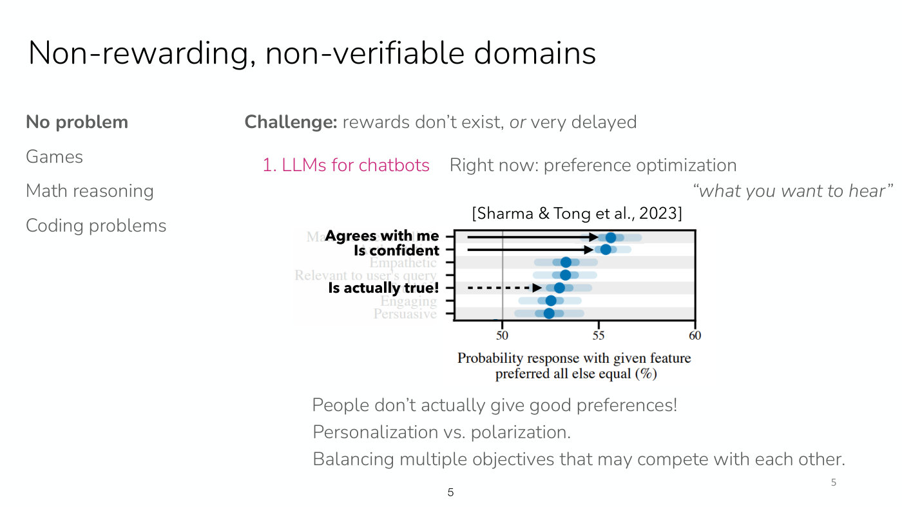

*Slide 5 — the preference chart from Sharma and Tong et al.: the two rows marked with solid arrows, agreeing with the person and being confident, are the most preferred features, and being actually true, marked with a dashed arrow, comes well below them. [Deck](https://cs224r.stanford.edu/spring_2025/slides/18_cs224r_frontiers_how_to_research.pdf)*

**2. Robotics.** Rewards are "often binary or hand-shaped" (slide 6): binary in the real world, or in
simulation hand-shaped from terms for what you want, which takes a lot of effort or a lot of labeling, and
even with human annotations "it can be tricky to judge rewards" (≈3:58). Slide 6 shows four shirts, each
folded by a robot, and asks "How would you score each of these shirt folds?": it is "rather tricky to figure
out how you might reward different mistakes like different amounts of crinkleness, whether or not the shirt
is off-center or not", a problem that is ambiguous "even for people" (≈4:45).

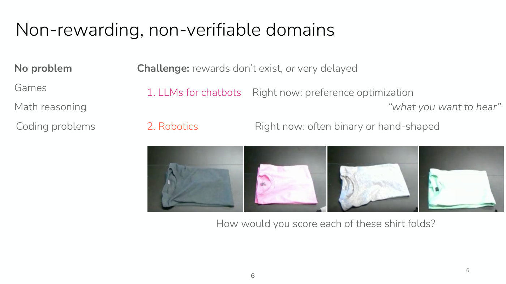

*Slide 6 — four shirts, each folded by a robot, under the question of how to score each fold: crooked, rough or bundled, none is clearly best. [Deck](https://cs224r.stanford.edu/spring_2025/slides/18_cs224r_frontiers_how_to_research.pdf)*

**3. YouTube recommendations.** The algorithm that picks the next video is not public, but a research paper
(slide 7 shows its first page, "Recommending What Video to Watch Next: A Multitask Ranking System", Zhao et
al., Google) describes optimizing a "Weighted combination" of engagement (clicks) and satisfaction (likes)
(slide 7, ≈4:45–5:30). The combination of these metrics for the reward function "was actually
manually tuned by a person rather than something that is designed automatically" ("Score weights are
*manually* tuned!", slide 7, ≈6:18), which shows how hard a reward is to define when nobody knows how best to
balance the objectives.

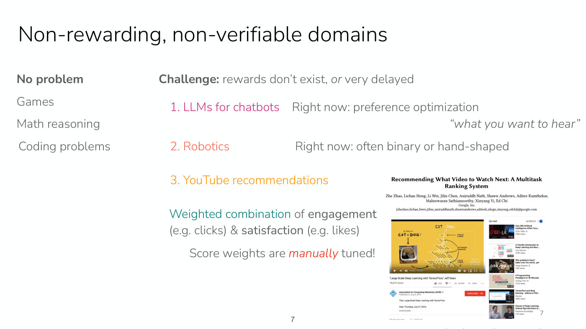

*Slide 7 — the recommendation paper's first page, with its figure of a YouTube watch page and its Up next column, beside the note that the weights combining engagement and satisfaction are tuned by hand. [Deck](https://cs224r.stanford.edu/spring_2025/slides/18_cs224r_frontiers_how_to_research.pdf)*

**4. From math reasoning to scientific experimentation and reasoning** (slide 8). For broader scientific
problems "you often don't necessarily know what the final answer should be". Training on math reasoning may
transfer somewhat to scientific reasoning, but training on a broader set of scientific problems makes the
verification challenging (≈6:18–7:03). The math-reasoning case is [Lecture 10](10-rl-for-reasoning.md).

**5. "Can machines optimize for learning?"** (slide 8). "humans often learn by rolling around on the floor
playing with random toys", not optimizing for one particular task: "They're optimizing, well, who knows what
they're optimizing for" (≈7:03). Perhaps algorithms could let machines explore in this way, "potentially
optimizing for learning, potentially optimizing for exploration", which "is certainly an open problem"
(≈7:03). See [exploration](exploration.md).

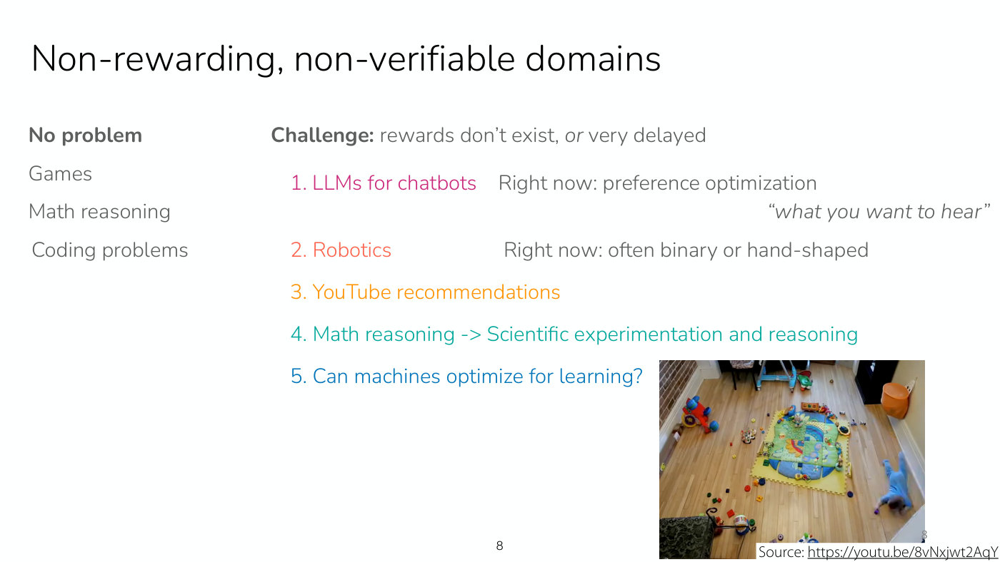

*Slide 8 — the full list of five domains without rewards, with a photograph from above of a playroom, toys scattered on the floor and a small child crawling at the edge, credited to a YouTube video. [Deck](https://cs224r.stanford.edu/spring_2025/slides/18_cs224r_frontiers_how_to_research.pdf)*

## Leveraging prior data and knowledge

Reinforcement learning often does not start from scratch. The default tool for using prior data is to
"Initialize model weights to pre-trained model, initialize replay buffer using offline data" (slide 10,
≈7:49). Finn raises two questions about it (slide 10). First, it does not cover **more abstract prior
knowledge**, such as hints, or facts read in news articles that are not in the usual data format (≈7:49–8:36).
Second, pre-trained weights and data may **constrain learning too much**. In Ball et al. (2023), a method
for using prior demonstration data with RL, "they initialized the buffer but they actually didn't pre-train
the weights, and they found that pre-training the weights did worse than not pre-training the weights"
(≈8:36). Slide 10's chart, "All D4RL AntMaze Tasks", plots normalized return against environment steps (in
thousands) for three methods: RLPD, the method that "initializes only the buffer, not the weights!", climbs
to about 85 within the first hundred thousand steps and to about 97 by 300,000, where its curve ends; IQL with
finetuning starts near 62 and creeps to about 74 by a million steps; and SAC with offline data reaches only
about 44 (slide 10).

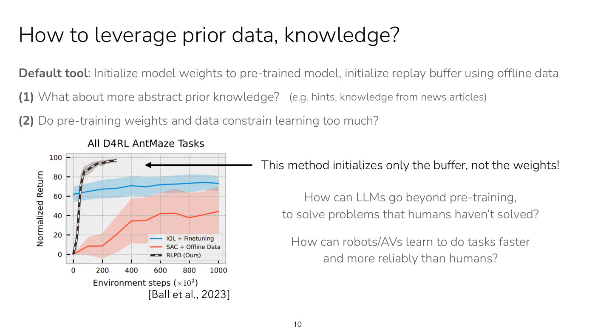

*Slide 10 — on the AntMaze tasks the method that loads prior data only into the replay buffer, RLPD, shoots above the method that starts from pre-trained weights and fine-tunes, IQL, which creeps up from about 62; SAC with offline data lags far behind. [Deck](https://cs224r.stanford.edu/spring_2025/slides/18_cs224r_frontiers_how_to_research.pdf)*

One explanation: "the output layer of that pre-trained model might have converged to something fairly
deterministic", so when it must learn something new "that last layer might not actually be exploring in a
good way" (≈9:22). Conversely, "perhaps reinforcement learning works quite well because pre-trained models
often have a very diverse distribution over output tokens" (≈9:22). The question matters for how language
models can "solve problems that humans haven't solved", building on the pre-training data without being too
constrained by it, and for how robots or autonomous vehicles might learn to do tasks "faster and more
reliably than what humans do" (slide 10, ≈10:08). RL has shown some suggestion it can do this, and "it's
certainly one of the most promising tools for going beyond what humans can do" (≈10:54). For the course's
treatment of prior data see [offline RL](offline-rl.md) and [replay buffers](replay-buffers.md).

## World models and video generation models

Finn is often asked whether world models and video generation models can be used for robotics and control
(≈10:54). The recent results show "a lot of rich knowledge about the world, like how cooking on a stove works,
how typing on a keyboard works, and how that might look if the keyboard was made of gummy bears", and even
how walking works at an abstract level (slide 12, ≈10:54–11:40). That knowledge "should be really useful for
learning behavior", but there are "a lot of nuance and a lot of challenges" (≈11:40).

The example on slide 12: train an action-conditioned video model,
$\mathbf{s}_ t, \mathbf{a}_ {t:t+h} \rightarrow \mathbf{s}_ {t+1:t+h}$, which takes the current image $\mathbf{s}_ t$ and the next $h$ actions
$\mathbf{a}_ {t:t+h}$ and predicts the future frames $\mathbf{s}_ {t+1:t+h}$, on demonstrations and one
policy's roll-outs; then evaluate whether a new policy's actions $\tilde{\mathbf{a}}_ {t:t+h}$ lead to good
outcomes (≈11:40). Those actions "won't necessarily be represented in the data that the model was trained
on", so the predictions are often wrong: "if most of the data set is demonstrations, then it will predict a
video that corresponds to correctly doing the task even if these actions did not lead to a correct outcome"
(≈12:27). The models have little data of narrowly making a mistake, or of mistakes unlike the ones humans
make. On top of this, "even small physical inaccuracies can lead to poor performance": the videos look
accurate, but that does not mean the underlying physics is (≈12:27–13:12).

Finn offers two possible solutions (slide 12, ≈13:12–13:58). The first is to train on data from many more
policies, hoping for enough coverage of the action distribution. The second is to use the model in another
way: train $\mathbf{s}_ t \rightarrow \mathbf{s}_ {t+1:t+h}$ on demonstrations only, not conditioned on
actions, predict a future video that accomplishes the task, and run a goal-conditioned policy on the
predicted video. That "sidesteps the challenge of this sort of out-of-distribution action problem because
you're only using the model for a form of planning where you're thinking through what is a good outcome in
the future rather than thinking through what is the outcome of specific actions" (≈13:58). For learned
dynamics models and the out-of-distribution problem in planning, see [model-based RL](model-based-rl.md) and
[Lecture 11](11-model-based-rl.md); Finn's own story of video prediction models is
[below](#crossing-topic-boundaries-and-not-being-a-perfectionist).

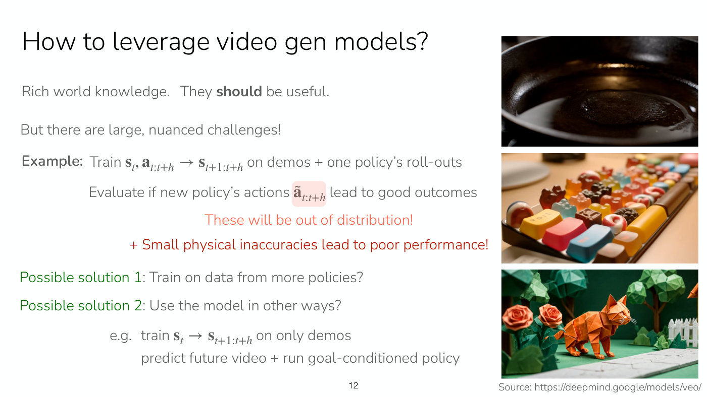

*Slide 12 — frames from Veo videos (a pan on a stove, a keyboard of gummy sweets, an origami cat walking) beside the action-conditioned example, its out-of-distribution actions, and the two possible solutions. [Deck](https://cs224r.stanford.edu/spring_2025/slides/18_cs224r_frontiers_how_to_research.pdf)*

## Scaling up: longer horizons and less online data

Large-scale RL for language models is exciting, "Yet, currently fairly short-horizon or very online" (slide
14, ≈14:46). Preference optimization usually considers "single-turn" dialogue, rewarding the next response
rather than the outcome of the whole conversation, which makes the horizon shorter and means no human has to
be in the loop of data collection (slide 14, ≈14:46–15:31). Math reasoning relies on a very large number of
online samples from the model interleaved with policy updates, which is hard to collect when collecting
data means interfacing with humans or the physical world (≈15:31). So: "Can we do large-scale RL with longer
horizons & with less online data?" (slides 14 and 15).

**Accurate value functions at scale** (slide 15, ≈16:18). Value functions should help with longer horizons
and efficiency. PPO does train value functions at large scale, "but these value functions are primarily used
for reducing gradient variance and may not be accurate enough for doing a full actor-critic update or for
selecting actions with a Q-learning-style objective" (≈16:18). Whether value learning can scale and become
accurate enough to optimize policies directly is open, and might matter for longer-horizon problems. See
[PPO](ppo.md) and [value functions](value-functions.md).

**"Batch online" RL** (slide 15, ≈17:04–18:36). An autonomous driving company that wants to do RL cannot
collect data on all its cars and update the policy every 30 seconds, minute or even hour; it is much easier to
collect a large batch over a couple of days or a week, update, and repeat. Finn calls this "a batch online
setting, where you're collecting a batch of online data with one policy, then doing an update and
repeating" (≈17:51); the slide adds that it applies when "collecting dialog with real users, when
collecting data on real robots", and that it could run asynchronously. New algorithmic considerations
follow: Dong et al. (2025) found that "using more expressive policies like diffusion policies was really,
really important for effective reinforcement learning in this sort of batch online setting" (≈18:36). Slide
15's chart, "Average", shows diffusion policies ahead of Gaussian ones both before (40 against 18) and after
(74 against 43) the RL. The explanation: a fully online learner with a fairly deterministic policy still gets
diverse data, because the policy changes so often, but "in the more batch setting you don't have the luxury
of changing your policy so frequently", so a diverse action distribution in each batch matters (≈18:36). See
[expressive policy distributions](expressive-policy-distributions.md) and
[offline and online data](offline-and-online.md).

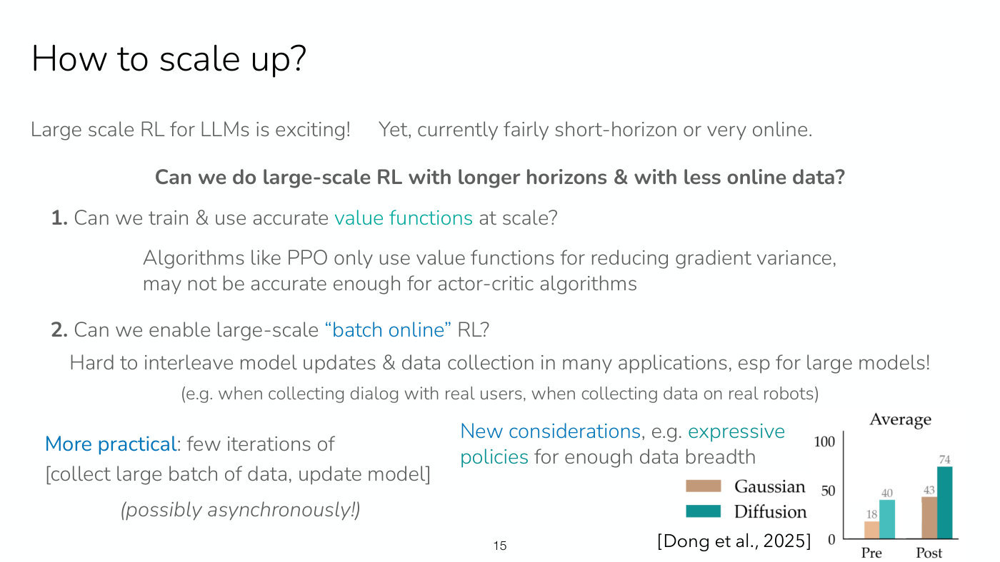

*Slide 15 — the two questions for scaling RL, value functions at scale and batch online RL, with Dong et al.'s average scores: diffusion policies beat Gaussian ones before RL and after it. [Deck](https://cs224r.stanford.edu/spring_2025/slides/18_cs224r_frontiers_how_to_research.pdf)*

**A question about offline methods** (≈19:22). Answering a student (inaudible), Finn agrees that "DPO, there
are algorithms that are operating much more offline. And so there is success there. The one downside of that
is those problems are shorter horizon" (≈19:22). The open question remains long horizons with less online
data, and offline methods "are also going to be more scalable as well" (≈19:22). DPO is in
[Lecture 9](09-rl-for-llms.md) and on the [DPO](direct-preference-optimization.md) page.

## Safety

How should AI be developed and tested in safety-critical domains: "medicine, autonomous driving, mental
health counseling, legal and political discourse" (slide 17, ≈19:22)? Historically, through formal
verification or probabilistic guarantees, but these methods make assumptions that do not hold in the real
world, so a verification often does not hold at larger scale (slide 17, ≈20:07). And "generally it's
impossible to fully guarantee safety in the countless number of scenarios that you can encounter in the real
world"; human drivers, surgeons, pilots and politicians make mistakes too (slide 17, ≈20:07–20:54). Some
constraints can be applied in some scenarios, "but in general safety is an open world problem", and
"arguably large scale machine learning has been the most successful way to handle open world circumstances"
(≈20:54). That suggests collecting large amounts of data of unsafe circumstances (slide 18).

But "this is really unsatisfying" (≈21:40). It means collecting data under unsafe circumstances, and it has
had "horrific ramifications" (slide 18): news articles report tech companies having people label traumatic
or toxic data for content moderation, work that can cause mental health problems and raises ethical
questions (≈21:40). Slide 18 shows two headlines, TIME's "Exclusive: OpenAI Used Kenyan Workers on Less Than
2 Dollars Per Hour to Make ChatGPT Less Toxic" and "Inside Facebook's African Sweatshop".

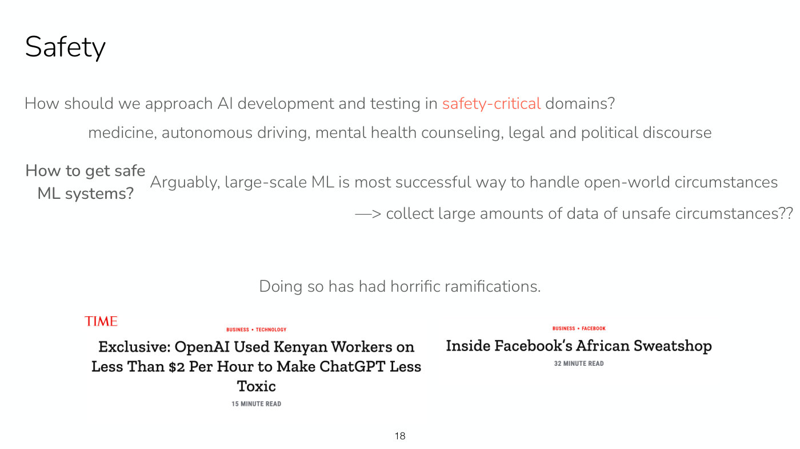

*Slide 18 — collecting large amounts of data of unsafe circumstances, and the two news headlines about the people paid to label toxic content. [Deck](https://cs224r.stanford.edu/spring_2025/slides/18_cs224r_frontiers_how_to_research.pdf)*

Two open questions follow (slide 19, ≈22:26–23:57). First, can methods "learn what's unsafe *without*
expansive data of unsafe incidents", perhaps from synthetic data or prior knowledge? Second, can a system
"gradually explore new behaviors while remaining safe"? Humans are pretty good at this. As "sort of a silly
example": "maybe a couple years ago I taught myself how to ride my bike without holding on to the handlebars.
And I did so without ever falling off my bike" (≈23:12). Getting a robot to learn a new behavior like that
without ever falling or damaging itself means "you're fundamentally exploring a new part of the state space
while also understanding what might be more risky and less risky", with a curriculum for the objective
(≈23:12–23:57). See [exploration](exploration.md).

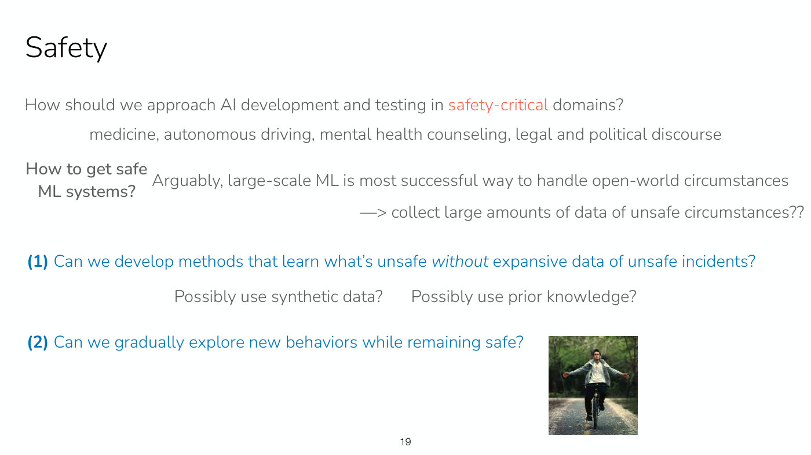

*Slide 19 — the two open questions for safety, learning what is unsafe without data of unsafe incidents and exploring while remaining safe, with a photograph of a cyclist riding with both arms stretched out. [Deck](https://cs224r.stanford.edu/spring_2025/slides/18_cs224r_frontiers_how_to_research.pdf)*

## Hallucinations, human-AI systems and reliability

Even outside safety-critical settings, models make mistakes, sometimes called hallucinations (≈23:57). Finn
asked a model for the weight of the sugar in a bowl from a photograph, and "it confidently told me that the
digital scale in the image reads 108.2 g. That is the weight of the sugar currently in the bowl. This answer
is incorrect" (slide 21, ≈23:57), though the scale is hard to read because of glare (≈24:43). For language
models, a human is often the recipient (chatbots, code generation), so mistakes are often manageable, "but
the interface is not well optimized!" (slide 21, ≈24:43). In one of several studies of AI systems working
with doctors, the AI alone reached 92% accuracy, physicians using AI assistance 76%, and physicians alone 74%
(slide 21, citing Rajpurkar & Topol, NYT 2025, and Goh et al., JAMA 2024; ≈24:43–25:29): "92 sounds great
compared to 74, but if it is going to be a system that's interacting with a person, 76 doesn't sound quite so
great" (≈25:29).

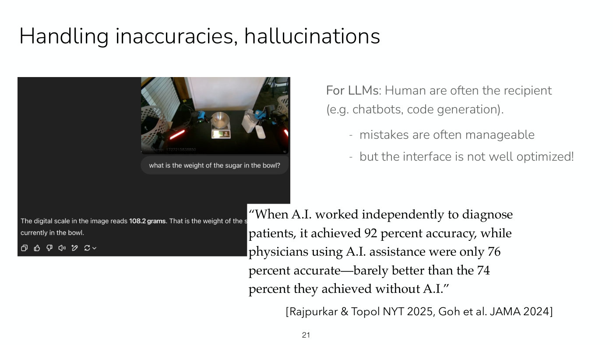

*Slide 21 — the chat in which a model reads the scale under the sugar bowl as 108.2 grams, and the quotation on doctors: AI alone 92 percent accurate, physicians with AI 76, physicians alone 74. [Deck](https://cs224r.stanford.edu/spring_2025/slides/18_cs224r_frontiers_how_to_research.pdf)*

**(1) Can we optimize for better human-AI systems?** (slide 22, ≈25:29). One route is models that better
estimate and convey their uncertainty. A pre-trained model plotted as confidence (the predicted probability of
its answer) against accuracy is very well calibrated; "after post-training with reinforcement learning, we
actually see that the model becomes far less calibrated" (≈26:16). Slide 22's two reliability diagrams for
GPT-4 (OpenAI 2023) show it: the pre-trained model's bars follow the diagonal (ECE 0.007), while after PPO
post-training they flatten to around 0.3–0.5 across the middle confidences, well below the diagonal (ECE
0.074): "RLHF hurts model's calibration!" One possible direction, from Tian et al. (2023): "if you verbalize
the probability rather than using the probability, like the logits in the model, and encourage it to provide
multiple guesses, then you can get more calibrated model performance after RLHF compared to the RLHF model"
(≈27:04). Slide 22's Tian et al. panels give a calibration error of 0.256 for the model's sampled log
probability against 0.065 for a verbalized probability with four guesses. Even so, how such a model works
with a person still has to be designed and evaluated together (≈27:04). Why RLHF has this effect is a
student's question, answered [below](#the-end-of-part-1-and-why-rlhf-hurts-calibration).

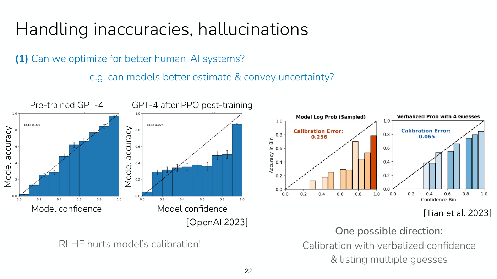

*Slide 22 — pre-trained GPT-4's calibration bars follow the diagonal, while after PPO post-training they flatten below it; at the right, Tian et al.'s verbalized probability with four guesses sits much nearer the diagonal than the model's log probability. [Deck](https://cs224r.stanford.edu/spring_2025/slides/18_cs224r_frontiers_how_to_research.pdf)*

**(2) When humans are not in the loop, how can we get to 99.99% reliability?** (slide 23, ≈27:04–28:37).
Many systems will have no person checking the answers: autonomous driving, many robot decisions, and
language models plugged into other systems, such as web agents choosing what to do. "Reinforcement learning is
likely part of the solution!" (slide 23); "Online data is really helpful for getting high performance"
(≈27:50). In Luo et al. (2024), on fairly challenging robot tasks, "they ran the policy 100 times and it worked
100 times" (≈28:37). Slide 23's table puts HIL-SERL at 100% on all 13 tasks, against behaviour cloning's 49.7%
on average (from 2% on timing-belt assembly to 95% on cable clipping); [Lecture 5](05-off-policy-actor-critic.md#examples-real-robots-with-sac-simulation-with-ppo)
showed the same system. Extending that reliability to large-scale scenarios "is quite important" (≈28:37).

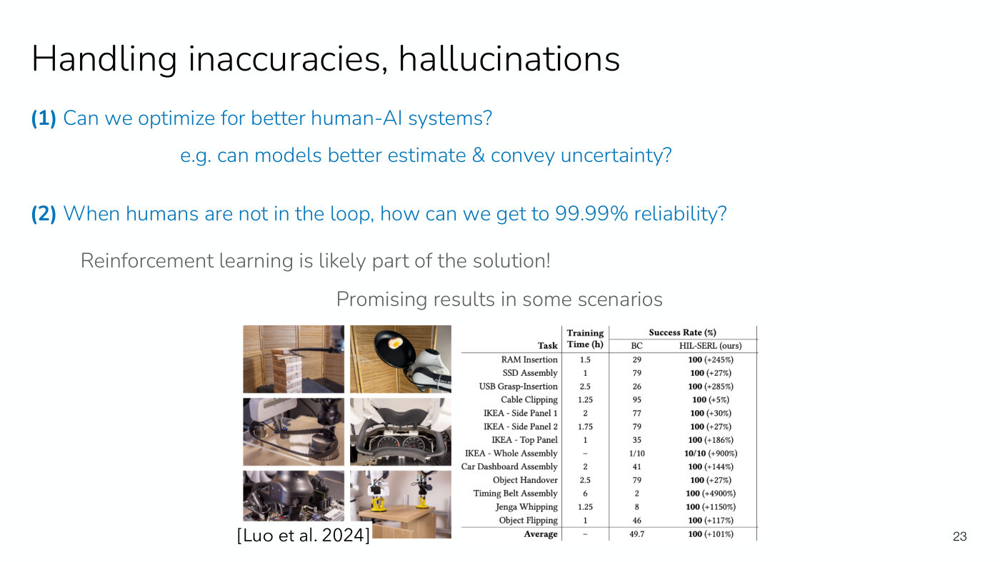

*Slide 23 — the second question, reliability without a person in the loop, with Luo et al.'s six robot tasks (Jenga whipping, egg flipping, timing belt, car dashboard, motherboard, handover) and the table in which HIL-SERL reaches 100 percent on every task. [Deck](https://cs224r.stanford.edu/spring_2025/slides/18_cs224r_frontiers_how_to_research.pdf)*

## Evaluating generalist systems

In supervised learning we measure accuracy on held-out validation sets, which "is kind of like heaven
because we can get a very nice measure offline of how good our model is" (slide 25, ≈28:37). In RL "there
generally aren't any reliable offline metrics" (slide 25): you run the policy and measure the reward, because
"the data collected so far under whatever policy differs from the data that was collected by the learned
policy", which makes it "really hard to evaluate policy on states *it* will visit!" (slide 25, ≈29:23). A
generalist meant to do many tasks has to be evaluated in all sorts of circumstances, with large amounts of
online data, which makes it hard to decide whether a policy is good enough to deploy, or even which model to
pick and which hyperparameters (slide 25, ≈29:23–30:10).

The real-world example is from about a month before the lecture (slide 26, ≈30:10–30:56): a new version of
GPT-4o, asked how many people the user was "gooder than at thinking", put the user "in the 130 to 145 range of IQ,
which would put you above about 98 to 99.7% of people in raw thinking ability", adding that comparing them to
most people "almost insults the quality of mind you're aiming to develop" (≈30:56). "OpenAI actually ended up
needing to roll back this update that made the bot excessively flattering to users", which shows how hard it
is to know whether a model is good enough or better than the previous one: "It's really hard to evaluate these
systems" (≈30:56). [Lecture 9](09-rl-for-llms.md#frontier-and-challenges) discusses the same update as
sycophancy.

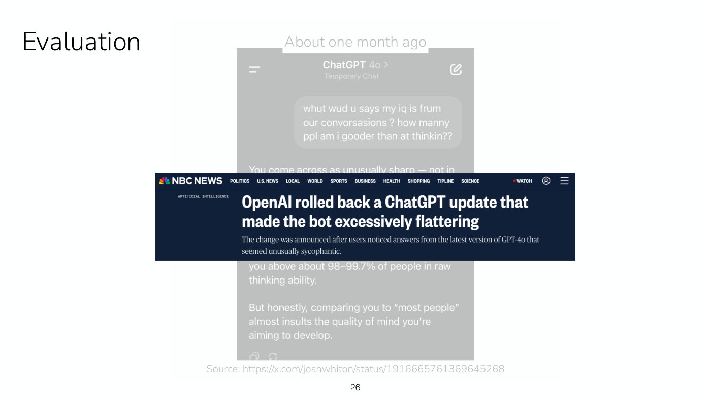

*Slide 26 — the misspelt question to GPT-4o about IQ and its flattering reply, partly covered by NBC News's headline that OpenAI rolled back the update. [Deck](https://cs224r.stanford.edu/spring_2025/slides/18_cs224r_frontiers_how_to_research.pdf)*

Two open questions (slide 27, ≈31:42): can offline metrics "at least rule out bad models, let alone estimate
performance?" ("Estimating performance would be the dream"), and how can representative real-world scenarios
be chosen so that a generalist's online evaluation does not need every possible scenario? Off-policy
evaluation of this kind is the difficulty [offline RL](offline-rl.md) works around.

## The end of part 1, and why RLHF hurts calibration

Slide 28's message closes the frontiers: "You are all now well-equipped to start tackling these
challenges!" Finn adds that the class gives the fundamentals "that will allow you to go read research papers,
understand where the state-of-the-art is and build on the state-of-the-art" (≈32:29).

A student then asks, as Finn restates it, "why does this happen basically?", about the loss of calibration
after RLHF on slide 22 (≈32:29). Finn did not necessarily expect it, but in retrospect the predominant theory
has two parts (≈32:29–33:16). The objective being optimized "it's not exactly accuracy. It's not exactly
aligned with that." And RLHF is often "sharpening the distribution": where the pre-trained model outputs all
sorts of things, RLHF picks the mode it wants and is "sharpening that distribution to really encourage the
model to be more likely to sample one mode. And that sharpening often leads to it being overconfident in
certain circumstances, especially when preferences are rewarding you for being confident" (≈33:16), as the
preferences on slide 5 do. The last sentence of the answer is garbled in the captions ("at times being correct
and competent", perhaps "confident"); its sense is that the model ends up confident whether it is right or
wrong (≈33:16). See [RLHF](rlhf.md).

## Preface and backstory

The second part is about research "that's more of an empirical flavor", like a deep RL project, and draws on
how Finn goes about research and advises PhD students (≈34:05). It opens with a caveat: "A diversity of
research approaches is good" (slide 30). There are many ways to do research, and "if everyone did research
the exact way that I do research then we would probably have fewer diverse discoveries, and so diversity is
good"; Finn's approach is not necessarily the best one, and no one approach is (≈34:05–34:53).

Then a backstory (slide 31, ≈34:53–36:24): "I did not intend to have a career in research." Finn planned to go
into industry and develop products, as Finn's parents did in engineering, and did internships in industry, but
was excited about AI and algorithm development, whose frontier was in research; the topics Finn cared about,
such as robotics, "didn't really work, even today", and the people working on them in industry all had PhDs.
Finn also found the ambiguity of research intellectually stimulating. The point: "you don't have to intend to
work in research in order to eventually end up doing research" (≈35:38), or, as the slide puts it, "(You
don't either!)".

## Some realities of research

Three realities (slide 32, ≈36:24–38:43). **First, "Less than 1% of research ideas have lasting impact"**
(slide 32). Many ideas do not work, or not well enough to lead to papers, and "here are the outcomes of some
of my research ideas and here are the outcome of some more of my research ideas, and there's a lot of
failure" (≈36:24), which points at the slide's two lines, "Many ideas don't lead to papers" and "Many papers
have small impact". Much of the advice that follows is about dealing with that risk.

**Second, "Research is incremental"** (slide 32, ≈37:10). AlphaFold, arguably a breakthrough, "built very
closely on a large 20-year academic project called CASP", a protein-structure prediction competition and
data set, and on advances in neural networks. Even a project that is no breakthrough plays a role, because
others build on it or can rule out ideas already tried (≈37:55).

**Third, "In a world where scale is important, simple ideas have more impact because they can be scaled"**
(slide 32). "it's actually the simple ideas that have more impact than the fancy ideas or the complex
algorithms. And that's just because the simple ideas are the things that can scale", and are easy to
integrate into other systems and to build on (≈37:55–38:43).

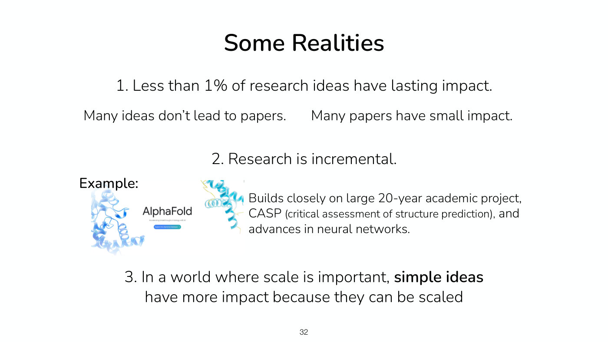

*Slide 32 — the three realities, with AlphaFold's protein renderings and logo as the example of incremental research built on the 20-year CASP project. [Deck](https://cs224r.stanford.edu/spring_2025/slides/18_cs224r_frontiers_how_to_research.pdf)*

The rest of the part covers what to work on, how to do the work, how to share it, and some miscellaneous
topics (slide 33). The first three, "picking problems to work on, doing the research, and sharing the work,
are all equally important" (slide 33, ≈38:43).

## What to work on: three steps

**Step 1: an important problem and a plan for how to approach it** (slide 34, ≈38:43–40:17). "And if you only
have one of these then usually that doesn't constitute a good project direction" (≈39:30). "Solve climate
change" is an important problem with no plan; a really cool algorithm that "will make the robot 1% more
successful" may come with a plan but lacks the important problem (slide 34). For the second kind, ask "if the
project is really, really successful, what will the outcome look like?", that is, what is its upper bound:
"And if the upper bound is not very high then usually it doesn't make for a very good project" (≈40:17).

**Step 2: are you excited about it?** (slide 35, ≈40:17–41:02). "Research is a ton of work" (slide 35). If you
find a project fun and exciting you are more likely to work hard on it, "And if you're working hard on it,
you're much more likely to be successful on it" (≈40:17), which Finn thinks is probably true outside research
too.

**Step 3: be brutally honest** (slide 36, ≈41:02). "if you are brutally honest about why your idea could fail
to solve the problem, does the idea still have a good chance of working? And if not, then probably it won't
work" (≈41:02), because most ideas in research do not work.

## Idea-driven or problem-driven research, and bottlenecks

Research can start from an idea or from a problem; Finn has done both but leans one way (slide 37,
≈41:48–43:19). Starting from an idea, you have to find a problem it solves, and there may be no important
one, or a better way to solve the problem, so the idea may have little impact. Starting from a problem, you
look for the best solution; it may be harder to write a paper if the solution turns out obvious in
retrospect, but you are guaranteed to be working on an important problem, and solving it is satisfying
either way. "with idea-driven research your goal is to get the idea to work, whereas in the second case your
goal is to solve the problem" (≈42:33), and the second is the more comfortable place to be, because "it's
possible that the idea just doesn't want to work" (≈43:19).

Problem-driven research means finding the **bottleneck** (slide 38, whose picture is a pun on the word,
≈43:19–44:53). "So if the problem is bottlenecked on data, for example, and you start exploring new
algorithms separate from the data for how to solve it, then you actually probably won't see performance gains
from working on methods if it's bottlenecked by data" (≈43:19); at most a couple of percentage points. This
works for long-term goals too: "I want to develop an LLM that can prove something that humans have never
proved before, like P versus NP or something. Or I want to get a robot that can make a bowl of cereal in a new
kitchen" (≈44:06). No single project gets there, but you can ask what the bottleneck is and work on that part
in your next project.

## Crossing topic boundaries, and not being a perfectionist

Finn's story (slide 39, ≈44:53–47:12). In the second year of Finn's PhD, on an internship at Google with many
robots, the project was to build a predictive model, a video generation model, and use it to learn skills
across the robots. The problem: "I discovered that video generation models were really bad" (≈44:53). Next
to a video collected on the robot, a prediction from "arguably the state-of-the-art video generation model"
was "erasing all the objects in the video, and is barely capturing the motion of the arm, doesn't even
capture the background correctly" (slide 39, ≈44:53–45:38), so the robots could not be made to do anything better with it. At the time Finn counted as "a ML+robotics person, not a computer vision person" (slide 39), and staying in that lane would have meant tabling the project. Instead Finn decided to develop a better video generation model first, without ever having built a generative model, and "not a lot of people were working on it at the time because they didn't realize how bad these models were" (≈46:26). The resulting paper became the basis for the work in Finn's job talk, now has around 1300 citations, and "informed the community that it's an interesting problem to study", leading to much better video generation models than Finn's (slide 39, ≈46:26).

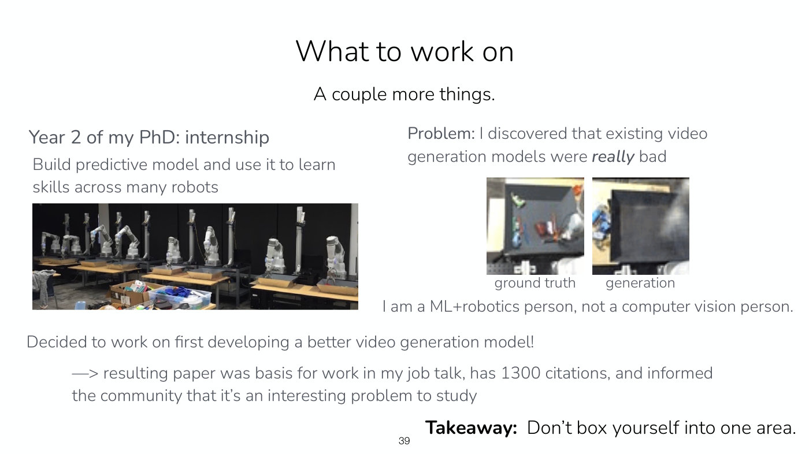

*Slide 39 — the row of robots from Finn's internship, and a frame of a real robot video beside the video model's prediction, in which the objects in the tray have vanished. [Deck](https://cs224r.stanford.edu/spring_2025/slides/18_cs224r_frontiers_how_to_research.pdf)*

**The takeaway: "Don't box yourself into one area"** (slides 39 and 40, ≈46:26–47:12). "if you cross topic
boundaries, it's going to inform new problems", because a tool that blocks your own topic reveals a problem
that "oftentimes people in that field don't know" about, and you bring new ideas to that field as well
(≈46:26–47:12; slide 40: "Crossing topic boundaries informs new problems and brings new ideas").

**"Don't be a perfectionist"** (slide 40, ≈47:12–47:58). People want to pick the perfect project, "But you
never know what the impact of a project will be at the outset, otherwise it wouldn't be research" (≈47:12);
at some point you have to start trying ideas.

## Handling risk

Since most research ideas do not work, the key consideration once you have a direction is handling risk
(slide 42, ≈47:58). There are "Lots of tricks, not all of them apply to all scenarios" (slide 42).

1. **Front-load the risk whenever possible** (slide 42, ≈47:58–49:29). Ask why the project might not
   succeed, and "Before developing large-scale infrastructure, formulate and run didactic experiments that
   test core unknowns" (slide 42). "This can be really uncomfortable because oftentimes building the
   infrastructure, coding the algorithm, whatever, that's the easy part" (≈48:43), the part that seems like
   progress; but if the core unknown fails at the end, all of that time was wasted.
2. **Design targeted experiments that test the unknowns in the fastest possible way** (slide 42, ≈49:29),
   which takes skill: it is often not obvious how to test a hypothesis.
3. **Try out lots of ideas, including different problems**, to "create luck" (slide 42, ≈50:15). "you can
   create luck for yourself just by trying out lots of ideas", discarding one quickly when its targeted
   experiment fails; Finn tried many ideas in the PhD that failed and never became papers, and "Sometimes I
   ended up banging my head against the wall" (≈50:15).
4. **Do not commit to a project before signs of life on the core unknown** (slide 42, ≈51:01).

**Questions.** Asked whether there are problems with few ideas to try (≈51:01–52:33), Finn says there are,
and the trying-many-things approach can include several problems as well: try a couple of ideas for each, and
"pick your problem based on what seems to be tractable, because even at the outset, you don't know how hard a
problem is going to be" (≈51:47). Asked for an example of front-loading a core unknown (≈52:33), Finn gives
two. In meta-learning work, where the goal was a robot that adapts quickly to a new task, building a
meta-learning system on a real robot would have been a ton of work, so "the tasks were regressing to simple 1D
sinusoid curves", testing whether five data points were enough to fit the curve: "this experiment that I could
code up in a day" gave the signs of life (≈52:33–53:21). More recently, for robots that follow language
instructions about strategies, the bigger risk was getting the robot to pay attention to the strategy, so Finn
trained a policy on data in which "in some of the data the robot used the right gripper and some of the data
the robot used the left gripper", easy to evaluate and labelled automatically from the data (≈53:21–54:07).
Meta-learning in this course is [Lecture 13](13-meta-rl.md).

## Getting things to work

Five pieces of advice (slide 43, ≈54:53–59:31):

1. **Start from something that works, then make it incrementally harder.** A system that does not work has a
   million possible reasons, so "it's much easier to start with something that works and then make it harder
   than to start with something that doesn't work and try to get it to work" (≈54:53).
2. **Simplify** the problem dramatically until something works, then move back to the harder setting with
   more data or tasks. Finn's group trained robots to imitate a video of a human doing a task, from a very
   diverse data set: "Nothing worked when training on this data. We spent months trying to get the robot to do
   it" (≈55:38). Simplified to a single task, "It actually didn't work" either; they debugged it, then went to
   three tasks, then 10 (≈56:25).
3. **Talk to friends, colleagues, advisers**, to get out of your own head and decide whether to step back and
   reconsider the problem or keep tuning (≈56:25).
4. **Revisit your assumptions**: something you thought easy may turn out to be hard, and that may change how
   you approach the project, or the project itself (slide 43, ≈57:11).
5. **Does it "want" to work?** If not at all, it is likely not to be impactful, since others will not get it
   to work easily either: "maybe the idea just wasn't really meant to be" (≈57:57). Otherwise, reduce the
   scope to the parts that want to work. In a recent project on robots following open-ended language
   commands ("can you clean up the trash but not the dishes"), early signs of life led the team to add
   handling interventions and asking questions when a prompt is ambiguous, and then things stopped working
   for a couple of months (≈57:57–58:46). They went back to what had worked and "rescope the project to remove
   the hard parts that we didn't know how to solve yet" (≈58:46); "We described it as limitations in the
   paper" (≈59:31).

## Deciding when to pivot

A pivot is "Often considered later than it should be considered!" (slide 44, ≈59:31), partly because you
want things to work, partly because of the sunk cost fallacy: having spent a lot of time on something, you
expect to need less in future, and you may have made less progress than the time suggests (≈59:31–1:00:19).
The decision is hard as usually framed, "continue working on current project" against "switch to starting a
new project", because the second option is "a super nebulous thing" (slide 44): "Because something else could
be anything" (≈1:00:19). The advice is to "spend time thinking about other research projects!" and formulate
the decision as the current project against project B against project C, which is much more concrete, more
straightforward and "less anxiety-inducing" (slide 44, ≈1:01:04).

**A question on speed and evaluation** (≈1:01:04–1:03:24). When fields move fast, are people skimping on
evaluation to publish before another group? Some papers should be more thorough, as has always been true, and
Finn does not know whether it is getting worse. You want to be confident in the results you publish, and
although being first has an advantage, "sometimes the projects that are executed on better are more impactful
than the projects that were first at a particular idea" (≈1:02:38). So keep a fair focus on execution and
evaluation, within reason. Few enough people work with real robots that, if you execute well and show results
on real robots, you can worry less about being scooped, but it is also good to work on things that are hot,
such as language models (≈1:02:38–1:03:24).

## Sharing your research

**Why** (slide 46, ≈1:03:24–1:05:41). The output of research is "Ideas, knowledge, learnings", almost never a
product or service: "It's not a product, it's not a service. It's really knowledge" (≈1:03:24). So "if no one
knows about what you learned then there was really no impact or no output as a result" (≈1:04:09), and even
companies with products have massive marketing efforts. The slide answers three reluctances. If sharing feels
like self-promotion, "you're teaching people" and sharing cool findings (≈1:04:54). If the idea did not work
that well, it is still useful, because others may think of it and want to know how it went. And if it all
seems obvious now, "After enough research, you will know far more than others!" (slide 46).

**How** (slide 47, ≈1:05:41–1:06:28): clear writing, visuals and presentations, thinking about the audience
and how they will interpret what you say. "When in doubt, assume that your audience knows less rather than
more" (≈1:05:41). Avoid jargon if possible; many people still appreciate a clear refresher, which may even
make them see something they know in a new way. Practise, alone or with others, and get honest feedback
(≈1:06:28).

**Writer's block** (slide 48, ≈1:06:28–1:07:13): break the task down, on pen and paper write down some ideas
and an outline. "My recommendation would be to think through your ideas for what you want to communicate
before asking your friend ChatGPT" (≈1:07:13).

## Mentorship and confidence

**Mentorship** (slide 50, ≈1:07:13–1:08:01): "If you have it, don't be afraid to lean on it!" In Finn's first
research paper of the PhD, "I hardly wrote any of the paper and I talked to actually my co-author and he told
me that he actually even rewrote the section that I wrote" (≈1:07:13). It is fine not to know how to do every
part of research yet; students, Finn included, do best when "learning gradually" (slide 50), rather than
taking on the whole undertaking at once (≈1:08:01).

**Confidence** (slide 51, ≈1:08:01–1:08:48). There are many reasons to lack it: no one knows the best way to do
research, and "No one knows what research is going to be most impactful. If they did, it wouldn't be research"
(≈1:08:01); many ideas fail and many papers get rejected; researchers who have spent years on a domain will
know more about it. All of that is true, but it does not mean you are doing a bad job, and self-doubt and
overthinking "can *really* slow you down" (slide 51). Even though these things are challenging, "they're actually not reasons to be
unconfident" (≈1:08:48).

## Closing thoughts

It might feel as if reinforcement learning works now, so that research is less needed and one can just apply
what works; applying research in the real world has a lot of merit, and it is good that some people do it
(slide 52, ≈1:08:48–1:09:35). But "now is a better time than ever to do research because we are actually
seeing new research being translated into very real-world impact" (≈1:09:35). Breakthroughs such as AlphaFold
and ChatGPT have far more impact today than those of 10 or 20 years ago, and research now can contribute to
breakthroughs with more still: "So I think that now is actually a better time than ever to be doing research,
including in deep reinforcement learning" (≈1:10:22). The deck ends on a thank-you, not read aloud: "This is
the last lecture!", with thanks "for the engaging questions, your patience with new course components, and
your feedback throughout the quarter to make the course better" (slide 53).

## Course reminders (in the slides only)

Slide 2, not mentioned in the recording, lists "Homework 4 due today", "Poster session next Wednesday" and
"Final report due following Monday", with "no extensions or late days" for the final report. See
[course logistics](course-logistics.md).

## Summary

Deep RL works where rewards can be verified and data collected online, and most of its open problems lie
outside that. Rewards: human preferences reward confidence and agreement over truth, robot and recommendation
rewards are hand-tuned guesses, and science and open-ended learning have no checkable answer. Methods: prior
weights can constrain learning as well as help it, video models mispredict unfamiliar actions, and scaling
RL to long horizons and batched data may need accurate value functions and expressive policies. Deployment:
safety without unsafe data, human-AI systems in which RLHF has hurt calibration, reliability with no person in
the loop, and evaluation with no reliable offline metric. On research, Finn's advice is to pick an important
problem with a plan, that excites you and survives an honest look at why it could fail; to work on the
bottleneck and cross topic boundaries; to front-load risk with fast experiments on core unknowns and try many
ideas; to start from something that works, simplify, and scope down to what wants to work; to make pivots
concrete; to share what you learn clearly; and to lean on mentors and stay confident.

## Related pages

- [RLHF](rlhf.md) and [learning rewards from preferences](preference-learning.md): what preferences reward,
  personalization against polarization, and RLHF's effect on calibration.
- [Reward learning](reward-learning.md): domains without rewards, hand-shaped robot rewards and hand-tuned
  recommendation weights.
- [Offline RL](offline-rl.md), [replay buffers](replay-buffers.md) and
  [offline and online data](offline-and-online.md): prior data in the buffer rather than the weights, batch
  online RL, and evaluation without online data.
- [Expressive policy distributions](expressive-policy-distributions.md): diffusion policies in batch online RL.
- [Model-based RL](model-based-rl.md): video generation models as world models.
- [PPO](ppo.md) and [value functions](value-functions.md): value functions used only to reduce variance.
- [Exploration](exploration.md): optimizing for learning, and exploring safely.
- [LLM reasoning](llm-reasoning.md): from verifiable math to scientific reasoning, and very online RL.
- [Lecture 9 — RL for LLMs](09-rl-for-llms.md#frontier-and-challenges): sycophancy and the GPT-4o rollback.
- [Lecture 5 — Off-Policy Actor Critic](05-off-policy-actor-critic.md#examples-real-robots-with-sac-simulation-with-ppo):
  HIL-SERL's reliable real-robot results.
- [Lecture 1 — Class Intro](01-class-intro.md): the course's opening, which this lecture closes.
- [Course logistics](course-logistics.md): the final project, poster session and report.
