# Lecture 19 — Tutorial Session: Review of Q-Learning

Stanford CS224R, Spring 2025 (the extra Q-learning section, Friday, April 18) ·
[video](https://www.youtube.com/watch?v=07MQNMcxhZU) (51 min) ·
[slides (PDF)](https://cs224r.stanford.edu/spring_2025/slides/section_q_learning_tutorial.pdf) ·
[slide-by-slide text](../raw/slides/19-q-learning-tutorial.md) ·
[transcript](../raw/transcripts/19-q-learning-tutorial.md)

**What this session establishes.** This is a TA session, given by Anikait Singh (named on slide 1),
that reviews the Q-learning material of [Lecture 6](06-q-learning.md) and works through it on
examples. It starts from the MDP and the value, Q and advantage functions, then runs **Q-value
iteration** on a small grid world, iteration by iteration, until the Q-values converge to the optimal
$Q^\ast$, from which the optimal value, policy and advantage are read off. It then moves to
**parametric** value functions and derives, on the whiteboard, how the **Monte Carlo**, **TD** and
**n-step** targets come out of the definition of the value function, and why they trade bias against
variance. The last part covers the practical details that make Q-learning stable: **semi-gradients**
and **target networks** (hard and Polyak updates), **gradient clipping** and the **Huber loss**,
**replay buffers**, and **overestimation**, with critic ensembles and double Q-learning as the fix.
The session was planned to end with a walkthrough of the Homework 2 algorithms, DQN and soft
actor-critic, but the recording stops before it.

The course site lists this as the "Extra section on Q-learning" in week 3; Lecture 6's slide 2
announces it as an extra Q-learning section from 1:30 to 2:30 pm that day. The catalog places the
recording last, which is why it is Lecture 19 here.

Slide numbers below are page numbers: the deck prints a number only on its title page, so every
other label is the slide's position in the PDF. Timestamps (≈M:SS) point into the video and the
[transcript](../raw/transcripts/19-q-learning-tutorial.md). **The recording ends on slide 31**, at
about 50:39, while Singh is still talking about critic ensembles; slides 32–35 (the homework
algorithms) are covered [at the end of this page](#not-in-the-recording-the-homework-algorithms) from
the [slide file](../raw/slides/19-q-learning-tutorial.md) only. Two passages are worked on a
whiteboard the recording does not show: the Monte Carlo, TD and n-step derivation (≈21:39–28:59),
whose lines slide 20 prints, and the TD loss (≈35:09–38:14), which this page reconstructs from what
Singh says and marks as such. Unlike the other recordings, some students are audible here: three
questions are captioned (≈7:47, 10:09 and 12:26), and five more are inaudible and known only from
Singh's answers.

**Notation.** This deck writes states and actions in plain type, $s_t$ and $a_t$, where Lecture 6
writes them bold; this page follows the deck. $\gamma$ is the discount factor, $r(s_t, a_t)$ the
reward, $p(s_{t+1} \mid s_t, a_t)$ the transition dynamics, $\pi$ a policy, $V^\pi$, $Q^\pi$ and
$A^\pi$ its value, Q- and advantage functions, and $Q^\ast$, $V^\ast$, $\pi^\ast$ and $A^\ast$ the
optimal ones.

## Contents

1. [Review of MDPs and value functions](#review-of-mdps-and-value-functions)
2. [From the Bellman equation to Q-value iteration](#from-the-bellman-equation-to-q-value-iteration)
3. [Q-value iteration on the grid world](#q-value-iteration-on-the-grid-world)
4. [The optimal value, Q-value and policy](#the-optimal-value-q-value-and-policy)
5. [Why learn more than a policy?](#why-learn-more-than-a-policy)
6. [The advantage of the optimal policy](#the-advantage-of-the-optimal-policy)
7. [Q-star against Q-pi](#q-star-against-q-pi)
8. [From tables to networks](#from-tables-to-networks)
9. [Discrete and continuous Q-functions](#discrete-and-continuous-q-functions)
10. [Q-learning as regression: Monte Carlo, TD and n-step](#q-learning-as-regression-monte-carlo-td-and-n-step)
11. [The bias-variance trade-off](#the-bias-variance-trade-off)
12. [Why dynamic programming: stitching](#why-dynamic-programming-stitching)
13. [Semi-gradients and target networks](#semi-gradients-and-target-networks)
14. [Dealing with TD gradients: clipping and the Huber loss](#dealing-with-td-gradients-clipping-and-the-huber-loss)
15. [Replay buffers](#replay-buffers)
16. [Overestimation](#overestimation)
17. [Critic ensembles and double Q-learning](#critic-ensembles-and-double-q-learning)
18. [Not in the recording: the homework algorithms](#not-in-the-recording-the-homework-algorithms)

## Review of MDPs and value functions

Slide 2's outline has five parts: a review of Markov decision processes, exact MDPs with fitted Q
iteration, parametric Q-learning with the bias-variance trade-off between TD and Monte Carlo,
practical details (replay buffer, overestimation, TD gradients), and a walkthrough of the Q-learning
and actor-critic algorithms as a preview of Homework 2 (≈0:05–0:51). Slide 2 also thanks Pieter
Abbeel, David Silver, Aviral Kumar and Justin Fu.

An MDP is defined by a set of states $s_t$, a set of actions $a_t$, a transition function
$p(s_{t+1} \mid s_t, a_t)$, a reward function $r(s_t, a_t)$, a start state $s_1$, a discount factor
$\gamma$ and a horizon $T$ (slide 3). The agent interacts with the environment: it takes an action,
and the environment, stochastic with $P(s' \mid s, a)$, returns the next observation, or state, and a
reward. The discount factor and horizon let you encourage longer- or shorter-horizon trajectories, the
horizon being the trajectory's length (≈0:51–1:38).

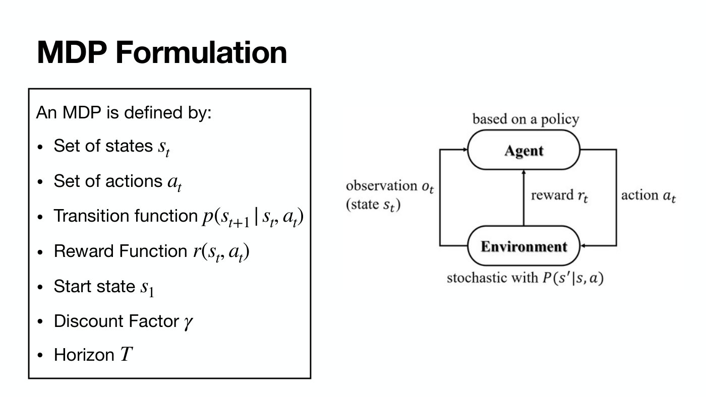

*Slide 3 — the MDP's seven parts beside the agent-environment loop: the agent acts, the stochastic environment returns an observation and a reward. [Deck](https://cs224r.stanford.edu/spring_2025/slides/section_q_learning_tutorial.pdf)*

The running example is a grid world (slide 4): a small robot that has to navigate to a gem in the
top-right cell, worth $+1$. The cell below the gem is a $-1$ cell, which Singh calls the lava, and one
cell is blocked by a stone. The goal is to find the policy that maximizes the expected discounted
return,

$$\max_{\pi} \mathbb{E}\left[\sum_{t=1}^{T} \gamma^{t} r(s_t, a_t) \mid \pi\right]$$

where in this tabular setting a policy is simply an action for each state, the one to take to reach
the goal (≈1:38–2:25). Slide 4 draws the policy as a map with an arrow in every cell.

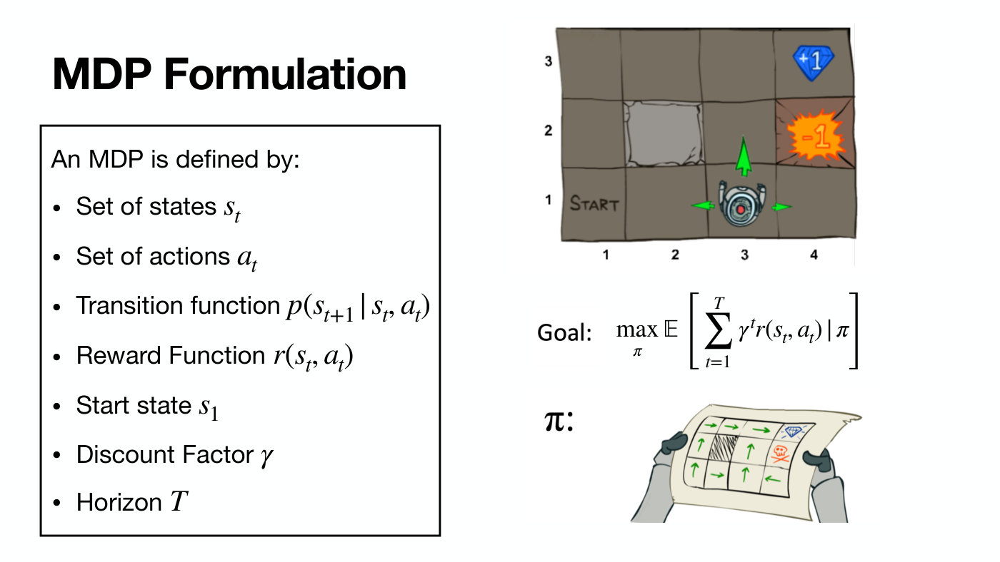

*Slide 4 — the grid world: start at bottom left, the gem worth +1 at top right, the -1 lava cell below it and a stone in the middle; a policy is a map with one arrow per cell. [Deck](https://cs224r.stanford.edu/spring_2025/slides/section_q_learning_tutorial.pdf)*

Slide 5 recalls the three objects of the previous lectures. The value function $V^\pi(\mathbf{s})$ is
the expected future reward starting at $\mathbf{s}$ and following $\pi$; the Q-function
$Q^\pi(\mathbf{s}, \mathbf{a})$ additionally conditions on the first action $\mathbf{a}$, then
follows $\pi$ (≈2:25). Both estimate how good a state, or a state and action, is, which guides the
policy's choice of action. The Q-function gives more information, because it lets you probe an
immediate action and ask what the value is if you take this one rather than another (≈3:10). The
useful relation between them is that the value function is the expectation of the Q-function over
the policy's action (≈3:56):

$$V^\pi(\mathbf{s}) = \mathbb{E}_ {\mathbf{a} \sim \pi(\cdot \mid \mathbf{s})}\left[Q^\pi(\mathbf{s}, \mathbf{a})\right]$$

The **advantage** estimates how much better it is to take action $\mathbf{a}$ than to follow the
policy at the current time step, and is the difference of the two (slide 5, ≈3:56):

$$A^\pi(\mathbf{s}, \mathbf{a}) = Q^\pi(\mathbf{s}, \mathbf{a}) - V^\pi(\mathbf{s})$$

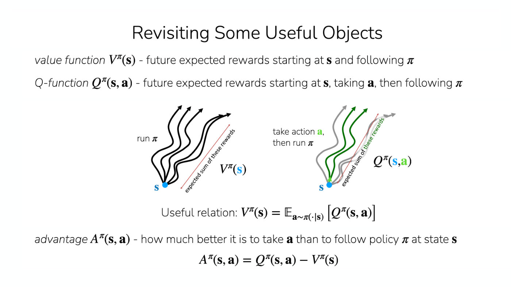

*Slide 5 — the value function averages over trajectories that run the policy from s; the Q-function's trajectories first take action a (green). [Deck](https://cs224r.stanford.edu/spring_2025/slides/section_q_learning_tutorial.pdf)*

See [value functions](value-functions.md) and [MDPs and RL notation](mdp-and-notation.md).

## From the Bellman equation to Q-value iteration

Slide 6 writes the **Bellman equation** for the optimal Q-function, with the expectation over the
next state written out as a sum over the transition dynamics:

$$Q^{\ast}(s,a) = \sum_{s_{t+1}} p(s_{t+1} \mid s_t, a_t)\left(r(s_t, a_t) + \gamma \max_{a_t} Q^{\ast}(s_{t+1}, a_{t+1})\right)$$

It is the expected reward to go: the transition dynamics from the current state, multiplying the
reward at the current time step plus the max of the Q-value at the next state (≈4:41). The slide
puts $a_t$ under the max while its argument is $a_{t+1}$; the maximization is over the next action,
as Singh reads it.

This equation can be turned into an iterative learning process, **Q-value iteration**, where each
iterate is computed from the previous one with the same maximization (slide 6, ≈4:41–5:28):

$$Q^{\ast}_ {k+1}(s,a) = \sum_{s_{t+1}} p(s_{t+1} \mid s_t, a_t)\left(r(s_t, a_t) + \gamma \max_{a_t} Q^{\ast}_ {k}(s_{t+1}, a_{t+1})\right)$$

You start from a grid whose Q-function is zero everywhere and, iterating, propagate the reward from
the terminal states back to every state in the grid world. This is "the foundation of TD learning or
Q-learning in general" (≈5:28).

**What is the difference between the two equations?** A student asks this (≈7:47). The Bellman
equation has no subscript for the iteration: it only says that this relation holds for the optimal
policy. The natural derivation from there is to apply it iteratively, starting from the terminal
states, whose reward is known, and propagating information from them until the true Q-function is
learned at every state and action; the iterate's subscript $k + 1$ or $k$ says which iteration you
are on (≈7:47–8:33).

**Is this Monte Carlo or dynamic programming?** Singh restates a clarification asked about this
(≈8:33). It is dynamic programming, and there is a quick heuristic for telling: "if you see the Q
function on both sides of your update", it is generally a dynamic programming style of algorithm,
whereas a Monte Carlo update has only rewards on the right-hand side. That is why the iteration
starts from the terminal states and propagates value to all the others (≈8:33–9:20). See
[Bellman equations](bellman-equations.md).

## Q-value iteration on the grid world

In the grid world the robot has five actions at every step: stay in its current spot, or move left,
right, up or down. It is rewarded for landing in the top-right square and penalized with a negative
value for the lava square below it, and the discount factor, 0.9 here (slide 7), encourages it to
reach the goal as quickly as it can rather than explore spuriously (≈6:14).

The plots on slides 7–15 number the cells from 0: $x$ runs from 0 to 3 left to right, and $y$ from 0
to 2 bottom to top, so the start is at (0, 0), the gem at (3, 2), the lava at (3, 1) and the stone at
(1, 1). Each cell carries five numbers in a cross, one Q-value per action: the top number is the
value of moving up, the left number the value of moving left, and so on (≈9:20–10:09), which leaves
the centre number for staying put.

**The first iterate.** Asked whether the initial Q-function is made up, Singh says no: $Q_0$ is all
zeros for every state in the tabular setting, which is how a Q-function is typically initialized, and
$Q_1$ is a single update with the equation above (≈10:09). In $Q^{\ast}_ 1$ (slide 7) every value is
zero except at the two terminal states: 1.0 for every action at the gem and $-1.0$ for every action in
the lava, because they are terminal and any action taken there results in the reward (≈7:01, 10:09).

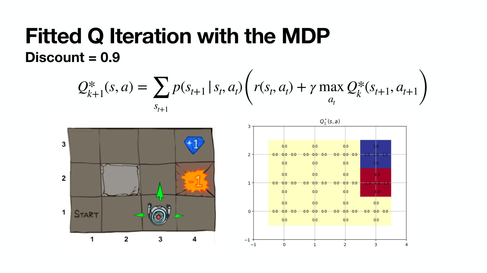

*Slide 7 — the first iterate: zero everywhere except the gem's cell (1.0 for every action, dark blue) and the lava's (-1.0, dark red). [Deck](https://cs224r.stanford.edu/spring_2025/slides/section_q_learning_tutorial.pdf)*

**Iteration two.** In $Q^{\ast}_ 2$ (slide 8) the states next to the top right first get Q-values
(≈7:01): moving right from (2, 2) into the gem is worth 0.9, the discounted $+1$, and the two moves
into the lava, right from (2, 1) and up from (3, 0), are worth $-0.9$.

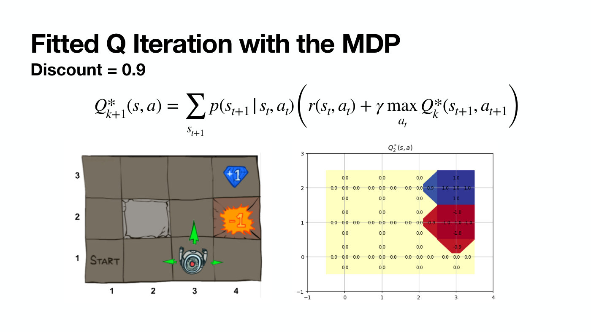

*Slide 8 — the second iterate: the move into the gem from its left neighbour is worth 0.9, and the two moves into the lava are worth -0.9. [Deck](https://cs224r.stanford.edu/spring_2025/slides/section_q_learning_tutorial.pdf)*

**Iterations three to six.** Each iteration carries value one step further from the goal, discounted
once more. In $Q^{\ast}_ 3$ (slide 9), 0.8 appears for the actions that reach (2, 2) in one step:
moving right from (1, 2), moving up from (2, 1), and moving up or staying at (2, 2) itself, where the
up move is blocked by the edge and leaves the robot in place. In $Q^{\ast}_ 4$ (slide 10), 0.7 appears
one step further out; in $Q^{\ast}_ 5$ (slide 11) it reaches the top-left cell and the bottom row; and
in $Q^{\ast}_ 6$ (slide 12), 0.6 appears in the bottom-left corner. Over multiple iterations the grid
fills up, leading to stable convergence of the Q-function (≈7:01–7:47), and from iteration one onwards
the value propagates from the top state to every other state in the grid world (≈10:54).

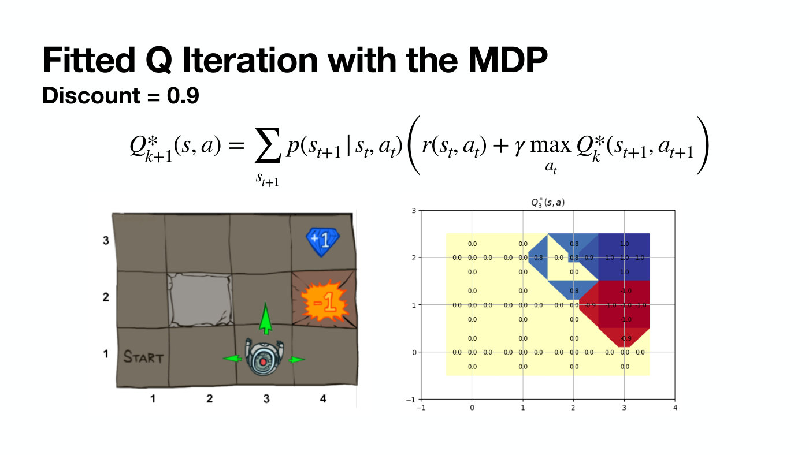

*Slide 9 — the third iterate: 0.8 for the actions that reach the cell beside the gem in one step. [Deck](https://cs224r.stanford.edu/spring_2025/slides/section_q_learning_tutorial.pdf)*

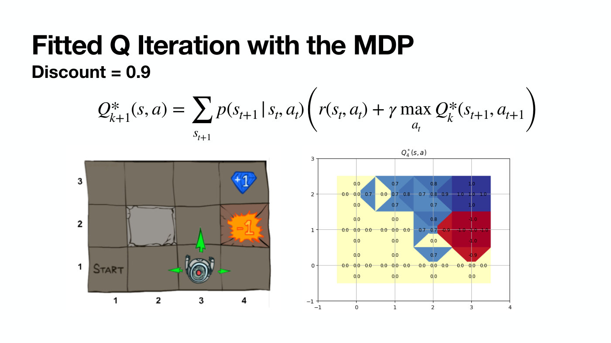

*Slide 10 — the fourth iterate: 0.7 spreads one step further from the goal. [Deck](https://cs224r.stanford.edu/spring_2025/slides/section_q_learning_tutorial.pdf)*

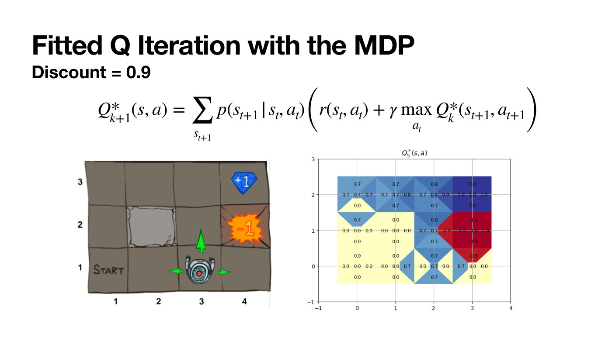

*Slide 11 — the fifth iterate: values reach the top-left cell and the bottom row. [Deck](https://cs224r.stanford.edu/spring_2025/slides/section_q_learning_tutorial.pdf)*

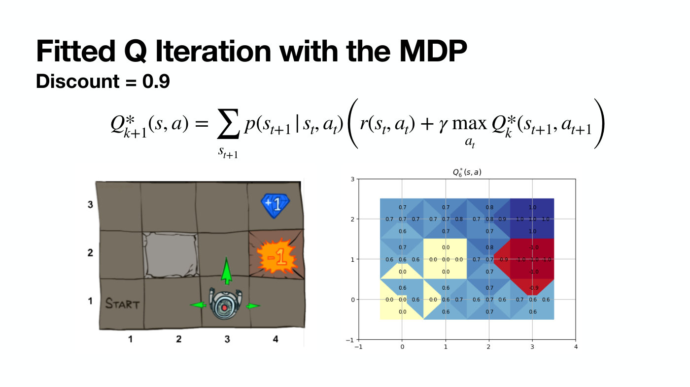

*Slide 12 — the sixth iterate: 0.6 reaches the bottom-left corner, and only the stone's cell is still pale. [Deck](https://cs224r.stanford.edu/spring_2025/slides/section_q_learning_tutorial.pdf)*

The printed values are rounded to one decimal place: Singh gives the exact pattern for the value
function, 0.9 one step away from the goal and 0.81 two steps away, and so on (≈11:40).

## The optimal value, Q-value and policy

Notation can be overwhelming, so slide 13 lays out the three optimal objects side by side for this
grid world (≈10:54–12:26).

$V^\ast(s)$, top left, is the value function, unconditional on the action. The cell where you get the
reward has value 1.0, and the discount of 0.9 applies for every step further away: 0.9 one step away,
0.81 two steps, and so on through the grid, except the lava, where you get $-1$ for terminating
(≈10:54–11:40). The printed rows are 0.7, 0.8, 0.9, 1.0 along the top; 0.7, 0.0 (the stone), 0.8,
$-1.0$ in the middle; and 0.6, 0.7, 0.7, 0.7 along the bottom (slide 13).

$Q^\ast(s, a)$, in the centre, is what the iteration converges to; it can also be calculated
analytically (≈11:40–12:26).

$\pi^\ast$, on the right, is a deterministic function: for any MDP without partial observability, the
optimal policy is defined as the argmax of the Q-function. It typically has a path towards the goal,
generally the shortest path from any state (≈12:26). On the slide each cell has a 1.0 on the chosen
action and 0.0 on the others: right along the top row, up from the start, and in the terminal cells
and the stone's, the centre, staying put (slide 13).

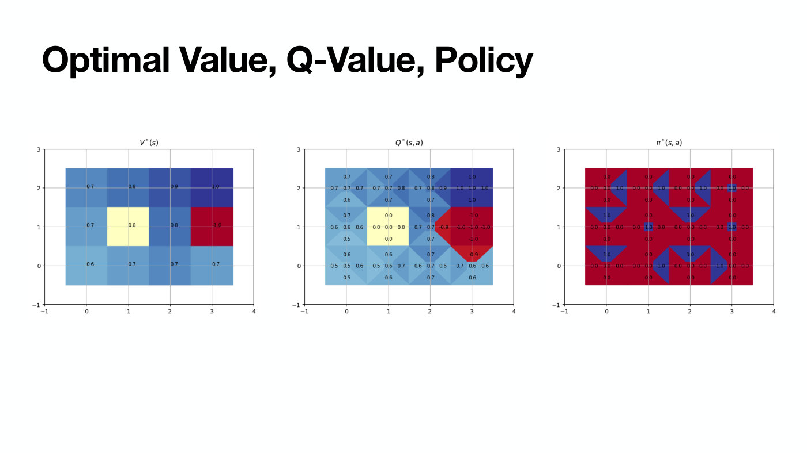

*Slide 13 — V-star (one number per cell), Q-star (one per action) and the deterministic optimal policy, whose 1.0 in each cell marks the argmax of Q-star. [Deck](https://cs224r.stanford.edu/spring_2025/slides/section_q_learning_tutorial.pdf)*

## Why learn more than a policy?

A student says that, looking at this, the policy seems to be all they need, and asks what the other
objects are for (≈12:26–13:13). Singh's answer (≈13:13–14:44): in this tabular domain the policy was
extracted by an argmax over the Q-function, so the Q-function was needed to determine the values
throughout the state space. There are also approaches that use only a policy, such as policy
gradient objectives from the first lectures, but they suffer from variance: once the environment has
a lot of variance, in the reward or in the transition dynamics, policy gradient and Monte Carlo
methods suffer. A Q-function lets you trade off that variance for bias, so each has trade-offs, and
certain environment configurations call for learning a Q-function more than others. See
[policy gradients](policy-gradients.md) and [policy evaluation](policy-evaluation.md).

## The advantage of the optimal policy

The advantage estimates how good an action is relative to the action the policy would take (≈14:44).
For the optimal policy no action is better than its own, so the advantage is zero for the actions it
takes and negative for every other (≈14:44–15:30). Singh first says the advantage "should always be
negative" for the optimal policy, then corrects it to that: actions from the policy have zero
advantage.

Slide 14 shows $A^\ast(s, a)$ beside $V^\ast$ and $Q^\ast$. The actions in red, which go towards the
lava, are strongly negative (≈14:44): moving right from (2, 1) has $-1.7$, its $Q^\ast$ of $-0.9$ less
the state's value of 0.8, and moving up from (3, 0) has $-1.6$. Two actions can also tie: at state
(0, 0) going up and going right both lead to similar values, so both have zero advantage, matching the
optimal policy; but the optimal policy is deterministic, so it picks one of them (≈15:30–16:15). The
slide's formula is the general one, $A^{\pi}(\mathbf{s}_ t, \mathbf{a}_ t) = Q^{\pi}(\mathbf{s}_ t, \mathbf{a}_ t) - V^{\pi}(\mathbf{s}_ t)$,
"how much better" $\mathbf{a}_ t$ "is" (slide 14).

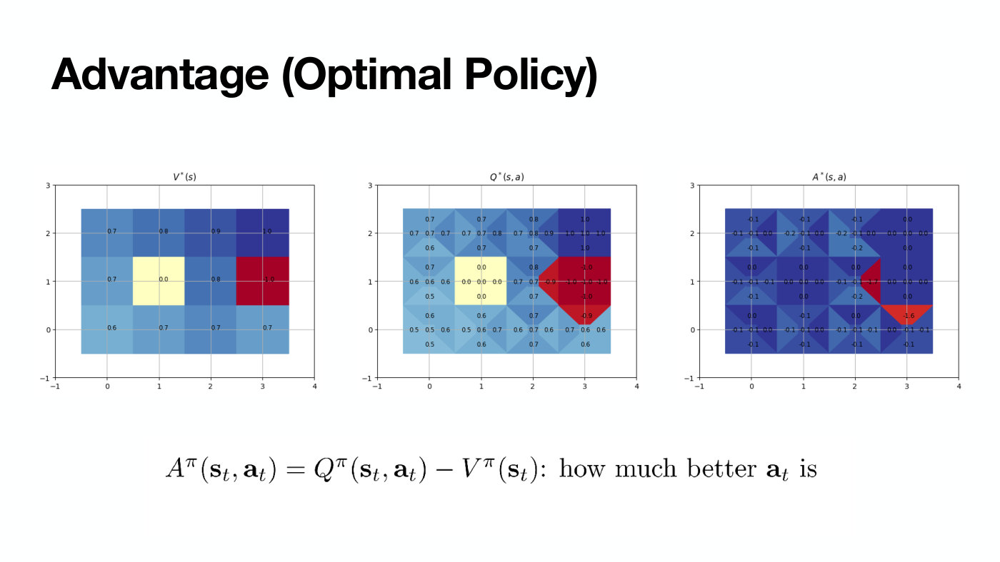

*Slide 14 — the optimal advantage: zero on the optimal policy's actions, small negatives elsewhere, and about -1.7 and -1.6 for the two moves into the lava. [Deck](https://cs224r.stanford.edu/spring_2025/slides/section_q_learning_tutorial.pdf)*

## Q-star against Q-pi

So far everything has been for the optimal policy. Slide 15 shows a suboptimal one beside it (≈16:15).
The top row repeats $Q^\ast$ and the deterministic $\pi^\ast$, labelled "Optimal Policy (Deterministic
for MDP)". The bottom row, "Suboptimal Policy", shows a stochastic policy $\pi(s, a)$ and its
Q-function $Q^\pi(s, a)$. The policy is not deterministic, in many cases does not take the right
actions, and sometimes even leads to the lava (≈16:15): from (2, 1), for example, it moves up with
probability 0.7 and right, into the lava, with probability 0.1 (slide 15). Its Q-function is
different from the optimal one (≈16:15–17:02); on the slide most of its values are near zero, and it
is non-zero mainly near the goal.

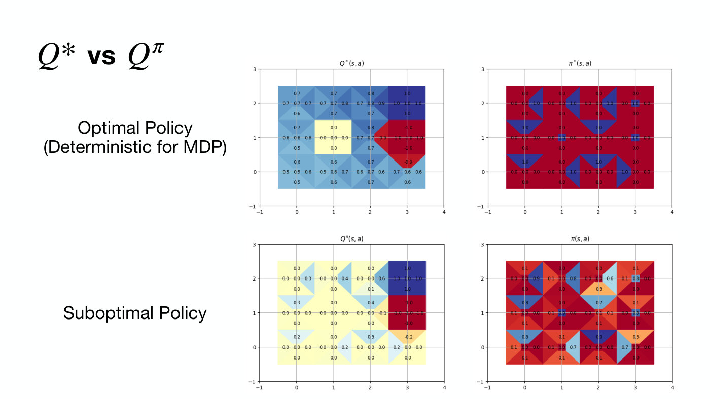

*Slide 15 — top, Q-star and the deterministic optimal policy; bottom, a stochastic suboptimal policy (probabilities per action) and its own Q-function, mostly near zero. [Deck](https://cs224r.stanford.edu/spring_2025/slides/section_q_learning_tutorial.pdf)*

You can learn a critic, a Q-function conditioned on a particular policy, that tells you how close you
are to the optimal policy and how to improve (≈17:02). In an actor-critic algorithm, the critic
conditioned on the current policy says which actions might be better than the ones being taken, and
that is used to update the policy by one step of improvement. $Q^\ast$, on the other hand, has
converged, so the optimal policy can no longer be updated (≈17:02–17:47). In short, $Q^\pi$ relates
to the current policy and $Q^\ast$ to the optimal one (≈17:47). See
[actor-critic methods](actor-critic.md).

To play more with these tabular environments, slide 16 points to a colab, shared in the PDF (≈17:47);
the page prints the word as a link with no URL.

## From tables to networks

Would this scale? Unfortunately not (slide 18, ≈17:47): a tabular value function becomes intractable
as the state or action space grows, with thousands or millions of rows. Learning a **parametric**
value function, through a neural network, also allows generalization: two states that are close to
each other, in a semantic or a literal sense, should have similar Q-values, a property of smoothness
that comes from the learned representation (≈17:47–18:32). The rest of the session uses regression to
learn value functions with a neural network, in both continuous and discrete settings.

Slide 18 draws three networks. The value network $V^\pi_\phi$ takes the state $s_t$ and outputs a
scalar, $V^\pi_\phi(s_t)$. There are two kinds of Q-network (≈19:20). The **continuous** one takes
both a state and an action and outputs a scalar $Q^\pi_\phi(s_t, a_t)$; the **discrete** one takes
the state and outputs a vector with one value per action, 
$Q^\pi_\phi(s_t, a_1) \ldots Q^\pi_\phi(s_t, a_m)$. You could use the first form for discrete actions too, but the second is
generally advisable as long as the discrete space is tractable, because you can enumerate all the
actions (≈19:20). Asked about the value function, Singh adds that it is irrelevant to the action
space, so there is only one general parameterization for it (≈19:20–20:06).

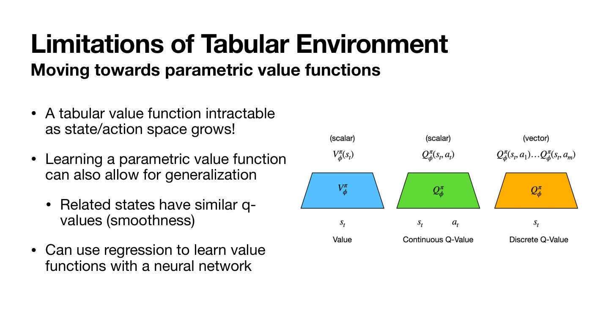

*Slide 18 — three ways to parameterize a value: V from the state, a continuous Q from the state and action, and a discrete Q with one output per action. [Deck](https://cs224r.stanford.edu/spring_2025/slides/section_q_learning_tutorial.pdf)*

## Discrete and continuous Q-functions

For a discrete Q-function you predict the Q-value of every action, for example the five of the grid
world, up, down, left, right and stay, and choose among them; in a continuous space it would be very
hard to enumerate all possible actions, so the action is taken as input and the network outputs a
scalar (slide 19, ≈20:06). The two differ when you compute an expectation over actions (≈20:06–20:53).
In the continuous case you sample actions from the policy, so the expectation is a sample-based
estimate; in the discrete case you output a value for each bin and enumerate them all, which gives
the exact expectation. Slide 19's panel (a) shows a robot opening a door with its Q-value plotted over
60 time steps, rising from about $-1200$ to about 0; panel (b) shows four frames of a paddle game,
each with three bars for the Q-values of the actions NO-OP, UP and DOWN.

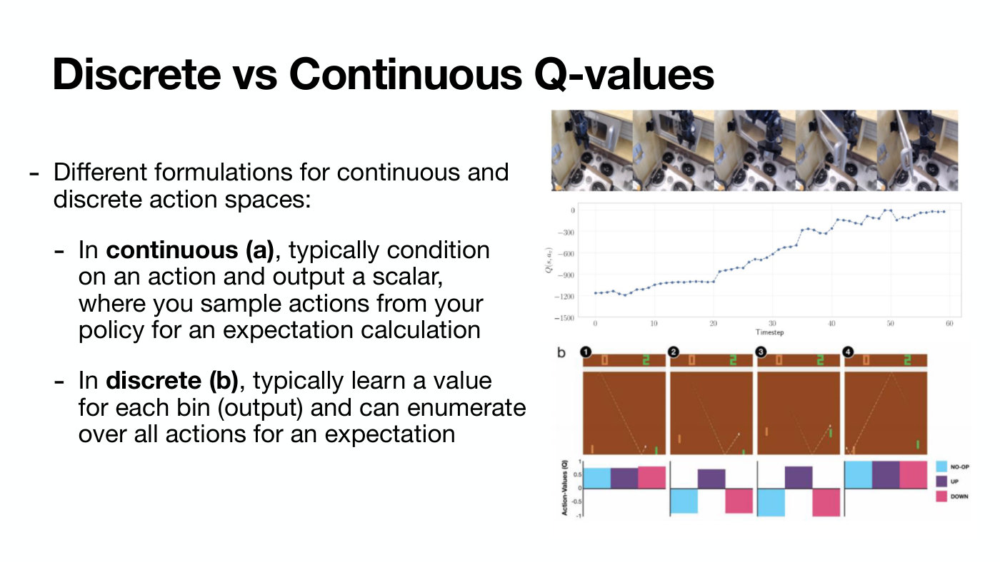

*Slide 19 — (a) a continuous Q-value along one robot episode; (b) a discrete Q-network's value for each of three actions, frame by frame. [Deck](https://cs224r.stanford.edu/spring_2025/slides/section_q_learning_tutorial.pdf)*

## Q-learning as regression: Monte Carlo, TD and n-step

Singh works this on the whiteboard for $V^\pi(s)$, saying a similar derivation goes for $Q$, adapted
from the Sutton and Barto textbook (≈20:53–21:39). The board is not visible in the recording, but
slide 20 prints its lines, each with a label:

$$V^\pi(s) = E_\pi \left[ \mathcal{R}_ t \mid S_t = s \right] \qquad \text{(Definition)}$$

$$= E_\pi \left[ \sum_{k=0}^{\infty} \gamma^k \thinspace r(s_{t+k}, a_{t+k}) \mid S_t = s \right] \qquad \text{(Monte-Carlo Rollout, MC)}$$

$$= E_\pi \left[ r(s_t, a_t) + \gamma \sum_{k=0}^{\infty} \gamma^k \thinspace r(s_{t+k+1}, a_{t+k+1}) \mid S_t = s \right] \qquad \text{(Expansion)}$$

$$= E_\pi \left[ r(s_t, a_t) + \gamma V^\pi(s_{t+1}) \mid S_t = s \right] \qquad \text{(Dynamic Programming, TD)}$$

$$= E_\pi \left[ r(s_t, a_t) + \gamma \thinspace r(s_{t+1}, a_{t+1}) + \cdots + \gamma^{k+1} V^\pi(s_{t+k+1}) \mid S_t = s \right] \qquad \text{(N-Step)}$$

Here $\mathcal{R}_ t$ is the return from time $t$, $S_t$ the state at time $t$ (capital on this slide),
and $E_\pi$ the expectation under the policy.

**Definition.** The value of a state is the expected return to go from it, written as an expectation
under the policy of the return, conditioned on the state (≈21:39).

**Monte Carlo.** The return expands into the sum of discounted rewards: from the current point in
time, all the rewards going forward, each discounted by the discount factor raised to the number of
time steps away (≈22:26–23:15). This is the Monte Carlo estimate of the value function.

**Expansion.** To turn it into a one-step TD estimate, take the reward at $k = 0$ out of the sum and
apply one factor of discounting to the rest, keeping the sum from $k = 0$ to infinity (≈23:15–24:00).
Singh shows the step on the board: splitting off $k = 0$ leaves $r(s_t, a_t)$ plus the sum from
$k = 1$ to infinity, which re-indexes into the line above (≈26:17–27:03).

**TD.** The remaining sum looks a lot like a value function, but at the next state instead of the
current one, so it becomes $V(s_{t+1})$, and that is the TD form (≈24:46–25:31).

**What the substitution costs and buys** (≈25:31–26:17). The Monte Carlo estimate is the discounted sum
of rewards over the entire trajectory, so it has no bias. The TD estimate substitutes the value
function back in, which introduces bias, because the value function can be inaccurate, but reduces
variance, because it shortens the horizon from $H$, which can be very large, to one.

**N-step.** Expanding $n$ times instead of once trades off between the two (≈27:03–27:49). The bias
comes from the value function's parameterization; the variance comes from the horizon, because a noisy
reward function or noisy dynamics add variance across the trajectories you roll out. Singh takes the
n-step line from an iPad to avoid a notation mistake (≈27:49), and the captions break off while it is
written; the next caption, at ≈28:59, describes it as $k$ steps of roll-out with the same expansion,
after which the value function is discounted by $k$ steps instead of one, trading off between the
Monte Carlo roll-out and the value-function estimate. See [policy evaluation](policy-evaluation.md).

## The bias-variance trade-off

Slide 21 puts the two side by side as backup diagrams (≈28:59–30:32). On the left, Monte Carlo lets
the policy roll out from a state until it reaches a terminal state, collects several such roll-outs
and averages their reward to go; that can have a lot of variance, because every action adds noise
from the transition dynamics or the reward. On the right, the TD backup unrolls only one step and uses
the value-function estimate at the next state, which reduces the variance; but because the value
function can be inaccurate, it can bring bias.

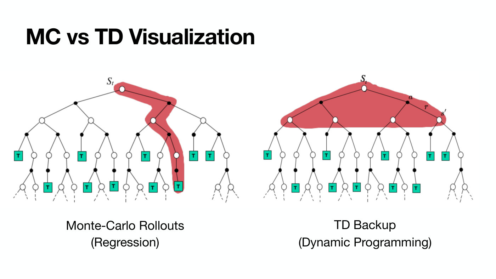

*Slide 21 — Monte Carlo follows one path all the way to a terminal state; the TD backup goes one step and stops at the next state's estimate. [Deck](https://cs224r.stanford.edu/spring_2025/slides/section_q_learning_tutorial.pdf)*

Asked whether the two converge to the same thing, Singh says that in tabular settings both approaches
should converge to the same result, but beyond that they do not (≈30:32). N-step returns let the TD
target look $n$ steps into the future before bootstrapping (slide 22, ≈30:32).

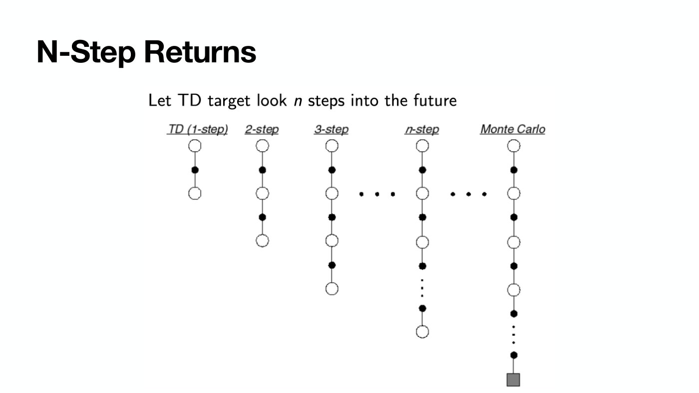

*Slide 22 — the backup grows from one step (TD) through two, three and n steps to the whole episode (Monte Carlo). [Deck](https://cs224r.stanford.edu/spring_2025/slides/section_q_learning_tutorial.pdf)*

Slide 23's table summarizes the trade-off (≈30:32–31:19):

| Method | Bootstrap depth | Bias | Variance |
| --- | --- | --- | --- |
| TD | 1 step | High | Low |
| N-step | N steps | Medium | Medium |
| Monte Carlo | Full episode | Low | High |

The slide prints the TD depth as "1 Steps". Singh reads Monte Carlo's bias as none at all, and the
n-step middle ground as depending on how large the number of steps is (≈31:19).

How this plays out depends heavily on the environment (≈31:19–32:05). In language, Monte Carlo
roll-outs are how many people do things, because the environment's dynamics are almost perfect and
the reward, especially in math or code reasoning, is perfect as well, so the variance of the dynamics
is not a worry. In agentic or robotic domains these factors come back into play. See
[RL for LLM reasoning](llm-reasoning.md).

## Why dynamic programming: stitching

Dynamic programming also gives you **stitching** (slide 24, ≈32:05–32:51). In the maze on the left,
the policy has collected two trajectories, one from A to B and one from C to D. With one-step dynamic
programming, which looks one step back at every step, you can find the optimal path from A to D by
stitching these trajectories together, which gives better coverage of the space and can make these
algorithms more efficient. The slide credits the figure to "Should I Use Offline RL or Imitation
Learning?" in its footer. See [offline RL](offline-rl.md) and [Lecture 7](07-offline-rl.md).

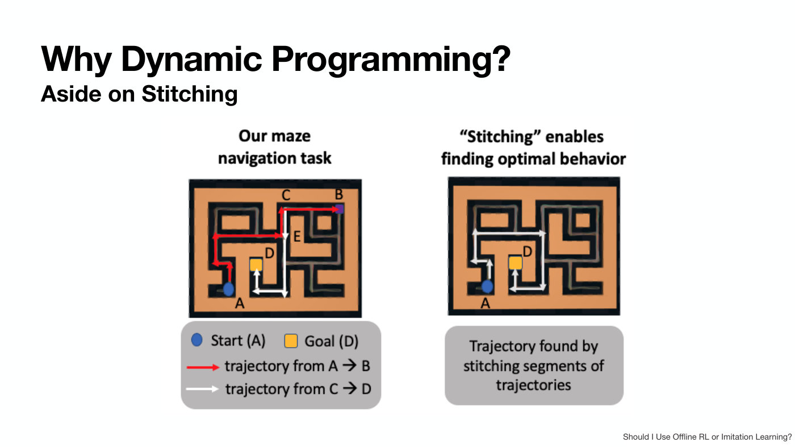

*Slide 24 — left, trajectories from A to B (red) and from C to D (white); right, the A-to-D path dynamic programming can stitch from their segments. [Deck](https://cs224r.stanford.edu/spring_2025/slides/section_q_learning_tutorial.pdf)*

## Semi-gradients and target networks

The practical details start from the Q-value estimate used so far: the reward at the current step
plus the discounted Q-value at the next step, maximized over all actions (slide 26, ≈32:51–33:38):

$$Q(s, a) \leftarrow r(s, a) + \gamma \max_{\hat{a}} Q(s', \hat{a})$$

The Q-function on the left is the same as the one on the right, which makes optimization very
difficult, especially if gradients propagate through both (≈33:38). The **semi-gradient** trick
freezes the right-hand side by passing no gradient to it:

$$Q_\theta(s, a) \leftarrow r(s, a) + \gamma \max_{\hat{a}} \text{stopgrad}\left( Q_\theta(s', \hat{a}) \right)$$

A **target network** goes further, delaying the updates of the right-hand side so that the Q-function
regresses to a more stable target (≈33:38–34:24):

$$Q_\theta(s, a) \leftarrow r(s, a) + \gamma \max_{\hat{a}} \text{stopgrad}\left( Q_{\text{target}}(s', \hat{a}) \right)$$

There are two kinds of update (slide 26, ≈34:24). A **hard target update** copies the current
weights at a fixed frequency, $w' \leftarrow w$ when $\text{mod}\thinspace(n, N) = 0$, where $w$ are
the current network's weights, $w'$ the target's, and $n$ counts updates. A **soft target update**,
an exponential moving average or Polyak averaging, interpolates smoothly with a decay parameter
$\tau$: $w' \leftarrow \tau \cdot w + (1 - \tau) \cdot w'$. Singh says both have been seen to work
well empirically, and that people have mostly settled on a value around 0.99 for the Polyak averaging
(≈34:24–35:09); which of the formula's two weights that is, Singh does not say. The aim of both
tricks is to give the regression a stable target, which makes the learning problem a lot easier
(≈35:09).

**The loss, on the board** (≈35:09–38:14; reconstructed from what Singh says). Singh writes the
regression for the value function: for a single sample, the target is the reward at the current time
step plus the discounted value at the next, and the loss is the squared difference between the value
at the current step and that target, an MSE-style TD loss,

$$y = r(s_t, a_t) + \gamma V(s_{t+1}), \qquad \text{loss} = \left( V(s_t) - y \right)^2$$

With a learned network on both sides of the MSE, this is very unstable to learn from (≈35:56). A stop
gradient fixes the target: gradients pass through the network on the left but not to the right
(≈35:56–36:42). The difference between the two tricks (≈36:42): the semi-gradient keeps the **same**
parameters on the right but passes no gradient through them, while the target network is a completely
**different** set of parameters, $w'$, independent of the ones being learned and updated from them,
every so often for a hard update or at every step with the soft ratio for Polyak averaging. Asked
which term is the target, Singh points to the bracketed one: the one-step TD target $y$ (≈37:28).

## Dealing with TD gradients: clipping and the Huber loss

Two more techniques help this converge (slide 27, ≈38:14–39:47). **Gradient clipping**: a gradient
that is too large, which unfortunately happens a lot with TD updates, is clipped so that optimization
is more stable. In the slide's loss landscape, without clipping the optimizer circles around the
optimal parameters; with it, it approaches them smoothly (≈38:14–39:00).

The **Huber loss** is an objective other than MSE, an interpolation between an L1 and an L2 loss: it
is not affected by outliers, through the L1 part, drawn in green, but close to the right value an L2
loss kicks in and brings the estimate closer and closer to the target (≈39:00–39:47). On slide 27 the
blue parabola is the squared loss and the green curve follows it near zero, then continues as straight
lines.

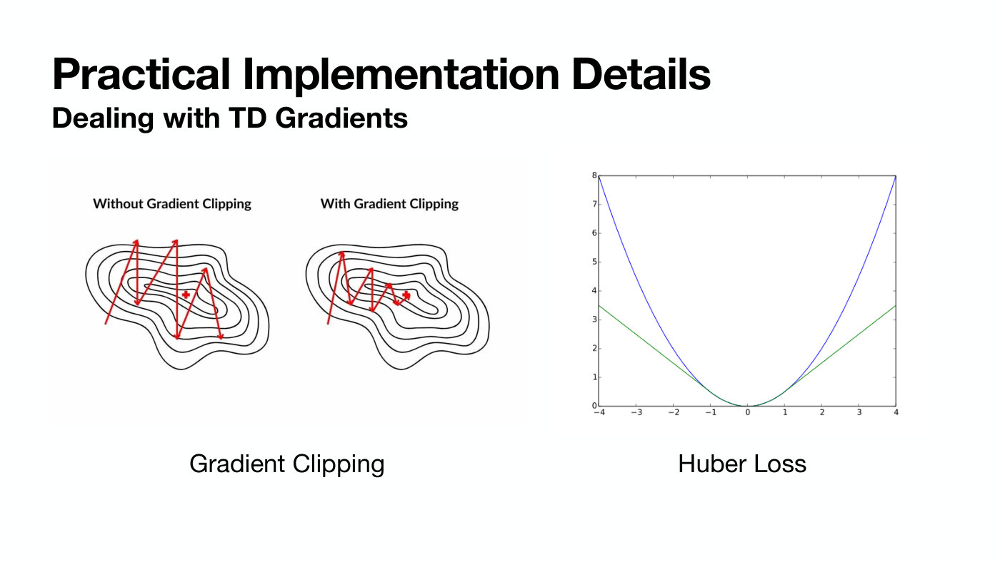

*Slide 27 — left, without clipping the steps overshoot across the contours, with clipping they shrink onto the minimum; right, the Huber loss (green) matches the squared loss (blue) near zero and grows linearly beyond it. [Deck](https://cs224r.stanford.edu/spring_2025/slides/section_q_learning_tutorial.pdf)*

## Replay buffers

A **replay buffer** is a memory structure that stores past experiences encountered by the agent, so
that they can be reused instead of discarded after a single update (slide 28, ≈39:47). It stores
tuples of state, action, reward and next state individually, as transitions rather than whole
trajectories, which does two things (≈39:47–41:19). It breaks the temporal correlations in the data,
because each sample is a transition drawn from anywhere in the buffer, across trajectories one to the
last. And it avoids recency bias: keeping past experience prevents overfitting to the current policy,
and Q-functions benefit from a lot of coverage of the space, which the current policy alone would
narrow. Together these improve sample efficiency, letting the agent reuse its experience effectively.

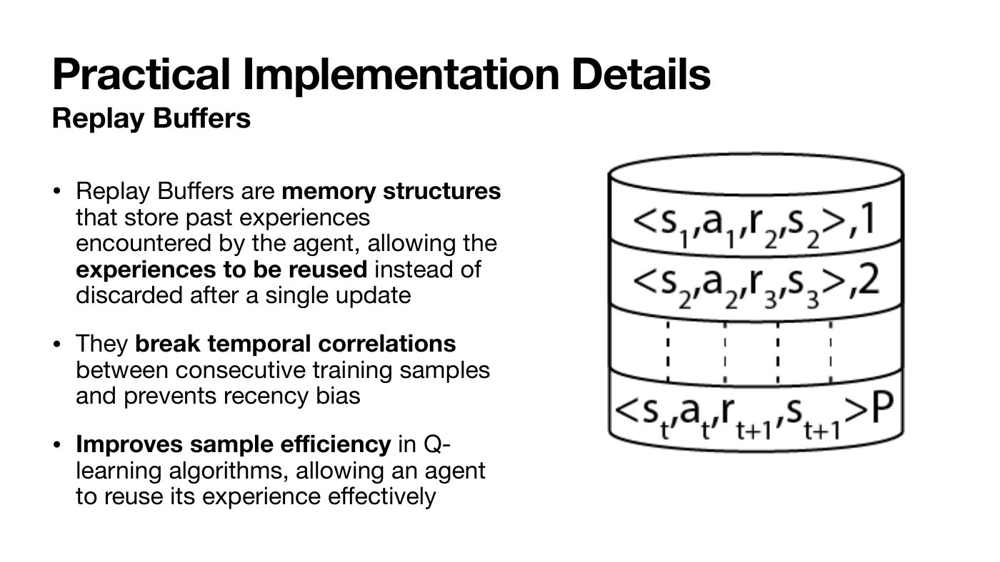

*Slide 28 — the buffer stores one transition per row (state, action, reward, next state), not whole trajectories. [Deck](https://cs224r.stanford.edu/spring_2025/slides/section_q_learning_tutorial.pdf)*

Two questions follow, both inaudible (≈41:19). The buffer can have a maximum size, depending on
capacity; typically that is not a concern, but when it is, you can reweight or throw out parts of the
buffer. On learning from history rather than single transitions, people have explored RNN and even
transformer-based architectures, such as Decision Transformer, which conditions on long horizons to
predict both actions and values, each with its own trade-offs (≈41:19–42:06). For critics this is very
feasible; for policies in language it is done by default; but in robotics, where the data can have
temporal correlations, learning with history is more nuanced and needs more design decisions. See
[replay buffers](replay-buffers.md).

## Overestimation

Q-learning's target has a max on the right-hand side, and this matters once the Q-function has noise
in it (slide 29, ≈42:06–42:52). Singh follows a derivation the slide's footer names, "Issues in Using
Function Approximation for Reinforcement Learning". When the Q-function is a function approximator
such as a neural network, its estimates carry some inherent noise from modeling errors. Write the
learned Q-function as the true one plus a noise term (≈43:40):

$$Q^{\text{approx}}(s', \hat{a}) = Q^{\text{target}}(s', \hat{a}) + Y^{\hat{a}}_ {s'}$$

where $Q^{\text{approx}}$ is the learned parameterization, $Q^{\text{target}}$ the true underlying
Q-function, and $Y^{\hat{a}}_ {s'}$ the noise for action $\hat{a}$ at next state $s'$. Noise on the
right-hand side transfers badly to the left: after one step of iteration, the error on the left is

$$Z_s := \gamma \left( \max_{\hat{a}} Q^{\text{approx}}(s', \hat{a}) - \max_{\hat{a}} Q^{\text{target}}(s', \hat{a}) \right)$$

and even when the noise has zero mean, $Z_s$ may have a positive mean (slide 29, ≈43:40–44:28):

$$\mathbb{E}\left[ Y^{\hat{a}}_ {s'} \right] = 0 \thinspace \forall \hat{a} \implies \mathbb{E}\left[ Z_s \right] \gt 0 \quad \text{(often)}$$

So the Q-values are overestimated, and this has to be dealt with when learning critics (≈44:28).

Singh then raises, and withdraws, a second cause (≈44:28–45:14). Sampling the actions over which the
max is taken might also be an issue; but the true target over all actions may actually be higher than
over a subset, so that is not necessarily a problem. The main concern is modeling error: the
Q-value on the right can be overestimated, and over multiple rounds of dynamic programming the error
propagates through the whole state space and compounds. To be precise, Singh means "an error or an
overestimation, which is actually in the Q function and not in the actions that were taken"
(≈45:14). Even assuming every action can be enumerated, as in a
discrete space (≈45:14–46:01), the learned Q-function can be higher than the true $Q^\ast$ because of noise, and even
zero-mean noise becomes non-zero-mean error through the max, propagates through the state space and
makes the Q-values blow up. See [Q-learning](q-learning.md).

## Critic ensembles and double Q-learning

Singh brings up slide 31's figure here, ahead of its place in the deck (≈46:47–47:33). In the
slide's caption, the left column of each row shows a true value function and one fitted estimate; the middle column the
estimates for all the actions and their maximum; the right column the difference between that maximum
and the true maximum. For standard Q-learning that difference is far above zero, a large error from
overestimating the true value and propagating it through the states.

One fix is **critic ensembling** (slide 30, ≈47:33–48:19): estimate the Q-function's epistemic
uncertainty with an ensemble of networks, and minimize over the ensemble to get an underestimate of
the Q-value. It works because networks initialized differently make different errors across states,
so a min reduction removes much of the modeling error. It has been shown to work in double Q-learning
and in offline RL, where the ensemble can be made much larger and heavy ensembling mitigates the
distribution shift by learning an underestimate rather than an overestimate driven by noise
(≈48:19–49:04). Slide 30 names SAC-N and EDAC (printed "Sac-N and EDAC") as the offline examples.

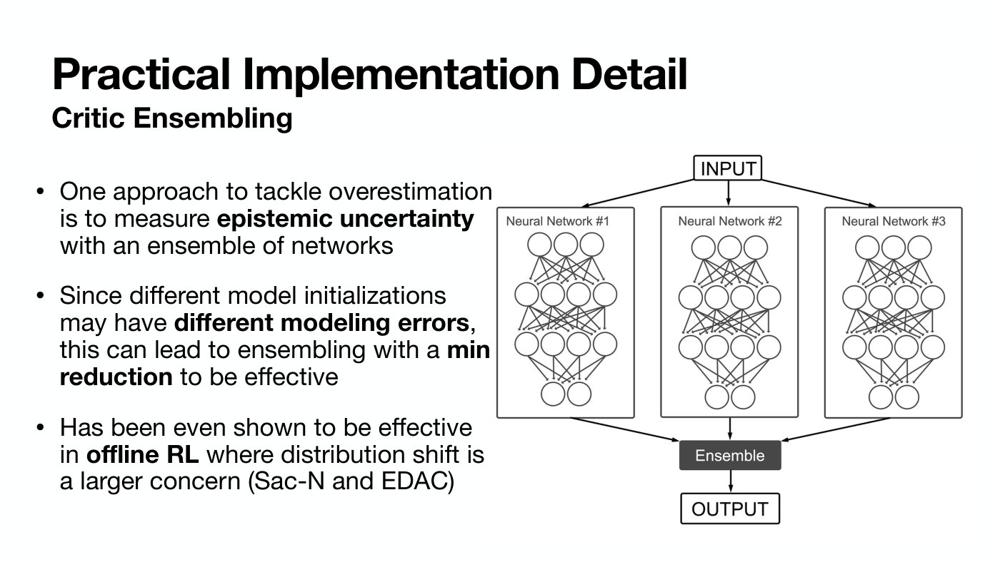

*Slide 30 — critic ensembling: several Q-networks from different initializations, combined (with a min reduction) into one estimate. [Deck](https://cs224r.stanford.edu/spring_2025/slides/section_q_learning_tutorial.pdf)*

Slide 31's figure is from the double Q-learning paper, Singh says (≈49:04). Its right column shows,
in each row, standard Q-learning's large errors (Singh calls it the red curve; on the slide it is
orange, with average errors of $+0.61$, $+0.47$ and $+3.35$) and the double-Q estimate near zero
(blue, $-0.02$, $+0.02$ and $-0.02$). An ensemble of just two, which is double Q-learning, mitigates a
lot of the overestimation and makes learning much more stable (≈49:04).

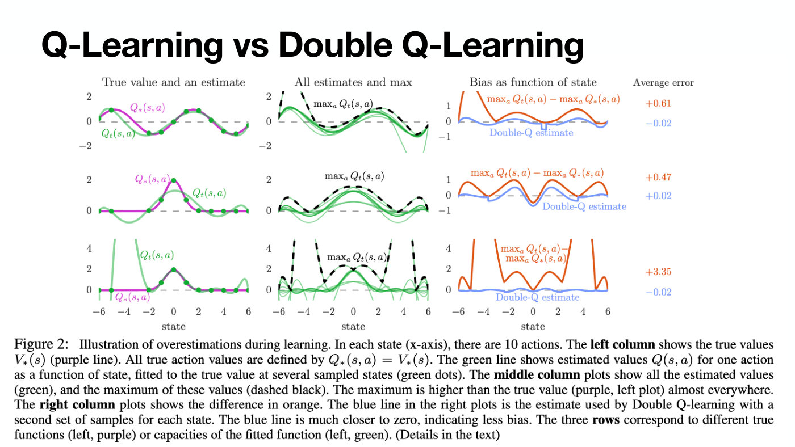

*Slide 31 — the max over noisy estimates (middle) sits above the true value almost everywhere, so its error (orange, right) is positive; the double-Q estimate (blue) stays near zero. [Deck](https://cs224r.stanford.edu/spring_2025/slides/section_q_learning_tutorial.pdf)*

How large an ensemble (≈49:04–49:49): "for online Q-learning algorithms you can get away with just
doing two", which works really well for most purposes, and beyond that the benefit saturates. Offline, with a static dataset, any error from leaving the support
of the data's state or action distribution propagates even more, so being careful about the
distribution matters a lot, and methods such as EDAC and SAC-N increase the ensemble size. Reward
modelling for language faces similar overestimation effects, and papers there keep it parameter
efficient by sharing most of the network, for example with LoRA or with shared layers and linear
adapters (≈49:49). The recording ends here. See [offline RL](offline-rl.md) and
[Lecture 6's double Q-learning](06-q-learning.md#trick-2-double-q-learning).

## Not in the recording: the homework algorithms

Slides 32–35 are known only from the [slide file](../raw/slides/19-q-learning-tutorial.md). Slide 32
opens "Understanding HW Algorithms", the walkthrough slide 2 calls a preview of Homework 2. Slides 33
and 34 each print one algorithm as pseudocode, marked "Whiteboard".

**DQN** (slide 33). The inputs are a replay buffer $\mathcal{D}$, a Q-network $Q_\theta$, a target
network $Q_{\theta'}$ initialized with $\theta' \leftarrow \theta$, the discount $\gamma$, a batch size
$N$, a learning rate $\alpha$, a target update frequency $C$ and an exploration schedule $\epsilon$.
At each interaction step $t$, the agent observes $s_t$ and chooses $a_t$ epsilon-greedily: a random
action with probability $\epsilon$, otherwise $\arg\max_a Q_\theta(s_t, a)$. It executes $a_t$,
observes $(r_t, s_{t+1})$ and stores $(s_t, a_t, r_t, s_{t+1})$ in $\mathcal{D}$. It then samples a
mini-batch of $N$ transitions, computes the targets $y_i \leftarrow r_i + \gamma \max_{a'} Q_{\theta'}(s_{i+1}, a')$,
and takes a gradient step on the squared error:

$$\theta \leftarrow \theta - \alpha \nabla_\theta \frac{1}{N} \sum_{i=1}^{N} \left[ Q_\theta(s_i, a_i) - y_i \right]^2$$

Every $C$ steps, when $t \bmod C = 0$, the target network is updated, $\theta' \leftarrow \theta$: a
hard target update.

**Soft actor-critic, with no entropy term** (slide 34). The inputs are a replay buffer, two critics
$Q_{\theta_1}$ and $Q_{\theta_2}$, an actor $\pi_\phi$, target critics initialized from the critics,
the discount $\gamma$, a smoothing coefficient $\tau$ and a batch size $N$. At each step the agent
samples $a_t \sim \pi_\phi(\cdot \mid s_t)$, executes it and stores the transition. From a mini-batch
it computes the next action from the actor, $a'_ {i+1} \leftarrow \pi_\phi(s_{i+1})$, and the target
from the **smaller** of the two target critics, $y_i \leftarrow r_i + \gamma \min_{j=1,2} Q_{\theta'_ j}(s_{i+1}, a'_ {i+1})$.
Each critic takes a gradient step on its squared error against $y_i$, with step size $\lambda_Q$. The
actor is updated to maximize the first critic's Q-value only:

$$\phi \leftarrow \phi + \lambda_\pi \nabla_\phi \frac{1}{N} \sum_i Q_{\theta_1}(s_i, \pi_\phi(s_i))$$

and the target critics are soft-updated, $\theta'_ j \leftarrow \tau \theta_j + (1 - \tau) \theta'_ j$.
The min over two critics is the ensemble of two from slide 30, and the two target updates are slide
26's hard and soft updates. DQN and soft actor-critic are taught in [Lecture 6](06-q-learning.md) and
[Lecture 5](05-off-policy-actor-critic.md). Slide 35 reads "Thanks!".

## Related pages

- [Lecture 6 — Q-Learning](06-q-learning.md): the lecture this session reviews: the greedy policy,
  the Bellman optimality equation, DQN, double Q-learning and n-step returns.
- [Q-learning](q-learning.md): the algorithm as a whole, with this session's grid-world iteration,
  stabilizing tricks and overestimation.
- [Bellman equations](bellman-equations.md): the Bellman equation and its iterative form.
- [Value functions](value-functions.md): $V$, $Q$ and $A$, with this session's optimal grid-world
  values.
- [Policy evaluation](policy-evaluation.md): Monte Carlo, bootstrapped and n-step targets and their
  bias and variance.
- [Replay buffers and soft actor-critic](replay-buffers.md): the buffer, and soft actor-critic with
  two critics.
- [Offline RL](offline-rl.md): stitching, and the larger critic ensembles used offline.
- [Actor-critic methods](actor-critic.md): the critic of the current policy and one step of
  improvement.
- [Lecture 5 — Off-Policy Actor Critic](05-off-policy-actor-critic.md): soft actor-critic, the second
  homework algorithm.
- [Course logistics](course-logistics.md): the homeworks, including Homework 2.
