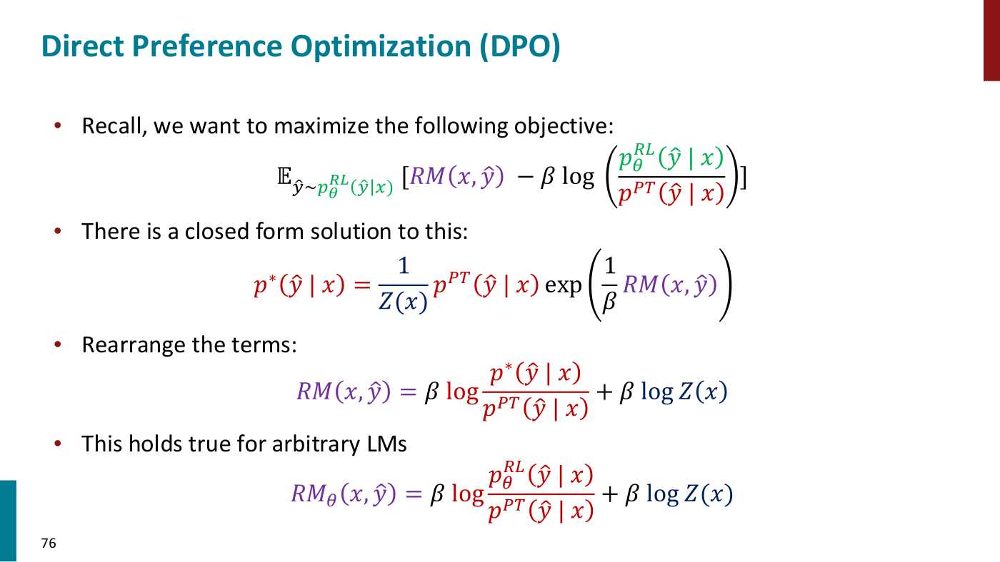
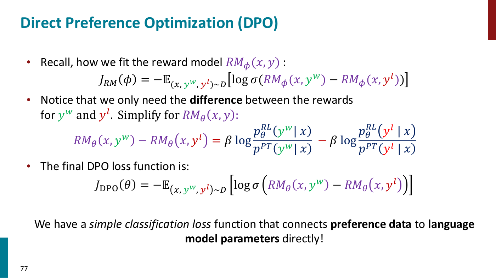
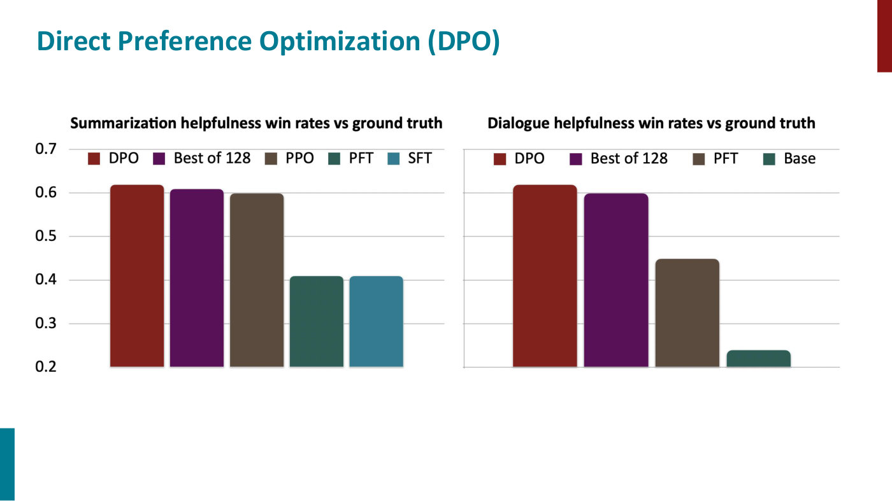

# Direct preference optimization (DPO)

Direct preference optimization trains a language model on human preference data with a simple
classification loss, with no separate reward model to optimize against and no RL loop. It optimizes the
same KL-constrained objective as [RL from human feedback](rlhf.md), and gets there by noticing that
the objective's optimal policy has a closed form, so the reward can be written in terms of the language
model itself. Lecture 9, a guest lecture by Archit Sharma, teaches it (slides 73–79, ≈35:39–52:49);
Lecture 8's reminder slide introduces Sharma as DPO's lead author (Lecture 8, slide 2). Citations are to
Lecture 9.

## Notation

Following the slides: $x$ is a prompt or input and $y$ (or $\hat{y}$, a sample) a completion.
$p^{PT}(y \mid x)$ is the pretrained, possibly instruction-finetuned, model the method starts from, held
fixed; $p^{RL}_ \theta(y \mid x)$ is the model being optimized, with parameters $\theta$. $RM(x, y)$ is a
reward model, $RM_\phi$ one with its own parameters $\phi$, and $RM_\theta$ the reward model DPO defines
from $p^{RL}_ \theta$. $\beta \gt 0$ weighs the KL penalty. $D$ is a dataset of triples
$(x, y^w, y^l)$, a prompt with a winning (preferred) and a losing completion, and $\sigma$ is the
sigmoid.

## Why: RLHF is complex

RLHF fits a reward model to preferences and then optimizes the language model against it with RL. At
the scale of a model with 100 billion or a trillion parameters that is expensive: every answer is
sampled and scored, value functions are fitted, online sampling is slow, and performance can be
sensitive to hyperparameters (slide 74, ≈35:39–36:25). Since all the information comes from the
preference labels anyway (slide 75), why not train the language model on the preference data directly?
The reward model is fitted with a simple classification loss, the Bradley-Terry loss; if the reward
model could be written in terms of the language model, the language model's parameters could be fitted
through that loss directly (≈37:13–37:59). That is the "direct" in the name.

## The derivation

**1. The KL-constrained objective has a closed-form optimum** (slide 76, ≈37:59–40:18). The RLHF
objective, with $p^{PT}$ and $RM$ fixed, is

$$\mathbb{E}_ {\hat{y} \sim p^{RL}_ \theta(\hat{y} \mid x)}\left[RM(x, \hat{y}) - \beta \log \left(\frac{p^{RL}_ \theta(\hat{y} \mid x)}{p^{PT}(\hat{y} \mid x)}\right)\right]$$

Plain expected-reward maximization has no closed-form solution, but with the KL term the optimal policy
$p^\ast$ is

$$p^\ast(\hat{y} \mid x) = \frac{1}{Z(x)} p^{PT}(\hat{y} \mid x) \exp\left(\frac{1}{\beta} RM(x, \hat{y})\right)$$

the starting model reweighted by the exponentiated reward, so that higher-reward completions become more
likely and lower-reward ones less. $Z(x)$ is the normalizer that makes it a distribution over
completions. The lecture states this solution without deriving it (≈40:18).

**2. Rearrange for the reward** (slide 76, ≈40:18–41:50). Rearranging the terms gives the reward,

$$RM(x, \hat{y}) = \beta \log \frac{p^\ast(\hat{y} \mid x)}{p^{PT}(\hat{y} \mid x)} + \beta \log Z(x)$$

A completion with a high reward has a high probability under $p^\ast$ relative to $p^{PT}$, and a
completion with a low reward a low one.

**3. Any model is optimal for some reward** (slide 76, ≈41:50). The relation is not special to $p^\ast$:
any language model $p^{RL}_ \theta$ is the optimal policy for some reward model, namely

$$RM_\theta(x, \hat{y}) = \beta \log \frac{p^{RL}_ \theta(\hat{y} \mid x)}{p^{PT}(\hat{y} \mid x)} + \beta \log Z(x)$$

*Lecture 9, slide 76 — the KL-constrained objective, its closed-form optimal policy, the rearrangement for the reward, and the same identity for any model. [Deck](https://cs224r.stanford.edu/spring_2025/slides/09_cs224r-2025-rlhf.pdf)*

**4. The normalizer cancels** (slide 77, ≈42:37–45:02). $Z(x)$ is intractable to compute, but the
Bradley-Terry loss needs only the difference of rewards between two completions of the **same** prompt
$x$, and both carry the same $\beta \log Z(x)$. Sharma writes the two rewards out on the board and
subtracts them:

$$RM_\theta(x, y^w) - RM_\theta(x, y^l) = \beta \log \frac{p^{RL}_ \theta(y^w \mid x)}{p^{PT}(y^w \mid x)} - \beta \log \frac{p^{RL}_ \theta(y^l \mid x)}{p^{PT}(y^l \mid x)}$$

This is also why the Bradley-Terry reward's scale was never fixed: it constrains only differences
(≈24:42).

**5. The loss** (slide 77, ≈45:02). Substitute that difference into the Bradley-Terry loss:

$$J_{DPO}(\theta) = -\mathbb{E}_ {(x, y^w, y^l) \sim D}\left[\log \sigma\left(RM_\theta(x, y^w) - RM_\theta(x, y^l)\right)\right]$$

"We have a simple classification loss function that connects preference data to language model
parameters directly!" (slide 77).

*Lecture 9, slide 77 — the Bradley-Terry loss, the reward difference in which the normalizer has cancelled, and the final DPO loss. [Deck](https://cs224r.stanford.edu/spring_2025/slides/09_cs224r-2025-rlhf.pdf)*

## What the loss does

The gradient flows only through $p^{RL}_ \theta$; $p^{PT}$ stays fixed, and at the start the two are
the same. Minimizing the loss raises $RM_\theta$ for the winning completion and lowers it for the
losing one, which means raising the probability of $y^w$ under the current model and lowering that of
$y^l$, "good thing go up, bad thing go down" (≈45:02–46:36).

The model is still kept close to $p^{PT}$. The sigmoid's gradients vanish once the difference is
already large, and $\beta$ controls how quickly it gets there: with a high $\beta$, a small discrepancy
saturates the sigmoid and the parameters barely change (≈46:36–47:22). As in the RL objective, $\beta$
is what controls the allowed divergence (≈48:55), and DPO's $\beta$ is exactly the RL objective's
(≈51:13).

In a sense DPO still trains a reward model, with the same objective; what it adds is the link between
a reward model and its optimal policy, so no RL loop is needed to get from one to the other (≈47:22).

## DPO and RLHF compared

There is a theoretical equivalence between optimizing the DPO objective and running the KL-constrained
RL procedure (≈51:13). On slide 78's win rates against ground truth, DPO is about 0.62 on summarization
helpfulness, against about 0.61 for best-of-128 sampling and 0.60 for PPO, and about 0.62 on dialogue
helpfulness; Sharma calls it similar or better, while noting this is debatable (≈50:28–51:13).

*Lecture 9, slide 78 — win rates against ground truth for summarization and dialogue, with DPO's bar first in each chart. [Deck](https://cs224r.stanford.edu/spring_2025/slides/09_cs224r-2025-rlhf.pdf)*

The trade-offs, from the summary (slide 79, ≈51:13–52:49) and the questions:

- **DPO** solves a binary classification problem on the preference data, skipping the sampling. It is
  simple, effective and cheap, and has similar properties to RLHF, but it "does not leverage online
  data" (slide 79). It removes the sampling during RL; the sampling that builds the preference dataset
  is still needed (≈49:41).
- **RLHF** is very effective when tuned well, sometimes perhaps more effective than DPO, but expensive
  and tricky (≈52:49). Its explicit reward model can generalize to grade generations not in the
  preference data, and online RL needs only prompts, so the prompt set used in RL is typically larger
  than the one used for preferences (≈48:09–50:28). Which to use depends on the budget and the goal.
- **Both** treat each preference as binary. Annotators are typically asked how strong a preference is,
  and only strong ones are kept, but learning from noisy and graded preferences is unsolved (≈50:28).

In the course's terms DPO is an offline method (see [offline and online algorithms](offline-and-online.md)):
it does not leverage online data (slide 79) and does not require an online step (≈52:49), learning
from a fixed dataset of preferences.

## In practice

DPO has been used widely in the open-source community since it was released: at one point nearly all
open LLMs used it, and Llama and Mistral models were post-trained with it (slide 87, ≈54:20). Slide 87
shows the Open LLM Leaderboard's top models annotated "DPO" one by one, and Meta's note that learning
from preference rankings via PPO and DPO improved Llama 3 on reasoning and coding.

## Per-step preference pairs for reasoning

Lecture 10 uses DPO as an offline RL method for math reasoning, with preference pairs built from
rollouts rather than from human judgments (Lecture 10, slides 20–22, ≈51:34–56:09). From a prefix of
one of the model's solutions, a rollout policy completes the solution several times, and a
continuation that reaches the right answer is preferred over one that does not, the two sharing the
prefix. Either a successful rollout is preferred over the model's own wrong ending, or the model's
correct ending over a rollout that fails. The shared prefix localizes the difference to the segment
after it, and the rollout tokens themselves are trained on (≈53:05). The loss is "the same old DPO
loss on top of these two segments of solutions" (≈53:50). On GSM8K and MATH this per-step DPO reaches
the test error of supervised finetuning on human-written solutions with 8x fewer questions (slide 23,
≈59:13). See [RL for LLM reasoning](llm-reasoning.md).

## Where this appears

- [Lecture 9 — RL for LLMs](09-rl-for-llms.md#direct-preference-optimization-why): the motivation,
  the derivation with its board work, the questions, the results and its use.
- [RL from human feedback](rlhf.md): the pipeline and objective DPO starts from.
- [Learning rewards from preferences](preference-learning.md): the Bradley-Terry style objective in
  Lecture 8.
- [The RL objective](rl-objective.md#a-kl-penalized-objective): the KL-penalized objective and its
  closed-form optimum.
- [Lecture 10 — RL for LLM Reasoning](10-rl-for-reasoning.md#option-2-offline-rl-with-per-step-dpo):
  per-step DPO on preference pairs built from rollouts, for math reasoning.
