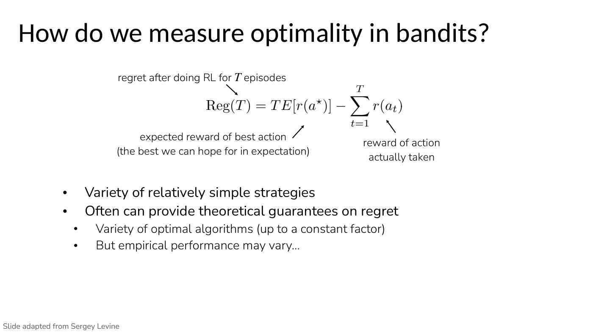
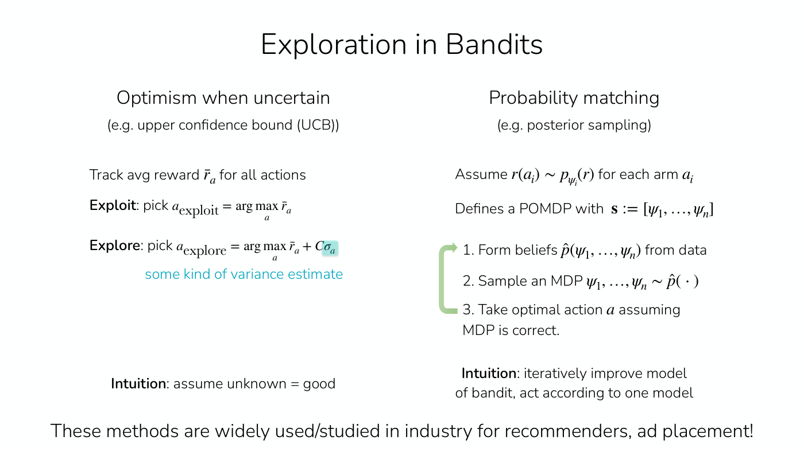
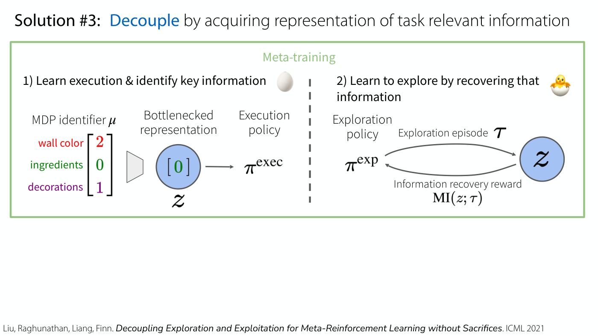

# Exploration

An RL agent learns only from the experience it collects, so what it chooses to try decides what it can
learn. **Exploration** is the problem of finding rewarding behaviour that no single action reveals, and
of deciding whether to try something new or do the best thing known so far. [Lecture 14](14-exploration.md)
teaches it: why it is hard, how it is measured and solved in bandits, why large MDPs rely on
demonstrations and pretrained models instead, and how a meta-RL agent can learn to explore efficiently
(DREAM). [Lecture 6](06-q-learning.md#what-data-to-collect-epsilon-greedy-and-boltzmann-exploration)
introduced the simplest exploration policies, and [Lecture 13](13-meta-rl.md) the problem of learning to
explore in meta-RL.

## Why exploration is hard

RL trained on Breakout, with the score as the reward, produces a performant player; trained on
Montezuma's Revenge it does really badly (Lecture 14, slide 4, ≈0:05–0:50). In Montezuma's Revenge the
rewards, for getting a key or opening a door, are sparse and few and far between, "Finishing the game
only weakly correlates with rewarding events", and the agent does not know what people know at a glance,
that a rolling skull is something to avoid (slide 5, ≈0:50–2:23). Finn's analogy is the card game Mao,
where you are never told the rules, are penalised for breaking them, and can discover them only by trial
and error: an RL agent is like someone whose goal in life is to win 50 games of Mao without being told
so, and tasks get harder the longer they are and the less the agent knows about the rules (slide 6,
≈2:23–3:57).

Lecture 14 gives two definitions of the problem that turn out to be one (slide 7, ≈3:57–5:31): how to
discover high-reward strategies that need "a temporally extended sequence of complex behaviors that,
individually, are not rewarding", and how to decide "whether to attempt new behaviors (to discover ones
with higher reward) or continue to do the best thing it knows so far". **Exploitation** is "doing what
you know will yield highest reward", such as acting greedily on a Q-function; **exploration** is "doing
things you haven't done before, in the hopes of getting even higher reward". Examples: a favourite
restaurant against a new one, the most successful advertisement against a random one, the best known
oil well against a new site (slide 8, ≈5:31–6:19).

## Simple exploration policies

Q-learning is off-policy, and its data should be broad, because the max in its target considers actions
that may have no data (Lecture 6, slide 14, ≈28:48–29:34). So it collects data with an exploration
policy built around the greedy one: **epsilon-greedy** takes a uniformly random action with probability
$\epsilon$ and the greedy action otherwise, often with $\epsilon$ lowered during training; **Boltzmann
exploration** takes actions with probability proportional to the exponentiated Q-value (≈30:19–32:37).
See [Q-learning](q-learning.md#what-data-to-collect) and [policies](policies.md).

Lecture 14's drug-trial game shows the cost of a constant $\epsilon$: long after the agent knows a lot
about the drugs, it still occasionally prescribes a random one, which is a very poor choice, and the
value of $\epsilon$ is a hyperparameter that can drastically affect performance (≈31:07–31:54).

## Bandits: where exploration can be analysed

RL problems run from "theoretically tractable" to "theoretically intractable" (Lecture 14, slide 9,
≈6:19–7:54): multi-armed bandits, contextual bandits, small tabular MDPs, large MDPs with known low-rank
features, and large MDPs without known structure, where most of this course's problems sit and where
both good exploration and its theory are hardest. A **multi-armed bandit** has a horizon of one time
step per episode, no state, and a stochastic reward; choosing a restaurant each evening is one
(≈7:54–9:26).

**Regret** measures how good an exploration algorithm is over the whole learning process (slide 10,
≈9:26–12:32). After $T$ episodes,

$$\mathrm{Reg}(T) = T\thinspace E[r(a^\star)] - \sum_{t=1}^{T} r(a_ t)$$

where $a^\star$ is the best action, $E[r(a^\star)]$ its expected reward, and $r(a_ t)$ the reward of the
action taken in episode $t$. The first term is an oracle, the best one could have done in retrospect. An
algorithm that does not learn, acting at random or always taking the same suboptimal action, has regret
that grows **linearly**; a good one has **sublinear** regret that flattens out once it has explored and
begins to exploit (≈12:32–15:39, from curves Finn draws that the PDF does not hold). Regret is "more of an
object that's used for analysis and not our optimization objective", since computing it requires
knowing the bandit (≈17:58–18:46). Many simple strategies come with guarantees on regret, but "empirical
performance may vary…" (slide 10).

*Lecture 14, slide 10 — regret after T episodes: T times the expected reward of the best action, minus the rewards of the actions actually taken. [Deck](https://cs224r.stanford.edu/spring_2025/slides/14_cs224r_exploration_2025.pdf)*

Two families of bandit strategies (slide 11, ≈20:17–24:53):

- **Optimism when uncertain**, such as the upper confidence bound (UCB). Track each action's average
  reward $\bar{r}_ a$ and, to explore, pick $\arg\max_ a \bar{r}_ a + C\sigma_ a$, where $\sigma_ a$ is "some
  kind of variance estimate" and $C$ a constant: a bonus for uncertainty. The intuition is "assume
  unknown = good"; an action never tried has an effectively infinite variance estimate, so every action
  is tried at least once (≈21:02–22:35). Versions of it have guarantees.
- **Probability matching**, such as posterior sampling (Thompson sampling). Assume each arm's reward
  follows a distribution $p_{\psi_i}(r)$ with unknown parameters, which "Defines a POMDP with
  $\mathbf{s} := [\psi_1, \ldots, \psi_n]$"; then repeatedly form beliefs $\hat{p}(\psi_1, \ldots, \psi_n)$ from
  data, sample an MDP from them, and take the optimal action as if the sample were correct. It is harder
  to give guarantees for but can work pretty well in practice (≈22:35–24:53).

*Lecture 14, slide 11 — optimism when uncertain (UCB) beside probability matching (posterior sampling), the two families of bandit strategies. [Deck](https://cs224r.stanford.edu/spring_2025/slides/14_cs224r_exploration_2025.pdf)*

Both are widely used and studied in industry for recommenders and ad placement (slide 11). In the class's
drug-trial game, played on a website, with around 5,000 patients and 10 drugs, posterior sampling was "by
far the best algorithm", greedy got a lot worse over time, and epsilon-greedy beat UCB with few patients
while UCB did better in the long run, because it makes more sure of exploring more actions (Lecture 14,
≈24:53–31:54).

## Large MDPs: start from demonstrations and base models

A lot of research translates these ideas to large MDPs, for example with reward bonuses for novelty, for
visiting new states or taking new actions, or by modelling different dynamics as posterior sampling does
(Lecture 14, slide 13, ≈31:54–32:40). Finn's view is "somewhat pessimistic": "at the end of the day,
**exploration from scratch in large MDPs is intractable**." A randomly initialized transformer trained on
upvotes would never write anything useful in the vast space of token sequences, and a robot learning to
pour water from scratch would only move its arms around at random (≈32:40–33:26). In practice exploration
comes from:

- **Demonstrations, or base models pretrained on data and demonstrations.** RL has been quite successful
  in language models with a strong base model that already writes coherent sentences, and in robotics
  starting from demonstrations of high-reward behaviour (≈33:26–34:12). Slide 13: "These models are
  *excellent* at exploration!" The initialization biases the agent towards the part of an enormous state
  space that gets high reward (≈34:58–35:44).
- **Shaped rewards wherever feasible**, such as rewards hand-coded in simulation for legged robots, or
  single-step rewards learned from preferences for language models, which give a fairly dense signal
  (slide 13, ≈34:12–34:58).

See [imitation learning](imitation-learning.md), [RLHF](rlhf.md), [reward learning](reward-learning.md)
and [RL for LLM reasoning](llm-reasoning.md).

## Learning to explore: meta-RL

Even a pretrained agent may need to explore when deployed, because it lacks information it needs: finding
the ingredients in a new kitchen, or trying strategies for a hard reasoning problem (Lecture 14, slide 15,
≈35:44–36:29). [Meta-RL](meta-rl.md) trains a policy with memory to explore and exploit in a new task.
Trained end to end, it can in principle learn the optimal strategy, but exploration and execution are
**coupled**: an agent that has not learned to explore never finds what it needs to get reward, and one
that cannot yet do the task gets low reward for any exploration (Lecture 13, slides 29–34; Lecture 14,
slide 16, ≈37:15). Alternative strategies, posterior sampling, intrinsic rewards, and task dynamics and
reward prediction, are easier to optimize but can be arbitrarily suboptimal (Lecture 13, slides 35–37;
Lecture 14, slide 17).

**DREAM** decouples the two while keeping optimality (Lecture 14, slides 18–24, ≈38:01–1:06:44):

1. **Execution**: label each training task with an identifier $\mu_i$. Train an encoder $F(z_i \mid \mu_i)$
   and an execution policy $\pi^{\mathrm{exec}}(\mathbf{a} \mid \mathbf{s}, z_i)$ to maximize reward, with a
   **variational information bottleneck**, Gaussian noise added to $z_i$ and a KL penalty towards the unit
   Gaussian, so that $z_i$ keeps only the information needed to do the task (slides 21–22). This is
   [multi-task RL](multi-task-rl.md), and it does not depend on exploration.
2. **Exploration**: train a model $q(z_i \mid \mathscr{D}_ {\mathrm{tr}})$ that predicts $z_i$ from the experience
   $\mathscr{D}_ {\mathrm{tr}}$ an exploration policy $\pi^{\exp}$ collects, and reward $\pi^{\exp}$ at each step
   with the information it gained, the drop in that model's prediction error from $\tau_{1:t-1}$ to
   $\tau_{1:t}$ (slide 23). Exploration aims to identify the task-relevant information, not to earn task
   reward.

*Lecture 14, slide 20 — DREAM's two steps: bottleneck the task identifier to the task-relevant z for the execution policy, then reward the exploration policy for episodes that recover z. [Deck](https://cs224r.stanford.edu/spring_2025/slides/14_cs224r_exploration_2025.pdf)*

At test time the exploration policy explores, the model infers $z$, and the execution policy exploits.
DREAM's objective is consistent with end-to-end optimization under mild assumptions; on a bandit-like
problem where one arm reveals which arm pays, it needs $\mathcal{O}(|\mathcal{A}| \log |\mathcal{A}|)$
samples against $\Omega(|\mathcal{A}|^2 \log |\mathcal{A}|)$ for end-to-end $\text{RL}^2$, with
$|\mathcal{A}|$ the number of arms (slide 24); and on a sparse-reward 3D navigation task, where a sign
names the goal's colour, it reaches near-optimal returns while end-to-end methods stay at zero (slides
25–26). Its cost is that it "requires task identifier" during training (slide 28). Students implement it
in Homework 4 (≈1:04:26). Applied to student programs in CS106A, a DREAM exploration policy that probes
games for bugs made grading 44% faster and 6% more accurate (slides 30–32, ≈1:09:49–1:12:08).

## Where this appears

- [Lecture 14 — Exploration](14-exploration.md): the whole topic, with the game, the questions and the
  experiments.
- [Lecture 6 — Q-Learning](06-q-learning.md#what-data-to-collect-epsilon-greedy-and-boltzmann-exploration):
  epsilon-greedy and Boltzmann exploration.
- [Lecture 13 — Meta RL](13-meta-rl.md#exploration-in-meta-rl-end-to-end-optimization): learning to
  explore end to end, the coupling problem, and the alternative strategies.
- [Meta-RL](meta-rl.md): exploration in meta-RL, including DREAM, as a topic.
- [MDPs and notation](mdp-and-notation.md#notation-for-exploration): the notation for bandits, regret and
  DREAM.
