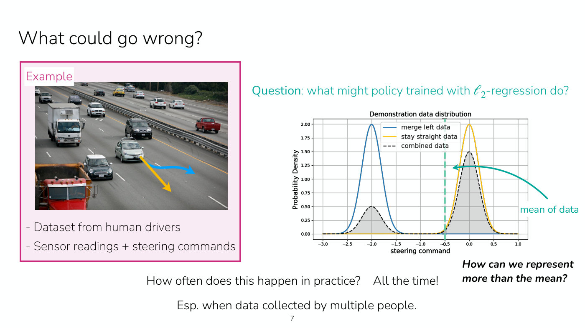
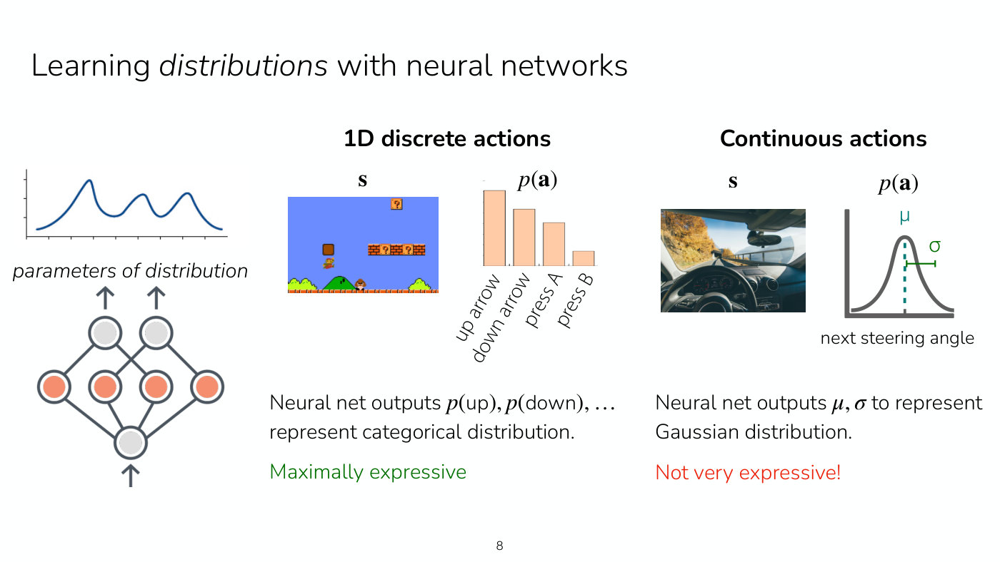
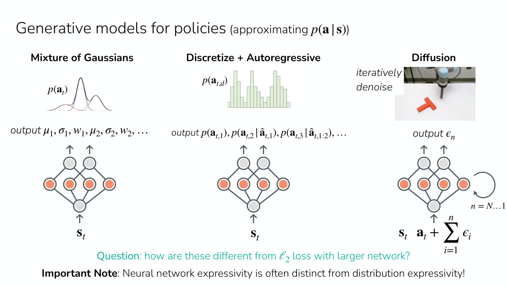
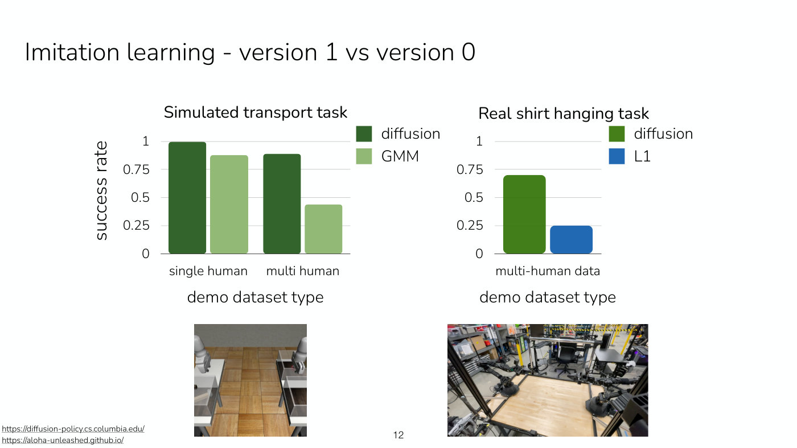

# Expressive policy distributions

A policy $\pi_\theta(\mathbf{a} \mid \mathbf{s})$ is a distribution over actions $\mathbf{a}$ given
a state $\mathbf{s}$, with network parameters $\theta$. How much of a behavior it can capture
depends not only on the network but on the **class of distribution** the network's outputs
describe. Lecture 2 develops this for imitation learning; the ideas are general to any policy
represented as a generative model, which Lecture 1 anticipates (slide 39). Symbols follow
[MDPs and RL notation](mdp-and-notation.md).

## Why a policy needs more than a mean

Demonstrations are often **multimodal**: in the same situation some drivers stay straight and
others merge left, so the steering commands in the data form two peaks (Lecture 2, slide 7,
≈7:47–10:05). A deterministic policy trained by squared-error regression predicts the **mean**
action. Here that falls between the peaks, an action with very low probability under the data and
a bad one in practice, since it might straddle the lane lines. Slide 7's chart shows the mean of
the combined data at a steering command of about $-0.5$, between peaks at $-2$ and $0$. This
happens "all the time", especially when data is collected by several people with different, often
unobservable, preferences (≈13:13).

*Slide 7 — the multimodal steering data: blue merge-left and yellow stay-straight demonstrations, their black dashed mixture, and the teal mean near minus 0.5 that an L2-trained policy predicts and almost no driver took. [Deck](https://cs224r.stanford.edu/spring_2025/slides/02_cs224r_imitation_2025.pdf)*

The remedy is to have the network output the **parameters of a distribution** over actions rather
than a single action (Lecture 2, slide 8, ≈14:43–15:30). Those parameters depend on the state, so
the policy can be multimodal in one state and unimodal in another (≈20:07–20:52).

*Slide 8 — a network that outputs a distribution's parameters: a categorical over Mario's buttons is maximally expressive, a single Gaussian over the steering angle is not. [Deck](https://cs224r.stanford.edu/spring_2025/slides/02_cs224r_imitation_2025.pdf)*

## The distribution classes

**Categorical (discrete actions).** For a one-dimensional discrete action, such as a game's buttons,
the network outputs a probability for each action. Learning it is like classification, and it is
**maximally expressive**: there is no distribution over those actions it cannot represent (Lecture
2, slide 8, ≈16:16–17:02).

**Gaussian (continuous actions).** The natural choice for a continuous action outputs a mean $\mu$
and standard deviation $\sigma$. Outputting only the mean is the same as minimizing squared error.
Outputting $\sigma$ as well does not help with two modes: the network just widens the Gaussian to
cover more probability mass. Slide 8's verdict is "Not very expressive!" (≈17:02–17:47).

**Mixture of Gaussians.** The network outputs the mean, standard deviation and weight of each of
several Gaussian components, $\mu_1, \sigma_1, w_1, \mu_2, \sigma_2, w_2, \ldots$ (Lecture 2,
slide 10, ≈23:10–23:57). One way to measure expressivity is how many distributions a class can
represent perfectly. A Gaussian mixture model (GMM) can represent any single Gaussian and any
combination of Gaussians, so it is **strictly more expressive** than one Gaussian (≈24:43). The
number of components is a hyperparameter, chosen in advance by checking how well different numbers
fit the data (≈25:30).

*Slide 10 — three generative policies side by side: a Gaussian mixture's means, widths and weights; a discretized action predicted one dimension at a time; and diffusion's loop that denoises an action over N steps. [Deck](https://cs224r.stanford.edu/spring_2025/slides/02_cs224r_imitation_2025.pdf)*

**Discretize + autoregressive.** This is the language-model approach (Lecture 2, ≈25:30–36:18).
Continuous, multi-dimensional actions are first discretized: each dimension's range is cut into
bins, and the network outputs a probability per bin, a staircase approximation of the true
distribution. Finer bins represent more but require more outputs (≈27:48–29:21). The dimensions are
then predicted one at a time, each conditioned on those already chosen, by a sequence model such as
a transformer that feeds each sampled dimension back in (≈30:07–33:14). Slide 10 writes the
outputs as
$p(\mathbf{a}_ {t,1}), p(\mathbf{a}_ {t,2} \mid \hat{\mathbf{a}}_ {t,1}), p(\mathbf{a}_ {t,3} \mid \hat{\mathbf{a}}_ {t,1:2}), \ldots$,
where $\mathbf{a}_ {t,d}$ is dimension $d$ of the action at time $t$. In Lecture 2's driving example
the first dimension is the steering angle and the second the acceleration, whose distribution
should depend on whether the car is merging (≈29:21–30:52).

- The bars can take any heights, so a discretized distribution can be far more expressive than a
  Gaussian mixture, up to the fineness of the bins (≈35:31).
- Predicting one dimension at a time is what keeps it tractable. A table over every combination of
  bins would blow up: with 100 bins in each of 10 dimensions it has $100^{10}$ cells (the recording
  says "10 to the fifth", ≈35:31).
- The order of the dimensions does not change the expressive power in principle, because the
  target is the full joint distribution. It is chosen by hand or as a hyperparameter; for a robot
  arm, the kinematic chain from the base outward is a natural order (≈34:00–34:45).
- It scales to fairly long sequences of actions, as language models do (≈43:58).

**Diffusion.** Diffusion is especially appealing for continuous, including high-dimensional,
actions (Lecture 2, ≈43:58–44:44). It starts from complete noise and denoises iteratively until it
produces a clean action. On slide 10 the network takes the state $\mathbf{s}_ t$ and a noisy action
$\mathbf{a}_ t + \sum_{i=1}^{n} \epsilon_i$, outputs $\epsilon_n$, and loops for $n = N \ldots 1$.
Like the autoregressive model it is iterative, over denoising steps rather than over action
dimensions. Lecture 2 does not go into the details of how diffusion models are trained (≈20:52).

## Training: maximum likelihood

All of these are trained by the same objective: maximize the probability of the demonstrated
actions under the policy, or equivalently minimize their negative log-likelihood (Lecture 2,
slide 11, ≈37:48–38:34), given a dataset $\mathcal{D}$ of demonstrations,

$$\min_\theta - \mathbb{E}_ {(\mathbf{s}, \mathbf{a}) \sim \mathcal{D}} \left[ \log \pi_\theta(\mathbf{a} \mid \mathbf{s}) \right]$$

For a Gaussian mixture, write down its density and differentiate with respect to the means,
variances and weights the network outputs (≈38:34). For a discretized autoregressive model, bin
each demonstrated action and apply a **cross-entropy loss** to each dimension, a classification
problem per dimension (≈31:41, ≈39:20–40:54). During training the earlier dimensions fed into the
network are the dataset's; at test time they are the network's own samples (≈40:08). Back-propagation
is unaffected by discreteness, because only the labels are discrete; the outputs are continuous
probabilities (≈42:25–43:12).

Cross-entropy treats a neighbouring bin as just as wrong as a distant one. In practice networks
tend to learn the structure fairly quickly, but this may cost data, makes the bin width an
important hyperparameter, and can be eased by smoothing the labels so they are not one-hot
(≈40:54–41:39).

The same log-likelihood reappears in reinforcement learning. Lecture 3 implements the
[policy gradient](policy-gradients.md) as a surrogate objective that weights each action's
log-probability by its reward, "weighted maximum likelihood": a cross-entropy loss for a
discrete-action policy, something like a squared error for a Gaussian policy, and more
sophisticated policies such as diffusion can be used too (slide 18, ≈53:56).

## Network expressivity is not distribution expressivity

Why not keep squared error and use a bigger network? Because however large the network, it still
outputs only a mean (Lecture 2, ≈44:44–45:31). A network that outputs distribution parameters has
two separate expressivities: how many functions from states to parameters it can represent, and how
many distributions those parameters can describe. A network outputting a mean and a variance can
represent the map from state to mean and variance very expressively, but never anything more
complex than a Gaussian (≈46:16–47:02). In slide 10's words: "Neural network expressivity is often
distinct from distribution expressivity!"

## Evidence

Lecture 2 cites two comparisons (slide 12, ≈47:51–50:10). On a simulated transport task, diffusion
reached a success rate of about 1.0 with data from one person and about 0.88 with data from several,
against about 0.87 and 0.43 for a Gaussian mixture: the less expressive distribution suffered much
more from diverse data. On a real shirt-hanging task with data from many people, diffusion reached
about 0.70 and a deterministic policy trained with an $\ell_1$ loss about 0.25.

*Slide 12 — success rates: diffusion holds up on multi-human transport data where the GMM falls to about half, and beats an L1-trained deterministic policy on real shirt hanging, about 0.70 to 0.25. [Deck](https://cs224r.stanford.edu/spring_2025/slides/02_cs224r_imitation_2025.pdf)*

Deployed systems use the same classes (Lecture 2, ≈50:10–50:56): diffusion in Physical
Intelligence's $\pi_0$, NVIDIA's Gr00t N1 and Figure's Helix, and discretized autoregressive
prediction in OpenVLA, Waymo's EMMA and Wayve's LINGO-2. The lecture's [deployed systems
section](02-imitation-learning.md#expressive-policies-in-deployed-systems) shows the slides.

Lecture 7 points to IDQL, a variant of implicit Q-learning for offline RL "that uses diffusion policies
for your policy class", which "also works quite well" (slide 32, ≈1:06:42–1:07:30). See
[implicit policy constraint methods](implicit-policy-constraints.md).

Lecture 18 adds a reason from data collection. In batch online RL, where a large batch of data is collected
with one policy before each update, Dong et al. (2025) found that "using more expressive policies like
diffusion policies was really, really important for effective reinforcement learning in this sort of batch
online setting" (Lecture 18, ≈18:36). Their average score was 40 for a diffusion policy against 18 for a
Gaussian one before RL, and 74 against 43 after it (Lecture 18, slide 15). A fully online learner gets
diverse data anyway because its policy keeps changing, but "in the more batch setting you don't have the
luxury of changing your policy so frequently" (≈18:36). See
[Lecture 18](18-frontiers.md#scaling-up-longer-horizons-and-less-online-data).

## Where this appears

- [Lecture 1 — Class Intro](01-class-intro.md#aside-why-stochastic-policies): why policies are
  stochastic, and the pointer to generative modeling.
- [Lecture 2 — Imitation Learning](02-imitation-learning.md#learning-distributions-with-neural-networks):
  the full development, with the student questions.
- [Lecture 3 — Policy Gradients](03-policy-gradients.md#implementing-it-the-surrogate-objective):
  the log-likelihood weighted by reward.
- [Policies](policies.md) and [imitation learning](imitation-learning.md).
- [Lecture 7 — Offline RL](07-offline-rl.md#which-offline-rl-algorithm-to-use): IDQL, an offline RL
  method with diffusion policies.
- [Lecture 18 — Frontiers](18-frontiers.md#scaling-up-longer-horizons-and-less-online-data): diffusion
  policies against Gaussian ones in batch online RL.
