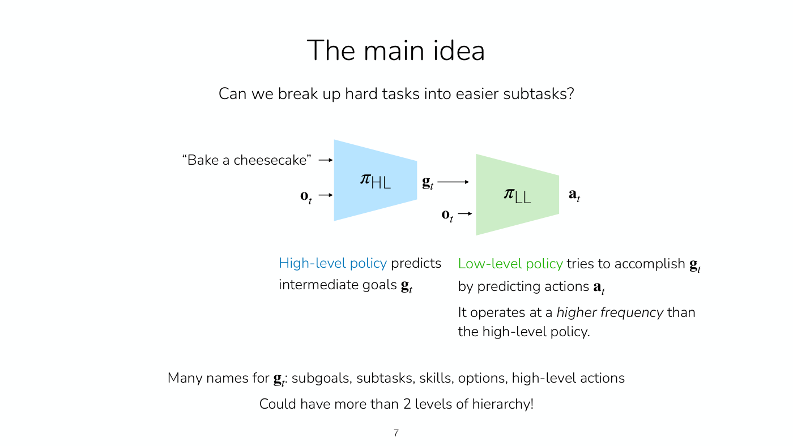
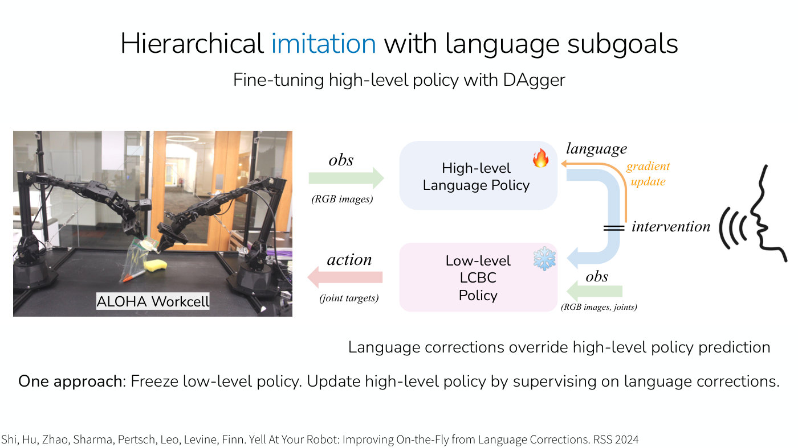

# Hierarchical RL and imitation

A long-horizon task, such as cooking a meal, fixing a bug that makes a training loss explode or driving
to Yosemite, takes many steps, often in some order. **Hierarchy** tackles such tasks by splitting the
policy in two: a high-level policy that chooses intermediate goals and a low-level policy that pursues
the current goal by choosing actions. [Lecture 15](15-hierarchical-rl.md) teaches it for both imitation
learning and RL: why long-horizon tasks are hard, why hierarchy may help, three design choices (how to
represent the goals, how to supervise each level, when to move on to the next goal) and example systems.
It builds on the task- and goal-conditioned policies of [multi-task RL](multi-task-rl.md), which serve
as the low level.

## Why long-horizon tasks are hard

Lecture 15's slide 5 gives three reasons (≈2:26–4:44). The agent visits a very large number of states
and must decide well in every one, so the policy must succeed on a broad distribution. It has many
opportunities to make mistakes, each of which it must recover from. And it has many opportunities to get
"stuck": a mistake that makes no progress can return it to the same state, where a policy keeps making
the same mistake and never moves towards the goal. Lecture 12 had already named sparse rewards and the
many ways of completing a task as challenges of long horizons
([Lecture 12](12-multi-task-rl.md#examples-of-multi-task-imitation-learning), ≈56:15–57:02).

## The two-level policy

The high-level policy $\pi_{\text{HL}}$ takes the task (for example "Bake a cheesecake") and the
observation $\mathbf{o}_ t$ and "predicts intermediate goals $\mathbf{g}_ t$"; the low-level policy
$\pi_{\text{LL}}$ takes the goal and the observation and "tries to accomplish $\mathbf{g}_ t$ by predicting
actions $\mathbf{a}_ t$" (Lecture 15, slide 7, ≈7:49–8:37). The low level acts at the original frequency,
perhaps 20 hertz for a robot or word by word for a language model; the high level predicts goals on a
coarser time scale, for instance once a paragraph or a trip to the store is done (≈8:37–9:23). The goals
go by many names, "subgoals, subtasks, skills, options, high-level actions": actions for a policy that
operates at a higher level of abstraction. There can be more than two levels (slide 7, ≈9:23–10:09).

*Lecture 15, slide 7 — the high-level policy (blue) turns the task and observation into a goal, and the low-level policy (green) turns the goal and observation into actions, at a higher frequency. [Deck](https://cs224r.stanford.edu/spring_2025/slides/15_cs224r_hierarchy_2025.pdf)*

To run it (Lecture 15, slide 8, ≈10:09–12:27), the agent observes $\mathbf{o}_ 1$, plans a goal
$\mathbf{g}_ t$ from $\pi_{\text{HL}}(\cdot \mid \mathbf{o}_ t, \text{prompt})$, and, until a new goal is
selected, executes actions from $\pi_{\text{LL}}(\cdot \mid \mathbf{o}_ t, \mathbf{g}_ t)$, advancing
$t$ and observing each new $\mathbf{o}_ t$; then it plans a new goal from the latest state.

## Why hierarchy may help

Lecture 15's slide 9 gives four reasons (≈12:27–14:46). The low level's goal-reaching objective is an
intermediate **supervision signal** that guides the agent towards the long task; in RL it replaces a
reward that would otherwise come only at the very end, and in imitation it keeps a policy from
oscillating between subtasks (≈17:53–19:24). The goal-conditioned low level shares knowledge **more
directly across similar subtasks** than one flat policy trained on the whole task. In RL, a high level that
proposes goals **structures exploration** in the higher-level goal space (see
[exploration](exploration.md)). And reasoning about the next step can run at a **lower frequency** than
acting, which saves compute.

A single policy can keep some of this. A chain-of-thought policy first predicts the goal and then the
action, $\mathbf{g}_ t$ then $\mathbf{a}_ t$; it "Can benefit from same supervision!", but it "May be too
computationally expensive (e.g. 50 Hz control)", and there is "No conclusive empirical comparison (yet)."
(Lecture 15, slides 10–11, ≈16:20–17:53). Chain of thought is also how language models reason through
intermediate steps (≈45:27); see [RL for LLM reasoning](llm-reasoning.md).

## Representing the goals

Goal representations "will likely be domain specific!" (Lecture 15, slide 14, ≈22:27–24:46): GPS
waypoints for a bike crossing campus, natural language ("beat the eggs") or an image of the desired
result for cooking, language for booking a vacation (≈20:56–22:27). Good ones are **expressive**, able to
"communicate many different low-level behaviors"; **structured**, so that "similar behaviors should have
similar $\mathbf{g}$", as nearby GPS coordinates call for similar actions while bare subtask labels do not;
and at an **appropriate level of abstraction**, neither the exact velocity for the next second nor "go to
the quad". Both levels usually see the full state (≈24:46–25:31).

## Supervising each level

Trained end to end with a latent goal, the two levels are just "a flat policy" with a particular
architecture (Lecture 15, slide 16, ≈28:36–30:10), so the benefit has to come from somewhere identifiable,
additional supervision or structured exploration. With explicit goals, the low level is "Trained to
accomplish $\mathbf{g}$, not the original task!" and the high level is "Trained to accomplish original,
long-horizon task" (slide 17). Trained completely independently, the skills may not chain: a skill trained
from states the high level would never send it from, or a gap between where one skill ends and the next can
start, leaves the full task brittle; the low level only needs to work for the state-goal pairs the high level
will command, but successive skills need overlapping states, ideally with a buffer (≈30:57–35:32). Hence
slide 18's "Key": the levels "Can be trained separately first. But, at least one policy should be adapted to
the deficiencies of the other." Language models are "often good high-level policies!", but still need
adapting: one that ignores the camera image might tell a robot standing at a coffee machine to go and buy
coffee at Starbucks (≈37:04–38:35).

## When to move on to the next goal

The high level can be re-queried when the low level reports that it has completed the goal, through a
success classifier or progress estimate, or after a fixed number $n$ of timesteps (Lecture 15, slide 21,
≈39:21–44:41). The first is "ideal in principle" and saves compute, but it is hard to tell when a subtask is
done and to notice when a past goal must be redone, and its errors are "more fatal": the agent can get
perpetually stuck. The second is "simple", trading compute against delay, and a wrong subtask only costs
$n$ steps of wrong actions. Most systems therefore re-query at a fixed, fairly frequent interval.

## Example systems

Recent robot systems, Physical Intelligence's $\pi_{0.5}$, NVIDIA's Gr00t N1, Figure's Helix and Gemini
Robotics, all pair a slower higher-level model that predicts intermediate goals with a faster lower-level
model that predicts actions (Lecture 15, slides 23–24, ≈44:41–46:16).

**Hierarchical imitation with language subgoals** trains both levels on long demonstrations cut into
segments, each labelled with a language command (slide 27, ≈46:16–48:33). DAgger on the high level then
works in language space: with the low level frozen, a person's spoken corrections override the high level's
commands and become its training data, so it adapts to the low level's deficiencies (slides 28–30,
≈50:07–51:39; DAgger is from [imitation learning](imitation-learning.md#fixing-it-with-corrective-data)).
In the comparison Lecture 15 shows, hierarchy beat a flat policy by 34% in task progress, and high-level
DAgger lifted final task performance from about 27 to about 51, near a human-correction oracle at about 55
(slide 34, ≈53:56–54:41).

*Lecture 15, slide 30 — DAgger in language space: the low-level policy is frozen, a person's spoken correction overrides the high-level policy's language output, and the correction becomes a gradient update for the high-level policy. [Deck](https://cs224r.stanford.edu/spring_2025/slides/15_cs224r_hierarchy_2025.pdf)*

**Hierarchical imitation with image subgoals** has the high level generate a goal image with an
image-editing model and the low level act as a goal-image-conditioned policy, a multi-step inverse model
(slide 38, ≈55:27–57:00). It needs no language labels, and its high level can learn from unlabeled video:
adding videos of humans raised SuSIE's averages from 0.30 to 0.50 and from 0.80 to 0.88 on two scenes
(slide 40, ≈58:34–59:20). Chain-of-thought versions predict plans, subtasks, subgoal images, bounding boxes
or waypoints before the action (slide 41). Fine-tuning such large hierarchical systems with RL is "an open
(and important!) research direction" (slide 41, ≈1:00:05–1:00:50).

**Hierarchical RL** has used state-reaching goals, with a goal-conditioned low level, a high level whose
actions are goal states, hindsight relabeling of those high-level actions and an off-policy algorithm, on an
ant that must push blocks aside or into a gap before reaching its target; and language goals, with hindsight
relabeling in language space, for simple object-arranging tasks (slide 43, ≈1:05:28–1:07:44; see
[hindsight relabeling](hindsight-relabeling.md)). Discovering useful skills without supervision, which could
then be sequenced, is an active research area that is hard to scale to very large state spaces (slide 44,
≈1:07:44–1:09:15).

## Where this appears

- [Lecture 15 — Hierarchical RL and IL](15-hierarchical-rl.md): the whole topic, with the think-pair-share,
  the pasta example, the videos and the questions.
- [Lecture 12 — Multi-Task RL](12-multi-task-rl.md#examples-of-multi-task-imitation-learning): the question on
  whether a multi-task policy is hierarchical, and what makes a task long-horizon.
- [Multi-task RL](multi-task-rl.md): the task- and goal-conditioned policies that serve as the low level.
- [Hindsight relabeling](hindsight-relabeling.md): relabeling goals, here applied to the high level's actions and
  to language.
- [Imitation learning](imitation-learning.md): behavior cloning and DAgger, which hierarchical imitation uses at
  both levels.
- [Policies](policies.md#hierarchical-policies): the two-level policy among the course's kinds of policy.
- [MDPs and notation](mdp-and-notation.md#notation-for-hierarchy): the notation for the two levels.
- [Lecture 1 — Class Intro](01-class-intro.md): long-horizon tasks and hierarchy among the course's open problems.
