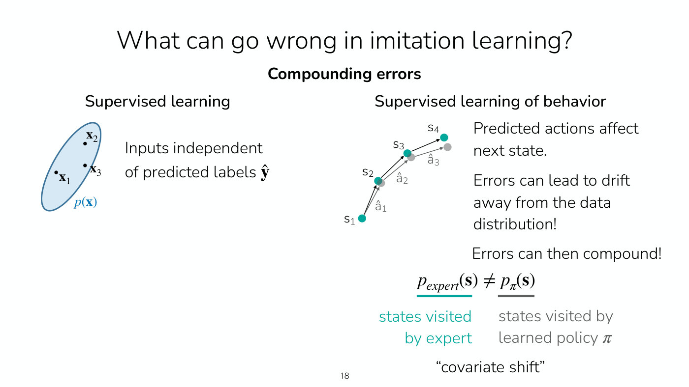
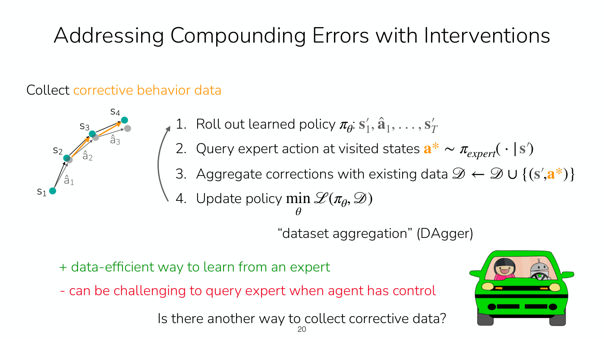
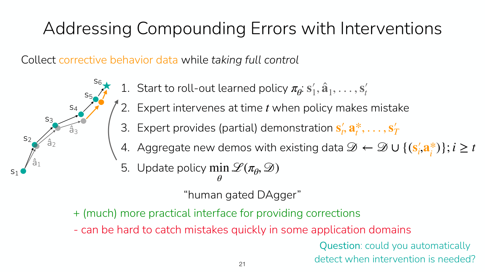
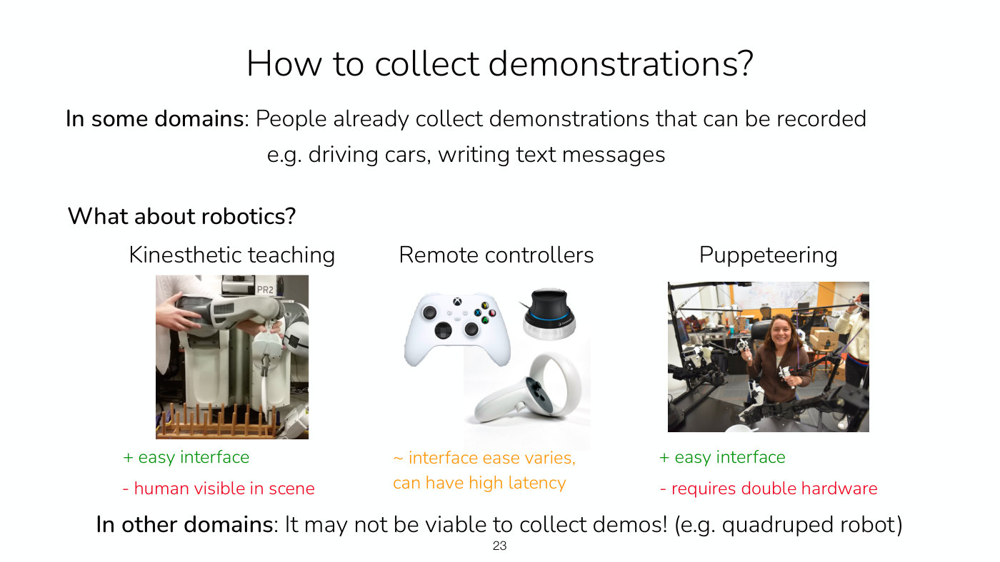
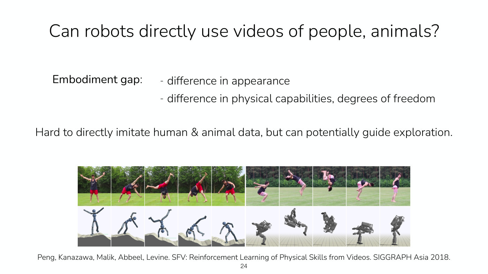

# Imitation learning

Imitation learning learns a policy by mimicking demonstrations of the task, rather than by
maximizing a reward the agent observes. Lecture 1 lists it as the first of the course's
[algorithm families](rl-algorithm-families.md), "mimic a policy that achieves high reward"
(slide 41), and Lecture 2 develops it: behavior cloning, why it needs expressive policies, why its
errors compound, and how corrective data from DAgger and its human-gated variant fixes that.
Symbols follow [MDPs and RL notation](mdp-and-notation.md).

## The problem

The goal is the same as in reinforcement learning: a policy that achieves high reward and does the
task well. The data is a set of trajectories collected by an expert, called **demonstrations**
(Lecture 2, ≈2:23). They are treated as samples from an **unknown** expert policy, since
nobody knows exactly how, say, a human driver decides; the goal is to learn a policy $\pi_\theta$
that performs at the level of the expert by mimicking what is in the data (≈3:55).

The dataset of demonstrations is written

$$\mathcal{D} := \lbrace(\mathbf{s}_ 1, \mathbf{a}_ 1, \ldots, \mathbf{s}_ T)\rbrace \quad \text{sampled from } \pi_{\text{expert}}$$

where each element is one demonstration, a sequence of states $\mathbf{s}_ t$ and actions
$\mathbf{a}_ t$. Lecture 2's running example is driving: record a car's sensors and the human
driver's steering commands and acceleration, and train an autonomous agent to mimic them (≈3:09).

The demonstrations are assumed to be good, but not necessarily optimal; in messy real-world
problems the optimal policy may be out of reach anyway (Lecture 2, ≈19:20). Imitation learning
aims to **match** the demonstrator, not to beat it. Doing better is where reinforcement learning
comes in, or curating the dataset to keep more of the better behavior (≈20:07), and the best
performance of the methods below is upper-bounded by the expert's (≈1:04:45).

## Behavior cloning

Training a policy on the demonstrations as a supervised learning problem is often called
**behavior cloning (BC)** (Lecture 2, slide 25).

**Version 0** trains a deterministic policy by regression to the expert's actions, then deploys it
(Lecture 2, slide 6, ≈3:55–7:01). With $\hat{\mathbf{a}} = \pi_\theta(\mathbf{s})$ the policy's
predicted action, it minimizes

$$\min_\theta \frac{1}{|\mathcal{D}|} \sum_{(\mathbf{s}, \mathbf{a}) \in \mathcal{D}} \lVert \mathbf{a} - \hat{\mathbf{a}} \rVert^2$$

by ordinary mini-batch stochastic gradient descent (≈6:14). This learns the **mean** of the
expert's actions in each state. That is fine when the data comes from one demonstrator with a
consistent strategy (≈13:58), but demonstrations are often **multimodal**, and then the mean can be
an action nobody took: averaging drivers who stay straight with drivers who merge left gives a car
that straddles the lane line (≈8:32–10:05). Lecture 2 says this happens "all the time", especially
when several people collect the data (slide 7).

*Slide 7 — the multimodal steering data: blue merge-left and yellow stay-straight demonstrations, their black dashed mixture, and the teal mean near minus 0.5 that an L2-trained policy predicts and almost no driver took. [Deck](https://cs224r.stanford.edu/spring_2025/slides/02_cs224r_imitation_2025.pdf)*

**Version 1** makes the policy an expressive distribution and trains it as a generative model of the
expert's actions, by maximum likelihood (Lecture 2, slide 11, ≈47:02):

$$\min_\theta - \mathbb{E}_ {(\mathbf{s}, \mathbf{a}) \sim \mathcal{D}} \left[ \log \pi_\theta(\mathbf{a} \mid \mathbf{s}) \right]$$

which the slide glosses as "maximize the log probability of the demo actions under the policy". The distribution
classes that make this work (Gaussian mixtures, discretized autoregressive models, diffusion) and
the evidence that they matter are on [expressive policy distributions](expressive-policy-distributions.md).

Behavior cloning is **fully offline**: it uses only the existing dataset and never runs the policy
to collect data (Lecture 2, slide 16, ≈51:42). It also needs **no reward function**, which helps
where rewards are hard to write down, as in driving (≈52:29–53:14). Its weakness is data: it may
need a lot of demonstrations for reliable performance (slide 16). See
[offline and online algorithms](offline-and-online.md).

## Compounding errors and covariate shift

In supervised learning the model's inputs come from a fixed dataset and are independent of its
predictions. In imitation learning they are not, because **predicted actions affect the next
state** (Lecture 2, slide 18, ≈54:46–57:06). A learned policy will make some mistake, perhaps a
small one, and land in a state the demonstrations barely cover. There it is more likely to make
another mistake, which takes it further from the data, where it may make a bigger one. Errors
**compound** as the policy rolls out.

*Slide 18 — why imitation is not ordinary supervised learning: on the right, the grey states reached by the policy's predicted actions drift further from the teal expert states at every step. [Deck](https://cs224r.stanford.edu/spring_2025/slides/02_cs224r_imitation_2025.pdf)*

The states the learned policy visits therefore come from a different distribution than the states
the expert visited,

$$p_{\text{expert}}(\mathbf{s}) \neq p_\pi(\mathbf{s})$$

which is called **covariate shift**, a kind of distribution shift (Lecture 2, ≈57:06). Fitting the
expert's distribution well reduces the problem (a mean-only policy compounds errors even more), but
does not remove it (≈57:53).

## Fixing it with corrective data

One remedy is to collect a great deal of demonstration data and "hope for the best", which is not
a terrible solution if you can afford it. The other, popular in practice, is to collect
**corrective behavior data**: examples of the right action from the states the *policy* reaches
when it drifts, so it learns how to get back (Lecture 2, ≈57:53–59:24). Corrections
should cover diverse situations; corrections gathered in one narrow setting (only on one campus,
say) can make the policy overfit to it (≈59:24, ≈1:06:16).

**DAgger** (dataset aggregation) does this in a loop (Lecture 2, slide 20, ≈1:00:56–1:02:27). Roll
out the learned policy, $\mathbf{s}'_ 1, \hat{\mathbf{a}}_ 1, \ldots, \mathbf{s}'_ T$. Query the expert
for the action at each visited state, $\mathbf{a}^{\ast} \sim \pi_{\text{expert}}(\cdot \mid \mathbf{s}')$.
Aggregate, $\mathcal{D} \leftarrow \mathcal{D} \cup \lbrace(\mathbf{s}', \mathbf{a}^{\ast})\rbrace$,
update the policy, and repeat, since the new policy may fail in new ways. It is data-efficient,
but labelling every visited state can be hard or impossible: a person has to say what steering
command the car *should* have used at each moment of a drive they did not control (≈1:02:27).

*Slide 20 — DAgger's loop: roll out the policy, ask the expert for the right action at each visited state, add those labels to the dataset, retrain, and repeat. [Deck](https://cs224r.stanford.edu/spring_2025/slides/02_cs224r_imitation_2025.pdf)*

**Human-gated DAgger** (HG-DAgger) asks less of the expert (Lecture 2, slide 21,
≈1:03:13–1:06:16). The policy runs until the expert sees a mistake and takes full control; the
expert's partial demonstration from that state onward,
$\mathbf{s}'_ t, \mathbf{a}^{\ast}_ t, \ldots, \mathbf{s}'_ T$, is added to the dataset, and the
policy is retrained. It is a much more practical interface, and it is how driving companies use
safety drivers. Its weakness is catching mistakes in time: a sudden, drastic action can be
impossible to prevent, and safety drivers have failed to prevent major mistakes.

*Slide 21 — human-gated DAgger: the policy drifts for three steps, then the expert takes control (orange) and steers to the goal state, and that partial demonstration joins the dataset. [Deck](https://cs224r.stanford.edu/spring_2025/slides/02_cs224r_imitation_2025.pdf)*

Both are **online**: they run the policy to collect data, so they need an interface through which
a human or expert can intervene (slide 25).

## Trade-offs in summary

Lecture 2's summary slide (slide 25) weighs the approaches; the recording ends before the lecture
reaches it.

| Approach | Data from the policy | For | Against |
| --- | --- | --- | --- |
| Offline BC | none (offline) | simple; no online data, which can be unsafe or expensive; no reward function | may need an impractically large amount of data for reliable performance |
| DAgger, HG-DAgger | online, with expert intervention | a possible path to reliable performance; more data-efficient than offline BC; no reward function | needs an intervention interface; querying or catching mistakes can be hard |

Neither provides a framework for improving on its own, from practicing, and the slide ends:
"Many successful methods **combine** imitation learning and reinforcement learning!"

## Collecting demonstrations

This part of Lecture 2 is on the slides only; the recording ends before it. In some domains people
already produce demonstrations that can be recorded, such as driving or writing text messages
(slide 23). For robots there are three interfaces: kinesthetic teaching (easy, but the human is
visible in the scene), remote controllers such as game controllers, 3D mice and VR controllers
(ease varies, latency can be high), and puppeteering with leader arms (easy, but double the
hardware). In other domains, such as quadruped robots, collecting demonstrations may not be viable.
Videos of people and animals are hard to imitate directly because of the **embodiment gap** in
appearance, physical capabilities and degrees of freedom, but they can potentially guide
exploration (slide 24).

*Slide 23 — three ways to collect robot demonstrations and their trade-offs: kinesthetic teaching, remote controllers, and puppeteering with handheld leader arms. [Deck](https://cs224r.stanford.edu/spring_2025/slides/02_cs224r_imitation_2025.pdf)*

*Slide 24 — the embodiment gap: video frames of a person's cartwheel and backflip above simulated characters reproducing them, from SFV (Peng et al., 2018). [Deck](https://cs224r.stanford.edu/spring_2025/slides/02_cs224r_imitation_2025.pdf)*

## Relation to policy gradients

Lecture 3 opens by recalling the imitation objective and its limits: it is a simple, scalable
approach, but it cannot outperform the demonstrator and does not allow improvement from practice
(slide 4, ≈0:54–1:40). Policy gradients address that, and they turn out to be closely related. The
policy gradient's first factor is exactly the gradient of the imitation objective,
$\sum_t \nabla_\theta \log \pi_\theta(\mathbf{a}_ {i,t} \mid \mathbf{s}_ {i,t})$, so a policy
gradient is the **imitation gradient weighted by reward**, applied to the policy's own rollouts
rather than to an expert's demonstrations (slide 11, ≈21:16–22:50). Imitation learning, by
contrast, imitates all of its data blindly and assumes it is good (≈23:36). In implementation the
connection is literal: the policy gradient's surrogate objective is "weighted maximum likelihood",
a cross-entropy or squared-error loss weighted by reward (slide 18).

*Lecture 3, slide 11 — the policy gradient beside imitation learning's gradient, with the shared term shaded teal: the policy gradient is the imitation gradient weighted by each trajectory's reward. [Deck](https://cs224r.stanford.edu/spring_2025/slides/03_cs224r_policy_gradients_2025.pdf)*

The two also combine in practice. A policy can be initialized with imitation learning and then
improved with policy gradients, which can be a very good fit when demonstrations are available,
since a randomly initialized policy does random things (≈24:23–25:09; slide 6 lists imitation
learning as one way to initialize the policy). See [policy gradients](policy-gradients.md).

## Imitation as an offline RL baseline

Lecture 7 returns to imitation learning as a way to learn from a fixed dataset. It avoids the central
failure of [offline RL](offline-rl.md), overestimated Q-values on actions the data never contains,
because it only supervises with actions that are seen in the data (≈26:30). But it cannot outperform
the expert, or what the data provides, and where two trajectories cross it averages their action
distributions instead of stitching the good start of one to the good finish of the other (Lecture 7,
slide 14, ≈27:15–29:33). Lecture 7's offline methods add reward information to the imitation
objective. **Filtered behavior cloning** imitates only trajectories whose return clears a threshold,
"a very primitive approach to using reward information" and "a **good baseline** to test against"
(slide 15). **Advantage-weighted** methods weight each transition's log-likelihood by its
exponentiated advantage (slide 16). When the behavior policy is deterministic, every advantage is zero
and advantage-weighted regression falls back on vanilla imitation learning (≈47:20). See
[implicit policy constraint methods](implicit-policy-constraints.md).

## Imitation versus learning a reward

Lecture 8 sets imitation learning against learning a reward (slide 13, ≈27:07–27:53). Imitation needs
no reward function, but it mimics actions with no reasoning about outcomes or dynamics; the expert might
have different degrees of freedom from the robot; and it might not be possible to provide
demonstrations at all. Reward learning asks instead what the expert is trying to achieve. In Lecture
8's robot example, imitating 50 demonstrations succeeded 26% of the time, and RL with a reward
classifier learned from those demonstrations' final states reached 62% (slide 19). The supervised
fine-tuning stage of training a chat model is "basically imitation learning" on a higher-quality
dataset, before RL from human feedback (≈58:52–59:38). See [reward learning](reward-learning.md) and
[learning rewards from preferences](preference-learning.md).

## Where this appears

- [Lecture 1 — Class Intro](01-class-intro.md#types-of-algorithms-and-why-there-are-so-many):
  imitation learning as one of the five algorithm families.
- [Lecture 2 — Imitation Learning](02-imitation-learning.md): the whole of this page, with the
  student questions and the deployed systems.
- [Lecture 3 — Policy Gradients](03-policy-gradients.md#what-the-gradient-means): the policy
  gradient as an imitation gradient weighted by reward, and imitation learning as initialization.
- [Lecture 7 — Offline RL](07-offline-rl.md#offline-rl-versus-imitation-learning-stitching):
  imitation as the implicit way to avoid out-of-distribution actions, why it cannot stitch, filtered
  behavior cloning and advantage-weighted imitation.
- [Lecture 8 — Reward Learning](08-reward-learning.md#imitation-and-reasoning-about-what-the-expert-wants):
  why imitation is not enough as task specification, and imitation as the baseline a learned reward
  beats.
