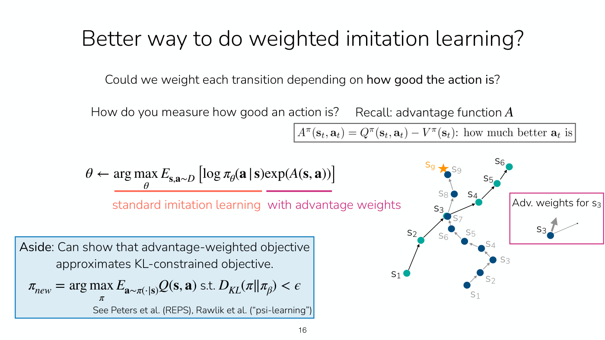
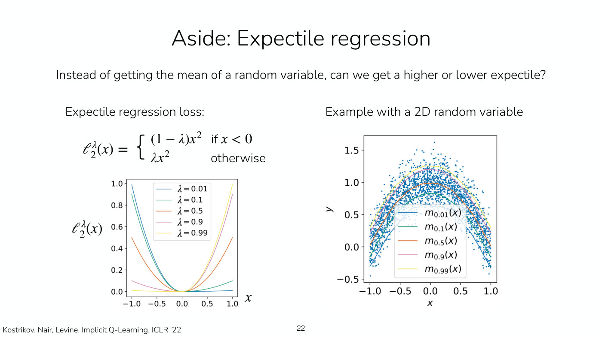
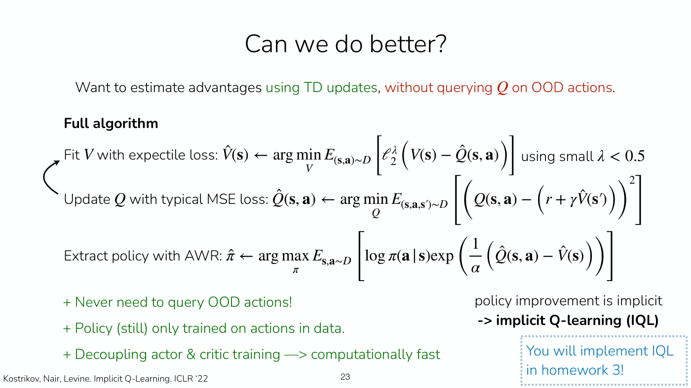

# Implicit policy constraint methods: filtered BC, AWR, AWAC and IQL

A line of [offline RL](offline-rl.md) methods from Lecture 7 that never let the policy, or the critic,
touch an action outside the dataset. The policy is trained by imitation, weighted by how good each
action was, so it stays implicitly constrained to the **behavior policy** $\pi_\beta$ that collected
the data (Lecture 7, slide 30). Each step below fixes one weakness of the one before.

Notation: $D$ (or $\mathcal{D}$) is the offline dataset of transitions $(\mathbf{s}, \mathbf{a}, \mathbf{s}', r)$;
$\pi_\theta$ is the policy being learned, with parameters $\theta$; $A$, $Q$ and $V$ are the advantage,
Q-function and value function (see [value functions](value-functions.md)); $\gamma$ is the discount and
$\alpha$ a temperature.

## Why imitation is the starting point

Running an off-policy actor-critic method on fixed data fails because its critic is evaluated on actions
the data does not contain, and the policy exploits the critic's errors there (slides 10–11; see
[offline RL](offline-rl.md#the-core-problem-overestimation-on-out-of-distribution-actions)).
[Imitation learning](imitation-learning.md) works because "you're only supervising with actions that are
seen in the data", so it avoids out-of-distribution (OOD) actions implicitly (≈26:30). What it lacks is a way to do better
than the data. The methods here add one.

## Filtered behavior cloning

The simplest use of rewards (slide 15, ≈29:33–31:51): rank trajectories by return
$r(\tau) = \sum_{(\mathbf{s}_ t, \mathbf{a}_ t) \in \tau} r(\mathbf{s}_ t, \mathbf{a}_ t)$, keep those
above a threshold $\eta$ (say, the top 30%, above the 70th percentile), and imitate them:

$$\max_\theta \sum_{(\mathbf{s}, \mathbf{a}) \in \tilde{D}} \log \pi_\theta(\mathbf{a} \mid \mathbf{s}), \qquad \tilde{D} : \lbrace \tau \mid r(\tau) \gt \eta \rbrace$$

It cannot stitch trajectories, because a bad trajectory is thrown away whole, good start included. The
slide calls it "a very primitive approach to using reward information" and therefore "a **good
baseline** to test against".

## Weighting by the advantage

Instead of keeping only good trajectories, weight every transition by how good its action was, using the
advantage $A^\pi(\mathbf{s}_ t, \mathbf{a}_ t) = Q^\pi(\mathbf{s}_ t, \mathbf{a}_ t) - V^\pi(\mathbf{s}_ t)$
(slide 16, ≈32:37–34:10):

$$\theta \leftarrow \arg\max_\theta E_{\mathbf{s}, \mathbf{a} \sim D} \left[ \log \pi_\theta(\mathbf{a} \mid \mathbf{s}) \exp(A(\mathbf{s}, \mathbf{a})) \right]$$

*Lecture 7, slide 16 — standard imitation times advantage weights; at the crossing state s3 the step toward the goal gets a positive advantage and the other a negative one. [Deck](https://cs224r.stanford.edu/spring_2025/slides/07_cs224r_offline_rl_2025.pdf)*

With a good advantage estimate this stitches: at a state where one action leads to a good outcome and
another to a bad one, the first has positive advantage and the second negative, so the policy learns to
head for the good outcome (≈34:10–35:42). The exponential is not arbitrary. The slide notes, without the
lecture deriving it, that the objective approximates a KL-constrained one, maximizing the Q-value subject
to $D_{KL}(\pi \Vert \pi_\beta) \lt \epsilon$. Staying close to the behavior policy is the point, since
far from it the data says nothing about how to improve (≈35:42). In practice the advantage is divided by
a temperature $\alpha$, which keeps the weights from exploding (≈37:16–38:02).

Compared with the actor-critic policy objective, this one exponentiates the advantage and takes its
actions from the offline dataset rather than from online data or the policy. One way to think about the
difference, Finn says, is that online objectives often optimize a reverse KL and offline ones look more
at a forward KL (≈38:02–39:34).

The advantage belongs to some policy. These methods use the behavior policy's, $A^{\pi_\beta}$ (slide
17). The rest of the line is about how to estimate it, and then how to do better than it.

## AWR: Monte Carlo advantages

**Advantage-weighted regression** (Peng, Kumar, Zhang and Levine, 2019; slides 18–19, ≈40:19–49:42)
fits $\hat{V}^{\pi_\beta}_ \phi$ by regression onto the empirical return, which is valid because the
data comes from the policy whose value is being fitted, and takes the advantage as return minus value:

$$\hat{A}^{\pi_\beta}(\mathbf{s}_ t, \mathbf{a}_ t) = \sum_{t'=t}^{T} r(\mathbf{s}_ {t'}, \mathbf{a}_ {t'}) - \hat{V}^{\pi_\beta}_ \phi(\mathbf{s}_ t)$$

(The slides print the reward inside the sum as $r(\mathbf{s}_ t, \mathbf{a}_ t)$.) The policy step is
the weighted imitation above with this advantage over $\alpha$. The one-step estimate
$r + \hat{V}(\mathbf{s}_ {t+1}) - \hat{V}(\mathbf{s}_ t)$ is also valid, and GAE could be used too
(≈44:17).

Its strengths are simplicity and that it never queries or trains on an OOD action. Its weaknesses are the
noise of Monte Carlo estimation and that $\hat{A}^{\pi_\beta}$ is for a weaker policy than the learned
one (slide 19). A telling special case (≈45:49–47:20): if $\pi_\beta$ is deterministic, every return
equals the value, every advantage is zero, every weight is one, and AWR reduces to plain imitation.
That is right, since data with no variety of actions gives nothing to improve on. Diverse actions in the
data are what let these methods outperform the behavior policy (≈48:09).

## AWAC: bootstrapping with the data's own next actions

To use TD updates without OOD queries, **advantage-weighted actor-critic** takes the next action
$\mathbf{a}'$ in the critic's target from the dataset rather than from the learned policy (slide 20,
≈52:01–53:32):

$$\min_\psi E_{(\mathbf{s}, \mathbf{a}, \mathbf{s}') \sim D} \left[ \left( \hat{Q}^\pi_ \psi(\mathbf{s}, \mathbf{a}) - \left( r + \gamma E_{\mathbf{a}' \sim D} \left[ \hat{Q}^\pi_ \psi(\mathbf{s}', \mathbf{a}') \right] \right) \right)^2 \right]$$

Every $(\mathbf{s}', \mathbf{a}')$ the critic sees now has a supervision target. The cost is that this
estimates the Q-function of $\pi_\beta$, the policy underlying the data, not of $\pi_\theta$ (slide 20).
It is the [Bellman equation](bellman-equations.md) for the behavior policy, with its next action read
from the data.

## Expectile regression: the value of a better policy

In AWAC's target, $Q(\mathbf{s}', \mathbf{a}')$ with $\mathbf{a}'$ from the data is "a sample of
$V^{\pi_\beta}(\mathbf{s}')$" (slide 21). Across the data's actions at a state, and at similar states,
these samples form a distribution of outcomes. A squared-error (L2) fit lands on its mean, the behavior
policy's value. Fitting something higher, like the 70th percentile, would estimate a better policy, the
best one within the data's support (slide 21, ≈53:32–56:41).

The tool is an asymmetric loss (slide 22, ≈57:28–1:00:32):

$$\ell_2^\lambda(x) = \begin{cases} (1 - \lambda) x^2 & \text{if } x \lt 0 \cr \lambda x^2 & \text{otherwise} \end{cases}$$

At $\lambda = 0.5$ it is the L2 loss and fits the mean. Away from 0.5 one sign of error costs more than
the other, and the fit moves to a higher or lower **expectile**.

*Lecture 7, slide 22 — the expectile loss for five values of lambda, and the matching five curves fitted to one cloud of points; the 0.5 curve is the mean, and the others sit above or below it. [Deck](https://cs224r.stanford.edu/spring_2025/slides/07_cs224r_offline_rl_2025.pdf)*

## IQL: implicit Q-learning

**Implicit Q-learning** (Kostrikov, Nair and Levine, ICLR 2022; slide 23, ≈1:02:05–1:05:55) puts the
pieces together. It fits $\hat{V}$ with the expectile loss against the Q-values of the data's actions,
using a small $\lambda$ below 0.5, fits $\hat{Q}$ by mean squared error to the reward plus $\hat{V}$ at
the next state, and extracts the policy with AWR's weighting by $\exp((\hat{Q} - \hat{V}) / \alpha)$:

$$\hat{V}(\mathbf{s}) \leftarrow \arg\min_V E_{(\mathbf{s}, \mathbf{a}) \sim D} \left[ \ell_2^\lambda \left( V(\mathbf{s}) - \hat{Q}(\mathbf{s}, \mathbf{a}) \right) \right]$$

$$\hat{Q}(\mathbf{s}, \mathbf{a}) \leftarrow \arg\min_Q E_{(\mathbf{s}, \mathbf{a}, \mathbf{s}') \sim D} \left[ \left( Q(\mathbf{s}, \mathbf{a}) - \left( r + \gamma \hat{V}(\mathbf{s}') \right) \right)^2 \right]$$

With $x = V(\mathbf{s}) - \hat{Q}(\mathbf{s}, \mathbf{a})$ and a small $\lambda$, a value below a data
action's Q-value costs weight $1 - \lambda$ and one above it only $\lambda$, so the value settles toward
the better outcomes the data shows. It is penalized less for overestimating a little (≈1:01:18). The
estimate of $V^{\pi_\beta}$ is deliberately high, because the target is a better policy's value; how
high depends on $\lambda$, and setting it to zero would probably overestimate (≈1:02:51–1:03:37). With
purely offline data $\lambda$ stays fixed; with online data the dataset improves, and it might make sense
to move $\lambda$ toward 0.5 (≈1:03:37–1:04:25).

*Lecture 7, slide 23 — the IQL loop of fitting V with the expectile loss and Q with the usual squared error, then extracting the policy with AWR. [Deck](https://cs224r.stanford.edu/spring_2025/slides/07_cs224r_offline_rl_2025.pdf)*

Its advantages (slide 23): it never queries an OOD action; the policy is still trained only on actions
in the data; and actor and critic training are decoupled, so the critics can be fitted first and the
policy afterwards, which is computationally fast. "Policy improvement is implicit", hence the name. The
expectile idea would also work with Monte Carlo returns, but a bootstrapped Q-function gives a
lower-variance target (≈1:05:10–1:05:55). Homework 3 implements IQL (slide 23).

**Why the asymmetric loss is for V and not for Q.** Lecture 8's recap answers this (≈3:09–7:43). A
roll-out varies in two ways: which action is taken, and, given the action, which next state the
environment produces. The value loss regresses $V$ onto the data's Q-values, so leaning toward the
larger ones leans toward better actions, the value of a better policy. The Q-function's targets are the
next states' values, so an asymmetric loss there would lean toward next states that turned out well by
chance, optimizing "not a better policy, but a more lucky policy", which the agent cannot control with
its actions. Finn's board example: an action can have a Q-value of 5 and still be followed by a state
worth 8 because the agent got lucky, and a risky action with a Q-value of −5 can be followed by a state
worth 0. The Q-function is still needed, because it is what tells which actions are better when the
policy is extracted (≈6:57).

Finn's recommendation (slide 32): IQL can stitch, stays within the data's support, will probably work
better than filtered behavior cloning with a broader dataset, and "seems most performant" for offline
pre-training followed by online fine-tuning. IDQL is a variant with
[diffusion policies](expressive-policy-distributions.md) and a different update.

## Filtering steps by advantage, for language reasoning

Lecture 10 applies this page's idea to the steps of a language model's math solutions. The advantage
of each step is estimated with rollouts from a separate rollout policy, and only steps with positive
advantage are imitated, each conditioned on its prefix, including good steps from solutions that
ended wrong (Lecture 10, slide 18, ≈43:52–46:58). Kumar calls it "very much reminiscent of
advantage-weighted regression", with a filter in place of exponentiated advantages. Training on
everything with each loss multiplied by $e^{A}$ also works, but "I think that objective requires a
lot of tuning, and if you can only run one experiment, you probably prefer this objective over e to
the A in general" (≈45:23). Asked whether this resembles trajectory stitching and advantage weights,
Kumar says "exactly yes" (≈39:13). See [process rewards and per-step credit](process-rewards.md).

## Where this appears

- [Lecture 7 — Offline RL](07-offline-rl.md): every method on this page, with the student questions on
  each.
- [Lecture 8 — Reward Learning](08-reward-learning.md#why-iqls-asymmetric-loss-is-for-v-and-not-for-q):
  the IQL recap, and why only the value function gets the asymmetric loss.
- [Offline RL](offline-rl.md): the problem these methods solve, and
  [conservative Q-learning](conservative-q-learning.md), the alternative approach.
- [Policy evaluation](policy-evaluation.md): the Monte Carlo and bootstrapped targets these methods
  adapt.
- [Lecture 10 — RL for LLM Reasoning](10-rl-for-reasoning.md#option-1-filtering-steps-by-advantage):
  advantage filtering of a language model's reasoning steps.
