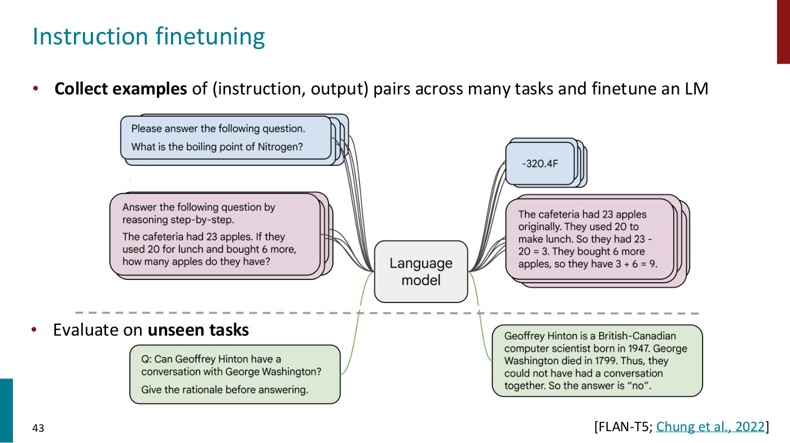
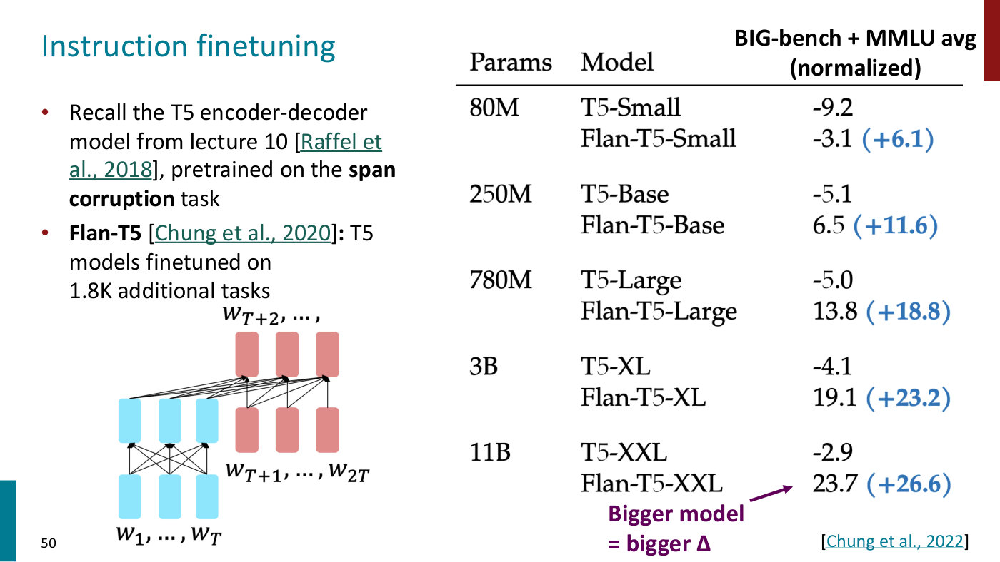
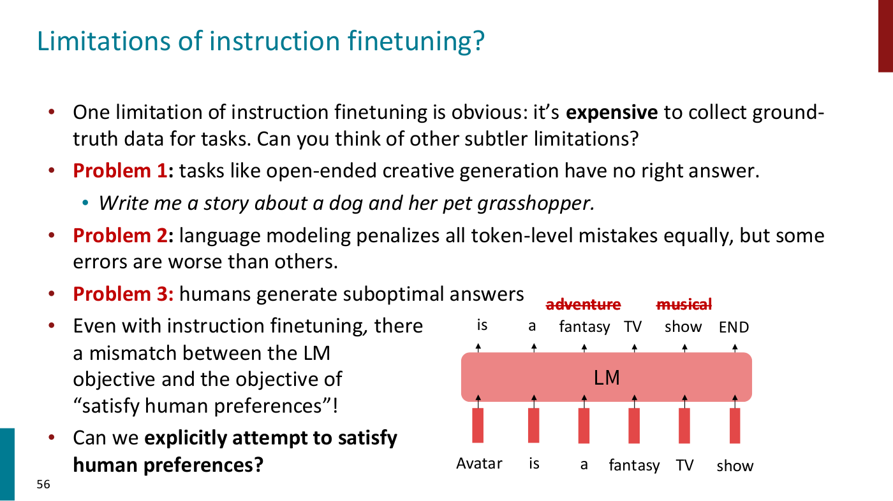

# Instruction finetuning

A language model pretrained to predict the next token knows a great deal but does not act as an
assistant. Instruction finetuning is the first step in turning it into one: supervised finetuning on
(instruction, output) pairs drawn from many tasks. It is also the first step of the RLHF pipeline,
where it is called supervised fine-tuning (SFT). Lecture 9, a guest lecture by Archit Sharma, teaches
it (slides 39–56, ≈3:54–12:21); Lecture 8 introduces it as the second stage of training a chat model.
Citations are to Lecture 9 unless they say otherwise.

## Why a pretrained model is not an assistant

Pretraining trains a model on a gigantic corpus of internet text to predict the next word or token
(≈0:51). That teaches facts, syntax, coreference and sentiment, and some evidence suggests it learns
some notion of how the world works: given a prompt about a physicist watching a bowling ball and a
leaf fall in a vacuum chamber, a model predicts they fall at the same rate, and changing the person to
someone who has never seen the demonstration changes the prediction (slides 5–6, ≈1:36–3:08). But
language modeling is still not assisting users (≈3:54). Asked to "Explain the moon landing to a 6 year
old in a few sentences", GPT-3 continues with more lines of the same kind ("Explain the theory of
gravity to a 6 year old. …"), because that is what such text is followed by in its corpus; a person
wants an explanation (slides 39–40). "Language models are not *aligned* with user intent" (slide 39,
citing Ouyang et al., 2022).

## Finetuning, then finetuning on many tasks

The general paradigm, still used today, is to pretrain on a large corpus and then finetune for a
specific task: collect inputs with target outputs and increase the log-likelihood of the targets
(slide 41, ≈4:40–5:26). The pretrained weights serve as the initialization. Because pretrained models
are good for many more things, the number of tasks was scaled up, finetuning one model on many tasks at
once (slide 42, ≈5:26–6:11). Instruction finetuning is this: "Collect examples of (instruction, output)
pairs across many tasks and finetune an LM", then evaluate on **unseen tasks** (slide 43, ≈6:11–6:58).
The model is trained to predict the answer conditioned on the instruction, for example "-320.4F" for
"What is the boiling point of Nitrogen?".

*Lecture 9, slide 43 — FLAN-T5's recipe: instruction and output pairs from many tasks train one model, evaluated afterwards on an unseen task. [Deck](https://cs224r.stanford.edu/spring_2025/slides/09_cs224r-2025-rlhf.pdf)*

Lecture 8 describes the same stage as supervised fine-tuning on higher-quality prompt and response
pairs, and calls it basically imitation learning (Lecture 8, slide 29, ≈58:52–59:38); see
[imitation learning](imitation-learning.md).

## Bigger models gain more

When models of different sizes are finetuned on the same instruction data, larger ones generalize much
better, even from a very small corpus (≈6:58–7:44). On the normalized average of BIG-bench and MMLU,
Flan-T5 gains +6.1 over T5 at 80M parameters, +11.6 at 250M, +18.8 at 780M, +23.2 at 3B and +26.6 at
11B: "Bigger model = bigger Δ" (slide 50, Chung et al., 2022). On a pronoun-disambiguation question,
the model before instruction finetuning keeps generating variants of the sentence, and the model after
it answers that the sentence is ambiguous (slides 51–52).

*Lecture 9, slide 50 — T5 against Flan-T5 at five sizes, with the gain from instruction finetuning rising from +6.1 to +26.6. [Deck](https://cs224r.stanford.edu/spring_2025/slides/09_cs224r-2025-rlhf.pdf)*

**Format or knowledge?** Asked how much of the improvement comes from learning a format and how much
from new knowledge, Sharma says most work suggests it is largely formatting, with the knowledge coming
from the base model: a model trained on wrong answers still does quite well downstream (≈11:34). The
corpora are no longer only question-answer pairs; they are now very diverse, including uses such as
function calling and tools (≈12:21).

## Limitations

Slide 56 (≈8:31–11:34) lists them:

- **Cost.** Ground-truth answers are expensive, and the harder the questions, the fewer people can
  answer them.
- **No right answer.** Open-ended creative tasks, such as "Write me a story about a dog and her pet
  grasshopper", have none.
- **Every mistake costs the same.** Language modeling "penalizes all token-level mistakes equally, but
  some errors are worse than others": "Avatar is a fantasy TV show" is not simply right or wrong, but
  "adventure" would have been better (≈10:02).
- **Humans generate suboptimal answers**, and on some tasks models are now better than the humans
  writing the targets (≈10:47).
- **A mismatched objective.** Predicting a given answer is not the same as following a person's intent,
  so even after instruction finetuning there is a mismatch with the objective of satisfying human
  preferences (slide 56).

*Lecture 9, slide 56 — the limitations, with a model trained on "Avatar is a fantasy TV show" while better and worse alternatives are crossed out above its outputs. [Deck](https://cs224r.stanford.edu/spring_2025/slides/09_cs224r-2025-rlhf.pdf)*

That leads to the question "Can we explicitly attempt to satisfy human preferences?" (slide 56), which
[RL from human feedback](rlhf.md) and [direct preference optimization](direct-preference-optimization.md)
answer.

## In practice

Instruction finetuning is step 1 of InstructGPT's pipeline, where a labeler demonstrates the desired
output and the data fine-tunes GPT-3 with supervised learning (slides 61 and 80). ChatGPT's first
model was trained the same way, on conversations in which human trainers played both sides (slide 84,
"Instruction finetuning!"). Preference training then changes the style of what an instruction-tuned
model writes: Alpaca, finetuned on 10k examples, answers a question about the causes of stress in one
line, and Alpaca with PPO in a detailed, well-formatted list (slide 88, ≈54:20–55:06).

## Where this appears

- [Lecture 9 — RL for LLMs](09-rl-for-llms.md#instruction-finetuning): the whole topic, with the
  scaling result and the limitations.
- [Lecture 8 — Reward Learning](08-reward-learning.md#rewards-for-language-models): supervised
  fine-tuning as the second stage of training a chat model.
- [RL from human feedback](rlhf.md): the pipeline it starts.
- [Imitation learning](imitation-learning.md): the supervised learning from demonstrations it
  resembles.
