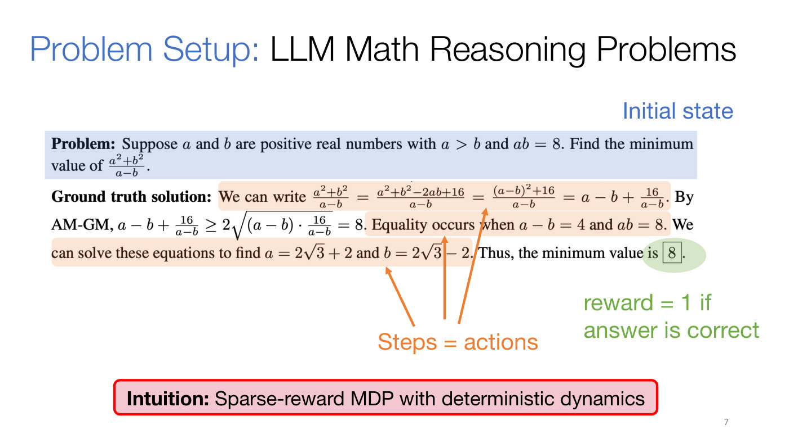
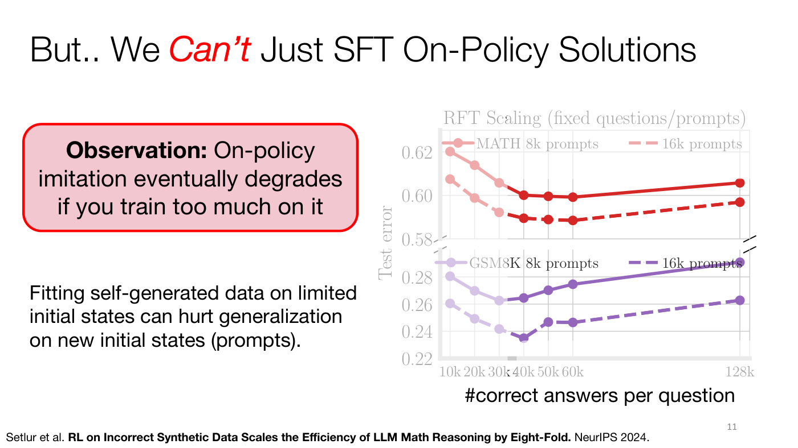
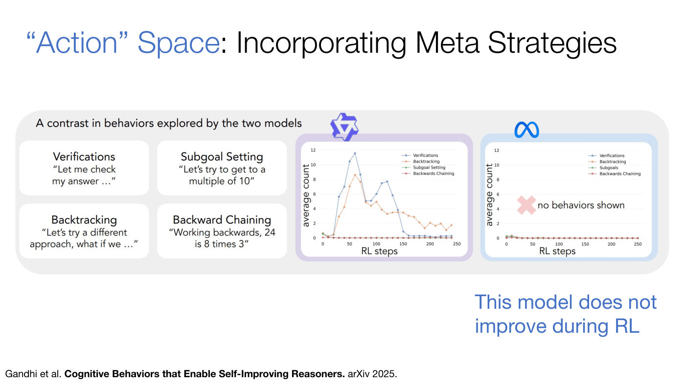

# RL for LLM reasoning

Training a language model to solve problems that have a checkable answer, such as competition
math, with reinforcement learning rather than by imitating reference solutions alone. In this course
it is the subject of [Lecture 10](10-rl-for-reasoning.md), a guest lecture by Aviral Kumar, which
restricts "reasoning" to solving math problems (Lecture 10, ≈0:05) and organizes the methods along a
timeline. Part 1 covers the classical techniques from before the "thinking" models such as
DeepSeek-R1 appeared in January 2025: imitation, offline RL and online RL. Part 2 covers how those
techniques carry over to thinking models (Lecture 10, slide 6, ≈6:12–7:46). The per-step credit
assignment at the heart of Part 1 has its own page, [process rewards and per-step
credit](process-rewards.md).

## Why RL: imitation scales slowly

The conventional way to train a model to reason is next-token prediction on questions paired with
reference solutions, which is supervised finetuning (SFT), a form of
[imitation learning](imitation-learning.md) (Lecture 10, slide 3, ≈1:37–2:23). Its error shrinks
with the amount of data similar to the target, but for reasoning there is not enough such data, and
high-quality internet text is estimated to run out by 2028 (slide 4, ≈3:10–3:55). Measured on the
GSM8K and MATH benchmarks, test error after SFT falls roughly as $|\mathcal{D}|^{-0.15}$ and
$|\mathcal{D}|^{-0.05}$ in the dataset size $|\mathcal{D}|$, far too slowly to solve them with a
reasonable amount of data (slide 10, ≈23:05). And a model trained on current data writes solutions
that look legitimate but are wrong: on slide 5's IMO 2021 inequality, an o-series model analyzes
individual terms and asserts its way to the conclusion, without noticing its mistake (≈4:41–5:27).
RL is meant to fix the logic, not the look, of a solution (≈6:12).

## Reasoning as a Markov decision process

The problem is the initial state. The solution is a sequence of steps, each step an action, and the
next state is the previous state with the step appended, so the dynamics are deterministic and there
is no external environment. The only reward comes at the end: 1 if the final answer matches the
ground truth and 0 otherwise. Kumar sums it up as "a sparse-reward MDP with deterministic dynamics"
(Lecture 10, slide 7, ≈8:32–10:50). The action space is infinite, but unlike continuous control's
fixed-size vectors, each action is a variable-length string of discrete tokens (≈10:50). The
framing needs a final answer that can be checked; how to handle problems whose answer is a proof is
still open (≈11:35). See [MDPs and notation](mdp-and-notation.md#notation-for-rl-for-llm-reasoning)
for the symbols.

*Lecture 10, slide 7 — the problem is the initial state, each shaded step of the solution is an action, and the circled final answer earns the 0/1 reward. [Deck](https://cs224r.stanford.edu/spring_2025/slides/10_cs224r-rl_for_reasoning_lecture.pdf)*

## Three ways to scale the data

Lecture 10 compares methods by how their performance grows with the data they train on, along three
axes (slide 9, ≈13:08–19:15):

- **SFT**: more questions, each with one reference answer written by a human or a bigger model.
- **Rejection finetuning (RFT)**: more correct solutions per question, sampled from the model itself
  and kept only if their final answer is right. It is on-policy imitation, and it needs no
  human-written solutions, only a way to check answers (≈18:29).
- **RL**: the model's incorrect solutions too, the rollouts with reward 0, which RL, unlike
  imitation, can learn from (≈18:29–19:15).

In practice RFT starts from a model already trained with SFT, so that it can answer some of the
questions (≈20:47–21:34).

## Rejection finetuning, and why it stops working

Each RFT iteration samples $N$ solutions per question from the model $\pi_\theta$, keeps the set
$\tilde{S}$ of correct ones, and trains $\pi_\theta$ to imitate them (Lecture 10, ≈13:54–18:29; the
algorithm is written on a board the recording does not show). RFT matches SFT trained with twice the
questions and twice the human-written solutions: on-policy imitation is about 2x as efficient
(≈23:51–24:37).

Pushed further, by sampling many more solutions per question, it gets worse: test error falls and
then rises (slide 11, ≈24:37–26:08). Fitting the model's own outputs on a limited set of initial
states hurts generalization to new ones (≈26:54). The reason Kumar gives is **spurious steps**:
incorrect steps in a sampled solution that happened not to derail it. In slide 12's GSM8K example the
model computes 100 times 2, gets 200, and on the next line switches to 100 divided by 2, still
reaching the right answer (≈29:13). Imitating such traces teaches incorrect associations, which
slide 12 likens to "causal confusion" in imitation learning (≈31:32–32:19). Even an irrelevant step
hurts, as a million irrelevant tokens would make finding the information that matters hard (≈35:22).

*Lecture 10, slide 11 — RFT on a fixed set of prompts: test error on MATH (red) and GSM8K (purple) falls as more correct answers per question are imitated, then rises again. [Deck](https://cs224r.stanford.edu/spring_2025/slides/10_cs224r-rl_for_reasoning_lecture.pdf)*

## Using incorrect data: credit for each step

The fix uses the third axis. For each prefix of a sampled solution, a rollout policy completes the
solution many times, and the fraction of successes is the Q-value of the step that ended the prefix.
The advantage of a step is its Q-value minus the previous step's. A step that lowers the chance of
success is likely spurious; one that raises it is worth learning from, even inside a failed solution
(Lecture 10, slides 15–17, ≈33:06–42:19). The details, including how to choose the rollout policy,
are on [process rewards and per-step credit](process-rewards.md). The advantages are then used in
one of three ways.

**Filtering (imitation).** Imitate only the steps with positive advantage, each conditioned on its
prefix, which is like [advantage-weighted regression](implicit-policy-constraints.md#awr-monte-carlo-advantages)
with a filter in place of exponentiated weights. Kumar prefers the filter, since the exponentiated
version "requires a lot of tuning" (slide 18, ≈43:52–46:58). It stops the rising error of plain RFT
(slide 19, ≈50:48).

**Offline RL with DPO.** Turn the rollouts into preference pairs that share a prefix, a successful
continuation preferred over a failing one, and train with
[DPO](direct-preference-optimization.md#per-step-preference-pairs-for-reasoning) (slides 20–22,
≈51:34–56:09). This needs about 8x less data than SFT on human-written solutions to reach the same
test error, against 2x for RFT (slide 23, ≈59:13).

**Online RL with a dense reward.** Fit a network to the advantages and add its per-step predictions
to the final 0/1 reward during online RL. Kumar's group calls these **process advantage verifiers**
(PAVs). With 2B and 9B models they were 5–6 times as sample-efficient as RL with the outcome reward
alone, and 6–7% more accurate (slides 25–27, ≈1:03:52–1:06:56).

## Online RL with an outcome reward

The simplest online method uses no advantages at all. It samples solutions from the current policy,
rewards each by checking its answer (perhaps also penalizing a missing answer or a format violation),
and trains with a [policy gradient](policy-gradients.md#for-language-models), "grad log pi times
the reward" (Lecture 10, slide 24, ≈1:01:32–1:03:06). Any policy-gradient method will do. Recent work
uses **GRPO**, which Kumar describes as an extension of [PPO](ppo.md#grpo-for-reasoning) that
replaces PPO's learned value function with advantages estimated from rollouts (≈1:03:06). This basic
online recipe trained many of the open thinking models, DeepSeek-R1 among them, and it generalizes
to a fair extent when trained on prompts of varied difficulty (≈1:04:39–1:05:25).

## Thinking models

Thinking models such as DeepSeek-R1 and OpenAI's o-series think for longer before answering. In
Kumar's view they are trained with much the same recipes (Lecture 10, slide 32, ≈1:07:42–1:09:59):

- The RL objective is unchanged: DeepSeek-R1 uses GRPO and Kimi 1.5 a version of advantage-induced
  policy alignment (APA), both policy-gradient methods with tweaks.
- The action space has changed, crudely speaking. The base models can now take "macro" actions such
  as verifying an answer, backtracking and planning, so RL works with a richer notion of a step.
- The token budget has grown drastically, so these macro actions can be chained.

Base models that cannot check or verify answers do not train well with RL (≈1:09:59).

The slides go further than the recording (slides 33–41, not discussed aloud). Slide 34 writes the
goal as maximizing expected reward on test problems under a fixed per-problem compute budget. Slide
35 (Gandhi et al.) shows one base model developing verification and backtracking over RL while
another develops none and does not improve. Slide 36 (Kimi 1.5) shows accuracy and response length
growing together during RL. Slides 37–39 (Snell et al.) contrast spending compute on a bigger model
with spending it on longer responses from the same model, a new paradigm of **test-time scaling**.
Slide 41 lists open questions: posing test-time compute as an adaptation problem, rewards denser than
the outcome, and the case for RL over SFT as test-time compute grows. See [Lecture 10's slide-only
section](10-rl-for-reasoning.md#from-the-slides-only).

*Lecture 10, slide 35 — four cognitive behaviors, and their counts over RL for two base models: one develops verification and backtracking, the other shows none and does not improve. [Deck](https://cs224r.stanford.edu/spring_2025/slides/10_cs224r-rl_for_reasoning_lecture.pdf)*

Lecture 13 presents this setting as meta-RL (Lecture 13, slide 22, ≈39:13–41:31). Solving a math
problem is itself an MDP over strategies, such as guess and check or eliminating terms, whose best choice
is not known in advance. DeepSeek R1 thinks for a while on a hard problem but also thinks through
"2+2=?" before giving a step-by-step explanation, which is somewhat wasteful. Bringing test-time compute
into training as a meta-RL problem encourages the model to answer easy problems quickly and to explore
on hard ones as much as it needs; the slide's paper (MRT, Qu et al.) reports higher success on Math 500
with the same number of tokens, and the same accuracy with 1.6x fewer tokens than GRPO. See
[meta-RL](meta-rl.md).

## Where this appears

- [Lecture 10 — RL for LLM Reasoning](10-rl-for-reasoning.md): the whole topic, with the student
  questions and the board work.
- [Process rewards and per-step credit](process-rewards.md): the Q-values and advantages of steps.
- [Lecture 9 — RL for LLMs](09-rl-for-llms.md#whats-next): verifiable rewards for reasoning as a
  direction beyond RL from human feedback.
- [Imitation learning](imitation-learning.md#imitating-a-models-own-correct-samples): SFT and RFT as
  imitation, and causal confusion.
- [Offline RL](offline-rl.md): the offline setting per-step DPO works in.
- [RL from human feedback](rlhf.md): the reward-model pipeline that process rewards extend to steps.
- [Lecture 13 — Meta RL](13-meta-rl.md#example-2-meta-rl-for-test-time-compute): optimizing
  test-time compute as a meta-RL problem.
- [Lecture 14 — Exploration](14-exploration.md#exploration-in-robotics-and-language-models): why RL for
  language models needs a strong base model to explore from, and reasoning as exploring at test time.
