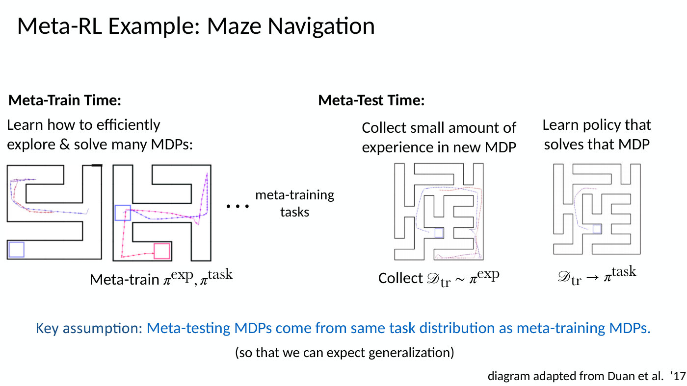
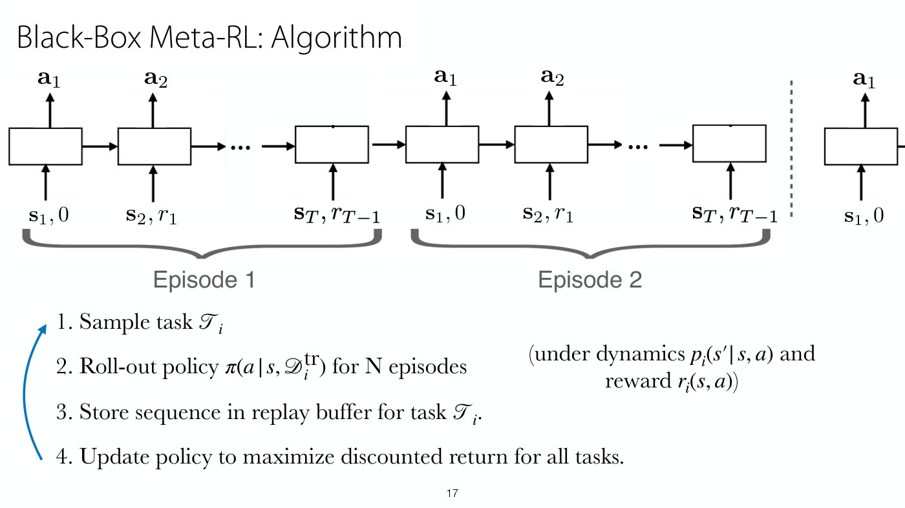
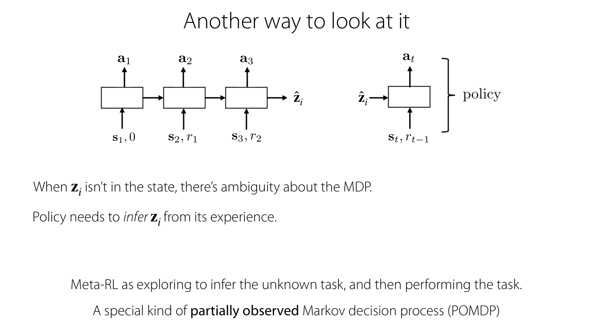
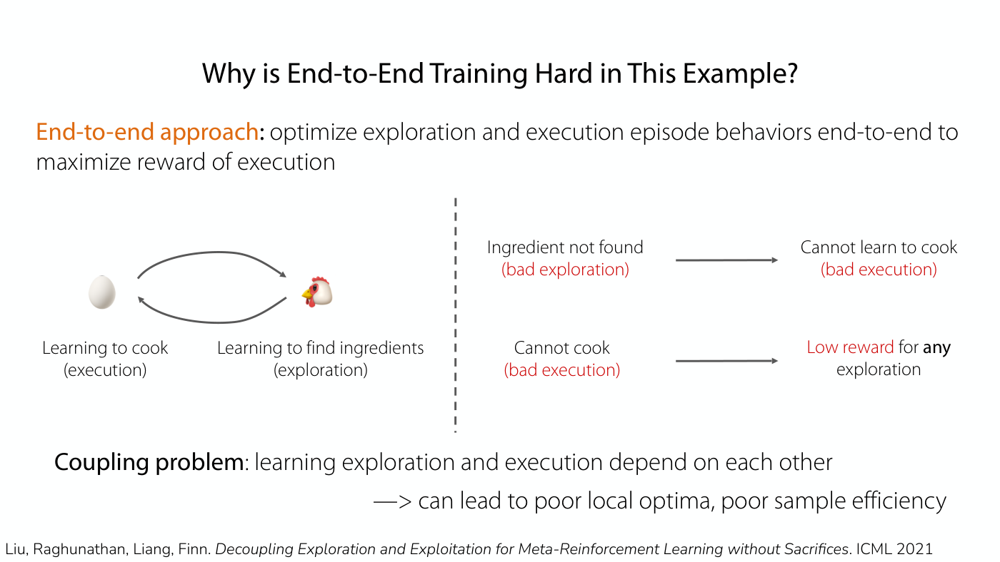
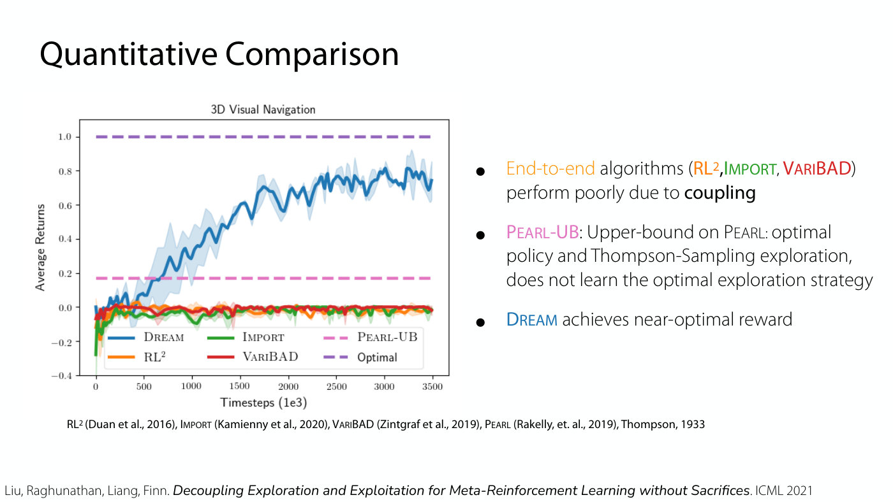

# Meta-RL

Meta-reinforcement learning trains an agent on many related tasks so that it can learn a **new** task
from a small amount of experience: a few episodes, or a few time steps. It is the RL counterpart of
few-shot and in-context learning, with one difference that shapes everything else: the agent has to
collect that small amount of experience itself, by exploring. [Lecture 13](13-meta-rl.md) teaches the
problem statement, black-box methods and the exploration challenge, and [Lecture 14](14-exploration.md)
returns to exploration with DREAM, which decouples learning to explore from learning to do the task.

## The problem: learning a new task quickly

A robot trained with PPO would need "millions of attempts" to learn a new espresso machine, while a
person with some instruction or prior coffee experience could learn it in minutes (Lecture 13, slide 6,
≈3:07–3:54). The difference is that people are not starting from scratch: they know how to move objects,
how other machines work, and what an instruction like "turn a knob" means, and they reuse that
experience (≈3:54–4:39). The question meta-RL asks is whether RL algorithms can likewise leverage
experience from previous tasks to learn a new task with less data (slide 7, ≈5:25).

Lecture 13 frames transfer to a new task three ways (slide 7, ≈6:13–8:31):

- **Forward transfer**: train on a source task, then fine-tune on the target task. The two tasks must be
  quite similar.
- **Multi-task transfer**: train on many tasks; with a structured task prompt, such as "pick up a pen",
  the policy may transfer **zero-shot** to a new prompt, with no new experience.
- **Meta-learning**: learn to learn on many tasks, aiming at **few-shot** transfer, adapting with a few
  examples or trials. It differs from multi-task learning in that it "Accounts for the fact that we'll be
  adapting to a new task during training!", and its task descriptor is "a few data examples provided
  in-context". Another word for it is in-context learning (≈7:45).

Outside RL, few-shot learning trains a model $\hat{y} = f(x, D_{\text{train}})$ that predicts the label
$\hat{y}$ of a test input $x$ from that input and a small training set $D_{\text{train}}$, by constructing
many training problems of the same structure, each of which becomes a single data point (slide 9,
≈9:16). A language model's in-context learning from a few examples in its prompt is another instance,
which arises from the statistics of internet data rather than from a purpose-built training set
(≈10:02–10:48). The most successful meta-RL methods look like prompting in this sense (≈11:34).

## Task distributions and the key assumption

Each task is an MDP with its own state space, action space, initial state distribution, dynamics and
reward (Lecture 13, slide 13, ≈17:41):

$$\mathcal{T}_ i \triangleq \lbrace \mathcal{S}_ i, \mathcal{A}_ i, p_i(\mathbf{s}_ 1), p_i(\mathbf{s}' \mid \mathbf{s}, \mathbf{a}), r_i(\mathbf{s}, \mathbf{a}) \rbrace$$

and the meta-learning problem is: "Given data from $\mathcal{T}_ 1, \ldots, \mathcal{T}_ {n}$, quickly solve
new task $\mathcal{T}_ {\text{test}}$". "Meta-reinforcement learning = meta-learning with RL tasks." The new
task does not have to resemble one particular training task, but it must come from the same
distribution: "Key assumption: Meta-testing MDPs come from same task distribution as meta-training
MDPs." (slide 11, ≈14:37). It can still differ from every training task (≈19:59). Examples of such
distributions are different mazes, different terrains and slopes for a legged robot, manipulation with
different objects and goals, and dialog with users who have different preferences (slide 12,
≈15:23–16:08).

*Lecture 13, slide 11 — meta-training explores and solves many mazes; meta-testing collects a little experience in a new maze and then goes straight to its goal. [Deck](https://cs224r.stanford.edu/spring_2025/slides/13_cs224r_metarl_2025.pdf)*

At meta-test time the agent first collects a small dataset in the new MDP with an exploration policy,
$\mathscr{D}_ {\text{tr}} \sim \pi^{\text{exp}}$, then turns it into a policy for that task,
$\mathscr{D}_ {\text{tr}} \rightarrow \pi^{\text{task}}$ (slide 10). The two policies may be separate
networks or share parameters (slide 14, ≈19:12). The problem can be stated as a policy that takes the
training set and the current state,

$$\mathbf{a} \sim \pi^{\text{task}}(\cdot \mid \mathbf{s}, D_{\text{train}})$$

where in the **episodic variant** $D_{\text{train}}$ is k roll-outs of $\pi^{\text{exp}}$ and in the
**online variant** it is a few time steps of it (slide 14, ≈17:41–19:12). Compared with supervised
meta-learning, the agent constructs its own training set, so it must trade off exploring against
exploiting: "Exploration-exploitation trade-off is a unique part of meta-RL!" (slide 10, ≈13:51).

Lecture 13's answer to how meta-RL differs from training and then fine-tuning is that meta-training
explicitly optimizes for the ability to adapt with a small dataset, which makes transfer much faster
and more data efficient, and that it gets this by training on many tasks rather than one (≈16:08–16:53).

## Black-box meta-RL

The conceptually simple method is to make the policy a **sequence model**, a recurrent network, a
transformer or any network with memory, whose input is all the experience it has collected in the
current MDP, and to train it across all the training MDPs (Lecture 13, slide 16, ≈19:59–21:31). Each
step's input is the current state with the previous reward, so the context grows as experience comes in.
It differs from simply giving a standard RL policy memory in three ways (≈22:16–24:34): the **reward is
an input**, so the reward is also needed at test time; it is **trained across MDPs**, whose state and
action spaces, dynamics and rewards may differ; and its **hidden state is kept across episodes** of the
same task. Actions can be inputs too, which matters for a stochastic policy, whose sampled actions are
not otherwise in its memory (≈23:02).

*Lecture 13, slide 17 — the hidden state carries over from episode 1 into episode 2 of the same task, and is cut at the dashed line where a new task begins. [Deck](https://cs224r.stanford.edu/spring_2025/slides/13_cs224r_metarl_2025.pdf)*

The algorithm (slide 17, ≈24:34–27:43) repeats four steps:

1. Sample a task $\mathcal{T}_ i$.
2. Roll out the policy $\pi(a \mid s, \mathscr{D}_ i^{\text{tr}})$ for N episodes under that task's dynamics
   and reward, with memory across the episodes.
3. Store the sequence in a replay buffer for task $\mathcal{T}_ i$, if the learner is off-policy.
4. Update the policy to maximize the discounted return summed over all tasks.

N is usually small, because a long history is hard to keep in a model's context (≈26:55). At meta-test
time, a new task $\mathcal{T}_ j$ is sampled and the policy is rolled out for up to N episodes; beyond N,
"all bets are off" (slide 18, ≈30:49). Because the whole thing is optimized end to end for reward, the
policy chooses its own exploration-exploitation trade-off, and that choice depends on N: with two
episodes it explores as quickly as possible, and with more it has more budget to explore (≈29:17–30:03).
Exploration is not a separate term in the objective: the agent simply cannot get high reward without
exploring, so the objective incentivizes it (≈36:56–37:42).

Lecture 13's slide 19 gives three designs and the optimizers they were trained with: an RNN with TRPO or
A3C ($\text{RL}^2$, Duan et al.; Wang et al.), attention with 1D convolutions with TRPO (SNAIL, Mishra et
al.), and a feedforward network whose embeddings are averaged, a "deep set", with SAC (PEARL, Rakelly et
al.), which is fast because it parallelizes and is surprisingly expressive (≈31:36–32:21). The black-box
approach is "+ general & expressive" with "+ a variety of design choices in architecture", but "-- hard
to optimize", since the model must work out from many inputs what matters for adapting, and it "~
inherits sample efficiency from outer RL optimizer" (slide 27, ≈52:21–53:54). That last point is why an
off-policy learner with a replay buffer meta-trains much faster than on-policy ones; at test time,
adaptation is equally fast either way (slide 26, ≈50:00–51:34). Its replay buffer stores whole sequences
of episodes per task, because the policy needs the trajectory as its memory input (≈51:34–52:21).

## Two other ways to see it

**Experience as a task identifier.** A multi-task policy $\pi_\theta(\mathbf{a} \mid \mathbf{s}, \mathbf{z}_ i)$
is told its task by a descriptor $\mathbf{z}_ i$. A meta-RL policy can be read as a multi-task policy whose
task identifier is its own experience, though the analogy is imperfect because the experience changes
within a task (Lecture 13, slide 23, ≈41:31–42:16). Meta-RL also generalizes goal-conditioned RL, since
"rewards are a strict generalization of goals", and it adapts to new tasks with k episodes or time steps
(k-shot) where a goal-conditioned policy generalizes to new goals zero-shot (≈43:03). Experience is used
rather than an index because an index cannot generalize to "task 100" at test time, while experience
lives in a continuous space of states and rewards from which a new task can be worked out; it comes down
to learning a representation $\mathbf{z}$ of the task (≈44:34–46:07). See [multi-task RL](multi-task-rl.md).

**A partially observed MDP.** When $\mathbf{z}_ i$ is not in the state, the policy must infer it from its
experience: meta-RL is "exploring to infer the unknown task, and then performing the task" (slides 24–25,
≈43:48–44:34). Multi-task RL with the task in the state is still an MDP, an aggregated one; meta-RL is not,
because the task is unobserved. It is "A special kind of **partially observed** Markov decision process
(POMDP)", in which the only unobserved thing is the task, so the hidden state is the observation together
with the task identifier, and inferring the task from experience is inferring that state (≈46:52–48:25).
See [MDPs and RL notation](mdp-and-notation.md).

*Lecture 13, slide 25 — the chain split in two: the first steps produce an estimate of the task, and the policy acts on that estimate together with the current state and reward. [Deck](https://cs224r.stanford.edu/spring_2025/slides/13_cs224r_metarl_2025.pdf)*

## Examples

- **Visual maze navigation** (Lecture 13, slides 20–21, ≈32:21–36:10): trained on a thousand small mazes
  with N = 2, an attention-and-convolution agent explores a held-out maze in its first episode and goes
  straight to the goal in its second. Its average time to find the goal in a small maze is 50.3 in
  episode 1 and 34.8 in episode 2, against a random policy's 188.6 and 187.7.
- **Test-time compute in language models** (slide 22, ≈39:13–41:31): solving a math problem is itself an
  MDP over strategies. DeepSeek R1 thinks at length even about 2+2; training with meta-RL to use
  test-time compute efficiently (MRT, Qu et al.) gives higher success with the same tokens, and the same
  accuracy with 1.6x fewer tokens than GRPO on Math 500. See [RL for LLM reasoning](llm-reasoning.md).
- **Continuous control** (slide 26, ≈49:13–51:34): tasks are walking directions, velocities and physical
  dynamics such as friction; the off-policy PEARL meta-trains far faster than $\text{RL}^2$, ProMP and MAML.

## Exploration: why end to end is hard, and the alternatives

Optimizing exploration and exploitation **end to end** for reward is simple and in principle yields the
optimal exploration-exploitation trade-off, but it is a challenging optimization when exploration is hard
(Lecture 13, slide 29, ≈53:54). In the running example, an agent must reach the end of one of several
hallways, and a document says which (slide 30, ≈54:40–56:13). A lucky trajectory that goes straight to
the right hallway earns reward but teaches nothing about exploring, since its context looks like any other
task's; trying a wrong hallway and then the right one teaches a suboptimal strategy; and reading the
instructions is good exploration that earns no reward by itself (slide 31, ≈56:13–59:17). Useful signal
comes only when the agent explores well and then exploits in the same trial, which it has to get lucky to
do (≈1:00:03).

*Lecture 13, slide 33 — the coupling problem: without finding the ingredients the agent cannot learn to cook, and without being able to cook no exploration earns reward. [Deck](https://cs224r.stanford.edu/spring_2025/slides/13_cs224r_metarl_2025.pdf)*

This is the **coupling problem**: learning exploration and learning execution depend on each other, like
the chicken and the egg. An agent that cannot find the ingredients cannot learn to cook, and one that
cannot cook gets low reward for any exploration (slides 32–33, ≈1:00:03–1:01:34); slide 33 says it "can
lead to poor local optima, poor sample efficiency". A dense reward would ease it, and with easy
exploration it does not arise, since only exploitation is left to solve (≈1:01:34–1:02:20).

The alternative is to **leverage alternative exploration strategies**, adding auxiliary exploration
objectives instead of relying on end-to-end reward alone (slides 35–37, ≈1:02:20–1:09:10):

- **Posterior sampling** (Thompson sampling, as in PEARL): learn a distribution over a latent task
  variable, $p(\mathbf{z})$ and $q(\mathbf{z} \mid \mathscr{D}_ {\text{tr}})$, with task policies
  $\pi(\mathbf{a} \mid \mathbf{s}, \mathbf{z})$; sample $\mathbf{z}$ from the current posterior and act as if it
  were the true task. As experience accumulates the samples concentrate on the right task (slide 35).
  It is bad when the goals are far away and a sign tells the agent the correct one: it walks each long
  hallway in turn instead of reading the sign (≈1:07:01–1:07:48).
- **Intrinsic rewards** that encourage visiting new states (MAME), and **task dynamics and reward
  prediction** (MetaCURE): train a model $f(\mathbf{s}', r \mid \mathbf{s}, \mathbf{a}, \mathscr{D}_ {\text{train}})$
  and collect data so that the model is accurate, which can explore more efficiently than posterior
  sampling but suffers with many distractors or complex, high-dimensional dynamics (slide 36,
  ≈1:07:48–1:08:35).

These alternatives are "+ easy to optimize" and "+ many based on principled strategies", but "--
suboptimal by arbitrarily large amount in some environments" (slide 37, ≈1:08:35).

## Decoupling exploration and execution: DREAM

Lecture 14 asks whether the chicken-and-egg problem can be avoided "*without* sacrificing optimality"
(Lecture 14, slide 18, ≈38:01). Its answer starts from task dynamics and reward prediction, but instead of
a full dynamics and reward model it labels each training task with an identifier $\mu_i$ and trains two
policies (slide 19, ≈39:36–44:13). An **execution policy** $\pi^{\mathrm{exec}}(\mathbf{a} \mid \mathbf{s}, \mu_i)$ is
given the identifier, so learning it is just multi-task RL and does not depend on exploration. An
**exploration policy** $\pi^{\exp}(\mathbf{a} \mid \mathbf{s})$ is rewarded for collecting experience from which a
model $q(\mu \mid \mathscr{D}_ {\mathrm{tr}})$ can identify the task. At meta-test time the agent explores, infers the
task, then performs it. A one-hot identifier may not generalize to new tasks, so DREAM replaces it with a
**bottlenecked representation** $z_i$: the encoder $F(z_i \mid \mu_i)$ and the execution policy maximize
reward minus a KL divergence to the unit Gaussian, a variational information bottleneck that keeps only
task-relevant information, and the exploration policy is rewarded at each step with its information gain
about $z_i$, the drop in a model's prediction error (slides 20–23, ≈44:13–1:04:26).

*Lecture 14, slide 26 — on sparse-reward 3D navigation, DREAM (blue) approaches the optimal return of 1.0 while the end-to-end methods RL², IMPORT and VariBAD stay at zero and the PEARL upper bound sits near 0.17. [Deck](https://cs224r.stanford.edu/spring_2025/slides/14_cs224r_exploration_2025.pdf)*

DREAM is consistent with end-to-end optimization under mild assumptions, needs $\mathcal{O}(|\mathcal{A}| \log |\mathcal{A}|)$
samples on a bandit-like problem where $\text{RL}^2$ needs $\Omega(|\mathcal{A}|^2 \log |\mathcal{A}|)$, with
$|\mathcal{A}|$ the number of arms (slide 24), and reaches near-optimal reward on a sparse-reward
navigation task where end-to-end methods perform poorly "due to **coupling**" (slides 25–26,
≈1:06:44–1:07:29). Slide 28 compares the three approaches: end to end leads to the optimal strategy in
principle but is hard to optimize when exploration is hard; alternative strategies are easy to optimize
but can be arbitrarily suboptimal; decoupled exploration and execution is optimal in principle and easy to
optimize in practice, but "requires task identifier". DREAM is part of Homework 4. See
[exploration](exploration.md#learning-to-explore-meta-rl) and
[Lecture 14](14-exploration.md#solution-30-explore-to-identify-the-task).

## Where this appears

- [Lecture 13 — Meta RL](13-meta-rl.md): the whole topic, with the examples and the questions.
- [Lecture 14 — Exploration](14-exploration.md#exploring-at-test-time-meta-rl-revisited): exploring at
  test time, and DREAM's decoupled exploration and execution, with its theory and experiments.
- [Exploration](exploration.md): exploration outside meta-RL, from bandits to large MDPs.
- [Lecture 1 — Class Intro](01-class-intro.md): meta-RL among the course's topics and open problems.
- [Lecture 10 — RL for LLM Reasoning](10-rl-for-reasoning.md): its slides list "Optimizing Test-Time
  Compute requires Solving a Meta-RL Problem" among the readings on thinking models.
- [Multi-task RL](multi-task-rl.md): the aggregated MDP and task identifiers meta-RL is contrasted with.
- [Policies](policies.md): policies with memory, including memory across episodes.
- [Replay buffers and soft actor-critic](replay-buffers.md): the off-policy learner behind PEARL.
- [Course logistics](course-logistics.md): Homework 4's meta-RL part.
