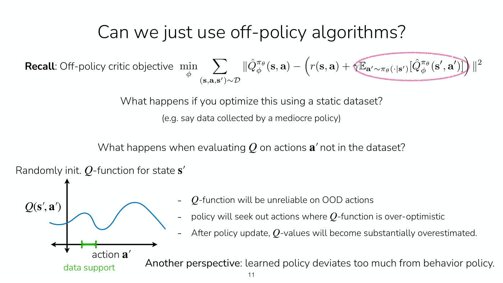
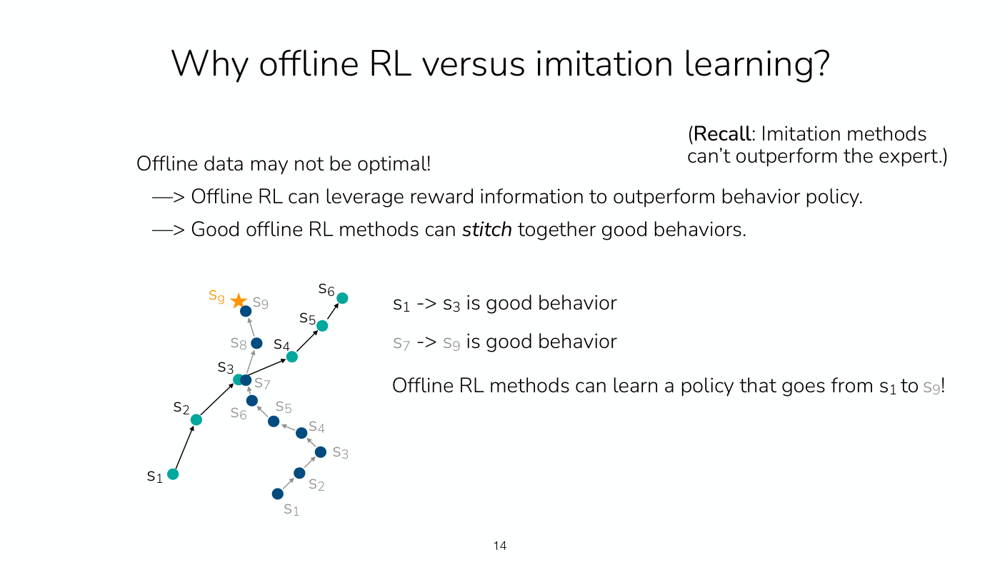
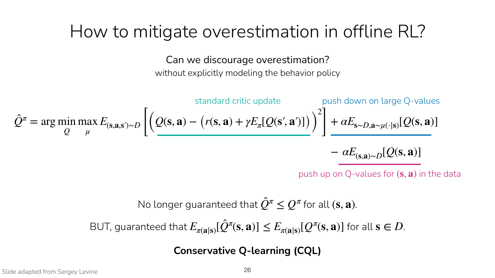

# Offline reinforcement learning

Offline RL learns a policy from a fixed dataset that someone else collected, with no further
interaction. Lecture 7 teaches it, and Lecture 8 opens by finishing it with conservative Q-learning.
This page gathers the setting, the central difficulty, why imitation learning is not enough, and the
methods, with the [implicit policy constraint methods](implicit-policy-constraints.md) and
[conservative Q-learning](conservative-q-learning.md) given their own pages.

## The setting

Online RL collects data, updates the policy on the latest data or all data so far, and repeats.
Offline RL is given a static dataset and trains a policy on it (Lecture 7, slide 7, ≈9:21–10:06). The
dataset $\mathcal{D} = \lbrace (\mathbf{s}, \mathbf{a}, \mathbf{s}', r) \rbrace$ of states, actions,
next states and rewards was sampled from some unknown **behavior policy** $\pi_\beta$ (slide 8):

$$\mathbf{s} \sim p_{\pi_\beta}(\cdot), \qquad \mathbf{a} \sim \pi_\beta(\cdot \mid \mathbf{s}), \qquad \mathbf{s}' \sim p(\cdot \mid \mathbf{s}, \mathbf{a}), \qquad r = r(\mathbf{s}, \mathbf{a})$$

If several people or systems collected the data, $\pi_\beta$ is a mixture of their policies, an
average or weighted sum, so speaking of one behavior policy loses nothing (≈14:49–15:35). The data
can come from people, a hand-designed system or controller, earlier RL runs, or a mixture (slide 9).

The goal is the usual [RL objective](rl-objective.md) for a learned policy $\pi_\theta$,

$$\max_\theta \mathbb{E}_ {p_\theta(\tau)} \left[ \sum_t r(\mathbf{s}_ t, \mathbf{a}_ t) \right]$$

an expectation under the learned policy's trajectory distribution $p_\theta(\tau)$, while the data
came from $\pi_\beta$ and the learned policy can never be sampled. Slide 8 names this **distribution
shift**. The dynamics are the same in the data and for the learned policy, so the shift comes only
from the change of policy (≈17:57). The two distributions are almost never identical: the point is
usually to do better than the data, and a better policy tends to have a narrower distribution than
the behavior policy (≈17:57–18:44).

**Why do it** (slide 7, ≈10:06–12:27): a dataset may already exist, collected by people or an
existing system, while running an untrained policy would be risky or unsafe (driving; medical
treatment, such as a seizure-prevention project); and reusing data beats recollecting it every time
an algorithm is rerun, because "online data is more expensive than offline data". The two can be
blended, with offline training followed by online improvement, for example with a safety driver.

How it relates to off-policy RL: a student suggested offline RL is a special case of off-policy
online RL whose data source is unknown. Finn calls that "sort of a correct way to view it", with the
strict difference that pure offline RL can never collect more data. Offline methods draw on
off-policy techniques because those already use old policies' data (≈12:27–13:13). See
[offline and online algorithms](offline-and-online.md).

## The core problem: overestimation on out-of-distribution actions

Running an off-policy actor-critic method such as soft actor-critic on the fixed dataset fails
(Lecture 7, slides 10–11, ≈19:29–24:58). Its critic target evaluates the Q-function on next actions
$\mathbf{a}'$ sampled from the learned policy:

$$\min_\phi \sum_{(\mathbf{s}, \mathbf{a}, \mathbf{s}') \sim \mathcal{D}} \left\Vert \hat{Q}^{\pi_\theta}_ \phi(\mathbf{s}, \mathbf{a}) - \left( r(\mathbf{s}, \mathbf{a}) + \gamma \mathbb{E}_ {\mathbf{a}' \sim \pi_\theta(\cdot \mid \mathbf{s}')} \left[ \hat{Q}^{\pi_\theta}_ \phi(\mathbf{s}', \mathbf{a}') \right] \right) \right\Vert^2$$

Those actions may never appear in the data. A Q-function starts randomly initialized, and outside the
data's support nothing corrects it, so some out-of-distribution (OOD) actions score arbitrarily high.
The policy update raises the likelihood of high-Q actions and so seeks those out; the critic keeps
reinforcing them, and the Q-values become substantially overestimated (slide 11). In Finn's car
example, the data holds a few ordinary actions, and nothing in it shows a car making a U-turn on the
highway, so that action's Q-value is whatever the initialization made it, and "your policy will
exploit those inaccuracies" (≈21:03–23:25). The other perspective: the learned policy deviates too
much from the behavior policy (slide 11).

*Lecture 7, slide 11 — a randomly initialized Q-function over actions, with data only under the short green bracket; the policy will head for the larger hump outside it. [Deck](https://cs224r.stanford.edu/spring_2025/slides/07_cs224r_offline_rl_2025.pdf)*

Discrete actions do not escape this. A state with full coverage of every action would be safe, but
in practice some states lack it (≈24:58). Nor can OOD actions simply be excluded, because what is in
distribution is unknown: the data holds samples, and a similar state may have taken an action the
state in hand never did (≈25:43). This is why the course's online off-policy methods insist on
action coverage; see [replay buffers and soft actor-critic](replay-buffers.md).

Mitigating this overestimation is, in slide 12's words, "the **core goal** of offline RL methods".

## Why not just imitate?

[Imitation learning](imitation-learning.md) avoids OOD actions implicitly, because it only supervises
with actions in the data (≈26:30). But imitation methods "can't outperform the expert" (slide 14), and
offline data may not be optimal. Offline RL can do better in two ways (slide 14, ≈27:15–29:33):

- it can use **reward information** to outperform the behavior policy;
- it can **stitch** together good behaviors from different trajectories. Where a trajectory with a bad
  ending crosses one with a good ending, a good offline method takes the first trajectory's good start
  and the second's good finish. Imitation would average the two action distributions at the crossing.

*Lecture 7, slide 14 — the teal trajectory's start (s1 to s3) and the blue trajectory's finish (s7 to s9, at the goal star) are each good; offline RL can learn to go from one to the other. [Deck](https://cs224r.stanford.edu/spring_2025/slides/07_cs224r_offline_rl_2025.pdf)*

The trajectories need not share an exact state. Neural networks give similar states similar outputs,
so stitching works across states that are close, more so with more data (≈36:29–37:16).

## The approaches

Lecture 7's summary (slide 30) lists three.

1. **Filtered or weighted imitation learning, a simple baseline.** Filtered behavior cloning imitates
   only trajectories whose return clears a threshold, such as the top 30% (slide 15). It cannot
   stitch, but Finn's advice is to try it first and make sure any offline RL method beats it
   (≈31:51).
2. **Implicitly constraining the policy to $\pi_\beta$**, by supervising it only on actions in the
   data: advantage-weighted regression (AWR), advantage-weighted actor-critic (AWAC) and implicit
   Q-learning (IQL). The policy is trained by imitation weighted by exponentiated advantages, and the
   critics are fitted without ever querying an OOD action. IQL fits its value function with an
   expectile loss so that it estimates a policy better than the behavior policy. These, and why they
   work, are on [implicit policy constraint methods](implicit-policy-constraints.md).
3. **A conservative objective that penalizes Q-values**: conservative Q-learning (CQL), below.

## Conservative Q-learning (CQL)

Lecture 7's recording does not teach this part; its slides 24–28, credited "Slide adapted from Sergey
Levine", hold it, and Lecture 8 teaches it aloud from the same slides (Lecture 8, slides 5–8,
≈6:57–21:39). The full treatment, with the lecture's explanations and student questions, is on
[conservative Q-learning](conservative-q-learning.md); the summary below cites Lecture 7's slide numbers.

Instead of avoiding OOD actions, CQL discourages overestimation directly, "without explicitly modeling
the behavior policy" (slide 25). To the standard critic update it adds a term that finds, through a
maximization over a distribution $\mu$, actions with large Q-values and pushes them down, weighted by
$\alpha$. For large enough $\alpha$ this gives $\hat{Q}^\pi \leq Q^\pi$ (slide 25). CQL adds one more
term that pushes up on the Q-values of the state-action pairs in the data (slide 26):

$$\hat{Q}^\pi = \arg\min_Q \max_\mu E_{(\mathbf{s}, \mathbf{a}, \mathbf{s}') \sim D} \left[ \left( Q(\mathbf{s}, \mathbf{a}) - \left( r(\mathbf{s}, \mathbf{a}) + \gamma E_\pi [Q(\mathbf{s}', \mathbf{a}')] \right) \right)^2 \right] + \alpha E_{\mathbf{s} \sim D, \mathbf{a} \sim \mu(\cdot \mid \mathbf{s})} [Q(\mathbf{s}, \mathbf{a})] - \alpha E_{(\mathbf{s}, \mathbf{a}) \sim D} [Q(\mathbf{s}, \mathbf{a})]$$

The pointwise bound is then lost, but the policy's expected Q-value is still guaranteed not to exceed
the true one for every state in the data:

$$E_{\pi(\mathbf{a} \mid \mathbf{s})} \left[ \hat{Q}^\pi(\mathbf{s}, \mathbf{a}) \right] \leq E_{\pi(\mathbf{a} \mid \mathbf{s})} \left[ Q^\pi(\mathbf{s}, \mathbf{a}) \right] \quad \text{for all } \mathbf{s} \in D$$

*Lecture 7, slide 26 — the CQL objective: the standard critic update, a term pushing down on large Q-values, and a term pushing up on Q-values for the data's own state-action pairs. [Deck](https://cs224r.stanford.edu/spring_2025/slides/07_cs224r_offline_rl_2025.pdf)*

The algorithm alternates updating $\hat{Q}^\pi$ with this loss on the data and updating the policy:
greedily, by $\arg\max$ over actions, when actions are discrete, and by a gradient step on
$E_{\mathbf{s} \sim D, \mathbf{a} \sim \pi_\theta(\cdot \mid \mathbf{s})}[\hat{Q}^\pi(\mathbf{s}, \mathbf{a})]$
when they are continuous (slide 27). With an entropy regularizer $R(\mu)$ on the inner maximization,
the optimal $\mu$ is proportional to $\exp(Q(\mathbf{s}, \mathbf{a}))$, and the push-down term becomes
$\log \sum_{\mathbf{a}} \exp(Q(\mathbf{s}, \mathbf{a}))$, so $\mu$ never has to be constructed
(slide 28). Homework 3 implements both CQL and IQL (slides 23 and 28).

Lecture 8 adds the reasoning the slides leave out (≈7:43–16:57). Pushing down alone is too pessimistic,
because it lowers the Q-values of the data's own actions too, which is why the push-up term is added;
the aim is a Q-function accurate inside the data's support and low outside it, where an accurate one
cannot be learned. The weight $\alpha$ sets how pessimistic the critic is outside the data, and the bound
fails if $\alpha$ is zero.

Slide 31's application uses it. LinkedIn's notification policy, trained offline by Prabhakar et al.
(2022), was tested online against a baseline: double DQN alone gave −0.69% weekly active users and
−7.79% click-through rate, while double DQN with CQL gave +0.18% and +2.26%.

## Which to use

Lecture 7's advice (slide 32, ≈1:06:42–1:07:51). To train offline only, filtered behavior cloning is a
good first approach. Implicit Q-learning can stitch and stays constrained to the data's support, and
will probably work better, especially with a broader dataset. Conservative Q-learning has "just one
hyperparameter" (slide only). For offline pre-training followed by online fine-tuning, IQL "seems most
performant". IDQL, a variant of IQL with [diffusion policies](expressive-policy-distributions.md),
also works well. Offline RL is "still an active area of research!" (slide 32).

## Offline RL for language reasoning

Lecture 10 places offline RL between imitation and online RL for training language models to solve
math problems. The data are the model's own sampled solutions, correct and incorrect. A rollout
policy completes prefixes of them, and the rollouts become preference pairs for DPO (Lecture 10,
slides 20–22, ≈51:34–56:09). Unlike imitation, this learns from the incorrect solutions too, which RL
can do (≈18:29–19:15). With Llama 2 and DeepSeek models it reached the test error of supervised
finetuning on human-written solutions with 8x fewer questions (slide 23, ≈59:13). See [RL for LLM
reasoning](llm-reasoning.md).

## Where this appears

- [Lecture 7 — Offline RL](07-offline-rl.md): the whole topic; CQL from the slides only.
- [Lecture 8 — Reward Learning](08-reward-learning.md#recap-offline-rl-and-implicit-q-learning): the
  recap, why IQL's asymmetric loss is for the value function only, CQL taught aloud with its LinkedIn
  application, and the summary of offline RL.
- [Lecture 2 — Imitation Learning](02-imitation-learning.md): behavior cloning as a fully offline
  method, which offline RL generalizes.
- [Lecture 5 — Off-Policy Actor Critic](05-off-policy-actor-critic.md) and
  [Lecture 6 — Q-Learning](06-q-learning.md): the off-policy methods whose action-coverage requirement
  is what breaks offline.
- [Lecture 10 — RL for LLM Reasoning](10-rl-for-reasoning.md#option-2-offline-rl-with-per-step-dpo):
  offline RL for math reasoning, with per-step DPO.
- [Lecture 18 — Frontiers](18-frontiers.md#evaluating-generalist-systems): no reliable offline metric for
  evaluating a policy, the open question of offline metrics that rule out bad models, and prior data used
  without pre-trained weights.
