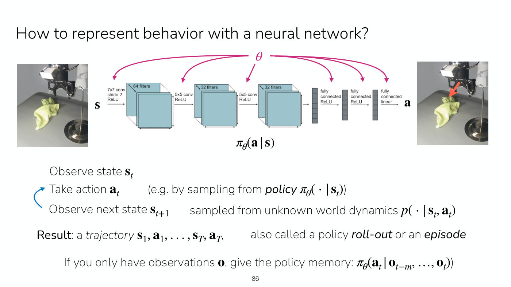

# Policies

A **policy** represents behavior: it selects actions based on states or observations
(Lecture 1, slide 44). CS224R writes it $\pi$, or $\pi_\theta$ when it has learnable parameters
$\theta$, and treats it as a conditional distribution over actions,
$\pi_\theta(\mathbf{a} \mid \mathbf{s})$. Symbols are as defined on
[MDPs and RL notation](mdp-and-notation.md).

## A policy is usually a neural network

The policy can be any function from states, observations or a sequence of observations to
actions: a convolutional network, a transformer, a fully connected network, or even a linear
function. $\theta$ denotes the parameters being learned, which for a neural network are its
weights (Lecture 1, ≈33:12–33:58). Slide 36 draws the example: a camera image of the towel and
hook (the state $\mathbf{s}$) goes through three convolutional layers ($7 \times 7$ with stride 2 and 64
filters, then two $5 \times 5$ layers with 32 filters each, all with ReLU) and three fully connected
layers (two ReLU, one linear) to an action $\mathbf{a}$, drawn as a red arrow on the same scene,
with $\theta$ pointing at every layer.

*Slide 36 — the policy as a convolutional network from camera image to action, with θ marking that every layer's weights are learned; below it, the roll-out loop. [Deck](https://cs224r.stanford.edu/spring_2025/slides/01_cs224r_intro_2025.pdf)*

## Using a policy: roll-outs and episodes

Running a policy is a loop (slide 36, ≈33:58–34:44):

1. observe the state $\mathbf{s}_ t$;
2. take an action $\mathbf{a}_ t$, for example by sampling from $\pi_\theta(\cdot \mid \mathbf{s}_ t)$,
   which means a forward pass through the network;
3. observe the next state $\mathbf{s}_ {t+1}$, sampled from the unknown world dynamics
   $p(\cdot \mid \mathbf{s}_ t, \mathbf{a}_ t)$, and repeat.

The result is a trajectory $\mathbf{s}_ 1, \mathbf{a}_ 1, \ldots, \mathbf{s}_ T, \mathbf{a}_ T$, also
called a policy **roll-out** or an **episode**. An episode is one attempt at the task. "Roll-out"
describes how the trajectory is produced, by unrolling the alternation of policy and dynamics
(≈34:44).

## Policies for observations need memory

A policy given the true state needs only the current state as input. A policy given only
observations needs **memory**, a window of past observations:

$$\pi_\theta(\mathbf{a}_ t \mid \mathbf{o}_ {t-m}, \ldots, \mathbf{o}_ t)$$

usually implemented with a sequence model, as language models do with the previous turns of a
conversation (slide 36, ≈35:29). Memory is avoided when possible because long histories use a lot
of memory on the computer or GPU. Adding the current observation to a policy that already has the
true state adds nothing, since the state has strictly more information (≈36:15–37:01). An
alternative for observation-only problems is a two-stage policy that first infers the state and
then acts on it, worthwhile when there is a good idea of what the underlying state should look
like (≈37:46).

## Why stochastic policies?

CS224R's policies are distributions, not deterministic functions, for two reasons (Lecture 1,
slide 39, ≈47:01–47:47):

- **Exploration.** To learn from its own experience, an agent must try different things, the way
  someone learning tennis should not repeat the same technique over and over.
- **Modeling stochastic behavior.** Data collected from people or other systems shows varying
  strategies, and a model of how they approach a problem has to be stochastic too.

This is where tools from **generative modeling** come in: a policy can be a generative model over
actions given states or observations.

Lecture 2 shows why the choice of distribution matters. When demonstrators do the same thing in
different ways, a policy that outputs a single action, or a single Gaussian, learns the average of
their actions, which can be an action none of them took (≈8:32–10:05). The network should output
the parameters of an expressive distribution instead, such as a Gaussian mixture, a discretized
autoregressive model or a diffusion model, trained to maximize the log-likelihood of the
demonstrated actions. And making the network bigger does not help on its own, because "neural
network expressivity is often distinct from distribution expressivity" (Lecture 2, ≈46:16). See
[expressive policy distributions](expressive-policy-distributions.md).

A stochastic policy is also one of the two sources of randomness in the RL objective; see
[The RL objective](rl-objective.md#where-the-randomness-comes-from).

## Where this appears

- [Lecture 1 — Class Intro](01-class-intro.md#representing-behavior-the-policy): the policy as a
  neural network, roll-outs, memory, and why policies are stochastic.
- [Lecture 2 — Imitation Learning](02-imitation-learning.md#learning-distributions-with-neural-networks):
  the policy as a network that outputs a distribution's parameters, and the generative models that
  make it expressive.
