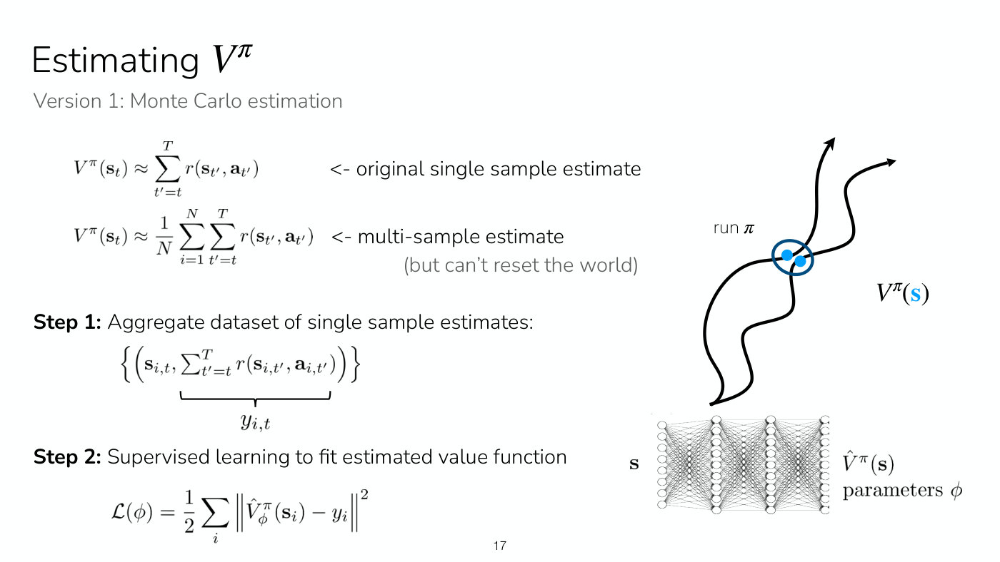
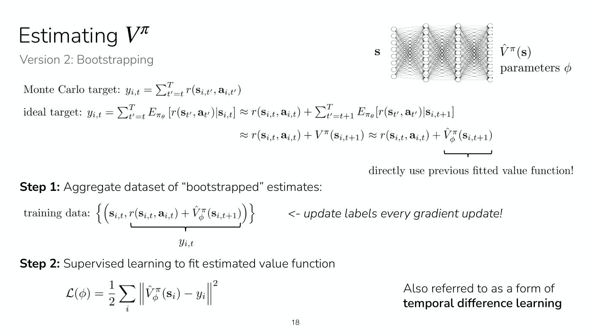
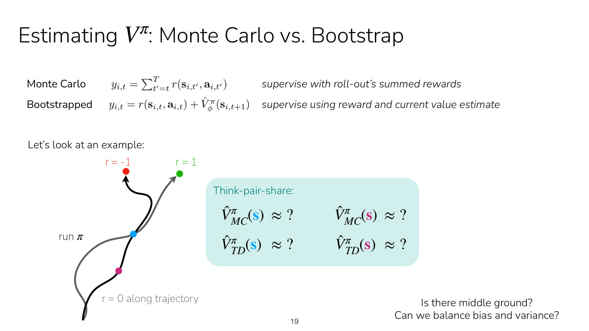
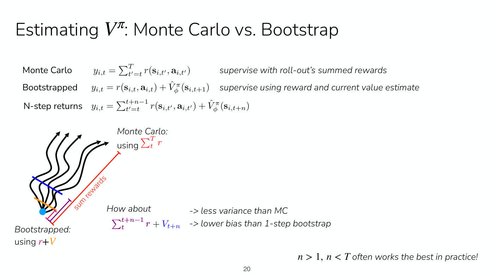

# Policy evaluation

**Policy evaluation** means estimating how good a state, or a state and action, is for a given
policy. Lecture 4 makes it the first learning goal, how to estimate how good a state and action is for
a policy: "This is called policy evaluation" (slide 5, ≈3:55). It is the critic's job in
[actor-critic methods](actor-critic.md). The lecture fits the [value function](value-functions.md)
$V^\pi(\mathbf{s})$, the expected sum of future rewards from state $\mathbf{s}$ under policy $\pi$,
with a neural network $\hat{V}^\pi_\phi$ whose parameters are $\phi$. It gives three ways to supervise
that network (Lecture 4, slides 23 and 36). Symbols are as on
[MDPs and RL notation](mdp-and-notation.md).

## Why the value function

Fitting the advantage $A^\pi$ directly is hard to supervise, and fitting both $Q^\pi$ and $V^\pi$
means two networks. But with one sampled next state $\mathbf{s}_ {t+1}$ the advantage is
approximately $r(\mathbf{s}_ t, \mathbf{a}_ t) + V^\pi(\mathbf{s}_ {t+1}) - V^\pi(\mathbf{s}_ t)$,
so $V^\pi$ alone is enough: "Let's just fit $V^\pi$!" (Lecture 4, slide 14, ≈27:00–33:14). The
superscript matters. Finn notes that much RL work "drops the pi just for simplicity", but the
function estimates a value for a particular policy, not for any policy (≈32:28–33:14).

All three methods below share one regression. From the sampled trajectories, indexed by $i$ with
time steps $t$, they build a dataset of states $\mathbf{s}_ {i,t}$ with labels $y_{i,t}$, and they
minimize a squared error (Lecture 4, slides 17–18, ≈38:35–40:07):

$$\mathcal{L}(\phi) = \frac{1}{2} \sum_i \left\Vert \hat{V}^\pi_\phi(\mathbf{s}_ i) - y_i \right\Vert^2$$

They differ only in the label. Because the policy is not changed by these gradient steps, many of
them can be taken on one batch without collecting new data (≈40:07).

## Monte Carlo estimation

The label is the sum of rewards actually observed from that time step to the end of the trajectory
(Lecture 4, slides 15–17, ≈34:00–40:53):

$$y_{i,t} = \sum_{t'=t}^{T} r(\mathbf{s}_ {i,t'}, \mathbf{a}_ {i,t'})$$

Averaging many rollouts from the same state would be better, but that needs the world reset to that
state, which "in many scenarios" is "very hard" (≈34:46). So instead a single network is trained on
single-sample labels from many trajectories. Similar states recur across them, and the network
learns to "amortize the data" (≈35:31). The dataset has the number of trajectories times the average
trajectory length as its size (≈37:04). Finn calls this "the simplest and kind of dumbest approach
you can use to fit a value function", and it has to be refit whenever the policy changes (≈37:50).

*Lecture 4, slide 17 — Monte Carlo estimation as supervised learning: two trajectories pass close to the same state (circled), so a network trained on many single-sample labels learns from both. [Deck](https://cs224r.stanford.edu/spring_2025/slides/04_cs224r_actor_critic_2025.pdf)*

## Bootstrapping (temporal difference learning)

The label is the reward now plus the network's current estimate of the next state's value
(Lecture 4, slide 18, ≈40:53–47:45):

$$y_{i,t} = r(\mathbf{s}_ {i,t}, \mathbf{a}_ {i,t}) + \hat{V}^\pi_\phi(\mathbf{s}_ {i,t+1})$$

This comes from the ideal target, the expected sum of future rewards, which equals the current
reward plus the value of the next state. The slide's note on the last term is "directly use
previous fitted value function!" Since the labels contain the network's own output, they change
during training and are typically recomputed after every gradient update (≈43:58–44:43). The name
is "bootstrapping" because the method bootstraps off its own estimate of the value function as part
of the learning process (≈43:58). It is also called **temporal difference learning**, after the
difference between the next time step and the current one. This propagates information backwards
in time, which "is distinct from propagating gradients through the network" (≈46:59–47:45).

Initialization needs nothing fancy, though values initialized around "negative a thousand" would
be bad, and one could start with the Monte Carlo objective to get into the right ballpark
(≈46:14–46:59).

*Lecture 4, slide 18 — the bootstrapped target: the reward now plus the fitted network's own estimate of the next state's value, with labels updated after every gradient step. [Deck](https://cs224r.stanford.edu/spring_2025/slides/04_cs224r_actor_critic_2025.pdf)*

## How they differ: an example

Two trajectories start from the same state and earn reward 0 until the end (Lecture 4, slide 19,
≈47:45–51:38). The black one passes through a pink state and then a blue state and ends with reward
$-1$. The grey one bypasses the pink state, joins at the blue state, and ends with reward $1$.

| State | Monte Carlo | Bootstrapping |
| --- | --- | --- |
| blue (both trajectories) | 0, the average of $-1$ and $1$ | 0 |
| pink (black trajectory only) | $-1$, that trajectory's own outcome | 0, from the blue state's estimate |

Monte Carlo pools the two trajectories only at the blue state, where the same exact state appears
with two labels (≈50:51). Bootstrapping passes the blue state's estimate back to the pink state, so
it is "able to look at its estimated value and actually aggregate information across trajectories
more effectively". Finn calls its answer arguably the more accurate one (≈50:04).

*Lecture 4, slide 19 — the think-pair-share: both trajectories pass through the blue state, only the black one (which ends at reward -1) passes through the pink state, and the question is what Monte Carlo and bootstrapping estimate at each. [Deck](https://cs224r.stanford.edu/spring_2025/slides/04_cs224r_actor_critic_2025.pdf)*

## Bias and variance

"Monte Carlo is going to have high variance, but it is completely unbiased, whereas the
bootstrapped estimate has much lower variance" (≈51:38). The bootstrapped estimate is biased,
because the current value estimate inevitably has at least a small amount of error (≈52:23).

The single next state has a cost too. It is a good approximation when the environment is close to
deterministic, "because there aren't that many futures", and worse when it is stochastic (≈32:28).

## N-step returns

The middle ground sums the observed rewards for $n$ steps and then bootstraps from the value at
step $t+n$ (Lecture 4, slide 20, ≈52:23–56:13):

$$y_{i,t} = \sum_{t'=t}^{t+n-1} r(\mathbf{s}_ {i,t'}, \mathbf{a}_ {i,t'}) + \hat{V}^\pi_\phi(\mathbf{s}_ {i,t+n})$$

It has less variance than Monte Carlo and lower bias than a one-step bootstrap. With $n = 1$ it is
bootstrapping, and with $n = T$ it is Monte Carlo. The slide's advice is that $n \gt 1$, $n \lt T$
"often works the best in practice". This is especially useful with very short time steps, such as
10 milliseconds, where little happens between steps (≈54:41). Choosing $n$ does not change how
greedy the agent is, since every target estimates the same quantity. What it trades is variance:
look further ahead when the variance grows slowly, and use a smaller $n$ when it grows quickly
(≈59:19–1:00:04). Mixing labels of several kinds is possible in principle, but in practice one is
picked (≈55:28–56:13).

*Lecture 4, slide 20 — Monte Carlo sums every reward (red), one-step bootstrapping uses one reward plus a value, and n-step returns sum n rewards (purple) and then use the value at t plus n (blue). [Deck](https://cs224r.stanford.edu/spring_2025/slides/04_cs224r_actor_critic_2025.pdf)*

Lecture 6 carries n-step returns over to Q-learning's targets (slides 24–25, ≈52:42–57:19), where
they help most early in training, while the Q-network is still bad and the single reward is the only
informative part of the target. There they have a cost the value-function version does not: the
summed rewards come from the policy that collected the data, not from the optimal policy being
estimated, so the target is only correct on-policy. See [Q-learning](q-learning.md).

The Q-learning tutorial (Lecture 19) derives all three targets from the value function's
definition, on the whiteboard, with slide 20 printing the lines: the expected return; its expansion
into the discounted sum of rewards, the Monte Carlo estimate; the first reward split off from the
sum; the rest recognized as $\gamma V^\pi(s_{t+1})$, the TD target; and the n-step form, which keeps
more rewards before the value (≈21:39–28:59). Monte Carlo uses the whole trajectory, so it has no
bias; TD substitutes a value function that can be inaccurate, which adds bias, but shortens the
horizon to one step, which cuts variance (≈25:31–26:17). Slide 23 tabulates it: TD has a bootstrap
depth of 1 step, high bias and low variance; n-step, N steps and medium for both; Monte Carlo, the
full episode, low bias and high variance. In tabular settings both approaches should converge to the
same result, but beyond that they do not (≈30:32). How much the variance matters depends on the
domain: for language, with almost perfect dynamics and, in math or code reasoning, perfect rewards,
Monte Carlo roll-outs are common, while agentic and robotic domains bring the variance back
(≈31:19–32:05).

*Lecture 19, slide 21 — Monte Carlo follows one path all the way to a terminal state; the TD backup goes one step and stops at the next state's estimate. [Deck](https://cs224r.stanford.edu/spring_2025/slides/section_q_learning_tutorial.pdf)*

## Discounting the targets

With very long or infinite episodes, summed rewards, and so the values, can grow without bound. A
discount factor $\gamma \in [0, 1]$ on the next state's value fixes this (Lecture 4, slide 21,
≈56:13–58:33):

$$y_{i,t} \approx r(\mathbf{s}_ {i,t}, \mathbf{a}_ {i,t}) + \gamma \hat{V}^\pi_\phi(\mathbf{s}_ {i,t+1})$$

The slide says 0.99 works well. In the n-step target the value term is multiplied by $\gamma^n$
(slide 22, ≈58:33). For what discounting means for the decision process, see
[the RL objective](rl-objective.md#horizon-and-discounting).

## Beyond the one-step advantage and the current batch

Lecture 5 extends policy evaluation in two directions. PPO's **generalized advantage estimation**
keeps the value function fitted the normal way, by Monte Carlo or bootstrapping, but estimates the
advantage from a weighted mixture of n-step estimates, with weights proportional to
$\lambda^{n-1}$ that decay quickly so that most weight stays on $n = 1$ (Lecture 5, slide 12,
≈37:51–41:42). Finn is not sure it is necessary; see [PPO](ppo.md#generalized-advantage-estimation).

And with a replay buffer of data from many past policies, a bootstrapped value function no longer
evaluates the current policy: it learns a value function for "some sort of mixture of all of your
past policies" (≈50:57). The fix is to fit a Q-function instead, bootstrapping from the next state's
Q-value under an action sampled from the current policy,
$y_i = r(\mathbf{s}_ i, \mathbf{a}_ i) + \gamma Q^{\pi_\theta}(\mathbf{s}'_ i, \bar{\mathbf{a}}'_ i)$,
which needs data covering actions similar to the current policy's (Lecture 5, slides 16–18). See
[replay buffers and soft actor-critic](replay-buffers.md).

## Policy evaluation inside policy iteration

Lecture 6 names the step. Fitting $Q^\pi$ for the current policy is **policy evaluation**, because it
learns the values of a policy, and it can take several gradient steps since it is only fitting
targets. Replacing the policy with the greedy one, which takes the action with the highest Q-value,
is **policy improvement**, and alternating the two is **policy iteration** (slide 10, ≈17:12–18:00).
Folding the improvement into the target, so that it bootstraps from the max over next actions
rather than from the current policy's action, gives Q-learning (slide 11); the equation each target
encodes is on [Bellman equations](bellman-equations.md).

## Evaluating the behavior policy offline

Lecture 7 opens by recalling the three regressions, Monte Carlo and bootstrapped targets for $V$ and the
bootstrapped Q target whose next action comes from the current policy (slide 4, ≈0:05–7:02). Its slides
print the Monte Carlo target's reward as $r(\mathbf{s}_ t, \mathbf{a}_ t)$ inside a sum over $t'$
(slides 4, 18 and 19); the lecture describes it as the sum of rewards from that state onward (≈1:38).

On an offline dataset all three change role. The data comes from a behavior policy $\pi_\beta$, so Monte
Carlo regression onto the empirical return evaluates $\pi_\beta$, which advantage-weighted regression
uses (slide 18). The Q target with the current policy's next action queries actions the data may never
contain, which is what makes Q-values overestimated offline (slides 10–11). Taking the next action from
the data instead evaluates $\pi_\beta$ by bootstrapping without that risk (slide 20, advantage-weighted
actor-critic). And replacing the squared error with an asymmetric **expectile** loss moves the fitted
value from the mean of the outcomes the data shows toward the value of the best policy in the data's
support (slides 21–23, implicit Q-learning). See
[implicit policy constraint methods](implicit-policy-constraints.md).

## Where this appears

- [Lecture 4 — Actor-Critic Methods](04-actor-critic.md#estimating-the-value-function-version-1-monte-carlo):
  the three methods, the worked example and the discount factor.
- [Lecture 3 — Policy Gradients](03-policy-gradients.md): the single-sample reward to go, which is
  the Monte Carlo estimate with no model.
- [Lecture 5 — Off-Policy Actor Critic](05-off-policy-actor-critic.md): the recap of the three
  methods, generalized advantage estimation, and fitting a Q-function from a replay buffer.
- [Lecture 6 — Q-Learning](06-q-learning.md#policy-iteration-from-actor-critic-to-critic-only):
  policy evaluation and improvement as policy iteration, and n-step returns for Q-learning targets.
- [Lecture 7 — Offline RL](07-offline-rl.md#recap-three-ways-to-fit-a-value-function): the recap of
  the three regressions, and their offline versions (Monte Carlo for the behavior policy, bootstrapping
  on data actions, expectile regression).
- [Lecture 19 — Tutorial Session: Review of Q-Learning](19-q-learning-tutorial.md#q-learning-as-regression-monte-carlo-td-and-n-step):
  Monte Carlo, TD and n-step targets derived from the value function's definition, the backup diagrams,
  and the bias-variance table.
