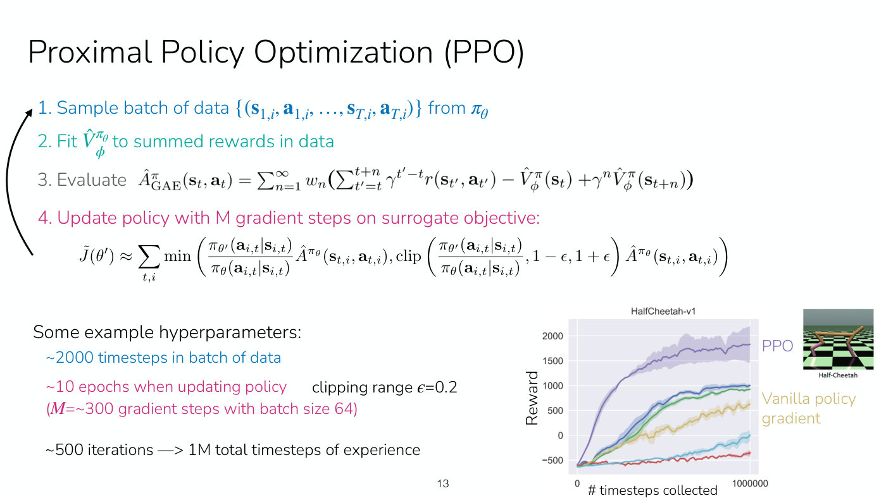

# Proximal policy optimization (PPO)

PPO is an [actor-critic](actor-critic.md) algorithm that takes many gradient steps on each batch of
data without letting the policy drift far from the one that collected it. Lecture 5 builds it from
the on-policy actor-critic algorithm and calls it "Off-policy actor-critic with a few tricks"
(slide 11). It is the course's example of stable but less data-efficient learning, and a common
choice for training in simulation and for language models (Lecture 5, slides 26–28). Symbols are as
on [MDPs and RL notation](mdp-and-notation.md): $\mathbf{s}$ is a state, $\mathbf{a}$ an action,
$r$ the reward, $\pi_\theta$ a [policy](policies.md) with parameters $\theta$, and
$\hat{A}^{\pi_\theta}$ an estimated [advantage](value-functions.md). Timestamps (≈M:SS) are into
[Lecture 5's recording](05-off-policy-actor-critic.md).

## The problem it solves

On-policy actor-critic takes one gradient step per batch, so it needs a lot of data. To take more
steps on one batch, the gradient at the updated parameters $\theta'$ reweights each term by an
[importance weight](importance-sampling.md), the ratio of the new policy's probability of the
action to that of the policy $\pi_\theta$ that collected the data (Lecture 5, slide 8,
≈7:47–9:20). Implemented through automatic differentiation, this is the **surrogate objective**
$\tilde{J}$, whose gradient is that importance-weighted gradient (slide 9, ≈10:09–12:26):

$$\tilde{J}(\theta') \approx \sum_{t,i} \frac{\pi_{\theta'}(\mathbf{a}_ {i,t} \mid \mathbf{s}_ {i,t})}{\pi_\theta(\mathbf{a}_ {i,t} \mid \mathbf{s}_ {i,t})} \hat{A}^{\pi_\theta}(\mathbf{s}_ {t,i}, \mathbf{a}_ {t,i})$$

Maximizing it, the policy pushes up the probability of actions with positive advantage, most of all
those the old policy rarely took, since that makes the ratio large. But the advantages were
estimated for the old policy from one batch. With too many gradient steps, the policy overfits them:
it moves far from the old policy, the advantages go out of date, and learning becomes unstable or
collapses (≈12:26–15:29). The slide's summary is "Policy is incentivized to differ significantly
from old policy, can easily overfit" (slide 9). The fix is to keep the new policy close to the old
one, so that the advantages stay valid (≈20:52).

## Two ways to stay close

**A KL penalty or constraint.** Add to the surrogate objective a penalty on the KL divergence between
the new and old policies, weighted by a hyperparameter $\beta$, or constrain that divergence below
some $\delta$, as slide 10 prints it (≈21:39–28:37). It keeps the advantages more accurate and allows
more gradient steps stably, at the cost of keeping the old policy in memory. With language models,
that means the old model's full weights, though the old probabilities for the batch can be cached
instead. $\beta$ is often a fairly important hyperparameter, tuned within an order of magnitude. KL
constraints are "Very common" and the course will see them in LLM preference optimization; one
version of PPO uses one, though not the most common version (slide 10, ≈27:51).

**Clipping the importance weights.** Bound the importance weight $w$ to the range from $1 - \epsilon$
to $1 + \epsilon$ (≈28:37–31:42):

$$\mathrm{clip}(w, 1 - \epsilon, 1 + \epsilon) = \min(\max(w, 1 - \epsilon), 1 + \epsilon)$$

With $\epsilon = 0.2$, a value used in practice, the weight stays between 0.8 and 1.2. Once the
ratio passes 1.2, raising the action's probability further no longer improves the objective, which
stays at 1.2 times the advantage. Clipping "Doesn't directly constrain policy, but removes
incentives" (slide 10), and it is the key idea behind PPO.

## The PPO objective

PPO's tricks, in order (Lecture 5, slides 11–12):

1. **Clip the importance weights.** Then the "Policy no longer incentivized to deviate
   significantly".
2. **Take the minimum with respect to the original objective**, for each data point.
3. **Estimate the advantage with generalized advantage estimation** (below).

The first two give the final surrogate objective:

$$\tilde{J}(\theta') \approx \sum_{t,i} \min \left( \frac{\pi_{\theta'}(\mathbf{a}_ {i,t} \mid \mathbf{s}_ {i,t})}{\pi_\theta(\mathbf{a}_ {i,t} \mid \mathbf{s}_ {i,t})} \hat{A}^{\pi_\theta}(\mathbf{s}_ {t,i}, \mathbf{a}_ {t,i}), \mathrm{clip} \left( \frac{\pi_{\theta'}(\mathbf{a}_ {i,t} \mid \mathbf{s}_ {i,t})}{\pi_\theta(\mathbf{a}_ {i,t} \mid \mathbf{s}_ {i,t})}, 1 - \epsilon, 1 + \epsilon \right) \hat{A}^{\pi_\theta}(\mathbf{s}_ {t,i}, \mathbf{a}_ {t,i}) \right)$$

The minimum exists for the "rare event where clipping makes objective better" (slide 11). Suppose a
state-action pair has advantage $-1000$, and the new policy gives the action probability 0.9 where
the old gave 0.1. The ratio is 9, and clipping it to 1.2 turns a contribution of $-9000$ into $-1200$,
rewarding the policy for a mistake. The mirror case is an advantage of $+1000$ with probabilities 0.1
and 0.9, where clipping a ratio of 1/9 up to 0.8 again flatters the objective. Taking the minimum
means clipping can never make the objective better, so the objective is a lower bound on the
original surrogate, and maximizing a lower bound cannot overshoot the original (≈32:28–37:06). Finn
is not sure how often this matters in practice (≈33:13).

## Generalized advantage estimation

The value function $\hat{V}^\pi_\phi$ is still fitted the normal way, by Monte Carlo or
bootstrapping (see [policy evaluation](policy-evaluation.md)). The advantage, though, mixes
estimates over several horizons, like n-step returns, instead of the one-step reward plus next value
minus current value (slide 12, ≈37:51–41:42):

$$\hat{A}^\pi_ n(\mathbf{s}_ t, \mathbf{a}_ t) = \sum_{t'=t}^{t+n} \gamma^{t'-t} r(\mathbf{s}_ {t'}, \mathbf{a}_ {t'}) - \hat{V}^\pi_\phi(\mathbf{s}_ t) + \gamma^n \hat{V}^\pi_\phi(\mathbf{s}_ {t+n})$$

$$\hat{A}^\pi_ {\mathrm{GAE}}(\mathbf{s}_ t, \mathbf{a}_ t) = \sum_{n=1}^{\infty} w_n \hat{A}^\pi_ n(\mathbf{s}_ t, \mathbf{a}_ t), \qquad w_n \propto \lambda^{n-1} \text{ for } n = 1, \ldots, N, \text{ where } N \ll T$$

Here $\gamma$ is the discount factor, $T$ the horizon, and $\lambda$ sets how fast the weights decay.
They decay quickly, "cut earlier for less variance", so most weight is still on $n = 1$, and $\gamma$
and $\lambda$ are used together. (The slide's reward sum runs to $t+n$; Lecture 5's slide 5 stops
the n-step sum at $t+n-1$.) Finn is candid about it: there is a bias-variance argument, and a mixture
of horizons may hedge when the right $n$ is unclear, but "it's also not 100% clear if it's
necessary", and Finn has not compared performance with and without it. The slide answers "Why?" with
a meme credited to one of the GAE authors: "I made it up".

## The algorithm

PPO has four steps, repeated (Lecture 5, slide 13, ≈41:42–44:48):

1. Sample a batch of data from $\pi_\theta$.
2. Fit $\hat{V}^{\pi_\theta}_ \phi$ to the summed rewards in the data.
3. Evaluate $\hat{A}^\pi_ {\mathrm{GAE}}$.
4. Update the policy with $M$ gradient steps on the surrogate objective.

After step 4, the updated policy collects the next batch, so $\theta$ becomes the previous $\theta'$.
The value function can be warm-started from the previous one or trained from scratch, depending on
the domain.

The slide's example hyperparameters, which are to be tuned per domain, are about 2,000 time steps
per batch, about 10 epochs per policy update ($M$ of about 300 gradient steps with batch size 64),
clipping range $\epsilon = 0.2$, and about 500 iterations, for about a million time steps of
experience. Because of the clipping, 300 gradient steps per batch do not make learning unstable
(≈42:28–44:00).

*Lecture 5, slide 13 — the four-step PPO loop, its example hyperparameters, and Half-Cheetah learning curves where PPO (purple) climbs to about 1800 reward in a million time steps while vanilla policy gradient (tan) reaches about 600. [Deck](https://cs224r.stanford.edu/spring_2025/slides/05_cs224r_offpolicy_actor_critic_2025.pdf)*

On the simulated Half-Cheetah, PPO improves much faster than vanilla policy gradient, which neither
fits an advantage function nor clips, because PPO does both and so can take many more gradient
steps on each batch (≈44:00–44:48).

## PPO against more off-policy methods

PPO reuses one batch for many gradient steps, but never data from earlier batches. Methods that keep
a [replay buffer](replay-buffers.md) of all past data, such as soft actor-critic, go further. On
Lecture 5's humanoid comparison, SAC (more off-policy) learns far faster than PPO (less
off-policy), but such methods "can also generally be a lot harder to tune hyperparameters, less
stable (than e.g. PPO)" (slide 23, ≈1:07:08). PPO is "Common algorithm of choice for stable, less
efficient learning" (slides 26–27, ≈1:08:40). Where data is cheap, as in simulation, that trade
favours PPO. The lecture's examples are a quadruped that learns to walk in simulation and transfers
to the real robot, and a robot hand that solves a Rubik's cube with a policy trained in simulation,
though sim-to-real transfer is generally much harder for manipulation. PPO is also a common choice
for language models (slide 28), which the course takes up with reward modeling: in Lecture 8, after a
reward model is learned from human preferences, "one somewhat common approach is to use PPO to maximize
the reward" (≈1:00:23; see [learning rewards from preferences](preference-learning.md)). In Lecture 9, PPO is the RL
step of InstructGPT's pipeline (slide 61) and of ChatGPT's (slide 85), and an RLHF-trained Alpaca is
labelled "Alpaca + PPO" (slide 88). Lecture 9 also shows why it is costly there: slide 74's PPO-based
RLHF pipeline needs a policy, a reference model, a reward model and a value model, generalized advantage
estimation and an experience buffer, and "Performance can be sensitive to hyperparameters". That cost
motivates [direct preference optimization](direct-preference-optimization.md), which drops the RL loop;
see [RL from human feedback](rlhf.md).

Lecture 6's closing advice puts it the same way (slide 27, "Chelsea's advice", ≈59:41–1:00:27):
PPO and its variants when you care about stability and ease of use and not about data efficiency.
PPO generally does not need much tuning, but it is very data-inefficient. SAC is for when data
efficiency matters most, and DQN for discrete or low-dimensional continuous actions; see
[Q-learning](q-learning.md#when-to-use-it).

## Where this appears

- [Lecture 5 — Off-Policy Actor Critic](05-off-policy-actor-critic.md#version-1-multiple-gradient-steps-with-importance-weights):
  the whole derivation, the questions on it, the hyperparameters and the examples.
- [Lecture 4 — Actor-Critic Methods](04-actor-critic.md#not-in-the-recording-off-policy-actor-critic):
  the first version of these slides, which that recording does not reach.
- [Lecture 4 — Actor-Critic Methods](04-actor-critic.md#recap-and-plan): actor-critic methods as
  "the basis for algorithms like PPO".
- [Importance sampling](importance-sampling.md): where the importance weight comes from.
- [Actor-critic methods](actor-critic.md): the on-policy algorithm PPO starts from.
- [Lecture 6 — Q-Learning](06-q-learning.md#which-online-rl-algorithm-to-use): when to use PPO,
  DQN or SAC.
- [Lecture 8 — Reward Learning](08-reward-learning.md#rewards-for-language-models): PPO as a common
  choice for the RL step of RL from human feedback.
- [Lecture 9 — RL for LLMs](09-rl-for-llms.md#direct-preference-optimization-why): PPO in
  InstructGPT and ChatGPT, and the complexity of a PPO-based RLHF pipeline.
