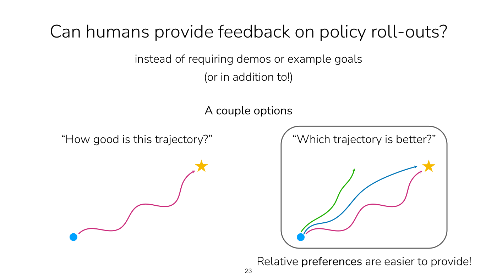
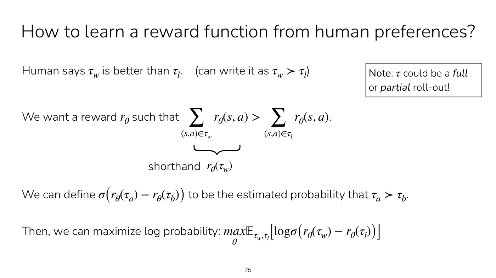
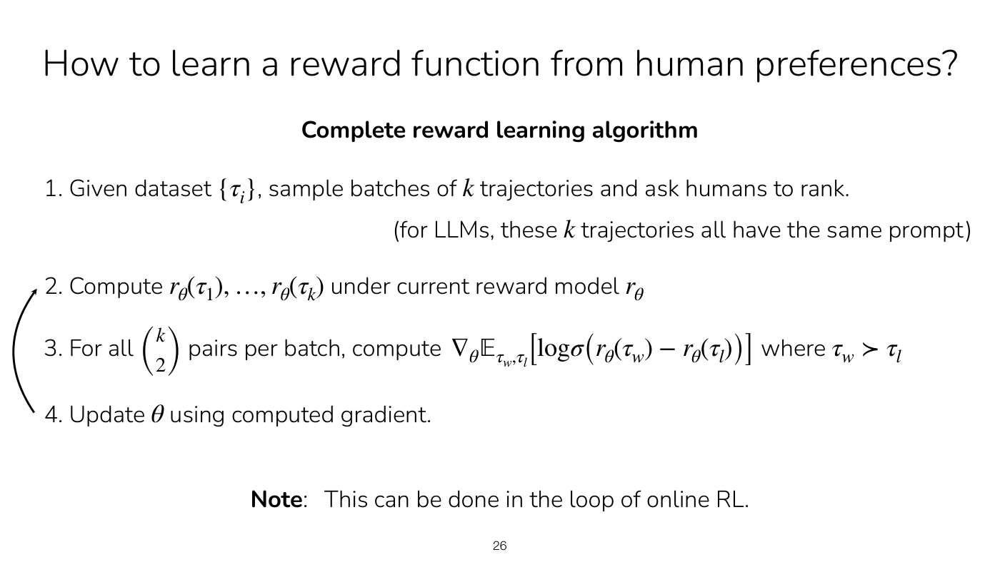
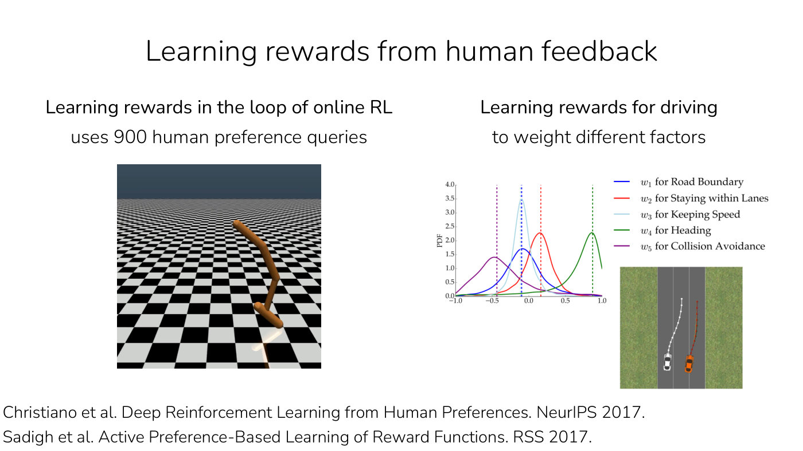
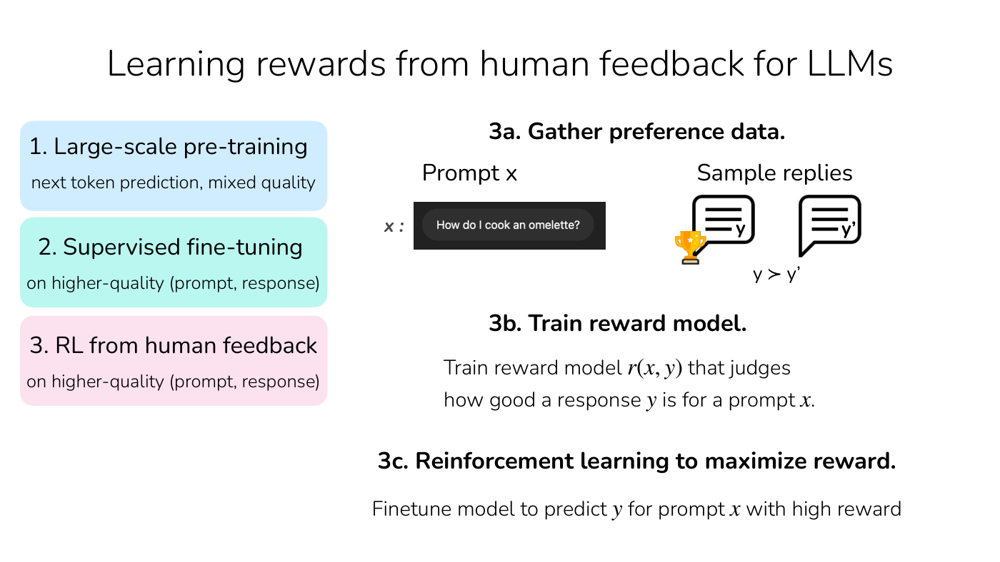

# Learning rewards from preferences

Instead of supplying a reward, demonstrations or example goals, a person can compare two of the
agent's attempts and say which is better. Learning a reward function from many such comparisons is
how rewards are learned for control tasks that are hard to specify, and for large language models in
RL from human feedback (RLHF). Lecture 8 teaches it (slides 22–30, ≈44:57–1:03:29); its other approach,
learning rewards from example goals, is on [reward learning](reward-learning.md). Citations are to
Lecture 8.

## Why compare instead of score

The goal here is more than reaching a goal set: to learn good behavior versus bad, which may involve
more than the final state, using feedback on whole roll-outs instead of, or in addition to,
demonstrations or example goals (slides 22–23, ≈44:57). Asked "how good is this trajectory?" about a
path from a start point to a goal star, people find it hard to answer. Asked "which trajectory is
better?", a whole class agrees at once (slide 23, ≈45:45). **Relative preferences are easier to
provide** than absolute evaluations, for lines in 2D and in many real-world uses (≈45:45–46:32).

*Lecture 8, slide 23 — scoring one trajectory to the star (left) against choosing the best of three (right); the class picked the blue one. [Deck](https://cs224r.stanford.edu/spring_2025/slides/08_cs224r_reward_learning_2025.pdf)*

## The objective

A person says trajectory $\tau_w$ is better than $\tau_l$, written $\tau_w \succ \tau_l$, with $w$ and
$l$ for winning and losing (slide 24, ≈46:32–47:18). Model the reward as a neural network
$r_\theta(s, a)$ with parameters $\theta$ that maps a state $s$ and action $a$ to a scalar (≈48:05), and
write $r_\theta(\tau)$ for its sum over a trajectory. The preference suggests the better trajectory
should have the larger sum of rewards (slide 24):

$$\sum_{(s, a) \in \tau_w} r_\theta(s, a) > \sum_{(s, a) \in \tau_l} r_\theta(s, a)$$

"Humans are classifying which trajectory is better. Reward should be discriminative as well"
(slide 24). Each binary label says only a little about the reward, so many are aggregated (≈47:18).

To train by maximum likelihood, pass the difference through the sigmoid $\sigma$, which squashes it to
between 0 and 1, and read $\sigma(r_\theta(\tau_a) - r_\theta(\tau_b))$ as the estimated probability that
$\tau_a \succ \tau_b$ (slide 25, ≈49:39). Then maximize the log probability of the observed preferences
over the dataset's pairs (slide 25, ≈50:25):

$$\max_\theta \mathbb{E}_ {\tau_w, \tau_l} \left[ \log \sigma \left( r_\theta(\tau_w) - r_\theta(\tau_l) \right) \right]$$

For each pair: sum each trajectory's rewards, subtract, take the sigmoid, and maximize with gradient
methods (≈50:25).

*Lecture 8, slide 25 — the preference inequality on summed rewards, the sigmoid of the reward difference read as a probability, and the log-likelihood to maximize. [Deck](https://cs224r.stanford.edu/spring_2025/slides/08_cs224r_reward_learning_2025.pdf)*

Two clarifications from the lecture:

- **Partial roll-outs.** $\tau$ can be a full or a partial roll-out (slide 24). A long trajectory, such
  as driving from Palo Alto to San Francisco or cleaning a kitchen, has better and worse parts, and
  parts can be compared (≈51:14).
- **Preferences carry no margin.** A label does not say how much better one trajectory is. With a lot
  of data the pairwise preferences form a ranking, which forces a much higher reward for the best
  trajectory than the worst; people can also be asked to rank a whole batch (≈52:00–53:30).

## The algorithm

Slide 26 (≈53:30–55:49):

1. Given a dataset of trajectories $\lbrace \tau_i \rbrace$, sample batches of $k$ trajectories and ask
   humans to rank them. For language models, the $k$ trajectories share one prompt.
2. Compute $r_\theta(\tau_1), \ldots, r_\theta(\tau_k)$ under the current reward model.
3. For all $\binom{k}{2}$ pairs per batch, compute the gradient of the objective, with $\tau_w \succ \tau_l$
   in each pair.
4. Update $\theta$ with the computed gradient, and repeat from step 2.

A ranking of $k$ trajectories gives $\binom{k}{2}$ pairs, each a winner and a loser to plug into the
objective (≈1:00:23–1:01:09). Batches share a starting point because trajectories from different
starts are hard to compare: one may have reached the goal faster only because it started somewhere
easier (≈54:16).

*Lecture 8, slide 26 — the complete reward-learning algorithm, ranking batches of k trajectories, computing rewards, taking gradients over every pair, updating and repeating. [Deck](https://cs224r.stanford.edu/spring_2025/slides/08_cs224r_reward_learning_2025.pdf)*

**In the loop of online RL** (slide 26, ≈55:49–56:34): sample from the policy, have people rank the
samples, update the reward model, update the policy with it, collect new roll-outs, and repeat. The
cost is human time: preference learning "may require supervision in the loop of RL", which usually
requires more human time (slide 31).

## Uses in control

Christiano et al. (NeurIPS 2017) taught a simulated agent a backflip, for which a reward function is
very hard to write, with 900 human preference queries asked in the loop of RL, learning a reward for a
human-preferred backflip along the way (slide 27, ≈56:34–57:20). Sadigh et al. (RSS 2017) learned how
to weight driving factors such as staying within lanes, keeping speed and avoiding collisions; you
would expect collision avoidance to matter much more than keeping a certain speed (slide 27, ≈57:20).

*Lecture 8, slide 27 — the simulated agent that learned a backflip from 900 preference queries, and learned densities over five driving-reward weights beside a two-car road diagram. [Deck](https://cs224r.stanford.edu/spring_2025/slides/08_cs224r_reward_learning_2025.pdf)*

## RL from human feedback for language models

Preference learning is a very popular way to learn rewards for language models (slide 28,
≈57:20–58:06). For a prompt $x$, such as "How do I cook an omelette?", sample two responses, ask a person
which is better ($y \succ y'$), and train a reward model $r(x, y)$ that judges how good a response $y$ is
for the prompt $x$. The labellers may be paid, and a chat assistant's users are sometimes asked the
same question (≈58:06).

The full pipeline has three stages (slide 29, ≈58:06–1:00:23): large-scale pre-training on next-token
prediction over mixed-quality data, which gives a model that knows a lot but is hard to control;
supervised fine-tuning on higher-quality prompt and response pairs, which is basically imitation
learning; and RL from human feedback, which fine-tunes that model on preference data in three steps:
gather preference data (existing preference datasets can be used), train a reward model, and run RL
to maximize it. One somewhat common choice for that last step is [PPO](ppo.md) (≈1:00:23). The
prompt $x$ is often the whole conversation history; the problem can be modelled sequentially, or more
crudely by treating the next response as the thing being optimized (≈1:00:23).

*Lecture 8, slide 29 — the three stages of training a chat model (pre-training, supervised fine-tuning, RL from human feedback) and the three steps of the last. [Deck](https://cs224r.stanford.edu/spring_2025/slides/08_cs224r_reward_learning_2025.pdf)*

Lecture 9, a guest lecture by Archit Sharma on preference optimization for language models, continues
from here (Lecture 8, slide 2). It names the objective above the **Bradley-Terry** paired comparison
model, writes it for a prompt $x$ with a winning response $y^w$ and a losing one $y^l$ as a loss to
minimize, and argues for comparisons over scores because people's scores are noisy and miscalibrated
(Lecture 9, slides 66–67, ≈22:23–23:56). It adds that ranking $N$ responses gives $\binom{N}{2}$ pairs,
and that the Plackett-Luce family generalizes Bradley-Terry to whole rankings (≈56:40). See
[RL from human feedback](rlhf.md) for the full method and its limitations, and
[direct preference optimization](direct-preference-optimization.md) for training the language model on
preferences without the RL step.

## AI feedback

The judge can be another model: ask a strong model which response is better, possibly about a specific
axis you care about. This is **reinforcement learning with AI feedback (RLAIF)** (slide 30,
≈1:01:57–1:02:43). It has been used to make models less harmful, by asking a model which of two
responses is less harmful. The key insight is that critique is easier than generation (slide 30),
one reason AI feedback can produce a stronger model (≈1:02:43). Slide 30's chart (Bai et al.,
"Constitutional AI", 2022) plots harmlessness against helpfulness Elo, with the Constitutional RL
runs beyond the frontier of standard RLHF.

## Trade-offs

Pairwise preferences are easy to provide and need no example goals or demonstrations, and the approach
has been deployed at very large scale. It may need supervision in the loop of RL, which takes more human
time (slide 31, ≈1:03:29). Compare learning from goals and demonstrations on
[reward learning](reward-learning.md).

## Where this appears

- [Lecture 8 — Reward Learning](08-reward-learning.md): the whole topic, with the student questions.
- [Reward learning](reward-learning.md): why rewards must be learned, and the goal-classifier approach.
- [PPO](ppo.md): the RL algorithm Lecture 8 names for the last step of RLHF.
- [Lecture 9 — RL for LLMs](09-rl-for-llms.md#a-reward-model-from-pairwise-comparisons): the
  Bradley-Terry reward model for language models, RLHF and DPO.
- [RL from human feedback](rlhf.md) and [direct preference optimization](direct-preference-optimization.md):
  the two ways Lecture 9 optimizes a language model on preferences.
- [Lecture 18 — Frontiers](18-frontiers.md#domains-without-rewards): evidence that people's preferences
  favour confident answers that agree with them over true ones, as an open problem for preference
  optimization.
