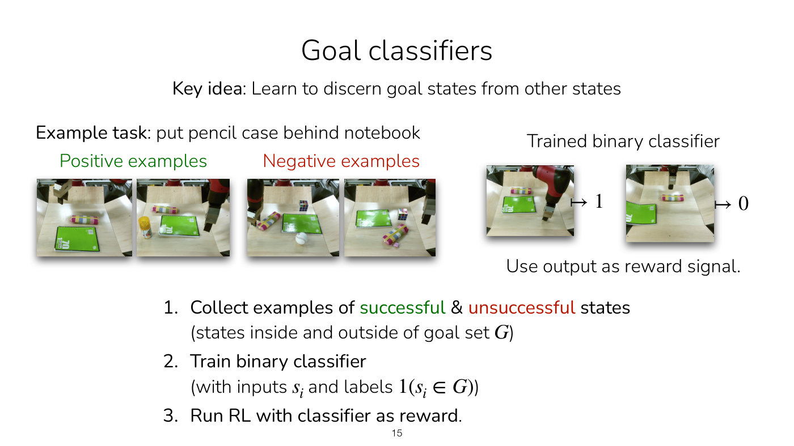
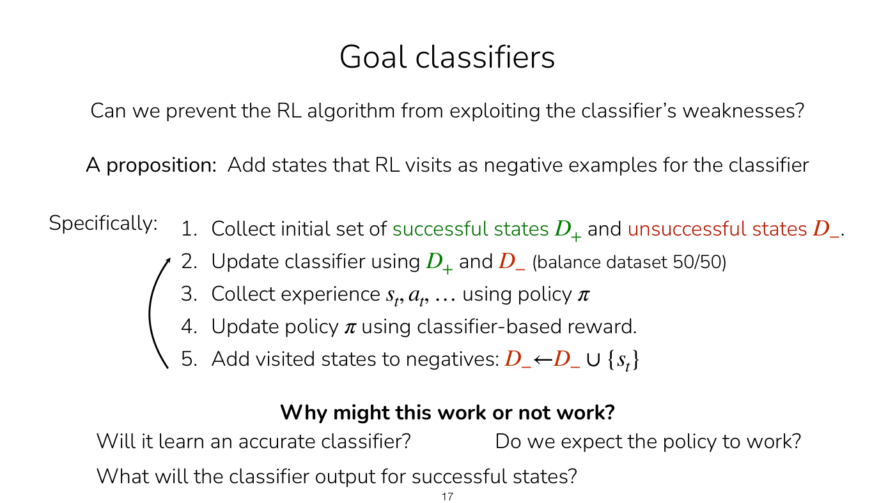
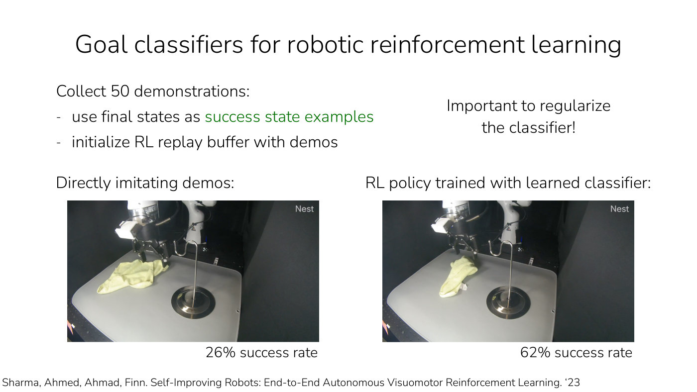
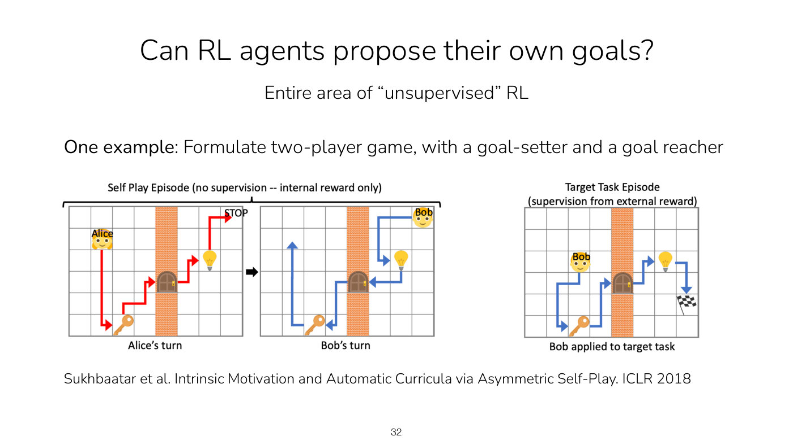

# Reward learning

Every RL method in the course, except imitation learning, maximizes a sum of rewards (see
[the RL objective](rl-objective.md)). Reward learning asks where that reward comes from when nobody
hands one over, and how to learn it from human supervision. Lecture 8 teaches it in two parts:
learning rewards from **examples of goals or behaviors**, covered on this page, and learning them
from **human preferences**, which has its own page,
[learning rewards from preferences](preference-learning.md). Citations are to Lecture 8 unless they
say otherwise.

## Why rewards cannot be taken for granted

In computer games the score is the reward, and RL produces a player that plays very well
(slide 12, ≈24:48). In the real world rewards rarely come so directly (≈24:48–26:21). For a robot
pouring water from a pitcher into a cup, a task young children do fairly well, a reward would have to
represent where the water is, whether any spilled and whether it got into the cup. A chatbot's users do
not announce rewards. Driving depends on the rules of the road, the ride's comfort and more.

A **proxy** can stand in: a person giving a reward of one for success and zero otherwise, or a
click-through rate, which nobody values for its own sake but which tracks what we might care about
(≈26:21–27:07; slide 12: "often use a proxy"). Proxies have many downsides, which is the reason to
look for other kinds of supervision. Slide 31's first takeaway is "Rewards can't be taken for
granted!" [Lecture 1](01-class-intro.md) already raised the problem: how a robot learns what is good
or bad for its task is one of the open problems the course lists under reward learning, and that
lecture's real-robot experiments measured reward with tricks (the arm's own position, a motion-capture
marker) that do not work in general.

Slide 3's learning goals for the topic are "why task specification is hard (& why naïve methods fail)"
and "methods for learning rewards from human supervision".

## Imitation is the reward-free alternative, and why it is not enough

[Imitation learning](imitation-learning.md) needs no reward function (slide 13, ≈27:07). But it
mimics actions without reasoning about outcomes or dynamics; the expert may have different degrees of
freedom from the robot; and it may not be possible to provide demonstrations (slide 13). Reward
learning asks instead what the expert is trying to achieve and what humans want. People, even very
small children, infer what someone's objective is and act to help (≈27:53).

## Goal classifiers

The simplest approach: show examples of success and failure, train a binary classifier to tell them
apart, and use its output as the reward (slide 15, ≈27:53–29:25). For the task "put pencil case behind
notebook", positive examples show the pencil case behind the notebook and negative examples show it
elsewhere. The steps:

1. Collect examples of successful and unsuccessful states, inside and outside a goal set $G$.
2. Train a binary classifier, with inputs $s_i$ and labels $\mathbb{1}(s_i \in G)$.
3. Run RL with the classifier as the reward.

*Lecture 8, slide 15 — positive and negative example photos for putting the pencil case behind the notebook, and a trained classifier mapping new images to 1 or 0 as the reward. [Deck](https://cs224r.stanford.edu/spring_2025/slides/08_cs224r_reward_learning_2025.pdf)*

Two things go wrong (slide 16, ≈29:25–30:58). The reward is **sparse**, saying only whether the agent
is in the goal set. Worse, RL **exploits the classifier**: "the RL algorithm will seek out states that
the classifier thinks are good", and it "may simply find states that the classifier wasn't trained
on" (slide 16), where the classifier can be wrong in the optimistic direction. Finn compares this to
[offline RL](offline-rl.md), where the policy seeks out the Q-function's overestimated actions.

## Adding visited states as negatives

The fix resembles [conservative Q-learning](conservative-q-learning.md) (≈30:58). Label the states the
policy visits as negatives, since their true labels are unknown and calling them failures is the
conservative choice, and retrain the classifier (≈31:44–33:19). Finn draws it as a 2D state space:
the classifier's decision boundary first encloses a large region around the positives, the policy
wanders into part of it, those states become negatives, and the boundary tightens around the true
goal states. The algorithm (slide 17, ≈33:19–34:07):

1. Collect an initial set of successful states $D_+$ and unsuccessful states $D_-$.
2. Update the classifier using $D_+$ and $D_-$, balancing the dataset 50/50.
3. Collect experience $s_t, a_t, \ldots$ using the policy $\pi$.
4. Update the policy $\pi$ using the classifier-based reward.
5. Add the visited states to the negatives, $D_- \leftarrow D_- \cup \lbrace s_t \rbrace$, and return to
   step 2.

*Lecture 8, slide 17 — the algorithm that adds the states the policy visits to the negatives and retrains the balanced classifier; the arrow loops from step 5 back to step 2. [Deck](https://cs224r.stanford.edu/spring_2025/slides/08_cs224r_reward_learning_2025.pdf)*

**Why it works, and what it needs** (slide 18, ≈34:07–41:02).

- The classifier can no longer be exploited, because wherever the policy goes becomes a negative.
- **Regularize the classifier.** With few positives it can overfit, drawing a boundary around each
  positive example and not the states right next to it. Standard regularizers that make it smoother
  help (≈34:07–34:54). In the robot experiment below this was very important (slide 19).
- **Balance the data 50/50.** Negatives keep accumulating, and without rebalancing the classifier
  might predict negative everywhere (≈34:54–35:40).
- **Successes labelled as failures are tolerable.** Once the policy reaches goal states, they are
  labelled negative, wrongly. With balanced batches the classifier still outputs a probability of
  at least 0.5 for successful states (slide 18). Finn's example: half the data is true positives;
  of the other half, 40% of the whole is false negatives and 10% true negatives, including the
  original ones. A properly trained classifier then gives a true positive a probability above 50%,
  reaching exactly 50% only if the negative half were all false negatives, and gives a true negative
  less than 0.5 (≈36:27–38:46).
- The classifier's probability can be used as the reward directly, without thresholding (≈38:46).
- No new human labels are assumed after the initial dataset. Labelling some of the policy's data as
  positive or negative is also a valid approach and can stabilize training (≈40:16–41:02).

## Adversarial training: it is a GAN

A student recognized the structure, and Finn agrees it is "exactly a form of a GAN": the classifier is
a discriminator separating the given positives from everything the policy visits, and the policy is
the generator (≈39:31–40:16). A generative adversarial network trains a classifier to tell real data
from generated data and a generator to produce data the classifier thinks is real; at convergence the
generator matches the data distribution (slide 20, ≈42:36). Slide 20's examples are VQ-GAN's
generated Yorkshire terriers and Phenaki's video of an astronaut on Mars.

The same recipe learns a **full reward function**, not just a goal classifier: with all states in the
demonstrations as positives and all states in the policy's roll-outs as negatives, it learns a reward
over state distributions rather than goal states (slide 21, ≈43:23–44:11; Finn skips the details for
time).

## Evidence: a self-improving robot

Sharma, Ahmed, Ahmad and Finn ('23) collected 50 demonstrations of a cloth task, used their final
states as success examples and initialized the replay buffer with them (slide 19, ≈41:02–42:36).
Imitating the demonstrations directly succeeded 26% of the time; RL with the learned classifier
reached 62%, "not awesome yet" but substantially higher.

*Lecture 8, slide 19 — one video frame of each policy on the cloth task, 26% success from imitating 50 demonstrations and 62% after RL with the learned classifier. [Deck](https://cs224r.stanford.edu/spring_2025/slides/08_cs224r_reward_learning_2025.pdf)*

## Trade-offs

Learning rewards from goals or demonstrations is a practical framework for task specification.
Adversarial training can be unstable, though many regularization tricks carry over from the GAN
literature. And it requires examples of the desired behavior or outcome, which can be challenging or
time-consuming to produce (slides 21 and 31, ≈44:11–44:57, ≈1:03:29). Learning from preferences
needs no such examples; see [learning rewards from preferences](preference-learning.md) for its side
of the comparison.

A learned reward is a proxy, and optimizing hard against a proxy exploits it, as RL exploits a fixed goal
classifier. Lecture 9 shows the same with reward models for language models: as the policy moves away
from its starting point, the reward model's predicted preference keeps rising while actual human
preference peaks and then falls (Lecture 9, slide 94, ≈59:48–1:00:35); see
[RL from human feedback](rlhf.md#costs-and-limitations).

## Other supervision, and agents that set their own goals

Goals and preferences are only two forms of feedback. Slide 31's thought exercise asks for others: an
agent could be told in words that something was good, helpful, or "helpful but kind of mean", and
Finn thinks there is more to do in this area (≈1:04:16).

At the other extreme, in **unsupervised RL**, no human says what to do and the agent has its own sort
of curiosity. One example makes it a two-player game between a goal-setter and a goal-reacher
(slide 32, ≈1:04:16–1:05:46; Sukhbaatar et al., ICLR 2018).

*Lecture 8, slide 32 — asymmetric self-play, where Alice sets a task by moving and stopping, Bob must reach it, and Bob is then applied to a target task with external reward. [Deck](https://cs224r.stanford.edu/spring_2025/slides/08_cs224r_reward_learning_2025.pdf)*

## Process rewards for reasoning

Lecture 10 meets a learned reward of a different kind. In math reasoning the outcome reward needs no
learning, since a final answer can be checked against the ground truth. What gets learned is a
per-step reward: a model that predicts how much each step of a solution helped. The NLP community
calls such a model a **process reward model** (PRM), because it scores the process rather than only
the answer, as RLHF's reward models do; in reasoning, reward models are often called **verifiers**
(Lecture 10, ≈42:19–43:05, ≈1:06:10). Kumar's group fits a process advantage verifier to advantages
estimated by rollouts and uses it as a dense reward in online RL, 5–6x as sample-efficient as the
outcome reward alone (slides 25–27, ≈1:03:52–1:06:56). See [process rewards and per-step
credit](process-rewards.md).

## A reward model for planning

Model-based RL needs the reward as well as the dynamics. "Note: Often also need to learn a reward
model!" (Lecture 11, slide 10): to use a learned model to see into the future, the agent has to predict
not only the future states but the rewards they lead to (≈18:36). A planner that backpropagates through
the model trains a reward function with the techniques of this page, unless the reward is known, such
as forward velocity for learning to walk or the distance to a goal (≈27:13–28:00). And like a policy
trained on a learned reward, the planner exploits the reward model's errors along with the dynamics
model's (≈28:00–28:46). See [model-based RL](model-based-rl.md).

Training a policy on a model's synthetic roll-outs needs rewards for them too, so it only makes sense
with an estimate of the reward function: its form may be known, or a reward function may have been
learned, and otherwise the model, or a separate one, learns the reward by supervised learning (Lecture
12, ≈11:37–12:22, ≈14:40). Rewards are generally easier to predict than future states, though a reward
learned from fewer labeled data can still be the less accurate of the two (≈26:12–27:00). Hindsight
relabeling has the same need: data relabeled for another task needs that task's reward, so its form
must be known or learned (≈1:09:21). See [hindsight relabeling](hindsight-relabeling.md).

## Where this appears

- [Lecture 8 — Reward Learning](08-reward-learning.md): the whole topic, with the student questions.
- [Learning rewards from preferences](preference-learning.md): the second approach.
- [Lecture 9 — RL for LLMs](09-rl-for-llms.md#frontier-and-challenges): reward hacking and
  over-optimization of learned reward models for language models.
- [Lecture 1 — Class Intro](01-class-intro.md): reward learning as one of the course's open problems.
- [Imitation learning](imitation-learning.md): the reward-free alternative.
- [Conservative Q-learning](conservative-q-learning.md): the offline RL method whose idea the
  negatives fix mirrors.
- [Lecture 10 — RL for LLM Reasoning](10-rl-for-reasoning.md#dense-rewards-process-advantage-verifiers):
  process reward models and process advantage verifiers for reasoning.
- [Lecture 11 — Model-Based RL](11-model-based-rl.md#how-to-learn-a-dynamics-model): the reward model
  a planner needs beside its dynamics model.
- [Lecture 12 — Multi-Task RL](12-multi-task-rl.md#model-based-policy-optimization-synthetic-data-from-a-model):
  rewards for synthetic data, and for relabeled data.
