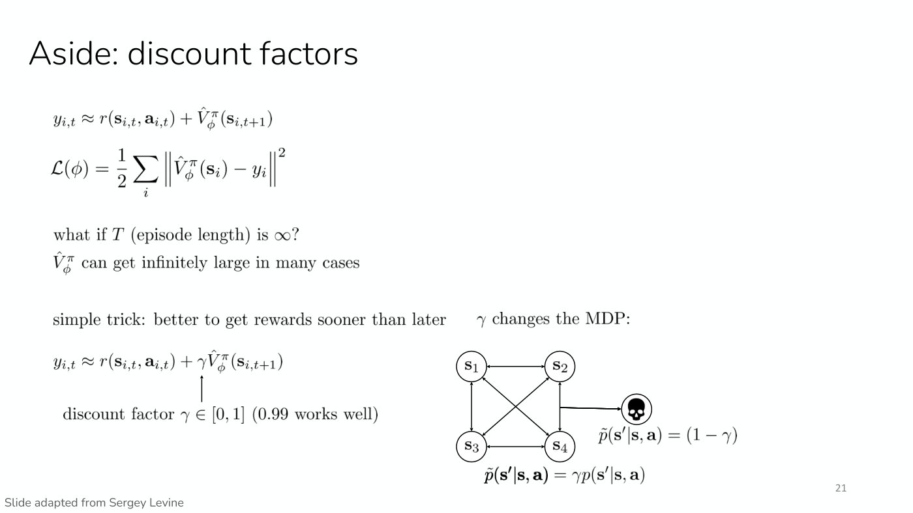

# The RL objective

What a reinforcement learning agent is trying to do, as Lecture 1 builds it up. Symbols are as
defined on [MDPs and RL notation](mdp-and-notation.md): $\mathbf{s}_ t$ and $\mathbf{a}_ t$ are
the state and action at time $t$, $T$ is the trajectory's length, $r$ is the reward function and
$\pi_\theta$ is the policy with parameters $\theta$.

## From a sum of rewards to an expected sum

The goal is to maximize reward over the whole trajectory, not at a single time step, which first
suggests maximizing the sum of rewards (Lecture 1, ≈38:32):

$$\max \sum_{t}^{T} r(\mathbf{s}_ t, \mathbf{a}_ t)$$

But that sum is not a deterministic quantity. Running the same policy twice gives different
trajectories and different rewards.

### Where the randomness comes from

Asked for the sources of variability, the class suggested stochastic dynamics, a stochastic
policy, a stochastic reward and changing goals (≈39:18–40:49). Rewards are typically modeled as
deterministic functions; randomness that seems to live in the reward, such as a goal that cannot
be observed, can be pushed into the state without loss of generality, and goals that change are
usually treated as a different decision process. That leaves **two main sources** (≈40:49–41:36):

1. **the world is stochastic**: the dynamics $p(\mathbf{s}_ {t+1} \mid \mathbf{s}_ t, \mathbf{a}_ t)$
   are a distribution, not a deterministic function;
2. **the policy is stochastic**: it may not make the same decision every time.

In driving, other cars behave randomly, and your own car may not make the same decision every
time. The initial state can be random too, like the deal in a card game (≈42:23).

### The trajectory distribution

Putting the initial state, the policy and the dynamics together gives a probability distribution
over trajectories, written $p_\theta(\tau)$ (≈41:36–43:09):

$$p_\theta(\tau) = p(\mathbf{s}_ 1, \mathbf{a}_ 1, \ldots, \mathbf{s}_ T, \mathbf{a}_ T) = p(\mathbf{s}_ 1) \prod_{t=1}^{T} \pi_\theta(\mathbf{a}_ t \mid \mathbf{s}_ t) \thinspace p(\mathbf{s}_ {t+1} \mid \mathbf{s}_ t, \mathbf{a}_ t)$$

Read left to right, this is the probability of the first state, then of the first action under
the policy, then of the next state under the dynamics, and so on. Slide 37 draws it as a
graphical model in which each state feeds the policy's action and both feed the next state, with
the formula beneath; slide 38 restates the formula. (The lecture says "plus the product" at
≈43:09; the slides multiply.)

*Slide 37 — the sum of rewards is random: the policy (state to action) and the dynamics (state and action to next state) in the graphical model are the two sources, and the trajectory probability multiplies them. [Deck](https://cs224r.stanford.edu/spring_2025/slides/01_cs224r_intro_2025.pdf)*

### The objective

The goal of RL is to find the policy parameters that maximize the **expected** sum of rewards
under that distribution (slide 38, ≈43:09–43:56):

$$\max_{\theta} \thinspace \mathbb{E}_ {\tau \sim p_\theta(\tau)} \left[ \sum_{t}^{T} r(\mathbf{s}_ t, \mathbf{a}_ t) \right]$$

The policy does not appear inside the sum. It affects the objective only through
$p_\theta(\tau)$, the distribution of trajectories it produces, and that is what makes RL harder
than supervised learning, where the parameters sit directly in the loss. Much of the course is
about how to optimize behavior under this objective (≈44:42). The
[algorithm families](rl-algorithm-families.md) are different ways of doing it.

## Horizon and discounting

The horizon $T$ is the number of steps in a trajectory. It is written as fixed because that is
easier, but it can vary (≈44:42–45:28).

The plain sum weights every reward equally: it cares about immediate rewards exactly as much as
rewards far in the future. That is not always what is wanted. If $T$ were 1,000 years, rewards
1,000 years from now should probably count for less than rewards today. A **discount factor**
handles this by weighting the reward at time $t$ by the discount factor raised to the power $t$.
It is usually greater than 0 and at most 1. A discount factor of 1 recovers the undiscounted
objective, and lower values make the agent greedier, caring more about near-term rewards than
distant ones (≈45:28–47:01).

Lecture 1 introduces the discount factor in speech only: it is on no slide of that deck and is
given no symbol. The lecture says discount factors return in a couple of lectures.

Lecture 4 brings it back as $\gamma \in [0, 1]$, to keep value estimates finite (slide 21,
≈56:13–58:33). If the episode length $T$ is infinite, or very long, a value that sums every future
reward can get very large. Multiplying the next state's value by $\gamma$ in each target weights
earlier rewards more than later ones. $\gamma = 1$ changes nothing; the lecture suggests something
like 0.9 or 0.99, and the slide says 0.99 works well. See
[policy evaluation](policy-evaluation.md#discounting-the-targets).

Lecture 4 also reads the discount factor as a change to the decision process: it is equivalent to
the agent dying at any point in time with some probability (≈57:47). With $\gamma = 0.99$ there
is a 1% chance at each step of entering a state with zero reward and staying there forever. In the
slide's diagram, every original transition probability $p(\mathbf{s}' \mid \mathbf{s}, \mathbf{a})$
is multiplied by $\gamma$, and with probability $1 - \gamma$ the agent drops into a death state
where it "can't do anything else after that" (≈58:33).

*Lecture 4, slide 21 — discounting as a change to the MDP: each original transition keeps probability gamma times its old value, and with probability one minus gamma the agent drops into a death state. [Deck](https://cs224r.stanford.edu/spring_2025/slides/04_cs224r_actor_critic_2025.pdf)*

## How good is a particular policy?

The same expectation, started from a given state (and action) instead of the initial state
distribution, defines the [value function and the Q-function](value-functions.md)
(slide 40).

## Estimating and differentiating the objective

Lecture 3 names the objective $J(\theta)$ and makes two moves with it. First, it can be
**estimated** but not read off the policy's weights: run the policy $N$ times and average the
summed rewards (slide 7, ≈4:00–4:47),

$$J(\theta) = \mathbb{E}_ {\tau \sim p_\theta(\tau)} \left[ \sum_t r(\mathbf{s}_ t, \mathbf{a}_ t) \right] \approx \frac{1}{N} \sum_i \sum_t r(\mathbf{s}_ {i,t}, \mathbf{a}_ {i,t})$$

where $i$ indexes the sampled trajectories. Second, it can be **differentiated**, even though
$\theta$ enters only through $p_\theta(\tau)$ and the dynamics are unknown. Writing the
expectation as an integral and using the identity
$p_\theta(\tau) \nabla_\theta \log p_\theta(\tau) = \nabla_\theta p_\theta(\tau)$ gives
$\nabla_\theta J(\theta) = \mathbb{E}_ {\tau \sim p_\theta(\tau)} \left[ \nabla_\theta \log p_\theta(\tau) \thinspace r(\tau) \right]$,
where $r(\tau)$ is the sum of rewards along $\tau$, and in $\log p_\theta(\tau)$ the initial-state
and dynamics terms do not depend on $\theta$, so they drop out (slides 8–9). That is the
[policy gradient](policy-gradients.md).

## Where the reward comes from

The objective assumes a reward function. In games the score supplies one, but in the real world rewards
rarely come directly, and Lecture 8 is about learning them: from examples of goals, with a classifier,
or from human preferences between trajectories (slide 12, ≈24:48–27:53). See
[reward learning](reward-learning.md) and [learning rewards from preferences](preference-learning.md).

## A KL-penalized objective

Lecture 9 (a guest lecture by Archit Sharma) uses the objective for a language model: the "trajectory" is a
whole completion $\hat{y}$ sampled from the model $p^{RL}_ \theta(\hat{y} \mid x)$ for a prompt $x$, and
the reward is a learned reward model $RM_\phi(x, \hat{y})$. Because that reward is only accurate near the
data it was fitted on, the objective subtracts a penalty for drifting from the starting model $p^{PT}$
(Lecture 9, slide 70, ≈29:21–30:58):

$$\mathbb{E}_ {\hat{y} \sim p^{RL}_ \theta(\hat{y} \mid x)}\left[RM_\phi(x, \hat{y}) - \beta \log \left(\frac{p^{RL}_ \theta(\hat{y} \mid x)}{p^{PT}(\hat{y} \mid x)}\right)\right]$$

In expectation the penalty is the KL divergence between the two models, weighted by $\beta$. Plain
expected-reward maximization has no closed-form optimum, but this KL-penalized objective does:
$p^\ast(\hat{y} \mid x) = \frac{1}{Z(x)} p^{PT}(\hat{y} \mid x) \exp\left(\frac{1}{\beta} RM(x, \hat{y})\right)$,
the starting model reweighted by the exponentiated reward, with $Z(x)$ the normalizer (Lecture 9,
slide 76, ≈38:46–40:18). That closed form is what [direct preference optimization](direct-preference-optimization.md)
builds on; [RL from human feedback](rlhf.md) optimizes the objective with RL instead.

## Evaluating an agent that never resets

Lecture 16 asks how to evaluate an agent that learns without resets, and gives two answers (Lecture 16,
slide 13, ≈12:20–14:40). **Deployed policy evaluation** asks how good the learned policy is: after learning,
start it from the initial state distribution $p(\mathbf{s}_ 1)$ and take its expected discounted return,
which is the objective above written with a discount $\gamma$:

$$J(\pi) = \mathbb{E}_ {\mathbf{s}_ 1 \sim p(\mathbf{s}_ 1), \mathbf{a}_ t \sim \pi} \left[ \sum_ t \gamma^t r(\mathbf{s}_ t, \mathbf{a}_ t) \right]$$

**Continuing policy evaluation**, or average-reward RL, instead averages the reward over the agent's lifetime
$h$, as the lifetime grows:

$$\lim_{h \to \infty} \mathbb{E} \left[ \frac{1}{h} \sum_{t=0}^{h} r(s_t, a_t) \right]$$

Its expectation "isn't under a single policy. It's over the learning process itself" (≈14:40). The first
matters when the point is a good policy to deploy, such as a robot chef; the second when what counts is the
reward collected while learning, such as a Mars rover's (≈10:02–11:35). See
[autonomous and single-life RL](autonomous-rl.md).

## Where this appears

- [Lecture 1 — Class Intro](01-class-intro.md#the-goal-of-reinforcement-learning): the objective,
  its sources of randomness, the horizon and the discount factor.
- [Lecture 3 — Policy Gradients](03-policy-gradients.md#deriving-the-policy-gradient): estimating
  the objective from samples and deriving its gradient.
- [Lecture 4 — Actor-Critic Methods](04-actor-critic.md#aside-discount-factors): the discount
  factor $\gamma$ and its reading as a probability of the agent dying.
- [Lecture 8 — Reward Learning](08-reward-learning.md#where-does-the-reward-come-from): where the
  reward in the objective comes from, and how to learn it.
- [Lecture 9 — RL for LLMs](09-rl-for-llms.md#the-kl-penalty): the expected reward of a language
  model's samples, its KL-penalized form, and that form's closed-form optimum.
- [Lecture 16 — RL for Robots: Autonomous Learning](16-autonomous-rl.md#two-ways-to-evaluate-an-autonomous-agent):
  deployed and continuing policy evaluation for an agent that learns without resets.
