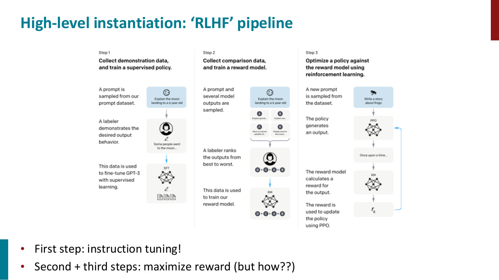
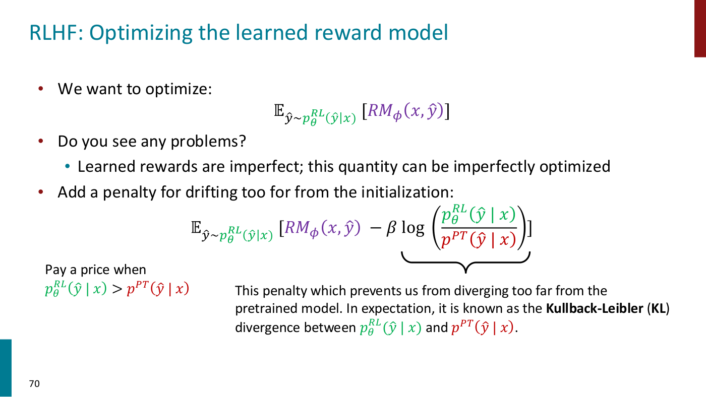
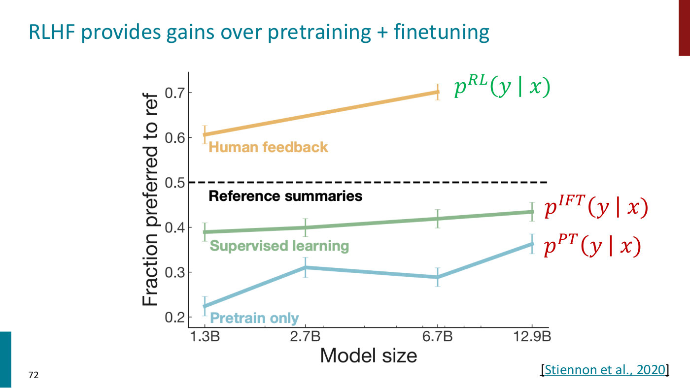
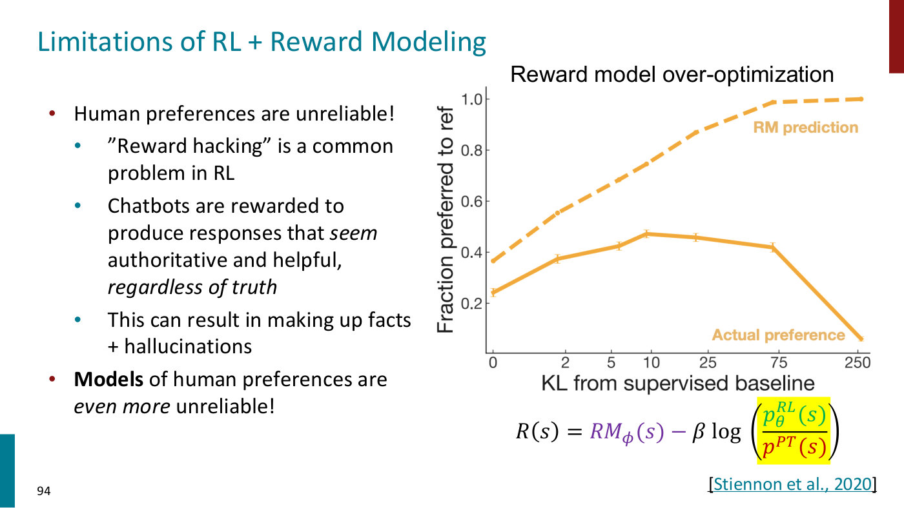

# RL from human feedback (RLHF)

RL from human feedback fine-tunes a language model to produce outputs people prefer. People compare
the model's outputs, a reward model is fitted to those comparisons, and the language model is then
optimized with RL to maximize that learned reward, with a penalty for drifting from where it started.
Lecture 8 introduces it as one use of [learning rewards from preferences](preference-learning.md)
(slides 28–29). Lecture 9, a guest lecture by Archit Sharma, teaches it in depth (slides 57–72,
≈11:34–35:39), together with its limitations and the alternative,
[direct preference optimization](direct-preference-optimization.md). Citations are to Lecture 9 unless
they say otherwise.

## Why optimize preferences

[Instruction finetuning](instruction-finetuning.md) trains on fixed target answers, which are expensive,
do not exist for creative tasks, treat every mistake alike, and are limited by the humans who write them
(slide 56). The alternative is to optimize human preferences directly. Take summarization: for an
instruction $x$ and a sample $y$ from the language model $p_\theta$, suppose a person could give a reward
$R(x, y) \in \mathbb{R}$, say 8.0 for an accurate summary of an earthquake report and 1.2 for one about
the Bay Area's weather (slide 60, ≈12:21–13:52). The goal is then the standard RL objective:

$$\mathbb{E}_ {\hat{y} \sim p_\theta(y \mid x)}[R(x, \hat{y})]$$

## The pipeline

The rough pipeline, from the InstructGPT paper (Lecture 9, slide 61, ≈13:52–14:39; Lecture 8,
slide 29):

1. **Instruction finetuning (SFT).** Labelers write demonstrations, and the pretrained model is
   finetuned on them with supervised learning, which gets the format right.
2. **Reward model.** Labelers rank several model outputs for each prompt, and a reward model is trained
   on the rankings.
3. **RL.** The policy generates outputs for new prompts, the reward model scores them, and the reward
   updates the policy with [PPO](ppo.md).

*Lecture 9, slide 61 — InstructGPT's three steps: demonstrations, ranked comparisons that train a reward model, and PPO against that reward model. [Deck](https://cs224r.stanford.edu/spring_2025/slides/09_cs224r-2025-rlhf.pdf)*

## The reward model

Asking people for a score on every sample is not workable. Training a large model needs millions of
queries, so the human preferences are modelled as a separate problem: train a reward model
$RM_\phi(x, y)$, with parameters $\phi$, on an annotated dataset, then optimize for it (slide 65,
≈20:49–21:38). The annotations should be **comparisons, not scores**. People's scores are noisy and
miscalibrated: a 7 means different things to different people, and the same person may score the same
summary differently depending on what they ate for lunch (slide 66, ≈22:23). Pairwise comparisons
"can be more reliable" (slide 67). The data is a set $D$ of triples $(x, y^w, y^l)$, a prompt with a
winning and a losing output, and the reward model is fitted with the **Bradley-Terry** paired
comparison objective (slide 67, ≈23:08–23:56):

$$J_{RM}(\phi) = -\mathbb{E}_ {(x, y^w, y^l) \sim D}\left[\log \sigma(RM_\phi(x, y^w) - RM_\phi(x, y^l))\right]$$

where $\sigma$ is the sigmoid, read as the probability that $y^w$ beats $y^l$ (≈25:29). Only the
difference of rewards matters, so the rewards' scale is not fixed and is normalized after the fact
across prompts (≈24:42), an observation [DPO](direct-preference-optimization.md) builds on. Lecture 8
writes the same objective over trajectories, to be maximized, and adds a batched algorithm over ranked
outputs; ranking $N$ outputs gives $\binom{N}{2}$ pairs, and the Plackett-Luce family generalizes
Bradley-Terry to whole rankings (Lecture 9, ≈56:40). See
[learning rewards from preferences](preference-learning.md).

How good are these reward models? Preference prediction is binary classification, where 90 or 95%
accuracy is common, but reward models for language models reach about 65 to 70%, barely better than
chance, and that is still enough for large improvements (≈33:19). Human preferences can even be
intransitive (≈32:31).

## The RL step, and why it is RL

With an instruction-tuned model $p^{PT}(y \mid x)$ and a reward model $RM_\phi$, RLHF copies the model
into $p^{RL}_ \theta(y \mid x)$ and maximizes (slide 69, ≈25:29–26:16)

$$\mathbb{E}_ {\hat{y} \sim p^{RL}_ \theta(\hat{y} \mid x)}[RM_\phi(x, \hat{y})]$$

The gradient comes from the [policy gradient](policy-gradients.md): the log-derivative trick turns the
gradient of the expectation into an expectation of $R \thinspace \nabla_\theta \log p_\theta$, estimated
from samples, so the update raises the probability of high-reward samples and lowers that of low-reward
ones (slides 63–64, ≈16:12–20:04). It needs only the gradient of the model's log probabilities, not of
the reward (≈34:07).

Why RL, when a reward model is a differentiable network? Because the model's outputs are **discrete
tokens**, sampled, and gradients cannot pass from the reward model back through the sampling to the
language model (≈27:02). If the outputs were continuous, backpropagation would do, and avoiding RL is
often very good, because RL's sampling is expensive (≈27:48). Relaxations such as the Gumbel-softmax
have not scaled to sentences of thousands of tokens over vocabularies of hundreds of thousands
(≈28:34–29:21). Sharma's lesson: never assume you need RL.

## The KL penalty

Learned rewards are imperfect, accurate only on the distribution of preferences they were trained on,
and naive optimization produces models that hack them (slide 70, ≈29:21–30:58). So the reward is
penalized for drifting from the starting model:

$$\mathbb{E}_ {\hat{y} \sim p^{RL}_ \theta(\hat{y} \mid x)}\left[RM_\phi(x, \hat{y}) - \beta \log \left(\frac{p^{RL}_ \theta(\hat{y} \mid x)}{p^{PT}(\hat{y} \mid x)}\right)\right]$$

In expectation the penalty is the Kullback-Leibler (KL) divergence between the optimized and the
starting model, which is never negative (slide 70, ≈34:54), and $\beta$ sets how much divergence is
allowed (≈48:55). This KL-constrained objective is the one DPO solves in closed form. PPO's KL-penalty
variant, in [Lecture 5](ppo.md#two-ways-to-stay-close), keeps a policy close to its previous version in
the same way.

*Lecture 9, slide 70 — the RLHF objective with its KL penalty, which keeps the model from diverging too far from the pretrained model. [Deck](https://cs224r.stanford.edu/spring_2025/slides/09_cs224r-2025-rlhf.pdf)*

## What it achieves

On summarization, RLHF was the first method whose summaries people preferred to the human-written
reference summaries, even at small model sizes: about 0.61 of the time at 1.3B parameters and 0.70 at
6.7B, against about 0.39–0.43 for supervised finetuning and 0.22–0.36 for pretraining alone (slide 72,
Stiennon et al., 2020, ≈31:45–32:31). InstructGPT scaled RLHF to tens of thousands of tasks, and
ChatGPT applied it to dialogue (slides 80–85). Preference training changes the style of answers:
longer, more detailed and better formatted, emergent properties of what the model discovered people
like (slide 88, ≈54:20–55:06).

*Lecture 9, slide 72 — fraction of summaries preferred to the reference against model size: only RLHF rises above the reference line. [Deck](https://cs224r.stanford.edu/spring_2025/slides/09_cs224r-2025-rlhf.pdf)*

## Costs and limitations

**Complexity and cost.** At the scale of a 100-billion-parameter model RLHF is expensive: every answer
is sampled and scored, and the RL algorithm needs value functions and more. "Online sampling is slow",
and "Performance can be sensitive to hyperparameters" (slide 74, ≈35:39–36:25). DPO removes this RL
loop, but RLHF keeps one advantage: its reward model can generalize to grade generations that were not
in the preference data (≈48:09).

**Reward hacking and over-optimization.** Models trained against a learned reward model align with
human preferences up to a point, then drift from what we want as training continues; training has to be
stopped at some point, which limits how far RL can be scaled (slides 92 and 94, ≈59:48–1:00:35). Slide
94's chart shows it: as KL from the supervised baseline grows, the reward model's predicted preference
rises toward 1.0, while actual human preference peaks near 0.47 and then collapses.

*Lecture 9, slide 94 — reward-model over-optimization: predicted preference keeps rising with KL while actual preference peaks and falls. [Deck](https://cs224r.stanford.edu/spring_2025/slides/09_cs224r-2025-rlhf.pdf)*

**Feedback that rewards the wrong thing.** Chatbots can be rewarded for seeming authoritative and
helpful regardless of truth, which can produce hallucinations (slide 93). Short-term preferences can
conflict with long-term interests (≈55:06), and a model update made GPT-4o sycophantic, endorsing good
and bad ideas alike (slide 95, ≈58:14–59:48).

**Data.** Preference data is still expensive, and not necessarily representative of the behaviors we
want. Directions include AI feedback (slide 97, and Lecture 8's
[RLAIF](preference-learning.md#ai-feedback)), finetuning models on their own outputs (slide 98),
verifiable rewards for reasoning, and personalization (slide 99, ≈1:01:21–1:02:08).

## Where this appears

- [Lecture 9 — RL for LLMs](09-rl-for-llms.md#optimizing-for-human-preferences): the whole method,
  the questions on it, and its limitations.
- [Lecture 8 — Reward Learning](08-reward-learning.md#rewards-for-language-models): the omelette
  example and the three-stage pipeline.
- [Learning rewards from preferences](preference-learning.md): the preference objective in general.
- [Direct preference optimization](direct-preference-optimization.md): the same objective without the
  RL loop.
- [Policy gradients](policy-gradients.md) and [PPO](ppo.md): the RL algorithms used in the third step.
- [Instruction finetuning](instruction-finetuning.md): the first step.
