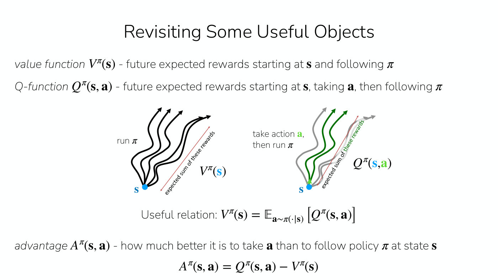
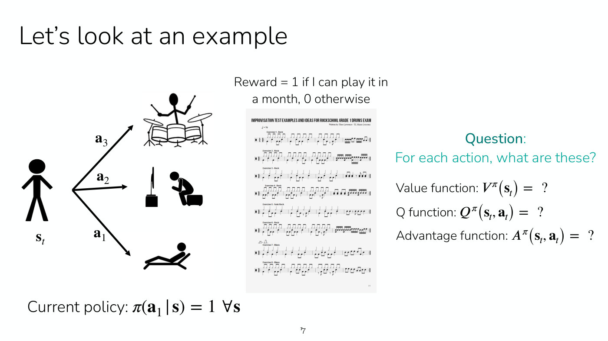

# Value functions

Improving a policy requires knowing how good it is, and value functions are how CS224R measures
that (Lecture 1, slide 40, ≈47:47–48:32). Lecture 1 introduces the value function and the
Q-function. Lecture 4 adds the advantage, the relations between the three, and how to estimate them,
because [actor-critic methods](actor-critic.md) are built on them. Symbols are as on
[MDPs and RL notation](mdp-and-notation.md); $\pi$ is a [policy](policies.md).

## The value function $V^\pi$

$V^\pi(\mathbf{s})$ is the future expected reward from starting at state $\mathbf{s}$ and
following the policy $\pi$ from then onward. It is the [RL objective](rl-objective.md), the
expected sum of rewards, but started at $\mathbf{s}$ rather than at a state drawn from the
initial state distribution (Lecture 1, ≈48:32). Lecture 4 writes it out as a sum, from the current
time step $t$ to the horizon $T$, of expected rewards over the states and actions the policy
visits, conditioned on starting at $\mathbf{s}_ t$ (≈4:41–5:28; the form is printed on Lecture 4,
slide 31):

$$V^\pi(\mathbf{s}_ t) = \sum_{t'=t}^{T} \mathbb{E}_ {\pi_\theta} \left[ r(\mathbf{s}_ {t'}, \mathbf{a}_ {t'}) \mid \mathbf{s}_ t \right]$$

Intuitively, collect many trajectories from that state with the policy, sum the rewards from that
step to the end of each, and average: that is how good the state is for the policy (Lecture 4,
≈6:13). In chess, for example, the value function is the probability of winning, for a given player
and a given game state (Lecture 4, ≈14:41–15:27).

## The Q-function $Q^\pi$

$Q^\pi(\mathbf{s}, \mathbf{a})$ is the future expected reward from starting at $\mathbf{s}$,
taking the action $\mathbf{a}$, and then following $\pi$. The first action $\mathbf{a}$ may differ
from what $\pi$ would have chosen in $\mathbf{s}$, which is what makes the Q-function useful for
comparing actions (Lecture 1, ≈49:20). It can also lead to different next states, since the
environment can be stochastic (Lecture 4, ≈7:00–7:47).

## The advantage $A^\pi$

The **advantage** is how much better it is to take $\mathbf{a}$ than to follow the policy at
$\mathbf{s}$ (Lecture 4, slide 6, ≈8:33–9:19):

$$A^\pi(\mathbf{s}, \mathbf{a}) = Q^\pi(\mathbf{s}, \mathbf{a}) - V^\pi(\mathbf{s})$$

It is the weight an actor-critic policy gradient puts on each action: positive for actions better
than the policy's usual behavior, negative for worse ones.

## How the three relate

The value of a state is the average of its Q-values over the actions the policy would take (Lecture
4, slide 6, ≈8:33):

$$V^\pi(\mathbf{s}) = \mathbb{E}_ {\mathbf{a} \sim \pi(\cdot \mid \mathbf{s})} \left[ Q^\pi(\mathbf{s}, \mathbf{a}) \right]$$

In $Q^\pi$ the first action is given as input and all later actions come from $\pi$. In $V^\pi$ the
first action comes from $\pi$ as well, so feeding a policy-sampled action into $Q^\pi$ gives
$V^\pi$ (Lecture 4, ≈10:05–11:37).

The Q-value is also the current reward plus the value of wherever the dynamics $p$ lead next, and
replacing that expectation with the one next state actually observed gives an approximation
(Lecture 4, slide 14, ≈28:34–31:43):

$$Q^\pi(\mathbf{s}_ t, \mathbf{a}_ t) = r(\mathbf{s}_ t, \mathbf{a}_ t) + \mathbb{E}_ {\mathbf{s}_ {t+1} \sim p(\cdot \mid \mathbf{s}_ t, \mathbf{a}_ t)} \left[ V^\pi(\mathbf{s}_ {t+1}) \right] \approx r(\mathbf{s}_ t, \mathbf{a}_ t) + V^\pi(\mathbf{s}_ {t+1})$$

So the advantage can be approximated from $V^\pi$ alone,
$A^\pi(\mathbf{s}_ t, \mathbf{a}_ t) \approx r(\mathbf{s}_ t, \mathbf{a}_ t) + V^\pi(\mathbf{s}_ {t+1}) - V^\pi(\mathbf{s}_ t)$.
This is why actor-critic methods learn only a value function. How to learn it, by Monte Carlo
estimation, bootstrapping or n-step returns, is on [policy evaluation](policy-evaluation.md).

Lecture 5 takes the relation one step further, writing the Q-value in terms of the next Q-value
(slide 17, ≈53:18–57:10). Split the first reward off the sum in the definition; the remaining
rewards, in expectation over the next state from the dynamics and the next action from the policy,
are the next Q-value:

$$Q^{\pi_\theta}(\mathbf{s}, \mathbf{a}) = r(\mathbf{s}, \mathbf{a}) + \gamma \mathbb{E}_ {\mathbf{s}' \sim p(\cdot \mid \mathbf{s}, \mathbf{a}), \bar{\mathbf{a}}' \sim \pi_\theta(\cdot \mid \mathbf{s}')} \left[ Q^{\pi_\theta}(\mathbf{s}', \bar{\mathbf{a}}') \right]$$

Here $\gamma$ is the discount factor, $\mathbf{s}'$ the next state and $\bar{\mathbf{a}}'$ the
action the policy takes there. It holds for any state and action, whichever policy chose the
action, which is what lets a Q-function for the current policy be fitted from a replay buffer of
other policies' data; see [replay buffers and soft actor-critic](replay-buffers.md). Lecture 6
names it the **Bellman equation**, and adds its counterpart for the optimal policy, the **Bellman
optimality equation**, in which the expectation over the next action becomes a max (slide 12,
≈21:50–27:15); see [Bellman equations](bellman-equations.md).

**Why a policy comes out of Q and not out of V.** Given $Q^\pi$, the policy that takes the action
with the highest Q-value is at least as good as $\pi$ (Lecture 6, slide 8, ≈12:32–13:18). Given
only $V(\mathbf{s})$, nothing says which action leads to a higher value; you would have to predict
the next state each action leads to, which needs the dynamics, and those are unknown (Lecture 6,
≈23:24–24:56). See [Q-learning](q-learning.md).

*Lecture 4, slide 6 — the value function averages the rewards of trajectories that run the policy from s; the Q-function first takes the action a (green) and then runs the policy. [Deck](https://cs224r.stanford.edu/spring_2025/slides/04_cs224r_actor_critic_2025.pdf)*

## Worked examples

Lecture 4 makes the three concrete with an exercise (slide 7, ≈11:37–15:27). The reward is 1 if you
can play a drum piece in a month and 0 otherwise. The actions are to sit on the beach, watch TV, or
practice the drums. The policy always sits on the beach, and you cannot yet play. Then
$V^\pi = 0$, because that policy never learns. $Q^\pi$ is 0 for the beach and for TV, and up to 1
for practicing, if one time step of practice is enough. It is lower if the practice is too short
before the policy goes back to the beach. Strictly, it is the probability of being able to play
after practicing. The advantage is positive for practicing and zero for the other two actions.

*Lecture 4, slide 7 — the drum example: three actions (beach, TV, practicing) from the current state, a reward for playing the piece in a month, and a policy that always picks the beach. [Deck](https://cs224r.stanford.edu/spring_2025/slides/04_cs224r_actor_critic_2025.pdf)*

Lecture 5 adds Go (≈3:11–4:43). If the reward is whether AlphaGo won or lost, the value function
is the expected outcome given the board state and the policy being run. A better policy has a
higher value, and so does a board state where things look good for that policy, so the value
depends on both. A Q-function considers a particular move first and then runs the policy.

## Where they are used

Two of the [algorithm families](rl-algorithm-families.md) are defined by value functions (Lecture
1, slide 41). Actor-critic methods estimate the value of the current policy and use it to improve
the policy; see [actor-critic methods](actor-critic.md). Value-based methods estimate the value of
the optimal policy and back a good policy out of it; Lecture 6's [Q-learning](q-learning.md) does
this by fitting a Q-function to the Bellman optimality equation and acting greedily on it (see
[Bellman equations](bellman-equations.md)). Lecture 1 only introduces the two functions,
without equations beyond the definitions; Q-functions are used from the week after it (Lecture 1,
≈49:20).

### Offline: the behavior policy's advantage

Lecture 7 uses the advantage to weight imitation on offline data, and stresses that an advantage
belongs to a policy: it is the advantage of taking $\mathbf{a}$ in $\mathbf{s}$ and then following some
policy (≈39:34). Its methods use the behavior policy's, $A^{\pi_\beta}$, the policy that collected the
data (slide 17). Advantage-weighted regression estimates it as the empirical return minus a Monte Carlo
value estimate (slide 18). Advantage-weighted actor-critic bootstraps a Q-function with next actions
from the data (slide 20). Implicit Q-learning fits the value function with an expectile loss, so that
$\hat{Q} - \hat{V}$ measures actions against a policy better than the behavior policy (slides 21–23).
See [implicit policy constraint methods](implicit-policy-constraints.md).

### Language: the value of a solution prefix

Lecture 10 applies both functions to a language model writing a math solution step by step. The
state is the problem plus the steps written so far, the action is the next step, and the reward is
1 only if the final answer is right. The Q-value of a step under a rollout policy $\tilde{\pi}$ is
the chance that $\tilde{\pi}$, continuing from there, reaches a correct answer, estimated by rolling
it out many times (Lecture 10, slides 15–16, ≈33:06–36:55). With the discount factor set to 1 and
the only reward at the end, the definition's expected sum of rewards collapses to that one
expectation (≈37:42–38:27). Because each state is the previous state with a step appended, the value
of the state before a step is the Q-value of the step before it, so the advantage becomes a
difference of consecutive Q-values (slide 17, ≈40:47). See [process rewards and per-step
credit](process-rewards.md).

## Where this appears

- [Lecture 1 — Class Intro](01-class-intro.md#how-good-is-a-policy-value-and-q-functions): the
  definitions of $V^\pi$ and $Q^\pi$.
- [Lecture 4 — Actor-Critic Methods](04-actor-critic.md#value-q-and-advantage-functions): the
  advantage, the relations between the three, the drum example, and why only $V^\pi$ is fitted.
- [Lecture 5 — Off-Policy Actor Critic](05-off-policy-actor-critic.md#fitting-a-q-function-with-data-from-past-policies):
  the Go example, the recursive form of $Q^\pi$, and why a Q-function rather than $V^\pi$ is fitted
  from a replay buffer.
- [Lecture 6 — Q-Learning](06-q-learning.md#why-it-works-the-bellman-optimality-equation): the
  greedy policy a Q-function defines, the Bellman optimality equation, and why Q rather than V.
- [Lecture 7 — Offline RL](07-offline-rl.md#weighting-imitation-by-the-advantage): the advantage of
  the behavior policy, estimated by Monte Carlo, by bootstrapping on data actions, and with an
  expectile-fitted value function.
- [Lecture 10 — RL for LLM Reasoning](10-rl-for-reasoning.md#the-q-value-of-a-step): the Q-value
  and advantage of each step of a solution, under a rollout policy.
